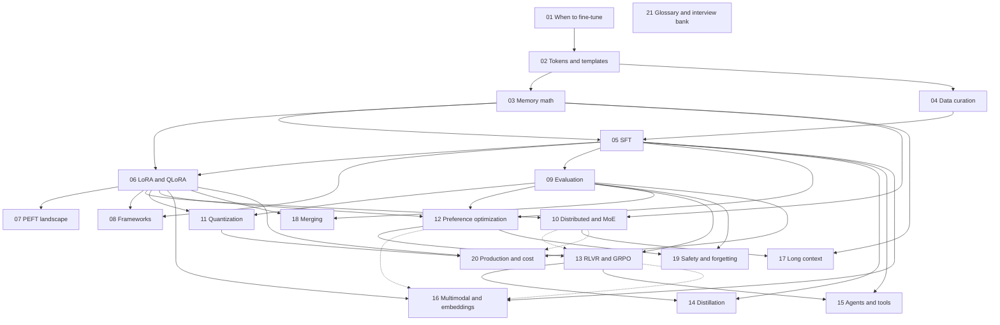

# LLM Fine-Tuning Deep Dive — A 2026 Course

A sequential, derive-it-yourself course on adapting pretrained language models, from "why not
just prompt it?" through supervised fine-tuning, LoRA and its relatives, preference
optimisation, and RL with verifiable rewards, to the data, evaluation and serving choices behind
production 2026 models.

## Who this is for

- You can program in Python and have trained a small neural network in PyTorch.
- You know what a transformer block is at the level of the
  [Transformers course](../transformers/00-README.md); module 02 recaps the parts a fine-tuner
  touches, and [its module 13](../transformers/13-training-considerations.md) covers the
  training mechanics this course extends.
- You do **not** need prior RL. Module 13 builds policy gradients for LLMs from scratch and
  links the [deep RL note](../../notes/deep-learning/deep-rl.md) for the classical derivation.
- The [transfer learning](../../notes/deep-learning/transfer-learning-and-finetuning.md),
  [prompting and alignment](../../notes/nlp/llm-prompting-and-alignment.md) and
  [Hugging Face](../../notes/libraries/huggingface.md) notes are the recaps this course goes beneath.
- Image and video diffusion fine-tuning (DreamBooth, FLUX/SDXL LoRA) is out of scope; the LoRA
  math in module 06 transfers, the data and loss do not.

Three reader paths:

- **The practitioner shipping a task model.** Read 01–09 in order, then 11 (quantize for export)
  and 20 (serve it and cost it).
- **The post-training engineer.** Read everything; 12–15 (preference optimisation, RLVR,
  distillation, agents) are your core.
- **The interview candidate.** Read [module 21](./21-glossary-cheatsheet-and-interview-bank.md)
  first, then the module each question points back to.

## Module map

```text
CORE RECIPE          01  When to Fine-Tune: What It Is, and When Not to Do It
                     02  Tokens, Chat Templates, and the Causal-LM Objective
                     03  Training Mechanics: Optimizers, Schedules, and Memory Math
                     04  Data Curation and Synthesis: Formats, Dedup, Decontamination, and Synthesis
                     05  Supervised Fine-Tuning and Continued Pretraining
                     06  LoRA and QLoRA in Depth
                     07  Beyond LoRA: The PEFT Landscape and Memory-Efficient Full Tuning
                     08  Frameworks: TRL, Unsloth, Axolotl, LLaMA-Factory, and Training Services
                     09  Evaluating Fine-Tuned Models

SCALE AND PRECISION  10  Scaling Out: Distributed Fine-Tuning, Parallelism, and MoE
                     11  Quantization Across the Lifecycle: QLoRA, QAT, FP8, and Export

POST-TRAINING        12  Preference Optimization: Reward Models, RLHF, DPO and Its Family
                     13  RL with Verifiable Rewards: GRPO and Its Successors
                     14  Distillation and Reasoning Fine-Tuning
                     15  Agentic and Tool-Use Fine-Tuning
                     16  Multimodal Fine-Tuning: Vision-Language, Audio, and Embedding Models
                     17  Long-Context Extension and Long-Sequence Training

SHIP AND SYNTHESISE  18  Model Merging and Adapter Composition
                     19  Safety, Forgetting, and Responsible Fine-Tuning
                     20  Production: Serving Adapters, MLOps, and Cost Planning
                     21  Glossary, Cheat Sheet & Interview Bank
```

Every silent bug lives in 02; 03 tells you whether a run fits; 06 is how most people fine-tune;
13 is the 2025–26 centre of gravity.

### Modules

| # | Module | You will learn | Lab (full-mode tier) |
|---|---|---|---|
| 01 | [When to Fine-Tune: What It Is, and When Not to Do It](./01-when-to-fine-tune.md) | when prompting or RAG beats tuning; the post-training vocabulary; how open model reports stage post-training | running-example data (CPU); prompting baseline (T0) |
| 02 | [Tokens, Chat Templates, and the Causal-LM Objective](./02-tokens-templates-and-the-causal-lm-objective.md) | which tokens a step trains on: special tokens, templates, label shift, `-100` masks, padding side | read a masked, templated batch (CPU, T0 extension) |
| 03 | [Training Mechanics: Optimizers, Schedules, and Memory Math](./03-training-mechanics-and-memory-math.md) | bytes per parameter, activation and logits memory, effective batch, optimizers, schedules, curves | memory calculator (CPU); throughput and LR sweep (T1) |
| 04 | [Data Curation and Synthesis: Formats, Dedup, Decontamination, and Synthesis](./04-data-curation-and-synthesis.md) | schemas for SFT, preference, RL and tool data; dedup, decontamination, synthetic generation and filtering | clean SFT set (CPU); Magpie (T1 or API); rejection sampling (T1) |
| 05 | [Supervised Fine-Tuning and Continued Pretraining](./05-supervised-fine-tuning.md) | `SFTTrainer` end to end: masking, packing, base vs instruct starts, reasoning SFT, CPT | base to instruct, reasoning SFT (T0); task SFT (T1); CPT (T1/T2) |
| 06 | [LoRA and QLoRA in Depth](./06-lora-and-qlora.md) | LoRA math and knobs, when it matches full FT, NF4 internals, init variants, merge lifecycle | LoRA from scratch (CPU, T0); ablation grid (T1); vs full FT (T2) |
| 07 | [Beyond LoRA: The PEFT Landscape and Memory-Efficient Full Tuning](./07-the-wider-peft-landscape.md) | DoRA, IA3, soft prompts, OFT, newer variants, GaLore and Spectrum, how to choose | PEFT bake-off (T1); GaLore or Spectrum (T2) |
| 08 | [Frameworks: TRL, Unsloth, Axolotl, LLaMA-Factory, and Training Services](./08-frameworks-and-tooling.md) | what each stack adds, the 2025–26 API changes, how to pick | one recipe, three tools (T0 or T1); CLI job and Hub push (T1 or HF Jobs) |
| 09 | [Evaluating Fine-Tuned Models](./09-evaluating-fine-tuned-models.md) | eval-first workflow, harnesses, LLM-as-judge bias controls, pass@k, sound comparisons | benchmarks with CIs, calibrated judge (T1); Inspect task (T0) |
| 10 | [Scaling Out: Distributed Fine-Tuning, Parallelism, and MoE](./10-distributed-fine-tuning-and-moe.md) | what DDP, ZeRO, FSDP2, TP, CP, PP and EP shard; Accelerate configs; MoE fine-tuning | FSDP2 vs ZeRO-3, QLoRA across GPUs (T3); MoE LoRA (T2/T3) |
| 11 | [Quantization Across the Lifecycle: QLoRA, QAT, FP8, and Export](./11-quantization-qat-and-fp8.md) | quantizing to fit, training for low precision, exporting with PTQ and GGUF | merge then GPTQ/GGUF (T1); QAT (T1/T2); FP8 SFT (T2) |
| 12 | [Preference Optimization: Reward Models, RLHF, DPO and Its Family](./12-preference-optimization.md) | the KL-regularised objective, reward models, DPO derivation and gradient, the offline zoo, KTO | SFT to DPO, loss ablation, RM (T1); KTO (T0) |
| 13 | [RL with Verifiable Rewards: GRPO and Its Successors](./13-rl-with-verifiable-rewards.md) | policy gradients for LLMs, GRPO, Dr. GRPO, DAPO, GSPO, CISPO, SAPO, IS correction, reward hacking | Unsloth GRPO (T0) up to server-mode code RL (T3) |
| 14 | [Distillation and Reasoning Fine-Tuning](./14-distillation-and-reasoning.md) | off-policy, logit and on-policy distillation, forward vs reverse KL, thinking-length control | off-policy SFT (T1); on-policy distillation (T2); budget forcing (T0) |
| 15 | [Agentic and Tool-Use Fine-Tuning](./15-agentic-and-tool-use-fine-tuning.md) | tool-call formats and data, trajectory masks, multi-turn RL with environments, agent security | function-calling SFT (T0/T1); environment GRPO (T1/T2); coding-agent RL (T2/T3) |
| 16 | [Multimodal Fine-Tuning: Vision-Language, Audio, and Embedding Models](./16-multimodal-and-embedding-fine-tuning.md) | what to train in a VLM, VLM DPO and GRPO, audio, contrastive embedding and reranker training | receipts VLM SFT (T0/T1); VLM GRPO (T1/T2); embeddings (T0) |
| 17 | [Long-Context Extension and Long-Sequence Training](./17-long-context-extension.md) | why RoPE fails past its window; PI, NTK, YaRN, LongRoPE; long-sequence memory and CP | YaRN plus LoRA (T1); 128k SFT (T3) |
| 18 | [Model Merging and Adapter Composition](./18-model-merging-and-composition.md) | why merging works on a shared base, soups to TIES and DARE, PEFT adapter combination, mergekit | merge math and code LoRAs (CPU merge; T0/T1 eval) |
| 19 | [Safety, Forgetting, and Responsible Fine-Tuning](./19-safety-forgetting-and-responsible-fine-tuning.md) | how tuning erodes safety and causes forgetting, measuring both, guards, documentation | safety regression, custom guard, forgetting study (T1) |
| 20 | [Production: Serving Adapters, MLOps, and Cost Planning](./20-production-serving-and-cost.md) | merged vs multi-LoRA serving, the train-to-serve checklist, the MLOps loop, cost models | three adapters on vLLM (T1); GGUF parity (T0 or CPU); cost model (CPU); capstone (T1–T3) |
| 21 | [Glossary, Cheat Sheet & Interview Bank](./21-glossary-cheatsheet-and-interview-bank.md) | decision tables, formulas, a debugging table, the glossary, numbers, 67 interview questions with answers | none |

### Dependency graph



Dotted edges are needed only for the scale-out or alignment sections of the target module.
Module 21 has no prerequisites: it is a standalone reference to 01–20.

## How to read this course

1. **Do not skip 02 and 03.** Template, masking and memory mistakes cause most failed runs;
   every later module assumes you can read a masked, templated example and predict whether a run
   fits.
2. **Run the checks and the smoke labs.** Every content module (01–20) has `finetuning-check`
   fences (CPU, seconds) and at least one lab script with a `--smoke` CPU mode; the full labs
   state their GPU tier.
3. **Evaluate before you train.** Labs report against module 01's eval set (see below). Read
   [09](./09-evaluating-fine-tuned-models.md) early if you are impatient.
4. **Answer the self-check questions** before moving on;
   [module 21](./21-glossary-cheatsheet-and-interview-bank.md) holds model answers.

## Conventions used throughout

### Versions and what the prose targets

TRL reached v1.0 on 31 March 2026 with semantic versioning for its stable core
([TRL v1 blog](https://huggingface.co/blog/trl-v1)); the course teaches the stable trainers
(SFT, DPO, Reward, RLOO, GRPO, KTO, Distillation) and flags the ones in `trl.experimental`.
[Transformers v5](https://huggingface.co/blog/transformers-v5) is PyTorch-only, and
[PEFT 0.18](https://github.com/huggingface/peft/releases/tag/v0.18.0) is the minimum PEFT release
that works with it. Two tools common in older tutorials are not used: torchtune (no longer
actively maintained) and TRL's `PPOTrainer` (removed in
[TRL v1.13.0](https://github.com/huggingface/trl/releases/tag/v1.13.0); module 12 teaches PPO
conceptually).

| Layer | Version | Used for |
|---|---|---|
| Python | 3.11 | executable checks and smoke labs |
| PyTorch | 2.8.0 (CPU wheel) | executable checks and smoke labs |
| transformers | 4.57.1 | pinned in the CI environment; checks do not import it |
| Transformers (prose) | v5.x | APIs taught in the prose (PyTorch-only, `dtype=`, `AttentionInterface`, `transformers serve`) |
| TRL (prose) | v1.x ([v1.15.0](https://github.com/huggingface/trl/releases/tag/v1.15.0) as of October 2026) | trainer APIs and defaults |
| PEFT (prose) | 0.18+ ([0.21.2](https://github.com/huggingface/peft/releases/tag/v0.21.2) current) | adapter APIs; 0.18 is the minimum for Transformers v5 |
| Accelerate (prose) | FSDP2 path (`fsdp_version=2`) | distributed configs |

**The checks import only torch, numpy and the standard library in the pinned CPU environment;
the prose teaches the October 2026 APIs and names the release behind every quoted default.**

### Running the checks and labs

```bash
python -m venv .venv-finetuning
.venv-finetuning/bin/python -m pip install torch==2.8.0 numpy
.venv-finetuning/bin/python site/test_finetuning_corrections.py
.venv-finetuning/bin/python content/courses/finetuning/code/lora_from_scratch.py --smoke
```

Run these from the repository root. Fences marked `finetuning-check` are independent CPU
programs with asserts, run with networking refused, that assert the numbers in the surrounding
prose; other code blocks are teaching fragments. Lab scripts in `code/`, such as
[lora_from_scratch.py](./code/lora_from_scratch.py), have a `--smoke` mode (CPU, no downloads,
asserts its own result) and a `--full` mode (real models, GPU tier in the module's Lab section).

### Hardware tiers

| Tier | Typical hardware | Lab design notes |
|---|---|---|
| CPU | any laptop | every `--smoke` mode and every `finetuning-check` |
| T0 | free Colab/Kaggle T4 16 GB | fp16 only (no bf16), no FlashAttention-2, compute capability 7.5; QLoRA up to ~8B with Unsloth |
| T1 | single 24 GB GPU (RTX 3090/4090, L4, A10G) | bf16 on Ampere+; LoRA 16-bit up to ~8B; QLoRA up to ~32B (tight) |
| T2 | single 80 GB GPU (A100/H100) | full FT of 1-3B; LoRA 14-32B; GRPO with colocated vLLM on 4-8B; FP8 training needs H100 or newer |
| T3 | multi-GPU node (2-8x A100/H100) or multi-node | FSDP2/ZeRO-3, vLLM server mode for RL, context parallelism, expert parallelism |

Why T0 is fp16-only and what that costs: a T4 lacks bf16, and fp16 overflows at 65,504, while
bf16 keeps fp32's range with fewer mantissa bits (epsilon $2^{-7}$ vs $2^{-10}$). An 8B model's
weights take $8\times10^9 \times 2 / 10^9 = 16$ GB in bf16, a full T4, but about 4.13 GB in NF4
with double quantization at 4.127 bits/param for the quantized linear weights; embeddings and
norms stay 16-bit, so the real footprint is somewhat higher ([module 06](./06-lora-and-qlora.md)).
The check below proves both, but not that a given GPU kernel supports a dtype.

```python finetuning-check
import torch

f16, bf16 = torch.finfo(torch.float16), torch.finfo(torch.bfloat16)
# fp16 tops out at 65504; bf16 shares fp32's 8-bit exponent but has 7 mantissa bits to fp16's 10.
assert f16.max == 65504.0
assert bf16.max > 3e38
assert bf16.eps == 2 ** -7 and f16.eps == 2 ** -10
x = torch.tensor(70000.0)
assert torch.isinf(x.to(torch.float16)).item()
assert torch.isfinite(x.to(torch.bfloat16)).item()
# Weights-only memory for an 8B model, decimal GB.
bf16_gb = 8e9 * 2 / 1e9
nf4_dq_gb = 8e9 * 4.127 / 8 / 1e9
assert bf16_gb == 16.0
assert abs(nf4_dq_gb - 4.127) < 0.01
assert bf16_gb / nf4_dq_gb > 3.8
print("fp16/bf16 limits and 8B weight arithmetic verified")
```

### The running example

Where a module needs a task, it uses **support-email JSON extraction**: turn a customer email
into one JSON object with exactly five keys: `customer_name`, `order_id` (canonical
`ORD-NNNNN`), `issue_type` (`refund`, `shipping`, `defect`, `account` or `other`),
`refund_requested` (boolean) and `sentiment` (`positive`, `neutral` or `negative`). Module 01
owns the dataset contract. On CPU,
`python content/courses/finetuning/code/fit_or_not_baseline.py --data-only` writes
`ft_data/train.jsonl` (200 rows) and `ft_data/eval.jsonl` (the 50-row frozen golden eval set,
built from held-out templates), one `{"id", "email", "gold"}` object per line. Modules 04, 05, 09, 11, 13, 19 and 20 reuse these files, module 01's system prompt
and its scorer (parse rate, schema validity, per-field and all-fields exact match) unchanged.
Module 01 also sets the prompting baseline every fine-tune must beat. The default model family
is **Qwen3** (0.6B to 8B, base and instruct), because it ships both checkpoints, a documented
thinking toggle, and first-class support in TRL, Unsloth, Axolotl and vLLM.

### Symbols

| Symbol | Meaning |
|---|---|
| $N$, $D$ | model parameter count, training tokens |
| $B$, $T$ | per-device micro-batch size (sequences), sequence length in tokens |
| $V$, $d$, $d_{ff}$, $L$ | vocabulary size, model width (`hidden_size`), MLP intermediate width, layer count |
| $r$ | LoRA rank; $\alpha$ LoRA alpha; $\gamma_r$ the LoRA scale ($\alpha/r$ or $\alpha/\sqrt{r}$) |
| $W_0$, $\Delta W$, $A$, $B_{\text{lora}}$ | frozen weight, update, LoRA down/up matrices (write $B$ for LoRA up-projection only where batch size is not in play, and say so) |
| $\pi_\theta$, $\pi_{\text{ref}}$ | policy being trained, frozen reference policy |
| $\beta$ | KL / DPO temperature coefficient |
| $y_w$, $y_l$ | chosen (winning) and rejected (losing) responses |
| $G$ | GRPO group size (`num_generations`) |
| $r_i$, $\hat A_i$ | reward and advantage of completion $i$ |
| $\rho_{i,t}$ | token importance ratio $\pi_\theta/\pi_{\text{old}}$ |
| $\epsilon$, $\epsilon_{\text{high}}$ | clip range (low/high) |
| $k$, $s$ | samples in pass@k; context-extension scale factor |
| $\Psi$ | parameter count in ZeRO formulas (matches the ZeRO paper) |

### Milestones

1. After module 05: a templated, masked, packed SFT batch whose trained tokens you can list by
   hand, and an SFT run that beats the module-01 prompting baseline.
2. After module 09: an eval report with bootstrap confidence intervals, a judge with measured
   position bias, and a regression suite.
3. After module 13: a GRPO run whose reward, length, entropy and clip-ratio curves you can
   explain, with a reward-hacking audit.

Use modules 11 and 20 alongside the [inference course](/courses/inference/) for serving.

---

**Start here → [01 — When to Fine-Tune: What It Is, and When Not to Do It](./01-when-to-fine-tune.md)**
