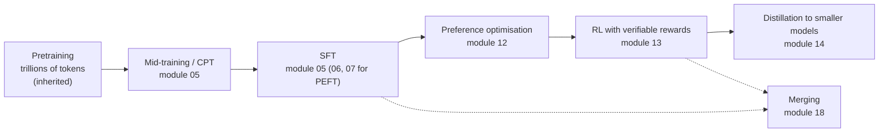
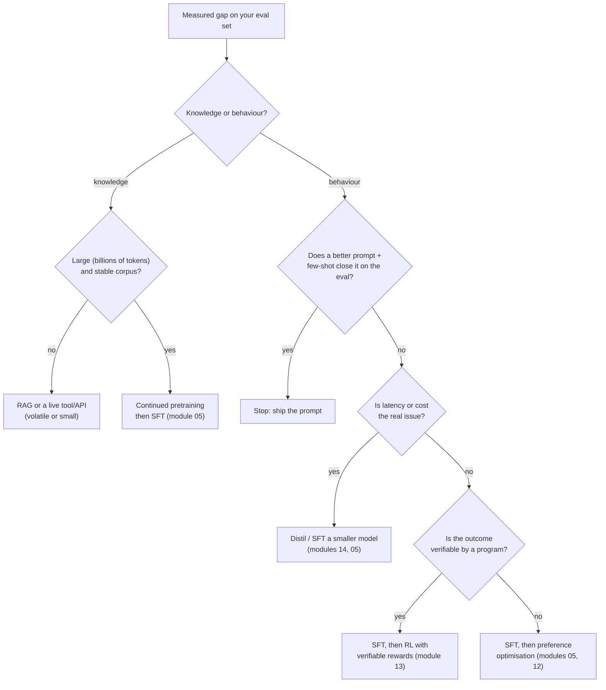

# 01 — When to Fine-Tune: What It Is, and When Not to Do It

> **Prerequisites:** none (Python and basic deep learning).
> **You will learn:** why most failed fine-tuning projects fail at the decision step, the
> post-training vocabulary, a decision framework for prompting vs RAG vs
> fine-tuning, and how open model reports structure their post-training pipelines.

Most failed fine-tuning projects do not fail in the training loop. They fail at
the decision step, weeks earlier. The team fine-tunes to inject facts that belong
in a retrieval index, or trains for three weeks to fix what a two-line system
prompt would have fixed, or ships a model whose only evaluation was "the loss went
down".

This module gives you the vocabulary every later module uses, a decision procedure
you can defend in a design review, a tour of how five open model reports actually
structure post-training, and the running task of the course: a support-email JSON
extractor, with a prompting baseline that every later module has to beat. The
[Transformers course](../transformers/13-training-considerations.md) ends where
this one starts: its section 13.7 sketches the post-training stack; this course
builds it.

---

## 1.1 The LLM lifecycle in one picture

### Pretraining, mid-training, post-training

**Pretraining** is next-token prediction on trillions of tokens of mostly web,
code and book text. It is where the model learns language, facts and most of its
capabilities. Llama 3 was pretrained on about 15T tokens
([Grattafiori et al., 2024](https://arxiv.org/abs/2407.21783)). You will almost
never do this; you inherit its result as a *base model*. The objective itself
is recapped in [Transformers module 13](../transformers/13-training-considerations.md)
and rederived for fine-tuners in [module 02](./02-tokens-templates-and-the-causal-lm-objective.md).

**Mid-training**, also called **continued pretraining (CPT)** when a downstream
team does it, keeps the same next-token objective but changes the data: a domain
corpus (legal, biomedical, a new language), long documents for context extension,
or reasoning-heavy math and code near the end of pretraining. The defining
property is that the loss covers *all* tokens of raw documents, not responses to
prompts. CPT is the right tool for stable, large-volume domain knowledge, and it
typically needs hundreds of millions to billions of domain tokens to shift knowledge
measurably ([module 05](./05-supervised-fine-tuning.md) gives the evidence).

**Post-training** turns a text continuer into something you can talk to. It has
three families of method, usually applied in this order. **Supervised fine-tuning
(SFT)** trains on prompt-response pairs with the loss masked to the response. It
teaches format, instruction following and style. **Preference optimisation**
(RLHF with a reward model, or DPO and its relatives) trains on pairs of better and
worse responses; it shapes which of several plausible answers the model prefers
([module 12](./12-preference-optimization.md)). **Reinforcement learning with
verifiable rewards (RLVR)** samples answers, checks them with a program (unit
tests, a math answer checker, a JSON schema) and reinforces the ones that pass
([module 13](./13-rl-with-verifiable-rewards.md)).

**Distillation** trains a small *student* on a large *teacher*'s outputs or
log-probabilities. Qwen3's 0.6B–14B models and DeepSeek's R1-Distill models got
their reasoning ability this way (section 1.4, [module 14](./14-distillation-and-reasoning.md)). **Merging**
combines the weights of several fine-tunes of the same base, without further
training, into one model (module 18).



Read the arrows as "usually comes after", not "must come after"; section 1.4 shows
the real shapes.

### Base, instruct, reasoning and hybrid checkpoints

Open model families now ship several checkpoints per size. **Which one you start
from is the first fine-tuning decision**, because you inherit everything it was
trained to do.

| Checkpoint | Trained to | You inherit | Typical fine-tuning use |
|---|---|---|---|
| **Base** (`Qwen/Qwen3-0.6B-Base`) | continue text | no chat template behaviour, no refusals, no stopping discipline | CPT; full control over the template and style; research |
| **Instruct** (`Qwen/Qwen3-4B-Instruct-2507`) | follow instructions in a chat template | the template, special tokens, refusal policy, verbosity | most task SFT and LoRA; fastest to a good result |
| **Reasoning / thinking** | emit a long chain of thought, then an answer | the thinking format (`<think>...</think>`), long outputs, higher latency | RL and reasoning distillation |
| **Hybrid** (`Qwen/Qwen3-0.6B`) | do either, switched per request | both behaviours plus the switch mechanism | tasks where some requests need reasoning and most do not |

The hybrid row is new since 2025. Qwen3's post-training includes a stage the
report calls **thinking mode fusion**: continued SFT on a mix of thinking and
non-thinking data under one chat template, so a single checkpoint does both
([Qwen Team, 2025, arXiv 2505.09388](https://arxiv.org/html/2505.09388v1)). At
inference you choose. In Hugging Face Transformers, the
[Qwen3-0.6B model card](https://huggingface.co/Qwen/Qwen3-0.6B/blob/c1899de289a04d12100db370d81485cdf75e47ca/README.md) documents
`apply_chat_template(..., enable_thinking=False)` as a hard switch (default
`True`), plus `/think` and `/no_think` soft switches in user or system messages that only
work while thinking is enabled. The `-2507` refresh (July–August 2025) split the line
again: the [Qwen3-4B-Instruct-2507 card](https://huggingface.co/Qwen/Qwen3-4B-Instruct-2507/blob/cdbee75f17c01a7cc42f958dc650907174af0554/README.md)
states that it "supports only non-thinking mode", and `enable_thinking=False` is no
longer required.

**Consequence for you:** if you SFT a hybrid checkpoint on data that contains only
non-thinking answers, you are retraining the switch, and the thinking mode may
degrade. Either keep a slice of thinking-mode data in the mix or start from a
single-mode checkpoint. [Module 14](./14-distillation-and-reasoning.md) owns
thinking-mode engineering; [module 02](./02-tokens-templates-and-the-causal-lm-objective.md)
owns chat templates.

### The superficial alignment hypothesis

[Zhou et al. (2023), LIMA](https://arxiv.org/abs/2305.11206) fine-tuned a 65B LLaMA
base on 1,000 carefully curated prompt-response pairs with the plain supervised
loss, no RLHF. They state the hypothesis this way: "A model's knowledge and
capabilities are learnt almost entirely during pretraining, while alignment
teaches it which subdistribution of formats should be used when interacting with
users." In their human study on 300 test prompts, LIMA's answers were equal to or
preferred over GPT-4's in 43% of comparisons and over text-davinci-003's in 65%.
In an ablation on 7B models graded by ChatGPT, a 16-fold increase in (Stack
Exchange) training data did not improve quality, while diversity and quality did.

What LIMA **does** establish: for a strong base, a small, clean, diverse SFT set
is enough to produce a capable general assistant, and data quality dominates data
quantity at that scale. That is the empirical root of [module 04](./04-data-curation-and-synthesis.md)'s
"curate before you collect" stance, and of the LIMO and s1 results for reasoning
that [module 14](./14-distillation-and-reasoning.md) covers.

What LIMA **does not** establish: it used one 65B base, a human-preference
evaluation of general chat, and a 300-prompt test set. It says nothing about
whether 1,000 examples suffice for a narrow task with a strict output contract,
for a skill the base lacks, or for the gains RL delivers on reasoning. The authors
themselves note that LIMA is "not as robust as product-grade models". **Use LIMA
to justify spending on quality, not to justify skipping evaluation.**

## 1.2 What fine-tuning is good at, and what it is bad at

### Behaviour vs knowledge

The [transfer-learning note](../../notes/deep-learning/transfer-learning-and-finetuning.md)
gives the short version in its "Fine-tune, retrieve, or prompt?" section:
fine-tuning adapts behaviour, retrieval supplies evidence.

**Fine-tuning reliably changes how a model behaves.** It is good at:

- **Format and structure**: always emit valid JSON with these five keys; always
  answer in this XML schema; stop after the answer.
- **Style and tone**: your brand voice, your legal register, terse vs chatty.
- **Task specialisation**: a narrow extraction or classification task where a small
  trained model can match a much larger prompted one.
- **Tool-call reliability**: correct function names and argument JSON every time.
- **Refusal policy**: stop refusing benign domain requests (security research,
  medication dosing for clinicians), or refuse a new class of requests.
- **Latency and cost**: distil a frontier model's behaviour on your task into a
  model you can serve at a tenth of the price.
- **Reasoning on verifiable tasks**, via RL ([module 13](./13-rl-with-verifiable-rewards.md)).

**Fine-tuning is unreliable for injecting facts.** The misconception that
"fine-tuning is how you add new knowledge" is the most common expensive one.
[Gekhman et al. (2024)](https://arxiv.org/abs/2405.05904) find that examples carrying
new facts are learned much more slowly than examples consistent with what the model
already knows, and that once learned they increase hallucination on other
questions. **Facts also change while weights do not**: a weekly price list needs a
weekly train-evaluate-deploy cycle. And **a fine-tuned model has no provenance**: it
cannot cite the document a claim came from, and access control cannot be per user.

For facts, use **retrieval** ([RAG note](../../notes/nlp/rag-and-retrieval.md)):
update the index, not the weights, and citations and per-user permissions become
possible. For *stable* domain knowledge at scale (a new language, a specialised
corpus of billions of tokens), use **continued pretraining** and then SFT
([module 05](./05-supervised-fine-tuning.md)). Fine-tuning also **cannot fix a weak
base**: if the base model cannot do the task at all with a good prompt and
examples, a few thousand SFT examples rarely create the capability from nothing.

The strongest systems combine the two. T-RAG
([Fatehkia et al., 2024](https://arxiv.org/pdf/2402.07483)), a practitioner report
on question answering over private organisational documents, pairs a fine-tuned
open model with RAG and an entity-hierarchy tree, and reports that the combination
beats both plain RAG and fine-tuning alone on their evaluation. Fine-tune for
format, domain tone and tool use; retrieve for facts.

**Table 1: problem → first thing to try → when fine-tuning wins**

| Problem | First thing to try | When fine-tuning wins |
|---|---|---|
| Wrong output format | explicit schema in the system prompt; few-shot examples; constrained decoding / structured output | the format must hold at very high reliability on a small model, or the schema is too long to repeat every request |
| Inconsistent tone | system prompt with a style guide and 3–5 exemplars | the style is hard to describe but easy to demonstrate, and you have hundreds of good examples |
| Missing proprietary facts | RAG over the documents | almost never for the facts themselves; possibly SFT to make the model *use* retrieved context well |
| Facts change weekly | RAG, or a tool/API call for live data | never for the facts; weights cannot be redeployed weekly at acceptable risk |
| Task too slow or expensive on a frontier API | prompt a smaller model; cache the prompt prefix | volume is high and a small fine-tuned model matches quality on your eval (distillation/SFT) |
| Tool calls malformed | better tool descriptions; fewer tools; a stricter parser with retry | the base model's tool format is close but brittle and you can log thousands of real calls |
| Model refuses benign domain requests | system prompt stating the deployment context and policy | the refusals persist and you can build a vetted dataset of allowed requests (re-test safety, module 19) |
| Needs multi-step math reasoning | a reasoning checkpoint; chain-of-thought prompting; tools (a calculator, code execution) | answers are verifiable, so RL with verifiable rewards can sharpen a capable base (module 13) |
| Needs a new language | a model family whose tokenizer and pretraining already cover it | coverage is weak: continued pretraining on a large corpus in that language, then SFT |

## 1.3 The decision framework

### Prompting, few-shot, RAG, tools, fine-tuning, or a combination

**Always start from a measurable gap, never from a method.** The procedure:

1. **Define the success metric and build a golden eval set** before anything else:
   50–200 real inputs with reference outputs or a grading rubric. If you cannot say
   what "better" means as a number, you cannot decide anything below.
2. **Score a prompting baseline** on that set: the best instruct model you can
   afford, a clear system prompt, then 3–5 few-shot examples. This is your number
   to beat, and in many projects it is also the answer.
3. **Read the failures and classify the gap.** Is the model missing information
   (knowledge) or doing the wrong thing with information it has (behaviour)? Count
   failures per category; [module 09](./09-evaluating-fine-tuned-models.md) teaches
   Hamel-style error analysis for this.
4. **Knowledge gaps go to retrieval or tools first.** Volatile facts go to RAG or a
   live API. Only a large, stable corpus justifies continued pretraining.
5. **Behaviour gaps go to prompting first, then to training.** If a better prompt
   and few-shot examples close the gap on the eval, stop. If not, ask why you want
   to train: if the reason is cost or latency, distil or SFT a smaller model; if the
   outcome is checkable by a program, plan SFT followed by RL; otherwise SFT,
   possibly followed by preference optimisation.
6. **Re-measure against the baseline**, on the same eval, every time.



Real projects take several branches at once: a support assistant often ends up as
RAG for policies, a tool for order lookups and a LoRA for tone and tool-call format.

### The cost of not fine-tuning

Prompting is not free either. A few-shot prompt is paid for on **every** request.
The fine-tune is paid for once, plus whatever premium the fine-tuned model costs to
serve. Set up the break-even.

Let a $k$-shot prompt add $P_{\text{shot}}$ input tokens per request at price
$c_{\text{in}}$ per input token. A fine-tune that internalises the examples removes
those tokens, costs $C_{\text{train}}$ once, and may cost $\Delta c$ more per
request to serve (a dedicated deployment, a vendor's fine-tuned-model surcharge,
an adapter-serving overhead). After $n$ requests the two options cost the same
when

$$
n \, P_{\text{shot}} \, c_{\text{in}} = C_{\text{train}} + n \, \Delta c
\quad\Longrightarrow\quad
n^* = \frac{C_{\text{train}}}{P_{\text{shot}} \, c_{\text{in}} - \Delta c}.
$$

If $\Delta c \ge P_{\text{shot}} c_{\text{in}}$, the denominator is not positive:
the fine-tune never pays for itself on prompt savings alone.

**Worked example.** A 5-shot prompt adds $P_{\text{shot}} = 1{,}500$ tokens. Input
costs USD 3 per million tokens, so $c_{\text{in}} = 3 \times 10^{-6}$ USD per token.
Per-request saving: $1{,}500 \times 3 / 10^6 = $ USD 0.0045. Training costs
$C_{\text{train}} = $ USD 90.

- Serving premium $\Delta c = 0$: $n^* = 90 / 0.0045 = 20{,}000$ requests.
- Serving premium $\Delta c = $ USD 0.0015 per request: $n^* = 90 / 0.003 = 30{,}000$ requests.

At 2,000 requests a day, the first case pays back in ten days; at 50 a day, in more
than a year. The check below encodes the formula and both numbers.

This check proves that the break-even function returns 20,000 and 30,000 requests
for the worked example, and infinity when the serving premium eats the saving.

```python finetuning-check
import math

def per_request_saving(shot_tokens, price_per_m):
    return shot_tokens * price_per_m / 1_000_000

def break_even(train_cost, shot_tokens, price_per_m, serving_premium=0.0):
    margin = per_request_saving(shot_tokens, price_per_m) - serving_premium
    if margin <= 0:
        return math.inf
    return train_cost / margin

saving = per_request_saving(1500, 3.0)
assert math.isclose(saving, 0.0045, rel_tol=0, abs_tol=1e-12)

n_star = break_even(90, 1500, 3.0)
assert round(n_star) == 20000 and math.isclose(n_star, 20000, rel_tol=1e-9)

n_star_premium = break_even(90, 1500, 3.0, serving_premium=0.0015)
assert round(n_star_premium) == 30000 and math.isclose(n_star_premium, 30000, rel_tol=1e-9)

# A premium equal to or above the saving means the fine-tune never pays back.
assert break_even(90, 1500, 3.0, serving_premium=0.0045) == math.inf
assert break_even(90, 1500, 3.0, serving_premium=0.01) == math.inf

# Payback time scales inversely with traffic: 2,000/day -> 10 days.
assert math.isclose(n_star / 2000, 10.0)
```

It does not prove the fine-tune is worth it: the formula counts only prompt-token
savings and ignores the quality difference, the engineering time, the evaluation
and retraining cadence, prompt caching discounts, and output-length changes, any
of which can dominate.

Two corrections make the estimate honest. **Prompt caching** cuts the effective
$c_{\text{in}}$ of a fixed few-shot prefix, so use your provider's cached-input price.
And **the real argument is rarely the 1,500 tokens**: a fine-tuned small model replacing
a large prompted one changes $c_{\text{in}}$ and the output price by an order of magnitude.

### Full fine-tuning, PEFT, hosted APIs, training-as-a-service

Once you have decided to train, decide *where*. Full fine-tuning updates every
weight and needs roughly 16 bytes per parameter for weights, gradients and AdamW
state in mixed precision, before activations: about 128 GB for an 8B model
([module 03](./03-training-mechanics-and-memory-math.md) derives it). PEFT methods
such as LoRA and QLoRA train a few million adapter parameters on a frozen base and
fit 8B models on one consumer GPU (modules 06 and 07).

| Axis | Full FT, self-hosted | LoRA / QLoRA, self-hosted | Hosted vendor fine-tuning API | Training-as-a-service (HF Jobs, Tinker-style LoRA APIs) |
|---|---|---|---|---|
| Control over recipe | total: any loss, any data mix | total within PEFT | low: the vendor's hyperparameters and method menu | medium: your training code (HF Jobs) or your loop over a LoRA-only primitive API (Tinker) |
| Data residency | your infrastructure | your infrastructure | data goes to the vendor | data goes to the service |
| Weights ownership | you own the full weights | you own the adapter (and use the base under its licence) | usually stays with the vendor; you call it by ID | you download weights or adapters |
| Cost model | GPU-hours; most expensive per run | GPU-hours; cheapest per run | per training token plus per-request serving (often a premium) | per GPU-hour or per token, no idle cluster |
| Ops burden | highest: multi-GPU, sharding, checkpoints | moderate: one GPU, a framework | lowest | low to moderate |
| Typical fit | CPT, large-data regimes, final production runs | most task SFT, RL experiments | teams with no ML infrastructure and a closed-model baseline | teams that want open weights without owning GPUs |

[Module 08](./08-frameworks-and-tooling.md) covers HF Jobs, Tinker and the self-hosted frameworks, including TRL's stable/`trl.experimental` split since [v1.0.0](https://github.com/huggingface/trl/releases/tag/v1.0.0).

## 1.4 How open models are post-trained: five case studies

### InstructGPT (2022): SFT, reward model, PPO

[Ouyang et al. (2022)](https://arxiv.org/abs/2203.02155) defined the template: SFT on
labeller demonstrations, a reward model on labeller rankings, then PPO with a KL penalty
to the SFT model. Human raters preferred the 1.3B InstructGPT to the 175B GPT-3. TRL
removed `PPOTrainer` in v1.13, so the course teaches PPO conceptually ([module 12](./12-preference-optimization.md)) and implements RL with GRPO or RLOO.

### Llama 3 (2024): rejection sampling, SFT and DPO, in six rounds

[Grattafiori et al. (2024)](https://arxiv.org/abs/2407.21783) describe a loop
rather than a pipeline: "we apply the above methods in six rounds". Each round
trains a reward model on new human preference data, uses it for **rejection
sampling** (sample $K$ responses per prompt, "typically between 10 and 30", keep the
best by reward), runs SFT on the result, then DPO. The SFT data is "largely
comprised of" human-annotation prompts with rejection-sampled responses, synthetic
data targeting specific capabilities, and small amounts of human-curated data.
The flagship model is used to "further improve the quality" of the 8B and 70B
models during post-training.

**Why no PPO?** The report says the team "explored on-policy algorithms such as
PPO" but "found that DPO required less compute for large-scale models and
performed better, especially on instruction following benchmarks", and that more
complex RL algorithms "tend to be less stable and harder to scale". Rejection
sampling plus iterated DPO gets much of the benefit of on-policy RL (each round's
data comes from the latest model) without the instability. [Module 04](./04-data-curation-and-synthesis.md)
treats rejection sampling as a data engine.

### Tulu 3 (2024): a fully open SFT, DPO, RLVR recipe

[Lambert et al. (2024), Tulu 3](https://huggingface.co/papers/2411.15124) is the
recipe to study if you want to reproduce every step, because AI2 released the data,
the training code (open-instruct), the evaluation code and every intermediate
checkpoint. Starting from Llama 3.1 base models (8B, 70B, 405B), it runs SFT on a
mixture of public instruction data and targeted synthetic data (including
persona-driven math and code prompts), then **length-normalised DPO** on on-policy
preference pairs, then **RLVR**: PPO where the reward is a constant (10 in the
paper) when a program verifies the answer and 0 otherwise, on GSM8K, MATH and
IFEval-style constraint prompts. RLVR is the stage this course's
[module 13](./13-rl-with-verifiable-rewards.md) generalises.

### Qwen3 (2025): four stages with thinking mode fusion

The [Qwen3 report](https://arxiv.org/html/2505.09388v1) runs four stages on its
flagships: a **long chain-of-thought cold start** (SFT on verified problems),
**reasoning RL** with GRPO on 3,995 query-verifier pairs, **thinking mode fusion**, and
**general RL** over 20+ tasks. The 0.6B–14B and 30B-A3B models instead get
**strong-to-weak distillation**, at about one tenth of the GPU hours ([module 14](./14-distillation-and-reasoning.md)).

### DeepSeek-R1 (2025): pure RL, then a multi-stage repair

[DeepSeek-AI (2025)](https://arxiv.org/abs/2501.12948v2) trained **R1-Zero** with
GRPO directly on the base, with rule-based accuracy and format rewards and no SFT; AIME
2024 pass@1 rose from 15.6% to 77.9% (v2 of the paper; v1 reported 71.0%). Its outputs
mixed languages, so **R1** adds a cold-start SFT, reasoning RL, about 800k SFT samples
(≈600k rejection-sampled reasoning traces plus ≈200k non-reasoning samples from the
DeepSeek-V3 pipeline) and a final RL stage. Those 800k samples also distilled six dense students, 1.5B to 70B ([module 13](./13-rl-with-verifiable-rewards.md)).

**Table 2: the five recipes**

| Recipe | SFT data source | Preference stage | RL stage and reward type | Distillation | Open data / code? | Course module |
|---|---|---|---|---|---|---|
| InstructGPT ([2203.02155](https://arxiv.org/abs/2203.02155)) | labeller-written demonstrations | reward model on labeller rankings | PPO against the learned RM, KL to SFT | no | no (API models only) | 12 |
| Llama 3 ([2407.21783](https://arxiv.org/abs/2407.21783)) | human prompts with rejection-sampled responses, targeted synthetic data, small human-curated set | RM for rejection sampling; DPO each round, six rounds | none beyond DPO; PPO explored and rejected | flagship model used to improve 8B/70B post-training | weights under the Llama licence; data and code not released | 04, 12 |
| Tulu 3 ([2411.15124](https://huggingface.co/papers/2411.15124)) | public instruction data plus persona-driven synthetic data | length-normalised DPO on on-policy pairs | RLVR: PPO, binary verifiable reward (math, constraints) | no | yes: data, code, eval, checkpoints | 05, 12, 13 |
| Qwen3 ([2505.09388](https://arxiv.org/html/2505.09388v1)) | verified long-CoT problems (cold start); mixed thinking and non-thinking data (fusion) | inside general RL via reward-model rewards | GRPO with verifiers (stage 2); rule, reference and RM rewards (stage 4) | strong-to-weak, off- then on-policy, for 0.6B–14B and 30B-A3B | weights Apache-2.0; data not released | 13, 14 |
| DeepSeek-R1 ([2501.12948](https://huggingface.co/papers/2501.12948)) | cold-start long-CoT; ~800k SFT samples (~600k rejection-sampled reasoning, ~200k non-reasoning) | preference rewards in the final RL stage | GRPO; rule-based accuracy and format rewards (R1-Zero: RL only) | SFT of six Qwen/Llama students on the 800k samples | weights released; training data not released | 13, 14 |

**What the five have in common.** SFT comes first (R1-Zero is the instructive
exception, and R1 added SFT back). A preference or RL stage follows, and the
centre of gravity has moved from human-preference RL toward verifiable rewards:
Raschka's 2025 review concludes that LLM development that year "was essentially
dominated by reasoning models using RLVR and GRPO"
([Raschka, 2025](https://magazine.sebastianraschka.com/p/state-of-llms-2025)).
**Rejection sampling is the data engine** in every modern recipe: sample from the
current best model, filter with a reward model or a verifier, train on the
survivors. And **synthetic data dominates**: human labour goes into prompts,
verifiers and preference labels, not into writing responses. Your projects will be
smaller, but the shape (SFT on curated data, then a preference or verifiable-reward
stage, with model-generated data filtered by a checker) is the same. The
[alignment note](../../notes/nlp/llm-prompting-and-alignment.md) has a one-page
overview of each method if you need it before modules 12–13.

## 1.5 Choosing a base model

The [model-families note](../../notes/nlp/pretrained-model-families.md) covers
architecture families and general checkpoint selection. For fine-tuning, the
checklist is more specific.

**Table 3: choosing a base model**

| Criterion | What to check | Where to look |
|---|---|---|
| Licence | commercial use allowed; attribution and naming clauses; user-count thresholds; acceptable-use policy | the `LICENSE` file in the model repo, not the model card summary |
| Size vs hardware tier | does LoRA/QLoRA fit your GPU at your sequence length; can you serve it at your latency target | module 03 memory math; the hardware tiers in module 00 |
| Tokenizer and language coverage | fertility (tokens per word) on *your* data; a 2x fertility doubles cost and halves effective context | tokenize 1,000 of your real examples and count (module 02) |
| Context length | native trained length, not the advertised extended length; your longest input plus output | `config.json` (`max_position_embeddings`, `rope_parameters`, or `rope_scaling` on older cards), the model card |
| Dense vs MoE | MoE fine-tuning memory scales with **total** parameters, not active ones; router stability under fine-tuning | `config.json` (`num_experts`); module 10 |
| Chat template and thinking toggle | does the template mark assistant turns for loss masking; is there a thinking switch you must preserve | `tokenizer_config.json` / `chat_template.jinja`; module 02 |
| Ecosystem support | day-zero support in TRL, Unsloth, Axolotl and vLLM; LoRA serving support for its module types | framework release notes and model lists (module 08) |
| Base vs instruct availability | is the base checkpoint released, or only the instruct one | the model collection on the Hub |

The running example uses **Qwen3** because it scores well on every row: Apache-2.0
weights (as stated on the [Qwen3-0.6B](https://huggingface.co/Qwen/Qwen3-0.6B/blob/c1899de289a04d12100db370d81485cdf75e47ca/README.md) and
[Qwen3-4B-Instruct-2507](https://huggingface.co/Qwen/Qwen3-4B-Instruct-2507/blob/cdbee75f17c01a7cc42f958dc650907174af0554/README.md) cards), separate base and
post-trained checkpoints, a documented thinking switch, and first-class support in
every framework the course uses.

### Licensing and data rights

Three licences govern a fine-tuned model, and you need all three to be compatible.
This is orientation, not legal advice; check the current terms before you ship.

**The model licence.** Apache-2.0 (Qwen3, Gemma 4) imposes almost nothing beyond
attribution. Google's
[Gemma 4 announcement](https://opensource.googleblog.com/2026/03/gemma-4-expanding-the-gemmaverse-with-apache-20.html)
calls Gemma 4 the first Gemma models released under Apache-2.0 (April 2026); earlier Gemma versions remain
under the custom Gemma Terms of Use, with a prohibited-use policy that passes
through to derivatives. Custom community licences add conditions: the
[Llama 3.1 Community License](https://github.com/meta-llama/llama-models/blob/0e0b8c519242d5833d8c11bffc1232b77ad7f301/models/llama3_1/LICENSE#L24-L32)
requires "Built with Llama" attribution, requires that any model trained or
fine-tuned with Llama materials or outputs and then distributed have a name
beginning with "Llama", and requires a separate licence from Meta for licensees
with more than 700 million monthly active users.

**The dataset licences.** Every dataset in your SFT mix has its own terms;
non-commercial (`cc-by-nc`) data in the mix can make the resulting weights
unusable commercially, and some datasets carry the terms of the model that
generated them.

**The terms of any model whose outputs you train on.** Synthetic data from a
proprietary API is governed by that vendor's terms, and several vendors restrict
using outputs to build competing models. Anthropic's
[commercial terms](https://www.anthropic.com/legal/commercial-terms) (version
effective 17 June 2025), for example, prohibit using the services "to build a
competing product or service, including to train competing AI models". Distilling
an open-weights teacher under Apache-2.0 avoids this class of problem.
[Module 04](./04-data-curation-and-synthesis.md) covers synthetic-data constraints
and [module 19](./19-safety-forgetting-and-responsible-fine-tuning.md) covers
governance.

### Safety is part of the choice

Refusal behaviour is itself fine-tuned, and further fine-tuning can erode it: [Qi et al. (2023)](https://arxiv.org/abs/2310.03693)
degraded aligned models' safety with a handful of adversarial examples, and less so with benign data.
Re-test safety after every fine-tune ([module 19](./19-safety-forgetting-and-responsible-fine-tuning.md)).

## 1.6 Scoping a project

### Success metric first

Scope every project as a five-step loop, and do not skip ahead.

1. **Metric and golden set.** Write down the metric that decides success and build
   a frozen eval set of 50–200 real examples. Freeze it: no example from it ever
   enters training data.
2. **Prompting baseline.** Score zero-shot and few-shot prompting on the strongest
   and the cheapest candidate models. Record the numbers. Many projects end here.
3. **Data budget.** Estimate how many training examples you can get and at what
   quality: hundreds of curated examples for format and style (LIMA's lesson);
   thousands for task specialisation; a verifier and prompts, not responses, for RL.
4. **Compute budget.** Pick the tier (CPU smoke tests, a T4, one 24 GB GPU, one
   80 GB GPU, a node) and the method that fits it; module 03 gives the arithmetic.
5. **Iterate.** Train small, evaluate on the golden set, read the failures
   (module 09's error analysis), fix the data, repeat. Most of the gain comes from
   the data fixes.

### The running example

The course's running task is **support-email JSON extraction**. Input: a customer
support email. Output: one JSON object with exactly five fields.

| Field | Type | Allowed values |
|---|---|---|
| `customer_name` | string | the name as signed, no titles or extra text |
| `order_id` | string | normalised to `ORD-` plus five digits (`^ORD-[0-9]{5}$`) |
| `issue_type` | string | `refund`, `shipping`, `defect`, `account`, `other` |
| `refund_requested` | boolean | `true`, `false` |
| `sentiment` | string | `positive`, `neutral`, `negative` |

One row of the lab's eval set (`id` `eval-0011`):

```text
Dear customer service,

Since I changed my password, my profile no longer lists order number 13303 for the
phone case. I want a full refund. This is the last time I order here.

Mateo Mensah (customer since 2019)
```

```json
{"customer_name": "Mateo Mensah", "order_id": "ORD-13303", "issue_type": "account",
 "refund_requested": true, "sentiment": "negative"}
```

It is deliberately awkward: the issue is an account problem but the customer still
asks for a refund, the order number must be normalised from `order number 13303`, and
the sign-off carries extra text after the name. Those are the cases where prompting
tends to wobble. Every method in the course uses one fixed system prompt (the
script's `SYSTEM_PROMPT`), which names the five keys, the `ORD-` format and both enums.

**The scoring rules.** Modules 05, 09 and 20 reuse them unchanged, and module 13's
reward functions decompose them. Every metric is a fraction of all eval rows; an
unparsable prediction scores 0 everywhere.

- **Parse rate.** Strip surrounding whitespace and one surrounding Markdown code fence
  (three backticks, optionally tagged `json`), then `json.loads`. A prediction
  *parses* if that yields a JSON object. No other normalisation: no case folding, no
  ID repair.
- **Schema validity.** Exactly the five keys, no more; `refund_requested` is a JSON
  boolean; the rest are strings; `order_id` matches `^ORD-[0-9]{5}$`; `issue_type`
  and `sentiment` are in their enums.
- **Per-field exact match.** For each field, the parsed value equals the gold value
  with the same JSON type (so the string `"true"` does not match `true`).
- **All-fields exact match.** All five fields match. This is the headline number.

This check proves that the scorer implements those rules on six hand-built
predictions: (a) perfect, (b) `issue_type` outside the enum, (c) invalid JSON with
a trailing comma, (d) correct but wrapped in a code fence, (e) `sentiment` missing,
(f) `refund_requested` as the string `"true"`. Expected: parse rate 5/6,
schema-valid 2/6 (a and d), all-fields exact match 2/6, `order_id` match 5/6,
`issue_type` match 4/6 (a, d, e, f). It also proves that an extra key or an
un-normalised ID makes a record schema-invalid.

```python finetuning-check
import json
import re
from fractions import Fraction

FIELDS = ["customer_name", "order_id", "issue_type", "refund_requested", "sentiment"]
ISSUE_TYPES = {"refund", "shipping", "defect", "account", "other"}
SENTIMENTS = {"positive", "neutral", "negative"}
FENCE = "`" * 3
FENCE_RE = re.compile("^" + FENCE + r"(?:json)?[ \t]*\n(.*)\n" + FENCE + "$", re.S)

def parse(text):
    text = text.strip()
    m = FENCE_RE.match(text)
    if m:
        text = m.group(1)
    try:
        obj = json.loads(text)
    except json.JSONDecodeError:
        return None
    return obj if isinstance(obj, dict) else None

def schema_valid(obj):
    if obj is None or set(obj) != set(FIELDS):
        return False
    if not isinstance(obj["refund_requested"], bool):
        return False
    if not all(isinstance(obj[k], str) for k in FIELDS if k != "refund_requested"):
        return False
    return (re.match(r"^ORD-[0-9]{5}$", obj["order_id"]) is not None
            and obj["issue_type"] in ISSUE_TYPES and obj["sentiment"] in SENTIMENTS)

def field_match(obj, gold, key):
    return obj is not None and key in obj and type(obj[key]) is type(gold[key]) and obj[key] == gold[key]

def score(preds, golds):
    n = len(golds)
    parsed = [parse(p) for p in preds]
    s = {
        "parse": Fraction(sum(o is not None for o in parsed), n),
        "schema": Fraction(sum(schema_valid(o) for o in parsed), n),
        "all_em": Fraction(sum(all(field_match(o, g, k) for k in FIELDS)
                               for o, g in zip(parsed, golds)), n),
    }
    for k in FIELDS:
        s[k] = Fraction(sum(field_match(o, g, k) for o, g in zip(parsed, golds)), n)
    return s

gold = {"customer_name": "Maya Patel", "order_id": "ORD-48213", "issue_type": "refund",
        "refund_requested": True, "sentiment": "negative"}
perfect = json.dumps(gold)
preds = [
    perfect,                                                         # (a)
    perfect.replace('"refund",', '"billing",'),                      # (b) enum violation
    perfect[:-1] + ",}",                                             # (c) trailing comma
    FENCE + "json\n" + perfect + "\n" + FENCE,                       # (d) fenced
    json.dumps({k: v for k, v in gold.items() if k != "sentiment"}), # (e) missing field
    perfect.replace("true", '"true"'),                               # (f) bool as string
]
assert '"billing"' in preds[1] and '"true"' in preds[5]

s = score(preds, [gold] * 6)
assert s["parse"] == Fraction(5, 6)
assert s["schema"] == Fraction(2, 6)
assert s["all_em"] == Fraction(2, 6)
assert s["order_id"] == Fraction(5, 6)
assert s["issue_type"] == Fraction(4, 6)
# The two all-fields matches are exactly (a) and (d).
assert [all(field_match(parse(p), gold, k) for k in FIELDS) for p in preds] == \
    [True, False, False, True, False, False]
# An extra key or a non-canonical ID parses and can match fields but is schema-invalid.
assert not schema_valid(dict(gold, note="x"))
assert not schema_valid(dict(gold, order_id="#48213"))
assert schema_valid(parse("  " + preds[3] + "\n"))
```

It does not prove these are the *right* metrics for your product: exact match on
`customer_name` punishes "Maya Patel" vs "Ms. Maya Patel", and a production scorer
might normalise names or weight fields by business cost. The point is that the rules
are written down and tested before any model is trained.

### Glossary you will need

| Term | Meaning in this course | Owning module |
|---|---|---|
| **Starting checkpoint** | the checkpoint you fine-tune from: base, instruct, reasoning or hybrid | 01 |
| **Base model** | a pretrained-only checkpoint with no post-training (e.g. `Qwen3-0.6B-Base`) | 01, 02 |
| **Adapter** | a small set of trainable parameters added to a frozen base (e.g., LoRA matrices), saved and served separately | 06, 07 |
| **Chat template** | the Jinja program that turns a list of messages into the exact token sequence the model was trained on | 02 |
| **Loss mask** | which tokens contribute to the loss; in SFT usually only assistant tokens | 02, 05 |
| **Policy** | the model being trained when we treat generation as acting, $\pi_\theta$ | 12, 13 |
| **Reference model** | a frozen copy of the starting policy, $\pi_{\text{ref}}$, used to keep the policy close via a KL term or the DPO loss | 12 |
| **Reward** | a scalar score for a completion, from a reward model, a verifier or a judge | 12, 13 |
| **Reward model** | a network trained on preference pairs to output that scalar | 12 |
| **Rollout** | a completion sampled from the current policy during RL, scored, then trained on | 13 |
| **Verifier** | a program that checks a completion (unit tests, a math checker, a JSON schema) and returns a reward | 13 |
| **Judge** | an LLM prompted to grade or compare outputs; useful, biased, needs calibration | 09 |
| **On-policy / off-policy** | training on samples from the current model / on samples from another model or a fixed dataset | 12, 14 |

## 1.7 Lab: a prompting baseline and a fine-tune-or-not memo

**Goal.** Build the 50-example golden eval set for the running task and score a
prompting baseline, zero-shot and 5-shot, so that every later module has a number
to beat. Then apply the decision flowchart to three scenarios in a one-page memo.

**Tier and models.** Smoke mode runs on CPU. Full mode needs **T0** (a free T4, 16 GB,
fp16) for [`Qwen/Qwen3-0.6B`](https://huggingface.co/Qwen/Qwen3-0.6B) (hybrid, thinking
disabled) and [`Qwen/Qwen3-4B-Instruct-2507`](https://huggingface.co/Qwen/Qwen3-4B-Instruct-2507) (about 8 GB of fp16 weights).

**Data.** No Hub dataset: the script generates the set deterministically (seed 0) and
writes `train.jsonl` (200 rows) and `eval.jsonl` (50 rows, 10 per issue type) under
`--out`, as `{"id", "email", "gold"}` rows. `--data-only` writes the full set on CPU;
`--smoke` writes the same two files with 20 and 40 rows, prefixes of the full ones.
**The eval split is built only from held-out templates**: its body sentences,
greetings, refund and tone phrases and sign-offs never occur in train, and it adds
three order-ID forms (`ORD13303`, `ord-13303`, `order no. 13303`) that train lacks. So
a high eval score cannot come from memorising the train templates. The eval set is
still a held-out-template split of a synthetic 200/50 set with only two body templates
per issue type. It checks pipeline correctness (template, decoding, parsing) and
transfer to phrasing the train templates never use. It does not measure generalisation
or real-world accuracy, and a regex written after reading the eval set could saturate it. This
breaks rule 1 of section 1.3 on purpose (a free, shareable, deterministic set); on a
real project, sample the 50 from production traffic. Open `ft_data/eval.jsonl` and
read five emails next to their gold JSON: would a careful human agree with each label?

**Script:** [`fit_or_not_baseline.py`](./code/fit_or_not_baseline.py).

```bash
# CPU, a few seconds, no downloads
python content/courses/finetuning/code/fit_or_not_baseline.py --smoke
# CPU: write the full 50 + 200 rows that later modules' labs read
python content/courses/finetuning/code/fit_or_not_baseline.py --data-only --out ft_data/

# T0 GPU: zero-shot and 5-shot baseline for both Qwen3 models
pip install "transformers>=5" torch
python content/courses/finetuning/code/fit_or_not_baseline.py --full --out ft_data/
```

### Step 1: the scorer and two reference points

The script's `score()` implements the rules from section 1.6 and returns parse
rate, schema validity, per-field exact match and all-fields exact match as exact
fractions. Smoke mode asserts it on the six fixtures from Check 1.2, then scores two
reference points. A randomly initialised byte-level GRU (the "no learning at all"
floor) parses 0 of 50. A regex-and-keyword extractor written by reading the *train*
templates scores 200/200 all-fields on train, and on the held-out eval gets 32/50
order IDs, 18/50 names and **1/50 all-fields matches**. That gap is what memorising
templates looks like, and it is the failure the held-out split exists to expose.

### Step 2: run the baselines

In full mode the script formats each email with the model's own chat template
(`apply_chat_template(..., add_generation_prompt=True, enable_thinking=False)`),
uses `SYSTEM_PROMPT`, and decodes greedily (`do_sample=False`, 128 new tokens) in
two settings: zero-shot, and 5-shot with the first five training rows as
user/assistant turns. It writes `baseline_scores.json` with all metrics per model and
setting. The loading code uses the Transformers v5 `dtype=` argument, not the
deprecated `torch_dtype=` (still accepted with a warning in v5).

**Record** parse rate, schema validity, per-field exact match and all-fields exact
match for zero-shot and 5-shot on both models.

**Expected outcome.** 5-shot should improve parse rate where zero-shot is below
ceiling, and the enum fields (`issue_type`, `sentiment`), because the examples show
the exact output shape. All-fields exact match should stay below what SFT
reaches in [module 05](./05-supervised-fine-tuning.md) (a T1 expectation; no GPU run of
either lab has been recorded, and on this synthetic set the gap shows the pipeline learns
the target format, not real-world accuracy). The refund-vs-issue
distinction and consistent ID normalisation are behaviours that a prompt describes
and training fixes. Do not expect specific numbers; they depend on the template
version and decoding details.

### Step 3: the fine-tune-or-not memo

Write one page applying the flowchart in section 1.3 to three scenarios: a product
FAQ bot, a natural-language-to-SQL generator, and a legal style rewriter. For each,
name the gap, the first intervention, the eval you would build, and what evidence
would make you fine-tune. Then compare with this model answer.

| Scenario | Decision | Why |
|---|---|---|
| Product FAQ bot | RAG over the product docs plus a good system prompt; **do not fine-tune** | the gap is knowledge, and product facts change; fine-tuning would produce confident near-miss answers with no citations. Revisit only if tone or answer format stays wrong after prompting. |
| SQL generator | prompt with the schema and examples first; then **SFT followed by RL with an execution-based reward** if accuracy stalls | the gap is behaviour (dialect, house conventions, join patterns) and the outcome is verifiable by running the query against a test database, which is exactly the RLVR setting (module 13). |
| Legal style rewriter | few-shot prompting first; **LoRA SFT, possibly with preference optimisation**, if the style is consistent and volume is high | style is a behaviour that is easier to demonstrate than describe; there is no programmatic verifier, so preference data from reviewers (module 12) is the signal. Check that the training texts may be used (client confidentiality, data rights). |

---

## Key takeaways

- **Most fine-tuning failures happen at the decision step.** Teams train to add
  facts or to fix what a prompt would fix; a golden eval set and a prompting
  baseline prevent both, and without them "the fine-tune helped" is unfalsifiable.
- **Fine-tuning changes behaviour; retrieval supplies knowledge.** Format, tone,
  task specialisation, tool-call reliability, refusal policy and cost are
  fine-tuning wins; volatile facts belong in RAG or a tool.
- **The checkpoint you start from is a decision.** Base, instruct, reasoning and
  hybrid checkpoints each bring a template, refusal policy and output format you
  inherit or must retrain; SFT on non-thinking data can damage a hybrid's thinking
  mode.
- **LIMA shows quality beats quantity for SFT on a strong base**, with one 65B
  model, 1,000 examples and a 300-prompt human study; it does not show 1,000
  examples suffice for every task or replace RL.
- **Few-shot prompts have a per-request cost.** Break-even is
  $n^* = C_{\text{train}}/(P_{\text{shot}} c_{\text{in}} - \Delta c)$: 20,000
  requests in the worked example, 30,000 with a 0.15-cent serving premium, never if
  the premium exceeds the saving.
- **Where you train is a separate choice from whether.** Full FT, self-hosted
  LoRA, hosted vendor APIs and training-as-a-service trade control, data residency,
  weights ownership, cost and ops burden.
- **Modern post-training is SFT, then preference or RL, fed by rejection
  sampling.** Llama 3 looped rejection sampling, SFT and DPO six times and avoided
  PPO for stability and compute; Tulu 3 added RLVR; Qwen3 and DeepSeek-R1 centre on
  GRPO with verifiers and distil to small models.
- **Licences stack.** The model licence, every dataset licence and the terms of any
  model whose outputs you train on must all permit your use.
- **Fine-tuning can erode safety even on benign data**, so safety re-testing is
  part of every project, not an afterthought.

## Self-check

1. A product team wants to fine-tune a model so it "knows" this quarter's price
   list, which changes weekly. What do you recommend instead, and what part of their
   problem might still justify fine-tuning?
2. Your 5-shot prompt adds 1,500 input tokens per request. Training a fine-tune
   costs USD 90 and serving it costs the same per token as the base. At USD 3 per
   million input tokens, how many requests until the fine-tune pays for itself, and
   what assumptions could break that estimate?
3. Compare the Llama 3, Tulu 3 and DeepSeek-R1 post-training recipes. What does
   each use as its main source of training signal after SFT, and why did Llama 3
   avoid complex RL?

---

**Next → [02 — Tokens, Chat Templates, and the Causal-LM Objective](./02-tokens-templates-and-the-causal-lm-objective.md)**
