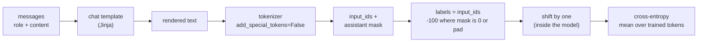

# 02 — Tokens, Chat Templates, and the Causal-LM Objective

> **Prerequisites:** module 01.
> **You will learn:** exactly which tokens a fine-tuning step trains on: tokenizers and special
> tokens, chat templates and their pitfalls, label shifting and the `-100` mask,
> padding side, numerical formats, and the generation settings evaluation needs.

Most silent fine-tuning bugs live in this module. The common ones are a wrong chat template, a doubled BOS, a missing EOS so the model never stops, the wrong padding side, loss computed on the prompt, and labels shifted by one too many. None of them crash the run. The loss still falls and the checkpoint still saves, and you find out at evaluation or in production. After this module you should be able to look at a tokenized, templated, masked example and say exactly which tokens count toward the loss and why.

The running example is the course's support-email extraction task from [module 01](./01-when-to-fine-tune.md). The model is a Qwen3 checkpoint.

---

## 2.1 The decoder-only model, seen by a fine-tuner

A decoder-only LM maps token ids to embeddings, sends them through $L$ identical blocks, applies a final norm, and projects to vocabulary logits with the LM head. Each block is pre-norm attention followed by a pre-norm MLP, each with a residual connection. The Transformers course derives every piece: [block anatomy](../transformers/06-transformer-block-anatomy.md) covers the residual stream and RMSNorm, and the [end-to-end forward pass](../transformers/16-end-to-end-forward-pass.md) traces shapes from token to logit. What a fine-tuner needs on top of that is **the names**. PEFT configs, FSDP wrap policies, quantization skip-lists and merge tools all refer to modules by their attribute names in the Hugging Face modeling code. Llama, Qwen, Mistral and most 2026 dense decoders use the same names.

The table uses the published [Qwen3-4B config](https://huggingface.co/Qwen/Qwen3-4B/blob/1cfa9a7208912126459214e8b04321603b3df60c/config.json): $d = 2560$, $d_{ff} = 9728$, $L = 36$, 32 query heads and 8 KV heads of size $d_h = 128$, $V = 151{,}936$, and `tie_word_embeddings: true`. Shapes are written as input → output. `nn.Linear` stores the weight transposed, as `(out, in)`. Here $d_q = n_h d_h = 4096$ and $d_{kv} = n_{kv} d_h = 1024$. Qwen3-4B is a reminder that $d_q$ need not equal $d$.

| Module name (HF) | Shape (in → out) | Qwen3-4B | What it does | Usual PEFT target? |
|---|---|---|---|---|
| `embed_tokens` | $(V, d)$ lookup | 151936 × 2560 | token id → vector | no, except when adding tokens (module 06) |
| `q_proj` | $d \to d_q$ | 2560 → 4096 | queries | yes |
| `k_proj` | $d \to d_{kv}$ | 2560 → 1024 | keys (GQA: fewer heads) | yes |
| `v_proj` | $d \to d_{kv}$ | 2560 → 1024 | values | yes |
| `o_proj` | $d_q \to d$ | 4096 → 2560 | mixes heads back into the residual stream | yes |
| `gate_proj` | $d \to d_{ff}$ | 2560 → 9728 | SwiGLU gate branch | yes |
| `up_proj` | $d \to d_{ff}$ | 2560 → 9728 | SwiGLU value branch | yes |
| `down_proj` | $d_{ff} \to d$ | 9728 → 2560 | back to the residual stream | yes |
| `input_layernorm` | $(d)$ | 2560 | RMSNorm before attention | no (tiny; sometimes fully trained) |
| `post_attention_layernorm` | $(d)$ | 2560 | RMSNorm before the MLP | no |
| `norm` | $(d)$ | 2560 | final RMSNorm | no |
| `lm_head` | $d \to V$ | 2560 → 151936 | logits; **tied** to `embed_tokens` here | no (`modules_to_save` if you must) |

Qwen3 also has per-head `q_norm` and `k_norm` of size $d_h$ (QK-norm). The other models in this family do not.

Per block, the four attention projections hold $2 \cdot 2560 \cdot 4096 + 2 \cdot 2560 \cdot 1024 = 26.2$M parameters. The three MLP projections hold $3 \cdot 2560 \cdot 9728 = 74.7$M, which is **74% of the block**. Over 36 blocks that comes to 3.63B, and the tied embedding adds another 0.39B, for about 4.02B in total. Two things follow. MLP projections hold most of the parameters, which is why [module 06](./06-lora-and-qlora.md) targets `all-linear` rather than only `q_proj`/`v_proj`. And because the embedding is tied, any change to `embed_tokens` also changes the output layer. Module 06 owns weight tying and `ensure_weight_tying`.

### MoE layers

In a mixture-of-experts model, each block's single MLP is replaced by $E$ expert MLPs plus a **router**: a linear layer $d \to E$ whose softmax picks the top-$k$ experts for each token. The [Transformers course MoE module](../transformers/12-mixture-of-experts.md) derives the routing. Two parts matter to a fine-tuner.

The first is the **auxiliary load-balancing loss**. Without it the router collapses onto a few experts. In the Switch Transformer form ([Fedus et al., 2021](https://arxiv.org/abs/2101.03961)):

$$
\mathcal{L}_{\text{aux}} = \alpha_{\text{aux}} \, E \sum_{i=1}^{E} f_i \, P_i
$$

Here $f_i$ is the fraction of tokens in the batch dispatched to expert $i$ (a hard count, so it has no gradient), and $P_i$ is the mean router probability assigned to expert $i$ (soft, so it does have a gradient). Under perfect balance $f_i = P_i = 1/E$, the sum is $E \cdot 1/E^2 = 1/E$, and $\mathcal{L}_{\text{aux}} = \alpha_{\text{aux}}$. Any imbalance makes it larger. In HF code, $\alpha_{\text{aux}}$ is `router_aux_loss_coef`, and the term is **only computed when `output_router_logits=True`** ([`modeling_qwen3_moe.py` at v5.19.0](https://github.com/huggingface/transformers/blob/c4c4605f961877852b89b97478536bb3a26b6fd1/src/transformers/models/qwen3_moe/modeling_qwen3_moe.py#L649-L658)). [Qwen3-30B-A3B's config](https://huggingface.co/Qwen/Qwen3-30B-A3B/blob/ad44e777bcd18fa416d9da3bd8f70d33ebb85d39/config.json) ships with $E = 128$, $k = 8$, `router_aux_loss_coef: 0.001` and `output_router_logits: false`. If you fine-tune it with a plain loop and leave that flag at its default, the router trains with no balancing pressure at all. TRL's `SFTConfig` exposes `router_aux_loss_coef` and logs the unscaled `aux_loss` ([TRL SFT docs, v1.15.0](https://huggingface.co/docs/trl/v1.15.0/en/sft_trainer)).

The second is **targeting and memory**. Experts are often stored as fused 3D parameters, not as separate `nn.Linear` modules, so `target_modules` name-matching can silently skip them. Memory scales with *total* parameters (all 128 experts are resident), not with the 3B *active* ones. [Module 10](./10-distributed-fine-tuning-and-moe.md) owns MoE fine-tuning: router stability, expert parallelism and LoRA on experts.

### Attention implementations

Every backend computes the same softmax attention. They differ in memory traffic and in which masks they accept. In Transformers v5 the choice goes through the `AttentionInterface` registry: you pick one with `attn_implementation=` in `from_pretrained`, or switch at runtime with `model.set_attn_implementation(...)` ([attention backends docs, v5.19.0](https://huggingface.co/docs/transformers/v5.19.0/en/attention_interface)).

| `attn_implementation` | What it is | Mask it consumes | Packed sequences |
|---|---|---|---|
| `"eager"` | plain matmul + softmax in the modeling file | float 4D mask | via a block-diagonal 4D mask |
| `"sdpa"` | `torch.nn.functional.scaled_dot_product_attention` (the default) | bool or float 4D mask | via a block-diagonal 4D mask |
| `"flash_attention_2"` / `"flash_attention_3"` | tiled kernels, never materialize $T \times T$ | 2D padding mask or position ids | **native varlen from position-id resets** |
| `"flex_attention"` | PyTorch FlexAttention with user `mask_mod`s | `BlockMask` | document masking in the `BlockMask` |
| `"paged\|..."` | paged-KV variants for continuous batching | n/a | serving, not training |

The packed-sequence column needs one more detail. In v5, when you pass `position_ids` and no 2D attention mask, the masking utilities detect where positions reset to 0 and build a per-document mask for *any* backend ([`masking_utils.py` at v5.19.0](https://github.com/huggingface/transformers/blob/c4c4605f961877852b89b97478536bb3a26b6fd1/src/transformers/masking_utils.py#L854-L862)). Only FlashAttention does this without materializing a dense mask. That is why TRL documents `padding_free=True` as supported only with FlashAttention 2 or 3. FlashAttention-2 needs an Ampere-or-newer GPU, so a T4 cannot use it. [Module 03](./03-training-mechanics-and-memory-math.md) covers the padding-free memory math and [module 05](./05-supervised-fine-tuning.md) covers packing strategies.

---

## 2.2 Tokenizers and special tokens

### BPE and SentencePiece in one page

A tokenizer maps text to ids from a fixed vocabulary of size $V$. **Byte-pair encoding** ([Sennrich et al., 2016](https://arxiv.org/abs/1508.07909)) starts from characters, or from bytes in byte-level BPE, and repeatedly merges the most frequent adjacent pair. The learned merge list is the tokenizer. **SentencePiece** ([Kudo and Richardson, 2018](https://arxiv.org/abs/1808.06226)) treats input as a raw stream with whitespace encoded as `▁`, so it needs no language-specific pre-tokenizer, and it can train BPE or unigram models. Qwen3 and Llama 3 use byte-level BPE with vocabularies of about 150k and 128k. Gemma 3 uses a SentencePiece-derived vocabulary of 262k. The [Transformers course tokenization module](../transformers/02-tokenization-and-embeddings.md) trains a BPE tokenizer from scratch, and the [text preprocessing note](../../notes/nlp/text-preprocessing.md) covers Unicode and normalization traps.

Transformers v5 made two changes that affect old tutorials. **It is PyTorch-only**: the release "sunset[s] Flax/TensorFlow support in favor of focusing on PyTorch as the sole backend" ([Transformers v5 blog, Dec 2025](https://huggingface.co/blog/transformers-v5)). The stable v5.0.0 shipped on 26 January 2026 ([release page](https://github.com/huggingface/transformers/releases/tag/v5.0.0)). **It also unified tokenizers** on the Rust `tokenizers` backend, "removing the concept of 'Fast' and 'Slow' tokenizers". So `use_fast=` and `*TokenizerFast` class choices no longer mean anything, and code that relied on a slow tokenizer's quirks may tokenize differently after upgrading. Re-check any cached tokenized dataset after a major-version bump.

### BOS, EOS, PAD, UNK and added tokens

| Token | Role in training | Role in generation |
|---|---|---|
| BOS | conditions the first real token; many models were pretrained with it always present | prepended once by the template or the tokenizer |
| EOS / turn-end | **must appear as a target** so the model learns to stop | generation halts when any id in `generation_config.eos_token_id` is sampled |
| PAD | fills batches; must be excluded from attention and from the loss | fills left-padded prompts in batched generation |
| UNK | byte-level BPE never needs it; SentencePiece vocabularies keep one | n/a |
| added/special | control tokens (`<|im_start|>`, `<think>`, tool tags), never split | parsed by the server for roles, reasoning and tool calls |

These conventions differ between families more than most people expect. Table 2 was read directly from each repository's `tokenizer_config.json` and `generation_config.json` at a pinned revision. The Llama and Gemma repositories are gated, so you need to log in to view their files.

| Family (checkpoint, revision) | BOS | Tokenizer EOS | Turn-end token | PAD default | `generation_config.eos_token_id` |
|---|---|---|---|---|---|
| Qwen3 hybrid ([`Qwen/Qwen3-0.6B@c1899de`](https://huggingface.co/Qwen/Qwen3-0.6B/blob/c1899de289a04d12100db370d81485cdf75e47ca/generation_config.json)) | none (`bos_token: null`) | `<|im_end|>` (151645) | `<|im_end|>` | `<|endoftext|>` (151643) | list: `[151645, 151643]` |
| Qwen3 base (`Qwen/Qwen3-0.6B-Base@da87bfb`) | none | `<|endoftext|>` | `<|im_end|>` in its template | `<|endoftext|>` (**= EOS**) | single: `151643` |
| Llama 3.2 ([`meta-llama/Llama-3.2-1B-Instruct@9213176`](https://huggingface.co/meta-llama/Llama-3.2-1B-Instruct/blob/9213176726f574b556790deb65791e0c5aa438b6/generation_config.json)) | `<|begin_of_text|>` (128000), added by the template **and** the tokenizer post-processor | `<|eot_id|>` (128009) | `<|eot_id|>` | none set (`<|finetune_right_pad_id|>` 128004 exists) | list: `[128001, 128008, 128009]` |
| Gemma 3 ([`google/gemma-3-1b-it@dcc83ea`](https://huggingface.co/google/gemma-3-1b-it/blob/dcc83ea841ab6100d6b47a070329e1ba4cf78752/generation_config.json)) | `<bos>` (2), template **and** `add_bos_token: true` | `<eos>` (1) | `<end_of_turn>` (106) | `<pad>` (0) | list: `[1, 106]` |

Three facts from this table drive the rest of the module:

- **Qwen3 has no BOS and Llama and Gemma add BOS twice if you let them.** Section 2.4 shows the double BOS.
- **The token that ends a chat turn often differs from the tokenizer's `eos_token`.** The Qwen3 base tokenizer says EOS is `<|endoftext|>`, but its chat template closes turns with `<|im_end|>`.
- **Stopping is a list.** Qwen's hybrid models stop on either `<|im_end|>` or `<|endoftext|>`, and Gemma 3 stops on `<eos>` or `<end_of_turn>`. Any server or eval harness that reads only `tokenizer.eos_token_id` will miss one.

### Adding tokens and resizing embeddings

Suppose you want dedicated tokens for the extraction task, such as `<ticket>` and `</ticket>`. Add them to the tokenizer, then grow the embedding (and the untied LM head) to match:

Teaching fragment (not executed; Transformers v5 API):

```python
tok.add_special_tokens({"additional_special_tokens": ["<ticket>", "</ticket>"]})
model.resize_token_embeddings(len(tok), pad_to_multiple_of=64)   # (V', d), V' rounded up to a multiple of 64
```

`pad_to_multiple_of=64` rounds the new vocabulary up so the LM-head matmul stays tensor-core friendly. The new rows are not random. With the default `mean_resizing=True`, Transformers samples them from a Gaussian with the old embeddings' mean and covariance ([`resize_token_embeddings` at v5.19.0](https://github.com/huggingface/transformers/blob/c4c4605f961877852b89b97478536bb3a26b6fd1/src/transformers/modeling_utils.py#L2634-L2670)). This follows [Hewitt's analysis](https://nlp.stanford.edu/~johnhew/vocab-expansion.html): mean initialization keeps the next-token distribution almost unchanged, so the new token does not hog probability mass before training. **Mean initialization only makes the new token harmless. It does not make the token mean anything.** A frozen-base LoRA run never updates those rows, and the model will never learn to emit `</ticket>` at the right time. Train them explicitly, with `trainable_token_indices` or `modules_to_save` ([module 06](./06-lora-and-qlora.md)), or as part of full or continued pretraining ([module 05](./05-supervised-fine-tuning.md)). Often the better choice is to add no tokens at all and express the structure in plain text the tokenizer already handles well.

### Perplexity depends on the tokenizer

Perplexity is the exponential of the mean per-token negative log-likelihood (in nats):

$$
\text{PPL} = \exp\!\Big(\tfrac{1}{n}\sum_{j=1}^{n} \ell_j\Big), \qquad \ell_j = -\log p_\theta(x_j \mid x_{<j})
$$

It is a per-*token* quantity, so it depends on what a token is. A tokenizer that splits text into more, easier pieces gets lower perplexity on the same text without predicting it any better. The [language models note](../../notes/nlp/language-models.md) and the [information theory note](../../notes/math/information-theory.md) derive PPL from cross-entropy. To compare models with different tokenizers, normalize by a unit they share, such as the UTF-8 byte. **Bits-per-byte** is the total NLL converted to bits and divided by byte count:

$$
\text{BPB} = \frac{\sum_j \ell_j}{\ln 2 \cdot \text{bytes}}
$$

Here is a worked example on the same 100-byte support email. Tokenizer A splits it into 25 tokens with total NLL 50 nats: PPL $= e^{2.0} = 7.39$ and BPB $= 50 / (100 \ln 2) = 0.721$. Tokenizer B splits it into 40 tokens with total NLL 52 nats: PPL $= e^{1.3} = 3.67$ and BPB $= 0.750$. **B halves the perplexity while compressing the text worse.** Model A is the better model of this text.

The check below confirms the arithmetic and the reversal.

```python finetuning-check
import math

n_bytes = 100
tok_a, nll_a = 25, 50.0   # tokenizer A: fewer, harder tokens
tok_b, nll_b = 40, 52.0   # tokenizer B: more, easier tokens

ppl_a, ppl_b = math.exp(nll_a / tok_a), math.exp(nll_b / tok_b)
bpb_a, bpb_b = nll_a / (math.log(2) * n_bytes), nll_b / (math.log(2) * n_bytes)

assert abs(ppl_a - 7.389) < 1e-3 and abs(ppl_b - 3.669) < 1e-3
assert abs(bpb_a - 0.721) < 1e-3 and abs(bpb_b - 0.750) < 1e-3
assert ppl_b < ppl_a          # B "wins" on perplexity ...
assert bpb_a < bpb_b          # ... but A assigns the text higher probability
# BPB is per-token NLL rescaled by tokens per byte, so the tokenizer cancels out
assert abs(bpb_b - (tok_b / n_bytes) * (nll_b / tok_b) / math.log(2)) < 1e-12
print("perplexity vs bits-per-byte verified")
```

It does not prove that BPB is enough on its own to compare models. Eval sets, context lengths and byte normalization (NFC vs raw) still have to match.

---

## 2.3 The causal-LM objective, exactly

### Next-token cross-entropy and label shifting

The model reads tokens $x_{b,1..T}$ for each sequence $b$ and, at every position $t$, outputs logits for token $t+1$. Training minimizes the mean negative log-likelihood over the set $\mathcal{M}$ of positions whose target is not masked:

$$
\mathcal{L} = -\frac{1}{|\mathcal{M}|}\sum_{(b,t)\in\mathcal{M}} \log p_\theta(x_{b,t+1}\mid x_{b,\le t})
$$

The [Transformers course](../transformers/13-training-considerations.md) introduces this as the pretraining objective. Fine-tuning changes only $\mathcal{M}$. In Hugging Face code **you pass `labels` aligned with `input_ids`, unshifted, and the model shifts them internally.** `ForCausalLMLoss` right-pads `labels` with one `-100`, takes `labels[..., 1:]`, upcasts logits to fp32, and calls `cross_entropy(..., ignore_index=-100)` ([`loss_utils.py` at v5.19.0](https://github.com/huggingface/transformers/blob/c4c4605f961877852b89b97478536bb3a26b6fd1/src/transformers/loss/loss_utils.py#L49-L71)). That is equivalent to scoring `logits[:, :-1]` against `labels[:, 1:]`. If you shift the labels yourself before passing them in, the model shifts again and every position is trained to predict two tokens ahead. The loss still goes down, but more slowly, and nothing errors.

Take a 6-token tail of an assistant turn: `<|im_start|> assistant {"ok": true} <|im_end|> <pad>`. Only the content and the closing `<|im_end|>` are trained, so `labels = [-100, -100, id, id, id, -100]`.

| Position $t$ | Input token | `labels[t]` (stored) | Target used at $t$ (`labels[t+1]`) | In loss? |
|---|---|---|---|---|
| 0 | `<|im_start|>` | -100 | `assistant` → -100 | no |
| 1 | `assistant` | -100 | `{"ok":` | **yes** |
| 2 | `{"ok":` | id | `true}` | **yes** |
| 3 | `true}` | id | `<|im_end|>` | **yes** |
| 4 | `<|im_end|>` | id | `<pad>` → -100 | no |
| 5 | `<pad>` | -100 | (padded -100) | no |

Read the table by rows. The label stored at position $t$ is scored at position $t-1$. Position 1 has a masked label of its own, yet it is the position that learns to start the answer, and position 3 is the one that learns to emit `<|im_end|>`. "Mask the header" therefore means "do not train the model to predict the header tokens". It does not mean "the header positions get no gradient".

### The ignore index -100

`F.cross_entropy(..., ignore_index=-100)` with mean reduction drops masked positions from **both the numerator and the denominator**. The result is the mean over trained tokens only, not a mean diluted by zeros. Their logits get exactly zero gradient. The check below verifies this, along with the equivalence between the HF pad-and-shift form and the slice form.

```python finetuning-check
import torch
import torch.nn.functional as F

torch.manual_seed(0)
B, T, V = 2, 6, 11
logits = torch.randn(B, T, V, requires_grad=True)          # (B, T, V)
labels = torch.randint(0, V, (B, T))                       # (B, T), unshifted
labels[0, :2] = -100                                        # prompt tokens of row 0
labels[1, :3] = -100                                        # prompt tokens of row 1
labels[1, 5] = -100                                         # right padding of row 1

# manual: log_softmax + gather on shifted targets, divide by the trained count
tgt = labels[:, 1:]                                         # (B, T-1)
keep = tgt.ne(-100)
logp = F.log_softmax(logits[:, :-1], dim=-1)                # (B, T-1, V)
nll = -logp.gather(-1, tgt.clamp(min=0).unsqueeze(-1)).squeeze(-1)
manual = nll[keep].sum() / keep.sum()
assert int(keep.sum()) == 6                                 # 4 trained targets in row 0, 2 in row 1

ref = F.cross_entropy(logits[:, :-1].reshape(-1, V), tgt.reshape(-1), ignore_index=-100)
torch.testing.assert_close(manual, ref, atol=1e-6, rtol=0)

# HF style: pad labels with one -100 on the right, shift, score all T positions
hf_tgt = F.pad(labels, (0, 1), value=-100)[:, 1:]
hf = F.cross_entropy(logits.reshape(-1, V), hf_tgt.reshape(-1), ignore_index=-100)
torch.testing.assert_close(hf, ref, atol=1e-6, rtol=0)

ref.backward()
row_grad = logits.grad.abs().sum(-1)                        # (B, T)
for b in range(B):
    for t in range(T):
        trained = t < T - 1 and labels[b, t + 1].item() != -100
        assert (row_grad[b, t] > 0) == trained, (b, t)

# token-level vs sequence-level averaging, the worked example from the prose
l1 = torch.full((2,), 1.0)                                  # sequence 1: 2 trained tokens, loss 1.0 each
l2 = torch.full((6,), 0.5)                                  # sequence 2: 6 trained tokens, loss 0.5 each
tok_level = (l1.sum() + l2.sum()) / (l1.numel() + l2.numel())
seq_level = (l1.mean() + l2.mean()) / 2
torch.testing.assert_close(tok_level, torch.tensor(0.625))
torch.testing.assert_close(seq_level, torch.tensor(0.75))
print("shift, ignore index, zero gradients and averaging verified")
```

It does not prove that a particular trainer averages this way across gradient-accumulation steps or devices. That depends on `num_items_in_batch`, which is covered in module 03.

### Token-level vs sequence-level averaging

When sequences in a batch have different numbers of trained tokens $n_b$, there are two reasonable "means" with per-token losses $\ell_{b,t}$:

$$
\mathcal{L}_{\text{tok}} = \frac{\sum_b \sum_t \ell_{b,t}}{\sum_b n_b}, \qquad
\mathcal{L}_{\text{seq}} = \frac{1}{B}\sum_b \frac{1}{n_b}\sum_t \ell_{b,t}
$$

Take two sequences with 2 and 6 trained tokens, per-token losses 1.0 in the first and 0.5 in the second. Token-level: $(2 \cdot 1.0 + 6 \cdot 0.5)/8 = 5/8 = 0.625$. Sequence-level: $(1.0 + 0.5)/2 = 0.75$. **Token-level weights every token equally, so long responses dominate the gradient. Sequence-level weights every example equally, so each token of a short response counts for more.** Neither one is a bug. They are different objectives. A dataset that mixes one-line JSON answers with long explanations will learn different things under each.

Hugging Face `Trainer` and TRL's `SFTTrainer` use **token-level** averaging. The model's loss is `sum / num_items_in_batch`, where the trainer counts trained tokens across the whole accumulated batch and, by default, across devices (`average_tokens_across_devices=True` in `SFTConfig`). TRL logs `loss` as "the average cross-entropy loss computed over non-masked tokens" ([TRL SFT docs](https://huggingface.co/docs/trl/v1.15.0/en/sft_trainer)). The 2024 gradient-accumulation bug came from mixing the two levels: each micro-batch took a token mean, and those means were then averaged. [Module 03](./03-training-mechanics-and-memory-math.md) works through it. RL losses reopen the same choice (GRPO's sequence-level vs DAPO's token-level normalization, [module 13](./13-rl-with-verifiable-rewards.md)).

The whole data path, from messages to loss:



---

## 2.4 Chat templates

### Jinja templates and roles

A chat model is still a next-token predictor over a single string. The **chat template** is a Jinja program stored in the tokenizer config that turns a list of `{"role": ..., "content": ...}` messages into that string, with the control tokens the model saw in post-training ([chat templating docs, v5.19.0](https://huggingface.co/docs/transformers/v5.19.0/en/chat_templating)). The roles are `system`, `user`, `assistant` and `tool`. Templates also take `tools=` (JSON schemas) and per-message fields such as `tool_calls` and `reasoning_content`. [Module 15](./15-agentic-and-tool-use-fine-tuning.md) covers tool formats.

`apply_chat_template` has four switches that matter:

| Argument | Effect | Use it for |
|---|---|---|
| `tokenize=False` | returns the rendered string | inspection, logging, writing JSONL |
| `tokenize=True` (+ `return_dict=True`) | returns ids (and masks) directly; BOS is handled by the template | training and inference, the safe default |
| `add_generation_prompt=True` | appends the assistant header (`<|im_start|>assistant\n`) so the model answers instead of continuing the user's turn | inference, eval, RL rollouts; **not** training |
| `continue_final_message=True` | renders the last message **without** its end-of-turn token so generation continues it | prefilling, e.g. starting the reply with `{"order_id": "` |

You cannot combine the last two: one opens a new turn and the other leaves the previous one open, and passing both raises an error. In v5, `continue_final_message` also accepts a **field name**: `continue_final_message="reasoning_content"` prefills Qwen's reasoning block and leaves it open, whereas prefilling `content` closes the reasoning block first. Gemma's equivalent field is `thinking` (same docs). Thinking formats and Qwen3's thinking-mode fusion ([Qwen3 technical report](https://arxiv.org/abs/2505.09388)) belong to [module 14](./14-distillation-and-reasoning.md).

This is the real Qwen3 rendering, at the pinned revision above, of our two-turn conversation (system, user, assistant, user, assistant) with `tokenize=False`:

```text
<|im_start|>system
Extract the ticket as JSON.<|im_end|>
<|im_start|>user
Hi, order 1142 arrived broken. Ana<|im_end|>
<|im_start|>assistant
{"order_id": "1142", "issue_type": "damaged"}<|im_end|>
<|im_start|>user
Add whether I want a refund: yes.<|im_end|>
<|im_start|>assistant
<think>

</think>

{"refund_requested": true}<|im_end|>
```

Walk through the special tokens. `<|im_start|>` (151644) opens each turn and is followed by the role name as ordinary text and a newline. `<|im_end|>` (151645) closes each turn and is **the token the model must learn to emit**. A `\n` follows every `<|im_end|>`. There is no BOS. The **last** assistant turn received an empty `<think>\n\n</think>\n\n` block that the earlier assistant turn did not get. That asymmetry matters below. The same conversation through Llama 3.2's template starts with `<|begin_of_text|>` and uses `<|start_header_id|>assistant<|end_header_id|>\n\n` headers with `<|eot_id|>` endings. It also injects `Cutting Knowledge Date: December 2023` and `Today Date: <today>` into the system turn, so **the same dataset renders differently on different days** unless you pass `date_string`. Gemma 3 has no system role: it folds the system prompt into the first user turn and calls the assistant `model`.

### Training templates and assistant masks

For SFT on conversations you usually train only assistant tokens (`assistant_only_loss`, [module 05](./05-supervised-fine-tuning.md); `completion_only_loss` is the default for prompt-completion data). To know which tokens are assistant tokens, the template must mark them. `` ... `` blocks around the assistant output make `apply_chat_template(..., return_assistant_tokens_mask=True)` return `assistant_masks`. **None of the three shipped templates in Table 2 contain these markers.** On the pinned revisions, all three return an all-zero mask with a warning. TRL handles this by swapping in patched training templates for known families (Qwen3, Llama 3.x, Gemma 3 and others) when `assistant_only_loss=True` ([TRL chat templates, v1.15.0](https://huggingface.co/docs/trl/v1.15.0/en/chat_templates)). For any other model, check the mask yourself. The lab prints it.

The check below builds the mask the way a `` template does. A hand-written ChatML renderer emits (text, trainable) pieces, and a toy tokenizer splits on whitespace while keeping `<|im_start|>` and `<|im_end|>` whole. The fixture has 29 tokens, and **exactly 8 are trained**: 4 content tokens plus `<|im_end|>` in the first assistant turn, and 2 plus `<|im_end|>` in the second.

```python finetuning-check
import re

SPECIAL = ("<|im_start|>", "<|im_end|>")
SPLIT = re.compile(r"(<\|im_start\|>|<\|im_end\|>)")

def render(messages, add_generation_prompt=False):
    """ChatML renderer returning (text, trainable) pieces, like a  template."""
    pieces = []
    for m in messages:
        if m["role"] == "assistant":
            pieces.append(("<|im_start|>assistant\n", False))         # header: never trained
            pieces.append((m["content"] + "<|im_end|>", True))        # content + turn end: trained
            pieces.append(("\n", False))
        else:
            pieces.append(("<|im_start|>" + m["role"] + "\n" + m["content"] + "<|im_end|>\n", False))
    if add_generation_prompt:
        pieces.append(("<|im_start|>assistant\n", False))
    return pieces

def tokenize(text):
    out = []
    for part in SPLIT.split(text):
        out.extend([part] if part in SPECIAL else part.split())
    return out

convo = [
    {"role": "system", "content": "Extract JSON."},
    {"role": "user", "content": "Order 1142 arrived broken."},
    {"role": "assistant", "content": '{"order_id": "1142", "issue_type": "damaged"}'},
    {"role": "user", "content": "Refund please."},
    {"role": "assistant", "content": '{"refund_requested": true}'},
]
pieces = render(convo)
text = "".join(p for p, _ in pieces)
tokens = tokenize(text)
mask = [flag for p, flag in pieces for _ in tokenize(p)]
assert [t for p, _ in pieces for t in tokenize(p)] == tokens   # piecewise == whole-string tokenization
vocab = {t: i for i, t in enumerate(sorted(set(tokens)))}
ids = [vocab[t] for t in tokens]
labels = [i if m else -100 for i, m in zip(ids, mask)]

assert len(tokens) == 29 and sum(mask) == 8
for k, t in enumerate(tokens):                                 # headers are never trained
    if t == "assistant":
        assert tokens[k - 1] == "<|im_start|>" and labels[k - 1] == labels[k] == -100
ends = [k for k, t in enumerate(tokens) if t == "<|im_end|>"]
trained_ends = [k for k in ends if labels[k] != -100]
assert len(ends) == 5 and len(trained_ends) == 2               # only assistant turn-ends are targets
assert all(labels[k] == ids[k] for k in trained_ends)
assert all(k == len(tokens) - 1 or tokens[k + 1] == "<|im_start|>" for k in trained_ends)
assert [tokens[k] for k in range(len(tokens)) if mask[k]] == [
    '{"order_id":', '"1142",', '"issue_type":', '"damaged"}', "<|im_end|>",
    '{"refund_requested":', "true}", "<|im_end|>"]

prompt = "".join(p for p, _ in render(convo[:4], add_generation_prompt=True))
assert prompt.endswith("<|im_start|>assistant\n")
assert "<|im_end|>" not in prompt.rsplit("<|im_start|>", 1)[1]  # the open turn has no end token
assert tokenize(prompt)[-2:] == ["<|im_start|>", "assistant"]
print("assistant-only label mask verified")
```

It does not prove that a real BPE tokenizer splits at the same boundaries. Byte-level BPE can merge a header's trailing newline with the first content character, which is why real masks come from character offsets or template markers rather than from per-piece tokenization.

### Pitfall 1: double BOS

The Llama and Gemma templates start with `{{ bos_token }}`. Their tokenizers also prepend BOS by default: Llama through a `TemplateProcessing` post-processor, Gemma through `add_bos_token: true`. Render with `tokenize=False`, tokenize the string with a plain `tok(text)` call, and you get **two BOS tokens**. On the pinned revisions this gives 94 ids instead of 93 for Llama 3.2 and 76 instead of 75 for Gemma 3. Qwen3 has no BOS and is unaffected. The model never saw `<bos><bos>` in pretraining, so every training example begins out of distribution, and inference with the correct single BOS then differs from training. The Transformers docs state the fix directly: "make sure you set `add_special_tokens=False` if you tokenize later ... This isn't an issue if you use `apply_chat_template(tokenize=True)`" ([chat templating docs](https://huggingface.co/docs/transformers/v5.19.0/en/chat_templating)). TRL's trainers tokenize conversational data through the template, so the bug shows up mainly in hand-written preprocessing.

### Pitfall 2: EOS alignment and pad = eos

Many tokenizers ship without a pad token. The usual fix is `tok.pad_token = tok.eos_token`, and TRL itself falls back to the EOS token when no pad is set (`SFTTrainer` `processing_class` docs). On its own that is harmless. **The damage comes from the collator.** The classic causal-LM collator builds labels by copying `input_ids` and setting every position equal to `pad_token_id` to -100. Transformers' own `DataCollatorForLanguageModeling(mlm=False)` still does exactly this ([`data_collator.py` at v5.19.0](https://github.com/huggingface/transformers/blob/c4c4605f961877852b89b97478536bb3a26b6fd1/src/transformers/data/data_collator.py#L791-L795)). If pad and EOS share an id, the real EOS at the end of each example is masked too. The model never receives a gradient toward stopping, so at inference it keeps going: it produces another turn, another JSON object, or filler until `max_new_tokens`.

TRL's collator avoids this by construction. It builds labels before padding and pads them with -100, so the mask depends on *position*, not on *id* ([TRL `DataCollatorForLanguageModeling`, v1.15.0](https://github.com/huggingface/trl/blob/dae7b6adc8d2729cfa8d21bc8480656ede769240/trl/trainer/sft_trainer.py#L169-L216)). The check below reproduces both behaviors, and the double-BOS bug, on toy ids.

```python finetuning-check
import torch

BOS, EOS, PAD = 1, 2, 2                                       # the bug: pad id == eos id
seqs = [[BOS, 5, 6, 7, EOS], [BOS, 8, EOS]]
T = max(len(s) for s in seqs)
input_ids = torch.tensor([s + [PAD] * (T - len(s)) for s in seqs])        # right padding, (2, 5)
attention = torch.tensor([[1] * len(s) + [0] * (T - len(s)) for s in seqs])

def eos_targets(labels):
    """Number of positions whose shifted target is EOS and enters the loss."""
    return int(labels[:, 1:].eq(EOS).sum())

by_id = input_ids.clone()
by_id[input_ids == PAD] = -100                                # mask by token id
by_position = input_ids.clone()
by_position[attention == 0] = -100                            # mask by position (TRL's behavior)

assert eos_targets(by_id) == 0                                # the model never learns to stop
assert eos_targets(by_position) == 2                          # exactly one EOS target per sequence
assert by_position[0, 4] == EOS and by_position[1, 2] == EOS and by_position[1, 3] == -100

def toy_tokenize(text_ids, add_special_tokens=True):
    """Stands in for tok(text): prepends BOS when add_special_tokens=True."""
    return ([BOS] if add_special_tokens else []) + list(text_ids)

templated = [BOS, 30, 31, 32, EOS]                            # chat template already emitted BOS
assert toy_tokenize(templated)[:2] == [BOS, BOS]              # double BOS
assert toy_tokenize(templated, add_special_tokens=False).count(BOS) == 1
print("pad=eos masking and double BOS verified")
```

It does not prove that a real model trained on `by_id` labels fails to stop. The `--never-stop` extension of the lab shows that on real weights, and the smoke mode shows it on a tiny model.

There are two fixes. You can **mask by attention mask or position, never by id**, or you can **use a pad token distinct from every stop token**: Llama 3.x has `<|finetune_right_pad_id|>`, and Qwen3 instruct already pads with `<|endoftext|>`, which differs from its EOS `<|im_end|>`. There is also a second form of this misalignment. **The tokenizer's `eos_token` must be the token your template ends turns with.** `Qwen/Qwen3-0.6B-Base` has `eos_token = pad_token = <|endoftext|>`, but its chat template closes turns with `<|im_end|>`. Train on that template while appending `<|endoftext|>` as "EOS", and the model learns to end with `<|im_end|><|endoftext|>`. A server that stops only on `<|endoftext|>` will then print the `<|im_end|>`. TRL's docs say to set `eos_token="<|im_end|>"` in `SFTConfig` for Qwen bases. The trainer then also prepends that id to `generation_config.eos_token_id` ([`sft_trainer.py` L719-L737](https://github.com/huggingface/trl/blob/dae7b6adc8d2729cfa8d21bc8480656ede769240/trl/trainer/sft_trainer.py#L719-L737)). [Module 05](./05-supervised-fine-tuning.md) gives the full base-model recipe.

### Pitfall 3: base models without a template

A base model may ship with no template, or with one it was never trained on. TRL's `SFTConfig(chat_template_path=...)` and the `clone_chat_template` helper copy a template, plus any special tokens it needs, from another tokenizer. If a Jinja file references tokens that are new to the vocabulary, you must add them and resize the embeddings (section 2.2). [Module 05](./05-supervised-fine-tuning.md) owns this workflow.

### Prefix-preserving templates

A template is **prefix-preserving** if rendering turns $1..k$ always produces a string prefix of rendering turns $1..k{+}1$. Multi-turn RL and agent loops depend on this property. They generate turn $k$, append a tool result, and keep the tokens they already have, including their log-probs, as the prefix of the next step. If appending a message changes how earlier messages render, the trainer is computing log-probs for a sequence the model never actually saw.

The Qwen3 rendering above breaks the property. Its template prints the `<think>...</think>` block only for assistant turns after the last user query: the original reads `` and then ``. When the conversation ends at assistant turn 1, that turn carries a `<think>` block. Append a user message or a tool response, render again, and turn 1 loses the block. Many reasoning templates follow the same pattern of stripping old reasoning, and they all break prefix preservation. TRL's patched `qwen3_training.jinja` drops that conditional "so the thinking block is always emitted", and TRL exposes `is_chat_template_prefix_preserving` to test a template ([TRL chat templates](https://huggingface.co/docs/trl/v1.15.0/en/chat_templates); [`chat_template_utils.py` L854](https://github.com/huggingface/trl/blob/dae7b6adc8d2729cfa8d21bc8480656ede769240/trl/chat_template_utils.py#L854)). [Module 15](./15-agentic-and-tool-use-fine-tuning.md) builds on this for tool-use RL.

| Pitfall | Symptom at train time | Symptom at inference | Fix |
|---|---|---|---|
| Double BOS | none visible; per-token table shows two BOS ids at position 0–1 | slightly worse quality; train/serve mismatch | `add_special_tokens=False` after `tokenize=False`, or `apply_chat_template(tokenize=True)` |
| pad = eos, mask by id | EOS rows are -100 in the label table; loss looks normal | never stops; runs to `max_new_tokens` | mask by attention/position; distinct pad token |
| Wrong EOS for the template (base models) | labels end in `<|endoftext|>` while turns end in `<|im_end|>` | stray `<|im_end|>` text or no stop in the server | `eos_token="<|im_end|>"`; align `generation_config.eos_token_id` |
| Loss on prompt tokens | lower loss than expected; slower task learning | echoes or paraphrases the prompt | `assistant_only_loss` / `completion_only_loss` (module 05) |
| No `` markers | `assistant_masks` all zeros, so nothing (or everything) is trained | model unchanged, or trained on the user's text | TRL training templates, or offsets-based masking (lab) |
| Template not prefix-preserving | multi-turn RL log-probs disagree with rollout | unstable or degenerate tool-use RL | patched training template; test with `is_chat_template_prefix_preserving` |
| Training template ≠ serving template | none | quality drop, format drift | ship the template with the checkpoint; render eval through it (module 20) |
| Date-stamped template (Llama 3.x) | same data renders differently on different days | none | pass `date_string` explicitly |

---

## 2.5 Padding side, attention masks and position ids

Batches need rectangular tensors, so short sequences get padding, and **which side** you pad on depends on what happens next. The [Hugging Face note](../../notes/libraries/huggingface.md) covers the basic tokenizer call.

**Right padding is normal for SFT training.** The loss looks at every position independently and pad positions carry label -100. With right padding, real tokens start at position 0, so `position_ids = 0, 1, 2, ...` match pretraining without any extra work. TRL's SFT collator pads on the right.

**Left padding is required for batched generation.** `generate` appends each new token after the *last column* of the batch. With right padding, a short prompt's last column is a pad token, so the model would continue from padding. With left padding, every row's last column is its real final token, usually the end of `<|im_start|>assistant\n`. This is why trainers that generate, such as GRPO/RLOO rollouts, online preference methods ([module 12](./12-preference-optimization.md)) and evaluation loops, pad prompts on the left (`tok.padding_side = "left"`), while the scoring forward passes can still use any side.

Left padding needs correct **position ids**. If a prompt has 3 pad tokens, its first real token must get position 0, not 3, or RoPE rotates every token by the wrong angle. Transformers' `generate` derives positions from the attention mask: `position_ids = attention_mask.cumsum(-1) - 1`, with pad positions clamped. Custom rollout code that passes `input_ids` without `attention_mask` silently gets positions offset by the pad count, and padded keys are attended to as well.

**Packed sequences** go one step further. Several short examples are concatenated into one row with no padding, and position ids **reset to 0 at each example boundary** (`[0,1,2,3,0,1,2,0,1,...]`). The resets tell the attention backend where documents end (section 2.1), and the first label of each packed example is masked so no example learns to predict across the boundary. [Module 05](./05-supervised-fine-tuning.md) covers packing strategies (`bfd`, `bfd_split`, `wrapped`), and [module 03](./03-training-mechanics-and-memory-math.md) covers what padding-free saves.

---

## 2.6 Numerical formats a fine-tuner must know

The [Transformers course section on mixed precision](../transformers/13-training-considerations.md#133-mixed-precision) explains why bf16 replaced fp16 for pretraining: the same 8-bit exponent as fp32, so no overflow and no loss scaling. Table 4 adds the formats you meet in 2026 fine-tuning. The [inference course numerics chapter](/courses/inference/00-foundations/00-05-numerics.html) covers them from the serving side.

| Format | Bits | Sign/exp/mantissa | Max finite value | Typical use in fine-tuning |
|---|---|---|---|---|
| fp32 | 32 | 1/8/23 | $3.4 \times 10^{38}$ | master weights, optimizer states, loss and softmax upcasts |
| tf32 | 19 (stored as 32) | 1/8/10 | $3.4 \times 10^{38}$ | Ampere+ tensor-core matmuls on fp32 tensors (`tf32=True`) |
| fp16 | 16 | 1/5/10 | 65,504 | T4/V100 training with loss scaling; legacy checkpoints |
| bf16 | 16 | 1/8/7 | $3.4 \times 10^{38}$ | default training and LoRA dtype on Ampere+ |
| fp8 E4M3 | 8 | 1/4/3 | 448 | FP8 training forward pass (weights, activations); block scales of NVFP4 |
| fp8 E5M2 | 8 | 1/5/2 | 57,344 | FP8 gradients (range over precision) |
| MXFP4 | 4 per element + shared scale | E2M1 elements, one E8M0 scale per 32 | 6 × block scale | 4-bit checkpoints (e.g. gpt-oss), QAT targets |
| NVFP4 | 4 per element + scales | E2M1 elements, E4M3 scale per 16, fp32 per-tensor scale | 6 × scales | Blackwell 4-bit training/inference, 4-bit LoRA bases |

Sources: FP8 formats from [Micikevicius et al. (2022)](https://arxiv.org/abs/2209.05433), MXFP4 from the [OCP Microscaling spec v1.0](https://www.opencompute.org/documents/ocp-microscaling-formats-mx-v1-0-spec-final-pdf), and NVFP4 from [NVIDIA Transformer Engine docs (release 2.18)](https://docs.nvidia.com/deeplearning/transformer-engine-releases/release-2.18/user-guide/features/low_precision_training/nvfp4/nvfp4.html).

**The T4 case.** Free Colab and Kaggle T4s are compute capability 7.5 ([NVIDIA CUDA GPU list](https://developer.nvidia.com/cuda-gpus)), and native bf16 tensor-core math starts at 8.0 (Ampere). Check `torch.cuda.get_device_capability() >= (8, 0)` rather than `torch.cuda.is_bf16_supported()`, which can report emulated support. On a T4, train in **fp16 with dynamic loss scaling**. fp16's 5-bit exponent underflows small gradients to zero, so `torch.amp.GradScaler` multiplies the loss by a large factor $S$ before `backward()`, unscales the gradients before the optimizer step, skips any step whose gradients contain `inf`/`nan`, and halves $S$ when that happens ([PyTorch AMP docs](https://docs.pytorch.org/docs/stable/amp.html)). In Trainer terms this means `fp16=True`. TRL's `SFTConfig` defaults `bf16` to `True` only when `fp16` is not set, so passing `fp16=True` turns the bf16 default off. Check the logged config anyway. [Module 03](./03-training-mechanics-and-memory-math.md) owns mixed-precision mechanics and master weights, and [module 11](./11-quantization-qat-and-fp8.md) owns FP8 training and the 4-bit formats.

**Loading.** In Transformers v5, `torch_dtype=` became `dtype=`, and `from_pretrained` **infers the dtype from the checkpoint config** when you do not pass one. A bf16 checkpoint loads as bf16. TRL trainers that receive a model *name* deliberately differ: "If `dtype` is not specified in `args.model_init_kwargs`, it defaults to `float32`" ([TRL `SFTTrainer` docs, v1.15.0](https://huggingface.co/docs/trl/v1.15.0/en/sft_trainer)). A 4B model then takes 16 GB of weights before any optimizer state.

Teaching fragment (not executed; Transformers v5 / TRL v1.15 APIs, as of October 2026):

```python
import torch
from transformers import AutoModelForCausalLM, AutoTokenizer
from trl import SFTConfig, SFTTrainer

tok = AutoTokenizer.from_pretrained("Qwen/Qwen3-4B")              # no use_fast= in v5
model = AutoModelForCausalLM.from_pretrained(
    "Qwen/Qwen3-4B",
    dtype=torch.bfloat16,        # omit -> inferred from config (bf16 here) in v5
    device_map="auto",           # place layers on available devices
    attn_implementation="sdpa",  # or "flash_attention_2" on Ampere+
)

# Passing a model *name* to TRL: set the dtype explicitly or you get float32
args = SFTConfig(output_dir="out", model_init_kwargs={"dtype": torch.bfloat16})
trainer = SFTTrainer(model="Qwen/Qwen3-4B", args=args, train_dataset=ds, processing_class=tok)
```

TRL, Unsloth and Axolotl wrap these same loader arguments ([module 08](./08-frameworks-and-tooling.md)). `device_map="auto"` is for inference and single-process training. Under FSDP or DeepSpeed, the launcher places the shards. `trust_remote_code=True` runs arbitrary Python from the model repository on your machine. Leave it off unless you have read the code and pinned the revision ([module 20](./20-production-serving-and-cost.md)).

---

## 2.7 Generation settings you need for evaluation and RL

Evaluation and RL both sample from your model, so the decoding settings belong to the experiment just as much as the learning rate does. Write them down. The [decoding note](../../notes/nlp/text-generation-and-decoding.md) derives each method. In one line each, for logits $z$ and probabilities $p$:

| Setting | Rule | When it matters |
|---|---|---|
| greedy | $\arg\max_i z_i$ | deterministic eval of extraction tasks like ours |
| temperature $\tau$ | $p_i \propto \exp(z_i/\tau)$ | $\tau \to 0$ is greedy; RL rollouts use $\tau \approx 1.0$ so the group explores |
| top-$k$ | keep the $k$ largest $p_i$, renormalize | cuts the long tail; Qwen3 recommends $k=20$ |
| top-$p$ ([Holtzman et al., 2019](https://arxiv.org/abs/1904.09751)) | keep the smallest set with $\sum p_i \ge p$ | adaptive tail cut; usually 0.9–0.95 for chat |
| min-$p$ ([Nguyen et al., 2024](https://arxiv.org/abs/2407.01082)) | keep $i$ with $p_i \ge p_{\min} \cdot \max_j p_j$ | stays coherent at high temperature |
| repetition penalty $\theta$ ([Keskar et al., 2019](https://arxiv.org/abs/1909.05858)) | for already-seen tokens, $z_i \leftarrow z_i/\theta$ if $z_i>0$, else $z_i\theta$ | masks loops instead of fixing them; avoid in eval and RL because it changes the distribution you are measuring |

Two rules. **Evaluation uses greedy decoding, or a fixed temperature with $n$ samples per prompt and a reported mean** (pass@k and its variance are in [module 09](./09-evaluating-fine-tuned-models.md)). **RL rollouts sample at the temperature the policy-gradient math assumes.** Sampling with top-$p$ or a penalty that the trainer's log-prob computation does not apply makes the importance ratio wrong ([module 13](./13-rl-with-verifiable-rewards.md)). Model repositories ship defaults in `generation_config.json`. Qwen3 ships `temperature=0.6, top_p=0.95, top_k=20` (pinned file above). `generate()` uses those unless you override them, so "I evaluated with defaults" means different settings for different models.

**Stop tokens.** `generation_config.eos_token_id` can be a list, and for all three families in Table 2 it is. A Python `model.generate` call reads the list. A serving stack, eval harness or hand-rolled loop that takes `tokenizer.eos_token_id` gets one id. For Qwen3 hybrid that id happens to be the right one (`<|im_end|>`). For a Qwen3 *base* model fine-tuned on ChatML, it is `<|endoftext|>`, so the server streams through `<|im_end|>` and invents the next user turn. This is the classic "works in Python, rambles in the server" bug. Check that the fine-tuned checkpoint's `generation_config.json` lists your template's turn-end token, and that the server reads it ([module 20](./20-production-serving-and-cost.md); the [inference course detokenization chapter](/courses/inference/09-serving-system/09-02-tokenization-and-detokenization.html) covers stop handling on the server side).

**KV cache.** Generation is one token at a time. Without a cache, step $t$ would recompute keys and values for all $t$ previous tokens. With a cache, each step computes K and V for one new token and attends over the stored ones, so the per-token cost is roughly constant in compute. But the cache grows linearly in memory: $2 \cdot L \cdot n_{kv} \cdot d_h$ values per token. For Qwen3-4B in bf16 that is $2 \cdot 36 \cdot 8 \cdot 128 \cdot 2 = 147{,}456$ bytes, about 0.15 MB, per token. One GRPO prompt with $G = 8$ completions of 4,096 tokens holds $8 \cdot 4096 \cdot 0.147\text{ MB} \approx 4.8$ GB of cache. That is why RL rollouts are memory-bound and why TRL's GRPO can hand generation to vLLM's paged cache ([module 13](./13-rl-with-verifiable-rewards.md)). The [decode loop and KV cache chapter](/courses/inference/00-foundations/00-02-decode-loop-and-kv-cache.html) derives this in detail.

---

## 2.8 Lab: read a masked, templated batch

**Goal.** Render one support-email conversation through three real chat templates, tokenize it, print a per-token table (index, token, label id or -100, in loss?), reproduce the double-BOS and pad=eos bugs, fix them, and confirm a hand-computed loss against the model's own loss.

**Tier.** CPU for both modes. `--full` downloads tokenizers only, plus `Qwen/Qwen3-0.6B` weights for the loss comparison (about 1.5 GB; works on CPU, faster on a T0 T4). The `--never-stop` extension is T0.

**Script.** [template_mask_inspector.py](./code/template_mask_inspector.py). Smoke mode has no dependencies beyond `torch`. Full mode imports `transformers` (v5.x) inside the functions that need it.

```bash
python content/courses/finetuning/code/template_mask_inspector.py --smoke
hf auth login        # Llama 3.2 and Gemma 3 are gated: accept their licenses on the Hub first
python content/courses/finetuning/code/template_mask_inspector.py --full
python content/courses/finetuning/code/template_mask_inspector.py --full --never-stop   # T0 GPU
```

### Step 1: render with each template

Full mode loads the tokenizers of `Qwen/Qwen3-0.6B`, `meta-llama/Llama-3.2-1B-Instruct` and `google/gemma-3-1b-it` at the revisions in Table 2 and prints `apply_chat_template(messages, tokenize=False)` for each. Record the differences: where BOS appears, the header strings, the empty `<think>` block on Qwen's last turn, Llama's date lines, and Gemma's folded system prompt.

### Step 2: count BOS twice

Tokenize each rendered string with `add_special_tokens=True` and then `False`, and compare both against `apply_chat_template(tokenize=True)`. Expect 2/1/1 BOS for Llama and Gemma and 0/0/0 for Qwen. Record the id counts.

### Step 3: build the assistant mask

The script first asks for `return_assistant_tokens_mask=True`. On these shipped templates it returns all zeros. That is your evidence that the markers are missing. It then falls back to offsets: it finds each assistant header in the rendered string, marks characters from the header's end through the turn-end token, and maps tokens to characters with `return_offsets_mapping`. It prints the per-token table and the trained-token count per template. On the pinned revisions the counts are 30, 24 and 28 for Qwen3, Llama 3.2 and Gemma 3, and Qwen's count includes the empty `<think>` block on the last turn. The script also flags any template where rendering turns $1..k$ is not a prefix of rendering turns $1..k{+}1$. Qwen3 gets flagged.

### Step 4: simulate pad = eos

The script sets `pad_token = eos_token`, pads a 3-example batch on the right, and builds labels twice: by id, the way `transformers.DataCollatorForLanguageModeling` does, and by position, the way TRL does. Record how many turn-end targets survive in each. By id it should be zero.

### Step 5: hand loss vs `model(**batch).loss`

With `Qwen/Qwen3-0.6B` weights, the script runs the 3-example position-masked batch, recomputes the loss from the returned logits with `log_softmax` + `gather` over shifted, unmasked targets, and asserts agreement with `model(**batch).loss` to $10^{-4}$.

**Smoke mode** runs the same logic with a hand-written ChatML renderer and a toy word-level vocabulary. It asserts the mask, the double BOS and the pad=eos label loss, checks the hand loss against a reimplementation of HF's pad-and-shift loss on a tiny random model, and then trains two tiny GRU language models on toy sequences, one with labels masked by id and one with labels masked by position. Only the position-masked model emits EOS under greedy decoding.

**Optional extension (`--never-stop`, T0).** This trains `Qwen/Qwen3-0.6B-Base` for 100 steps on ChatML-formatted support-email examples, using `pad_token = <|im_end|>` and id-based masking, then again with a distinct pad and position masking. It generates 20 replies from each and reports how many stop on `<|im_end|>` before `max_new_tokens`. Expect the fixed run to stop reliably. The id-masked run never receives a gradient toward `<|im_end|>`, so whether it stops depends on what the base model already knew about that token. Expect fewer stops, not necessarily zero, and record the gap. The counts depend on hardware and seed.

**What to record.** BOS counts per template, trained-token counts, prefix-preservation flags, the number of EOS targets under each masking scheme, the hand-vs-model loss difference, and (with the extension) stop rates.

---

## Key takeaways

- **The loss is defined by the labels you build.** Fine-tuning reuses the pretraining objective. Only the set of trained positions $\mathcal{M}$ changes.
- **Pass unshifted labels to HF models.** The model shifts them internally, so shifting them yourself trains a two-tokens-ahead objective without any error.
- **`-100` removes a position from both the numerator and the denominator, and its logits get zero gradient.** The mean is over trained tokens only.
- **Token-level averaging (the HF/TRL default) weights long responses more than sequence-level averaging does.** With 2 and 6 trained tokens the two give 0.625 vs 0.75.
- **Perplexity is per-token and depends on the tokenizer.** Compare across tokenizers in bits-per-byte.
- **Chat templates are part of the model.** Train, evaluate and serve through the same template, or quality drops without any error.
- **Tokenize `tokenize=False` output with `add_special_tokens=False`, or use `tokenize=True`.** Llama 3.x and Gemma 3 otherwise get a second BOS.
- **pad = eos is only dangerous when labels are masked by id.** Mask by position or use a distinct pad, and make sure EOS remains a target.
- **The tokenizer's `eos_token` must match the template's turn-end token.** Qwen bases need `<|im_end|>`, and `generation_config.eos_token_id` must include it.
- **Shipped templates usually lack `` markers.** Check `assistant_masks` before trusting `assistant_only_loss`. TRL patches known families.
- **Multi-turn and tool RL need prefix-preserving templates.** Templates that strip old reasoning break the property.
- **Pad right to train, pad left to generate, and pass the attention mask so position ids start at 0.**
- **On a T4 there is no bf16.** Use fp16 with `GradScaler`. Set `fp16=True` explicitly, because TRL otherwise defaults to bf16.
- **Record decoding settings and stop lists with every eval.** `generation_config` defaults differ by model, and a missing stop id makes a server ramble.

## Self-check

1. You fine-tuned a model with `pad_token = eos_token` and now it never stops generating. Explain the mechanism at the level of labels, and give two fixes.
2. A teammate tokenizes the output of `apply_chat_template(..., tokenize=False)` with the default tokenizer call. What goes wrong, how would you detect it in a per-token table, and what is the fix?
3. Two sequences in a batch have 2 and 6 trained tokens. Write the token-level and sequence-level average losses, and explain which of the two a long, low-loss response dominates.

---

**Next → [03 — Training Mechanics: Optimizers, Schedules, and Memory Math](./03-training-mechanics-and-memory-math.md)**
