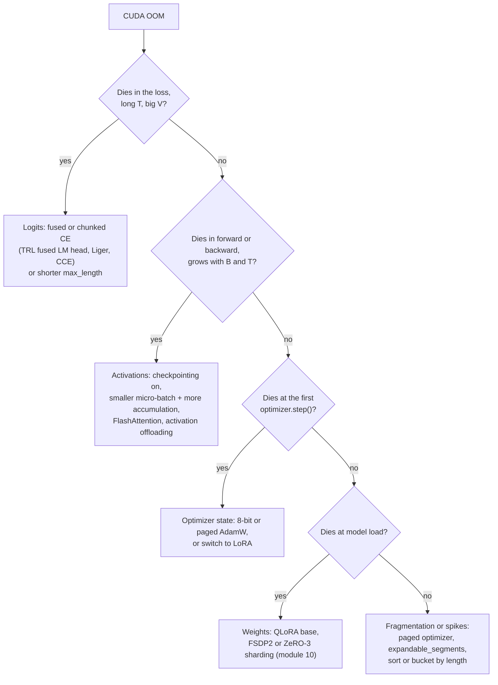

# 03 — Training Mechanics: Optimizers, Schedules, and Memory Math

> **Prerequisites:** module 02.
> **You will learn:** how to predict whether a run fits and how long it takes: the
> bytes-per-parameter budget, activation and logits memory, effective batch and
> loss normalisation, optimizers, schedules, and how to read the curves.

Before you rent a GPU you should be able to say three things: whether the run fits, roughly how long it will take, and which knob you will turn when it runs out of memory or diverges. This module is the numerical core of the course. Every later module (LoRA, distributed training, preference optimisation, RL) reuses the arithmetic here.

The Transformers course already derives the causal-LM objective, the mixed-precision formats, the 16 bytes per parameter rule and gradient checkpointing in [module 13](../transformers/13-training-considerations.md).

---

## 3.1 Where the memory goes

### The four buckets

Peak GPU memory during a training step is the sum of four buckets plus overhead:

| Bucket | Scales with | Lives for |
|---|---|---|
| **Weights** | parameter count $N$ and storage dtype | the whole run |
| **Gradients** | *trainable* parameters | backward until the optimizer step |
| **Optimizer state** (plus fp32 master weights if used) | trainable parameters and optimizer | the whole run |
| **Activations** | $B \cdot T \cdot d \cdot L$, plus logits $B \cdot T \cdot V$ | forward until backward consumes them |
| Overhead | CUDA context, allocator fragmentation, temporary buffers | the whole run |

The first three are **static**: you can compute them from the config before you start. Activations are **dynamic**: they depend on batch size and sequence length, and they peak at the start of the backward pass. The overhead term is real: this course assumes **1 to 2 GB** for CUDA context, cuBLAS workspaces and fragmentation; measure it once on your own stack and replace the assumption.

All numbers below use GB $= 10^9$ bytes.

### Full fine-tuning: 16 to 18 bytes per parameter

Full fine-tuning with AdamW in bf16 mixed precision keeps five copies of information per parameter. There are two common routes, and they land in the same place.

| Component | Route A: bf16 params + fp32 master | Route B: native autocast (fp32 params) |
|---|---|---|
| Weights used in forward/backward | 2 (bf16) | 4 (fp32) |
| Gradients | 2 (bf16) | 4 (fp32) |
| fp32 master weights | 4 | (the fp32 params are the master) |
| Adam first moment $m$ | 4 | 4 |
| Adam second moment $v$ | 4 | 4 |
| **Total** | **16** | **16** |
| fp32 gradient-accumulation buffer in place of bf16 grads (some DeepSpeed/Megatron setups) | 4 instead of 2 → **18** | n/a |

Route A is what DeepSpeed and Megatron-style mixed precision do. Route B is what `torch.autocast` plus a plain `torch.optim.AdamW` does, and what you get from TRL by default: TRL trainers load the model in **float32 unless you pass `model_init_kwargs={"dtype": ...}`** ([SFTTrainer docs, v1.15.0](https://huggingface.co/docs/trl/v1.15.0/en/sft_trainer)), and `bf16=True` then autocasts the matmuls. The "18" is an assumption about extra buffers, not a law: say which one you mean.

So **an 8B model needs 8e9 × 16 = 128 GB of state before a single activation** (nominal 8e9; the exact 8.03B gives 128.5 GB), and a 7B model needs 112 GB. Full fine-tuning of an 8B model therefore does not fit on one 80 GB card. 8-bit optimizer state (section 3.2) brings it to about 80 GB, still over the card once activations and overhead are added, so you need sharding or CPU offload (module [10](./10-distributed-fine-tuning-and-moe.md)), or must also drop the fp32 master copy and accept the precision risk in section 3.6.

A third route deserves a warning. If you load the model in bf16 (`dtype=torch.bfloat16`) and hand it to a plain AdamW, PyTorch keeps $m$ and $v$ in the parameter dtype: **2 + 2 + 2 + 2 = 8 bytes per parameter, with no fp32 master copy**. It fits in half the memory and silently loses small updates, because updates smaller than about 0.002 (half the $2^{-8}$ spacing below 1.0) round to nothing. Check 3.5 in section 3.6 shows the update vanishing.

### LoRA and QLoRA change which buckets are big

LoRA freezes the base and trains low-rank adapters (module [06](./06-lora-and-qlora.md) derives everything). For memory, the effect is simple: **the frozen base costs only its storage bytes, with no gradients and no optimizer state; the adapters pay the full 16 bytes per parameter.**

- **LoRA**: base in bf16 at 2 bytes/param.
- **QLoRA**: base in NF4 with double-quantized scales at **4.127 bits/param ≈ 0.516 bytes/param** (the 4.127 is derived in module 06).

For a Llama-3.1-8B-shaped model ($d = 4096$, $d_{kv} = 1024$, $d_{ff} = 14336$, $L = 32$) with rank $r = 16$ on all seven linear layers per block, the adapter count is

$$
L \cdot r \cdot \big[\underbrace{2(d+d)}_{q,\,o} + \underbrace{2(d+d_{kv})}_{k,\,v} + \underbrace{3(d+d_{ff})}_{\text{gate, up, down}}\big] = 32 \cdot 16 \cdot 81{,}920 = 41{,}943{,}040.
$$

| | Base | Adapter state (41,943,040 × 16 B) | Total before activations |
|---|---|---|---|
| Full FT | 8e9 × 16 B = 128.0 GB | n/a | **128.0 GB** |
| LoRA (bf16 base) | 8e9 × 2 B = 16.0 GB | 0.671 GB | **16.67 GB** |
| QLoRA (NF4 base) | 8e9 × 4.127/8 B = 4.127 GB | 0.671 GB | **4.80 GB** |

The adapter state is under 1 GB at any reasonable rank. **For LoRA and QLoRA, memory is dominated by the frozen base and the activations, not by the optimizer.** That is why 8-bit optimizers barely matter for LoRA and matter enormously for full fine-tuning.

Check 3.1 implements the estimator and recomputes the adapter count from shapes, so 41,943,040 is not a magic constant.

```python finetuning-check
def estimate(params, method, adapter_params=0, bits=16, grad_accum_buffer=False):
    """Static training state in GB (1e9 bytes): weights, grads, master, optimizer."""
    gb = 1e9
    if method == "full":
        out = {"weights": 2 * params, "adapter_weights": 0,
               "grads": 2 * params + (2 * params if grad_accum_buffer else 0),
               "master": 4 * params, "optimizer": 8 * params}
    else:  # frozen base at `bits`, adapters carry the full 16 bytes/param
        out = {"weights": params * bits / 8, "adapter_weights": 2 * adapter_params,
               "grads": 2 * adapter_params, "master": 4 * adapter_params,
               "optimizer": 8 * adapter_params}
    out = {k: v / gb for k, v in out.items()}
    parts = ("adapter_weights", "grads", "master", "optimizer")
    out["adapter_state"] = sum(out[k] for k in parts) if method != "full" else 0.0
    out["total"] = out["weights"] + sum(out[k] for k in parts)
    return out

# Adapter count from Llama-3.1-8B shapes, r=16, all seven linear layers per block.
d, d_kv, d_ff, L, r = 4096, 1024, 14336, 32, 16
shapes = [(d, d), (d, d_kv), (d, d_kv), (d, d), (d, d_ff), (d, d_ff), (d_ff, d)]
adapters = L * sum(r * (i + o) for i, o in shapes)
assert adapters == 41_943_040

assert estimate(8e9, "full")["total"] == 128.0
assert estimate(8e9, "full", grad_accum_buffer=True)["total"] == 144.0
assert estimate(7e9, "full")["total"] == 112.0

lora = estimate(8e9, "lora", adapters, bits=16)
assert lora["weights"] == 16.0
assert round(lora["adapter_state"], 3) == 0.671
assert round(lora["total"], 2) == 16.67

qlora = estimate(8e9, "qlora", adapters, bits=4.127)
assert round(qlora["weights"], 3) == 4.127
assert abs(qlora["total"] - 4.798) < 1e-3

# Throughput arithmetic from section 3.7: 8B full FT, 3,000 tokens/s/GPU on an H100.
mfu = 6 * 8e9 * 3000 / 989e12
assert round(100 * mfu, 1) == 14.6
print("memory estimator verified")
```

The check proves the arithmetic of the static buckets. It does not prove that a real run fits: activations, logits and overhead come next, and kernels add buffers no formula sees.

Table 1 puts the static numbers next to what Unsloth publishes as minimum VRAM. Adapter counts use real shapes ($r = 16$, all-linear): Llama-3.2-1B, Llama-3.1-8B, Qwen3-32B and Llama-3.1-70B configs, computed by the lab's calculator. Base sizes are nominal ($N$ = 1, 8, 32, 70 B); `--exact-params` in the calculator uses the real counts.

| Size | Full FT (16 B/p) | LoRA: bf16 base + adapter state | QLoRA: NF4 base + adapter state | Unsloth minimum VRAM, LoRA 16-bit / QLoRA 4-bit |
|---|---|---|---|---|
| 1B | 16 GB | 2.18 GB (11.3M adapters) | 0.70 GB | not listed (smallest row is 3B: 8 / 3.5 GB) |
| 8B | 128 GB | 16.67 GB (41.9M) | 4.80 GB | 22 / 6 GB |
| 32B | 512 GB | 66.15 GB (134.2M) | 18.66 GB | 76 / 26 GB |
| 70B | 1,120 GB | 143.31 GB (207.1M) | 39.42 GB | 164 / 41 GB |

The last column is from the [Unsloth requirements page](https://unsloth.ai/docs/get-started/fine-tuning-for-beginners/unsloth-requirements), fetched 10 October 2026, which calls the figures the "absolute minimum". **Measured numbers sit above the static estimate** because of activations, the logits buffer, CUDA context and fragmentation, and NF4 implementations that keep embeddings, norms and often `lm_head` in 16-bit. Treat any static estimate as a floor, then add activations.

### Activation memory

Activations scale as $B \cdot T \cdot d \cdot L$ times a per-layer constant. Korthikanti et al. (2022), [Reducing Activation Recomputation in Large Transformer Models](https://huggingface.co/papers/2205.05198), give the per-layer estimate for a GPT-style block with 16-bit activations and no recomputation or parallelism:

$$
\text{activations per layer} \approx s\,b\,h\left(34 + \frac{5\,a\,s}{h}\right) \text{ bytes},
$$

with $s$ the sequence length ($T$), $b$ the micro-batch ($B$), $h$ the hidden size ($d$) and $a$ the number of heads. The $34\,sbh$ term covers the stored inputs of the QKV projection, attention output, MLP and norms, plus dropout masks. The $5as^2b$ term is the attention score matrix, its softmax and its dropout mask: it is **quadratic in sequence length**.

FlashAttention never materialises the $s \times s$ scores; it recomputes them in backward from $Q$, $K$, $V$ and the softmax statistics ([Transformers module 11](../transformers/11-hardware-aware-attention.md)). **With FlashAttention or a memory-efficient SDPA kernel, the $5as/h$ term disappears** and activations become linear in $T$.

Worked example with Qwen3-4B dimensions ($h = 2560$, $a = 32$, $L = 36$; from its [config.json](https://huggingface.co/Qwen/Qwen3-4B/blob/1cfa9a7208912126459214e8b04321603b3df60c/config.json)), $T = 2048$, $B = 1$. Then $sbh = 5{,}242{,}880$ and $5as/h = 128$.

| Setting | Per layer | × 36 layers |
|---|---|---|
| Eager attention, no checkpointing: $sbh(34 + 128)$ | 0.849 GB | **30.6 GB** |
| FlashAttention, no checkpointing: $34\,sbh$ | 0.178 GB | **6.42 GB** |
| FlashAttention + per-block checkpointing: $2\,sbh$ per layer kept, one layer's $34\,sbh$ during recompute | — | **0.56 GB** |

Treat these as ±30% estimates. The constant 34 was derived for a 4h GELU MLP and full multi-head attention; Qwen3 uses SwiGLU with $d_{ff} = 3.8h$, grouped-query attention and a query width of 4096, not 2560. The ordering of the three rows is what matters: **eager attention at 2k context already costs more than the whole bf16 base of a 4B model, and checkpointing brings activations below 1 GB.**

### The logits problem

The last activation is the biggest one at long context. The LM head produces logits of shape $(B, T, V)$, and modern vocabularies are large: Qwen3 has $V = 151{,}936$. The loss upcasts logits to fp32 for a stable log-softmax.

$$
151{,}936 \times 8{,}192 \times 4\ \text{bytes} = 4.98\ \text{GB per sequence}.
$$

That is one copy. A naive implementation holds the bf16 logits (2.49 GB), the fp32 upcast (4.98 GB), and then a gradient of the same shape in backward, so the transient peak is **several times the 4.98 GB**, for a single 8k sequence. At 8k context the logits can outweigh every transformer layer's checkpointed activations combined.

The fix is to **never materialise the full logits**. Chunked (or fused) cross-entropy processes $T$ in tiles: project a tile of hidden states through the LM head, compute its log-softmax and loss, accumulate the gradient for the head weight, and discard the tile. Variants:

- **Liger Kernel**'s fused linear cross-entropy, Hsu et al. (2024), [arXiv 2410.10989](https://arxiv.org/abs/2410.10989), reporting on average 20% higher throughput and 60% lower GPU memory than Hugging Face implementations across their benchmarks.
- **Cut Cross-Entropy**, Wijmans et al. (2024), [arXiv 2411.09009](https://arxiv.org/abs/2411.09009), which computes the loss without storing logits in global memory and reports Gemma 2 (2B) loss-computation memory falling from 24 GB to 1 MB.
- **TRL's fused LM head**, on by default for SFT, DPO, KTO, GRPO, RLOO and Distillation since [TRL v1.15.0](https://github.com/huggingface/trl/releases/tag/v1.15.0) (8 October 2026), which reports up to 6.9× longer sequences on the same GPU. Module [08](./08-frameworks-and-tooling.md) covers the switch and its interactions; the deprecation of `use_liger_kernel` in DPO/KTO/GRPO/RLOO in favour of `model_init_kwargs={"use_kernels": True}` is covered there too.

At very long context, even fused cross-entropy and checkpointing eventually run out of room on one GPU, and sequence parallelism takes over; that is module [17](./17-long-context-extension.md).

Check 3.2 asserts the 4.98 GB and proves the chunked loss is exact, not an approximation.

```python finetuning-check
import torch
import torch.nn.functional as F

assert round(151_936 * 8_192 * 4 / 1e9, 2) == 4.98   # fp32 logits, one 8k sequence

torch.manual_seed(0)
T, d, V, chunk = 64, 16, 101, 16
h = torch.randn(T, d, dtype=torch.float64)                       # (T, d) final hidden states
W = torch.randn(V, d, dtype=torch.float64, requires_grad=True)   # (V, d) LM head
y = torch.randint(0, V, (T,))

full = F.cross_entropy(h @ W.T, y, reduction="sum")              # materialises (T, V)
(g_full,) = torch.autograd.grad(full, W)

total, g_chunk, biggest = torch.zeros((), dtype=torch.float64), torch.zeros_like(W), 0
for start in range(0, T, chunk):
    logits = h[start:start + chunk] @ W.T                        # (16, V), never (T, V)
    biggest = max(biggest, logits.numel())
    loss = F.cross_entropy(logits, y[start:start + chunk], reduction="sum")
    (g,) = torch.autograd.grad(loss, W)                          # frees this chunk's graph
    total, g_chunk = total + loss.detach(), g_chunk + g

assert biggest == chunk * V
torch.testing.assert_close(total, full.detach(), rtol=1e-6, atol=1e-6)
torch.testing.assert_close(g_chunk, g_full, rtol=1e-6, atol=1e-6)
print("chunked cross-entropy verified")
```

The check proves that summing per-chunk losses and gradients reproduces the full loss and head gradient exactly. It does not prove a speed or memory win: real fused kernels also avoid storing the chunk for backward (they recompute it) and run in Triton.

---

## 3.2 Cutting memory: checkpointing, offloading, paged and 8-bit optimizers

### Gradient (activation) checkpointing

**Store only each block's input in the forward pass; recompute the block's internals during backward.** Per-layer activation memory drops from $34\,sbh$ to $2\,sbh$, plus one block's internals during recompute (the 0.56 GB row above). The cost is one extra forward pass. If backward costs about twice the forward, a step goes from $F + 2F = 3F$ to $4F$: **about 33% more step time** for an order of magnitude less activation memory. [Transformers module 13](../transformers/13-training-considerations.md#134-the-memory-budget) derives the checkpoint placement trade-offs; do not re-derive them here.

In TRL, gradient checkpointing is **on by default in every trainer** ([Reducing memory usage](https://huggingface.co/docs/trl/main/en/reducing_memory_usage), as of October 2026), whereas plain `TrainingArguments` defaults to off. Turn it off only when you have measured that activations fit and want that extra forward pass (a quarter of the checkpointed step time) back.

**Selective checkpointing** recomputes only the cheap-to-recompute, expensive-to-store parts. Korthikanti et al. recompute the attention core (the $5as/h$ term) and keep the linear-layer inputs, which removes most of the memory at a fraction of the recompute. With FlashAttention that term is already gone, so TRL's selective mode inverts the idea: it **saves the attention output** and recomputes the rest, recovering most of the checkpointing slowdown at long context for one hidden-sized tensor per layer (`gradient_checkpointing_kwargs={"selective": True}` in `SFTConfig`, per the same TRL page, as of October 2026).

### Activation offloading

Instead of recomputing, **move saved activations to CPU RAM during forward and bring them back for backward.** TRL implements this with PyTorch's `saved_tensors_hooks` behind `SFTConfig(activation_offloading=True)`. It trades PCIe bandwidth for memory; it works best when the copies overlap with compute and when the CPU has pinned memory to spare.

**Unsloth's offloaded gradient checkpointing** combines both ideas: checkpoint at block boundaries, then offload those boundary tensors to CPU asynchronously. You enable it with `use_gradient_checkpointing="unsloth"` in `FastLanguageModel.get_peft_model`. Unsloth reports that it "reduces memory usage by an extra 30% and supports extremely long context fine-tunes" ([LoRA hyperparameters guide](https://unsloth.ai/docs/get-started/fine-tuning-llms-guide/lora-hyperparameters-guide)); that is a vendor claim measured on their kernels.

### 8-bit Adam and paged optimizers

Two separate ideas from bitsandbytes often get conflated:

- **8-bit optimizer state** (Dettmers et al., 2021, [8-bit Optimizers via Block-wise Quantization](https://arxiv.org/abs/2110.02861)): Adam's $m$ and $v$ are stored as 8-bit codes, quantized block-wise (each block of 2,048 values has its own fp32 scale) with a dynamic, non-linear code. State drops from 8 bytes to **about 2 bytes per parameter** (two 1-byte moments plus 4/2048 bytes of scale each). The update is still computed in 32-bit after dequantization. For full fine-tuning of an 8B model, that is 64 GB → 16 GB.
- **Paged optimizers** (introduced with QLoRA, Dettmers et al., 2023, [arXiv 2305.14314](https://arxiv.org/abs/2305.14314)): the optimizer state is allocated in NVIDIA unified memory, so when a long sequence causes a memory spike the driver pages state out to CPU RAM instead of raising OOM. Nothing is quantized by paging itself; it is a safety valve for spikes.

Both are selected through `optim`: `"adamw_8bit"` (alias of `"adamw_bnb_8bit"`), `"paged_adamw_8bit"`, `"paged_adamw_32bit"`, and Lion equivalents ([`OptimizerNames`, Transformers v5.19.0](https://github.com/huggingface/transformers/blob/c4c4605f961877852b89b97478536bb3a26b6fd1/src/transformers/training_args.py#L118-L158)). For LoRA, where the state is 0.34 GB, the 8-bit variant saves about 0.25 GB. **Use 8-bit and paged optimizers for full fine-tuning; for LoRA, use them only as the spike safety valve.**

### OOM triage

When a run dies with `CUDA out of memory`, work out which bucket is big before reaching for a knob.



The order matters. A first OOM at the optimizer step means the static state does not fit, and no activation trick will save you. An OOM that appears only after hundreds of steps usually means one unusually long batch: cap `max_length`, or use packing so every batch has the same token count.

---

## 3.3 Batch size, gradient accumulation, and loss normalisation

**Effective batch size = per-device micro-batch × gradient accumulation steps × number of data-parallel ranks.** For LLMs the quantity that controls gradient noise is **tokens per optimizer step**, not sequences: 16 sequences of 300 tokens and 16 sequences of 4,000 tokens are very different batches.

| Knob | `TrainingArguments` name | Memory effect | Step-time effect |
|---|---|---|---|
| Micro-batch $B$ | `per_device_train_batch_size` | activations ∝ $B$ | better GPU utilisation up to saturation |
| Accumulation $K$ | `gradient_accumulation_steps` | none | $K$ forward/backward passes per optimizer step |
| Ranks $R$ | `accelerate launch --num_processes` | weights replicated unless sharded | communication per step |

Unsloth's starting recommendation is micro-batch 2 with accumulation 8, an effective batch of 16, and to "always prefer to set a smaller batch_size and increase gradient_accumulation_steps" when memory is tight ([LoRA hyperparameters guide](https://unsloth.ai/docs/get-started/fine-tuning-llms-guide/lora-hyperparameters-guide)).

### The gradient-accumulation loss bug class

Accumulation is supposed to be equivalent to one big batch. It is equivalent **only if the loss is normalised by the total number of trained tokens across the whole effective batch**.

Let micro-batch $k$ have $n_k$ trained tokens (labels not equal to −100; module [02](./02-tokens-templates-and-the-causal-lm-objective.md) covers the label shift and the ignore index) and summed token loss $S_k$. The objective you want is the token mean over the effective batch:

$$
\mathcal{L}_{\text{correct}} = \frac{\sum_k S_k}{\sum_k n_k}.
$$

The naive loop computes each micro-batch's mean, divides by $K$ and accumulates:

$$
\mathcal{L}_{\text{buggy}} = \frac{1}{K}\sum_k \frac{S_k}{n_k}.
$$

These agree only when every $n_k$ is equal. Worked example: two micro-batches with $n = (2, 6)$ trained tokens and per-token losses of 1.0 and 0.5.

$$
\mathcal{L}_{\text{correct}} = \frac{2(1.0) + 6(0.5)}{8} = 0.625, \qquad \mathcal{L}_{\text{buggy}} = \frac{1.0 + 0.5}{2} = 0.75.
$$

The buggy version gives each of the 2 tokens in the short micro-batch 3× the weight of each token in the long one. The bias is systematic: short examples are over-weighted, and the loss you log changes when you change `gradient_accumulation_steps`.

This is exactly the bug Unsloth reported in the Hugging Face Trainer in October 2024. The fix, described in the HF blog post [Fixing Gradient Accumulation](https://huggingface.co/blog/gradient_accumulation) (16 October 2024), passes `num_items_in_batch` (the global trained-token count) into the loss, which then sums and divides once. Across ranks the same problem recurs: each rank must divide by the *global* count, which needs an all-reduce of token counts. That is `average_tokens_across_devices`, which **defaults to `True`** in Transformers v5 `TrainingArguments` and in `SFTConfig` as of October 2026 ([Trainer docs, v5.19.0](https://huggingface.co/docs/transformers/v5.19.0/en/main_classes/trainer); see [issue 34242](https://github.com/huggingface/transformers/issues/34242)). If you write a custom loss, accept `num_items_in_batch` and divide by it; otherwise you have reintroduced the bug.

Check 3.3 builds the three versions on a tiny linear model and compares gradients.

```python finetuning-check
import torch
import torch.nn.functional as F

torch.manual_seed(0)
V, d = 11, 5
W = torch.randn(V, d, requires_grad=True)
h1, y1 = torch.randn(6, d), torch.randint(0, V, (6,))
y1[2:] = -100                              # micro-batch 1: 2 trained tokens
h2, y2 = torch.randn(6, d), torch.randint(0, V, (6,))   # micro-batch 2: 6 trained tokens
micro = [(h1, y1), (h2, y2)]

# (a) one big batch, token mean over all 8 trained tokens
loss_a = F.cross_entropy(torch.cat([h1, h2]) @ W.T, torch.cat([y1, y2]), ignore_index=-100)
(g_a,) = torch.autograd.grad(loss_a, W)

# (b) accumulate summed losses, divide by the global token count
n_total = sum(int((y != -100).sum()) for _, y in micro)
assert n_total == 8
g_b = torch.zeros_like(W)
for h, y in micro:
    s = F.cross_entropy(h @ W.T, y, ignore_index=-100, reduction="sum") / n_total
    (g,) = torch.autograd.grad(s, W)
    g_b += g
torch.testing.assert_close(g_a, g_b)

# (c) the bug: mean per micro-batch, averaged over micro-batches
g_c = torch.zeros_like(W)
for h, y in micro:
    m = F.cross_entropy(h @ W.T, y, ignore_index=-100) / len(micro)
    (g,) = torch.autograd.grad(m, W)
    g_c += g
assert (g_a - g_c).abs().max() > 1e-4

# The worked scalar example from the prose.
tok1, tok2 = torch.full((2,), 1.0), torch.full((6,), 0.5)
correct = (tok1.sum() + tok2.sum()) / 8
buggy = (tok1.mean() + tok2.mean()) / 2
assert abs(correct.item() - 0.625) < 1e-12 and abs(buggy.item() - 0.75) < 1e-12
print("gradient accumulation normalisation verified")
```

The check proves that sum-then-divide-by-global-count accumulation reproduces the big-batch gradient and that per-micro-batch averaging does not. It does not test the distributed all-reduce, mixed precision accumulation, or any library's implementation.

**So, is gradient accumulation identical to a bigger batch?** Mathematically yes, with two conditions: the loss is normalised by the global trained-token count, and the model has no batch-dependent layers (BatchNorm, in-batch negatives in contrastive losses, MoE load-balancing losses computed per micro-batch). Decoder LLMs mostly satisfy the second; the first is the one that bit everyone in 2024. Numerically, bf16 accumulation order can also differ slightly.

---

## 3.4 Optimizers

The [optimisation note](../../notes/deep-learning/optimization-and-training.md) derives SGD, Adam and AdamW. Here the question is narrower: what each costs in memory and when it is worth changing from the default.

- **AdamW** (Loshchilov and Hutter, [arXiv 1711.05101](https://arxiv.org/abs/1711.05101)) is the default. In Transformers v5.19, `optim` defaults to `"adamw_torch_fused"` on torch ≥ 2.8, and `SFTConfig` lists `adamw_torch_fused` explicitly. **Fused** means one CUDA kernel updates all parameters' $m$, $v$ and weights together instead of launching several kernels per tensor: same maths, fewer launches, measurably faster for models with many small tensors.
- **Adafactor** (Shazeer and Stern, 2018, [arXiv 1804.04235](https://arxiv.org/abs/1804.04235)) **factors the second moment** of each $r \times c$ matrix into a row vector and a column vector ($r + c$ numbers instead of $rc$), and by default keeps **no first moment**. For a 4096 × 14336 MLP matrix, state is 4 × (4096 + 14336) = 73.7 KB instead of 8 × 58.7M = 470 MB. The price is noisier updates and more sensitivity to the learning rate; it was the T5 default.
- **Lion** (Chen et al., 2023, [Symbolic Discovery of Optimization Algorithms](https://arxiv.org/abs/2302.06675)) keeps **one momentum buffer** and applies the **sign** of an interpolated momentum, so every coordinate moves by exactly the learning rate. Half of Adam's state. Because sign updates have a larger norm, the paper recommends a learning rate 3 to 10 times smaller than AdamW's and a correspondingly larger weight decay.
- **Muon** (Liu et al., 2025, [arXiv 2502.16982](https://arxiv.org/abs/2502.16982)) orthogonalises each 2D momentum update with Newton–Schulz iterations; embeddings, head, norms and biases stay on AdamW ([`torch.optim.Muon`](https://docs.pytorch.org/docs/2.14/generated/torch.optim.Muon.html)). Its ~2× efficiency is a pretraining result. The paper's own SFT ablation (§3.5) found no significant advantage "when the SFT optimizer differs from the pretraining optimizer", and [Qu et al. (2026)](https://arxiv.org/abs/2605.10468) report that Muon fine-tuning of Adam-pretrained models degrades them, less so under LoRA. **Keep AdamW for fine-tuning unless you have a Muon-pretrained base and a reason.** [Transformers module 13](../transformers/13-training-considerations.md#135-optimizers-and-muon) covers Muon's role in pretraining.

| Optimizer | State bytes per trainable param | Notes | When to use in fine-tuning |
|---|---|---|---|
| AdamW (fused) | 8 (+4 fp32 master in route A) | default; `adamw_torch_fused` | almost always |
| 8-bit AdamW | ~2 | block-wise quantized moments; `adamw_8bit` | full FT that is short on memory |
| Paged AdamW (8 or 32-bit) | ~2 or 8, can spill to CPU | unified memory; `paged_adamw_8bit` | QLoRA and spiky long-context runs |
| Adafactor | $O(r + c)$ per matrix (≈ 0) | factored $v$, no $m$ by default | full FT under extreme memory pressure; tune the LR |
| Lion | 4 | sign updates; LR 3–10× lower than AdamW | rarely; needs its own LR sweep |
| Muon | 4 (momentum) for matrices + 8 (AdamW) for the rest | Newton–Schulz orthogonalised updates | only with a Muon-pretrained base, or research |
| SGD + momentum | 4 | poor fit for transformers | no |

Memory-efficient *full-parameter* methods that project gradients into a low-rank subspace, GaLore (Zhao et al., 2024, [arXiv 2403.03507](https://arxiv.org/abs/2403.03507)) and APOLLO, and LoRA-specific optimizers such as LoRA+ and LoRA-FA, are covered in module [07](./07-the-wider-peft-landscape.md).

---

## 3.5 Learning rate, schedules and regularisation

### Schedules

With $\eta_{\max}$ the peak learning rate, $t_w$ warmup steps and $T_{\text{tot}}$ total steps (the symbol $T$ is reserved for sequence length):

**Linear warmup**, for $t < t_w$:

$$
\eta_t = \eta_{\max}\,\frac{t}{t_w}.
$$

Warmup protects the first steps, when Adam's second-moment estimate is built from few samples and is noisy. For fine-tuning, **3 to 10% of steps** is typical; Unsloth recommends 5 to 10%. In Transformers v5, `warmup_steps` accepts either an integer or a float in $[0, 1)$ interpreted as a fraction of total steps, and defaults to 0 ([Trainer docs, v5.19.0](https://huggingface.co/docs/transformers/v5.19.0/en/main_classes/trainer)).

**Cosine decay** after warmup:

$$
\eta_t = \eta_{\min} + \tfrac12(\eta_{\max} - \eta_{\min})\left(1 + \cos\!\left(\pi\,\frac{t - t_w}{T_{\text{tot}} - t_w}\right)\right).
$$

**Linear decay** replaces the cosine with $1 - \frac{t - t_w}{T_{\text{tot}} - t_w}$. It is the `TrainingArguments` default (`lr_scheduler_type="linear"`). **Constant with warmup** holds $\eta_{\max}$ after warmup and is common for short LoRA runs and for RL.

**WSD (warmup–stable–decay)** warms up, holds $\eta_{\max}$ for most of training, and then decays to zero over the last 10 to 20% of steps, linearly or with $1 - \sqrt{\cdot}$ (Hu et al., 2024, [MiniCPM](https://arxiv.org/abs/2404.06395); Hägele et al., 2024, [arXiv 2405.18392](https://arxiv.org/abs/2405.18392)). Its practical advantage is that **you do not need to know the total step count in advance**: any checkpoint from the stable phase can be branched into a short decay, and continued training resumes from the stable phase rather than from a decayed, low-LR endpoint. That makes it a natural fit for continued pretraining (module [05](./05-supervised-fine-tuning.md)). Transformers exposes it as `lr_scheduler_type="warmup_stable_decay"` with `decay_type` in {`linear`, `cosine`, `1-sqrt`} ([`get_wsd_schedule`, v5.19.0](https://github.com/huggingface/transformers/blob/c4c4605f961877852b89b97478536bb3a26b6fd1/src/transformers/optimization.py#L470-L520)).

Worked values with $\eta_{\max} = 2\times10^{-4}$, $t_w = 10$, $T_{\text{tot}} = 100$, $\eta_{\min} = 0$: at $t = 5$, $\eta = 10^{-4}$ (half-way up the warmup); at $t = 10$, $2\times10^{-4}$; at $t = 55$ the cosine argument is $\pi/2$, so $\eta = 10^{-4}$; at $t = 100$, $\eta = 0$.

Check 3.4 implements warmup-plus-cosine and WSD as plain functions, asserts those values, and confirms `LambdaLR` reproduces them.

```python finetuning-check
import math
import torch

ETA, TW, TOT = 2e-4, 10, 100

def warmup_cosine(t, eta_min=0.0):
    if t < TW:
        return ETA * t / TW
    p = (t - TW) / (TOT - TW)
    return eta_min + 0.5 * (ETA - eta_min) * (1 + math.cos(math.pi * p))

def wsd(t, decay_frac=0.2):
    decay_start = TOT - int(decay_frac * TOT)
    if t < TW:
        return ETA * t / TW
    if t < decay_start:
        return ETA
    return ETA * (1 - (t - decay_start) / (TOT - decay_start))

for t, want in [(5, 1e-4), (10, 2e-4), (55, 1e-4), (100, 0.0)]:
    assert abs(warmup_cosine(t) - want) < 1e-12

assert all(wsd(t) == ETA for t in range(TW, 80))      # flat stable phase
assert wsd(TOT) == 0.0
for f in (warmup_cosine, wsd):
    after = [f(t) for t in range(TW, TOT + 1)]
    assert all(a >= b for a, b in zip(after, after[1:]))   # monotone non-increasing

# torch's LambdaLR multiplies the base LR by the lambda; it must reproduce the same curve.
p = torch.nn.Parameter(torch.zeros(1))
opt = torch.optim.SGD([p], lr=ETA)
sched = torch.optim.lr_scheduler.LambdaLR(opt, lambda t: warmup_cosine(t) / ETA)
seen = []
for t in range(TOT + 1):
    seen.append(opt.param_groups[0]["lr"])
    opt.step()
    sched.step()
for t in (5, 10, 55, 100):
    assert abs(seen[t] - warmup_cosine(t)) < 1e-12
print("schedules verified")
```

The check proves the formulas and the four worked values. It does not tell you which schedule gives the best model; for short fine-tuning runs the choice among linear, cosine and constant usually matters less than the peak learning rate.

### Typical learning rates per stage

The peak learning rate is the hyperparameter that matters most. Starting points, as of October 2026:

| Stage | Full fine-tuning | LoRA / QLoRA |
|---|---|---|
| SFT | 1e-5 to 2e-5. `SFTConfig` default is 2e-5 ([TRL v1.15.0](https://huggingface.co/docs/trl/v1.15.0/en/sft_trainer)). Liu et al. used 5e-5 with linear decay to 0 for SFT of their 16B-total MoE ([Muon paper, §3.5](https://arxiv.org/abs/2502.16982)) | 1e-4 to 2e-4. TRL suggests ≈1e-4 for adapters ([SFT docs](https://huggingface.co/docs/trl/v1.15.0/en/sft_trainer)); Unsloth recommends 2e-4 as a starting point ([guide](https://unsloth.ai/docs/get-started/fine-tuning-llms-guide/lora-hyperparameters-guide)) |
| DPO | 1e-6, the `DPOConfig` default ([TRL v1.15.0](https://huggingface.co/docs/trl/v1.15.0/en/dpo_trainer)) | 5e-6 (Unsloth's RL recommendation) to ~1e-5 (10× the full-FT value) |
| GRPO | 1e-6, the `GRPOConfig` default ([TRL v1.15.0](https://huggingface.co/docs/trl/v1.15.0/en/grpo_trainer)) | 5e-6 ([Unsloth guide](https://unsloth.ai/docs/get-started/fine-tuning-llms-guide/lora-hyperparameters-guide)) |

The roughly 10× gap between the columns is systematic: Thinking Machines' [LoRA Without Regret](https://thinkingmachines.ai/blog/lora/) reports that the optimal LoRA learning rate is about 10× the full fine-tuning one across their sweeps. Module [06](./06-lora-and-qlora.md) shows how the LoRA scale $\gamma_r$ couples $\alpha$ and the learning rate; the 10× ratio itself is empirical. Lab L3.3 reproduces the effect qualitatively.

### Regularisation

The [regularisation note](../../notes/deep-learning/regularization-and-normalization.md) covers the theory. For fine-tuning:

- **Weight decay**: 0 to 0.1. `TrainingArguments` defaults to 0; Unsloth recommends 0.01 to 0.1 and warns against large values. Decay is excluded from biases and norm weights automatically. For LoRA, decay pulls the adapter towards zero, which means towards the base model: it is a mild regulariser towards the starting point.
- **Dropout**: usually 0 for LoRA. Unsloth notes that "for the short training runs common in fine-tuning, lora_dropout may be an unreliable regularizer". Pretrained checkpoints like Qwen3 and Llama 3 ship with attention dropout 0 and you should leave it there.
- **NEFTune** (Jain et al., 2023, [arXiv 2310.05914](https://arxiv.org/abs/2310.05914)) adds uniform noise to the input embeddings during training only:

$$
\tilde{X}_{\text{emb}} = X_{\text{emb}} + \frac{\alpha}{\sqrt{T\,d}}\,\epsilon, \qquad \epsilon \sim \mathcal{U}(-1, 1)^{T \times d},
$$

with $T$ the sequence length (the paper writes $L$) and $d$ the embedding width. The $1/\sqrt{Td}$ scaling keeps the expected noise norm constant as length and width change. The paper reports large gains on length-unadjusted AlpacaEval (29.79% → 64.69% for LLaMA-2-7B on Alpaca), partly from longer answers; see module [09](./09-evaluating-fine-tuned-models.md). Enable it with `neftune_noise_alpha=5` (the paper's typical values are 5 to 15).
- **Early stopping** on eval loss: set `eval_strategy="steps"`, `load_best_model_at_end=True`, `metric_for_best_model="eval_loss"` and add `EarlyStoppingCallback`. The save and eval strategies must match.
- **Epochs**: **1 to 3 for SFT.** Unsloth: "training for more than 3 epochs offers diminishing returns and increases the risk of overfitting". Note that `SFTConfig` defaults `num_train_epochs=3.0`, the top of that range. "More epochs help small datasets" is the misconception: on 500 examples, epoch 5 teaches the model the exact phrasing of 500 answers, not the task. If the data is small, get more data or lower the learning rate.

---

## 3.6 Stability: clipping, spikes and NaNs

### Mixed precision mechanics and master weights

Module [02](./02-tokens-templates-and-the-causal-lm-objective.md) has the format table: bf16 keeps fp32's 8-bit exponent and has 8 bits of significand precision (7 stored + 1 implicit); fp16 has a 5-bit exponent and 11 bits (10 stored + 1 implicit); T4 and V100 GPUs lack bf16. The mechanics that matter for training:

1. **Autocast** chooses per-operation dtypes: matmuls run in bf16/fp16, while reductions, softmax and the loss stay in fp32.
2. **An fp32 master copy** of the weights receives the update. This is the point of the 4 bytes in route A: an update of $10^{-4}$ to a weight of 1.0 is representable in fp32 but **rounds to zero in bf16**, where the spacing just below 1.0 is $2^{-8} \approx 0.0039$.
3. **`GradScaler` is for fp16 only.** fp16 gradients below about $6\times10^{-8}$ underflow to zero; multiplying the loss by a scale such as $2^{16}$ lifts them into range, and the scaler unscales before the step and **skips any step whose gradients contain inf or NaN**, halving the scale. bf16 has fp32's range and needs no scaler.
4. **TF32** (`tf32=True`, or `torch.set_float32_matmul_precision("high")`) lets Ampere and newer GPUs run fp32 matmuls with a 10-bit mantissa on tensor cores. It speeds up the fp32 parts of route B for free in practice.

FP8 training (E4M3 forward, E5M2 gradients, per-tensor or block scaling) is module [11](./11-quantization-qat-and-fp8.md)'s subject. The [numerics page of the inference course](/courses/inference/00-foundations/00-05-numerics.html) and the [numerical methods note](../../notes/math/numerical-methods.md) cover rounding in depth.

Three failure modes follow: small updates vanish without a master copy, long running sums in bf16 stop growing once half the spacing exceeds the addend (summing 1,000 × 0.01 stalls at 4.0), and fp16 overflows above 65,504 and underflows below about 6e-8. Check 3.5 makes them concrete, and adds the clipping rule from the next subsection.

```python finetuning-check
import torch

bf16, fp16 = torch.bfloat16, torch.float16

# 1. bf16 weight updates vanish without an fp32 master copy.
w_bf16 = torch.tensor(1.0, dtype=bf16)
w_master = torch.tensor(1.0, dtype=torch.float32)
for _ in range(100):
    w_bf16 = w_bf16 - torch.tensor(1e-3, dtype=bf16)
    w_master = w_master - 1e-3
assert w_bf16.item() == 1.0                       # 100 updates, no movement
assert abs(w_master.item() - 0.9) < 1e-5          # the fp32 master moved

# 2. Long accumulations in bf16 stagnate: sum 1,000 copies of 0.01.
acc_bf16 = torch.tensor(0.0, dtype=bf16)
for _ in range(1000):
    acc_bf16 = acc_bf16 + torch.tensor(0.01, dtype=bf16)
acc_fp32 = torch.full((1000,), 0.01).sum()
assert abs(acc_fp32.item() - 10.0) < 1e-4
assert acc_bf16.item() <= 4.0 + 1e-6              # stuck once spacing/2 exceeds 0.01

# 3. fp16 overflows and underflows; bf16 does not, and loss scaling rescues fp16 grads.
assert torch.isinf(torch.tensor(60000.0, dtype=fp16) * 2)
assert torch.isfinite(torch.tensor(60000.0, dtype=bf16) * 2)
assert torch.tensor(1e-8, dtype=fp16).item() == 0.0
assert torch.tensor(1e-8 * 2**16, dtype=fp16).item() > 0.0

# 4. Global-norm clipping rescales a norm-5 gradient to norm 1 and keeps its direction.
p = torch.nn.Parameter(torch.zeros(2))
p.grad = torch.tensor([3.0, 4.0])
pre = torch.nn.utils.clip_grad_norm_([p], max_norm=1.0)
assert abs(pre.item() - 5.0) < 1e-6                 # returns the pre-clip norm
torch.testing.assert_close(p.grad, torch.tensor([0.6, 0.8]))
print("precision failure modes verified")
```

The check proves the arithmetic of rounding, stagnation, overflow and clipping on scalars. It does not show how often these bite in a real run; in practice bf16 master-less training degrades quietly, which is why you should know the mechanism.

### Clipping, spikes and NaNs

**`max_grad_norm=1.0`** is the default in both `TrainingArguments` and `SFTConfig`. It rescales the whole gradient vector when its global L2 norm exceeds the threshold $c$:

$$
g \leftarrow g \cdot \min\!\left(1,\ \frac{c}{\lVert g\rVert_2}\right),
$$

with the norm taken jointly over all trainable parameters and $c$ = `max_grad_norm`. `torch.nn.utils.clip_grad_norm_(model.parameters(), 1.0)` does this and returns the pre-clip norm, which Trainer logs as `grad_norm`. The logged `grad_norm` is measured *before* clipping, so a run that logs `grad_norm` values of 5 to 50 is being clipped every step: the effective learning rate is lower than the one you set.

Loss spikes in fine-tuning usually come from data, not from the optimizer: a batch of extremely long examples, a mislabelled or truncated example, a broken template that puts the whole conversation in the loss. Divergence (a spike that never recovers) usually means the learning rate is too high for the batch size.

| Symptom | Likely cause | First check | Fix |
|---|---|---|---|
| `loss: nan` from step 1 | fp16 on a model trained in bf16 (activations overflow 65,504) | `fp16=True` set? GPU without bf16? | use bf16; on T4 keep fp16 with the scaler and an fp32 master |
| fp16 run logs skipped steps, scale keeps halving | overflow in some layer | grad-scaler scale in the logs | lower LR; check for inf in inputs; bf16 where possible |
| Isolated loss spike, recovers | one bad or very long batch | log the batch indices and lengths at the spike | filter the data; cap `max_length`; packing |
| Spike, then divergence | LR too high, warmup too short | `grad_norm` rising before the spike | lower peak LR; longer warmup; keep clipping at 1.0 |
| `grad_norm` permanently ≫ 1 | clipping always active | `grad_norm` vs `max_grad_norm` | lower LR rather than raise the clip |
| Loss decreases, then plateaus high in full bf16 | updates rounding to zero (no master copy) | model dtype bf16 and plain AdamW? | fp32 master (route A/B), or Kahan-summation / stochastic-rounding optimizer |
| NaN only with long sequences | fp16 attention scores, or fp32 logits overflow in a custom loss | does it reproduce at short `max_length`? | bf16; fused CE; FlashAttention |

---

## 3.7 Throughput

### Tokens per second and MFU

Measure **trained tokens per second per GPU**, excluding padding. Transformers will count them for you with `include_num_input_tokens_seen="non_padding"`. Then convert to **model FLOPs utilisation**:

$$
\text{MFU} = \frac{\text{achieved FLOP/s}}{\text{peak FLOP/s}}, \qquad \text{achieved FLOP/s} \approx 6N \cdot \text{tokens/s}.
$$

**Where the 6 comes from.** Each parameter takes part in one multiply-add per token in the forward pass: 2 FLOPs per parameter per token, so $2N$. The backward pass computes two products per weight matrix, one for the gradient with respect to the layer input (to keep back-propagating) and one for the gradient with respect to the weight: $4N$. Total $6N$ per token, ignoring the attention-score FLOPs, which add roughly $12\,L\,d\,T$ per token and matter only at long context.

Worked: full fine-tuning of an 8B model at 3,000 tokens/s/GPU on an H100 SXM (989 TFLOP/s dense bf16):

$$
\text{MFU} = \frac{6 \times 8\times10^{9} \times 3000}{989\times10^{12}} \approx 14.6\%.
$$

That is mediocre; a well-tuned fine-tuning run reaches 30 to 50% (module [20](./20-production-serving-and-cost.md) uses the same range). Three conventions to keep straight. **Checkpointing lowers MFU but not the formula**: the recomputed forward does real work ($8N$ hardware FLOPs per token, counted by HFU) but MFU still credits only $6N$, so a checkpointed run shows lower MFU at the same hardware efficiency. That is what makes MFU comparable across recipes. **LoRA does less work per token**: the base still back-propagates activation gradients ($2N$) but computes no weight gradients for frozen layers, so a LoRA step is closer to $4N$; quote MFU with $6N$ only for full fine-tuning and state the convention otherwise. **Short sequences and small batches waste the GPU**: the [roofline page](/courses/inference/00-foundations/00-04-roofline-and-arithmetic-intensity.html) explains why a matmul with few rows is memory-bound.

### Padding waste, packing and padding-free batching

If a batch pads every sequence to its longest member, the padding tokens cost full compute and train nothing. On chat data with a long-tailed length distribution, half the tokens in a batch can be padding. Two fixes, both owned by module [05](./05-supervised-fine-tuning.md):

- **Packing** concatenates examples into fixed-length rows (`packing=True`, best-fit-decreasing by default). With the default `bfd` strategy, packing turns `padding_free` on automatically ([SFTConfig](https://huggingface.co/docs/trl/v1.15.0/en/sft_trainer)), so it inherits the same FlashAttention requirement.
- **Padding-free batching** flattens the batch into one sequence with per-example position ids and no padding at all (`padding_free=True`).

Both need attention that respects example boundaries. **In TRL that means FlashAttention-2 or 3**, whose variable-length kernels take cumulative sequence lengths and attend only within each segment without building any mask (other backends fall back to a dense block-diagonal mask; see module [02](./02-tokens-templates-and-the-causal-lm-objective.md)). SDPA can express a block-diagonal mask only by materialising a $T \times T$ mask, which costs quadratic memory and usually forces it off its fused kernels. TRL states that padding-free "is only supported with the FlashAttention 2 or 3" ([SFTConfig](https://huggingface.co/docs/trl/v1.15.0/en/sft_trainer)) and warns of batch contamination otherwise. Load the model with `attn_implementation="flash_attention_2"` or a Hub kernel such as `"kernels-community/flash-attn2"`.

### torch.compile and fused kernels

`torch_compile=True` in `TrainingArguments` wraps the model in `torch.compile`, which fuses elementwise operations and removes Python overhead. **It pays off on long runs with static shapes**: the first steps are slow while it compiles, and every new sequence length triggers a recompile unless shapes are padded to a few buckets (`pad_to_multiple_of`) or packing fixes them. For a 200-step LoRA experiment, compile time can exceed the saving. The [PyTorch note](../../notes/libraries/pytorch.md) covers the basics, and the [inference course page on torch.compile](/courses/inference/08-compilation-and-runtime/08-02-torch-compile.html) explains graphs, guards and recompiles.

Fused kernels (Liger's RMSNorm, RoPE and SwiGLU; Hub kernels via `model_init_kwargs={"use_kernels": True}`; TRL's fused LM head) cut both memory and time. Module [08](./08-frameworks-and-tooling.md) covers which framework enables what.

---

## 3.8 Reading the curves

TRL's `SFTTrainer` logs, among others ([logged metrics, v1.15.0](https://huggingface.co/docs/trl/v1.15.0/en/sft_trainer)):

| Metric | Definition | What it tells you |
|---|---|---|
| `loss` | mean cross-entropy over non-masked tokens in the logging interval | the objective; compare against eval |
| `mean_token_accuracy` | fraction of non-masked tokens whose top-1 prediction equals the label | rises quickly on templated data; near 1.0 means memorisation |
| `entropy` | mean entropy of the predicted token distribution over non-masked tokens | collapsing towards 0 means over-confident, often overfit |
| `grad_norm` | global L2 norm of the gradients before clipping | stability; spikes precede divergence |
| `learning_rate` | current LR | confirms warmup and decay are what you think |
| `num_tokens` | tokens processed so far | the x-axis you should actually use |

Set `eval_strategy="steps"` with a held-out split, or you are reading half a picture.

**Overfitting signals**: eval loss turning up while train loss keeps falling; train loss falling below about 0.2 on instruction data (Unsloth: "If your training loss drops below 0.2, your model is likely overfitting"); entropy collapsing; generations reproducing training answers verbatim.

**Underfitting and data bugs**: a loss that starts and stays near $\ln V$ ($\ln 151{,}936 \approx 11.9$ for Qwen3) means the model is predicting uniformly, which for a pretrained model indicates broken labels, a wrong tokenizer, or freshly initialised embeddings. A loss that is suspiciously low from step 1 usually means the prompt or the chat template is in the loss: the model is being graded on predicting boilerplate it already knows. **Lower training loss is not a better model**; module [09](./09-evaluating-fine-tuned-models.md) explains how to evaluate.

| Curve shape | Diagnosis | Action |
|---|---|---|
| Train and eval fall together, then flatten | healthy; capacity or data reached | stop; evaluate on the task |
| Train keeps falling, eval turns up after epoch 1–2 | overfitting | fewer epochs; lower LR; more data; early stopping |
| Both flat, high | LR too low, labels masked out, or wrong template | check the number of trained tokens per batch; raise LR |
| Train very low from step 1, eval looks fine | template or prompt tokens in the loss | assistant-only or completion-only loss (module 05) |
| Saw-tooth, drops at each epoch boundary | memorisation of repeated examples | 1 epoch, or deduplicate (module 04) |

---

## 3.9 The Trainer, configs, checkpoints and reproducibility

### Trainer and TRL config anatomy

The [Hugging Face note](../../notes/libraries/huggingface.md) walks through `Trainer` and `TrainingArguments`. **Each TRL trainer has its own config subclass with different defaults from `TrainingArguments`** (for example, `SFTConfig` turns on gradient checkpointing and uses `learning_rate=2e-5`); module [05](./05-supervised-fine-tuning.md) lists them. Teaching fragment (not executed), current API:

```python
# Teaching fragment: not executed. TRL v1.15 / Transformers v5.19 API.
import torch
from trl import SFTConfig

args = SFTConfig(
    output_dir="runs/qwen3-1.7b-support-json",
    model_init_kwargs={"dtype": torch.bfloat16},  # TRL loads float32 otherwise
    per_device_train_batch_size=2,
    gradient_accumulation_steps=8,                # effective batch 16 per rank
    learning_rate=2e-4,                           # LoRA starting point
    lr_scheduler_type="cosine",
    warmup_steps=0.05,                            # float < 1 = fraction of total steps
    num_train_epochs=2,
    max_length=2048,
    eval_strategy="steps", eval_steps=100,
    save_strategy="steps", save_steps=100, save_total_limit=3,
    load_best_model_at_end=True, metric_for_best_model="eval_loss",
    report_to="trackio", run_name="lora-r16-lr2e-4",
    seed=42, data_seed=42,
)
```

### Checkpoints and resuming

A Trainer checkpoint directory holds the model (or adapter) weights, `optimizer.pt`, `scheduler.pt`, the RNG states and `trainer_state.json`. **Resuming is more than loading weights**: without the optimizer moments and the scheduler position, the first steps after a restart are a fresh AdamW warmup at the wrong learning rate. `trainer.train(resume_from_checkpoint=True)` picks up the latest checkpoint in `output_dir` and restores model, optimizer and scheduler state.

| Argument | Effect | Watch out |
|---|---|---|
| `save_strategy` / `save_steps` | when to write checkpoints (`SFTConfig` default: every 500 steps) | each full-FT checkpoint of an 8B model with optimizer state is ~100 GB |
| `save_total_limit` | keep only the newest $k$ (plus the best one if `load_best_model_at_end`) | without it, disks fill |
| `save_only_model=True` | weights only, no optimizer/scheduler/RNG | **cannot resume** from it |
| `hub_strategy` | `"end"`, `"every_save"` (default, async), `"checkpoint"` (also pushes `last-checkpoint` for resuming elsewhere), `"all_checkpoints"` | pushing full-FT checkpoints every save is slow and costly |

For LoRA, checkpoints are small (the adapter plus its optimizer state, under 1 GB for 8B at $r = 16$), so saving often is cheap. Module [20](./20-production-serving-and-cost.md) covers versioning and promotion of the pushed artefacts.

### Reproducibility

`seed` (default 42) seeds Python, NumPy and torch, including model init for new heads. `data_seed` seeds the data sampler independently, so you can vary initialisation while holding data order fixed, or the reverse. `full_determinism=True` calls `enable_full_determinism()`, which turns on `torch.use_deterministic_algorithms` and the cuBLAS workspace setting; the docs warn it "will negatively impact the performance". Some kernels (FlashAttention backward, CUDA `scatter_add`/`index_add`) stay non-deterministic unless run in a deterministic mode. **What you can expect**: same hardware, same software versions, same world size and `full_determinism=True` gives bitwise-identical runs. Change the GPU model, the library version or the number of GPUs and you get a statistically equivalent run, not an identical one. Report seeds, and report the spread across 2 or 3 seeds for any claim that a change helped.

### Experiment tracking

`report_to` defaults to `"none"`. Supported values include `"wandb"`, `"tensorboard"`, `"mlflow"` and `"trackio"`, Hugging Face's lightweight tracker that logs locally or to a Space (`trackio_space_id`) ([Trainer docs, v5.19.0](https://huggingface.co/docs/transformers/v5.19.0/en/main_classes/trainer)). Whatever you use: log every 10 steps or so for runs under a few thousand steps; log eval on a schedule, not only at the end; and record the full config, the dataset revision and the git SHA of your training code with every run.

---

## 3.10 Lab: will it fit, and how fast?

Both lab scripts run on CPU in a reduced form; the full modes need a **T1** GPU (one 24 GB Ampere-or-newer card).

### L3.1 Memory calculator (CPU)

Script: [`memory_calculator.py`](./code/memory_calculator.py). It takes model shapes (`--preset` one of `llama-3.2-1b-like`, `qwen3-1.7b`, `qwen3-4b`, `llama-3.1-8b-like`, `qwen3-32b-like`, `llama-3.1-70b-like`, copied from their pinned `config.json`), the method (`--method full|lora|qlora`), `--rank` (all-linear targets), `--batch`, `--seq-len`, `--no-checkpointing`, `--eager-attention`, `--fused-ce` and `--optimizer`, and prints a per-bucket GB table.

```bash
python content/courses/finetuning/code/memory_calculator.py --smoke
python content/courses/finetuning/code/memory_calculator.py --preset qwen3-4b --method qlora --seq-len 16384
python content/courses/finetuning/code/memory_calculator.py --preset qwen3-4b --method qlora --seq-len 16384 --fused-ce
```

The smoke mode asserts the section 3.1 numbers (128.0 and 144.0 GB, 16.67 GB, 4.80 GB, 4.98 GB, and the activation table). Then:

1. Reproduce Table 1 for all four sizes and compare against Unsloth's column. Write down which bucket explains each gap.
2. For Qwen3-4B QLoRA, find the longest `--seq-len` that fits in 24 GB with and without `--fused-ce`, and with `--no-checkpointing`.
3. **Full mode (T1, optional)**: `--full --method lora --seq-len 2048` loads `Qwen/Qwen3-1.7B`, runs one real step and compares `torch.cuda.max_memory_allocated()` with the estimate. Record the gap and explain it (allocator rounding, backward temporaries, the fp32 logits upcast, the SDPA kernel chosen). `max_memory_allocated` excludes the CUDA context, so it will read below `nvidia-smi`.

### L3.2 Throughput ablation and L3.3 LR sweep (T1)

Script: [`throughput_ablation.py`](./code/throughput_ablation.py).

```bash
python content/courses/finetuning/code/throughput_ablation.py --smoke
python content/courses/finetuning/code/throughput_ablation.py --full
python content/courses/finetuning/code/throughput_ablation.py --full --lr-sweep --skip-full-ft
```

- **Smoke (CPU)**: a 2-layer toy decoder, timed with and without `torch.utils.checkpoint`; asserts identical loss and gradients. Checkpointing changes memory and time, never the maths.
- **L3.2 (T1)**: `Qwen/Qwen3-1.7B` SFT on [`trl-lib/Capybara`](https://huggingface.co/datasets/trl-lib/Capybara) for 60 steps under four configurations: (a) no checkpointing, (b) checkpointing, (c) packing with FlashAttention-2, (d) Hub kernels via `use_kernels`. Record peak VRAM and non-padding tokens/s for each, and compute MFU with the LoRA-vs-full caveat from 3.7.
- **L3.3 (T1)**: LoRA ($r = 16$, all-linear) at learning rates {2e-5, 5e-5, 1e-4, 2e-4, 5e-4} for 200 steps each, plotting final eval loss against LR. On a T2 card drop `--skip-full-ft` to add full fine-tuning at {5e-6, 1e-5, 2e-5}.

**Expected qualitative outcome**: (a) runs out of memory or is the fastest at the highest VRAM; (b) cuts VRAM sharply for a 20 to 35% slowdown; (c) recovers the most throughput on Capybara's mixed lengths; (d) helps modestly. In the sweep, the LoRA curve is U-shaped with its minimum near 1e-4 to 2e-4, about an order of magnitude above the full fine-tuning optimum. Do not expect exact numbers; record your GPU, driver and library versions next to every result.

## Key takeaways

- **Full fine-tuning with AdamW costs 16 bytes per parameter before activations** (18 with an fp32 accumulation buffer): 128 GB for 8B, 112 GB for 7B. Both the master-copy and native-autocast routes reach 16.
- **LoRA and QLoRA move the memory from the optimizer to the frozen base and the activations.** Adapter state for 8B at $r = 16$ is 0.67 GB; the base is 16 GB in bf16 or 4.13 GB in NF4.
- **Published minimum VRAM sits above the static estimate** because of activations, logits, overhead and 16-bit embeddings in "4-bit" models. Treat estimates as floors.
- **Activations are linear in $B \cdot T$ with FlashAttention and quadratic without it.** Checkpointing cuts them by an order of magnitude for about 33% more step time.
- **At long context the logits are the largest single tensor**: 4.98 GB in fp32 for one 8k Qwen3 sequence. Chunked or fused cross-entropy is exact and removes it.
- **Gradient accumulation equals a big batch only if you divide by the global trained-token count.** Averaging per-micro-batch means over-weights short examples; `average_tokens_across_devices=True` fixes the cross-rank version.
- **AdamW (fused) stays the fine-tuning default.** 8-bit and paged variants matter for full fine-tuning; Muon's 2× is a pretraining result, and switching optimizers on an AdamW-pretrained model is reported to hurt.
- **The peak learning rate matters more than the schedule shape.** Start at 2e-5 for full SFT, 2e-4 for LoRA, 1e-6 for full DPO/GRPO; LoRA wants about 10× the full-FT rate.
- **WSD lets you decide the training length late** and resume from the stable phase, which suits continued training.
- **One to three epochs for SFT**; train loss under ~0.2 on instruction data is an overfitting alarm, not a success.
- **bf16 without an fp32 master copy silently drops small updates**; fp16 needs a GradScaler; `grad_norm` is logged before clipping.
- **MFU uses $6N$ FLOPs per token for full fine-tuning**; 3,000 tokens/s for 8B on an H100 is 14.6%, and LoRA does less work per token.
- **In TRL, padding-free batching (and `bfd` packing) needs FlashAttention-2/3 varlen kernels**; `torch.compile` pays off only with long runs and stable shapes.
- **A resumable checkpoint includes optimizer, scheduler and RNG state**; `save_only_model` checkpoints cannot resume, and determinism holds only on identical hardware and software.

## Self-check

1. Walk through the memory footprint of fully fine-tuning a 7B model with AdamW in bf16 mixed precision. How do LoRA and QLoRA change each term?
2. Your run averages the mean loss of each of 8 gradient-accumulation micro-batches. Construct a case where this differs from a single large batch, and give the fix.
3. A Qwen3 SFT run at 32k context runs out of memory even with gradient checkpointing and batch size 1. Estimate the logits memory, and list the changes you would try, in order.

---

**Next → [04 — Data: Formats, Curation, Synthesis, and Decontamination](./04-data-curation-and-synthesis.md)**
