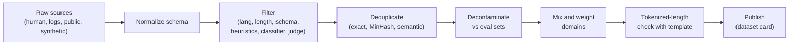

# 04 — Data: Formats, Curation, Synthesis, and Decontamination

> **Prerequisites:** module 02.
> **You will learn:** how to produce a clean, deduplicated, decontaminated dataset in the right
> schema for SFT, preference, RL and tool training, including synthetic
> generation and filtering pipelines.

**Data quality dominates hyperparameters.** A learning rate that is off by 2x costs you a
point or two; a training set full of near-duplicates, broken labels or leaked benchmark items
costs you the whole experiment, and you often will not notice. Every later module assumes you
can hand a trainer a clean, deduplicated, decontaminated dataset in the schema it expects.
And because most post-training data in 2026 is generated by models rather than written by
people, generation and filtering pipelines are core skills, not extras.

---

## 4.1 Dataset schemas: the TRL taxonomy

TRL classifies a dataset along two axes
([TRL dataset formats, v1.15.0](https://huggingface.co/docs/trl/v1.15.0/en/dataset_formats)).
The **format** is *standard* (plain strings) or *conversational* (lists of
`{"role", "content"}` messages). The **type** is the task, defined by which columns exist.
The trainer reads the columns to decide what to tokenize, what to mask and what to compare.
Get the columns wrong and you get either an error or, worse, silent training on the wrong tokens.

**Table 1. Dataset types, their columns, and their consumers (as of TRL v1.15, October 2026).**

| Type | Columns | Example row (abridged) | Consumed by |
|---|---|---|---|
| Language modeling | `text` (standard) or `messages` (conversational) | `{"text": "Email: ... JSON: {...}"}` | `SFTTrainer` (loss on every token by default) |
| Prompt-completion | `prompt`, `completion` | `{"prompt": [{"role":"user","content":"Order 551..."}], "completion": [{"role":"assistant","content":"{...}"}]}` | `SFTTrainer` (loss on completion only by default) |
| Conversational | `messages` | `{"messages": [{"role":"system",...},{"role":"user",...},{"role":"assistant",...}]}` | `SFTTrainer`; with `assistant_only_loss=True`, loss on assistant turns only |
| Preference, explicit prompt | `prompt`, `chosen`, `rejected` | `{"prompt": [...], "chosen": [{"role":"assistant","content":"{...}"}], "rejected": [...]}` | `DPOTrainer` (explicit recommended), `KTOTrainer` |
| Preference, implicit prompt | `chosen`, `rejected` (each a full conversation) | `{"chosen": [user, assistant_good], "rejected": [user, assistant_bad]}` | `RewardTrainer` (implicit recommended) |
| Unpaired preference | `prompt`, `completion`, `label` (bool) | `{"prompt": [...], "completion": [...], "label": false}` | `KTOTrainer` |
| Prompt-only | `prompt` (+ any extra columns) | `{"prompt": [{"role":"user","content":"Solve ..."}], "answer": "42"}` | `GRPOTrainer`, `RLOOTrainer` |
| Tool calling | `messages` with assistant `tool_calls` and `tool` role turns, plus a `tools` column of JSON schemas | `{"messages": [...], "tools": [{"type":"function","function":{...}}]}` | `SFTTrainer`; owned by [module 15](./15-agentic-and-tool-use-fine-tuning.md) |
| Vision | `image` or `images` + content blocks `[{"type":"image"},{"type":"text",...}]` | `{"images": [img], "messages": [...]}` | `SFTTrainer` (VLM path) and other trainers with VLM support; owned by [module 16](./16-multimodal-and-embedding-fine-tuning.md) |

The trainer-to-type mapping is TRL's own table; it also lists `experimental` trainers
(ORPO, CPO, Online DPO, GKD), which this course treats as experimental. Two details
from the same page matter in practice. First, a prompt-only row and a language-modeling row
render differently under the chat template: the prompt-only row ends with the
assistant header (a generation prompt), the language-modeling row ends with end-of-sequence.
Second, tool `arguments` are arbitrary JSON, so recent `datasets` releases store them with the
`Json()` feature type; older releases need `tools` serialized as a JSON string.

### Converting between formats

You will convert constantly, because public datasets rarely arrive in the type your trainer wants.
TRL recommends converting **before** applying the chat template, while the data is still
a list of messages. The conversions you need most:

| From | To | Rule |
|---|---|---|
| Conversational `messages` | Prompt-completion | `prompt` = every message before the last assistant turn; `completion` = that last assistant turn |
| Prompt-completion | Language modeling | concatenate (and accept that the prompt becomes trained tokens) |
| Implicit preference | Explicit preference | split the longest common prefix off as `prompt` (TRL: `extract_prompt`) |
| Explicit preference | Implicit preference | prepend `prompt` to both `chosen` and `rejected` |
| Preference | Unpaired preference | emit `(prompt, chosen, True)` and `(prompt, rejected, False)` (TRL: `unpair_preference_dataset`) |
| Unpaired preference | Prompt-completion | keep rows with `label=True`, drop `label` |

The unpairing direction carries a warning in the TRL docs that deserves repeating: a
`rejected` response is only worse *than its partner*. It may still be a good response in
absolute terms. Labeling every rejected response `False` is a claim you must check (for
example with a reward model score) before you make it.

**Why the type controls masking.** The type is not cosmetic: it changes which tokens
receive loss. For prompt-completion data, `SFTConfig.completion_only_loss` defaults to `None`,
which TRL resolves to "completion only"; for language-modeling data it resolves to the full
sequence ([SFTConfig reference](https://huggingface.co/docs/trl/v1.15.0/en/sft_trainer)).
Conversational data trains on every token unless you set `assistant_only_loss=True` with a
chat template that marks assistant spans with ``. So converting your support-email
set from `messages` to prompt-completion silently changes the objective from "model the
email and the JSON" to "model the JSON given the email". That is usually what you want; [module
05](./05-supervised-fine-tuning.md) measures the difference.

Check 4.3 (in section 4.8) asserts exactly these conversions on a multi-turn record from the
running task.

### Prompt-only datasets for RL

GRPO and RLOO generate their own completions, so they need only prompts. But the **reward
function** needs whatever it takes to score a completion. TRL passes every dataset column
except `prompt` to each reward function as a keyword argument of the same name, and
`GRPOConfig.remove_unused_columns` defaults to `False` so those columns survive
([GRPO trainer docs, v1.15.0](https://huggingface.co/docs/trl/v1.15.0/en/grpo_trainer)).
Design the row around the verifier:

```json
{"prompt": [{"role": "user", "content": "Extract the fields from: 'Order 551 never came. - Dana'"}],
 "gold": {"customer_name": "Dana", "order_id": "551", "issue_type": "missing",
          "refund_requested": false, "sentiment": "negative"}}
```

A reward function `def reward(completions, gold, **kwargs)` can then parse each completion and
score field-level agreement. If the column it needs is missing, you find out at the first step,
not at dataset-build time, so validate prompt-only sets with the same schema checker you use for
SFT data. [Module 13](./13-rl-with-verifiable-rewards.md) designs the rewards themselves.

---

## 4.2 The datasets library for fine-tuners

The [Hugging Face note](../../notes/libraries/huggingface.md) covers loading and basic
processing. Recap in one paragraph: `load_dataset` returns an Arrow-backed `Dataset` that is
memory-mapped from disk, so a 50 GB dataset does not need 50 GB of RAM; `map` and `filter`
transform it and cache the result under a **fingerprint** (a hash of the previous fingerprint
plus the function and its arguments), so re-running an unchanged pipeline is a cache hit. The parts that
matter for fine-tuning data are below.

Teaching fragment: not executed (needs `datasets` and network access).

```python
from datasets import load_dataset

ds = load_dataset("json", data_files={"train": "raw_emails.jsonl"}, split="train")

def to_messages(batch):                       # batched=True: dict of lists in, dict of lists out
    return {"messages": [
        [{"role": "system", "content": SYSTEM},
         {"role": "user", "content": e},
         {"role": "assistant", "content": json.dumps(l, sort_keys=True)}]
        for e, l in zip(batch["email"], batch["label"])]}

ds = ds.map(to_messages, batched=True, num_proc=8, remove_columns=ds.column_names)
ds = ds.filter(lambda b: [valid(m) for m in b["messages"]], batched=True, num_proc=8)
splits = ds.train_test_split(test_size=0.05, seed=0)      # seeded: reproducible split
splits.push_to_hub("you/support-email-sft", private=True)
```

- **`batched=True`** hands your function 1,000 rows at a time by default, which is
  much faster for tokenizers and anything vectorized. **`num_proc`** forks worker processes.
  A non-picklable closure, or a function that reads a global that changes, breaks fingerprint
  caching. The symptom is either a silent re-computation or, worse, a stale cache hit.
- **Streaming.** `load_dataset(..., streaming=True)` returns an `IterableDataset` that reads as
  you iterate ([streaming guide](https://huggingface.co/docs/datasets/main/en/stream)). It has no
  `len()`, shuffles only within a buffer (default 1,000 examples; raise it), and `take`/`skip`
  lock the shard order, so shuffle first. Because the length is unknown, **TRL trainers require
  `max_steps` when the training set is an `IterableDataset`**: the scheduler needs a total step
  count, and "epochs" are undefined ([SFTTrainer reference](https://huggingface.co/docs/trl/v1.15.0/en/sft_trainer)).
- **Mixing at load time.** `interleave_datasets([a, b], probabilities=[0.8, 0.2], seed=0)`
  draws from several sources in fixed ratios, which is how section 4.8's replay mix is built
  without materializing it.
- **Publishing.** `push_to_hub` writes Parquet shards. The repository's `README.md` is the
  **dataset card**: a YAML header (`license`, `language`, `task_categories`, `size_categories`,
  `configs`) followed by prose sections
  ([dataset card guide](https://huggingface.co/docs/datasets/main/en/dataset_card)). For a
  fine-tuning set, the card must also record provenance: which model generated which
  column, under which terms, the filters applied with their thresholds, the dedup and
  decontamination settings, and the eval sets you decontaminated against. Without that record,
  the set cannot be audited or regenerated. Card content for safety and release is owned by
  [module 19](./19-safety-forgetting-and-responsible-fine-tuning.md).

---

## 4.3 Where data comes from

| Source | Strength | Main risk |
|---|---|---|
| Human-written (experts, annotators) | correct, on-distribution, sets the bar | slow, expensive, inconsistent between annotators |
| Product logs | exactly your input distribution | consent, PII, label noise, feedback bias |
| Public instruction datasets | free, large, varied | license mix, contamination, stale styles |
| Distillation from a stronger model | cheap, scalable, high fluency | terms of service, teacher errors, homogeneity |
| Programmatic generation (templates, solvers, code) | perfect labels, unlimited | low diversity, unrealistic inputs |

Most production sets are blends. For the running support-email task, a sensible start is a few
hundred real emails (scrubbed) with gold labels written or checked by people, padded with
synthetic emails whose labels you can verify by construction.

### Quality over quantity

LIMA ([Zhou et al., 2023](https://arxiv.org/abs/2305.11206)) fine-tuned a 65B base model on 1,000
curated examples and got competitive human preference ratings. That result is the evidence
behind the **superficial alignment hypothesis**: most capability comes from pretraining, and
SFT mostly teaches format and style ([module 01](./01-when-to-fine-tune.md)). For reasoning,
LIMO ([Ye et al., 2025](https://arxiv.org/abs/2502.03387)) used 817 examples and s1
([Muennighoff et al., 2025](https://arxiv.org/abs/2501.19393)) used 1,000 (s1K), selected for
difficulty, diversity and quality. s1 also introduced **budget forcing**, which controls how
long the model thinks at test time ([module 14](./14-distillation-and-reasoning.md)).

What these results **establish**: with a strong base model, careful selection by difficulty and
quality beats volume, and a few hundred excellent examples can unlock behavior the base model
already latently has. What they **do not establish**: that a tiny set suffices for a domain
the base model knows little about, for a strict output schema with many edge cases, or for
robustness across messy real inputs. Your support-email extractor will need enough
examples to cover every `issue_type` and the ugly cases (forwarded threads, two orders in one
email, no order id at all). That usually means hundreds to a few thousand examples, not 50.

### Licensing, PII and terms of service

Three separate constraints apply to every row:

1. **Dataset licenses.** Public sets carry licenses (Apache-2.0, CC-BY, CC-BY-NC, custom), and a
   mix inherits the most restrictive terms you rely on. Record each source's license in the card.
2. **Outputs of proprietary models.** Several API providers' terms restrict using outputs to
   build competing models. Whether your use is allowed is a legal question about your contract,
   not a technical one. [Module 01](./01-when-to-fine-tune.md) covers model and dataset licensing.
   Open-weight teachers (Apache-2.0 Qwen3 checkpoints, for example) avoid most of this.
3. **PII.** Logs contain names, emails, addresses and order numbers. Scrub before training: a
   regex pass for structured identifiers (emails, phone numbers, card numbers), then an NER pass
   for names and addresses, then spot checks. Fine-tuned models can memorize and regurgitate
   training rows; [module 19](./19-safety-forgetting-and-responsible-fine-tuning.md) owns
   memorization risk. Note the tension in the running task: `customer_name` is a target field,
   so you replace real names with consistent synthetic ones rather than deleting them.

### Preference data from production logs

Thumbs-up/down logs look like preference data, but they are not pairs. Each event is one
response to one prompt with a binary label. That is the **unpaired preference** type, and its
natural consumer is KTO ([Ethayarajh et al., 2024](https://arxiv.org/abs/2402.01306);
[module 12](./12-preference-optimization.md)), which learns from desirable and undesirable
examples separately. DPO needs two responses **to the same prompt**. You have them only when:

- the product showed two candidates (A/B or regenerate) and the user picked one;
- the user regenerated and then thumbed up the second answer, which gives a weak pair; or
- you build pairs offline: for each logged prompt, sample several fresh responses from the
  current model, rank them with a judge or reward model, and take best vs worst. The log then
  supplies the prompt distribution and the judge supplies the preference.

Pitfalls to design around:

- **Selection bias**: very few users click anything, and the ones who do skew negative.
- **Label noise**: a thumbs-down may be about latency or a policy refusal, not the answer itself.
- **Prompt imbalance**: one heavy user can dominate the data, so cap events per user and per prompt cluster.
- **Off-policy staleness**: responses from last quarter's model are off-policy for this
  quarter's, which matters more for DPO than for KTO.

Deduplicate prompts before splitting, or near-identical prompts will straddle the train and eval split.

---

## 4.4 Cleaning and filtering

Run filters cheapest first, so each expensive stage sees fewer rows:

1. **Language ID** (fastText-style classifier). Drop or route rows not in your target languages.
2. **Length filters.** Drop empty and truncated responses, and responses over the token budget
   (section 4.8). Also drop prompts of a few characters: they are usually noise.
3. **Format and schema validation.** Parse every structured target. For the running task, the
   assistant turn must be valid JSON with exactly the five fields, `issue_type` in the enum, and
   `refund_requested` a boolean. This one filter typically removes more bad rows than all the
   others combined.
4. **Heuristic filters.** Repetition (fraction of duplicated lines or n-grams), boilerplate
   ("As an AI language model"), leftover template tokens, unbalanced code fences, refusals
   where none is warranted. The Gopher and C4 rule sets are the classic references; datatrove
   ships implementations of both.
5. **Model-based quality classifier.** Label a sample (often with an LLM), train a small
   classifier, and score everything. FineWeb-Edu did this for pretraining text
   ([Penedo et al., 2024](https://arxiv.org/abs/2406.17557)): an LLM annotated educational
   value, a small classifier learned it, and a threshold on its score selected the corpus.
   Classifiers are cheap per row, so they scale to millions.
6. **LLM-as-judge filtering.** A strong model scores each (prompt, response) against a written
   rubric (correctness, instruction-following, format, helpfulness) on a 1–5 or 1–10 scale. Keep
   rows at or above a threshold. Calibrate first: hand-label 100 rows, check the judge's
   agreement with you, and pick the threshold from that agreement, not by intuition. Judges
   prefer longer answers and their own style; [module 09](./09-evaluating-fine-tuned-models.md)
   covers judge bias.
7. **Reward-model scoring.** A trained RM gives a scalar per response. Use it to rank candidates
   for the same prompt, where it is most reliable. Absolute thresholds across prompts are less
   reliable, because RM scores are not calibrated between prompts.

### Rejection sampling as a data engine

The most important filter is not a filter on existing data. It generates candidates and
keeps the ones that pass. For each prompt, sample $k$ responses; keep those that pass a verifier
(unit tests, exact answer match, schema check) or exceed a reward threshold. Llama 3's
post-training ran this loop each round: rejection-sampled SFT data, then DPO
([Grattafiori et al., 2024](https://arxiv.org/abs/2407.21783); see [module 01](./01-when-to-fine-tune.md)).

If a teacher solves a prompt with probability $p$, the chance that at least one of $k$
samples passes is $1-(1-p)^k$. At $p=0.2$ and $k=8$ that is $1-0.8^8 = 0.832$. **So $k$ buys
coverage of hard prompts**, and keeping all passing samples overweights easy prompts, where
every sample passes. Cap kept samples per prompt (the lab uses 4) and deduplicate identical
solutions.

Synthetic reasoning data is this loop with a long chain of thought. Collect teacher CoT traces
and keep those with a correct final answer. Then filter by length: drop traces that hit the token
limit, which were truncated before the answer, and consider dropping extreme outliers, which teach
the student to ramble. [Module 14](./14-distillation-and-reasoning.md) covers reasoning
distillation in full.



---

## 4.5 Deduplication

Duplicates do three kinds of damage. They overweight some examples, which wastes compute and
pushes the model to memorize them. They leak between train and validation splits, which inflates
your metrics. And in synthetic data they signal **mode collapse**: the generator keeps saying the
same thing. Deduplicate before you split.

### Exact

Normalize (lowercase, strip punctuation, collapse whitespace, optionally Unicode NFKC; see
[text preprocessing](../../notes/nlp/text-preprocessing.md)), then hash with `hashlib.sha256`
and keep the first row per hash. This is $O(n)$ and catches copy-paste, re-scraped pages and
re-sent emails. It misses anything with a single changed word.

### Near-duplicate: MinHash-LSH

**Problem.** You want all pairs of documents with Jaccard similarity
$J(A,B) = |A\cap B|/|A\cup B|$ above some $s^*$, where $A$ and $B$ are shingle sets (character
5-grams or word $n$-grams). All-pairs comparison is $O(n^2)$: at $10^6$ documents that is
$5\times10^{11}$ comparisons.

**MinHash (Broder, 1997).** Apply a random hash $h$ to every shingle and keep the minimum. Over a
random permutation of the shingle universe, the minimum element of $A\cup B$ is equally likely to
be any of its $|A\cup B|$ elements, and $\min h(A) = \min h(B)$ exactly when that element lies in
$A\cap B$. Hence

$$
P\big[\min h(A) = \min h(B)\big] = \frac{|A\cap B|}{|A\cup B|} = J(A,B).
$$

With $k$ independent hash functions, the estimate $\hat J = \frac1k\sum_{i=1}^k \mathbb{1}[\min h_i(A) = \min h_i(B)]$
is a binomial proportion, so it is unbiased with standard error $\sqrt{J(1-J)/k}$
([probability note](../../notes/math/probability.md)). At $J=0.8$ and $k=128$ that is $0.035$.
Each document becomes a $k$-integer signature, regardless of its length.

**LSH banding.** Signatures are compact, but comparing all pairs of them is still $O(n^2)$. Split
each signature into $b$ bands of $r$ rows ($k = br$) and hash each band into a bucket. Two
documents become a **candidate pair** if they collide in at least one band. A band matches with
probability $s^r$, so it fails with $1-s^r$; all $b$ bands fail with $(1-s^r)^b$. Therefore

$$
P[\text{candidate} \mid J=s] = 1-(1-s^r)^b .
$$

This is an S-curve whose steepest point sits near $s^* \approx (1/b)^{1/r}$
(Leskovec, Rajaraman and Ullman, *Mining of Massive Datasets*, ch. 3). Raising $r$ sharpens the
curve and moves it right; raising $b$ moves it left.

| $b \times r$ ($k$) | threshold $(1/b)^{1/r}$ | $P$ at $s=0.3$ | $P$ at $s=0.5$ | $P$ at $s=0.8$ |
|---|---|---|---|---|
| $20\times5$ (100) | 0.549 | 0.047 | 0.470 | 0.9996 |
| $32\times4$ (128) | 0.420 | 0.229 | | 1.000 |
| $14\times8$ (112), datatrove default | 0.719 | | 0.053 | 0.924 |

Read the first row. Pairs at 80% similarity are caught with probability 0.9996. Pairs at 30% slip
into a shared bucket 4.7% of the time, and those false candidates are cheap to discard by
checking their estimated $\hat J$. The datatrove default is deliberately stricter: it targets
web-scale near-copies, not paraphrases.

Check 4.1 builds 128 MinHash functions from `blake2b` plus seeded $(ax+b) \bmod p$. On a support
email (A), a copy with two words changed (B) and an unrelated text (C), it shows:

- the true Jaccard of A and B is 0.824 and the 128-hash estimate is 0.797;
- the estimate for A and C stays under 0.2;
- $32\times4$ banding makes (A, B) a candidate and does not make (A, C) one;
- the closed-form values in the table above hold.

```python finetuning-check
import hashlib
import random

def shingles(text, k=5):
    t = " ".join(text.lower().split())
    return {t[i:i + k] for i in range(len(t) - k + 1)}

def jaccard(a, b):
    return len(a & b) / len(a | b)

P = (1 << 61) - 1                      # Mersenne prime modulus
rng = random.Random(0)
K = 128
COEFFS = [(rng.randrange(1, P), rng.randrange(0, P)) for _ in range(K)]

def base_hash(s):
    # stable 64-bit hash; never Python's salted hash()
    return int.from_bytes(hashlib.blake2b(s.encode(), digest_size=8).digest(), "big")

def signature(sh):
    xs = [base_hash(s) for s in sh]
    return [min((a * x + b) % P for x in xs) for a, b in COEFFS]

def estimate(sa, sb):
    return sum(x == y for x, y in zip(sa, sb)) / len(sa)

def lsh_candidate(sa, sb, b, r):
    assert b * r == len(sa)
    return any(sa[i * r:(i + 1) * r] == sb[i * r:(i + 1) * r] for i in range(b))

A = ("Hi team, my order 48213 arrived with a cracked screen and the box was "
     "soaked. I would like a full refund to my original card, not store credit. "
     "Please confirm once the return label is ready. Thanks, Priya Raman")
B = A.replace("cracked", "broken").replace("soaked", "damp")      # 2 words changed
C = ("Quarterly revenue grew on strong cloud demand while hardware margins "
     "narrowed; the board approved a new buyback and raised the dividend.")

shA, shB, shC = shingles(A), shingles(B), shingles(C)
sigA, sigB, sigC = signature(shA), signature(shB), signature(shC)

j_ab, j_ac = jaccard(shA, shB), jaccard(shA, shC)
assert j_ab > 0.7 and round(j_ab, 3) == 0.824
assert abs(estimate(sigA, sigB) - j_ab) < 0.1
assert round(estimate(sigA, sigB), 3) == 0.797
assert estimate(sigA, sigC) < 0.2 and j_ac < 0.2

# LSH with b=32 bands x r=4 rows (k=128): near-dup collides, unrelated does not
assert lsh_candidate(sigA, sigB, b=32, r=4)
assert not lsh_candidate(sigA, sigC, b=32, r=4)

# Closed-form S-curve values quoted in the table
def p_candidate(s, b, r):
    return 1 - (1 - s ** r) ** b

assert round((1 / 20) ** (1 / 5), 3) == 0.549
assert round(p_candidate(0.8, 20, 5), 4) == 0.9996
assert round(p_candidate(0.3, 20, 5), 3) == 0.047
assert round(p_candidate(0.5, 20, 5), 3) == 0.470
assert round((1 / 32) ** (1 / 4), 3) == 0.420
assert round(p_candidate(0.3, 32, 4), 3) == 0.229
assert round((1 / 14) ** (1 / 8), 3) == 0.719
assert round(p_candidate(0.8, 14, 8), 3) == 0.924
assert round(p_candidate(0.5, 14, 8), 3) == 0.053
print("MinHash estimate, LSH banding and S-curve values verified.")
```

The check shows that the estimator and the banding work on one pair. It does not show
that any threshold is right for your data. Pick shingle size and threshold by inspecting
the pairs that land just above and just below the cut.

### Semantic dedup with embeddings

MinHash sees characters, so two paraphrases ("my parcel never came" and "the package was
not delivered") look unrelated to it. Semantic dedup embeds each example with a sentence
encoder (see [text representation](../../notes/nlp/text-representation.md)) and treats pairs
above a cosine threshold (often 0.9–0.95) as duplicates. SemDeDup
([Abbas et al., 2023](https://arxiv.org/abs/2303.09540)) made this scale: cluster the
embeddings with k-means, then compare pairs only within each cluster. The costs are a forward
pass per example and an approximate nearest-neighbor index. The threshold also needs care:
two support emails about different orders with the same complaint can sit at cosine 0.95 and
still both be useful. **Use semantic dedup on instructions and prompts**, where paraphrase
duplication is the failure mode, and check samples at the threshold before trusting it.

### Tools

- **datatrove** ([GitHub, pinned](https://github.com/huggingface/datatrove/tree/1977fbb0f3c163d43cace334b073dda17fa3ef26))
  is Hugging Face's library for large-scale processing. Its pipelines (readers, filters, dedup
  stages, writers) run locally, on Slurm or on Ray. MinHash runs as four stages: signatures,
  bucket matching, clustering, then filtering. The defaults are 5-gram word shingles and
  14 buckets × 8 hashes ([`MinhashConfig`](https://github.com/huggingface/datatrove/blob/1977fbb0f3c163d43cace334b073dda17fa3ef26/src/datatrove/pipeline/dedup/minhash.py#L41-L53)).
  It also ships exact-substring and sentence-level dedup, and Gopher, C4, FineWeb and fastText filters.
- **distilabel's `MinHashDedup` step**
  ([component docs](https://distilabel.argilla.io/dev/components-gallery/steps/minhashdedup/),
  as of October 2026) wraps `datasketch`. It reads a `text` column and writes a
  `keep_row_after_minhash_filtering` boolean. Its parameters are `num_perm` (default 128),
  `seed` (1), `tokenizer` (`"words"` or `"ngrams"`), `n` (5, used with ngrams), `threshold`
  (0.9) and `storage` (`"dict"` or the experimental `"disk"`). Use it inside a distilabel
  generation pipeline, right after generation.

---

## 4.6 Decontamination

If your training set contains your evaluation items, your eval score measures memorization,
and **every reported gain becomes uninterpretable**. Synthetic data makes this worse: a
teacher trained on the public web has seen GSM8K, MMLU and HumanEval, and can reproduce their
items almost verbatim when prompted for "a grade-school math word problem".

**n-gram overlap.** Build the set of word $n$-grams from every eval item, after the same
normalization you apply to training text. Then flag any training example that shares at least
one $n$-gram with the set. GPT-3 used 13-grams
([Brown et al., 2020](https://arxiv.org/abs/2005.14165), appendix C), which became the
classic choice. A long $n$ gives few false positives, because 13 consecutive matching words are
rarely coincidental, but it misses light paraphrase. 8-grams are stricter; below about 6, common
phrases ("the customer name, the order id") start triggering. Normalization matters as much as
$n$: without lowercasing and punctuation stripping, a casing change defeats the match.

Check 4.2 shows both effects. The setup is a three-item eval set and five training items:

- item 0 contains a 22-word span of an eval item with changed casing and punctuation;
- item 1 shares only a 6-word phrase with an eval item;
- items 2–4 are unrelated.

At $n=13$, only item 0 is flagged; at $n=6$, items 0 and 1 are flagged; the clean items are never
flagged; and without normalization, the 13-gram match misses item 0 entirely.

```python finetuning-check
import string

def normalize(text):
    text = text.lower()
    text = text.translate(str.maketrans(string.punctuation, " " * len(string.punctuation)))
    return text.split()                      # split() also collapses whitespace

def ngrams(tokens, n):
    return {tuple(tokens[i:i + n]) for i in range(len(tokens) - n + 1)}

EVAL = [
    "A customer writes that order 7731 arrived two weeks late and the ceramic "
    "mug inside was shattered into pieces, and she asks whether she can get her "
    "money back or a replacement shipped by express courier.",
    "Extract the customer name, the order id and the issue type from the "
    "following email, and return a single JSON object with no extra text.",
    "My subscription renewed even though I cancelled it last month through the "
    "settings page, please reverse the charge and confirm by email today.",
]
TRAIN = [
    # 0: verbatim 22-word span of EVAL[0], different casing and punctuation
    "Ticket #88: ORDER 7731 Arrived Two Weeks Late; and the Ceramic Mug inside "
    "was SHATTERED into pieces -- and she asks whether she can get... a refund?",
    # 1: shares only the 6-word span "the customer name the order id" with EVAL[1]
    "Please list the customer name, the order id, plus a short summary of "
    "the complaint for our weekly support review meeting.",
    # 2-4: clean
    "The parcel never arrived and tracking has shown no movement since Monday.",
    "I love the new blender, it is quiet and the jug is easy to clean.",
    "Can you change the delivery address on my account to my office downtown?",
]

def flagged(train, evals, n):
    bank = set().union(*(ngrams(normalize(e), n) for e in evals))
    return [i for i, t in enumerate(train) if ngrams(normalize(t), n) & bank]

assert flagged(TRAIN, EVAL, 13) == [0]
assert flagged(TRAIN, EVAL, 6) == [0, 1]
assert not set(flagged(TRAIN, EVAL, 6)) & {2, 3, 4}
# without normalization, 13-gram matching misses the contaminated item
def raw_grams(t, n):
    w = t.split()
    return {tuple(w[i:i + n]) for i in range(len(w) - n + 1)}
raw_bank = set().union(*(raw_grams(e, 13) for e in EVAL))
assert [i for i, t in enumerate(TRAIN) if raw_grams(t, 13) & raw_bank] == []
print("13-gram and 6-gram decontamination verified.")
```

This shows that normalization and $n$ control what gets flagged. It does not catch a
paraphrased or translated eval item. For that you need the next tool.

**Embedding similarity.** Embed every eval item and every training prompt, then flag pairs above
a cosine threshold and review them by hand. This catches rephrased benchmark questions with
different numbers, the main contamination route for teacher-generated math. Run both methods:
n-grams for verbatim leaks, embeddings for paraphrase.

**Where to apply it.** Decontaminate against **every** eval set you will report, including
your own golden set (for the running task, the 50-example eval set from module 01), and do it
after generation and before mixing. When the teacher was trained on a benchmark, also check
whether its traces contain benchmark answers ([module 14](./14-distillation-and-reasoning.md)).
[Module 09](./09-evaluating-fine-tuned-models.md) covers the evaluation-side checks:
canaries, perturbed benchmarks, and the score gap between public and private test sets.

---

## 4.7 Synthetic data generation

Every method below solves the same problem: getting **diverse, correct, appropriately hard**
data out of a model whose default outputs are homogeneous. Each method gets diversity from a
different source, and each fails in a predictable way.

**Self-Instruct** ([Wang et al., 2022](https://arxiv.org/abs/2212.10560)). Start from a small
pool of human-written seed tasks (175 in the paper). Prompt the model with a few sampled tasks
to write new instructions, generate inputs and outputs for them, and add each new instruction to
the pool only if its ROUGE-L similarity to every existing instruction is below 0.7. Diversity
comes from the seed pool and the similarity filter. Failure mode: drift toward easy, generic tasks.

**Evol-Instruct** (WizardLM; [Xu et al., 2023](https://arxiv.org/abs/2304.12244)). Rewrite
existing instructions to make them harder. **In-depth** evolution adds constraints,
deepens the question, makes it more concrete, adds reasoning steps, or complicates the
input. **In-breadth** evolution writes a new instruction on a related but rarer topic. An
elimination step drops evolutions that failed: ones that copy the original, cannot be answered,
or contain prompt residue. Failure mode: instructions that are convoluted rather than hard,
and answers the generator cannot get right.

**Magpie** ([Xu et al., 2024](https://arxiv.org/abs/2406.08464)). An aligned chat model has
learned what user turns look like. Give it **only the pre-query template**, the chat
template up to and including the user header (for Qwen3's ChatML format, `<|im_start|>user\n`),
and it autocompletes a plausible user query. Then send that query back through the normal template
to get the answer. You need no seeds and no prompt engineering. The authors generated about 4M
instruction-response pairs from Llama-3-Instruct and selected 300K. Models fine-tuned on that
subset from Llama-3-8B-Base were comparable to the official instruct model on some alignment
benchmarks. Failure modes:

- **topic collapse**: queries concentrate on the model's own favorite topics (coding help,
  writing tips), so the domain mix mirrors the generator, not your users;
- **safety-filtered and easy**: the aligned model rarely writes hard, adversarial or messy queries;
- **self-agreement**: the answers are the same model's answers, so errors are not caught.

Filter Magpie output with a judge for quality and difficulty, a topic classifier to rebalance
the mix, MinHash and semantic dedup, and decontamination. Steer the domain with a system prompt
placed before the pre-query template.

**Persona-driven generation** (Persona Hub; [Ge et al., 2024](https://arxiv.org/abs/2406.20094)).
Condition each generation on a different persona ("a night-shift nurse who orders supplies in
bulk", "a retired teacher disputing a double charge"). Persona Hub curated about a billion
personas from web text. Diversity comes from the persona pool, not the sampling temperature. For the
running task, personas give you varied writing styles, complaint types and levels of
anger, which is exactly what real emails have and templated emails lack.

**Back-translation of instructions** ([Li et al., 2023](https://arxiv.org/abs/2308.06259),
"instruction backtranslation"). Start from high-quality human text, such as a well-written help-center
answer, and have a model write the instruction that text answers. Then self-curate: score
the pairs and keep the best. The response side is human-quality by construction; the risk is
instructions that fit their response too neatly to resemble real user queries.

**Multi-turn simulation.** One model plays the user (with a persona and a goal), another plays
the assistant, and you run several turns. This is the only cheap way to get follow-ups,
clarifications and corrections, such as "actually it was order 552". Failure modes:
the simulated user is too cooperative and the conversations end too early. Give the user
simulator explicit goals and stopping rules.

### Synthetic preference pairs

**UltraFeedback** ([Cui et al., 2023](https://arxiv.org/abs/2310.01377)) sampled four responses
per prompt from a pool of different models and had GPT-4 rate each one on several aspects. The
widely used binarized version takes the highest-rated response as chosen and a random lower
one as rejected. The on-policy variant, now more common, samples several responses from **the
model you are about to train** and ranks them with a judge or reward model. Pitfalls:

- **Length bias.** Judges prefer longer answers, so chosen responses end up systematically longer
  than rejected ones, and DPO learns verbosity. Measure the chosen-minus-rejected length gap
  before training and rebalance or length-control it.
- **Near-identical pairs.** Two samples from the same model at low temperature can differ by a
  word. The gradient signal is then mostly noise. Drop pairs whose judge-score gap is small.
- **Chosen from a much stronger model.** If chosen comes from a frontier model and rejected
  from yours, the pair teaches "write like the other model". Both responses are also far from
  your policy's distribution, which weakens DPO's implicit reward.

[Module 12](./12-preference-optimization.md) covers what each preference loss does with these pairs.

### Tool-use data

Function-calling data needs verification that plain text does not. APIGen
([Liu et al., 2024](https://arxiv.org/abs/2406.18518)) generates calls and checks each one in three
stages: format (does it parse against the schema?), execution (does the call run?) and
semantics (does the result answer the query?). ToolACE
([Liu et al., 2024](https://arxiv.org/abs/2409.00920)) synthesizes a large, diverse pool of APIs
first, then generates dialogues over it. [Module 15](./15-agentic-and-tool-use-fine-tuning.md)
owns both, along with the tool-calling schema.

**Table 2. Synthetic generation methods.**

| Method | Seed needed | Diversity source | Main failure mode | Filter to apply |
|---|---|---|---|---|
| Self-Instruct | ~100–200 human tasks | seed pool + ROUGE-L novelty filter | generic, easy tasks | novelty filter, judge for difficulty |
| Evol-Instruct | existing instructions | evolution operators | convoluted, unanswerable prompts | elimination step, judge for answerability |
| Magpie | none (pre-query template) | the model's own prior | topic collapse, low difficulty | topic classifier + rebalancing, judge, semantic dedup |
| Persona-driven | persona pool | personas | persona stereotypes, shallow variation | dedup, judge, persona coverage audit |
| Back-translation | high-quality responses | the response corpus | instructions too tailored to the answer | self-curation score, judge |
| Multi-turn simulation | personas + goals | user simulator | over-cooperative users, short dialogues | turn-count and goal-completion checks |
| Rejection sampling | prompts + verifier | sampling temperature, $k$ | easy prompts dominate | per-prompt cap, verifier, length filter |
| UltraFeedback-style pairs | prompts | several models or samples | length bias, near-identical pairs | length-gap audit, score-gap threshold |
| APIGen-style tool data | API pool | APIs × query templates | calls that parse but do the wrong thing | format, execution and semantic checks |

---

## 4.8 Mixing, curriculum and length

**Domain ratios.** A fine-tuning set is a mixture: task data, general instructions, maybe
reasoning or safety data. Set ratios deliberately and record them. Upsample rare but important
slices, such as the hard examples, the rare `issue_type`s and multi-order emails, rather than
letting the generator's distribution decide. The [imbalanced data note](../../notes/ml/imbalanced-data-and-pitfalls.md)
covers the class-imbalance version of the same problem.

**Replay general data.** Narrow fine-tuning erodes general abilities, a problem called
**catastrophic forgetting** ([module 19](./19-safety-forgetting-and-responsible-fine-tuning.md)).
The cheapest mitigation is to mix in general instruction data, ideally from the same distribution
the base model was post-trained on. A common practitioner **heuristic** is 5–20% replay.
That is a starting point to tune against your forgetting evals, not an established constant.
Use more replay when the task data is large and narrow, and less when it is small and
you train for few steps.

**Curriculum.** Ordering by difficulty (easy to hard) has mixed evidence in LLM fine-tuning.
Most recipes shuffle uniformly. The robust version of the idea is **difficulty filtering**:
drop examples the base model already gets right, and drop examples that no sample from the
teacher gets right. Then train on the band in between. s1 and LIMO selected their sets this way.

### Tokenized-length analysis

Lengths are measured in tokens **after** applying the target model's chat template, never in
characters or words. A system prompt plus role markers can add tens of tokens per turn, and
JSON costs more tokens than its character count suggests. Compute, for every example, the
templated prompt length $p$ and completion length $c$; then for a candidate `max_length` $M$:

$$
\text{frac truncated} = \frac{\#\{p+c > M\}}{n}, \qquad
\text{completion tokens lost} = \frac{\sum_i \min\big(c_i, \max(0, p_i + c_i - M)\big)}{\sum_i c_i}.
$$

`SFTConfig.max_length` defaults to 1024 and `truncation_mode` defaults to `"keep_start"`, which
keeps the first $M$ tokens; `"keep_end"` is deprecated and slated for removal in TRL v2.0
([SFTConfig reference](https://huggingface.co/docs/trl/v1.15.0/en/sft_trainer), as of
October 2026). Under keep_start, **truncation always eats the end of the completion first**, the
tokens you most wanted to train on. For the running task that means a JSON object cut before
its closing brace, which teaches the model to stop mid-object. And if the prompt alone fills
$M$, the example has **zero trained tokens**: it costs a forward pass, adds nothing to the loss,
and can distort per-batch loss normalization. Filter those out before training.

Choose $M$ at a high percentile of the templated length, p95–p99. Then decide what to do with the
tail: drop it, raise $M$ for those rows by packing ([module 05](./05-supervised-fine-tuning.md)
covers packing, and the evidence that fewer truncations improve training in
[Ding et al., 2024](https://huggingface.co/papers/2404.10830)), or shorten the prompts.
For sequences far longer than your current budget, see [module 17](./17-long-context-extension.md).

Here is a worked example with ten examples whose $(p, c)$ token counts range from $(40, 60)$
to $(300, 1500)$, at $M=1024$. Two examples (20%) are truncated; 972 of 6,110 tokens (15.9%) are
cut, and 18.6% of **completion** tokens are lost. The token loss is concentrated in the
completions because keep_start cuts from the end. Check 4.3 asserts these numbers, the format
conversions from section 4.1, and the zero-trained-token drop rule on a 12-token prompt with an
8-token completion.

```python finetuning-check
SYS = {"role": "system", "content": "Extract the fields as JSON."}
U1 = {"role": "user", "content": "Order 551 never came. - Dana"}
A1 = {"role": "assistant", "content": '{"customer_name": "Dana", "order_id": "551"}'}
U2 = {"role": "user", "content": "Add refund_requested too."}
A2 = {"role": "assistant", "content": '{"customer_name": "Dana", "order_id": "551", "refund_requested": false}'}
record = {"messages": [SYS, U1, A1, U2, A2]}

def to_prompt_completion(rec):
    msgs = rec["messages"]
    last = max(i for i, m in enumerate(msgs) if m["role"] == "assistant")
    return {"prompt": msgs[:last], "completion": msgs[last:last + 1]}

def to_implicit_preference(rec, rejected_text):
    pc = to_prompt_completion(rec)
    bad = {"role": "assistant", "content": rejected_text}
    return {"chosen": pc["prompt"] + pc["completion"], "rejected": pc["prompt"] + [bad]}

pc = to_prompt_completion(record)
assert pc == {"prompt": [SYS, U1, A1, U2], "completion": [A2]}
pref = to_implicit_preference(record, '{"customer_name": "Dana"}')
assert pref == {
    "chosen": [SYS, U1, A1, U2, A2],
    "rejected": [SYS, U1, A1, U2, {"role": "assistant", "content": '{"customer_name": "Dana"}'}],
}
# explicit-prompt form is recovered by splitting off the shared prefix
assert pref["chosen"][:4] == pref["rejected"][:4] == pc["prompt"]

# keep_start truncation of a tokenized prompt-completion example
def truncate_keep_start(ids, mask, max_length):
    return ids[:max_length], mask[:max_length]

prompt_ids = list(range(100, 112))           # 12 prompt tokens
completion_ids = list(range(200, 208))       # 8 completion tokens
ids = prompt_ids + completion_ids
mask = [0] * 12 + [1] * 8                    # 1 = token contributes to the loss

ids16, mask16 = truncate_keep_start(ids, mask, 16)
assert ids16 == ids[:16] and len(ids16) == 16
assert sum(mask16) == 4                      # only 4 of 8 completion tokens survive
ids12, mask12 = truncate_keep_start(ids, mask, 12)
assert sum(mask12) == 0                      # nothing left to train on

def keep(mask_after_truncation, min_trained_tokens=1):
    return sum(mask_after_truncation) >= min_trained_tokens

assert keep(mask16) and not keep(mask12)

# dataset-level truncation statistics for a choice of max_length
lengths = [(40, 60), (50, 90), (30, 150), (80, 200), (60, 300),
           (70, 420), (90, 610), (40, 800), (120, 1100), (300, 1500)]   # (prompt, completion)
M = 1024
total = [p + c for p, c in lengths]
frac_truncated = sum(t > M for t in total) / len(total)
lost_tokens = sum(max(0, t - M) for t in total)
lost_completion = sum(min(c, max(0, p + c - M)) for p, c in lengths)
assert frac_truncated == 0.2
assert (lost_tokens, sum(total)) == (972, 6110)
assert round(lost_tokens / sum(total), 3) == 0.159
assert round(lost_completion / sum(c for _, c in lengths), 3) == 0.186
print("Schema conversion, keep_start truncation and drop rule verified.")
```

This proves the bookkeeping. It does not reproduce TRL's tokenizer-level behavior. In
particular, the real template adds tokens around every turn, so measure lengths with
`apply_chat_template` on the actual tokenizer, as the lab does.

---

## 4.9 Tooling map

**Table 3. Data tooling (as of October 2026).**

| Tool | What it is | Use it when |
|---|---|---|
| `datasets` | Arrow-backed loading, `map`/`filter`, streaming, Hub I/O | always; it is the interchange format every trainer reads |
| [distilabel](https://distilabel.argilla.io/) | pipelines of LLM steps: generation, judges (UltraFeedback-style), `MinHashDedup`, embeddings | building a synthetic or judged dataset as a reproducible graph |
| [datatrove](https://github.com/huggingface/datatrove/tree/1977fbb0f3c163d43cace334b073dda17fa3ef26) | large-scale filters, MinHash/exact/sentence dedup, local/Slurm/Ray executors | millions of documents, continued-pretraining corpora, CPU clusters |
| Argilla-style annotation UIs | human review, labeling and rubric scoring | building the gold set, calibrating a judge, auditing a filter's rejects |
| [Unsloth Data Recipes](https://unsloth.ai/docs/new/studio/data-recipe) | visual graph workflow in Unsloth Studio that turns PDFs, CSVs and Hub datasets into synthetic datasets (built on NVIDIA NeMo Data Designer) | quick document-to-dataset generation feeding an Unsloth fine-tune |
| Hub dataset viewer | browse, search, filter and run SQL over any Hub dataset in the browser | eyeballing a public set before you download it; spotting junk and duplicates |
| Your own scripts (this module's lab) | schema checks, dedup, decontamination, length report | small and medium sets where you want every step visible and tested |

[Module 16](./16-multimodal-and-embedding-fine-tuning.md) covers the embedding-model side of
data work, including hard-negative mining for retrieval training with Sentence Transformers.

---

## 4.10 Lab: a clean, decontaminated SFT set

**Goal.** Turn raw support-email records into validated SFT and preference datasets. Then scale
up two ways: Magpie-style generation with filtering, and a rejection-sampled math set.

| Part | Tier | Model | Data | Script |
|---|---|---|---|---|
| L4.1 formats, dedup, decontam, length | CPU | none (smoke) / `Qwen/Qwen3-0.6B` tokenizer (full) | inline corpus or your module-01 JSONL | [build_sft_dataset.py](./code/build_sft_dataset.py) |
| L4.2 Magpie generation | T1 or API | [`Qwen/Qwen3-4B-Instruct-2507`](https://huggingface.co/Qwen/Qwen3-4B-Instruct-2507) (non-thinking, Apache-2.0) | generated | [build_sft_dataset.py](./code/build_sft_dataset.py) `--magpie` |
| L4.3 rejection-sampled math | T1 | same teacher | [`openai/gsm8k`](https://huggingface.co/datasets/openai/gsm8k), config `main`, split `train` | [rejection_sample_gsm8k.py](./code/rejection_sample_gsm8k.py) |

```bash
python content/courses/finetuning/code/build_sft_dataset.py --smoke
python content/courses/finetuning/code/rejection_sample_gsm8k.py --smoke

python content/courses/finetuning/code/build_sft_dataset.py --full \
    --input raw.jsonl --eval golden_eval.jsonl --tokenizer Qwen/Qwen3-0.6B --output-dir out/
python content/courses/finetuning/code/build_sft_dataset.py --full --magpie 2000 \
    --eval golden_eval.jsonl --output-dir out/
python content/courses/finetuning/code/rejection_sample_gsm8k.py --full --k 8 --limit 2000 \
    --out gsm8k_rs.jsonl
```

Both smoke runs finish in about a second on a laptop CPU and use only the standard library.
The `--full` paths import `transformers`, `datasets` and `vllm` inside the functions that need them.

### L4.1 Formats, dedup and decontamination (CPU)

The smoke corpus has 16 hand-written support emails with gold extractions, plus five
planted problems:

- an exact duplicate;
- a duplicate that differs only in casing and punctuation;
- a near-duplicate with two words changed;
- a lowercased, forwarded copy of a golden eval email;
- a record whose label violates the schema.

The script runs the pipeline from the diagram in section 4.4 and logs the row count after each
stage: 21 raw rows, 20 after the schema check, 18 after exact dedup, 17 after MinHash, and 16
after decontamination. It then emits language-modeling, prompt-completion, conversational and
preference rows, runs each through a schema checker, and computes the length report. The smoke
run asserts every count.

An early version of this lab generated the smoke corpus from one sentence template with
slots for name, item and issue. MinHash then collapsed 26 "distinct" emails into 9. **Templated
synthetic data is near-duplicate data**, and the dedup stage is how you find out.

The preference rows use a cheap, programmatic rejected response: the gold JSON with
`refund_requested` deleted. That pair teaches schema completeness only. Treat it as a format
exercise, not a recipe for real preference data (section 4.7).

What to record: rows removed at each stage, the length percentiles (p50/p95/p99), the chosen
`max_length`, and the fraction of completion tokens lost at that length.

### L4.2 Magpie generation, judge filter, publish (T1 or API)

`--magpie N` loads the teacher in vLLM and calls `LLM.generate` on the bare pre-query
template `<|im_start|>user\n`, stopping at `<|im_end|>`. It keeps queries between 20 and
2,000 characters and answers them with `LLM.chat`. It then applies MinHash dedup and 13-gram
decontamination against your eval file and writes `magpie.jsonl`. Next, judge-filter with a
larger model, such as `Qwen/Qwen3-32B` served by vLLM or any API judge your terms allow.

Teaching fragment: not executed (needs a GPU or an API).

```python
RUBRIC = ("Rate the user query and answer from 1-10 for: clear and answerable query, "
          "correct and complete answer, appropriate difficulty. Reply with only the integer.")

def judge_score(llm, conv):                        # llm: a vLLM LLM serving the judge
    msgs = [{"role": "system", "content": RUBRIC},
            {"role": "user", "content": json.dumps(conv["messages"])}]
    out = llm.chat([msgs], SamplingParams(temperature=0.0, max_tokens=4))[0].outputs[0].text
    return int(out.strip()) if out.strip().isdigit() else 0

kept = [c for c in rows if judge_score(judge, c) >= 7]   # threshold chosen on 100 hand-labeled rows
```

Before trusting the threshold, label 100 rows yourself and measure the judge's agreement with
you. Run a topic classifier, or just cluster the query embeddings, to see how badly the topics
collapsed, and rebalance. Push the result with `--push-to-hub user/repo`. Then write the
dataset card: source model and its license, the pre-query template, sampling parameters, judge
model, rubric and threshold, dedup and decontamination settings, and the rows removed at each
stage. Expect a large share of raw Magpie output to be removed by dedup and the judge, and
expect the topic histogram to look nothing like real support traffic.

### L4.3 A verified math SFT set by rejection sampling (T1)

`rejection_sample_gsm8k.py --full` samples $k=8$ solutions per GSM8K training problem at
temperature 0.8. It extracts each sample's final answer and keeps samples that match the
reference. It also deduplicates identical solutions and caps kept rows at 4 per problem. The
extractor is the piece most likely to be wrong, so the smoke mode tests it on the edge cases:

- `#### 1,234` (GSM8K style, with a thousands separator);
- `\boxed{42}`, where the last box wins if a solution has several;
- `The answer is: -3.50`, which must equal `-3.5`;
- an amount written with a leading dollar sign;
- text with no number at all.

On the fake teacher, the smoke run asserts a sample keep rate of exactly 10/24, a 2/3 problem
coverage rate, and 7 rows after dedup and capping.

What to record:

- the **sample keep rate** and **problem coverage** (fraction of problems with at least one kept
  solution);
- the word-length distribution of kept solutions against all samples. Correct solutions
  are often shorter, because rambling samples run out of tokens before the answer;
- the problems with zero kept solutions. These are your hard set: candidates for a stronger
  teacher, a larger $k$, or RL with a verifier ([module 13](./13-rl-with-verifiable-rewards.md)).

Expect high coverage on GSM8K from a modern 4B instruct teacher, a lower per-sample keep rate,
and a kept-length distribution shifted shorter than the raw one. Before using the set to
report any math score, decontaminate it against the GSM8K **test** split. The teacher may
have seen it.

## Key takeaways

- **The dataset type decides what the trainer trains on.** Prompt-completion data gets
  completion-only loss by default; conversational data needs `assistant_only_loss=True` and a
  `` template; DPO needs paired responses to the same prompt.
- **Prompt-only RL sets must carry what the verifier needs.** TRL passes every extra column to
  reward functions as keyword arguments, so put the gold answer in the row.
- **Thumbs-up/down logs are unpaired preference data.** They fit KTO as they are. DPO needs
  same-prompt pairs, which you must collect or build by sampling and ranking.
- **Filter cheapest first, and validate the schema early.** For structured tasks, a parse-and-validate
  step removes more bad rows than any model-based filter.
- **Rejection sampling turns a verifier into a data generator.** Sampling $k$ times raises
  coverage to $1-(1-p)^k$; cap rows per prompt so easy prompts do not dominate.
- **MinHash estimates Jaccard without bias at $O(k)$ cost per pair**, with standard error
  $\sqrt{J(1-J)/k}$. LSH banding turns that into a threshold near $(1/b)^{1/r}$.
- **Use exact, MinHash and semantic dedup together.** They catch copies, light edits and
  paraphrases respectively; deduplicate before splitting.
- **Decontaminate with normalized n-grams and embeddings, against every eval you report.**
  Without normalization, a casing change defeats a 13-gram match; without embeddings,
  paraphrases pass.
- **Every synthetic method gets diversity from somewhere specific and fails in a known way.**
  Magpie collapses toward the model's favorite topics, judge-ranked pairs inherit length bias,
  and templated data is near-duplicate data.
- **Replay of general data is the cheapest guard against forgetting.** 5–20% is a heuristic
  starting point, not a constant.
- **Measure lengths in templated tokens and pick `max_length` at p95–p99.** keep_start
  truncation cuts completions first, and an example truncated to zero trained tokens must be dropped.
- **A dataset without a card is not reproducible.** Record sources, licenses, generator models,
  filters, thresholds, dedup and decontamination settings.

## Self-check

1. Describe the Magpie data-generation trick. What are its failure modes, and how would you
   filter its output?
2. How would you detect and prevent benchmark contamination in a synthetic training set
   generated by a strong teacher model?
3. You have six months of production thumbs-up/down logs. How do you turn them into
   preference-training data, and which training method fits the data you actually have?

---

**Next → [05 — Supervised Fine-Tuning and Continued Pretraining](./05-supervised-fine-tuning.md)**
