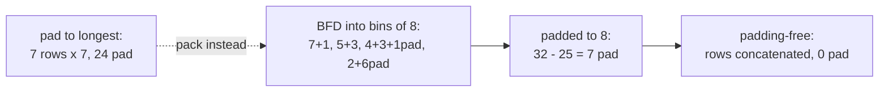

# 05 — Supervised Fine-Tuning and Continued Pretraining

> **Prerequisites:** modules 03, 04.
> **You will learn:** the workhorse recipe end to end with TRL's `SFTTrainer`: loss masking,
> packing, instruction-tuning a base model, adapting an instruct model,
> reasoning-format SFT, alternative losses, and continued pretraining.

Supervised fine-tuning is the stage every later post-training method stands on.
DPO starts from an SFT checkpoint, GRPO needs a model that already emits the right
format, and distillation is SFT with a teacher writing the data. The
[alignment note](../../notes/nlp/llm-prompting-and-alignment.md) states the idea in one
line (maximise the likelihood of demonstrations); this module turns modules 02 to 04
into a recipe that works, and shows where it silently does not.

Defaults are from **TRL v1.15.0** ([SFT docs](https://huggingface.co/docs/trl/v1.15.0/en/sft_trainer)); the [Hugging Face note](../../notes/libraries/huggingface.md) recaps `Trainer` and PEFT.

---

## 5.1 SFTTrainer end to end

Here is the whole recipe for a LoRA SFT run.

Teaching fragment: not executed (needs `trl`, `peft`, a GPU and downloads).

```python
from datasets import load_dataset
from peft import LoraConfig
from transformers import AutoTokenizer
from trl import SFTConfig, SFTTrainer

tok = AutoTokenizer.from_pretrained("Qwen/Qwen3-0.6B")
ds = load_dataset("trl-lib/Capybara", split="train")          # conversational "messages"

cfg = SFTConfig(
    output_dir="qwen3-0.6b-sft",
    max_length=1024,                          # tokens per row, after templating
    model_init_kwargs={"dtype": "bfloat16"},  # otherwise TRL loads float32
    learning_rate=1e-4,                       # LoRA-scale LR; SFTConfig default is 2e-5
    per_device_train_batch_size=8,
    num_train_epochs=2,
    eval_strategy="steps", eval_steps=200,
    packing=True,                             # BFD packing, padding-free (section 5.3)
    assistant_only_loss=True,                 # needs  (section 5.2)
)
trainer = SFTTrainer(
    model="Qwen/Qwen3-0.6B",                  # string: TRL calls from_pretrained for you
    args=cfg,
    train_dataset=ds,
    processing_class=tok,                     # not tokenizer=
    peft_config=LoraConfig(r=16, lora_alpha=32, target_modules="all-linear"),
)
trainer.train()
```

| Argument | What it does | Gotcha |
|---|---|---|
| `model` (string) | TRL loads it with `model_init_kwargs` | without `dtype`, weights load in **float32** (TRL docstring, unlike v5 `from_pretrained`, which infers dtype from the config) |
| `model` (object) | you load it yourself, any quantisation or attention backend | `model_init_kwargs` is then ignored |
| `processing_class` | the tokenizer (or a processor for VLMs) | `tokenizer=` is the stale name ([module 08](./08-frameworks-and-tooling.md)); if `pad_token` is unset TRL falls back to `eos_token` |
| `model_init_kwargs` | forwarded to `from_pretrained` | `{"dtype": ..., "attn_implementation": ..., "use_kernels": True}` live here |
| `peft_config` | wraps the model in a PEFT adapter | the LoRA knobs are [module 06](./06-lora-and-qlora.md) |

`formatting_func` maps a raw row to one string, which makes the dataset language-modelling
type and so is rejected with `completion_only_loss=True`. `quantization_config` takes a
`BitsAndBytesConfig` for a string `model`; with `peft_config` that is QLoRA.

**Pre-tokenised** rows need `input_ids`; `labels` (with `-100`) are used as is, otherwise
TRL builds them from optional `completion_mask` and `assistant_masks` columns
([docstring](https://github.com/huggingface/trl/blob/dae7b6adc8d2729cfa8d21bc8480656ede769240/trl/trainer/sft_trainer.py#L554-L560)).
That is full control of masking when no template trick fits ([module 02](./02-tokens-templates-and-the-causal-lm-objective.md) explains `-100`).

### SFTConfig defaults that differ from TrainingArguments

`SFTConfig` subclasses `TrainingArguments` and overrides several defaults. **Know these
before you copy a hyperparameter from an old tutorial.**

| Field | `SFTConfig` (TRL v1.15.0) | `TrainingArguments` | Why it matters |
|---|---|---|---|
| `learning_rate` | `2e-5` | `5e-5` | full-FT scale; LoRA wants ~10x more |
| `gradient_checkpointing` | `True` | `False` | ~20% slower, much less activation memory ([module 03](./03-training-mechanics-and-memory-math.md)) |
| `bf16` | `True` unless `fp16` is set | `False` | a T4 has no bf16: set `fp16=True` there |
| `logging_steps` | `10` | `500` | you see the loss curve early |
| `max_length` | `1024` | n/a | longer rows are truncated `keep_start`; VLMs need `None` ([module 16](./16-multimodal-and-embedding-fine-tuning.md)) |
| `packing` | `False` | n/a | strategy defaults to `"bfd"` when on |
| `padding_free` | `False` | n/a | forced on by `packing=True` with `bfd` or `bfd_split` |
| `completion_only_loss` | `None`: True for prompt-completion, full sequence for LM data | n/a | the most common silent default |
| `assistant_only_loss` | `False` | n/a | conversational data trains on **every** token unless you set it |
| `loss_type` | `"nll"` (also `"dft"`) | n/a | `"chunked_nll"` is a deprecated alias of `"nll"` |
| model dtype (string `model`) | float32 unless `model_init_kwargs["dtype"]` | n/a | a 4B model in fp32 is 16 GB of weights alone |

Sources: [`sft_config.py`](https://github.com/huggingface/trl/blob/dae7b6adc8d2729cfa8d21bc8480656ede769240/trl/trainer/sft_config.py#L128-L134)
and [`base_config.py`](https://github.com/huggingface/trl/blob/dae7b6adc8d2729cfa8d21bc8480656ede769240/trl/trainer/base_config.py#L55-L75).
`truncation_mode="keep_end"`, `pad_token=` and `compute_loss_func=` are deprecated (gone in TRL v2.0).

### Dataset formats SFTTrainer accepts

Two types, language modelling and prompt-completion, each in a standard (plain text) or
conversational (message list) format; [module 04](./04-data-curation-and-synthesis.md) has
the schema table. What matters here is how each is tokenised and which tokens get loss.

| Type, format | Columns | Tokenisation | Default loss |
|---|---|---|---|
| Language modelling, standard | `text` | as is | every token |
| Language modelling, conversational | `messages` (role/content dicts) | `apply_chat_template` on the whole list | every token, unless `assistant_only_loss=True` |
| Prompt-completion (either format) | `prompt`, `completion` | each tokenised (templated if conversational), concatenated, `completion_mask` recorded | completion only |

Conversational prompt-completion (`prompt` a message list, `completion` the assistant
message) is templated and completion-only by default; the running JSON task uses it.

### Gradient checkpointing with a frozen base

Reentrant checkpointing (the old Transformers default, and what TRL forces for PEFT under
DeepSpeed ZeRO-3) plus a frozen base can produce
`RuntimeError: element 0 of tensors does not require grad and does not have a grad_fn`.
Reentrant checkpointing builds a backward graph for a segment only if one of its *inputs*
requires grad. The first decoder layer's input comes from a frozen embedding, so autograd
never sees the LoRA matrices inside the segment.

The fix is `model.enable_input_require_grads()`, a forward hook that marks the embedding
output as requiring grad. TRL v1.15 calls it for every PEFT model with checkpointing on
([`sft_trainer.py` L866-L869](https://github.com/huggingface/trl/blob/dae7b6adc8d2729cfa8d21bc8480656ede769240/trl/trainer/sft_trainer.py#L866-L869)),
so you hit the error in your own loop. Checkpointing memory is [module 03](./03-training-mechanics-and-memory-math.md)'s.

This check proves the failure and the fix on a two-matrix "adapter" inside a checkpointed
segment.

```python finetuning-check
import warnings
import torch
from torch.utils.checkpoint import checkpoint
torch.manual_seed(0)

emb = torch.nn.Embedding(10, 4)
emb.weight.requires_grad_(False)                     # frozen base embedding
block = torch.nn.Linear(4, 4)
block.weight.requires_grad_(False)
block.bias.requires_grad_(False)
lora_A = torch.nn.Parameter(torch.randn(2, 4) * 0.1)   # trainable adapter inside the block
lora_B = torch.nn.Parameter(torch.randn(4, 2) * 0.1)

def segment(h):
    return block(h) + h @ lora_A.T @ lora_B.T

ids = torch.tensor([1, 2, 3])

# Reentrant checkpointing with a frozen input: autograd never sees the adapter.
h = emb(ids)
assert not h.requires_grad
with warnings.catch_warnings():
    warnings.simplefilter("ignore")
    out = checkpoint(segment, h, use_reentrant=True)
assert not out.requires_grad
try:
    out.sum().backward()
    raised = False
except RuntimeError as e:
    raised = "does not require grad" in str(e)
assert raised

# The fix enable_input_require_grads() applies: a forward hook marking embedding outputs.
handle = emb.register_forward_hook(lambda m, i, o: o.requires_grad_(True))
out = checkpoint(segment, emb(ids), use_reentrant=True)
out.sum().backward()
assert lora_A.grad is not None and lora_A.grad.abs().sum() > 0
handle.remove()
print("frozen-base checkpointing behaviour verified")
```

It does not prove anything about memory or speed; non-reentrant checkpointing avoids the
problem without the hook.

---

## 5.2 Loss masking

The objective is pretraining's next-token cross-entropy; **the mask decides what you are
teaching**. Masked prompt tokens still shape the gradient (completion tokens attend to
them); they are just not targets.

### completion_only_loss

For prompt-completion data TRL sets the label to `-100` wherever `completion_mask` is 0.
With the default `completion_only_loss=None` this is automatic for prompt-completion data
and never applies to language-modelling data. Set it to `False` to ablate (lab L5.2 does).

### assistant_only_loss and 

For conversational data TRL calls `apply_chat_template(..., return_assistant_tokens_mask=True)`.
The mask "is only available for chat templates that support it via the
`` keyword" ([docstring](https://github.com/huggingface/transformers/blob/v5.19.0/src/transformers/tokenization_utils_base.py#L3065-L3068)).
A minimal ChatML template with the markers:

```jinja

    
        {{- "<|im_start|>assistant\n" }}
        
        {{- message.content + "<|im_end|>" }}
        
        {{- "\n" }}
    
        {{- "<|im_start|>" + message.role + "\n" + message.content + "<|im_end|>\n" }}
    

{{- "<|im_start|>assistant\n" }}
```

On a two-turn chat the generation spans are exactly `Hello!<|im_end|>` and `Ciao<|im_end|>`.
**The header sits outside the block and the turn-end token inside it**: the server writes
the header; `<|im_end|>` is how the model learns to stop. SmolLM3's template puts the
header inside ([lines 76-82](https://huggingface.co/HuggingFaceTB/SmolLM3-3B/blob/a07cc9a04f16550a088caea529712d1d335b0ac1/chat_template.jinja#L76-L82)),
which trains three header tokens per turn. Harmless, but know it.

Most shipped templates lack the markers. TRL v1.15 has two safety nets: for recognised
families (Qwen3 including Instruct-2507, Llama 3.x, Gemma, DeepSeek-V3, GPT-OSS and
others) it swaps in a patched training template
([TRL chat templates](https://huggingface.co/docs/trl/v1.15.0/en/chat_templates)); for
anything else, an example with no assistant tokens raises a `RuntimeError`
([source](https://github.com/huggingface/trl/blob/dae7b6adc8d2729cfa8d21bc8480656ede769240/trl/trainer/sft_trainer.py#L1385-L1391)).
Hand-rolled loops have neither: an all-zero mask gives no signal or, worse, a silent
fallback to full-sequence loss. **Always decode the trained tokens of one batch
before a long run.**

Unsloth's alternative is string matching:
`train_on_responses_only(trainer, instruction_part="<|im_start|>user\n",
response_part="<|im_start|>assistant\n")` masks everything except the spans after each
response marker ([Unsloth docs](https://unsloth.ai/docs/get-started/fine-tuning-llms-guide/lora-hyperparameters-guide)).
It works with any template, and it breaks silently if the marker string tokenises
differently in context (a leading space, a merged newline). Multi-turn agent traces add a
further rule, mask tool outputs too, which is [module 15](./15-agentic-and-tool-use-fine-tuning.md)'s territory.

### When training on prompts helps

The misconception is "train on the whole conversation, more tokens is more signal". For
typical instruction data the prompt tokens are the user's distribution, not the behaviour
you want, and they dilute the loss (in the example below, three quarters of the targets
are not the final answer). Training on prompts helps only in narrow cases: tiny datasets
with very short completions (a label) where prompt loss regularises on domain text, and
CPT-like data where the prompt is itself text you want modelled. Measure it.

Dettmers et al. (2023), [QLoRA](https://arxiv.org/abs/2305.14314) (Appendix B, Table 10),
found target-only training beat source-plus-target on all four instruction datasets they
tried, a 7B model scoring 38.6 vs 37.5 mean 5-shot MMLU. They did not measure chat quality
for this ablation. Treat target-only as the default and prompt loss as an ablation.

### What each scheme trains, counted

Take one ChatML conversation with these token counts: system turn 12, user turn 20,
assistant header 3, assistant answer 31 (content plus `<|im_end|>`), second user turn 15,
header 3, second answer 26. Total 110 tokens, so 109 next-token targets after the shift.

| Scheme | Trained targets | Share | What the model learns |
|---|---|---|---|
| (a) full sequence | 109 | 100% | also how to write system prompts and user turns |
| (b) completion-only on a prompt-completion split | 26 | 24% | only the final answer; earlier answers are context |
| (c) assistant-only, multi-turn | 57 | 52% | every assistant turn, including the stop token |

With a SmolLM3-style template, (c) would be 63 (the two headers count). Scheme (b) wastes
the first answer as a target, which is why multi-turn data stays conversational.

---

## 5.3 Packing and padding-free batching

### Padding wastes compute

Take seven examples of lengths `[7, 5, 4, 3, 3, 2, 1]` (25 real tokens) and
`max_length=8`. Padded to the longest in one batch, you compute $7 \times 7 = 49$
positions for 25 tokens: **24 pad tokens**, nearly half the batch, and real long-tailed
SFT sets waste more.

**Packing** puts several examples into one row. TRL v1.15 offers three strategies
([reducing memory usage](https://huggingface.co/docs/trl/v1.15.0/en/reducing_memory_usage)):

| `packing_strategy` | Placement | Overlong examples | Cross-example attention |
|---|---|---|---|
| `"bfd"` (default) | best-fit decreasing bins | overflow tokens **discarded** | none: padding-free, position ids reset |
| `"bfd_split"` | best-fit decreasing after splitting | split into chunks of at most `max_length`, nothing lost | none |
| `"wrapped"` | concatenate everything, cut every `max_length` | split mid-example | examples share rows and get cut; the docs warn it hurts |

If no example exceeds `max_length`, `bfd` and `bfd_split` are identical.

**Best-fit decreasing** sorts lengths descending and puts each into the open bin with the
least room that still fits. Our lengths give bins `[7,1]`, `[5,3]`, `[4,3]`, `[2]`.



Four rows padded to 8 is $32 - 25 = 7$ pad tokens. **Padding-free** goes further: the
whole batch is one flattened sequence with per-example boundaries, so zero pad tokens.
This check implements BFD and asserts every number above.

```python finetuning-check
from collections import Counter

def bfd(lengths, capacity):
    """Best-fit decreasing: longest first, into the bin with the least room that still fits."""
    bins, room = [], []
    for n in sorted(lengths, reverse=True):
        assert n <= capacity, "bfd truncates (or bfd_split splits) anything longer first"
        fits = [i for i, r in enumerate(room) if r >= n]
        if fits:
            i = min(fits, key=lambda j: room[j])  # tightest fit; ties go to the earliest bin
            bins[i].append(n)
            room[i] -= n
        else:
            bins.append([n])
            room.append(capacity - n)
    return bins

lengths, max_length = [7, 5, 4, 3, 3, 2, 1], 8
real = sum(lengths)
assert real == 25

pad_to_longest = len(lengths) * max(lengths) - real
assert pad_to_longest == 24

bins = bfd(lengths, max_length)
assert sorted(map(sorted, bins)) == sorted(map(sorted, [[7, 1], [5, 3], [4, 3], [2]]))
assert len(bins) == 4
assert all(sum(b) <= max_length for b in bins)
assert Counter(x for b in bins for x in b) == Counter(lengths)  # every item placed exactly once

packed_padded_waste = len(bins) * max_length - real
assert packed_padded_waste == 7
padding_free_waste = sum(sum(b) for b in bins) - real  # rows are concatenated, no pad at all
assert padding_free_waste == 0
print("BFD packing arithmetic verified")
```

It does not prove a wall-clock speed-up, which depends on the kernel and the GPU.

### Packing does not contaminate examples

The misconception is that packed examples attend to each other. Naive concatenation did,
with position ids counting across the boundary. Modern packing **restarts position ids at
0 for each example**, and FlashAttention 2/3's variable-length path turns the resets into
cumulative sequence lengths (`cu_seqlens`) and block-diagonal causal attention without a
mask ([Transformers module 11](../transformers/11-hardware-aware-attention.md)
covers the kernel; [Transformers module 08](../transformers/08-encoder-decoder-masking.md) the masks).
Each example's last label is ignored, so none is trained to predict the next one's first token.

This check packs two documents with position ids `[0,1,2,0,1,2,3]`, masks block-diagonally
from the resets, and compares against each document run alone.

```python finetuning-check
import torch
torch.manual_seed(0)
d = 8

def rope(x, pos):
    # x: (T, d), pos: (T,) position ids; rotate pairs of channels by pos * theta_k
    half = x.shape[-1] // 2
    theta = 10000.0 ** (-torch.arange(half, dtype=torch.float64) / half)
    ang = pos[:, None].double() * theta[None, :]            # (T, d/2)
    cos, sin = ang.cos(), ang.sin()
    x1, x2 = x[:, :half], x[:, half:]
    return torch.cat([x1 * cos - x2 * sin, x1 * sin + x2 * cos], dim=-1)

Wq, Wk, Wv = (torch.randn(d, d, dtype=torch.float64) for _ in range(3))

def attend(x, pos, allowed):
    q, k, v = rope(x @ Wq, pos), rope(x @ Wk, pos), x @ Wv
    s = (q @ k.T) / d ** 0.5
    s = s.masked_fill(~allowed, float("-inf"))
    return s.softmax(-1) @ v                                 # (T, d)

def causal(T):
    return torch.ones(T, T, dtype=torch.bool).tril()

doc1 = torch.randn(3, d, dtype=torch.float64)
doc2 = torch.randn(4, d, dtype=torch.float64)
row = torch.cat([doc1, doc2])                                # one packed row of 7 tokens
pos = torch.tensor([0, 1, 2, 0, 1, 2, 3])

# Document ids recovered from position-id resets: a new document starts wherever pos == 0.
doc_id = torch.cumsum((pos == 0).long(), 0) - 1
assert doc_id.tolist() == [0, 0, 0, 1, 1, 1, 1]
block_causal = causal(7) & (doc_id[:, None] == doc_id[None, :])

packed = attend(row, pos, block_causal)
alone1 = attend(doc1, torch.arange(3), causal(3))
alone2 = attend(doc2, torch.arange(4), causal(4))
torch.testing.assert_close(packed[:3], alone1, atol=1e-6, rtol=0)
torch.testing.assert_close(packed[3:], alone2, atol=1e-6, rtol=0)

# Same position ids, but a plain causal mask: document 2 now attends to document 1.
leaky = attend(row, pos, causal(7))
torch.testing.assert_close(leaky[:3], alone1, atol=1e-6, rtol=0)   # doc 1 has nothing before it
assert (leaky[3:] - alone2).abs().max() > 1e-3                     # doc 2 is contaminated
print("packed attention == per-document attention verified")
```

It does not prove that *your* stack honours the resets: a backend with a dense causal mask
gives the leaky case.

### padding_free and pad_to_multiple_of

`padding_free=True` without packing flattens each sampled batch into one sequence,
keeping every example whole. Padding-free needs attention that respects example
boundaries: **in TRL that means FlashAttention-2 or 3**
(`model_init_kwargs={"attn_implementation": "kernels-community/flash-attn2"}`); with other
backends you risk exactly the contamination above. `packing=True` with `bfd` or
`bfd_split` turns it on regardless of the flag. `pad_to_multiple_of=8` (or 64) rounds padded
lengths up for tensor-core-friendly shapes when you do pad. Hardware support is
[module 03](./03-training-mechanics-and-memory-math.md)'s topic.

### What "Fewer Truncations" showed

Ding et al. (2024), [Fewer Truncations Improve Language Modeling](https://huggingface.co/papers/2404.10830),
replaced concatenate-and-split (what `wrapped` does) with best-fit packing in pretraining:
reading comprehension +4.7% relative, context following +16.8%, program synthesis +9.2%,
closed-domain hallucination down by up to 58.3%. **It establishes** that truncation is not
free; **it does not** test SFT, so applying it there (as `bfd_split` does) is an inference.

---

## 5.4 Instruction-tuning a base model

A base model saw raw text: no turns, often no stop behaviour
([module 01](./01-when-to-fine-tune.md)). Making it a chat model takes four decisions.

**1. A chat template.** Many base models ship none. `SFTConfig(chat_template_path=...)`
accepts either a Jinja file or a model/tokenizer id. Given an id, TRL calls
`clone_chat_template`, which copies the template, adds the source tokenizer's special
tokens, sets the EOS token, and resizes the embeddings (rounded up to a multiple of 64 by
default) ([TRL source](https://github.com/huggingface/trl/blob/dae7b6adc8d2729cfa8d21bc8480656ede769240/trl/chat_template_utils.py#L48-L93)).
Given a raw Jinja file, you add the special tokens and resize yourself
([module 02](./02-tokens-templates-and-the-causal-lm-objective.md) covers templates).

**2. The EOS token.** This is the decision that breaks things. `Qwen/Qwen3-0.6B-Base`
ships a ChatML template, but its EOS is `<|endoftext|>` (id 151643), and its
[`generation_config.json`](https://huggingface.co/Qwen/Qwen3-0.6B-Base/blob/da87bfb608c14b7cf20ba1ce41287e8de496c0cd/generation_config.json)
stops only on 151643. A ChatML assistant turn ends with `<|im_end|>`. Train without
aligning them and the model learns to emit `<|im_end|>`, the generator does not stop
there, and the model rambles on into an invented user turn. The fix, from the TRL docs:
set `SFTConfig(eos_token="<|im_end|>")`. TRL then sets the tokenizer's EOS, mirrors it
into the model config, and **prepends** it to `generation_config.eos_token_id` rather than
replacing the list ([source](https://github.com/huggingface/trl/blob/dae7b6adc8d2729cfa8d21bc8480656ede769240/trl/trainer/sft_trainer.py#L719-L737)).
Compare Qwen's own instruct model, whose
[generation config](https://huggingface.co/Qwen/Qwen3-4B-Instruct-2507/blob/cdbee75f17c01a7cc42f958dc650907174af0554/generation_config.json)
lists `[151645, 151643]`: `<|im_end|>` first, `<|endoftext|>` second. The pad-equals-EOS
trap is [module 02](./02-tokens-templates-and-the-causal-lm-objective.md)'s.

**3. New special tokens** need embedding and LM-head rows, which `resize_token_embeddings`
creates (initialised from the mean and covariance of the old rows; [module 02](./02-tokens-templates-and-the-causal-lm-objective.md)).

**4. Training those rows.** A new row is useless until trained, and LoRA on linear layers
does not touch embeddings. Two options: `trainable_token_indices` in PEFT trains only the
new rows ([module 06](./06-lora-and-qlora.md), along with weight tying), or
`modules_to_save=["embed_tokens", "lm_head"]` trains full copies of both matrices, which
for a 150k-vocabulary model is hundreds of millions of extra trainable parameters. If the
template's tokens already exist in the vocabulary (Qwen's ChatML tokens do), they may
still be under-trained in a base model; assistant-only loss on `<|im_end|>` is what
teaches it.

The TRL docs' example (`Qwen/Qwen3-0.6B-Base`, `trl-lib/Capybara`,
`chat_template_path="HuggingFaceTB/SmolLM3-3B"`) is lab L5.1.

### Fine-tuning an already-instruct model

The more common job is making `Qwen/Qwen3-4B-Instruct-2507` better at your task. The rules:

- **Keep its template, system-prompt conventions and thinking flags byte-for-byte.** The
  model is conditioned on those exact tokens; a mismatch at serving time degrades it silently.
- **Low LR, small data:** at most about `1e-5` full or `1e-4` LoRA, 1 to 3 epochs. You are
  nudging a converged policy; more steps buy regression, not task skill.
- **Mix in general instruction data** ([module 04](./04-data-curation-and-synthesis.md) on mixing).
- **Re-run a general and a safety eval after**: narrow SFT can erode refusals and broad
  skills ([module 19](./19-safety-forgetting-and-responsible-fine-tuning.md)).

---

## 5.5 Reasoning-format SFT

Reasoning models put a trace between `<think>` and `</think>` before the answer. Store it
**inline in `content`** (`"<think>\n...\n</think>\n\nanswer"`, how the TRL docs format
`FreedomIntelligence/medical-o1-reasoning-SFT`), or in a **`reasoning_content` field** that
templates such as Qwen3's render into the think block; if the template ignores the field,
the trace is silently dropped.

Two traps. First, **stock templates often strip history**: Qwen3's template drops the
reasoning from assistant turns before the last user query, and DeepSeek-R1-Distill's
template drops everything up to `</think>`, which removes the trace from the training
target. TRL's patched training templates fix both and always emit the think block
([TRL chat templates](https://huggingface.co/docs/trl/v1.15.0/en/chat_templates)).
Second, **the thinking toggle**. Qwen3's hybrid checkpoints switch with
`enable_thinking`; the Qwen3 report describes "thinking mode fusion", training both modes
together with non-thinking samples carrying an *empty* think block (Yang et al. 2025,
[Qwen3 Technical Report](https://huggingface.co/papers/2505.09388)). Fine-tune a hybrid
model only on traces and the non-thinking mode degrades. Keep both kinds of example,
render non-thinking ones with the empty block as the template does at inference, and
evaluate both modes. Train single-mode checkpoints such as `Qwen3-4B-Instruct-2507` only
in their mode.

Measure the truncation rate at your `max_length` first: a truncated trace teaches the
model to stop mid-thought. Where traces come from is [module 14](./14-distillation-and-reasoning.md).

---

## 5.6 Alternative SFT losses

### DFT: Dynamic Fine-Tuning

Wu et al. (2025), [On the Generalization of SFT](https://huggingface.co/papers/2508.05629),
rewrite the SFT gradient as a policy gradient. With the expert response $y^{\star}$,

$$
\nabla_\theta \mathcal{L}_{\text{SFT}} = -\,\mathbb{E}_{y \sim \pi_\theta}\!\left[\frac{\mathbf{1}[y = y^{\star}]}{\pi_\theta(y \mid x)}\,\nabla_\theta \log \pi_\theta(y \mid x)\right].
$$

Check: the indicator keeps only $y=y^\star$, so the expectation equals
$\pi_\theta(y^\star\mid x)\cdot\frac{1}{\pi_\theta(y^\star\mid x)}\nabla_\theta\log\pi_\theta(y^\star\mid x)=\nabla_\theta\log\pi_\theta(y^\star\mid x)$,
and the right-hand side is $-\nabla_\theta\log\pi_\theta(y^\star\mid x)$, the ordinary SFT
gradient. Read it as on-policy RL (policy gradients:
[module 13](./13-rl-with-verifiable-rewards.md)) with a sparse reward
$r = \mathbf{1}[y=y^{\star}]$ and an importance weight $1/\pi_\theta(y^{\star}\mid x)$. The weight is the problem: **the less likely the model
finds the demonstration, the larger the update**, which the paper argues makes SFT's
implicit reward ill-posed and its gradients high-variance on low-probability tokens. The
fix cancels the weight by multiplying with its stop-gradient inverse, applied per token:

$$
\mathcal{L}_{\text{DFT}} = -\frac{1}{|\mathcal{M}|}\sum_{t \in \mathcal{M}} \text{sg}\big(p_\theta(y_t \mid \cdot)\big)\,\log p_\theta(y_t \mid \cdot),
$$

where $\mathcal{M}$ is the set of unmasked tokens. The gradient is the CE gradient of each
token scaled by $\text{sg}(p_t)$: confident tokens keep their update, surprising ones are
damped. In TRL it is `SFTConfig(loss_type="dft")`, and the implementation is one line,
`per_token_loss * log_probs.exp().detach()`
([source](https://github.com/huggingface/trl/blob/dae7b6adc8d2729cfa8d21bc8480656ede769240/trl/trainer/sft_trainer.py#L1610-L1613)).

This check asserts the loss, the per-token gradient scaling, and that DFT never exceeds CE.

```python finetuning-check
import torch
import torch.nn.functional as F
torch.manual_seed(0)
logits = torch.randn(5, 7, dtype=torch.float64, requires_grad=True)  # (tokens, V); f64
targets = torch.tensor([0, 3, 6, 2, 2])

logp = F.log_softmax(logits, -1)
nll = -logp.gather(1, targets[:, None]).squeeze(1)   # (5,) per-token CE
p = torch.exp(-nll)                                  # p_theta(y_t | .)

ce = nll.mean()
dft = (p.detach() * nll).mean()                      # loss_type="dft"

# Reference DFT loss written from scratch.
with torch.no_grad():
    probs = torch.softmax(logits, -1)
    ref = sum(float(probs[i, targets[i]]) * -float(torch.log(probs[i, targets[i]])) for i in range(5)) / 5
assert abs(dft.item() - ref) < 1e-12

# Gradient: DFT gradient == per-token CE gradient scaled by sg(p_t).
g_dft, = torch.autograd.grad(dft, logits, retain_graph=True)
g_tok, = torch.autograd.grad(nll.sum(), logits, retain_graph=True)  # row t = grad of token t's CE
expected = g_tok * p.detach()[:, None] / 5
torch.testing.assert_close(g_dft, expected, atol=1e-12, rtol=0)

# Analytic form of the CE row gradient: softmax - onehot.
onehot = F.one_hot(targets, 7).double()
torch.testing.assert_close(g_tok, torch.softmax(logits, -1) - onehot, atol=1e-12, rtol=0)

# Every weight p_t < 1, so DFT <= CE, and low-probability tokens are damped most.
assert bool((p < 1).all()) and dft.item() <= ce.item()
print("DFT loss and gradient verified")
```

It does not prove DFT generalises better. The paper's gains are on math reasoning (100k
NuminaMath-CoT examples; Qwen2.5-Math, Llama 3.x, DeepSeekMath); it also reports DFT
**losing** to SFT on Natural Questions, since it under-weights hard or rare tokens by
construction. Use it when the behaviour is already plausible to the model, not for new facts.

### Label smoothing, NEFTune, filtered SFT

- **Label smoothing** (`label_smoothing_factor`) works in `SFTTrainer` but needs full
  logits, so it runs outside the fused LM-head path; little evidence it helps LLM SFT.
- **NEFTune** (embedding noise, [Jain et al. 2023](https://arxiv.org/abs/2310.05914)) is
  a regulariser covered in [module 03](./03-training-mechanics-and-memory-math.md).
- **TailSFT** ([Malladi et al. 2026](https://huggingface.co/papers/2608.25756)) drops
  the sequences whose loss has fallen most since the initial policy, to keep pass@k
  coverage for a later RL stage. On OLMo-3 7B it improved pass@16 in 15 of 18 pairs, and
  GRPO from its checkpoints won pass@1 in 5 of 5. If SFT is a warm-up for RL, the SFT
  objective that maximises pass@1 may not be the one you want.

---

## 5.7 Continued pretraining

Continued pretraining (CPT) runs the language-modelling objective on raw domain text from
an existing base model. It moves **stable** knowledge into a model (a new language, a
field's terminology, a code base's idioms), not volatile facts, where retrieval wins
([module 01](./01-when-to-fine-tune.md)).

| Knob | CPT | SFT |
|---|---|---|
| Data | raw domain text, millions to billions of tokens | demonstrations, thousands to hundreds of thousands |
| Loss | every token (`text` column, LM type) | completion or assistant only |
| LR (full FT) | higher, e.g. `5e-5` to `1e-4` | `1e-5` to `2e-5` |
| LoRA | high rank (64 to 256), all linear layers | rank 8 to 32 usually suffices |
| Embeddings / LM head | trained, at a smaller LR | frozen unless new tokens |
| Packing | `bfd_split` or `wrapped` (documents are long) | `bfd` |

**Train `embed_tokens` and `lm_head`, but slower.** Unsloth's CPT recipe trains both with
an `embedding_learning_rate` "2-10x smaller than learning_rate" (their example: `5e-5` and
`5e-6`; [Unsloth CPT docs](https://unsloth.ai/docs/basics/continued-pretraining)).
Frequent tokens' rows get gradient almost every step, and a large LR there disrupts the
representation every layer reads. In PyTorch or TRL this is two optimizer parameter
groups, which the lab script builds and asserts.

**Mix in general text.** A domain-only stream is the fastest route to catastrophic
forgetting. Replay general web text (10 to 30% for raw-text CPT, more than the 5–20% heuristic for SFT
mixes in [module 04](./04-data-curation-and-synthesis.md)) and track general perplexity
beside domain perplexity; [module 19](./19-safety-forgetting-and-responsible-fine-tuning.md)
has the forgetting evidence.

**Vocabulary extension** for a new language: add tokens trained on domain text, resize,
initialise new rows from the mean of their old sub-token embeddings, and train embeddings
first. Then **a short SFT** restores the chat behaviour raw-text CPT erodes.

**CPT before SFT pays** when you have far more stable domain text than SFT data (hundreds
of millions of tokens or more), when the language or terminology tokenises into many
pieces per word, or when domain perplexity is much worse than general perplexity.
Otherwise go straight to SFT. Long-document CPT for context extension is
[module 17](./17-long-context-extension.md).

---

## 5.8 Beyond chat: multi-task, multi-turn, and classification heads

**Multi-task SFT**: balance tasks by tokens, not examples, and give each an unambiguous
instruction. **Multi-turn SFT**: keep conversations conversational with assistant-only
loss (scheme (c) in section 5.2); a conversation truncated after a user turn trains
nothing at its end. **System-prompt diversity**: a single training system prompt becomes
a trigger string, so sample paraphrases (and some rows with none) when serving prompts
will vary. The running task's labs keep module 01's prompt fixed so that scores compare.

**Classification heads.** For a fixed label set, `AutoModelForSequenceClassification`
puts a linear `score` head on the last token's hidden state; with LoRA, train it in full.

Teaching fragment: not executed.

```python
from peft import LoraConfig, TaskType, get_peft_model
from transformers import AutoModelForSequenceClassification, AutoTokenizer

tok = AutoTokenizer.from_pretrained("Qwen/Qwen3-0.6B")
model = AutoModelForSequenceClassification.from_pretrained(
    "Qwen/Qwen3-0.6B", num_labels=5, dtype="bfloat16")       # issue_type, 5 classes
model.config.pad_token_id = tok.pad_token_id  # must match the id the tokenizer pads with
cfg = LoraConfig(task_type=TaskType.SEQ_CLS, r=16, lora_alpha=32,
                 target_modules="all-linear", modules_to_save=["score"])
model = get_peft_model(model, cfg)                             # LoRA body, full head
```

The model pools the last non-pad token, found via `pad_token_id`; Qwen3's config EOS
(`<|im_end|>`) is not the id its tokenizer pads with, so copying EOS would pool padding.
PEFT 0.21.2 adds `score` to `modules_to_save` itself ([source](https://github.com/huggingface/peft/blob/v0.21.2/src/peft/peft_model.py#L1827-L1836)).
**A head beats generative SFT** for a fixed label set: one forward pass, calibrated
scores, no parse failures. Generative SFT wins for structured outputs (the running task's
JSON has free-text fields) or changing labels. The broader classification ladder is in the
[text classification note](../../notes/nlp/text-classification.md); embedding and
reranker heads are [module 16](./16-multimodal-and-embedding-fine-tuning.md).

**Tool-calling SFT** (`tool_calls`, `tool` messages and a `tools` column, supported by
`SFTTrainer`) is [module 15](./15-agentic-and-tool-use-fine-tuning.md)'s.

---

## 5.9 Monitoring, saving and failure modes

### Monitor

- **Two eval sets**, in-domain and general: in-domain loss falling while general loss
  rises is forgetting in real time.
- **Generations every N steps** (a `TrainerCallback` decoding five fixed prompts with the
  serving template): loss curves do not show a model that never stops; samples do.
- **`mean_token_accuracy`** (logged by `SFTTrainer`) near 1.0 with flat eval accuracy
  means memorisation.
- **Task metrics** on the golden set: for the running task, module 01's parse rate, schema
  validity, per-field and all-fields exact match ([module 09](./09-evaluating-fine-tuned-models.md)
  designs evals).

### Save the whole contract, not just weights

| Artefact | Why |
|---|---|
| Adapter (`adapter_model.safetensors` + `adapter_config.json`) | small; serve with multi-LoRA, or merge later |
| Merged weights | merge into a **bf16** copy of the base; needed for runtimes without adapter support |
| Tokenizer files and `chat_template.jinja` | a cloned or patched template exists nowhere else |
| `generation_config.json` with the EOS **list** | the server stops on these ids; a missing turn-end id means a model that never stops |
| Model card | base model, data, template, intended use, evals |

`trainer.save_model()` saves the adapter and the processing class; check the saved EOS
list. Serving is [module 20](./20-production-serving-and-cost.md); the card is
[module 19](./19-safety-forgetting-and-responsible-fine-tuning.md).

### Failure modes

| Failure | Symptom | Likely cause | Fix |
|---|---|---|---|
| Repetition loops | same phrase or JSON key repeated to `max_new_tokens` | over-training on short repetitive targets; greedy decoding on a peaked model; turn-end never learned | fewer epochs or lower LR; include the turn-end token in the loss; check sampling settings; dedup data |
| Never stops | answer continues into a fake user turn | EOS masked as padding (pad = eos), turn-end outside the loss mask, or `generation_config` missing the turn-end id | set `eos_token` to the turn end; use a distinct pad token; put the turn-end token inside the generation block; fix the EOS list |
| Template mismatch at inference | fine on training-style prompts, worse in production | serving with a different template, a double BOS, a missing system prompt, or thinking toggled differently | ship the template with the model; render serving prompts with `apply_chat_template` and diff against a training row |
| Catastrophic forgetting | task metric up, general eval and safety refusals down | LR too high, too many epochs, domain-only data | lower LR, LoRA, 1 to 3 epochs, replay general data, re-evaluate |
| Overfitting to style | every answer has the dataset's tone, length or boilerplate, even off-task | small homogeneous dataset, training loss far below eval loss | more diverse data, system-prompt diversity, early stopping on eval loss |
| Truncated completions | answers end mid-JSON or mid-trace | `max_length` cut the end of long examples and the model learned that | measure truncation rate first; raise `max_length`, use `bfd_split`, or drop overlong examples |

---

## 5.10 Lab: from base to instruct, and task SFT

**Goal:** see the masking, packing and template decisions in the numbers. Scripts:
[sft_lab.py](./code/sft_lab.py) (L5.1, L5.2, L5.4) and [continued_pretraining.py](./code/continued_pretraining.py) (L5.3).

### Step 0: the CPU rehearsal

The smoke modes need only torch and assert masking, BFD packing isolation and the two CPT
learning rates on toy models (the docstrings list each check). Given module 01's files,
`sft_lab.py --smoke` also loads them and checks its prompt and scorer against module 01's.

```bash
python content/courses/finetuning/code/fit_or_not_baseline.py --data-only
python content/courses/finetuning/code/sft_lab.py --smoke
python content/courses/finetuning/code/continued_pretraining.py --smoke
```

### L5.1 Base to instruct (T0)

`Qwen/Qwen3-0.6B-Base` on [`trl-lib/Capybara`](https://huggingface.co/datasets/trl-lib/Capybara/tree/e235e846458bff3398a88aed812347f7f0756520)
with `chat_template_path="HuggingFaceTB/SmolLM3-3B"` (the TRL docs' recipe), QLoRA, fp16
on a T4. Then score the result on module 01's golden set with the same prompt as the
prompting baseline (the script copies module 01's `SYSTEM_PROMPT` verbatim).

```bash
python content/courses/finetuning/code/sft_lab.py --full --task base2instruct
python content/courses/finetuning/code/sft_lab.py --full --task base2instruct --eval-only --adapter qwen3-0.6b-base-capybara
```

Record: whether generations stop at `<|im_end|>`, and the four task metrics against module
01's zero-shot baseline. Expect chat format and stopping, not a real instruct model's score.

### L5.2 Task SFT with ablations (T1)

`Qwen/Qwen3-4B-Instruct-2507` + LoRA on `ft_data/train.jsonl`, scored on
`ft_data/eval.jsonl` (module 01's `{"id", "email", "gold"}` rows), as conversational
prompt-completion data. Four runs: completion-only vs full-sequence loss, packing off vs on.

```bash
python content/courses/finetuning/code/sft_lab.py --full --task task
python content/courses/finetuning/code/sft_lab.py --full --task task --full-sequence-loss
python content/courses/finetuning/code/sft_lab.py --full --task task --packing
python content/courses/finetuning/code/sft_lab.py --full --task task --full-sequence-loss --packing
```

Record the four metrics and wall-clock time per run. Expect SFT to beat the prompting
baseline on all-fields EM, packing to cut wall time with little metric change, and
full-sequence loss to be no better (often slightly worse) on this prompt-heavy task.

### L5.3 Continued pretraining then SFT (T1/T2)

`Qwen/Qwen3-1.7B-Base`, CPT on public-domain US case law
([`common-pile/caselaw_access_project_filtered`](https://huggingface.co/datasets/common-pile/caselaw_access_project_filtered))
mixed 80:20 with `HuggingFaceFW/fineweb-edu`, LoRA r=128 plus embeddings at a 10x smaller
LR, `bfd_split` packing. Then a short SFT with `sft_lab.py`, and an MMLU-Pro subset with
`lm_eval` before and after (module 09 explains the harness and error bars).

```bash
python content/courses/finetuning/code/continued_pretraining.py --full --max-steps 2000
```

Record domain and general perplexity and MMLU-Pro accuracy. Expect domain perplexity to
drop clearly and the general numbers to move a little; rerun without the general mix to
see forgetting.

### L5.4 Reasoning SFT (T0)

[`FreedomIntelligence/medical-o1-reasoning-SFT`](https://huggingface.co/datasets/FreedomIntelligence/medical-o1-reasoning-SFT/tree/fc2c9e8a37b38f38da6d449564a8c350b244aef4)
(`en` config, Apache-2.0) formatted as `<think>Complex_CoT</think>` then `Response`,
QLoRA on `Qwen/Qwen3-0.6B`.

```bash
python content/courses/finetuning/code/sft_lab.py --full --task reasoning
```

Record the truncation rate the script prints for `max_length=2048` and its ten held-out
samples with thinking on and ten off (`thinking_samples.json`, plus a count of outputs
containing a trace). If non-thinking answers now include traces, you have reproduced the
toggle failure of section 5.5; the fix is non-thinking examples with empty think blocks.

---

## Key takeaways

- **The mask is the curriculum.** Prompt-completion data is masked by default; conversational
  data trains every token unless you set `assistant_only_loss=True`, which needs
  `` markers. In the worked conversation the schemes train 109, 26 and 57
  targets; decode the trained tokens of one batch before a long run.
- **SFTConfig defaults are not TrainingArguments defaults.** LR `2e-5`, checkpointing on,
  bf16 on, `max_length=1024`, and float32 weights unless you set `dtype`.
- **Packing with BFD removes padding without mixing examples, and truncation is a training
  signal.** Position-id resets plus varlen attention give per-example outputs (24 pad tokens
  become 7 or 0); prefer `bfd_split` and measure truncation before long-trace SFT.
- **A base-to-chat conversion is a template, an EOS, and trained token rows.** Get the
  turn-end token into the loss and into `generation_config`, and ship adapter, tokenizer,
  template, EOS list and model card together, or the model never stops in production.
- **Instruct models need gentle SFT.** Keep the template, LR at most `1e-4` LoRA, small
  data, general replay, and re-run general and safety evals.
- **Hybrid reasoning models need both modes in the data.** Empty think blocks keep the
  non-thinking mode alive; stock templates may strip traces from history.
- **DFT reweights tokens by their own probability.** It cancels SFT's inverse-probability
  weight, helps where the behaviour is already plausible, and can hurt knowledge learning.
- **CPT moves stable knowledge, slowly at the embeddings.** Higher LR, high-rank LoRA,
  embeddings 2 to 10x slower, general replay, then a short SFT.
- **Use a classification head for fixed labels.** One forward pass, calibrated scores,
  no parsing; LoRA body with the `score` head trained in full.

## Self-check

1. How do you fine-tune a base model into a chat model? List the template, special-token
   and EOS decisions, and say what breaks if the EOS token is wrong.
2. What does `assistant_only_loss=True` require from the chat template, and what silently
   happens if the template lacks it?
3. Explain sequence packing and how modern implementations prevent cross-example
   attention. When should you do continued pretraining before SFT, and how do you set the
   learning rate for embeddings?

---

**Next → [06 — LoRA and QLoRA in Depth](./06-lora-and-qlora.md)**
