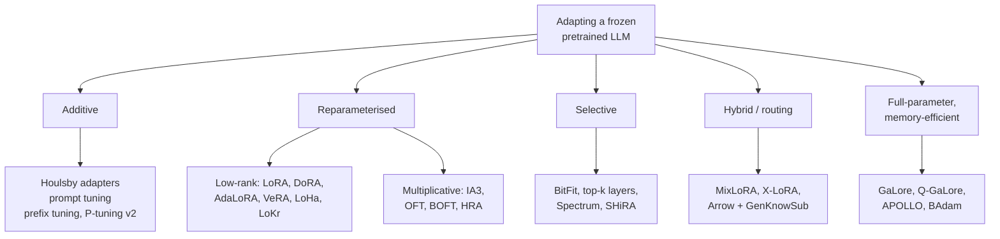

# 07 — Beyond LoRA: The PEFT Landscape and Memory-Efficient Full Tuning

> **Prerequisites:** module 06.
> **You will learn:** the PEFT families beyond LoRA (DoRA, IA3, soft prompts, OFT, the 2025–26
> variants), memory-efficient full-parameter methods such as GaLore and
> Spectrum, and how to choose among them.

LoRA is the default, not the only option. Between July 2025 and October 2026 the PEFT library alone
shipped more than thirty new methods across releases v0.16 to v0.21. You need to know which families
exist, which are used in production (DoRA, IA3, prompt tuning, OFT), which are research, and which
memory-efficient *full-parameter* methods compete with adapters. Then you choose a method on purpose
instead of defaulting to one. The notes' PEFT family table in [transfer learning and
fine-tuning](../../notes/deep-learning/transfer-learning-and-finetuning.md) gives the one-screen
summary: adapters cost latency, prefixes cost context, BitFit costs almost nothing. This module goes
underneath that table, with parameter counts, the algebra that makes each method mergeable or not,
and evidence from one controlled benchmark.

---

## 7.1 A taxonomy

Every PEFT method answers one question: **which part of the computation do you let gradients change,
and how is it parameterised?** There are four answers, plus a fifth family that is not PEFT at all
but competes for the same GPU budget.

| Family | What is trained | Examples | Mergeable into $W_0$? |
|---|---|---|---|
| Additive | new modules or new inputs beside the frozen network | Houlsby adapters, prompt tuning, prefix tuning, P-tuning | adapters and prompts: no |
| Reparameterised | a structured update $\Delta W$ (or multiplier) to existing weights | LoRA, DoRA, AdaLoRA, VeRA, LoHa, LoKr, OFT, BOFT, HRA | yes |
| Selective | a chosen subset of existing parameters | BitFit, top-k layer training, Spectrum, SHiRA | trivially (the weights *are* the model) |
| Hybrid | combinations, routing, shared state | MixLoRA, X-LoRA, Arrow, ShadowPEFT | usually no |
| Full-parameter, memory-efficient | all weights, but optimiser state is compressed or scheduled | GaLore, Q-GaLore, APOLLO, BAdam | not applicable |



The split between "reparameterised" and "multiplicative" inside the second branch matters later:
**additive low-rank updates change neuron norms and angles freely; multiplicative ones (IA3 scales,
OFT rotations) constrain what can change**, and that constraint is both their regulariser and their
ceiling.

---

## 7.2 Adapters and soft prompts

### Houlsby bottleneck adapters

The first PEFT method for transformers. Houlsby et al. (2019) [Parameter-Efficient Transfer Learning
for NLP](https://arxiv.org/abs/1902.00751) insert a small bottleneck module after the attention
sublayer and after the MLP sublayer of every block:

$$
\text{Adapter}(h) = h + W_{\text{up}}\,\phi(W_{\text{down}} h + b_{\text{down}}) + b_{\text{up}},
\qquad W_{\text{down}} \in \mathbb{R}^{m\times d},\; W_{\text{up}} \in \mathbb{R}^{d\times m}
$$

with bottleneck width $m \ll d$ and a nonlinearity $\phi$. Each adapter has $2dm + d + m$ parameters
(two matrices plus two biases). With $W_{\text{up}}$ initialised near zero the residual makes the
adapter start as the identity. On GLUE they reported results within 0.4% of full fine-tuning while
adding 3.6% of parameters per task.

**Why LoRA displaced them.** The nonlinearity $\phi$ sits between the two projections, so the
adapter cannot be folded into any existing weight. It runs as two extra sequential matmuls per
sublayer on every token, forever, and at batch size 1 decoding that shows up directly in time per
token. LoRA's update $\gamma_r BA$ (here $B$ is the LoRA up-projection, not a batch size) is linear,
so after training you compute $W_0 + \gamma_r BA$ once and serve a model that is bit-for-bit the
same shape as the base: zero added latency. The parameter efficiency was similar; the serving story
was not.

### Prompt tuning, prefix tuning, P-tuning

Soft prompts adapt the *input* rather than the weights. The [PEFT soft-prompt
guide](https://huggingface.co/docs/peft/conceptual_guides/prompting) covers four variants.

- **Prompt tuning** (Lester et al., 2021, [The Power of Scale for Parameter-Efficient Prompt
  Tuning](https://arxiv.org/abs/2104.08691)): prepend $n$ trainable embedding vectors to the input
  sequence. Parameters: $n d$. Nothing inside the network changes. The paper's headline is about
  scale: in T5 ablations, "as models exceed billions of parameters" prompt tuning "closes the gap"
  and matches full model tuning. On small models it is clearly weaker.
- **Prefix tuning** (Li and Liang, 2021, [Prefix-Tuning](https://arxiv.org/abs/2101.00190)): learn
  $n$ key and value vectors *at every layer*, prepended to that layer's KV cache. Parameters: $n
  \cdot 2 L \cdot d_{kv}$, where $d_{kv}$ is the per-layer KV width (heads times head dimension).
  The paper trains a reparameterisation MLP that produces the prefixes, because optimising the
  prefixes directly was unstable, and drops the MLP after training. In PEFT that MLP is opt-in
  (`prefix_projection=False` is the default), and with grouped-query attention PEFT sizes the prefix
  by the KV heads, not the query heads ([source at
  v0.21.2](https://github.com/huggingface/peft/blob/eaa35c777c7ba554a2a3639ac9c79bb690f39a57/src/peft/utils/other.py#L1197-L1231)).
- **P-tuning** v1 (Liu et al., 2021, [GPT Understands, Too](https://arxiv.org/abs/2103.10385))
  produces the virtual tokens with a small prompt encoder (an LSTM or MLP). **P-tuning v2** ([arXiv
  2110.07602](https://arxiv.org/abs/2110.07602)) adds prompts at every layer. That is essentially
  prefix tuning, and it made soft prompts competitive at small scale.
- **Multitask prompt tuning** ([Wang et al., 2023](https://arxiv.org/abs/2303.02861)) distils one
  shared prompt from many source tasks, then adapts it to each target task with a cheap low-rank,
  multiplicative update.

**The prefix-tuning caveats in the PEFT docs are real.** The [PEFT prefix-tuning
reference](https://huggingface.co/docs/peft/v0.21.0/en/package_reference/prefix_tuning) warns that
for encoder-decoder models the prefix is only applied to the decoder, which differs from the paper.
Since v0.19 it also offers zero initialisation and initialisation from an existing KV-cache prefix,
which PEFT reports cuts run-to-run variance substantially ([v0.19.0 release
notes](https://github.com/huggingface/peft/releases/tag/v0.19.0)).

**When soft prompts still make sense.** You serve one frozen model to thousands of tasks or tenants,
each adapter must be a few kilobytes, and you cannot touch the serving graph. A 20-token prompt for
a 4096-wide model is 81,920 numbers, about 160 KB in bf16. **The costs:** every virtual token
occupies a position in the context window (and in the KV cache, at every layer for prefixes).
Quality is weaker on models below a few billion parameters. And they are very sensitive to
initialisation and learning rate, as the benchmark in 7.9 shows.

The worked parameter counts below use a toy config ($d = 512$, $d_{kv} = 128$, $d_{ff} = 1536$, $L =
4$, SwiGLU MLP) and are asserted in Check 7.2 at the end of 7.3:

| Method | Per layer | Total ($L=4$) |
|---|---|---|
| LoRA $r=8$, all linear: $8\,[(512+512)\cdot 2 + (512+128)\cdot 2 + (512+1536)\cdot 3]$ | 75,776 | 303,104 |
| IA3: $128 + 128 + 1536$ | 1,792 | 7,168 |
| Prompt tuning $n=20$: $20 \cdot 512$ | (input only) | 10,240 |
| Prefix tuning $n=20$: $20 \cdot 2 \cdot 4 \cdot 128$ (without the training-time MLP) | 5,120 | 20,480 |
| Houlsby $m=64$, two adapters: $2\,(2\cdot 512 \cdot 64 + 512 + 64)$ | 132,224 | 528,896 |

---

## 7.3 IA3

Liu et al. (2022), [Few-Shot Parameter-Efficient Fine-Tuning is Better and Cheaper than In-Context
Learning](https://arxiv.org/abs/2205.05638) (the T-Few paper), asked for the smallest useful
intervention. IA3 ("Infused Adapter by Inhibiting and Amplifying Inner Activations") learns three
vectors per layer that **rescale activations elementwise**:

$$
k \leftarrow l_k \odot k, \qquad v \leftarrow l_v \odot v, \qquad
\text{FFN}(h) = W_{\text{down}}\big(l_{ff} \odot \phi(\ldots h \ldots)\big)
$$

with $l_k, l_v \in \mathbb{R}^{d_{kv}}$ and $l_{ff} \in \mathbb{R}^{d_{ff}}$, all initialised to
ones (so the model starts unchanged). The [PEFT IA3
page](https://huggingface.co/docs/peft/v0.21.0/en/package_reference/ia3) recommends
`target_modules=["k_proj", "v_proj", "down_proj"]` with `feedforward_modules=["down_proj"]` for
decoder-only models. The flag matters: for feedforward modules (the MLP down projection, see [transformers module 07](../transformers/07-ffn-and-activations.md)) IA3 scales the layer's *input*; for
the others it scales the *output*.

**Parameters per layer:** $d_{kv} + d_{kv} + d_{ff}$. For Llama-3-8B shapes ($d_{kv} = 8 \times 128
= 1024$, $d_{ff} = 14{,}336$, $L = 32$) that is $1{,}024 + 1{,}024 + 14{,}336 = 16{,}384$ per layer
and **524,288 in total**, about 0.007% of the model. A rank-8 all-linear LoRA on the same model is
about 21M.

**It merges.** Scaling a linear layer's output by $l$ is the same as scaling the rows of $W$:
$\text{diag}(l)\,W$. Scaling its input is scaling the columns: $W\,\text{diag}(l)$. Either is a
dense weight of the original shape, so a merged IA3 model has zero overhead (the lab script asserts
this).

**The trade-off.** IA3 can only amplify or suppress existing features. It cannot rotate them or
create new directions. In T-Few that was enough for few-shot classification on T0. For generation
tasks that need new behaviour it trails LoRA (7.9 has numbers). Use it when adapter size dominates
every other concern.

The check below builds the toy config as real `nn.Parameter` tensors, counts them, and asserts every
total quoted in 7.2 and 7.3, plus the GaLore and optimiser-state counts used in 7.8:

```python finetuning-check
import torch
import torch.nn as nn

d, d_kv, d_ff, L = 512, 128, 1536, 4
r, n_virtual, m_bottleneck = 8, 20, 64

def lora_layer(r):
    shapes = {"q": (d, d), "k": (d, d_kv), "v": (d, d_kv), "o": (d, d),
              "gate": (d, d_ff), "up": (d, d_ff), "down": (d_ff, d)}
    ps = []
    for fan_in, fan_out in shapes.values():
        ps += [nn.Parameter(torch.zeros(r, fan_in)), nn.Parameter(torch.zeros(fan_out, r))]
    return ps

def count(ps):
    return sum(p.numel() for p in ps)

lora = [p for _ in range(L) for p in lora_layer(r)]
ia3 = [nn.Parameter(torch.ones(n)) for _ in range(L) for n in (d_kv, d_kv, d_ff)]
prompt = [nn.Parameter(torch.zeros(n_virtual, d))]
prefix = [nn.Parameter(torch.zeros(n_virtual, 2 * L * d_kv))]   # PEFT's prefix embedding, no MLP
houlsby = []
for _ in range(L):
    for _adapter in range(2):                                    # after attention and after MLP
        houlsby += [nn.Parameter(torch.zeros(m_bottleneck, d)), nn.Parameter(torch.zeros(m_bottleneck)),
                    nn.Parameter(torch.zeros(d, m_bottleneck)), nn.Parameter(torch.zeros(d))]

lora_closed = r * ((d + d) * 2 + (d + d_kv) * 2 + (d + d_ff) * 3)
assert lora_closed == 75_776 and count(lora) == L * lora_closed == 303_104
assert d_kv + d_kv + d_ff == 1_792 and count(ia3) == 7_168
assert count(prompt) == n_virtual * d == 10_240
assert count(prefix) == n_virtual * 2 * L * d_kv == 20_480
assert 2 * (2 * d * m_bottleneck + d + m_bottleneck) == 132_224 and count(houlsby) == 528_896
totals = {"ia3": count(ia3), "prompt": count(prompt), "prefix": count(prefix),
          "lora": count(lora), "houlsby": count(houlsby)}
assert sorted(totals, key=totals.get) == ["ia3", "prompt", "prefix", "lora", "houlsby"]

# IA3 on Llama-3-8B shapes
assert (1024 + 1024 + 14336) * 32 == 524_288

# Optimiser state (floats) for one 4096 x 4096 matrix
m = n = 4096
full_adam = 2 * m * n
galore = 2 * 128 * n + m * 128            # two moments in r x n, plus the m x r projection
assert full_adam == 33_554_432 and galore == 1_572_864
assert galore / full_adam == 0.046875
assert 2 * 16 * (m + n) == 262_144        # Adam moments for LoRA r=16 (131,072 trainable)
assert 2 * 1 * n + 2 == 8_194             # APOLLO-Mini: rank-1 moments plus a seed/scale pair
print("parameter and optimiser-state counts verified")
```

The check proves the arithmetic and that the closed forms match real tensors. It does not prove that
PEFT's own `print_trainable_parameters()` agrees on a real checkpoint (tied embeddings,
`modules_to_save` and biases can change the count), and it says nothing about quality.

---

## 7.4 DoRA

Liu et al. (2024), [DoRA: Weight-Decomposed Low-Rank Adaptation](https://arxiv.org/abs/2402.09353),
start from a diagnostic. Decompose any weight into a magnitude and a direction and track how each
changes during training. Full fine-tuning shows a *negative* correlation between magnitude change
and direction change: it makes large directional changes with small magnitude changes, or the
reverse. LoRA shows a *positive* correlation: magnitude and direction move together, because one
low-rank product controls both. DoRA gives the magnitude its own parameter:

$$
W' = m \odot \frac{W_0 + \gamma_r B A}{\lVert W_0 + \gamma_r B A \rVert_c},
\qquad m \text{ initialised to } \lVert W_0 \rVert_c .
$$

**The convention matters when you implement it.** The paper writes $W \in \mathbb{R}^{d \times k}$
and a "column-wise" norm. PEFT stores PyTorch weights as `(out_features, in_features)` and computes
`torch.linalg.norm(weight, dim=1)`: **one norm and one magnitude per output feature**, each taken
over the input dimension ([`dora.py` at
v0.21.2](https://github.com/huggingface/peft/blob/eaa35c777c7ba554a2a3639ac9c79bb690f39a57/src/peft/tuners/lora/dora.py#L86-L91)).
So `m` has `out_features` entries, and each row of the merged weight has norm $m_i$.

**The init identity.** With $B = 0$, $W_0 + \gamma_r BA = W_0$, so $W' = \lVert W_0\rVert_c \odot
W_0 / \lVert W_0\rVert_c = W_0$. DoRA starts exactly at the base model, like LoRA.

**Why it helps.** The LoRA branch now only needs to learn *direction*, and $m$ handles scale. The
paper reports that DoRA's magnitude-direction pattern resembles full fine-tuning, and it reports
consistent gains over LoRA on commonsense reasoning (LLaMA-7B/13B), visual instruction tuning and
image/video-text tasks. The PEFT v0.9 release notes add a practitioner's rule of thumb: the gain is
largest "at lower ranks (e.g. `r=8`)".

**What it costs.**

- **Compute and memory every step.** The norm $\lVert W_0 + \gamma_r BA\rVert$ must be recomputed
  each forward pass from the full-size adapted weight. PEFT follows section 4.3 of the paper and
  detaches the norm from the graph to save memory. PEFT's own Llama-3.1-8B benchmark puts *unmerged*
  DoRA inference at 139% more time than LoRA without caching ([DoRA
  docs](https://huggingface.co/docs/peft/v0.21.0/en/package_reference/lora_variant_dora)).
- **Merge for inference.** The docs say so outright. After merging, DoRA is a dense weight with zero
  overhead.
- **No mixed-adapter batches.** Passing `adapter_names=` (different adapters for different rows of
  one batch) raises "Cannot pass `adapter_names` when DoRA is enabled" ([`layer.py` at
  v0.21.2](https://github.com/huggingface/peft/blob/eaa35c777c7ba554a2a3639ac9c79bb690f39a57/src/peft/tuners/lora/layer.py#L845-L851)).
- **Not servable unmerged in vLLM.** vLLM v0.31.0 rejects an adapter whose config has
  `use_dora=True` with "vLLM does not yet support DoRA"
  ([`peft_helper.py`](https://github.com/vllm-project/vllm/blob/db9527a46873454610df6dbedf79a36d6bf1a7f6/vllm/lora/peft_helper.py#L40-L56)).

Enabling it is one flag. Teaching fragment, not executed:

```python
from peft import LoraConfig

cfg = LoraConfig(r=16, lora_alpha=32, target_modules="all-linear",
                 use_dora=True, task_type="CAUSAL_LM")   # magnitude vector per out_feature
# after training: model = model.merge_and_unload()     # dense weights, no DoRA overhead
```

The check below implements DoRA with PEFT's convention. It verifies the init identity, verifies that
PEFT's forward formulation equals the merged dense weight, and verifies that merged row norms equal
$m$:

```python finetuning-check
import torch

torch.manual_seed(0)
out_f, in_f, r, alpha = 12, 16, 4, 8
gamma = alpha / r
dt = torch.float64
W0 = torch.randn(out_f, in_f, dtype=dt)
A = torch.randn(r, in_f, dtype=dt) / in_f ** 0.5      # LoRA down-projection (random init)
B = torch.zeros(out_f, r, dtype=dt)                   # LoRA up-projection (zero init)
m = W0.norm(dim=1)                                    # (out_f,): one magnitude per output feature
x = torch.randn(5, in_f, dtype=dt)                    # (batch, in_f)

def dora_forward(x, W0, A, B, m):
    V = W0 + gamma * B @ A                            # (out_f, in_f)
    return (x @ V.T) * (m / V.norm(dim=1))            # (batch, out_f)

def peft_formulation(x, W0, A, B, m):
    # PEFT adds (s - 1) * base + s * gamma * lora on top of the base output
    s = m / (W0 + gamma * B @ A).norm(dim=1)
    base = x @ W0.T
    return base + (s - 1) * base + s * gamma * ((x @ A.T) @ B.T)

# 1. At init the model is the base model
torch.testing.assert_close(dora_forward(x, W0, A, B, m), x @ W0.T, atol=1e-6, rtol=0)

# 2. After "training": random B and perturbed magnitudes
B = torch.randn(out_f, r, dtype=dt)
m = m * (1 + 0.2 * torch.randn(out_f, dtype=dt)).abs()
V = W0 + gamma * B @ A
W_merged = (m / V.norm(dim=1))[:, None] * V           # (out_f, in_f)
torch.testing.assert_close(dora_forward(x, W0, A, B, m), x @ W_merged.T, atol=1e-6, rtol=0)
torch.testing.assert_close(peft_formulation(x, W0, A, B, m), x @ W_merged.T, atol=1e-6, rtol=0)

# 3. The merged rows have exactly the learned magnitudes
torch.testing.assert_close(W_merged.norm(dim=1), m, atol=1e-5, rtol=0)
print("DoRA init identity and merge verified")
```

This proves the algebra of the decomposition and of merging. It does not prove DoRA learns better
than LoRA. That is an empirical claim, and the benchmark in 7.9 shows it does not hold on every
task.

---

## 7.5 Orthogonal fine-tuning

Qiu et al. (2023), [Controlling Text-to-Image Diffusion by Orthogonal
Finetuning](https://arxiv.org/abs/2306.07280), start from a different invariant. Treat each neuron's
weight vector as a point on a hypersphere. The *hyperspherical energy* of a layer ([Liu et al.,
2018](https://arxiv.org/abs/1805.09298)) depends only on the pairwise angles between those points.
OFT argues that these angles encode much of what pretraining learned. So it fine-tunes by
**multiplying** the weight by a learned orthogonal matrix $R$, which rotates all neurons together:

$$
W' = R\,W_0, \qquad R^\top R = I .
$$

Here the columns of $W_0 \in \mathbb{R}^{d\times n}$ are the $n$ neurons in a $d$-dimensional input
space. For any two neurons $w_i, w_j$, $(Rw_i)^\top(Rw_j) = w_i^\top R^\top R\, w_j = w_i^\top w_j$,
and the norms are kept too, so every pairwise angle is preserved exactly. In PyTorch's `(out, in)`
layout the same thing is written $W' = W_0 R^\top$, a rotation of the input side.

**Parameterising "orthogonal" with the Cayley transform.** Gradient descent on an unconstrained
matrix will not stay orthogonal. Instead, train a free matrix and map it to a skew-symmetric $S$
($S^\top = -S$), then set

$$
R = (I + S)(I - S)^{-1}.
$$

*Proof sketch that $R$ is orthogonal.* $S$ is skew-symmetric, so its eigenvalues are purely
imaginary and $I - S$ is always invertible. $I+S$ and $I-S$ commute (both are polynomials in $S$; the [linear algebra note](../../notes/math/linear-algebra.md) covers orthogonal matrices),
so their inverses commute with them too. Then $R^\top = (I-S)^{-\top}(I+S)^\top = (I+S)^{-1}(I-S)$,
and

$$
R^\top R = (I+S)^{-1}(I-S)(I+S)(I-S)^{-1} = (I+S)^{-1}(I+S)(I-S)(I-S)^{-1} = I.
$$

At $S = 0$, $R = I$, so OFT also starts exactly at the base model.

**Making it cheap.** A full $d \times d$ rotation has $d(d-1)/2$ parameters, too many. OFT makes $R$
**block-diagonal** with blocks of size $b$, giving $(d/b) \cdot b(b-1)/2$ parameters. PEFT's
[`OFTConfig`](https://huggingface.co/docs/peft/v0.21.0/en/package_reference/oft) defaults to
`oft_block_size=32`, which must divide the layer's input dimension. The relatives:

- **BOFT** ([Liu et al., 2023](https://arxiv.org/abs/2311.06243)) factorises $R$ as a product of
  sparse *butterfly* matrices, borrowed from the Cooley–Tukey FFT. Every input dimension can then
  mix with every other, which block-diagonal OFT cannot do, at $O(d \log d)$ parameters.
- **OFTv2** ([Qiu et al., 2025, Orthogonal Finetuning Made
  Scalable](https://arxiv.org/abs/2506.19847)) makes OFT *input-centric*. It applies $R$ to
  activations with matrix-vector products instead of forming $RW_0$ with a cubic matrix-matrix
  product, and it replaces the exact inverse with a truncated Neumann series (Cayley–Neumann). The
  paper reports up to 10x faster training and 3x lower memory. PEFT adopted the Cayley–Neumann form
  (`use_cayley_neumann=True` by default, 5 terms, as of v0.21). The v0.18 release notes warn that
  the numerics update means OFT checkpoints from before v0.18 should be retrained. LLaMA-Factory
  added OFT and OFTv2 in August 2025.
- **HRA** ([Yuan et al., 2024](https://arxiv.org/abs/2405.17484)) builds $R$ as a chain of $r$
  Householder reflections. It is still orthogonal, and it is also a rank-$r$ update, which bridges
  OFT and LoRA.

OFT merges trivially, because $R W_0$ is a dense matrix of the same shape. vLLM does not serve it
unmerged. The check below verifies the Cayley construction and the angle-preservation claim, and it
shows that an additive low-rank update of the same size does *not* preserve angles:

```python finetuning-check
import torch

torch.manual_seed(0)
dt = torch.float64
M = torch.randn(8, 8, dtype=dt)
S = 0.1 * (M - M.T)                                   # skew-symmetric, small norm
I = torch.eye(8, dtype=dt)
R = (I + S) @ torch.linalg.inv(I - S)                 # Cayley transform
torch.testing.assert_close(R.T @ R, I, atol=1e-5, rtol=0)

W = torch.randn(8, 6, dtype=dt)                       # 6 neurons (columns) in an 8-dim input space

def cosines(W):
    Wn = W / W.norm(dim=0, keepdim=True)
    return Wn.T @ Wn                                  # (6, 6) pairwise cosine similarities

W_oft = R @ W
torch.testing.assert_close(cosines(W_oft), cosines(W), atol=1e-5, rtol=0)
torch.testing.assert_close(W_oft.norm(dim=0), W.norm(dim=0), atol=1e-5, rtol=0)

# An additive rank-1 (LoRA-style) update with the same Frobenius norm as the OFT change
delta_norm = (W_oft - W).norm()
u, v = torch.randn(8, 1, dtype=dt), torch.randn(1, 6, dtype=dt)
delta = u @ v
W_lora = W + delta * (delta_norm / delta.norm())
assert (cosines(W_lora) - cosines(W)).abs().max() > 1e-3
print("Cayley orthogonality and angle preservation verified")
```

The check proves the geometry. It does not prove that preserving angles reduces forgetting in an
LLM. That is the OFT papers' hypothesis, supported mainly by diffusion-model evidence. For LLM
fine-tuning, treat it as a plausible regulariser to test, not a guarantee.

---

## 7.6 The LoRA variant zoo

The table is survey-level, checked against the PEFT v0.21.2 docs and release notes. "Mergeable"
means PEFT implements `merge`/`merge_and_unload` for it. "vLLM unmerged" means vLLM v0.31.0 can load
the adapter as-is through `--enable-lora`.

| Method | Idea | Trainable params vs LoRA (same targets) | Mergeable? | vLLM unmerged? | PEFT version |
|---|---|---|---|---|---|
| [AdaLoRA](https://arxiv.org/abs/2303.10512) | SVD-form update $P\Lambda Q$; prunes singular values by importance to move rank budget to the layers that need it | ~1–2x at init, then pruned to a budget | yes | no | v0.3 |
| [LoHa](https://arxiv.org/abs/2108.06098) | $\Delta W = (B_1A_1) \odot (B_2A_2)$: Hadamard product of two low-rank products, effective rank up to $r^2$ | 2x | yes | no | v0.6 |
| [LoKr](https://arxiv.org/abs/2309.14859) | $\Delta W = C \otimes (BA)$: Kronecker product, very high effective rank for few params | far fewer | yes | no | v0.6 |
| [VeRA](https://arxiv.org/abs/2310.11454) | one frozen random $A, B$ pair shared across layers; each layer learns two scaling vectors | ~$d_{\text{out}} + r$ per layer (tiny) | yes | no | v0.11; generic quantization backend since v0.20 |
| [VB-LoRA](https://arxiv.org/abs/2405.15179) | LoRA factors assembled from a global vector bank via top-k mixing | far fewer | yes | no | v0.13 |
| [LoRA-FA](https://arxiv.org/abs/2308.03303) | freeze $A$ at init, train only $B$: no need to store the layer input for $A$'s gradient, so activation memory drops and stops growing with rank | half | yes | yes (it is plain LoRA) | v0.16 (optimizer) |
| [LoRA+](https://arxiv.org/abs/2402.12354) | $B$'s learning rate = $\lambda \times$ $A$'s; the paper's experiments favour $\lambda \approx 2^4$ | same | yes | yes | v0.13 (optimizer) |
| [Riemannian preconditioned LoRA](https://arxiv.org/abs/2402.02347) | precondition gradients with $r\times r$ matrices: $g_A \leftarrow (B^\top B + \delta I)^{-1} g_A$, $g_B \leftarrow g_B (AA^\top + \delta I)^{-1}$; removes the separate A/B learning-rate tuning | same | yes | yes | v0.21 (optimizer) |
| [MiSS](https://arxiv.org/abs/2409.15371) | single trainable shard matrix shared across row blocks; replaces Bone | fewer | yes | no | v0.17 (Bone removed v0.19) |
| [SHiRA](https://arxiv.org/abs/2406.13175) | train a sparse 1–2% subset of base weights directly: high-rank, cheap to switch | similar | yes | no | v0.17 |
| [GraLoRA](https://arxiv.org/abs/2505.20355) | split $W$ into $k\times k$ blocks, each with its own small LoRA; helps at rank 64+ | same | yes | no | v0.19 |
| [RoAd](https://arxiv.org/abs/2409.00119) | learned 2D rotations on pairs of output dims, elementwise; supports PEFT mixed-adapter batches | far fewer | yes | no | v0.18 |
| [DeLoRA](https://arxiv.org/abs/2503.18225) | normalised $BA$ with a learned norm bound $\lambda$: decouples angle and strength, bounded deviation | ≈ same | yes | no | v0.18 |
| [KaSA](https://huggingface.co/docs/peft/v0.21.0/en/package_reference/lora_variant_kasa) | truncate $W_0$'s smallest singular directions, learn $\Delta W = BA$ with a learnable diagonal of singular values; destructive to the base | ≈ same | yes | no | v0.21 |
| [HiRA](https://huggingface.co/docs/peft/v0.21.0/en/package_reference/hira) | $\Delta W = W_0 \odot (BA)$: Hadamard with the full-rank base, so the update is high-rank | same | yes | no | v0.20 |
| [Uni-LoRA](https://arxiv.org/abs/2506.00799) | all LoRA parameters projected from one global trainable vector | far fewer | yes | no | v0.20 |
| BD-LoRA | block-diagonal LoRA factors that need no extra communication under tensor parallelism | ≈ same | yes | experimental vLLM branch only | v0.19 |
| [TinyLoRA](https://arxiv.org/abs/2602.04118) | SVD-based LoRA-XS with a tiny trainable vector through fixed random projections; targets RL (as few as 13 params) | orders of magnitude fewer | yes | no | v0.19 |
| [ShadowPEFT](https://huggingface.co/docs/peft/v0.21.0/en/package_reference/shadow) | a small trainable "shadow" network runs beside the frozen model and injects corrections at each layer | LoRA-range | **no** (input-dependent) | no | v0.21 |
| [Super-Tuning](https://huggingface.co/docs/peft/v0.21.0/en/package_reference/supertuning) | sparse fine-tuning of entries chosen by magnitude (optionally plus LoRA, "Supra") | configurable | yes | no | v0.21 |

Release provenance: the [v0.16](https://github.com/huggingface/peft/releases/tag/v0.16.0) through
[v0.21](https://github.com/huggingface/peft/releases/tag/v0.21.0) release notes; older versions from
the matching tags. Two practical notes:

- **Bone is gone.** It was deprecated in v0.17 and removed in v0.19. Port old checkpoints with the
  [`convert-bone-to-miss.py`](https://github.com/huggingface/peft/blob/eaa35c777c7ba554a2a3639ac9c79bb690f39a57/scripts/convert-bone-to-miss.py)
  script and keep training with MiSS.
- **Optimiser-only variants are free wins to try.** LoRA-FA, LoRA+ and the Riemannian preconditioner
  produce a *standard* LoRA checkpoint. They change training, not the artifact, so they keep full
  vLLM servability. Teaching fragment, not executed (PEFT v0.21 API):

```python
import torch
from peft.optimizers import create_loraplus_optimizer, create_riemannian_optimizer

opt = create_loraplus_optimizer(model=peft_model, optimizer_cls=torch.optim.AdamW,
                                lr=2e-4, loraplus_lr_ratio=16)      # no default ratio; 16 per the docs
# or
opt = create_riemannian_optimizer(peft_model, torch.optim.AdamW, lr=2e-4, reg=1e-2)
trainer = SFTTrainer(model=peft_model, args=cfg, optimizers=(opt, None), ...)
```

**Treat everything else in the table as survey material.** As of October 2026, LoRA, QLoRA and DoRA
remain the production defaults. They are supported by every framework ([module 08](./08-frameworks-and-tooling.md)), by quantized
training ([module 11](./11-quantization-qat-and-fp8.md)) and by serving stacks ([module 20](./20-production-serving-and-cost.md)). Most of the 2025–26 variants come with one
paper, one PEFT implementation and no serving support. Know what they are and why they exist, and
reach for them only after a measured LoRA baseline. Note also the compatibility floor: PEFT 0.18 is
the minimum version that works with Transformers v5 ([v0.18.0
notes](https://github.com/huggingface/peft/releases/tag/v0.18.0)). Module 08 owns the version
matrix.

---

## 7.7 Routing and composition

Some methods do not train one adapter; they *combine many*. Module 18 owns merging (TIES, DARE, task
arithmetic); the methods here pick or mix adapters at run time.

**Arrow** (Ostapenko et al., 2024, [Towards Modular LLMs by Building and Reusing a Library of
LoRAs](https://arxiv.org/abs/2405.11157)) routes among a library of already-trained LoRAs **per
token, without training a router**. For each LoRA in each layer it takes the top right singular
vector of $\Delta W = BA$ as that adapter's *prototype*. At inference, each token's hidden state is
compared to every prototype by cosine similarity. The top-k adapters are kept, the scores are
softmaxed, and their outputs are combined. PEFT v0.18 implements it as `ArrowConfig` plus
`create_arrow_model` with `top_k` and `router_temperature` ([LoRA docs, Arrow
section](https://huggingface.co/docs/peft/v0.21.0/en/package_reference/lora)).

**GenKnowSub** ([Bagherifard et al., 2025](https://arxiv.org/abs/2505.10939)) cleans the library
before routing. Train a few "general knowledge" LoRAs (for example on Wikipedia in several
languages), average them, and **subtract** that average from each task LoRA, following the
forgetting-via-negation idea from task arithmetic. The task adapters keep more task-specific signal
and interfere less. In PEFT you set `use_gks=True` and pass `general_adapter_paths`.

**X-LoRA** ([Buehler and Buehler, 2024](https://arxiv.org/abs/2402.07148)) trains a small scaling
head over frozen LoRA experts. Each step runs the base model *twice*: once to get hidden states,
then again with the LoRA mixture those states select. That doubles inference cost, which is the
price of dense, token-level mixing.

**MixLoRA** ([Li et al., 2024](https://arxiv.org/abs/2404.15159)) builds a sparse mixture of experts
*out of LoRAs*. Each FFN gets $E$ LoRA experts plus a trainable top-k router with a load-balancing
loss, while attention keeps ordinary LoRA. Axolotl ships it as a plugin (`adapter: mixlora`,
`mixlora_num_experts: 8`, `mixlora_top_k: 2` by default). Its README is explicit that `merge-lora`
is not supported: the experts stay separate and you load the checkpoint as-is ([Axolotl MixLoRA
README](https://github.com/axolotl-ai-cloud/axolotl/blob/d17227d1a3ba1983442400fc3b9dcf0260bed857/src/axolotl/integrations/mixlora/README.md)).

The shared lesson: **routing buys capacity and reuse at the cost of mergeability.** None of these
four produces a single dense model, and none is servable by stock vLLM multi-LoRA.

---

## 7.8 Selective and memory-efficient full-parameter tuning

Adapters are not the only way to fit training into memory. [Module 03](./03-training-mechanics-and-memory-math.md) showed that full fine-tuning
with AdamW costs about 16 bytes per parameter, and that most of it is **optimiser state and
gradients, not weights**. This family keeps the model's own weights as the trainable object and
attacks that state directly.

### Selective tuning: BitFit, freezing, Spectrum

- **BitFit** (Ben Zaken et al., 2021, [arXiv 2106.10199](https://arxiv.org/abs/2106.10199)) trains
  only bias terms, about 0.1% of a BERT model, and was competitive on small GLUE tasks. Llama and
  Qwen3 have no biases in their linear layers, so BitFit is mostly of historical interest for modern
  decoder LLMs. PEFT's BEFT (v0.20) revives the idea for models that do have biases, targeting the
  value projection.
- **Layer freezing / top-k layers.** Freeze everything except the last $k$ blocks (often plus the LM
  head). You get real full-parameter updates in the layers you train, and zero optimiser state for
  the rest. LLaMA-Factory calls this "freeze-tuning". It is crude, but it is a strong baseline when
  the task mostly changes output behaviour.
- **Spectrum** (Hartford et al., 2024, [Targeted Training on Signal to Noise
  Ratio](https://arxiv.org/abs/2406.06623)) picks *which* layers to unfreeze using random-matrix
  theory. Under the Marchenko–Pastur law, the singular values of a pure-noise $m \times n$ matrix
  with entry scale $\sigma$ stay below an edge $\varepsilon \approx \sigma(\sqrt m + \sqrt n)$.
  Spectrum calls singular values above $\varepsilon$ signal and those below it noise, scores each
  matrix by $\text{SNR} = \sum_{\sigma_k > \varepsilon} \sigma_k \,/\, \sum_{\sigma_k \le
  \varepsilon} \sigma_k$ (normalised by the largest singular value, with $\sigma$ estimated from the
  interquartile range), and **trains the top $x\%$ of matrices of each module type** (Spectrum-25
  and Spectrum-50 in the paper). The rest stay frozen. Axolotl exposes it as a plugin
  (`spectrum_top_fraction: 0.5`), with precomputed SNR scans for common models
  ([README](https://github.com/axolotl-ai-cloud/axolotl/blob/d17227d1a3ba1983442400fc3b9dcf0260bed857/src/axolotl/integrations/spectrum/README.md)).
  The lab script includes a pure-torch SNR scorer.

### Growing the model: LLaMA Pro and `layer_replication`

**LLaMA Pro** (Wu et al., 2024, [Block Expansion](https://arxiv.org/abs/2401.02415)) adds capacity
instead of choosing a subset. Copy some blocks, interleave the copies, and **zero the copies'
attention output projection and MLP down projection** ($W_O$ and $W_3$ in the paper). A pre-norm
block whose output projections are zero adds nothing to the residual stream, so it is exactly the
identity at initialisation. Then train only the new blocks and freeze the original ones. The paper
expands LLaMA-2-7B from 32 to 40 blocks (8.3B) and continues pretraining on code and math, gaining
domain skill while keeping general ability. LLaMA-Factory supports it as a preprocessing step.

PEFT's **`layer_replication`** is the memory-cheap relative ([LoRA
docs](https://huggingface.co/docs/peft/v0.21.0/en/package_reference/lora)):
`LoraConfig(layer_replication=[[0, 4], [2, 5]])` turns a 5-layer model into `[0, 1, 2, 3, 2, 3, 4]`.
The replicated layers *share* base weights, so they cost no extra memory, and each copy gets its own
LoRA. This follows mergekit's passthrough convention, which SOLAR-style depth up-scaling uses.

### GaLore: low-rank gradients, full-rank weights

Zhao et al. (2024), [GaLore](https://arxiv.org/abs/2403.03507), observe that the **gradient** of a
weight matrix is approximately low-rank during training, even when the accumulated *update* is not.
So project the gradient, not the weight. For a matrix with gradient $G_t \in \mathbb{R}^{m \times
n}$ ($m \le n$):

1. Every $T$ steps, compute the SVD of $G_t$ and set $P \in \mathbb{R}^{m \times r}$ to its top-$r$
   left singular vectors.
2. Project: $R_t = P^\top G_t \in \mathbb{R}^{r \times n}$.
3. Run Adam on $R_t$, keeping both moments in $\mathbb{R}^{r \times n}$ (Adam itself is recapped in
   the [optimisation note](../../notes/deep-learning/optimization-and-training.md)).
4. Project back and apply: $W \leftarrow W - \eta\,\alpha\,P\,\tilde R_t$, where $\tilde R_t$ is
   Adam's normalised update and $\alpha$ is a scale factor.

**Memory.** Full Adam stores $2mn$ floats per matrix. GaLore stores $2rn$ for the moments plus $mr$
for $P$. For $4096 \times 4096$ at $r = 128$: $2 \cdot 128 \cdot 4096 + 4096 \cdot 128 =
1{,}572{,}864$ floats against $33{,}554{,}432$, which is **4.7%** (asserted in Check 7.2). The paper
reports up to 65.5% lower optimiser-state memory for full models (other parameters remain dense) and
7B pretraining on a 24 GB consumer GPU with 8-bit GaLore. **Costs:** an SVD of every targeted matrix
every $T$ steps (T = 200 by default), and full-size weights and gradients: GaLore saves optimiser
state only (its layer-wise variants update during the backward pass to avoid holding all gradients).

Because the projection is refreshed, the *sum* of updates can be high-rank. That is **when GaLore
beats LoRA: pretraining-like regimes** (continued pretraining on large corpora, big domain shifts)
where the accumulated change $\Delta W$ really is high-rank and LoRA's fixed subspace runs out of
capacity ([module 06](./06-lora-and-qlora.md)'s "capacity" caveat). For ordinary SFT on tens of thousands of examples,
all-linear LoRA is usually as good and cheaper.

Transformers exposes it through the trainer (Transformers v5.19, as of October 2026; defaults
`rank=128`, `update_proj_gap=200`, `scale=0.25` per
[`trainer_optimizer.py`](https://github.com/huggingface/transformers/blob/c4c4605f961877852b89b97478536bb3a26b6fd1/src/transformers/trainer_optimizer.py#L369-L374)).
Teaching fragment, not executed; requires `pip install galore-torch`:

```python
from trl import SFTConfig

cfg = SFTConfig(
    output_dir="out/galore",
    optim="galore_adamw",                       # also galore_adamw_8bit, *_layerwise variants
    optim_target_modules=[r".*self_attn.*", r".*mlp.*"],   # nn.Linear modules only
    optim_args="rank=128, update_proj_gap=200, scale=0.25",
    learning_rate=1e-5, max_length=1024, bf16=True,
)
```

### The relatives: Q-GaLore, APOLLO, BAdam

- **Q-GaLore** ([Zhang et al., 2024](https://arxiv.org/abs/2407.08296)) keeps the projection
  matrices in INT4 and the weights in INT8 with stochastic rounding. It also refreshes each layer's
  subspace adaptively, skipping SVDs once that layer's subspace has converged. The paper reports
  pretraining LLaMA-7B on a 16 GB RTX 4060 Ti.
- **APOLLO** ([Zhu et al., 2024](https://arxiv.org/abs/2412.05270)) argues that AdamW's per-element
  learning-rate adaptation can be coarsened to *channel-wise* scaling factors. Those factors can be
  estimated in a low-rank space built by a **random** projection, so no SVD is needed. The
  projection is regenerated from a seed and never stored, so state is $2nr + 2$ floats. APOLLO-Mini
  uses rank 1 with tensor-wise scaling: $2n + 2 = 8{,}194$ floats for a 4096-wide matrix, close to
  SGD's memory. Transformers has `optim="apollo_adamw"`, and LLaMA-Factory added APOLLO in January
  2025.
- **BAdam** ([Luo et al., 2024](https://arxiv.org/abs/2404.02827)) uses block coordinate descent. It
  partitions the model into $D$ blocks (one per transformer layer), runs $K$ Adam steps on one block
  while the rest are frozen, then moves to the next block. Only the active block holds gradients and
  Adam state, so memory is about $2M + 16M/D$ GB for an $M$-billion-parameter model. The paper
  fine-tunes Llama 3-8B on a single 24 GB RTX 3090.

LLaMA-Factory bundles GaLore, BAdam, APOLLO, OFT and Muon. Muon is an orthogonalising optimiser, not
a memory method; module 03 covers it, see [Muon](./03-training-mechanics-and-memory-math.md). Do not
confuse Muon's orthogonalised *updates* with OFT's orthogonal *weights*.

**Table 2. Optimiser-state cost for one $4096 \times 4096$ matrix** (floats, before multiplying by
bytes per float):

| Method | Parameters updated | Optimiser state | Notes |
|---|---|---|---|
| Full AdamW | 16,777,216 | 33,554,432 ($2mn$) | plus a full gradient |
| LoRA $r = 16$ | 131,072 ($r(m+n)$) | 262,144 | gradient only for $A$, $B$; frozen $W_0$ |
| GaLore $r = 128$ | 16,777,216 | 1,572,864 ($2rn + mr$) = 4.7% | full gradient still materialised (unless layer-wise); SVD every 200 steps |
| APOLLO-Mini (rank 1) | 16,777,216 | 8,194 ($2n + 2$) | random projection from a seed; tensor-wise scaling |
| BAdam | all, one block at a time | $2mn$ for the active block, 0 otherwise | $K$ steps per block |
| Spectrum 25% | the selected matrices only | $2mn$ if selected, 0 otherwise | static choice by SNR |

---

## 7.9 Choosing a method

The only controlled, same-harness comparison of many PEFT methods on an LLM task is PEFT's own
**MetaMathQA suite** ([`method_comparison/MetaMathQA` at
v0.21.2](https://github.com/huggingface/peft/tree/eaa35c777c7ba554a2a3639ac9c79bb690f39a57/method_comparison/MetaMathQA)).
It trains Llama-3.2-3B on MetaMathQA for 5,000 steps at batch size 4 (bf16, AdamW, cosine schedule,
seed 0) and reports GSM8K test accuracy, peak memory and trainable parameters for each method.
Results are browsable in the [PEFT method-comparison
Space](https://huggingface.co/spaces/peft-internal-testing/PEFT-method-comparison), and the v0.20
[PEFT Shop](https://huggingface.co/spaces/peft-internal-testing/PEFT-shop) Space compares
*capabilities* (quantization support and so on). The table pulls from the committed result files at
that tag. Each figure is one run with one seed, and the targets differ between rows, so read
differences of a point or two as noise.

**Table 3. Method selection** (accuracy and peak memory from the MetaMathQA suite; "–" where the
method is not in the suite):

| Method | GSM8K acc. (3B, single seed) | Trainable params | Peak train memory | Inference overhead | Mergeable | vLLM unmerged | Production use |
|---|---|---|---|---|---|---|---|
| Full FT (lr 1e-5), for reference | 47.2% | 3.2B | 38.9 GB | none | n/a | n/a | when memory allows |
| LoRA r=32 (q, v only) | 47.8% | 9.2M | 22.3 GB | none merged; small unmerged | yes | **yes** (rank ≤ `max_lora_rank`) | default |
| QLoRA | – (module 06) | as LoRA | lowest (4-bit base) | as LoRA | merge into a bf16 copy, then quantize | yes | default on small GPUs |
| DoRA r=32 (q, v) | 46.9% | 9.3M | 24.5 GB | large unmerged (+139% time, PEFT bench) | yes | **no** | merge, then serve |
| IA3 (k, v, down; lr 1e-3) | 39.8% | 0.29M | 23.2 GB | none merged; tiny unmerged | yes | no | tiny-storage, many tasks |
| Prompt tuning (200 tokens, vocab init) | 34.3% | 0.61M | 24.4 GB | context tokens | **no** | no | frozen-model multi-task |
| Prefix tuning (50 tokens, init from prefix) | 41.6% | 2.9M | 20.6 GB | KV prefix every layer | **no** | no | rare |
| OFT r=32 (q, v) | 49.1% | 8.2M | 22.3 GB | none merged | yes | no | diffusion; LLM niche |
| AdaLoRA (target r=8 from 32) | 37.3% | 18.4M | 22.8 GB | none merged | yes | no | rare |
| VeRA (r=256) | 35.4% | 0.13M | 21.6 GB | none merged | yes | no | storage-bound |
| GaLore | – | all | between LoRA and full FT | none (it is the model) | n/a | yes (full model) | CPT on one GPU |
| Spectrum | – | top x% | scales with x | none | n/a | yes (full model) | Axolotl users, SFT/CPT |

The suite also shows how fast the variants move. SHiRA (51.0%), HiRA (51.3%), rsLoRA at rank 64
(51.3%) and MLP-only LoRA at rank 10 (49.4%) all beat the q/v LoRA baseline above. The last two are
the module-06 lessons (scaling and all-linear targeting) showing up again, not new methods.

### Reading PEFT papers critically

Most "method X beats LoRA by 2 points" claims fail one of these tests:

1. **Matched trainable parameters.** A method with 2x LoRA's parameters should be compared with LoRA
   at 2x rank. AdaLoRA and LoHa above carry about 18M parameters against LoRA's 9M.
2. **Matched targets.** The suite's own LoRA baseline targets only `q_proj` and `v_proj`. With
   all-linear targeting (module 06) the baseline gets stronger, and many published gaps were
   measured against q/v-only LoRA.
3. **Learning rate tuned per method.** This is the largest effect in the suite. Prompt tuning moves
   from **5.7% to 34.3%** with a better LR and vocabulary initialisation. Prefix tuning moves from
   **18.6% to 41.6%**. IA3 moves from 31.1% to 45.5% with a higher LR and wider targets. A paper
   that tunes its own method's LR and reuses LoRA's default is measuring the tuning, not the method.
4. **Same data, steps and evaluation.** Identical tokens seen, identical prompts and decoding,
   identical test split.
5. **Variance across seeds.** A one-seed difference of 1–2 points on 1,319 GSM8K problems is within
   run-to-run noise. Ask for three or more seeds and an interval.

### Servability decides more than quality

Here is the misconception to correct: **"any LoRA can be served efficiently by vLLM."** vLLM serves
standard LoRA adapters on the module types each model implements, at ranks up to `--max-lora-rank`.
As of v0.31.0 that defaults to 16, and the allowed values are 1, 8, 16, 32, 64, 128, 256, 320 and
512
([`config/lora.py`](https://github.com/vllm-project/vllm/blob/db9527a46873454610df6dbedf79a36d6bf1a7f6/vllm/config/lora.py#L26-L35)).
It rejects DoRA, adapter biases, and `modules_to_save` other than classifier heads
([`peft_helper.py`](https://github.com/vllm-project/vllm/blob/db9527a46873454610df6dbedf79a36d6bf1a7f6/vllm/lora/peft_helper.py#L40-L56)).
Every other method in Tables 1 and 3 needs one of three exits:

- **merge** into the base and serve a full model (you lose cheap multi-tenancy),
- **convert** to LoRA with PEFT's `save_as_lora` (v0.19+). It is lossy, but with a high enough rank
  the error is small, per the [v0.19
  notes](https://github.com/huggingface/peft/releases/tag/v0.19.0),
- or **serve through PEFT/Transformers** directly and accept lower throughput.

Module 20 builds the serving side, and the inference course's [LoRA serving
chapter](/courses/inference/07-architectures/07-05-lora-and-pooling-models.html) covers multi-LoRA
batching kernels. The practical rule: **if you need many adapters on one base in vLLM, train
standard LoRA (optionally with LoRA+, LoRA-FA or the Riemannian optimiser) and stop there.**

A compact decision procedure:

| Situation | Choose |
|---|---|
| Default SFT, any size | LoRA all-linear (QLoRA if memory-bound) |
| Low rank forced, will merge before serving | DoRA |
| Thousands of tenants, tiny storage, frozen serving graph | IA3 or prompt tuning, measured first |
| Must preserve base behaviour strongly (forgetting-sensitive) | OFT, or LoRA plus the module 19 mitigations |
| Large-corpus continued pretraining on one GPU | GaLore / APOLLO, or BAdam |
| Full fine-tune but GPU-short; Axolotl stack | Spectrum 25–50% |
| Long context with LoRA | LongLoRA-style recipe ([module 17](./17-long-context-extension.md): shifted sparse attention plus trainable embeddings and norms) |
| Reusing a library of task LoRAs | Arrow (+ GenKnowSub); merging in [module 18](./18-model-merging-and-composition.md) |

---

## 7.10 Lab: the PEFT bake-off

**Goal.** Run the same task through five PEFT families and one memory-efficient full-parameter
method, and fill in your own version of Table 3. Then you know your numbers, not the paper's.

**Script:** [`peft_bakeoff.py`](./code/peft_bakeoff.py).

### Step 1: CPU smoke run (any laptop)

```bash
python content/courses/finetuning/code/peft_bakeoff.py --smoke
```

The smoke mode implements LoRA, DoRA, IA3, prompt tuning and Cayley-parameterised block-diagonal OFT
in pure torch, on a tiny random attention-plus-SwiGLU block ($d = 32$, $d_{kv} = 16$, $d_{ff} =
64$). Each method trains for 100 Adam steps to imitate a perturbed "teacher" copy. The script
asserts that every method lowers the loss, that each trainable-parameter count equals its closed
form from this module, and that LoRA, DoRA, IA3 and OFT each **merge into dense weights that
reproduce the adapted forward pass**. It also checks a toy GaLore
loop (state $2rn + mr$, falling loss) and the Spectrum SNR scorer, all in a few seconds. Expect the
teacher (a low-rank change plus k/v rescaling) to favour LoRA and DoRA. IA3 and OFT improve only
partly, because neither can express an arbitrary low-rank additive change. Prompt tuning barely
moves on a 32-wide model, which is the small-model weakness from 7.2 in miniature.

### Step 2 (L7.1, tier T1): five methods on Qwen3-1.7B

- **Model:** `Qwen/Qwen3-1.7B` ([revision
  `70d244c`](https://huggingface.co/Qwen/Qwen3-1.7B/tree/70d244cc86ccca08cf5af4e1e306ecf908b1ad5e)).
- **Data:** a 4,000-example slice of `trl-lib/Capybara` (multi-turn chat), or your support-email
  JSON extraction set from module 01 if you have it.
- **Hardware:** one 24 GB GPU, bf16.

```bash
python content/courses/finetuning/code/peft_bakeoff.py --full --methods lora dora ia3 prompt oft
```

The script builds each config (LoRA and DoRA $r = 16$ all-linear; IA3 on
`k_proj`/`v_proj`/`down_proj`; 32 virtual tokens with vocabulary initialisation; OFT with
`oft_block_size=32`). It trains each with TRL's `SFTTrainer` (`processing_class=`,
`max_length=1024`, `model_init_kwargs={"dtype": torch.bfloat16}`) for 300 steps, using a per-method
learning rate (2e-4 LoRA/DoRA, 1e-3 IA3 and prompt, 1e-4 OFT). It prints a Markdown table of
trainable parameters, eval loss, seconds per step, mergeability and vLLM servability.

**Record:** that table, plus three greedy samples per method on held-out prompts. For the JSON task,
add field-level exact match from module 09.

**Expected outcome (qualitative):** LoRA and DoRA close together; DoRA slower per step; OFT
competitive; IA3 and prompt tuning behind on eval loss but with adapters of kilobytes to a few MB.
Only LoRA is marked servable in vLLM without merging. If prompt tuning looks hopeless, change its LR
before concluding anything (7.9, point 3).

### Step 3 (L7.2, tier T2): GaLore or Spectrum vs LoRA on a 3B model

```bash
python content/courses/finetuning/code/peft_bakeoff.py --full --galore
python content/courses/finetuning/code/peft_bakeoff.py --full --spectrum 0.25
```

Both use `Qwen/Qwen2.5-3B` (Axolotl ships a precomputed SNR scan for it) on one 80 GB GPU with
gradient checkpointing; get the LoRA baseline with `--full --methods lora --model Qwen/Qwen2.5-3B`. `--galore` sets `optim="galore_adamw"`, `optim_target_modules` for attention
and MLP, and `rank=128, update_proj_gap=200`. `--spectrum 0.25` scores every attention and MLP
matrix with the SNR function from the smoke mode, unfreezes the top 25% per module type, and trains
with plain AdamW.

**Record:** peak memory (`torch.cuda.max_memory_allocated`), training samples per second and eval
loss on the same held-out slice (the script prints all three).

**Expected outcome:** GaLore's peak memory sits well below full AdamW but above LoRA, and its step
time shows periodic SVD spikes every 200 steps. Spectrum-25 holds optimiser state for only the selected quarter
of matrices. On a 4,000-example SFT slice,
expect no clear quality win for either over all-linear LoRA. Their advantage appears with
continued-pretraining-sized data.

---

## Key takeaways

- **PEFT methods differ in what they let change, not just how many parameters they train.**
  Additive, reparameterised, selective, hybrid and memory-efficient full-parameter families have
  different merge, latency and serving properties.
- **Houlsby adapters lost to LoRA on serving, not quality.** A nonlinearity between the projections
  prevents merging, so every token pays two extra matmuls per sublayer forever.
- **Soft prompts are tiny and frozen-graph-friendly, but they spend context and are fragile.** In
  PEFT's suite, prompt tuning moved from 5.7% to 34.3% GSM8K accuracy from LR and initialisation
  alone.
- **IA3 is the smallest useful adapter.** 524,288 parameters for Llama-3-8B shapes, mergeable as row
  and column scalings, but it can only amplify or suppress existing features.
- **DoRA separates magnitude from direction.** $W' = m \odot V/\lVert V\rVert$ with $m = \lVert
  W_0\rVert$ at init keeps the base model exact at step 0. It costs a norm every step, has no
  mixed-adapter batches, and vLLM rejects it, so merge before serving.
- **OFT rotates neurons and preserves all pairwise angles.** The Cayley transform $R =
  (I+S)(I-S)^{-1}$ of a skew-symmetric $S$ is exactly orthogonal. OFTv2 makes it input-centric and
  uses a Neumann-series inverse for speed.
- **The 2025–26 variant zoo is survey material.** LoRA, QLoRA and DoRA remain the production
  defaults, and optimiser-only variants (LoRA+, LoRA-FA, Riemannian) are the safe upgrades because
  their checkpoints are still plain LoRA.
- **Routing (Arrow, GenKnowSub, X-LoRA, MixLoRA) trades mergeability for capacity and reuse.** None
  yields a single dense model or stock-vLLM servability.
- **GaLore saves optimiser state, not weights or gradients.** For a 4096×4096 matrix at rank 128 it
  needs 1,572,864 floats against 33,554,432 (4.7%), and it pays off in pretraining-like, high-rank
  regimes.
- **APOLLO-Mini and BAdam push full-parameter training toward SGD-sized memory**, through rank-1
  random-projection scaling and one-block-at-a-time Adam.
- **Read PEFT comparisons for matched params, targets, per-method LR tuning and seed variance.**
  Unequal LR tuning alone can move results by 20+ points.
- **Servability is a selection criterion, not an afterthought.** vLLM serves standard LoRA up to
  `max_lora_rank`; everything else must be merged, converted with `save_as_lora`, or served more
  slowly.

## Self-check

1. Compare LoRA, DoRA, IA3 and prompt tuning on quality, training memory, inference overhead,
   mergeability and servability in vLLM.
2. Write DoRA's reparameterisation and explain why the model is unchanged at initialisation. What
   does DoRA cost that LoRA does not?
3. When would you choose GaLore or Spectrum-style selective full fine-tuning over LoRA, and what
   does GaLore save in memory for a 4096×4096 matrix at rank 128?

---

**Next → [08 — Frameworks: TRL, Unsloth, Axolotl, LLaMA-Factory, and Training Services](./08-frameworks-and-tooling.md)**
