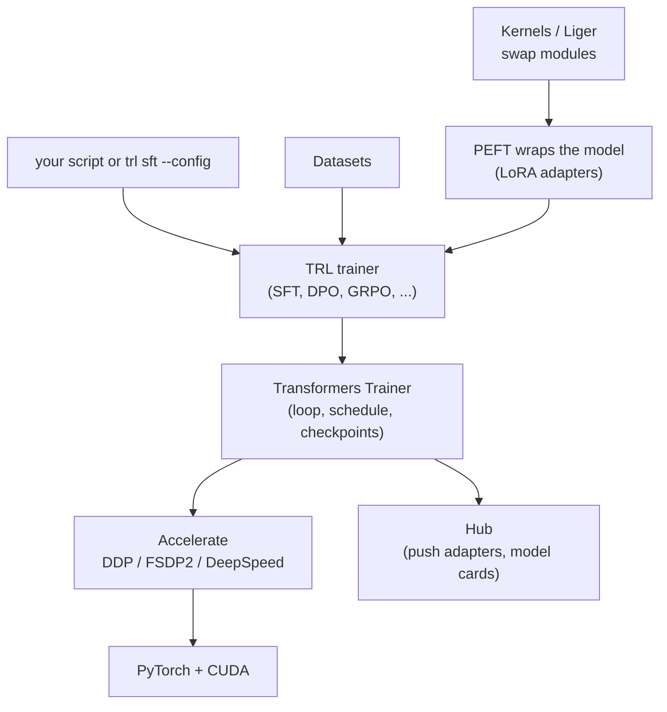

# 08 — Frameworks: TRL, Unsloth, Axolotl, LLaMA-Factory, and Training Services

> **Prerequisites:** modules 05, 06.
> **You will learn:** what TRL v1, Unsloth, Axolotl, LLaMA-Factory and managed training APIs
> each add, which APIs changed in 2025–26, and how to pick a stack.

You will almost never write a raw training loop for an LLM fine-tune. You will write a config,
or twenty lines of Python against a trainer, and a framework will do the rest. That makes the
framework part of your experiment: its defaults pick your scheduler, your warmup, which tokens
carry loss and how much memory you need. **Two tools given "the same recipe" do not run the same
experiment unless you check the effective values.** This module teaches the dominant stacks as of
October 2026, what each adds over plain TRL and Transformers, which ones are current (TRL v1,
Unsloth, Axolotl, LLaMA-Factory) and which are not (torchtune), and how to choose.

It is also the course's **API-currency reference**. Most fine-tuning tutorials on the web were
written against TRL 0.x and Transformers 4.x. Section 8.2 holds the 2024 → 2026 migration table
that every other module assumes.

---

## 8.1 The Hugging Face stack and how it composes

Six libraries and one service make up the default stack. The
[Hugging Face ecosystem note](../../notes/libraries/huggingface.md) covers `Trainer`, PEFT and
TRL basics with runnable examples; here is how the pieces fit together in 2026.

| Piece | Owns | What you touch |
|---|---|---|
| **Transformers v5** | model classes, tokenizers, `Trainer`, `TrainingArguments` | `from_pretrained(..., dtype=...)`, `attn_implementation` |
| **Datasets** | Arrow-backed loading, mapping, streaming | `load_dataset(...)`, column formats |
| **PEFT** | adapter injection, save/load/merge | `LoraConfig`, `get_peft_model`, `merge_and_unload` |
| **Accelerate** | process launch, DDP/FSDP2/DeepSpeed wrapping, mixed precision | `accelerate launch`, config YAML |
| **TRL** | post-training trainers and their losses, CLI | `SFTTrainer`, `DPOTrainer`, `GRPOTrainer`, `trl sft` |
| **Kernels** | Hub-hosted compiled kernels swapped into models | `attn_implementation="kernels-community/..."`, `use_kernels` |
| **Hub** | weights, datasets, adapters, model cards, Jobs | `push_to_hub`, `hf jobs` |

Transformers v5 (stable release 26 January 2026) is PyTorch-only: TensorFlow and Flax are gone,
slow tokenizers are gone, and `from_pretrained` infers dtype from the checkpoint config.
[Module 02](./02-tokens-templates-and-the-causal-lm-objective.md) owns those changes; what matters
here is that a TRL trainer does **not** follow the v5 dtype inference. If you let TRL load the
model from a string and set no dtype, it loads in float32
([`SFTTrainer` docstring, TRL v1.15.0](https://github.com/huggingface/trl/blob/dae7b6adc8d2729cfa8d21bc8480656ede769240/trl/trainer/sft_trainer.py#L535-L537)).
Pass `model_init_kwargs={"dtype": "bfloat16"}` in the config. Transformers v5 also ships `transformers serve`, an
OpenAI-compatible server for quick checks of a fine-tune;
[module 20](./20-production-serving-and-cost.md) covers serving properly.



Read the diagram from top to bottom as a chain of responsibilities. TRL subclasses the
Transformers `Trainer` and adds data preparation (chat templates, packing, loss masks) and the
method-specific loss. The `Trainer` owns the loop, the optimizer, the schedule and checkpointing.
Accelerate owns the processes and the sharding. When something goes wrong, the layer that owns the
behaviour is where the fix lives: a wrong loss mask is a TRL question, a wrong warmup is a
`Trainer` question, an FSDP hang is an Accelerate question.

### Version compatibility (Table 1)

Pin these together. Every cell below was read from the release's own packaging metadata or
release notes as of 10 October 2026.

| Component | Current release | Hard constraint | Source |
|---|---|---|---|
| Python | 3.11–3.14 | TRL v1.15 requires `>=3.11` (3.10 dropped in v1.15); Transformers v5.19 supports 3.10–3.14 | [TRL pyproject](https://github.com/huggingface/trl/blob/dae7b6adc8d2729cfa8d21bc8480656ede769240/pyproject.toml#L29-L35), [Transformers setup.py](https://github.com/huggingface/transformers/blob/c4c4605f961877852b89b97478536bb3a26b6fd1/setup.py#L51) |
| PyTorch | 2.6+ for the FSDP2 path | Transformers v5.19 needs `torch>=2.5`; Accelerate raises if FSDP2 is requested below 2.6.0 | [Transformers setup.py](https://github.com/huggingface/transformers/blob/c4c4605f961877852b89b97478536bb3a26b6fd1/setup.py#L150), [Accelerate constants](https://github.com/huggingface/accelerate/blob/6afc1e5ee217051fde702b23de2813344dc0fd33/src/accelerate/utils/constants.py#L46) |
| Transformers | v5.19.0 | TRL v1.15 accepts `>=4.56.2` (v4 still works), but the DeepSpeed extra excludes 5.1.0 | [TRL pyproject](https://github.com/huggingface/trl/blob/dae7b6adc8d2729cfa8d21bc8480656ede769240/pyproject.toml#L46-L48) |
| PEFT | v0.21.2 | **PEFT < 0.18.0 is incompatible with Transformers v5**; TRL's own floor (`>=0.13.0`) is looser, so the v5 rule binds | [PEFT v0.18.0 notes](https://github.com/huggingface/peft/releases/tag/v0.18.0) |
| Accelerate | v1.15.0 | TRL needs `>=1.4.0`; `fsdp_version` defaults to 1, so set 2 explicitly | [FSDP1 vs FSDP2 guide](https://github.com/huggingface/accelerate/blob/6afc1e5ee217051fde702b23de2813344dc0fd33/docs/source/concept_guides/fsdp1_vs_fsdp2.md) |
| TRL | v1.15.0 (8 Oct 2026) | refuses `nn.DataParallel`; `datasets>=4.7.0` | [v1.15.0 release](https://github.com/huggingface/trl/releases/tag/v1.15.0) |
| vLLM (for GRPO/RLOO/online distillation) | 0.31.0 | TRL v1.15's `vllm` extra pins `>=0.21.0,<=0.31.0`; the window moves every release | [TRL pyproject](https://github.com/huggingface/trl/blob/dae7b6adc8d2729cfa8d21bc8480656ede769240/pyproject.toml#L85-L86) |

The practical rule: **pick the TRL release first, then take its vLLM window literally, then make
sure PEFT is at least 0.18 if Transformers is v5.** TRL's lower bounds are compatibility promises,
not recommendations.

---

## 8.2 TRL v1

TRL v1.0 shipped on 31 March 2026 with a two-tier contract
([TRL v1 blog](https://huggingface.co/blog/trl-v1)): "The stable core follows semantic versioning.
The experimental layer makes no such promises." A minor release may add features to a stable
trainer but should not break its public API; anything breaking waits for v2.0 behind a
deprecation warning. That is why the deprecated arguments below say "removal in v2.0.0".

### Stable vs experimental

As of the [v1.15.0 docs index](https://huggingface.co/docs/trl/v1.15.0/en/index), the taxonomy is:

| Tier | Trainers |
|---|---|
| Stable (`from trl import ...`) | `SFTTrainer`, `DPOTrainer`, `KTOTrainer`, `RewardTrainer`, `RLOOTrainer`, `GRPOTrainer`, `DistillationTrainer` |
| Experimental (`from trl.experimental... import ...`) | `ORPOTrainer`, `CPOTrainer`, `OnlineDPOTrainer`, `GKDTrainer`, `GOLDTrainer`, `AsyncGRPOTrainer`, `AsyncDistillationTrainer`, `GMPOTrainer`, `TPOTrainer`, `SDFTTrainer`, `SDPOTrainer`, `SSDTrainer`, and others |

`DistillationTrainer` graduated in v1.10; [module 14](./14-distillation-and-reasoning.md) uses it
instead of `GKDTrainer`. **Experimental means "may vanish in a minor release"**, and v1.14 proved it
by deleting six trainers at once. Use experimental trainers for research, pin the exact TRL
version, and never build a team pipeline on one without a plan to vendor the code.

### Removed (Table 2)

| Removed | In | Use instead |
|---|---|---|
| `PPOTrainer`, `PPOConfig`, `AutoModelForCausalLMWithValueHead` and the value-head module | [v1.13.0](https://github.com/huggingface/trl/releases/tag/v1.13.0) | `GRPOTrainer` or `RLOOTrainer`; verl/OpenRLHF for real PPO ([module 12](./12-preference-optimization.md)) |
| `BCOTrainer`, `PRMTrainer`, `XPOTrainer`, `NashMDTrainer`, `GRPOWithReplayBufferTrainer`, GSPO-token trainer | [v1.14.0](https://github.com/huggingface/trl/releases/tag/v1.14.0) | KTO for unpaired feedback; GRPO with `importance_sampling_level="sequence"` for GSPO; vendor the old file if you must |
| `trl.losses` (fused linear DPO/KTO/GRPO/JSD losses, vendored in v1.13) | v1.14.0 | trainers stream their own log-probs; nothing to import |
| experimental MiniLLM trainer | [v1.15.0](https://github.com/huggingface/trl/releases/tag/v1.15.0) | `DistillationTrainer` |
| `trl skills install` | [v1.11.0](https://github.com/huggingface/trl/releases/tag/v1.11.0) | the skill source moved out of the package |
| old `examples/scripts/...` paths | v1.11.0 | per-example folders; trainer doc pages carry runnable snippets |

The PPO removal note is worth reading as an engineering lesson: the trainer was "unmaintained (no
feature work in over a year...), the only trainer never aligned on the input format..., near-zero
recorded usage" ([v1.13.0 notes](https://github.com/huggingface/trl/releases/tag/v1.13.0)). TRL
chose a small, coherent stable surface over breadth.

### The `trl` CLI

Every stable trainer has a subcommand: `trl sft`, `trl dpo`, `trl kto`, `trl reward`, `trl rloo`,
`trl grpo` and `trl distillation`, plus `trl env` for bug reports and `trl vllm-serve`
([CLI docs, v1.15.0](https://huggingface.co/docs/trl/v1.15.0/en/clis)). Since v1.11, `trl
vllm-serve` is a thin wrapper that translates its flags into vLLM's own `vllm serve` and sets the
three options TRL needs for NCCL weight transfer; the v1.15 docs mark it deprecated in favour of
calling `vllm serve` directly. Here is the SFT recipe for this module's lab as a config file:

```yaml
# sft.yaml  ->  trl sft --config sft.yaml
model_name_or_path: Qwen/Qwen3-1.7B
dtype: bfloat16                 # ModelConfig default is float32
datasets:
  - path: trl-lib/Capybara
    split: "train[:2000]"
use_peft: true
lora_r: 16
lora_alpha: 32
lora_dropout: 0.0               # ModelConfig default is 0.05
lora_target_modules: [all-linear]
learning_rate: 2.0e-4           # SFTConfig default is 2e-5 (full-FT scale)
num_train_epochs: 1
per_device_train_batch_size: 4
gradient_accumulation_steps: 4
warmup_steps: 0.03              # a float < 1 is a ratio in Transformers v5
max_length: 2048
output_dir: qwen3-1.7b-capybara-lora
```

Three details in that file are traps. `learning_rate: 2.0e-4` has a dot because YAML 1.1 parsers
read `2e-4` as a **string**, and the parser then fails on type conversion. `lora_target_modules`
defaults to `None`, which hands the choice to PEFT's per-architecture default (attention
projections only for most decoders), so you must say `all-linear`
([module 06](./06-lora-and-qlora.md) explains why the MLP matters). And `warmup_steps: 0.03`
reflects Transformers v5, where `warmup_ratio` was deprecated in v5.0 and folded into
`warmup_steps`, which now accepts a float in $[0, 1)$ as a ratio
([`TrainingArguments`, v5.19.0](https://github.com/huggingface/transformers/blob/c4c4605f961877852b89b97478536bb3a26b6fd1/src/transformers/training_args.py#L796-L801)).

### How YAML, flags and dataclasses meet

There is no separate CLI schema. TRL's `TrlParser` subclasses Transformers' `HfArgumentParser`,
which turns dataclass fields into argparse flags. The `sft` command parses three dataclasses:
`ScriptArguments` (dataset name and splits, or a `datasets:` mixture), `SFTConfig` (every
`TrainingArguments` field plus SFT's own) and `ModelConfig` (model id, `dtype`, and the PEFT and
quantization flags `use_peft`, `lora_r`, `lora_alpha`, `lora_dropout`, `lora_target_modules`,
`use_rslora`, `use_dora`, `load_in_4bit`)
([`ModelConfig`, v1.15.0](https://github.com/huggingface/trl/blob/dae7b6adc8d2729cfa8d21bc8480656ede769240/trl/trainer/model_config.py#L103-L178)).
`parse_args_and_config` loads the YAML, sets any `env:` block as environment variables, installs
the YAML values as **new defaults**, then parses the command line, so a flag always beats the file
([`TrlParser`, v1.15.0](https://github.com/huggingface/trl/blob/dae7b6adc8d2729cfa8d21bc8480656ede769240/trl/scripts/utils.py#L234-L340)).
`trl sft --config sft.yaml --learning_rate 1e-4` runs the file with a different LR. Unknown keys in
the file raise. Accelerate options such as `num_processes` or `accelerate_config: fsdp2` can live in
the same YAML; the CLI forwards them to `accelerate launch`.

This design means **the dataclass is the documentation**. When you wonder what a key does, read
the field's `metadata["help"]` in the pinned source, not a blog post.

### Configs resolve to steps

The single most common config bug is not a wrong key, it is a wrong mental model of how many
optimizer steps a run will take. Take 10,000 examples, `per_device_train_batch_size=4`,
`gradient_accumulation_steps=8`, two GPUs, three epochs and a 3% warmup.

The effective batch is $4 \times 8 \times 2 = 64$ sequences per optimizer step. Each rank's
`DistributedSampler` sees $\lceil 10{,}000 / 2 \rceil = 5{,}000$ examples, which is
$\lceil 5{,}000 / 4 \rceil = 1{,}250$ micro-batches. Transformers v5 converts micro-batches to
update steps with a ceiling, counting the trailing partial accumulation window as a step:

$$
\text{steps/epoch} = \left\lfloor \tfrac{1250}{8} \right\rfloor + [1250 \bmod 8 > 0] = 156 + 1 = 157,
\qquad \text{total} = \lceil 3 \times 157 \rceil = 471
$$

([`set_initial_training_values`, v5.19.0](https://github.com/huggingface/transformers/blob/c4c4605f961877852b89b97478536bb3a26b6fd1/src/transformers/trainer.py#L2496-L2504)).
Warmup uses another ceiling: $\lceil 0.03 \times 471 \rceil = \lceil 14.13 \rceil = 15$
([`get_warmup_steps`](https://github.com/huggingface/transformers/blob/c4c4605f961877852b89b97478536bb3a26b6fd1/src/transformers/training_args.py#L2122-L2129)).
Rounding conventions are not universal. Transformers 4.45 used a plain floor, $\lfloor 1250/8 \rfloor = 156$
steps per epoch, and silently dropped the remainder from the schedule
([v4.45.0 trainer.py](https://github.com/huggingface/transformers/blob/2ef31dec1676249d26044a8aa8abe33dbecf0d10/src/transformers/trainer.py#L2095)).
Axolotl computes `int(warmup_ratio * total_steps)`, a floor, so the same 3% gives 14 warmup steps
([Axolotl builder](https://github.com/axolotl-ai-cloud/axolotl/blob/d17227d1a3ba1983442400fc3b9dcf0260bed857/src/axolotl/core/builders/base.py#L264-L285)).
If you set `max_steps=200`, epochs no longer matter: 200 steps and $\lceil 6.0 \rceil = 6$ warmup.

The check below implements the Transformers v5 arithmetic (ceilings everywhere) and asserts those
numbers, plus the two alternative conventions.

```python finetuning-check
import math

def schedule(n, per_device, accum, world, epochs, warmup_ratio, max_steps=-1,
             count_remainder=True, warmup_round="ceil"):
    effective = per_device * accum * world
    micro = math.ceil(math.ceil(n / world) / per_device)        # len(dataloader) on each rank
    if count_remainder:
        per_epoch = max(micro // accum + int(micro % accum > 0), 1)
    else:
        per_epoch = max(micro // accum, 1)
    total = max_steps if max_steps > 0 else math.ceil(epochs * per_epoch)
    raw = warmup_ratio * total
    warm = math.ceil(raw) if warmup_round == "ceil" else int(raw)
    return effective, micro, per_epoch, total, warm

eff, micro, per_epoch, total, warm = schedule(10_000, 4, 8, 2, 3, 0.03)
assert eff == 64
assert micro == 1250
assert per_epoch == 157
assert total == 471
assert warm == 15

# max_steps overrides epochs; warmup follows the new total
_, _, _, total200, warm200 = schedule(10_000, 4, 8, 2, 3, 0.03, max_steps=200)
assert (total200, warm200) == (200, 6)

# The older floor convention and Axolotl's floor warmup differ by one step each
assert schedule(10_000, 4, 8, 2, 3, 0.03, count_remainder=False)[2] == 156
assert schedule(10_000, 4, 8, 2, 3, 0.03, warmup_round="floor")[4] == 14
print("schedule arithmetic verified")
```

This proves the arithmetic of the stated conventions. It does not prove which convention your
installed version uses; for that, read the `Num update steps per epoch` line the `Trainer` logs at
start-up and compare.

### The 2024 → 2026 migration table (Table 3)

If you paste a 2024 tutorial into a 2026 environment, these are the lines that break or silently
change behaviour.

| 2024 code | 2026 replacement | Status and source |
|---|---|---|
| `SFTTrainer(..., tokenizer=tok)` | `processing_class=tok` | renamed in TRL v0.12; all TRL trainers |
| `SFTConfig(max_seq_length=...)` | `max_length=` (default 1024) | renamed in TRL v0.16 |
| `TrainingArguments(evaluation_strategy=...)` | `eval_strategy=` | gone from Transformers v5 `TrainingArguments` |
| `from_pretrained(..., torch_dtype=...)` | `dtype=`; TRL: `model_init_kwargs={"dtype": ...}` | `torch_dtype` kept only as a back-compat alias in v5; TRL switched in v1.10 |
| `TrainingArguments(warmup_ratio=0.03)` | `warmup_steps=0.03` | deprecated in v5.0, absent from v5.19 |
| `DataCollatorForCompletionOnlyLM(response_template, ...)` | `completion_only_loss` (prompt-completion data) or `assistant_only_loss=True` with `` templates | class removed in TRL v0.20 ([module 05](./05-supervised-fine-tuning.md)) |
| `SFTConfig(truncation_mode="keep_end")` | `keep_start` | deprecated, removal in v2.0.0 ([`SFTConfig`](https://github.com/huggingface/trl/blob/dae7b6adc8d2729cfa8d21bc8480656ede769240/trl/trainer/sft_config.py#L209-L216)) |
| `SFTConfig(pad_token=...)` | set `tokenizer.pad_token` and pass it as `processing_class` | deprecated, removal in v2.0.0 |
| `use_liger_kernel=True` in DPO/KTO/GRPO/RLOO | `model_init_kwargs={"use_kernels": True}` | deprecated in v1.15, removal in v2.0.0 |
| `SFTConfig(loss_type="chunked_nll")` | `loss_type="nll"` (the default, now fused) | deprecated alias, removal in v2.0.0 |
| `PPOTrainer`, value-head models | `GRPOTrainer` / `RLOOTrainer` | removed in v1.13 |
| `GKDTrainer` as the distillation default | `DistillationTrainer` | stable since v1.10; GKD stays experimental |
| `nn.DataParallel` (bare `python train.py` on a multi-GPU box) | `accelerate launch` / `trl ... --num_processes N` (DDP or FSDP2) | refused in v1.15 ([module 10](./10-distributed-fine-tuning-and-moe.md)) |
| PEFT adapter directly on `lm_head` in DPO/KTO/GRPO/RLOO | `modules_to_save=["lm_head"]` | raises since v1.15 (fused LM head) |
| GRPO/RLOO `use_vllm=True` assuming server mode | set `vllm_mode="server"` explicitly | default became `"colocate"` in v1.0 ([MIGRATION.md](https://github.com/huggingface/trl/blob/dae7b6adc8d2729cfa8d21bc8480656ede769240/MIGRATION.md)) |
| `packing="bfd-requeue"` | `packing_strategy="bfd_split"` | renamed in v1.0 |
| links to `trl/examples/scripts/...` | the trainer's doc page | reorganised in v1.11 |
| `pip install peft<0.18` with Transformers v5 | PEFT ≥ 0.18 | incompatible |

Version sources: the [v0.12](https://github.com/huggingface/trl/releases/tag/v0.12.0),
[v0.16](https://github.com/huggingface/trl/releases/tag/v0.16.0) and
[v1.10](https://github.com/huggingface/trl/releases/tag/v1.10.0) release notes, plus a check of
`trl/trainer/utils.py` at the v0.19.0 tag (class present) and v0.20.0 tag (class absent).

You can automate most of this. The check below is a small linter that walks a script's AST and
reports the eight most common stale patterns. It uses the AST rather than plain regex so comments
do not trigger it, and so it can tell `tokenizer=` passed to a `*Trainer(` (stale) from
`tokenizer=` passed to a collator, and `max_seq_length=` passed to a TRL `*Config(` (stale) from
Unsloth's `from_pretrained(max_seq_length=...)` (current Unsloth API).

```python finetuning-check
import ast

STALE_KWARGS = {"max_seq_length": "max_length", "evaluation_strategy": "eval_strategy",
                "torch_dtype": "dtype"}
STALE_NAMES = {"DataCollatorForCompletionOnlyLM": "completion_only_loss / assistant_only_loss",
               "PPOTrainer": "GRPOTrainer / RLOOTrainer"}

def call_name(node):
    f = node.func
    return f.id if isinstance(f, ast.Name) else (f.attr if isinstance(f, ast.Attribute) else "")

def lint(src):
    found = set()
    for node in ast.walk(ast.parse(src)):
        if isinstance(node, ast.Call):
            name = call_name(node)
            for kw in node.keywords:
                if kw.arg == "tokenizer" and name.endswith("Trainer"):
                    found.add(("tokenizer=", "processing_class="))
                elif kw.arg == "max_seq_length" and not name.endswith(("Config", "Trainer")):
                    continue
                elif kw.arg in STALE_KWARGS:
                    found.add((kw.arg + "=", STALE_KWARGS[kw.arg] + "="))
                elif kw.arg == "use_liger_kernel" and isinstance(kw.value, ast.Constant) and kw.value.value is True:
                    found.add(("use_liger_kernel=True", 'model_init_kwargs={"use_kernels": True}'))
                elif kw.arg == "truncation_mode" and isinstance(kw.value, ast.Constant) and kw.value.value == "keep_end":
                    found.add(('truncation_mode="keep_end"', 'truncation_mode="keep_start"'))
        elif isinstance(node, ast.Name) and node.id in STALE_NAMES:
            found.add((node.id, STALE_NAMES[node.id]))
        elif isinstance(node, ast.alias) and node.name in STALE_NAMES:
            found.add((node.name, STALE_NAMES[node.name]))
    return sorted(found)

old = "\n".join([
    "from trl import SFTTrainer, SFTConfig, DPOConfig, PPOTrainer, DataCollatorForCompletionOnlyLM",
    "from transformers import AutoModelForCausalLM, AutoTokenizer",
    'model = AutoModelForCausalLM.from_pretrained("Qwen/Qwen2-0.5B", torch_dtype="bfloat16")',
    'tok = AutoTokenizer.from_pretrained("Qwen/Qwen2-0.5B")',
    'collator = DataCollatorForCompletionOnlyLM("### Answer:", tokenizer=tok)',
    'args = SFTConfig(output_dir="out", max_seq_length=2048, evaluation_strategy="steps",',
    '                 truncation_mode="keep_end")',
    'dpo_args = DPOConfig(output_dir="dpo", use_liger_kernel=True)',
    "trainer = SFTTrainer(model=model, args=args, train_dataset=ds, tokenizer=tok,",
    "                     data_collator=collator)",
    "trainer.train()",
    "rlhf = PPOTrainer",
])
new = "\n".join([
    "from trl import SFTTrainer, SFTConfig, DPOConfig",
    "from unsloth import FastLanguageModel",
    "# old code used tokenizer= and PPOTrainer; comments must not trigger the linter",
    'model, tok = FastLanguageModel.from_pretrained("unsloth/Qwen3-1.7B", max_seq_length=2048)',
    'args = SFTConfig(output_dir="out", max_length=2048, eval_strategy="steps",',
    '                 truncation_mode="keep_start", model_init_kwargs={"dtype": "bfloat16"})',
    'dpo_args = DPOConfig(output_dir="dpo", model_init_kwargs={"use_kernels": True})',
    "trainer = SFTTrainer(model=model, args=args, train_dataset=ds, processing_class=tok)",
])

issues = lint(old)
assert len(issues) == 8, issues
assert {p for p, _ in issues} == {
    "tokenizer=", "max_seq_length=", "evaluation_strategy=", "torch_dtype=",
    "use_liger_kernel=True", "DataCollatorForCompletionOnlyLM", "PPOTrainer",
    'truncation_mode="keep_end"'}
assert lint(new) == []
print("stale-API linter verified")
```

This proves the linter finds the eight planted patterns and stays silent on a current script,
including the collator's `tokenizer=` and Unsloth's `max_seq_length=`. It does not prove
completeness: it knows nothing about default changes (a 2024 GRPO script that relied on server-mode
vLLM runs without error and does something different). The lab script ships the same linter as
`--lint`.

---

## 8.3 Kernels

A kernel library replaces PyTorch module implementations with fused GPU kernels. The gains come
from two places: fewer round trips to HBM, and not materialising large intermediates.

**Liger Kernel** (Hsu et al., 2024, [arXiv 2410.10989](https://arxiv.org/abs/2410.10989)) is a set
of Triton kernels for RMSNorm, RoPE, SwiGLU/GeGLU and a fused linear cross-entropy. The paper
reports "on average a 20% increase in training throughput and a 60% reduction in GPU memory usage"
against the Hugging Face implementations, on its own benchmark set. The memory part comes almost
entirely from the fused linear cross-entropy: it never builds the $(B, T, V)$ logits tensor, which
for Qwen3's 151,936-token vocabulary dominates activation memory at long $T$.
[Module 03](./03-training-mechanics-and-memory-math.md) derives why, extending the
[Transformers course's memory budget](../transformers/13-training-considerations.md).

In 2026 TRL took that idea in-house:

- **v1.14** shipped an in-tree Triton kernel that computes per-token log-probs and entropy directly
  from the hidden states, on by default on CUDA, ROCm and XPU
  ([v1.14.0 notes](https://github.com/huggingface/trl/releases/tag/v1.14.0)).
- **v1.15** made a **fused LM head** the default for SFT, DPO, KTO, GRPO, RLOO and Distillation:
  hidden states are projected through `lm_head` in tiles and reduced to per-token log-probs, "so
  the `[batch, seq, vocab]` logits tensor is never built"
  ([v1.15.0 notes](https://github.com/huggingface/trl/releases/tag/v1.15.0)).

The v1.15 benchmark (gemma-3-1b, 262k vocabulary, 79 GiB cap, bf16, batch 1, gradient checkpointing,
SDPA) reports the maximum trainable sequence length rising from 9,216 to 63,488 tokens for KTO
(6.89×), 10,240 to 59,392 for DPO (5.80×) and 20,480 to 107,520 for SFT with `loss_type="nll"`
(5.25×). SFT's previous default path already avoided full logits and did not change. Those numbers
are for a small model with a huge vocabulary, the case where logits are the largest tensor; expect
smaller gains on an 8B model with a 32k vocabulary.

Because TRL now owns the head, `use_liger_kernel=True` is **deprecated in DPO, KTO, GRPO and RLOO**
(removal in v2.0.0). Liger's layer kernels still apply, but its fused cross-entropy is forced off.
The replacement is the Hugging Face **Kernels Hub**: compiled kernels published as Hub repositories
and loaded by Transformers at model-init time. Two entry points matter:

```python
# Teaching fragment: not executed (needs a GPU and the `kernels` package).
from trl import DPOConfig, SFTConfig

# 1) swap layer kernels (RMSNorm, MLP, ...) from the Hub into the model
args = DPOConfig(output_dir="dpo", model_init_kwargs={"dtype": "bfloat16", "use_kernels": True})

# 2) pick an attention kernel from the Hub, pinned to a version branch
args = SFTConfig(output_dir="sft",
                 model_init_kwargs={"dtype": "bfloat16",
                                    "attn_implementation": "kernels-community/flash-attn2@v2"})
```

Pin the kernel revision. The [Kernels Hub guide](https://huggingface.co/docs/trl/v1.15.0/en/kernels_hub)
notes that Transformers picks a default version branch per kernel repository and that the default
can change between Transformers releases, and it documents a CUDA 12.8 backward-pass failure in
`v3` builds for grouped-query attention. A run that is reproducible on Tuesday can silently
change kernels on Wednesday unless you write `@v2` or a commit SHA.

Two more knobs belong here but are owned elsewhere. `attn_implementation` chooses SDPA,
FlashAttention or a Hub kernel; FlashAttention needs Ampere or newer, so a T4 runs SDPA. And
`torch.compile` can fuse the rest of the graph; [module 03](./03-training-mechanics-and-memory-math.md)
covers when it pays. For how Triton kernels are written at all, see the inference course's
[Triton and CUTLASS chapter](/courses/inference/08-compilation-and-runtime/08-03-triton-and-cutlass.html).

---

## 8.4 Unsloth

Unsloth is a single-GPU-first training library built on top of TRL and PEFT. It rewrites the hot
paths (attention, RoPE, MLP, cross-entropy, LoRA matmuls) as Triton kernels with hand-derived
backward passes, patches the model classes at import time, and then hands you an ordinary
`SFTTrainer`. **What it adds is speed and memory on one GPU; what it costs is a patched,
version-sensitive model stack.** That is why `import unsloth` must come before `trl` and
`transformers`.

```python
# Teaching fragment: not executed (needs a CUDA GPU and `pip install unsloth`).
from unsloth import FastLanguageModel   # import first: it patches transformers/trl
from trl import SFTConfig, SFTTrainer

model, tokenizer = FastLanguageModel.from_pretrained(
    model_name="unsloth/Qwen3-1.7B",
    max_seq_length=2048,          # Unsloth's own argument name; not TRL's stale one
    load_in_4bit=True,            # QLoRA; False plus load_in_16bit=True for 16-bit LoRA
    dtype=None,                   # auto: bf16 on Ampere+, fp16 on T4
)
model = FastLanguageModel.get_peft_model(
    model,
    r=16, lora_alpha=32, lora_dropout=0.0,
    target_modules=["q_proj", "k_proj", "v_proj", "o_proj", "gate_proj", "up_proj", "down_proj"],
    use_gradient_checkpointing="unsloth",   # offloaded checkpointing
    random_state=3407,
)
trainer = SFTTrainer(model=model, processing_class=tokenizer, train_dataset=ds,
                     args=SFTConfig(learning_rate=2e-4, max_length=2048, output_dir="out"))
trainer.train()
model.save_pretrained_merged("merged-16bit", tokenizer, save_method="merged_16bit")
model.save_pretrained_gguf("gguf", tokenizer, quantization_method="q4_k_m")
```

The signatures above match Unsloth's source at
[`FastLanguageModel.from_pretrained`](https://github.com/unslothai/unsloth/blob/e0a92903052b4d556fc82299c5fe182125e71bfa/unsloth/models/loader.py#L962-L996)
(defaults `load_in_4bit=True`, `use_gradient_checkpointing="unsloth"`, plus `full_finetuning`,
`load_in_fp8` and `qat_scheme`) and
[`get_peft_model`](https://github.com/unslothai/unsloth/blob/e0a92903052b4d556fc82299c5fe182125e71bfa/unsloth/models/llama.py#L3705-L3729)
(defaults `r=16`, `lora_alpha=16`, `lora_dropout=0.0`, all seven projection layers). Note
`lora_alpha=16` against TRL's 32: the default scale $\gamma_r = \alpha / r$ is 1.0 in Unsloth and
2.0 in TRL's CLI, which acts like a 2× learning-rate difference on the adapter
([module 06](./06-lora-and-qlora.md)).

The pieces that matter:

- **`use_gradient_checkpointing="unsloth"`** checkpoints activations and asynchronously offloads
  them to CPU RAM. Unsloth's April 2024 post reported about 30% less VRAM for about 1.9% extra
  time ([Unsloth long-context blog](https://unsloth.ai/blog/long-context)); your PCIe bandwidth
  sets the real cost.
- **Dynamic 4-bit quants** (the `unsloth-bnb-4bit` uploads) build on bitsandbytes NF4 but leave
  selected sensitive parameters unquantized, for under 10% more VRAM than plain NF4 per Unsloth's
  [December 2024 post](https://unsloth.ai/blog/dynamic-4bit). They change the frozen base in
  QLoRA, not the adapter.
- **Export**: merged 16-bit weights for vLLM, GGUF for llama.cpp/Ollama, and (from July 2026)
  NVFP4, FP8 and imatrix GGUF exports
  ([Unsloth changelog](https://unsloth.ai/docs/new/changelog)).
- **GRPO**: since July 2026 sequence packing is on by default for GRPO and Unsloth reports GRPO
  1.3× faster (changelog, 7 July 2026).
- **`FastVisionModel`** is the VLM counterpart; [module 16](./16-multimodal-and-embedding-fine-tuning.md)
  uses it.

The 2026 product line, from the changelog: **Unsloth Studio**, a browser UI for running, training
and exporting models, launched in March 2026 (the first post-launch release is dated 25 March);
**preliminary automatic multi-GPU** for training and inference (31 March 2026); full **AMD** support
(20 July 2026) and **Intel XPU** support (29 July 2026); **Unsloth Desktop**, a native app wrapping
Studio (11 August 2026); and **`unsloth eval`** for evaluating checkpoints and LoRA adapters
(1 October 2026). Unsloth core is Apache-2.0; Studio's UI components are AGPL-3.0
([README](https://github.com/unslothai/unsloth/blob/e0a92903052b4d556fc82299c5fe182125e71bfa/README.md)),
which matters if you embed it in a product.

Treat multi-GPU Unsloth as preliminary until its docs say otherwise. **Unsloth's sweet spot is one
GPU, especially a small one**: a free T4 running QLoRA on an 8B model is the case it was built for.

---

## 8.5 Axolotl

Axolotl is a YAML-first trainer: you describe the run in one config file and `axolotl train
config.yaml` does preprocessing, training, and optionally merging and export. Under the hood it
builds Transformers/TRL trainers, but it adds a large, tested surface of options that would
otherwise be your glue code. **What it adds is reproducible multi-GPU configs and breadth of
features behind flags.**

Here is the lab recipe as Axolotl YAML, with keys checked against the
[0.20 schema](https://github.com/axolotl-ai-cloud/axolotl/blob/d17227d1a3ba1983442400fc3b9dcf0260bed857/src/axolotl/utils/schemas/config.py):

```yaml
# axolotl train sft.yaml   (Axolotl 0.20)
base_model: Qwen/Qwen3-1.7B
chat_template: qwen3
datasets:
  - path: trl-lib/Capybara
    type: chat_template
    split: "train[:2000]"
    roles_to_train: [assistant]   # the default, made explicit
val_set_size: 0.0
output_dir: ./outputs/qwen3-1.7b-capybara-lora
sequence_len: 2048                # default 512
sample_packing: false             # docs recommend true; off to match the TRL run
adapter: lora
lora_r: 16
lora_alpha: 32
lora_dropout: 0.0
lora_target_linear: true          # all linear layers
micro_batch_size: 4
gradient_accumulation_steps: 4
num_epochs: 1
learning_rate: 2.0e-4
lr_scheduler: linear              # default is cosine
warmup_ratio: 0.03
bf16: auto
gradient_checkpointing: true      # default is false
```

Compare it with the TRL YAML line by line and you find the defaults that differ. Axolotl's
`chat_template` dataset type trains **only on assistant turns by default**
(`roles_to_train: ["assistant"]`, per the
[conversation-format docs](https://github.com/axolotl-ai-cloud/axolotl/blob/d17227d1a3ba1983442400fc3b9dcf0260bed857/docs/dataset-formats/conversation.qmd#L80)),
while TRL computes loss on every token of a `messages` dataset unless you set
`assistant_only_loss=True` with a template that has `` markers. Same data, same
LR, different objective. The default scheduler is cosine, not linear. Gradient checkpointing is off.
And if you set no warmup at all, Axolotl adds `min(int(0.03 × steps), 100)` steps for you.

The features you reach Axolotl for, from its
[README at a pinned commit](https://github.com/axolotl-ai-cloud/axolotl/blob/d17227d1a3ba1983442400fc3b9dcf0260bed857/README.md):

| Feature | What it does |
|---|---|
| Dataset types | `chat_template`, `alpaca` and other instruction formats, template-free (`input_output` segments with per-segment `label`), pre-tokenized |
| [Multipacking](https://docs.axolotl.ai/docs/multipack.html) | packs examples into `sequence_len` with block-diagonal attention and per-sequence `position_ids` |
| Distributed | FSDP2 and DeepSpeed configs; sequence/context parallelism (Ulysses, Ring, USP); N-D parallelism composing CP, TP and FSDP; expert parallelism for MoE |
| [QAT](https://docs.axolotl.ai/docs/qat.html) | int8/int4/FP8/NVFP4/MXFP4 fake-quant during training ([module 11](./11-quantization-qat-and-fp8.md)) |
| RL | DPO/IPO/KTO/ORPO, GRPO, GDPO, async GRPO (April 2026) |
| 2026 training options | DFT loss, MixLoRA (routed LoRA experts on dense models), Tinker-compatible remote training (June 2026) |
| [Export](https://docs.axolotl.ai/docs/export.html) | `axolotl export` to GGUF with optional quantization (September 2026) |
| Kernels | Liger plugin, Cut Cross-Entropy plugin, LoRA MLP/QKV kernels |

A team that needs "the same run, next month, on a different cluster" gets the most from Axolotl:
the YAML is the experiment. The cost is an abstraction layer: when Axolotl's preprocessing does
something you did not expect, you debug Axolotl, not TRL. Use `axolotl preprocess` and inspect
the tokenized output with its label mask before you train.

---

## 8.6 LLaMA-Factory and others

### LLaMA-Factory

[LLaMA-Factory](https://github.com/hiyouga/LlamaFactory/blob/1fded918ac4723ac9966363f51ed4500866c5d1d/README.md)
is the broadest of the config-driven tools. It supports more model families than anyone else,
reads YAML (`llamafactory-cli train config.yaml`), and ships **LLaMA Board**, a Gradio web UI
(`llamafactory-cli webui`) that drives the same training options without editing YAML. Its distinctive breadth is in
memory-efficient full tuning: GaLore, BAdam, APOLLO, Adam-mini and Muon optimizers, plus OFT and
OFTv2 adapters (August 2025) and freeze-tuning. [Module 07](./07-the-wider-peft-landscape.md)
explains those methods; LLaMA-Factory is the easiest place to try them side by side. Since
26 October 2025 it also has a **Megatron-core training backend** via `mcore_adapter`, and its
sibling project [EasyR1](https://github.com/hiyouga/EasyR1) does GRPO-style RL.

### LitGPT, NeMo and Megatron

[LitGPT](https://pypi.org/project/litgpt/) (Lightning AI) reimplements popular architectures in
readable single-file PyTorch with recipes for pretraining, fine-tuning and LoRA. Pick it when you
want to read and modify every line of the model.

NVIDIA's NeMo framework and [Megatron-Bridge](https://github.com/NVIDIA-NeMo/Megatron-Bridge)
(conversion between Hugging Face checkpoints and Megatron-Core training) are where you go when the
Hugging Face stack stops scaling. **Leave the HF stack when** you train dense models past roughly
100B parameters, large MoE models where expert parallelism and pipeline schedules dominate, or any
run where a few points of model FLOPs utilisation are worth an engineer's month. Megatron-Core's
tensor, pipeline, context and expert parallelism are more mature than what Accelerate composes, at
the price of its own checkpoint format and config system. [Module 10](./10-distributed-fine-tuning-and-moe.md)
covers the parallelism itself.

### RL-at-scale frameworks

For RL with large rollouts, the 2025–26 field split off from trainer libraries.
[verl](https://github.com/volcengine/verl) (ByteDance), [OpenRLHF](https://github.com/OpenRLHF/OpenRLHF)
(Ray plus vLLM) and [slime](https://github.com/THUDM/slime) (Megatron plus SGLang) all separate
the rollout engine from the trainer and schedule them across a cluster. They implement PPO with a
critic, GRPO, DAPO and their successors at scales TRL does not target. Stay in TRL for GRPO on one
node; move to one of these when generation throughput across nodes is the bottleneck.
[Module 13](./13-rl-with-verifiable-rewards.md) owns the algorithms.

### torchtune: no longer maintained

torchtune was PyTorch's native fine-tuning library and many 2024 tutorials (including PyTorch's
own QAT walk-throughs) use it. Its README now opens with: "Torchtune is no longer actively
maintained: torchtune development wound down in 2025"
([README at a pinned commit](https://github.com/meta-pytorch/torchtune/blob/bd2a0fc7c31430972728494fa01aaeeb0ebf1ba1/README.md)).
**Do not start a new project on torchtune.** Re-base its recipes on TRL, Axolotl or Unsloth, and
use torchao directly for QAT.

---

## 8.7 Managed and API-based training

Sometimes you do not want to own a GPU at all. Three shapes exist, and they differ in how much of
the loop you keep.

### Hugging Face Jobs: your script, their hardware

[Hugging Face Jobs](https://github.com/huggingface/huggingface_hub/blob/3d49da4a6c122969e81fffda7d79561f4810bbd1/docs/source/en/guides/jobs.md)
runs a Docker image and command, or a `uv` script, on Hub hardware. It is pay-as-you-go by the
second, with listed prices per flavor (for example `a10g-small`, one 24 GB A10G, at USD 1.00 per
hour and `a100-large` at USD 2.50 per hour in that guide's hardware table), and jobs stop after a
**default 30-minute timeout** unless you raise it. The TRL docs give the canonical
[Jobs recipes](https://huggingface.co/docs/trl/v1.15.0/en/jobs_training):

```bash
# One GPU: run TRL's own SFT script with uv (dependencies come from the script header)
hf jobs uv run --flavor a10g-small --timeout 3h --secrets HF_TOKEN -- \
    https://raw.githubusercontent.com/huggingface/trl/refs/heads/main/trl/scripts/sft.py \
    --model_name_or_path Qwen/Qwen3-1.7B --dataset_name trl-lib/Capybara \
    --use_peft --lora_target_modules all-linear --output_dir qwen3-sft --push_to_hub

# Several GPUs: run the trl CLI inside the huggingface/trl image
hf jobs run --flavor a100x4 --timeout 2h --secrets HF_TOKEN huggingface/trl -- \
    trl sft --num_processes 4 --model_name_or_path Qwen/Qwen3-1.7B \
    --dataset_name trl-lib/Capybara --output_dir qwen3-sft --push_to_hub
```

`--secrets HF_TOKEN` forwards your local token so the job can push. `hf jobs logs -f <id>`,
`hf jobs ps` and `hf jobs cancel <id>` manage runs. Pin the script URL to a tag or commit
rather than `main` for anything you want to reproduce.

### Tinker: you own the loop, they own the GPUs

[Tinker](https://tinker-docs.thinkingmachines.ai/tinker/) (Thinking Machines) inverts the
arrangement. You run the training loop on your laptop; the service holds the model and executes
four primitives remotely: "`forward_backward`: feed in your data and loss function, and we'll
compute and accumulate the gradients for you", "`optim_step`: update your model using the
accumulated gradients", `sample` to generate from the current weights, and `save_state` to
checkpoint. Calls return futures, so you can pipeline them. Tinker "implements low-rank
adaptation (LoRA) fine-tuning, not full fine-tuning", citing the
[LoRA Without Regret](https://thinkingmachines.ai/blog/lora/) evidence that LoRA matches full
fine-tuning for most post-training and RL. Built-in losses include cross-entropy, importance
sampling, PPO, CISPO and DRO, plus custom losses over log-probs.

**Why the primitive split matters: gradient accumulation semantics.** Tinker's cross-entropy loss
is a **sum** over weighted tokens, not a mean
([cross-entropy docs](https://tinker-docs.thinkingmachines.ai/tinker/losses/cross-entropy/)).
Summed gradients compose exactly across `forward_backward` calls; means do not, because a mean
over a 3-example chunk and a mean over a 5-example chunk weight examples differently from a mean
over all 8. So you either pre-scale token weights by $1/N_{\text{total}}$ before the calls, or
divide once at step time. The check below builds a toy client with Tinker-shaped primitives over
`nn.Linear(4, 1)` and proves that two `forward_backward` calls on chunks of 3 and 5 examples
followed by one `optim_step` land on exactly the same weights as one call on all 8, while
stepping after each chunk does not.

```python finetuning-check
import torch

class ToyTrainingClient:
    """Tinker-shaped primitives: sum-reduced grads accumulate until optim_step."""
    def __init__(self, model, lr):
        self.model, self.lr, self.count = model, lr, 0
    def forward_backward(self, x, y):
        loss = ((self.model(x) - y) ** 2).sum()          # sum, not mean
        loss.backward()                                   # .grad accumulates across calls
        self.count += x.shape[0]
        return loss.item()
    def optim_step(self):
        with torch.no_grad():
            for p in self.model.parameters():
                p -= self.lr * p.grad / self.count        # normalise once, by the total count
                p.grad = None
        self.count = 0
    def sample(self, x):
        with torch.no_grad():
            return self.model(x)

def fresh():
    torch.manual_seed(0)
    return torch.nn.Linear(4, 1)

g = torch.Generator().manual_seed(1)
x = torch.randn(8, 4, generator=g)                       # (8, 4)
y = torch.randn(8, 1, generator=g)                       # (8, 1)

full = ToyTrainingClient(fresh(), lr=0.1)
full.forward_backward(x, y); full.optim_step()

accum = ToyTrainingClient(fresh(), lr=0.1)
accum.forward_backward(x[:3], y[:3]); accum.forward_backward(x[3:], y[3:]); accum.optim_step()

for a, b in zip(full.model.parameters(), accum.model.parameters()):
    torch.testing.assert_close(a, b)                     # 3 + 5 accumulated == 8 at once
torch.testing.assert_close(full.sample(x), accum.sample(x))

eager = ToyTrainingClient(fresh(), lr=0.1)
eager.forward_backward(x[:3], y[:3]); eager.optim_step()
eager.forward_backward(x[3:], y[3:]); eager.optim_step()
w_full, w_eager = full.model.weight, eager.model.weight
assert not torch.allclose(w_full, w_eager, atol=1e-6)   # two steps is a different trajectory

# Averaging per-chunk means is also wrong when chunks are unequal: (m3 + m5) / 2 != m8
m = torch.nn.functional.mse_loss
model = fresh()
m3, m5, m8 = m(model(x[:3]), y[:3]), m(model(x[3:]), y[3:]), m(model(x), y)
assert not torch.allclose((m3 + m5) / 2, m8)
torch.testing.assert_close((3 * m3 + 5 * m5) / 8, m8)
print("accumulation semantics verified")
```

This proves that sum-then-normalise accumulation is exact for a linear model and SGD. It does not
prove anything about Adam state or token-weighted LLM losses, where the same rule (normalise by
the total token count across all micro-batches) is what Transformers' `Trainer` and TRL implement
for you; [module 03](./03-training-mechanics-and-memory-math.md) has the LLM version.

Evaluation on such an API is just `sample` plus your own scoring code, run between steps on a
saved sampler checkpoint. What you give up compared with owning GPUs: full fine-tuning, custom
architectures and kernels, control over precision and parallelism, and data residency (your data
leaves your network). What you gain: no CUDA, no OOM debugging, and the freedom to write any loss
over log-probs.

### Cloud vendor fine-tuning APIs and parallel sweeps

The big model vendors' fine-tuning endpoints sit at the far end: upload JSONL, pick a base model
and a few hyperparameters, get a hosted model back. You cannot see the loss mask, the scheduler or
the weights, and you usually cannot export the result. Use them when the base model is only
available that way, and check data-retention and region terms first.

At the other end, [RapidFire AI](https://huggingface.co/docs/trl/v1.15.0/en/rapidfire_integration)
integrates with TRL's SFT, DPO and GRPO trainers to run many configs concurrently on the same
GPUs. It time-slices configs chunk by chunk over the data, so you can compare learning curves
live, stop losers and clone-and-modify winners mid-run. The integration page claims 16–24× higher
experimentation throughput than sequential runs; that is the vendor's figure, and the real gain
depends on how early your configs separate.

---

## 8.8 Environment, configs and tracking

Most "the framework is broken" reports are environment bugs. The stack has five layers that must
agree: the NVIDIA **driver**, the **CUDA runtime** a wheel was built against, **PyTorch**, and the
compiled extensions on top (**flash-attn**, **bitsandbytes**, **vLLM**). Three failure classes
account for most lost afternoons:

| Failure | Symptom | Cause and fix |
|---|---|---|
| flash-attn ABI mismatch | `undefined symbol` on import | the wheel was built for a different torch/CUDA/C++ ABI; install the wheel matching your exact torch, or use a Hub attention kernel instead |
| bitsandbytes CUDA mismatch | 4-bit load fails or falls back to CPU | the library cannot find a CUDA runtime it supports; check `python -m bitsandbytes`, match it to your torch's CUDA |
| vLLM pins torch | installing vLLM downgrades or upgrades torch, breaking everything else | vLLM wheels pin an exact torch; install vLLM first, then the rest, inside TRL's supported vLLM window |

The fixes are boring and they work:

- **Use the official images** when you can: `huggingface/trl` (now with vLLM installed, per the
  v1.15 notes), `axolotlai/axolotl`, and `unsloth/unsloth` (plus `unsloth/unsloth-rocm` for AMD).
- **Lock with `uv`.** A `uv.lock` records exact versions and hashes; `uv sync --locked` recreates
  the environment or fails loudly ([uv docs](https://docs.astral.sh/uv/concepts/projects/sync/)).
  Axolotl's install instructions already use `uv` with `UV_TORCH_BACKEND` to choose the CUDA build.
- **Record the environment with the run.** `trl env` prints platform, Python, torch, accelerator,
  and the versions of Transformers, Accelerate (with its config), Datasets, TRL, PEFT, DeepSpeed,
  bitsandbytes, Liger and vLLM. Save that output next to every checkpoint.

**Config management** follows the same rule. You have three ways to specify a run: a YAML file, CLI
flags, and Python dataclasses. They are layers of one system (8.2), and the precedence is flag >
YAML > dataclass default. Whatever you use, **save the resolved config** (the `TrainingArguments`
the `Trainer` actually saw, which it writes as `training_args.bin`, plus the Axolotl or TRL YAML
and the `trl env` dump). A YAML file that omits `lr_scheduler` is not a record of which scheduler
ran.

**Tracking**: `report_to` sends metrics to Weights & Biases, Trackio (Hugging Face's lightweight
open-source tracker), MLflow or TensorBoard; [module 03](./03-training-mechanics-and-memory-math.md)
covers which curves to watch. The [MLOps note](../../notes/libraries/mlops-and-serving.md) covers
experiment tracking and model versioning in general, and the
[PyTorch note](../../notes/libraries/pytorch.md) has the raw-loop equivalents (checkpointing,
mixed precision, `torchrun`) if you need to drop below the frameworks.

---

## 8.9 Choosing a framework

All of these tools sit on the same PyTorch and mostly on the same TRL. The choice is about
ergonomics, hardware and how much you want hidden.

| Criterion | Unsloth | Axolotl | LLaMA-Factory | Raw TRL | Tinker / HF Jobs |
|---|---|---|---|---|---|
| Single-GPU speed and memory | **best** (custom kernels, offloaded checkpointing) | good (Liger/CCE plugins, LoRA kernels) | good (can use Unsloth and Liger backends) | good since v1.15 fused head | n/a (their hardware) |
| Multi-GPU and N-D parallelism | preliminary (2026) | **best** (FSDP2, DeepSpeed, CP/TP/EP) | good (DeepSpeed, Megatron-core backend) | good via Accelerate | Jobs: multi-GPU flavors; Tinker: hidden |
| Reproducible configs | Python scripts | **best** (one YAML) | YAML | YAML via CLI, or Python | Jobs: script + image; Tinker: your code |
| RL breadth | GRPO family, memory-optimised | DPO/KTO/ORPO, GRPO, GDPO, async GRPO | DPO/KTO/PPO-style, EasyR1 | **best** for on-node RL (GRPO, RLOO, KTO, experimental zoo) | Tinker: any loss over log-probs |
| Research flexibility | medium (patched stack) | medium (config surface) | low–medium | **best** (subclass a trainer) | Tinker: high for losses, LoRA only |
| GUI | Studio / Desktop | no | LLaMA Board | no | Jobs UI; Tinker console |
| VLM support | `FastVisionModel` | yes | broad | yes (SFT, DPO, GRPO) | depends on base models offered |
| Export | GGUF, merged 16-bit, NVFP4/FP8 | merged weights, `axolotl export` GGUF | merged, plus vLLM/SGLang inference | merged via PEFT | Tinker: PEFT adapter download |

A five-line decision rule:

1. **One GPU, want it fast, standard model:** Unsloth.
2. **A team, several GPUs, runs that must be repeatable:** Axolotl, with the YAML in version control.
3. **New loss or RL idea:** raw TRL; subclass the nearest stable trainer and pin the version.
4. **Non-programmers or exotic optimizers:** LLaMA-Factory with LLaMA Board.
5. **No GPUs of your own:** HF Jobs for your own script; Tinker if LoRA is enough and you want to keep the loop.

---

## 8.10 Lab: one recipe, three tools

**Goal.** Run the same SFT recipe in TRL, Unsloth and Axolotl, measure what differs, and learn to
read effective hyperparameters rather than the ones you meant to set.

**Script.** [`framework_configs.py`](./code/framework_configs.py) takes one recipe dict and emits a
TRL CLI YAML, an Axolotl YAML and an Unsloth Python script, plus an `effective_defaults.md` table
of what each tool does for knobs you leave out. It also contains the Check 8.1 schedule arithmetic
and the Check 8.3 linter.

```bash
# CPU smoke test: writes all three artifacts to a temp dir and asserts their contents
python content/courses/finetuning/code/framework_configs.py --smoke
# Write the artifacts to runs/l8 and print the GPU commands for L8.1 and L8.2
python content/courses/finetuning/code/framework_configs.py --full --out runs/l8
# Lint an old script for stale TRL/Transformers APIs
python content/courses/finetuning/code/framework_configs.py --lint path/to/old_train.py
```

### L8.1: one recipe, three tools (T0 or T1)

- **Model:** `Qwen/Qwen3-1.7B` (Unsloth: `unsloth/Qwen3-1.7B`).
- **Data:** `trl-lib/Capybara`, the first 2,000 training conversations; hold out a separate 200 for eval.
- **Recipe:** LoRA $r=16$, $\alpha=32$, dropout 0, all linear layers, LR $2 \times 10^{-4}$, one
  epoch, micro-batch 4, accumulation 4, linear schedule, 3% warmup, `max_length` 2048. With one
  GPU that is $\lceil 2000/4 \rceil = 500$ micro-batches, 125 optimizer steps and
  $\lceil 3.75 \rceil = 4$ warmup steps in TRL (3 in Axolotl, which floors).
- **Tier:** T1 (24 GB, bf16) as written. On a T0 T4, set `load_in_4bit=True` in the Unsloth
  script, and fp16 instead of bf16 in all three.

Steps:

1. Run `--full --out runs/l8` and read `effective_defaults.md` before training anything.
2. Train each tool: `trl sft --config runs/l8/trl_sft.yaml`, `axolotl train runs/l8/axolotl_sft.yaml`,
   `python runs/l8/unsloth_sft.py`.
3. For each, record tokens/s (from the logs), peak VRAM (`torch.cuda.max_memory_allocated()` or
   `nvidia-smi`), final train loss, and eval loss on the same 200 held-out conversations with the
   same template.
4. Diff the resolved configs: open the saved `training_args.bin` (TRL, Unsloth) and Axolotl's
   resolved config, and list every value that differs from the recipe.

**Expected outcome.** Unsloth should use the least VRAM and run fastest on one GPU. Axolotl's train
loss is **not comparable** to the others unless you switch TRL and Unsloth to assistant-only loss
too: by default it averages over assistant tokens only, which are harder to predict than the
user's text. Expect your diff list to include at least the loss mask, the warmup rounding and the
checkpointing mode. Do not expect identical eval loss; expect differences you can explain.

### L8.2: CLI job and Hub push (T1 or HF Jobs)

1. Add `push_to_hub: true` and `hub_model_id: <you>/qwen3-1.7b-capybara-lora` to the TRL YAML and
   run `trl sft --config runs/l8/trl_sft.yaml` on a 24 GB GPU, or run the `hf jobs` command the
   script prints (one `a10g-large`, `--timeout 2h`, `--secrets HF_TOKEN`).
2. Open the pushed repo. Check that it holds only adapter weights (`adapter_model.safetensors`
   and `adapter_config.json`, tens of MB), and that `adapter_config.json` lists all seven
   projection modules.
3. Edit the model card: base model, dataset slice, the resolved hyperparameters, the `trl env`
   output and the eval numbers from L8.1.

**Record** the job's wall-clock and cost (seconds × the flavor's per-second price). **Expected
outcome:** a loadable adapter repo whose card is enough for a stranger to rerun the job.

## Key takeaways

- **A framework is part of your experiment.** Defaults for LR, scheduler, warmup rounding, loss
  mask, LoRA scale and load dtype differ across TRL, Axolotl and Unsloth.
- **Pin TRL first, then its vLLM window, then PEFT ≥ 0.18 for Transformers v5.** TRL v1.15 needs
  Python ≥ 3.11 and pins vLLM 0.21.0–0.31.0.
- **TRL v1 has a stable core with semantic versioning and an experimental layer with no promises.**
  Seven stable trainers; v1.14 deleted six experimental ones in one release.
- **PPOTrainer is gone (v1.13).** Use GRPO or RLOO in TRL, or verl/OpenRLHF/slime for PPO with a critic at scale.
- **The migration table is mechanical.** `processing_class`, `max_length`, `eval_strategy`, `dtype`,
  `warmup_steps` as a ratio, completion/assistant-only loss, `keep_start`, `use_kernels`; a linter
  catches most of it.
- **The `trl` CLI is `HfArgumentParser` over dataclasses.** YAML sets defaults, flags override them,
  and the dataclass field's help text is the documentation.
- **Step counts depend on rounding conventions.** 10,000 examples at effective batch 64 is 157
  steps per epoch in Transformers v5, 156 in older versions; warmup is ceiling in TRL, floor in Axolotl.
- **TRL v1.15's fused LM head never builds the logits tensor.** It is on by default and replaces
  Liger's fused loss; up to 6.9× longer sequences on a large-vocabulary 1B model.
- **Unsloth wins on one GPU.** Custom kernels, offloaded checkpointing, dynamic 4-bit quants and
  direct GGUF/16-bit export; multi-GPU is still preliminary.
- **Axolotl wins on reproducible multi-GPU runs.** One YAML covers packing, FSDP2/DeepSpeed,
  context and expert parallelism, QAT and RL.
- **LLaMA-Factory wins on breadth and GUI.** Most model families, GaLore/APOLLO/BAdam/Muon/OFT,
  and a Megatron-core backend.
- **torchtune is no longer maintained.** Do not start new work on it.
- **Tinker-style APIs keep your loop and rent their GPUs.** Summed losses make
  `forward_backward` accumulation exact; you give up full fine-tuning and data residency.
- **Most framework bugs are environment bugs.** Use official images or `uv` lockfiles, and save
  `trl env` output and the resolved config with every run.

## Self-check

1. What changed in TRL v1 and Transformers v5 that would break a 2024 fine-tuning script? Name at
   least six specific changes and their replacements.
2. How would you choose between Unsloth, Axolotl, LLaMA-Factory and raw TRL for (a) a single 24 GB
   GPU prototype, (b) a reproducible 8-GPU team pipeline, (c) a new RL research idea?
3. A training API exposes only `forward_backward`, `optim_step` and `sample`. Explain how you would
   implement gradient accumulation and evaluation on top of it, and what you give up compared with
   owning the GPUs.

---

**Next → [09 — Evaluating Fine-Tuned Models](./09-evaluating-fine-tuned-models.md)**
