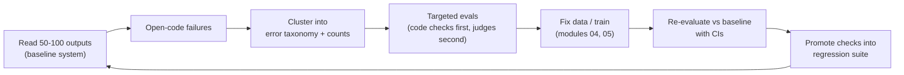

# 09 — Evaluating Fine-Tuned Models

> **Prerequisites:** module 05.
> **You will learn:** how to know whether a fine-tune worked: the evaluation-first workflow, task
> metrics, harnesses, LLM-as-judge bias controls, pass@k, and statistically
> sound comparisons.

Without evaluation, fine-tuning is guesswork with a GPU bill. Every later module in this course
ends with "evaluate it", and this is the module that tells you what that means. The order matters:
build a task-specific eval first, then add standard benchmarks, then LLM-as-judge with bias
controls, then regression suites for forgetting and safety, and put a confidence interval on every
number you report.

Two notes cover the general machinery, and this module assumes them. [Model
evaluation](../../notes/ml/model-evaluation.md) covers classification metrics, validation
protocols, leakage and significance testing for ordinary ML models. [NLP
evaluation](../../notes/nlp/nlp-evaluation.md) covers BLEU/ROUGE, a bias table for LLM judges,
contamination and the statistics of text metrics. Here we apply both to one question: **did this
fine-tune make the model better at the job, without breaking anything else?**

---

## 9.1 Evaluation first

The most common failure in a fine-tuning project is not a bad learning rate. It is training for a
week and then finding you cannot say whether the result is better. **Define the success metric,
the golden set and the error taxonomy before you train anything.**

The method that works in practice is error analysis, popularised for LLM products by Hamel Husain
and Shreya Shankar (practitioner material: the [Parlance evals
course](https://hamel.quarto.pub/parlance/education/evals) and Husain's [evals
FAQ](https://hamel.dev/blog/posts/evals-faq/)). It has five steps:

1. **Read outputs.** Run the current system (your [module-01](./01-when-to-fine-tune.md) prompting
   baseline on the support-email task) on 50 to 100 realistic inputs and read every output. Husain recommends at least 100
   traces, and to keep reading until new traces stop showing new failure kinds.
2. **Open-code.** Write a free-text note on each failure, in your own words. Note the *first*
   thing that went wrong; later errors are often caused by it.
3. **Cluster (axial coding).** Group the notes into a taxonomy: "invented an `order_id` that is
   not in the email", "`issue_type` outside the enum", "prose wrapped around the JSON",
   "sentiment wrong on sarcastic emails".
4. **Count and prioritise.** A taxonomy with counts tells you which failures matter. Twenty
   hallucinated order IDs beat two odd sentiment labels.
5. **Turn the top classes into targeted tests.** Each class becomes an automated check (a regex, a
   schema validator, an exact-match field) or, only where no code check is possible, a narrow
   binary LLM judge.

Husain argues for **binary pass/fail checks per failure mode** over 1-to-5 Likert scores. Binary
labels force a decision, and annotators drift to the middle of a scale. If you want a gradient,
use several binary checks.



The loop never ends. Every production incident is a new trace to open-code, and every new failure
class becomes a new test. **The baseline is not optional.** If the prompted Qwen3-4B-Instruct
already scores 0.92 schema validity, a fine-tune that reaches 0.94 has to justify its cost (module
01 makes that decision); you can only know this if you measured the baseline with the same harness.

### Golden sets

A golden set is a small, frozen, carefully labelled set of inputs with known-correct outputs. The
course's running task uses 50 support emails. Four rules:

- **Size sets your noise floor.** At n = 50 a 95% interval on an accuracy of 0.8 is about ±11
  points (worked in 9.7). A 50-item set can detect a jump from 0.6 to 0.9; it cannot detect 0.80
  to 0.83. Grow the set when the decisions you need to make get finer.
- **Stratify by taxonomy class.** If 10% of real traffic is refund requests with no order ID,
  make sure the golden set has enough of them to measure. Report per-stratum results next to the
  total.
- **Freeze and version it.** `golden_v3.jsonl` with a content hash. Never edit labels silently;
  a relabel is a new version, and you re-score old models on it.
- **Keep it out of training.** Fine-tuning data comes from the same source as the golden set,
  so leakage is easy. Run the n-gram and embedding decontamination from
  [module 04](./04-data-curation-and-synthesis.md) against every training set, every time.

---

## 9.2 Loss, perplexity and why they are not enough

Eval loss is the mean token-level cross-entropy on held-out examples; perplexity is its
exponential, $\exp(\mathcal{L})$. They measure how well the model fits the *distribution of
reference tokens* in the eval set under teacher forcing. That is useful and cheap. It is not the
question you care about.

**Lower eval loss does not guarantee better generations**, for three reasons:

- **Template memorisation.** Much of the loss on instruction data sits in predictable tokens:
  JSON braces, field names, the chat template. A model can drive those to near-zero loss while
  still getting `issue_type` wrong. The loss averages over all tokens; your metric cares about
  five.
- **Exposure bias.** Teacher forcing always conditions on the *reference* prefix. At inference
  time the model conditions on its own earlier tokens, and one early mistake (an invented order
  ID) changes everything after it. Loss never sees that path.
- **Decoding.** Generation uses greedy or sampled decoding with stop tokens and length limits
  ([module 02](./02-tokens-templates-and-the-causal-lm-objective.md) covers temperature, top-p,
  top-k and min-p). A model with lower loss can still loop, truncate or emit the wrong stop token.

So correct the misconception directly: **"lower training loss means a better model" is false.**
Training loss can fall because the model memorises the training set (train loss below about 0.2
on instruction data is a common overfitting signal, module 03). Use loss as a **smoke alarm**:
eval loss that rises while training loss falls means overfitting; a loss spike means a data or
optimiser bug. Use **task metrics on generated outputs** to make decisions.

---

## 9.3 Task metrics

Pick the cheapest metric that matches the task. For the running task, all of these are code
checks; none needs a judge.

| Metric | Definition | Use for | Watch out for |
|---|---|---|---|
| Exact match (EM) | normalised output == reference | short answers, enum fields, math final answers | normalisation rules change scores by points; report them |
| Token F1 | harmonic mean of token precision/recall vs reference | extractive QA, names | rewards partial overlap that may be wrong |
| Schema validity | output parses and satisfies the schema | structured output (our task) | must decide whether prose around JSON fails |
| Field accuracy | fraction of fields equal to the label | structured output | average hides which field fails; report per field |
| BLEU / ROUGE | n-gram overlap with references | translation, summaries (legacy) | surface overlap: a correct paraphrase scores low, a fluent wrong answer can score high |
| pass@k | P(at least one of k samples passes) | code, math with verifiers | needs an unbiased estimator (below) |

The [NLP evaluation note](../../notes/nlp/nlp-evaluation.md) derives BLEU and ROUGE; the point
here is only that **surface overlap is a weak signal for open-ended generation**, and fine-tunes
that change style but not content move it in either direction.

### Execution-based code evaluation

For code, the reference is a set of unit tests, not a string. Generate a program, run it in a
sandbox against hidden tests, and count it as correct only if every test passes. Chen et al.
(2021) [Codex / HumanEval](https://arxiv.org/abs/2107.03374) set the pattern: 164 hand-written
problems, each with unit tests, scored by functional correctness. Three practical rules:

- **Sandbox everything.** Generated code can delete files, open sockets, or loop forever. Run it in
  a container with no network, a CPU and memory limit, and a wall-clock timeout. Inspect AI
  (9.4) ships Docker sandboxes for exactly this.
- **Test the tests.** A weak test suite rewards wrong programs; a model being trained against it
  will find the gap (reward hacking, [module 13](./13-rl-with-verifiable-rewards.md)).
- **Sample more than once.** Report pass@1 estimated from $n$ samples per problem, not from one
  sample, so the estimate has low variance.

### pass@k without bias

pass@k is the probability that at least one of $k$ independent samples solves the problem. The
naive way to estimate it is to draw exactly $k$ samples and check. That is high variance. Chen
et al. instead draw $n \ge k$ samples (they used $n = 200$), count the $c$ correct ones, and ask:
if I pick $k$ of these $n$ without replacement, what is the chance that all $k$ are wrong?

There are $\binom{n}{k}$ ways to choose $k$ samples and $\binom{n-c}{k}$ ways to choose only wrong
ones, so

$$
\widehat{\text{pass@}k} = 1 - \frac{\binom{n-c}{k}}{\binom{n}{k}}.
$$

This is unbiased: averaging over all $k$-subsets of $n$ i.i.d. samples gives the same expectation
as drawing $k$ fresh samples. Binomial coefficients overflow for $n = 200$, so expand the ratio
into a product. Cancelling factorials,

$$
\frac{\binom{n-c}{k}}{\binom{n}{k}}
= \frac{(n-c)!\,(n-k)!}{n!\,(n-c-k)!}
= \prod_{i=n-c+1}^{n} \frac{i-k}{i}
= \prod_{i=n-c+1}^{n} \left(1 - \frac{k}{i}\right),
$$

which needs only $c$ multiplications of numbers in $[0, 1]$. If $n - c < k$, every $k$-subset
contains a correct sample and the estimate is exactly 1.

**Worked example.** $n = 10$ samples, $c = 3$ correct.

- $k = 1$: $1 - \binom{9}{1}/\binom{10}{1} = 1 - 9/10 = 0.3 = c/n$. pass@1 is just the success rate.
- $k = 5$: $1 - \binom{7}{5}/\binom{10}{5} = 1 - 21/252 = 0.91667$.

**Why not plug in $\hat p = c/n$?** The tempting estimator is $1 - (1 - c/n)^k$. For our numbers
it gives $1 - 0.7^5 = 0.83193$, not 0.91667. It is biased because $(1-\hat p)^k$ is a convex
function of $\hat p$; by Jensen's inequality $\mathbb{E}[(1-\hat p)^k] \ge (1-p)^k$, so the plug-in
**systematically underestimates** pass@k. It also treats the $n$ samples as if drawn with
replacement, which double-counts the wrong ones.

The check below implements the product form and compares it with a brute-force count over every
5-subset of 10 samples.

```python finetuning-check
import itertools
import math

def pass_at_k(n, c, k):
    if not (0 <= c <= n and 1 <= k <= n):
        raise ValueError("need 0 <= c <= n and 1 <= k <= n")
    if n - c < k:
        return 1.0
    prod = 1.0
    for i in range(n - c + 1, n + 1):
        prod *= 1.0 - k / i
    return 1.0 - prod

n, c = 10, 3
assert math.isclose(pass_at_k(n, c, 1), 0.3, abs_tol=1e-12)
assert round(pass_at_k(n, c, 5), 5) == 0.91667
assert math.isclose(pass_at_k(n, c, 5), 1 - 21 / 252, abs_tol=1e-12)

# Brute force: samples 0..2 are correct; count 5-subsets with at least one correct.
correct = set(range(c))
subsets = list(itertools.combinations(range(n), 5))
hits = sum(1 for s in subsets if correct & set(s))
assert len(subsets) == 252
assert math.isclose(pass_at_k(n, c, 5), hits / len(subsets), abs_tol=1e-12)

# Edge cases: no correct samples, and too few wrong samples to fill k slots.
assert pass_at_k(10, 0, 5) == 0.0
for c_hi in range(10 - 5 + 1, 11):
    assert pass_at_k(10, c_hi, 5) == 1.0

# The plug-in estimator is biased low here.
naive = 1 - (1 - c / n) ** 5
assert round(naive, 5) == 0.83193 and naive < pass_at_k(n, c, 5)

# Product form agrees with the binomial form across a grid.
for nn in range(1, 16):
    for cc in range(0, nn + 1):
        for kk in range(1, nn + 1):
            exact = 1 - math.comb(nn - cc, kk) / math.comb(nn, kk)
            assert math.isclose(pass_at_k(nn, cc, kk), exact, abs_tol=1e-12)
print("unbiased pass@k verified")
```

It proves the estimator equals the subset-counting definition and that the plug-in formula
differs. It does not prove that your $n$ samples are independent: samples from one prompt with a
fixed seed, or deduplicated samples, break the i.i.d. assumption the estimator relies on.

---

## 9.4 Harnesses

Do not write your own benchmark runner. Prompt formatting, few-shot selection, answer extraction
and normalisation each move scores by points, and harnesses exist so those choices are fixed and
shared. As of October 2026 three open harnesses matter.

### lm-evaluation-harness

EleutherAI's [lm-evaluation-harness](https://github.com/EleutherAI/lm-evaluation-harness/tree/eb4678c395c2c1f157d462b8f3a09831160c861a)
(`lm_eval`, v0.4.13 as of August 2026) is the standard for academic benchmarks. Two recent changes
break old tutorials:

- **The base package no longer bundles torch or transformers.** Install the backend you need:
  `pip install "lm_eval[hf]"` or `pip install "lm_eval[vllm]"`
  ([README at v0.4.13](https://github.com/EleutherAI/lm-evaluation-harness/blob/eb4678c395c2c1f157d462b8f3a09831160c861a/README.md)).
- **The CLI has subcommands** (December 2025): `lm-eval run`, `lm-eval ls tasks`, and
  `lm-eval validate --tasks ...`, plus `--config` for a YAML run config
  ([CLI reference](https://github.com/EleutherAI/lm-evaluation-harness/blob/eb4678c395c2c1f157d462b8f3a09831160c861a/docs/interface.md)).
  Both `lm-eval` and `lm_eval` entry points exist.

A typical run of your SFT checkpoint with the vLLM backend:

```bash
pip install "lm_eval[vllm]==0.4.13"
lm-eval run --model vllm \
  --model_args pretrained=./qwen3-1.7b-sft-merged,dtype=bfloat16,gpu_memory_utilization=0.8 \
  --tasks gsm8k ifeval mmlu_pro_math mmlu_pro_law \
  --apply_chat_template \
  --gen_kwargs temperature=0 \
  --log_samples --output_path results/sft
```

`--log_samples` writes one JSONL row per item with its metric value, which is what the paired
statistics in 9.7 need. For Qwen3 in thinking mode, the CLI reference documents
`enable_thinking=True,think_end_token="</think>"` in `--model_args` to strip the reasoning trace
before scoring.

Tasks are YAML files. The [GSM8K task](https://github.com/EleutherAI/lm-evaluation-harness/blob/eb4678c395c2c1f157d462b8f3a09831160c861a/lm_eval/tasks/gsm8k/gsm8k.yaml)
shows every choice a benchmark number depends on:

```yaml
task: gsm8k
dataset_path: openai/gsm8k
output_type: generate_until
doc_to_text: "Question: {{question}}\nAnswer:"
num_fewshot: 5
generation_kwargs: {until: ["Question:", "</s>", "<|im_end|>"], do_sample: false, temperature: 0.0}
metric_list:
  - {metric: exact_match, aggregation: mean, ignore_case: true}
filter_list:
  - name: strict-match        # "#### <number>" only
  - name: flexible-extract    # last number anywhere in the output
```

The two filters can report very different GSM8K scores for the same outputs. A fine-tune that
changes the answer format moves `strict-match` without changing the maths. **Always say which
filter you report.** Write your own task the same way and pass `--include_path ./my_tasks`.

### Lighteval

Hugging Face's [Lighteval](https://huggingface.co/docs/lighteval/en/index) (v0.13.0, November
2025) has backends for Accelerate, vLLM, SGLang, Nanotron, endpoints and LiteLLM. Its docs, as of
October 2026, call the **inspect-ai backend (`lighteval eval`) the preferred way**:

```bash
lighteval eval vllm/your-org/qwen3-1.7b-sft "gsm8k|0" --max-samples 200
lighteval eval hf-inference-providers/openai/gpt-oss-20b aime25 --epochs 16 --epochs-reducer pass_at_4
```

The [inspect-ai backend page](https://huggingface.co/docs/lighteval/en/inspect-ai) notes that not
every Lighteval task has been ported yet; the older `lighteval vllm "model_name=..." tasks` route
still covers those. Results land in an Inspect log directory, browsable with `inspect view`.

### Inspect AI

[Inspect AI](https://inspect.aisi.org.uk/) from the UK AI Security Institute (PyPI
[`inspect-ai`](https://pypi.org/project/inspect-ai/0.3.251/); 0.3.278 released 2026-10-09) is a
framework rather than a benchmark list. Four concepts:

- **Task**: a dataset plus a solver plus a scorer.
- **Solver**: how an answer is produced: a single `generate()`, a system prompt then
  `generate()`, or a multi-turn agent with tools.
- **Scorer**: how the answer is graded: string match, model-graded QA, or your own code.
- **Sandbox**: an isolated environment (Docker, Kubernetes and others) where tool calls and
  generated code run.

Models are named `provider/model`, for example `vllm/Qwen/Qwen3-1.7B`; Inspect starts a vLLM
server for you, or uses an existing one via `--model-base-url` / `VLLM_BASE_URL`
([providers](https://inspect.aisi.org.uk/providers.html)).

A custom scorer for the running task's schema validity, following the
[custom scorer docs](https://inspect.aisi.org.uk/custom-scorers.html). Teaching fragment: not
executed (needs `inspect-ai`); the full version is in the lab script.

```python
from inspect_ai.scorer import CORRECT, INCORRECT, Score, Target, accuracy, scorer, stderr
from inspect_ai.solver import TaskState

@scorer(metrics=[accuracy(), stderr()])
def json_schema_valid():
    async def score(state: TaskState, target: Target) -> Score:
        obj = extract_json(state.output.completion)     # None if not one JSON object
        errors = schema_errors(obj)                       # enum, type, missing-field checks
        return Score(
            value=CORRECT if not errors else INCORRECT,
            answer=state.output.completion,
            explanation="; ".join(errors) or "valid",
        )
    return score
# Task(dataset=samples, solver=generate(), scorer=json_schema_valid())
```

### `unsloth eval`

Unsloth added an [`unsloth eval` command](https://github.com/unslothai/unsloth/pull/6824) that runs
lm-evaluation-harness tasks on a checkpoint or LoRA adapter. It is convenient right after an
Unsloth run; [module 08](./08-frameworks-and-tooling.md) covers it with the rest of the Unsloth
tooling.

**Table 1. Harnesses (as of October 2026).**

| Harness | Strengths | Backends | When to use |
|---|---|---|---|
| lm-evaluation-harness | widest academic task set; YAML tasks; reference implementation behind many reported numbers | `hf`, `vllm`, `sglang`, OpenAI-compatible APIs | standard benchmarks for base vs fine-tune; reproducing paper numbers |
| Lighteval | inspect-ai backend, Hub-integrated results, provider comparisons, `--epochs` with pass@k reducers | inspect-ai (preferred), Accelerate, vLLM, SGLang, Nanotron, endpoints, LiteLLM | HF-ecosystem evals, reasoning benchmarks with many samples, pushing results to the Hub |
| Inspect AI | custom tasks, solvers and scorers in Python; agents and tools; Docker sandboxes; log viewer | API providers, vLLM, SGLang, HF | your golden set, agentic and code evals, anything needing a sandbox |
| `unsloth eval` | one command after an Unsloth run; LoRA adapters directly | lm-eval tasks underneath | quick sanity numbers inside an Unsloth workflow |

---

## 9.5 Benchmark families

Standard benchmarks answer a different question from your golden set: **did the fine-tune keep
or break general capability?** Pick a few per family, run them on the base model and the
fine-tune with identical settings, and compare.

**Table 2. Benchmark families.**

| Family | Benchmark(s) | What it measures | Metric | Caveats |
|---|---|---|---|---|
| Knowledge | [MMLU-Pro](https://arxiv.org/abs/2406.01574) | multi-subject reasoning-heavy multiple choice, 10 options | accuracy (lm-eval: generative, regex-extracted letter, 5-shot CoT) | answer extraction regex matters; subsets are fine for regression checks |
| Math | GSM8K ([Cobbe et al. 2021](https://arxiv.org/abs/2110.14168)), MATH-500 (subset of MATH from [Lightman et al. 2023](https://arxiv.org/abs/2305.20050)), AIME 2024/2025 | grade-school to competition maths | EM on final answer; AIME as pass@1 averaged over many samples | GSM8K is saturated and widely contaminated; AIME has 30 problems per year, so one problem is 3.3 points |
| Code | HumanEval-style, [LiveCodeBench](https://arxiv.org/abs/2403.07974) | functional correctness | pass@1 (from $n$ samples), pass@k | needs a sandbox; LiveCodeBench dates problems so you can score only post-cutoff ones |
| Instruction following | [IFEval](https://arxiv.org/abs/2311.07911) | ~500 prompts with 25 types of verifiable constraints ("no commas", "at least 3 bullet points") | prompt-level and instruction-level accuracy, strict and loose | checks format compliance, not helpfulness; a common casualty of domain SFT |
| Chat quality | MT-Bench, AlpacaEval 2 LC, Arena-Hard ([BenchBuilder](https://arxiv.org/abs/2406.11939)) | open-ended helpfulness via an LLM judge | judge score or win rate vs a baseline | judge biases (9.6); raw AlpacaEval and raw MT-Bench are not primary chat metrics in 2026 |
| Tool use | BFCL ([leaderboard](https://gorilla.cs.berkeley.edu/leaderboard.html)) | function-call correctness (AST matching), multi-turn and agentic in V4 | accuracy per category | owned by [module 15](./15-agentic-and-tool-use-fine-tuning.md) |
| Long context | [RULER](https://arxiv.org/abs/2404.06654), needle-in-a-haystack | retrieval and reasoning over long inputs | accuracy by context length | needle tests retrieval only; owned by [module 17](./17-long-context-extension.md) |
| Safety | refusal and harmful-request sets, over-refusal sets | refuses harmful requests, answers benign ones | refusal rate / compliance rate | owned by [module 19](./19-safety-forgetting-and-responsible-fine-tuning.md) |

**IFEval in detail**, because it is the benchmark most often hurt by fine-tuning. Each prompt
carries one or more instructions that code can verify. *Instruction-level* accuracy is the
fraction of individual instructions followed; *prompt-level* accuracy is the fraction of prompts
where **all** instructions were followed, so it is always lower or equal. *Strict* checks the
raw response; *loose* also accepts the response after simple transformations (removing the first
or last line, stripping markdown asterisks) to reduce false negatives. lm-eval reports all four as
`prompt_level_strict_acc`, `inst_level_strict_acc`, `prompt_level_loose_acc` and
`inst_level_loose_acc` ([task YAML](https://github.com/EleutherAI/lm-evaluation-harness/blob/eb4678c395c2c1f157d462b8f3a09831160c861a/lm_eval/tasks/ifeval/ifeval.yaml)).
Report prompt-level strict as the headline.

### Generation settings are part of the result

The same checkpoint can score 10 points apart under two generation configs. A benchmark number
without its settings is not a result. The settings that matter:

- **Chat template.** Instruct and fine-tuned models must be evaluated with the template they were
  trained with (`--apply_chat_template` in lm-eval). Evaluating a chat fine-tune on raw
  completion prompts measures the wrong model. Base models are usually evaluated without one.
- **Temperature and top-p.** Greedy (`temperature=0`) for deterministic single-answer tasks. But
  the [Qwen3 model card](https://huggingface.co/Qwen/Qwen3-1.7B/blob/70d244cc86ccca08cf5af4e1e306ecf908b1ad5e/README.md)
  says thinking mode should use temperature 0.6, top-p 0.95, top-k 20 and warns **not** to use
  greedy decoding, which can cause endless repetition. Follow the model card, and use the same
  settings for base and fine-tune.
- **Max new tokens.** Reasoning traces run to thousands of tokens. A cap that truncates them
  turns correct answers into failures. Report the truncation rate.
- **Thinking on or off.** For hybrid models such as Qwen3 this is a different operating mode,
  not a detail. Report both if you claim anything about reasoning.
- **Number of samples.** pass@1 from 1 sample, or averaged over 16, has very different variance.
- **Stop tokens and few-shot count.** A missing `<|im_end|>` stop lets the model ramble into the
  next turn.

**Reporting checklist** (put this in every eval table caption or model card): harness and version;
task names and filters; model revision (commit SHA); chat template on/off; thinking on/off;
temperature, top-p, top-k; max new tokens; number of samples per item and how they were reduced;
few-shot count; dataset revision; seeds; and the confidence interval.

---

## 9.6 LLM-as-judge

When outputs are open-ended (a customer-support reply, a summary), code checks run out and you ask
a strong model to grade. Zheng et al. (2023) [Judging LLM-as-a-Judge with MT-Bench and Chatbot
Arena](https://arxiv.org/abs/2306.05685) defined the modern setup and its failure modes. MT-Bench
is 80 two-turn questions in 8 categories; Chatbot Arena collects crowd votes on anonymous
side-by-side battles. They found GPT-4 as a judge reached **over 80% agreement with human
preferences, the same level as human-human agreement**, and also documented its biases.

**Pointwise vs pairwise.** *Pointwise* (single-answer grading) asks for an absolute score, say
1 to 10. It scales linearly with the number of models but scores drift and compress (most land
at 7 or 8). *Pairwise* asks which of two answers is better. It is more consistent and maps
directly onto "is the fine-tune better than the baseline?", but its cost grows with the number of
pairs. For a before/after comparison, pairwise against the baseline is the default.

### The three biases

- **Position bias.** The judge prefers an answer because of where it appears. In Zheng et al.'s
  Table 2, judges saw two near-identical answers in both orders. GPT-4 gave the same verdict in
  both orders only **65.0%** of the time and favoured the first position in 30.0% of cases;
  Claude-v1 was consistent in 23.8% and favoured the first position in 75.0%.
- **Verbosity (length) bias.** The judge prefers longer answers even when they add nothing. In
  their "repetitive list" attack (pad an answer with a reworded copy of its own list), GPT-3.5
  and Claude-v1 preferred the padded answer 91.3% of the time, GPT-4 8.7%.
- **Self-preference (self-enhancement).** The judge favours answers from its own model family.
  Zheng et al. saw GPT-4 favour itself by about 10% in win rate and Claude-v1 by about 25%, but
  say their data cannot establish the effect conclusively. Treat it as a risk to control, not a
  measured constant.

The obvious failed attempt is "the judge is a strong model, so its verdicts are objective".
**LLM-as-judge is not objective.** It is a measuring instrument with known systematic errors,
and you calibrate it like one.

### Length-controlled AlpacaEval

AlpacaEval compares a model's answers to a baseline's with an LLM judge and reports a win rate.
Raw win rate rewards length. Dubois et al. (2024) [Length-Controlled
AlpacaEval](https://arxiv.org/abs/2404.04475) fix this with regression rather than prompting.
They fit a generalised linear model (a logistic regression) predicting the judge's preference
from the model identity, the **length difference** between the two answers, and other features
such as instruction difficulty. Then they predict the preference **with the length difference
set to zero**. The result answers "what would the win rate be if both answers had the same
length?". Length control raised the Spearman correlation with Chatbot Arena rankings from 0.94 to
0.98, and made the metric much harder to game by padding. **Report AlpacaEval 2 LC, not raw
win rate.**

### Arena-Hard and BenchBuilder

Li et al. (2024) [Arena-Hard / BenchBuilder](https://arxiv.org/abs/2406.11939) address a
different problem: MT-Bench is small and saturated, so it no longer separates strong models.
BenchBuilder is a pipeline that takes crowdsourced prompts (from Chatbot Arena and similar
sources), has an LLM annotate each for qualities such as specificity, domain knowledge,
complexity and problem-solving, and keeps high-quality prompts from high-quality topic clusters.
The resulting Arena-Hard-Auto has 500 challenging prompts. Each model is compared pairwise against
a fixed baseline by an LLM judge, in both orders, and the pairwise outcomes are turned into
scores with a Bradley-Terry model (the same pairwise-preference model behind reward-model
training in [module 12](./12-preference-optimization.md)), with bootstrap confidence intervals. The paper reports about 3x the separation of
model performances of MT-Bench and 98.6% correlation with human preference rankings, at about
USD 20 per evaluation. The lesson for your own judge sets: **prompt selection and pairwise
comparison against a fixed baseline are what make a judge benchmark informative.**

### Controls that work

1. **Swap order, require consistency.** Judge every pair twice, A-first and B-first. Zheng et al.
   use the conservative rule: a win counts only if both orders agree; otherwise it is a tie. The
   alternative is to average the two orders' probabilities.
2. **Control length.** Use LC-style regression for win rates, or instruct the judge to ignore
   length and spot-check that it does. Report average output length next to every judge score.
3. **Write a rubric with anchored scale points.** "4 = all fields correct, tone appropriate,
   no unsupported claims; 2 = one factual error" beats "rate helpfulness 1 to 5". Prefer binary
   checks per failure mode (9.1).
4. **Give reference answers** where they exist. Zheng et al. found GPT-4 failed 14 of 20 math
   gradings with the default prompt and 3 of 20 when shown a reference answer.
5. **Use multiple judges or a different family** from the model being evaluated, to dilute
   self-preference.
6. **Calibrate against humans.** Label 100 or more items yourself (or with domain experts), run
   the judge on the same items, and report agreement with a confidence interval and **Cohen's
   kappa**, which corrects for chance agreement:
   $\kappa = (p_o - p_e)/(1 - p_e)$, with $p_o$ the observed agreement and $p_e$ the agreement
   expected if both raters labelled at random with their own label frequencies. For binary
   judges, Husain recommends tracking the judge's true-positive and true-negative rates against
   human labels on a held-out test split, because overall agreement hides whether it misses
   failures or raises false alarms.
7. **Consider an open judge.** Prometheus 2 ([Kim et al. 2024](https://arxiv.org/abs/2405.01535))
   is an open evaluator model trained for both rubric-based direct assessment and pairwise
   ranking. It is cheaper and reproducible (pinned weights never change under you, an API judge
   can), at some cost in accuracy versus frontier judges. Calibrate it the same way.

### Measuring position bias

Two numbers summarise a judge run in both orders over $P$ pairs:

- **Consistency rate**: the fraction of pairs whose winner (by answer identity) is the same in
  both orders.
- **First-position preference rate**: the fraction of all $2P$ verdicts that pick whichever answer
  was shown first.

They are linked. A consistent pair contributes exactly one first-position pick (A in one order,
second slot in the other). An inconsistent pair contributes two (the judge picked the first slot
both times) or zero (the second slot both times). So

$$
\text{first-position rate} = \frac{1}{2} + \frac{n_{\text{first,first}} - n_{\text{second,second}}}{2P}.
$$

An unbiased judge scores 0.5 no matter how consistent it is; any departure from 0.5 comes from
inconsistent pairs. **Worked example:** 20 pairs; the judge is consistent on 14 (9 A wins, 5 B
wins) and on the other 6 it picks whatever is shown first. Consistency = 14/20 = 0.70.
First-position rate = $0.5 + 6/40 = 0.65$. Under the conservative rule, those 6 pairs become ties.

The check builds that fixture and asserts both numbers and the identity.

```python finetuning-check
# Each verdict names the WINNING ANSWER ("A" or "B"), not the slot.
# Run "ab": A shown first.  Run "ba": B shown first.
ab = ["A"] * 9 + ["B"] * 5 + ["A"] * 6
ba = ["A"] * 9 + ["B"] * 5 + ["B"] * 6
P = len(ab)
assert P == 20 and len(ba) == 20

consistent = sum(x == y for x, y in zip(ab, ba))
consistency = consistent / P
first_picks = sum(v == "A" for v in ab) + sum(v == "B" for v in ba)
first_rate = first_picks / (2 * P)
assert consistency == 0.70
assert first_rate == 0.65

# Identity: rate = 1/2 + (first-first minus second-second inconsistent pairs) / (2P).
ff = sum(x == "A" and y == "B" for x, y in zip(ab, ba))   # first slot both times
ss = sum(x == "B" and y == "A" for x, y in zip(ab, ba))   # second slot both times
assert (ff, ss) == (6, 0)
assert abs(first_rate - (0.5 + (ff - ss) / (2 * P))) < 1e-12

# Conservative combination: disagreements become ties.
final = [x if x == y else "tie" for x, y in zip(ab, ba)]
assert final.count("A") == 9 and final.count("B") == 5 and final.count("tie") == 6

# A perfectly consistent judge has first-position rate exactly 0.5.
assert (sum(v == "A" for v in ab[:14]) + sum(v == "B" for v in ba[:14])) / 28 == 0.5
print("judge position-bias metrics verified")
```

It proves the two metrics and their relationship on a fixture. It does not prove the judge is
*right*: a judge can be perfectly consistent and consistently wrong, which is why human
calibration is a separate step.

---

## 9.7 Statistical rigour

Every eval number is an estimate from a finite sample of items, and fine-tuning gains are often
a few points. The [statistics note](../../notes/math/statistics.md) covers intervals, tests and
the bootstrap in general; this section applies them to model comparisons.

### Confidence intervals for one model: Wilson

For an accuracy of $\hat p$ on $n$ independent items, the textbook Wald interval
$\hat p \pm z\sqrt{\hat p(1-\hat p)/n}$ misbehaves at small $n$ and near 0 or 1 (it can extend
past 1). Use the **Wilson score interval**:

$$
\frac{\hat p + \frac{z^2}{2n}}{1 + \frac{z^2}{n}}
\;\pm\;
\frac{z}{1 + \frac{z^2}{n}}\sqrt{\frac{\hat p(1-\hat p)}{n} + \frac{z^2}{4n^2}},
\qquad z = 1.96.
$$

**Worked example: the 50-item golden set at 0.8.** With $n = 50$, $\hat p = 0.8$ (40 correct),
the centre is $(0.8 + 0.0384)/1.0768 = 0.7786$ and the half-width is $0.1090$, giving
**[0.670, 0.888]**. That is about ±11 points on a single model.

What difference can you detect? If you compared two *independent* 50-item runs, the 95%
half-width on the difference is about $1.96\sqrt{2 \times 0.16/50} \approx 0.157$: you would need
a gap of roughly 16 points. Pairing (same items for both models, below) helps a lot, but only
the items where the models *disagree* carry evidence. With 10 discordant items, you need a 9-to-1
split (a 16-point net gain on 50 items) before McNemar's exact test gives $p < 0.05$; an 8-to-2
split gives $p = 0.11$. **A 50-item golden set is for catching big regressions and big wins, not
for ranking close checkpoints.**

| $n$ at $\hat p = 0.8$ | Wilson 95% interval | Half-width |
|---|---|---|
| 50 | [0.670, 0.888] | ±0.109 |
| 200 | [0.739, 0.850] | ±0.055 |
| 1,000 | [0.774, 0.824] | ±0.025 |

### Paired bootstrap for A vs B

When both models are scored on the same items, compare them **per item**. The paired bootstrap:

1. Compute per-item scores $a_j, b_j$ for $j = 1..n$ (0/1 for accuracy, or any per-item metric).
2. The observed delta is $\bar b - \bar a$.
3. For $B = 2{,}000$ resamples, draw $n$ item indices **with replacement**, and recompute
   $\bar b - \bar a$ on those indices (the same indices for both models; that is the pairing).
4. The 2.5th and 97.5th percentiles of the 2,000 deltas form the 95% percentile CI.

Resampling items jointly keeps the correlation between the models: an item both get right moves
both means together, so it adds no noise to the delta. This is why paired CIs are much narrower
than two independent intervals.

**Fixture.** 200 items: both right on 140, only A right on 8, only B right on 20, both wrong on
32. A scores 148/200 = 0.74, B scores 160/200 = 0.80, delta = +0.06 (12 net items). The paired
bootstrap CI with `default_rng(0)` is about [+0.010, +0.115]: it excludes zero. A second fixture
with 13 A-only and 15 B-only items (delta +0.01, two net items) gives a CI of about
[−0.04, +0.06], which includes zero.

**McNemar's test** is the classical paired test for binary outcomes. Let $n_{01}$ be items only A
gets right and $n_{10}$ items only B gets right. Under the null of equal accuracy each discordant
item is a fair coin flip, so the exact test is a two-sided binomial test of $n_{10}$ out of
$n_{01} + n_{10}$ at $p = 0.5$. For the first fixture, 20 versus 8 gives $p \approx 0.036$. Items
both models get right or wrong do not enter at all, which is the paired bootstrap's lesson in a
single formula.

The check asserts the delta, the bootstrap CI's behaviour on both fixtures, and the Wilson numbers
stated above.

```python finetuning-check
import math
import numpy as np

def paired_bootstrap(a, b, n_boot=2000, seed=0):
    rng = np.random.default_rng(seed)
    idx = rng.integers(0, len(a), size=(n_boot, len(a)))
    deltas = b[idx].mean(axis=1) - a[idx].mean(axis=1)
    lo, hi = np.quantile(deltas, [0.025, 0.975])
    return b.mean() - a.mean(), lo, hi

def fixture(a_only, b_only, both=140, neither=32):
    a = np.array([1] * both + [1] * a_only + [0] * b_only + [0] * neither, dtype=float)
    b = np.array([1] * both + [0] * a_only + [1] * b_only + [0] * neither, dtype=float)
    return a, b

a, b = fixture(a_only=8, b_only=20)
assert len(a) == 200 and a.sum() == 148 and b.sum() == 160
delta, lo, hi = paired_bootstrap(a, b)
assert abs(delta - 12 / 200) < 1e-12
assert lo < delta < hi
assert lo > 0                                  # excludes zero
se = math.sqrt(((b - a).var()) / len(a))      # normal-approximation cross-check
assert abs(lo - (0.06 - 1.96 * se)) < 0.01 and abs(hi - (0.06 + 1.96 * se)) < 0.01

a2, b2 = fixture(a_only=13, b_only=15)
d2, lo2, hi2 = paired_bootstrap(a2, b2)
assert abs(d2 - 2 / 200) < 1e-12
assert lo2 < 0 < hi2                           # includes zero

# Exact McNemar on the first fixture: 8 vs 20 discordant items.
m = 28
p_mcnemar = 2 * sum(math.comb(m, i) for i in range(0, 9)) / 2**m
assert 0.035 < p_mcnemar < 0.036

# Wilson interval for n=50, p_hat=0.8.
n, z = 50, 1.959963984540054
p = 40 / n
den = 1 + z * z / n
centre = (p + z * z / (2 * n)) / den
half = z * math.sqrt(p * (1 - p) / n + z * z / (4 * n * n)) / den
assert (round(centre - half, 3), round(centre + half, 3)) == (0.670, 0.888)
assert round(half, 3) == 0.109
print("paired bootstrap, McNemar and Wilson verified")
```

It proves the procedure and the stated numbers on fixed fixtures. It does not prove that your
items are independent: if the golden set has five near-duplicate emails per customer, resample
customers, not emails, or the interval will be too narrow.

### Seed variance

The bootstrap covers *item* noise: which emails happened to be in the set. It does not cover
*training* noise. Two fine-tunes with identical configs and different seeds (data order, LoRA
init, dropout) can differ by more than the gain you are claiming. **When you claim a small gain,
train at least 3 seeds of each configuration** and report the mean and spread across seeds along
with the per-run CIs. If the seed spread is as large as the delta, you have no result. Fix the
generation seed separately when sampling, and report both.

---

## 9.8 Contamination, gaming and regression suites

### Contamination

A benchmark score means nothing if the test items were in the training data. For fine-tuning
this happens two ways: your SFT data (often synthetic, often scraped) contains benchmark items,
or the base model saw them in pretraining. Checks, in increasing order of strength (the methods
are in [module 04](./04-data-curation-and-synthesis.md)):

- **n-gram overlap** between training data and eval items (13-gram overlap is a common choice),
  plus embedding similarity for paraphrases.
- **Canary strings.** Some benchmarks embed a unique GUID so that a model reproducing it reveals
  training on the benchmark files. Search your training corpus for them.
- **Post-cutoff items.** Score separately on items published after the model's training cutoff.
  LiveCodeBench dates every problem for this reason. A model that does much better on old items
  than new ones of equal difficulty was probably trained on them.
- **Inherited contamination.** A model distilled from a teacher's outputs
  ([module 14](./14-distillation-and-reasoning.md)) can inherit benchmark answers the teacher
  memorised, even if your own data pipeline never touched the benchmark.

### Gaming

Benchmarks are gamed without anyone intending to cheat. **Format overfitting**: SFT data written
in GSM8K's "#### answer" style lifts `strict-match` scores without improving maths. **Prompt
tuning on the test set**: trying ten system prompts and reporting the best is selection on the
test set; the best-of-ten is biased upward. Keep a dev split for choices and touch the test split
once.

### Regression suites

A regression suite is a fixed set of evals that every candidate must pass before release. For a
fine-tune, it has four parts:

| Suite | What it catches | Example contents | Gate |
|---|---|---|---|
| General capability | catastrophic forgetting | IFEval, MMLU-Pro subset, GSM8K, a few chat prompts | no drop larger than the paired CI vs the base/instruct model |
| Safety and refusal | alignment lost during fine-tuning | harmful-request refusal set plus a benign over-refusal set | refusal rate on harmful prompts not lower than baseline |
| Format adherence | broken output contract | your schema-validity checks, stop-token checks | validity ≥ target (e.g. 0.98 on the golden set) |
| Latency and cost | longer outputs, slower serving | output length distribution, p50/p95 latency on fixed hardware | p95 within budget |

Fine-tuning can erode general and safety behaviour even on benign data;
[module 19](./19-safety-forgetting-and-responsible-fine-tuning.md) gives the evidence and
mitigations. Latency regressions usually come from longer outputs, not a slower model; measure
them the way the inference course's [honest
benchmarking](/courses/inference/10-benchmarking/10-03-honest-benchmarking.html) chapter
describes. **Gate releases on the suite automatically**, so nobody has to remember to run it.

---

## 9.9 Evaluating RL-trained models (preview)

Models trained with RL on verifiable rewards ([module 13](./13-rl-with-verifiable-rewards.md))
need one extra caution: **the choice of $k$ can reverse the conclusion.** Yue et al. (2025) [Does
Reinforcement Learning Really Incentivize Reasoning Capacity in LLMs Beyond the Base
Model?](https://arxiv.org/abs/2504.13837) compared base and RLVR-trained models with pass@k at
large $k$. RL-trained models win at pass@1, but base models catch up and can overtake them as $k$
grows to the hundreds. Their reading is that RLVR mostly sharpens the distribution toward answers
the base model could already find, narrowing coverage. Rebuttals exist and module 13 covers the
debate. For evaluation the lesson is simple: **report pass@1 and pass@k at several $k$ (computed
with the unbiased estimator from the same $n$ samples)**, and do not claim "new reasoning
ability" from pass@1 alone.

The second caution is **reward hacking**. RL optimises the verifier, not the task. Audit
RL-trained models with a held-out verifier the training never saw, read a sample of
high-reward outputs, and watch for length inflation and format tricks. Module 13 covers the
taxonomy (DAPO-style length shaping and Lilian Weng's reward-hacking survey included).

---

## 9.10 Online evaluation and reporting

Offline evals predict; production decides. Once a fine-tune passes the regression suite:

- **A/B test** it against the current model on a slice of real traffic, with a primary metric
  fixed in advance (task success, escalation rate, user rating) and guardrail metrics (latency,
  refusal rate, complaints). Run the A/B test long enough for the sample size you computed in
  advance; peeking and stopping early inflates false positives (see the [statistics
  note](../../notes/math/statistics.md) on A/B testing).
- **Collect human preferences** in production: thumbs up/down, side-by-side comparisons for
  internal reviewers, edits that agents make to model drafts. These are noisy but on-distribution.
- **Feed failures back into data.** Every bad trace goes through the 9.1 loop: open-code it, add
  it to the taxonomy, add a test, and (after decontamination against the golden set) add
  corrected examples to the next training set. Preference pairs from production feed
  [module 12](./12-preference-optimization.md). [Module 20](./20-production-serving-and-cost.md)
  builds this flywheel into the serving stack.

**Log evals with training runs.** Every checkpoint you might ship should have its eval suite
results logged in the same experiment tracker as its training curves, with the full config
(including the generation settings from 9.5) and the harness version.

**Publish eval results with the model.** The model card should state intended use, the eval
sets, the settings checklist and the CIs. On the Hugging Face Hub, eval scores can also live as
YAML files in a model repo's `.eval_results/` folder ([Hub docs, a work-in-progress feature as
of October 2026](https://huggingface.co/docs/hub/eval-results)). Each entry names a Hub benchmark
dataset and task, and the score appears on the model page and on that benchmark's leaderboard:

```yaml
# .eval_results/gsm8k.yaml  (required fields: dataset.id, dataset.task_id, value)
- dataset:
    id: openai/gsm8k           # must be a Hub dataset registered as a Benchmark
    task_id: gsm8k             # as defined in the benchmark's eval.yaml
  value: 0.71
  date: "2026-10-10"
  source:
    url: https://huggingface.co/datasets/my-org/qwen3-sft-eval-logs
    name: Eval traces
  notes: "inspect-ai via lighteval eval, benchmark eval.yaml protocol, thinking off"
```

Only datasets registered as Hub benchmarks are accepted, and each benchmark's `eval.yaml` fixes
its own protocol. GSM8K's, for instance, runs through inspect-ai with its own prompt template,
4 epochs reduced to pass@1 and a model-graded scorer, so an lm-eval `strict-match` number is a
different measurement and should not be posted under it without saying so in `notes`. A `verifyToken` marks results that
were run on HF Jobs with inspect-ai. Results submitted by others via pull request show as
"community". Treat the value above as a placeholder, not a reported score.

---

## 9.11 Lab: an evaluation report with error bars

**Goal.** Produce the evaluation report you would attach to a release decision for the
[module-05](./05-supervised-fine-tuning.md) SFT model: standard benchmarks base vs SFT with paired CIs, a calibrated pairwise judge, and an
Inspect task for the running task's output contract.

**Scripts.** [`eval_toolkit.py`](./code/eval_toolkit.py) (pass@k, Wilson, paired bootstrap,
McNemar, judge consistency and Cohen's kappa; reads lm-eval sample logs) and
[`inspect_json_task.py`](./code/inspect_json_task.py) (Inspect task with the schema-validity
scorer). Both run their core logic on CPU fixtures:

```bash
python content/courses/finetuning/code/eval_toolkit.py --smoke
python content/courses/finetuning/code/inspect_json_task.py --smoke
```

### L9.1 Benchmarks with confidence intervals (T1)

- **Tier:** T1 (single 24 GB GPU).
- **Models:** your module-05 base model (for example `Qwen/Qwen3-1.7B-Base` or `Qwen/Qwen3-1.7B`)
  and the SFT checkpoint, with the LoRA adapter merged.
- **Datasets:** `TIGER-Lab/MMLU-Pro` (two or three subject subtasks such as `mmlu_pro_math`),
  `openai/gsm8k`, `google/IFEval`, through their lm-eval tasks.

Steps:

1. `pip install "lm_eval[vllm]==0.4.13"`. Run the `lm-eval run --model vllm ... --log_samples`
   command from 9.4 twice, with `--output_path results/base` and `results/sft`, identical
   settings otherwise. Apply the chat template to both if both are instruct models; if comparing
   a base model, decide and record how it was prompted.
2. Repeat one task with Lighteval: push the merged SFT model to the Hub (a private repo is
   fine) and run `lighteval eval vllm/<your-org>/<repo> "gsm8k|0"`. Compare the score
   with lm-eval's. Explain any difference by reading both prompt templates and extraction rules.
3. Build the report:

```bash
python content/courses/finetuning/code/eval_toolkit.py --full \
  --base-dir results/base --tuned-dir results/sft --tasks gsm8k ifeval mmlu_pro_math
```

(The script reads each task's metric and filter from a table matching the v0.4.13 task YAMLs:
`strict-match` for GSM8K, `prompt_level_strict_acc` for IFEval, `custom-extract` for MMLU-Pro;
`--metric`/`--filter` override it for other tasks.) **Record:** per task, n, base, SFT, delta, paired 95% CI, McNemar
p, and Wilson intervals; plus the settings checklist. **Expect:** gains on tasks close to your SFT
data, flat or slightly negative IFEval and MMLU-Pro if forgetting occurred. Do not expect any
specific number; the point is whether the CI excludes zero.

### L9.2 A calibrated pairwise judge (API or T1)

- **Tier:** an API judge model, or a T1 GPU serving an open judge (for example a Prometheus 2
  checkpoint through vLLM).
- **Data:** 100 support-email replies (or chat responses) from base and SFT models.

Steps:

1. Write a pairwise rubric prompt with anchored criteria (9.6) and ask for "A", "B" or "tie".
2. Judge each pair twice: base answer first, then SFT answer first. Record winners by answer
   identity.
3. Label the same 100 pairs yourself, blind to which model produced which answer.
4. Save `judge_labels.csv` with columns `item_id,verdict_ab,verdict_ba,human` and run
   `eval_toolkit.py --full ... --judge-csv judge_labels.csv`.

**Record:** consistency rate, first-position rate, agreement with human labels and its Wilson
interval, Cohen's kappa. **Expect:** consistency well below 1.0 for weaker judges and a
first-position rate away from 0.5; the conservative rule turns some wins into ties. If kappa is
low, fix the rubric before trusting any judge-based number.

### L9.3 An Inspect task for the output contract (T0)

- **Tier:** T0 (free T4) with vLLM serving Qwen3-0.6B or 1.7B, or any API model.
- **Data:** the module-01 50-example golden set as JSONL rows `{"email": ..., "label": {...}}`.

Steps:

1. `pip install inspect-ai`, then
   `python content/courses/finetuning/code/inspect_json_task.py --full --data golden_50.jsonl --model vllm/Qwen/Qwen3-1.7B`.
2. Run it again on your fine-tuned model (`--model vllm/<your-org>/<repo>` for the Hub copy
   from L9.1).
3. Open `inspect view` and read every INCORRECT sample's explanation. Add each new failure kind to
   your taxonomy.

**Record:** schema validity with Inspect's stderr, mean field accuracy from the score metadata,
and the failure taxonomy counts. **Expect:** the base instruct model fails mostly on format (prose
around JSON, enum drift); the fine-tune should fix format, and its remaining failures should be
field-level errors.

---

## Key takeaways

- **Evaluation comes before training.** Define the metric, golden set and error taxonomy first,
  and measure the prompting baseline with the same harness, or you cannot tell whether the
  fine-tune was worth it.
- **Error analysis drives the evals.** Read 50 to 100 outputs, open-code, cluster, count, and
  turn the top failure classes into binary code checks before reaching for a judge.
- **Loss is a smoke alarm, not a decision.** Lower eval loss can coexist with worse generations
  through template memorisation, exposure bias and decoding failures.
- **Use the unbiased pass@k estimator.** $1 - \binom{n-c}{k}/\binom{n}{k}$ in product form; the
  plug-in $1-(1-c/n)^k$ underestimates (0.832 vs 0.917 for $n = 10$, $c = 3$, $k = 5$).
- **Harnesses fix the hidden choices.** lm-eval (`lm-eval run`, `[vllm]` extra), Lighteval
  (`lighteval eval`, inspect-ai backend) and Inspect AI (tasks, solvers, scorers, sandboxes)
  make prompts, extraction and normalisation reproducible.
- **Generation settings are part of the result.** Template, thinking mode, temperature,
  max tokens, samples and filters can move a score by many points; report them every time.
- **LLM judges are biased instruments.** Position, verbosity and self-preference biases are
  documented; GPT-4 was consistent on only 65% of swapped near-identical pairs in Zheng et al.
- **Control judges explicitly.** Swap order and require agreement, control length (LC
  AlpacaEval's GLM), use anchored rubrics and references, and calibrate on 100+ human labels with
  Cohen's kappa.
- **Small golden sets are noisy.** At $n = 50$ and 0.8 accuracy the Wilson interval is
  [0.670, 0.888]; only big changes are detectable.
- **Compare models per item.** Paired bootstrap and McNemar use only the discordant items'
  evidence and give much tighter intervals than two independent CIs.
- **Seeds are a second noise source.** Train at least three seeds before claiming a small gain.
- **Regression suites gate releases.** General capability, safety and refusal, format adherence
  and latency, checked automatically on every candidate.
- **For RL-trained models, report pass@k at several k.** pass@1 gains can coexist with narrower
  coverage at large $k$.

## Self-check

1. How would you evaluate a fine-tuned customer-support model before launch? Name the eval sets,
   metrics, judge controls and release gates.
2. What is pass@k, how is it estimated without bias from $n$ samples, and why does the choice of
   $k$ matter when comparing an RL-trained model with its base?
3. How do you control for position and length bias in LLM-as-judge evaluation, and how would you
   show your judge agrees with humans?

---

**Next → [10 — Scaling Out: Distributed Fine-Tuning, Parallelism, and MoE](./10-distributed-fine-tuning-and-moe.md)**
