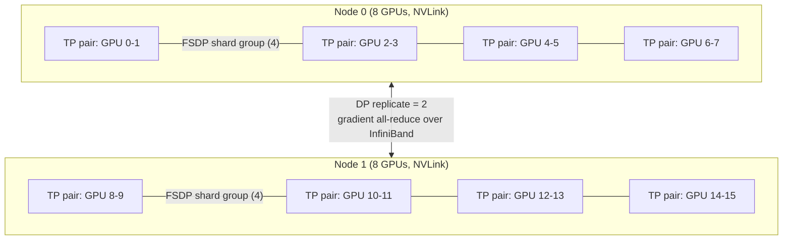

# 10 — Scaling Out: Distributed Fine-Tuning, Parallelism, and MoE

> **Prerequisites:** modules 03, 06.
> **You will learn:** what DDP, ZeRO, FSDP2, tensor, context, pipeline and expert parallelism
> each shard, how to configure them through Accelerate, how to debug multi-GPU
> runs, and what changes when you fine-tune a mixture-of-experts model.

A full fine-tune of anything past about 8B parameters, an RL run with large rollouts, or a
128k-context SFT job does not fit on one GPU. At that point you need to know three things:
what each parallelism scheme actually splits, how to switch it on through Accelerate or
DeepSpeed without guessing at flags, and what the failure modes look like (hangs, OOM on
save, a slow interconnect quietly halving your throughput). The transformers course's
[memory section](../transformers/13-training-considerations.md#134-the-memory-budget)
lists these techniques in one line each. This module derives them.

Two facts from [module 03](./03-training-mechanics-and-memory-math.md) carry everything
below: mixed-precision AdamW costs about 16 bytes per parameter (2 weights, 2 gradients, 12
for the fp32 master copy and Adam moments), so an 8B full fine-tune needs about 128 GB of
model state; and activations scale with $B \times T \times d \times L$. Every technique here
spreads one of those terms across GPUs and pays for it in communication.

---

## 10.1 Data parallelism

### DDP: replicate everything, average the gradients

Distributed Data Parallel (DDP) is the baseline. Every rank (one process per GPU) holds a
**full replica** of the model and its optimizer state. Each rank runs forward and backward
on a different slice of the global batch, then the ranks **all-reduce** their gradients so
that every replica applies the same averaged update. The replicas never drift because they
start identical and take identical steps.

Why is averaging per-rank gradients correct? With a mean loss over a batch split into $N$
equal shards, the full-batch gradient is

$$
\nabla \frac{1}{NB}\sum_{i=1}^{NB} \ell_i = \frac{1}{N}\sum_{r=1}^{N} \nabla \underbrace{\frac{1}{B}\sum_{i \in \text{shard } r} \ell_i}_{\text{rank } r\text{'s mean loss}}
$$

so the average of per-rank mean-loss gradients **is** the full-batch gradient. That identity
breaks when shards contain different numbers of loss tokens (padding, masked prompts,
packing): then a per-rank mean over-weights short shards. Normalize by the global count of
loss tokens instead. This is the same bug class as the gradient-accumulation normalization
error covered in [module 03](./03-training-mechanics-and-memory-math.md); in the HF Trainer
the switch that sums token counts across ranks is `average_tokens_across_devices`.

### What the all-reduce costs

The standard implementation is a **ring all-reduce**: a reduce-scatter (each rank ends up
owning the sum of one $1/N$ chunk) followed by an all-gather (every rank receives every
summed chunk). Each phase moves $\frac{N-1}{N}\Psi$ elements through each rank, so the total
per rank per optimizer step is

$$
V_{\text{all-reduce}} = 2\,\frac{N-1}{N}\,\Psi \text{ elements.}
$$

**The volume per rank is almost independent of $N$.** For an 8B model with bf16 gradients
on 8 GPUs that is $2 \times \tfrac{7}{8} \times 16$ GB $= 28$ GB per rank per step. On
NVLink this is a fraction of a second; across a PCIe-only box it is not (section 10.5).

DDP hides most of this cost. It groups parameters into **buckets** (25 MB by default in
PyTorch) and launches each bucket's all-reduce as soon as backward has produced all of its
gradients, so communication for late layers overlaps with backward compute for early ones.
The [PyTorch note](../../notes/libraries/pytorch.md) covers the DDP API itself, and the
[optimization note](../../notes/deep-learning/optimization-and-training.md) covers the
batch-size and learning-rate interplay you disturb when you add ranks.

### Why `nn.DataParallel` is gone

`nn.DataParallel` is the older single-process API: one Python process drives all GPUs,
replicates the model every forward, and scatters and gathers through GPU 0. It is
GIL-bound and overloads GPU 0. [TRL v1.15.0](https://github.com/huggingface/trl/releases/tag/v1.15.0)
now **refuses** it outright, so launch with `accelerate launch` or `torchrun` to get DDP
(or FSDP2/ZeRO, configured below).

### Effective batch across ranks

The [TRL distributed-training guide](https://huggingface.co/docs/trl/v1.15.0/en/distributing_training)
states the rule you will use every day:

$$
\text{effective batch} = \texttt{per\_device\_train\_batch\_size} \times \text{num\_devices} \times \texttt{gradient\_accumulation\_steps}.
$$

When you move a recipe from 1 GPU to 8, divide `gradient_accumulation_steps` by 8 (or the
micro-batch) to keep the optimizer seeing the same batch, or retune the learning rate.

---

## 10.2 Sharding the state: ZeRO

DDP's weakness is that every rank stores the same 16 bytes per parameter. Rajbhandari et
al. (2020), [ZeRO](https://huggingface.co/papers/1910.02054), observed that this redundancy
is unnecessary: each rank only needs the optimizer state for the parameters it updates, and
only needs full weights for the layer it is currently computing.

### The three stages

Let $\Psi$ be the parameter count, $N_d$ the data-parallel degree, and $K$ the optimizer
bytes per parameter ($K = 12$ for mixed-precision Adam: fp32 master weights, momentum,
variance). With 2-byte weights and 2-byte gradients:

| Stage | Shards | Per-GPU model-state memory |
|---|---|---|
| Baseline (DDP) | nothing | $(2 + 2 + K)\,\Psi$ |
| ZeRO-1, $P_{os}$ | optimizer states | $4\Psi + K\Psi / N_d$ |
| ZeRO-2, $P_{os+g}$ | + gradients | $2\Psi + (2 + K)\Psi / N_d$ |
| ZeRO-3, $P_{os+g+p}$ | + parameters | $(2 + 2 + K)\Psi / N_d$ |

ZeRO-3 is the interesting one. No rank holds a full layer at rest. Before a layer's forward,
the ranks **all-gather** that layer's parameter shards, compute, then free the gathered copy.
Backward repeats the all-gather for the same layer, computes gradients, and
**reduce-scatters** them so each rank keeps only the gradient slice for the parameters it
owns. Each rank then runs Adam on its own $1/N_d$ of the parameters.

The paper's worked example is a 7.5B model on 64 GPUs. Plugging in:

| | Baseline | ZeRO-1 | ZeRO-2 | ZeRO-3 |
|---|---|---|---|---|
| GB per GPU | 120.0 | 31.4 | 16.6 | 1.9 |

The next check reproduces these four numbers exactly (120.0, 31.40625, 16.640625 and 1.875
GB), and confirms that stage 3 stores no redundant byte: per-GPU memory times $N_d$ equals
the baseline.

```python finetuning-check
# ZeRO per-GPU model-state memory (Rajbhandari et al. 2020), K = 12.
def zero_bytes(psi, n_d, stage, k=12):
    if stage == 0:
        return (2 + 2 + k) * psi
    if stage == 1:
        return 4 * psi + k * psi / n_d
    if stage == 2:
        return 2 * psi + (2 + k) * psi / n_d
    if stage == 3:
        return (2 + 2 + k) * psi / n_d
    raise ValueError(stage)

GB = 1e9
psi, n_d = 7.5e9, 64
got = [zero_bytes(psi, n_d, s) / GB for s in range(4)]
for g, w in zip(got, [120.0, 31.40625, 16.640625, 1.875]):
    assert abs(g - w) < 1e-9, (g, w)

# Every stage strictly lowers memory for any data-parallel degree >= 2.
for n in (2, 3, 4, 8, 16, 64, 512):
    for p in (1e8, 7.5e9, 7e10):
        vals = [zero_bytes(p, n, s) for s in range(4)]
        assert all(a > b for a, b in zip(vals, vals[1:])), (n, p, vals)

# Stage 3 keeps exactly one copy of everything across the group.
assert abs(zero_bytes(psi, n_d, 3) * n_d - zero_bytes(psi, n_d, 0)) < 1.0
# With N_d = 1 every stage collapses to the baseline: sharding needs partners.
assert len({zero_bytes(psi, 1, s) for s in range(4)}) == 1
print("ZeRO memory formulas verified")
```

The check proves the arithmetic of model states only; it says nothing about activations,
the temporary buffers that hold gathered layers, or allocator fragmentation, which together
often add several GB per GPU.

### What stage 3 costs in communication

ZeRO-1 and ZeRO-2 move **the same volume as DDP**: the all-reduce is already a reduce-scatter
plus an all-gather, and ZeRO simply reorders it (reduce-scatter gradients, step locally,
all-gather updated parameters). ZeRO-3 adds a second parameter all-gather, because the
parameters are gathered once for forward and again for backward. That is three passes of
$\frac{N-1}{N}\Psi$ instead of two, so **ZeRO-3 costs about 1.5× DDP's communication**. You
buy an $N_d$-fold cut in parameter memory with a 50% increase in traffic, which is a good
deal on NVLink and a questionable one over PCIe.

### Offload and the ZeRO family

| Variant | Paper | What moves | When it helps |
|---|---|---|---|
| ZeRO-Offload | [Ren et al. 2021](https://arxiv.org/abs/2101.06840) | optimizer state and the Adam step to CPU (with ZeRO-2) | one or few GPUs, lots of host RAM |
| ZeRO-Infinity | [Rajbhandari et al. 2021](https://arxiv.org/abs/2104.07857) | parameters, gradients, optimizer state to CPU **or NVMe** (ZeRO-3) | models larger than aggregate GPU memory |
| ZeRO++ | [Wang et al. 2023](https://arxiv.org/abs/2306.10209) | quantized weight all-gather, hierarchical (intra-node) weight partition, quantized gradient reduce | multi-node runs on slow inter-node links |

### DeepSpeed configuration

The keys below are checked against the
[DeepSpeed config reference](https://www.deepspeed.ai/docs/config-json/) and the
[Transformers v5.19 DeepSpeed guide](https://huggingface.co/docs/transformers/v5.19.0/en/deepspeed),
as of October 2026. `"auto"` tells the HF integration to copy the value from your
`TrainingArguments`/`SFTConfig`, which is what you want for anything that has a twin there.

```json
{
  "bf16": { "enabled": "auto" },
  "zero_optimization": {
    "stage": 3,
    "overlap_comm": true,
    "contiguous_gradients": true,
    "reduce_bucket_size": "auto",
    "stage3_prefetch_bucket_size": "auto",
    "stage3_param_persistence_threshold": "auto",
    "stage3_gather_16bit_weights_on_model_save": true,
    "offload_optimizer": { "device": "cpu", "pin_memory": true },
    "offload_param": { "device": "none" },
    "zero_quantized_weights": false,
    "zero_hpz_partition_size": 1,
    "zero_quantized_gradients": false
  },
  "gradient_clipping": "auto",
  "train_micro_batch_size_per_gpu": "auto",
  "train_batch_size": "auto",
  "gradient_accumulation_steps": "auto"
}
```

`overlap_comm` overlaps gradient reduction with backward; `contiguous_gradients` copies
gradients into one buffer as they are produced to avoid fragmentation;
`offload_optimizer.device` is `cpu` or `nvme`; `offload_param` is valid only at stage 3. The
three ZeRO++ keys switch on quantized weights, the secondary intra-node partition (set
`zero_hpz_partition_size` to GPUs per node), and quantized gradients. One trap from the
Transformers guide: **under ZeRO-3, build the `TrainingArguments` before loading the
model**, or every rank materializes the full model first and you save nothing.

### Saving a ZeRO-3 checkpoint

Under ZeRO-3, a rank's `state_dict()` holds placeholders, not weights. A DeepSpeed
checkpoint is therefore a directory of per-rank shards (model and optimizer partitions) that
only DeepSpeed can resume from. You have two ways out:

1. **Gather at save time.** `stage3_gather_16bit_weights_on_model_save: true` makes
   `save_model()` all-gather the full 16-bit weights and write a normal HF checkpoint. The
   DeepSpeed tutorial warns this "can be slow and memory demanding": rank 0 must hold the
   whole model in host memory, which is the classic **OOM at gather** for 70B-class models.
2. **Consolidate offline.** Every checkpoint directory contains
   [`zero_to_fp32.py`](https://github.com/deepspeedai/DeepSpeed/blob/v0.19.7/deepspeed/utils/zero_to_fp32.py#L13-L16),
   which needs no GPU and no config:

```bash
cd runs/ft10/checkpoint-500
python zero_to_fp32.py . merged/ --safe_serialization   # fp32 safetensors, sharded at 5GB
```

For resuming on a different number of GPUs, DeepSpeed's Universal Checkpointing converts
the shards into a topology-independent form.

---

## 10.3 FSDP: from FSDP1 to FSDP2

PyTorch's Fully Sharded Data Parallel ([Zhao et al. 2023](https://arxiv.org/abs/2304.11277))
implements the same idea as ZeRO-3 natively in PyTorch: shard parameters, gradients and
optimizer state, all-gather a unit before its forward and backward, reduce-scatter its
gradients.

**FSDP and ZeRO-3 are not different ideas.** A common misconception treats them as rival
algorithms. They shard the same three things with the same collectives; they differ in
implementation (a PyTorch-native module wrapper versus DeepSpeed's engine), configuration
surface, checkpoint format, and ecosystem features (offload engines and ZeRO++ on one side,
DTensor composition with TP and `torch.compile` on the other). The
[Accelerate FSDP guide](https://huggingface.co/docs/accelerate/v1.15.0/en/usage_guides/fsdp)
spells out the mapping:

| ZeRO | FSDP1 `sharding_strategy` | FSDP2 / Accelerate | Shards |
|---|---|---|---|
| Stage 0 (DDP) | `NO_SHARD` | plain DDP | nothing |
| Stage 2 | `SHARD_GRAD_OP` | `fsdp_reshard_after_forward: false` | optimizer state, gradients (params kept gathered between forward and backward) |
| Stage 3 | `FULL_SHARD` | `fsdp_reshard_after_forward: true` | optimizer state, gradients, parameters |
| ZeRO++ hpZ-style | `HYBRID_SHARD` | HSDP: 2-D mesh, `dp_shard_size` + `dp_replicate_size` | full sharding within a group, replication across groups |

### FSDP1: the `FlatParameter`

FSDP1 wraps a module (say, one decoder layer) and **flattens all of its parameters into one
1-D `FlatParameter`**, which it then chunks across ranks. That is efficient for one big
all-gather per unit, but it destroys per-parameter identity. A flat buffer has one dtype
and one `requires_grad`, so a unit that mixes frozen bf16 base weights with trainable LoRA
matrices, or bf16 weights with fp8 or packed 4-bit ones, needs workarounds: the
`use_orig_params` flag, special wrap policies that put LoRA layers in their own units, and
uniform storage dtypes.

### FSDP2: per-parameter `DTensor` sharding

FSDP2 (`torch.distributed.fsdp.fully_shard`) drops the flat buffer. Each parameter becomes a
**`DTensor`** sharded on dimension 0 across the data-parallel ranks; the
[PyTorch 2.8 docs](https://docs.pytorch.org/docs/2.8/distributed.fsdp.fully_shard.html)
describe it as chunking "each parameter on dim-0" and note that this "relaxes constraints
around frozen parameters". The
[Accelerate FSDP1-vs-FSDP2 guide](https://huggingface.co/docs/accelerate/v1.15.0/en/concept_guides/fsdp1_vs_fsdp2)
lists what follows:

- **Partial freezing just works**, because `requires_grad` lives on each parameter. LoRA
  needs no special wrap policy.
- **Mixed dtypes coexist** in one unit (bf16 next to fp8 or quantized storage).
- **Sharded checkpoints are cheap**: each rank saves its own shard with
  `torch.distributed.checkpoint`, no gather, and async saves are supported.
- **Deterministic memory**: no `recordStream`, so fewer surprise spikes.

### Configuring FSDP2 in Accelerate

As of October 2026, Accelerate still defaults to `fsdp_version: 1` so old configs do not
break; set 2 explicitly. Teaching fragment: an Accelerate config, not executed.

```yaml
compute_environment: LOCAL_MACHINE
distributed_type: FSDP
mixed_precision: bf16
num_machines: 1
num_processes: 8
fsdp_config:
  fsdp_version: 2
  fsdp_reshard_after_forward: true       # replaces fsdp_sharding_strategy (true ~ FULL_SHARD)
  fsdp_auto_wrap_policy: TRANSFORMER_BASED_WRAP
  fsdp_cpu_ram_efficient_loading: true   # rank 0 reads the checkpoint, others start empty
  fsdp_state_dict_type: SHARDED_STATE_DICT
  fsdp_offload_params: false
  fsdp_activation_checkpointing: true
```

Three FSDP1 flags are **gone** in FSDP2: `fsdp_use_orig_params` (FSDP2 always uses the
original parameters), `fsdp_sync_module_states` (redundant; CPU-RAM-efficient loading no
longer needs it), and `fsdp_backward_prefetch` (FSDP2 always prefetches the way
`BACKWARD_PRE` did). `fsdp_forward_prefetch` is not implemented in FSDP2 yet. If you
inherited an FSDP1 YAML, convert it rather than editing by hand:

```bash
accelerate to-fsdp2 --config_file fsdp1.yaml --output_file fsdp2.yaml
```

### FULL versus SHARDED state dicts

| | `FULL_STATE_DICT` | `SHARDED_STATE_DICT` |
|---|---|---|
| What is written | one full model, gathered to rank 0 | one shard per rank plus metadata (`.distcp` files) |
| Save cost | all-gather plus a memory spike on rank 0; OOM risk for big models | no extra communication; fast |
| Resume | load anywhere, any world size | resume with `accelerator.load_state`; DCP reshards at load |
| Ship to inference | directly loadable with `from_pretrained` | needs `accelerate merge-weights ckpt/pytorch_model_fsdp_0 out/` first |

Train with `SHARDED_STATE_DICT`; produce a full checkpoint once at the end, ideally offline
with `merge-weights`, on a machine with enough host RAM.

### HSDP: shard inside, replicate across

Full sharding across 64 GPUs on 8 nodes means every layer's all-gather crosses the slow
inter-node network. **Hybrid sharded data parallel (HSDP)** shards within a group (usually
one node, on NVLink) and replicates across groups, so only the gradient all-reduce between
replicas crosses nodes. In FSDP2 this is a 2-D device mesh: parameters are "sharded across
the 1st dim and replicated across the 0th dim" per the `fully_shard` docs. The cost is
memory: per-GPU state is the ZeRO-3 formula with $N_d$ replaced by the group size. For an
8B model on 16 GPUs, full sharding needs 8 GB of model state per GPU; HSDP with 8-GPU groups
needs 16 GB. Run `zero_memory_planner.py` (section 10.8) to see the full table.

### FSDP with LoRA and QLoRA

**LoRA under FSDP2 needs nothing special.** Frozen base weights are sharded `DTensor`s
without gradients or optimizer state; LoRA matrices are small sharded `DTensor`s with both.
The memory per GPU is roughly $2\Psi_{\text{base}}/N_d$ plus 16 bytes per trainable
parameter divided by $N_d$. Under FSDP1 the same setup required `use_orig_params=False` and
PEFT's `fsdp_auto_wrap_policy` to wrap trainable and frozen parameters separately; the
[PEFT FSDP guide](https://huggingface.co/docs/peft/main/en/accelerate/fsdp) still shows
that FSDP1 recipe as of October 2026, and also documents an FSDP2 subtlety: `set_adapter()`
and `disable_adapter()` must reshard modules so `requires_grad` changes reach the sharded
parameters.

**FSDP + QLoRA** adds one hard constraint. FSDP shards floating-point tensors, and
bitsandbytes normally packs 4-bit weights into `uint8`. Answer.AI's
[FSDP-QLoRA work](https://www.answer.ai/posts/2024-03-06-fsdp-qlora.html) (March 2024, with
Tim Dettmers and Hugging Face) fixed this by letting the packed storage use a float dtype:
`bnb_4bit_quant_storage=torch.bfloat16` packs four 4-bit values into each bf16 element. The
**storage dtype must be the same on every rank and match the dtype of the rest of the
model** (`dtype=torch.bfloat16` in `from_pretrained`), or FSDP cannot build uniform shards.
With CPU offload and gradient checkpointing, they fine-tuned a **70B model on two 24 GB
GPUs**. The PEFT guide reports 19.6 GB per GPU (with about 107 GB of CPU RAM) for Llama-2-70B
QLoRA on two GPUs, rising to 35.6 GB per GPU with offload disabled: offload is what makes
24 GB cards work.

The lab's `--variant qlora` path in [`fsdp2_sft.py`](./code/fsdp2_sft.py) sets both.
[Module 11](./11-quantization-qat-and-fp8.md) owns NF4 itself; here the point is only that
quantized storage must be shardable.

### Simulating the collectives

The check below runs DDP and FSDP collectives as plain tensor algebra in one process: four
"ranks" of two examples each average to the full-batch gradient, a 10-element parameter
padded to 12 and sharded four ways all-gathers back to the original, and reduce-scatter of
four rank gradients equals the shard of their sum.

```python finetuning-check
import torch
import torch.nn.functional as F

torch.manual_seed(10)
world, per_rank = 4, 2
x = torch.randn(world * per_rank, 5)
y = torch.randint(0, 3, (world * per_rank,))
w = torch.randn(3, 5, requires_grad=True)

# Full-batch mean-loss gradient in one process.
F.cross_entropy(x @ w.T, y).backward()
full_grad = w.grad.clone()

# DDP: each rank's mean-loss gradient, then all-reduce(sum) / world.
rank_grads = []
for r in range(world):
    w.grad = None
    sl = slice(r * per_rank, (r + 1) * per_rank)
    F.cross_entropy(x[sl] @ w.T, y[sl]).backward()
    rank_grads.append(w.grad.clone())
ddp_grad = torch.stack(rank_grads).sum(0) / world
torch.testing.assert_close(ddp_grad, full_grad, atol=1e-6, rtol=1e-6)

# FSDP-style sharding of a 10-element parameter across 4 ranks: pad to 12, chunk.
p = torch.arange(10, dtype=torch.float32)
pad = (-p.numel()) % world
assert pad == 2
shards = list(torch.cat([p, p.new_zeros(pad)]).chunk(world))
assert all(s.numel() == 3 for s in shards)
gathered = torch.cat(shards)[: p.numel()]          # all-gather, then unpad
assert torch.equal(gathered, p)

# Reduce-scatter: rank r keeps shard r of the SUM of all ranks' (padded) gradients.
g = [torch.randn(10) for _ in range(world)]
padded = [torch.cat([gi, gi.new_zeros(pad)]) for gi in g]
summed = torch.stack(padded).sum(0)
for r in range(world):
    mine = torch.stack([pg.chunk(world)[r] for pg in padded]).sum(0)
    torch.testing.assert_close(mine, summed.chunk(world)[r])
# Ring all-reduce volume per rank: 2 (N - 1) / N * Psi elements.
assert 2 * (world - 1) / world * 12 == 18.0
print("DDP averaging, shard/all-gather and reduce-scatter verified")
```

It shows the algebra is exact; it does not exercise real process groups, bucketing,
overlap, or the bf16 reduction order that makes multi-GPU gradients differ from a
single-GPU run in the last bits. The lab's `--smoke` mode does the same equality test with
two real `gloo` processes.

---

## 10.4 Model parallelism: tensor, sequence/context, pipeline, expert

Data parallelism, sharded or not, still runs **every layer's full math on every GPU** for its
own micro-batch. When a single layer's activations or a single sequence no longer fits, you
split the model itself.

### Tensor parallelism

Megatron-LM ([Shoeybi et al. 2019](https://arxiv.org/abs/1909.08053)) splits each MLP into a
**column-parallel** first linear and a **row-parallel** second linear. With TP degree $t$,
each GPU holds $1/t$ of the columns of $W_{\text{up}}$ (so it computes $1/t$ of the
intermediate features, and the elementwise activation needs no communication) and the
matching $1/t$ of the rows of $W_{\text{down}}$, producing a partial sum of the output. One
**all-reduce** sums the partials. Attention splits the same way by heads. So a transformer
layer costs two all-reduces of a $(B, T, d)$ activation in forward and two in backward,
every layer, every micro-batch (the inference course's
[tensor-parallelism chapter](/courses/inference/05-parallelism/05-01-tensor-parallelism.html)
draws the split). That traffic is why **TP belongs inside a node, on NVLink**;
the [Accelerate N-D guide](https://huggingface.co/blog/accelerate-nd-parallel) says it is
"not recommended for PCIe linked GPUs". TP also cuts activation memory per GPU, which
sharded DP cannot do.

In Transformers v5, TP moved to a **DTensor-native backend in v5.16**, which the
[v5.16.0 release notes](https://github.com/huggingface/transformers/releases/tag/v5.16.0)
flag as breaking for users of the legacy TP API. As of the
[v5.19 docs](https://huggingface.co/docs/transformers/v5.19.0/en/tensor_parallelism), you
pass a `DistributedConfig` (models must define `base_model_tp_plan`); `tp_plan="auto"` now
goes inside it, and passing `tp_plan` directly to `from_pretrained()` is deprecated.
Teaching fragment, not executed:

```python
from transformers import AutoModelForCausalLM, DistributedConfig
model = AutoModelForCausalLM.from_pretrained(
    "Qwen/Qwen3-8B", dtype=torch.bfloat16,
    distributed_config=DistributedConfig(tp_size=4, tp_plan="auto"),
)
# launch: torchrun --nproc-per-node 4 train_tp.py
```

LoRA works on a TP base model: PEFT detects each target module's TP layout and shards the
adapter accordingly. Per the [PEFT LoRA guide](https://huggingface.co/docs/peft/main/en/developer_guides/lora)
(October 2026), the DTensor-based TP path needs **PEFT ≥ 0.21.1 with Transformers ≥ 5.17**,
and `save_pretrained` gathers the adapter so the checkpoint does not depend on the TP degree.

### Sequence and context parallelism

When one sequence's activations are the problem (64k to 1M tokens), you shard the
**sequence** dimension. Ulysses ([Jacobs et al. 2023](https://arxiv.org/abs/2309.14509))
keeps tokens sharded for the MLP, then does an **all-to-all** before attention so each rank
holds the full sequence for a subset of heads, and another all-to-all after; its degree is
capped by the number of (KV) heads. Ring Attention ([Liu et al. 2023](https://arxiv.org/abs/2310.01889))
keeps queries local and passes KV blocks around a ring of ranks, overlapping transfer with
blockwise attention. [Module 17](./17-long-context-extension.md) owns both, including ALST
and the TRL 1M-token recipe.

### Pipeline parallelism

Pipeline parallelism (GPipe, [Huang et al. 2019](https://arxiv.org/abs/1811.06965)) puts
contiguous blocks of layers on different GPUs ("stages") and streams **micro-batches**
through them. Only stage boundaries communicate (one activation tensor point-to-point), so
it tolerates slow links. The cost is the **bubble**: at the start and end of each batch some
stages sit idle. With $p$ stages and $m$ micro-batches under a GPipe-style schedule, the idle
fraction is

$$
\text{bubble} = \frac{p - 1}{m + p - 1}.
$$

With $p = 4$ and $m = 16$, the bubble is $3/19 \approx 15.8\%$. More micro-batches shrink
it, at the cost of activation memory; interleaved and 1F1B schedules reduce it further.
Pipeline parallelism is rare in HF fine-tuning stacks because it needs the model rewritten
as stages; it is standard in Megatron-style pretraining. See also the inference course's
[pipeline chapter](/courses/inference/05-parallelism/05-02-pipeline-parallelism.html).

### Expert parallelism

In a mixture-of-experts layer, each token visits only $k$ of $E$ experts. **Expert
parallelism (EP)** places different experts on different ranks. Each MoE layer then does an
**all-to-all dispatch** (send each token to the ranks owning its chosen experts), local
expert compute, and an **all-to-all combine** (send results back), weighted by the router
probabilities. Traffic scales with tokens times $k$, not with parameter count. The
[Transformers expert-parallelism guide](https://huggingface.co/docs/transformers/v5.19.0/en/expert_parallelism)
exposes this as `DistributedConfig(ep_size=..., fsdp_size=...)`, with `ep_size` dividing the
expert count; section 10.6 covers the fine-tuning side, and the inference course's
[data- and expert-parallelism chapter](/courses/inference/05-parallelism/05-03-data-and-expert-parallelism.html)
covers the serving side.

### Comparison

| Parallelism | What is split | Communication per step | When to use | HF entry point |
|---|---|---|---|---|
| DDP | data (batch) | all-reduce grads, $2\frac{N-1}{N}\Psi$ | model + optimizer fit on one GPU | `accelerate launch` (multi-GPU) |
| ZeRO-1/2 | data; optimizer state (+ grads) | same as DDP | weights fit, optimizer does not | DeepSpeed config `stage: 1/2` |
| ZeRO-3 / FSDP2 | data; params, grads, optimizer | ~1.5× DDP (2 all-gathers + reduce-scatter) | full fine-tune beyond one GPU | FSDP2 YAML or `stage: 3` |
| HSDP | as FSDP inside group, replicate across | intra-group gathers, inter-group all-reduce | multi-node | `ParallelismConfig(dp_shard_size, dp_replicate_size)` |
| Tensor | weight matrices (heads, MLP columns/rows) | 2 activation all-reduces per layer, fwd and bwd | layer activations or weights too big; inside NVLink | `DistributedConfig(tp_size)`, `ParallelismConfig(tp_size)` |
| Context / sequence | sequence dimension | all-to-all (Ulysses) or ring KV passes | 64k+ token sequences | `ParallelismConfig(cp_size)`; module 17 |
| Pipeline | layers into stages | point-to-point activations; bubble $\frac{p-1}{m+p-1}$ | very large models, slow links | Megatron-style frameworks |
| Expert | MoE experts | 2 all-to-alls per MoE layer | large MoE models | `DistributedConfig(ep_size)`; Axolotl EP |

### N-D parallelism

Real runs compose these. Accelerate's `ParallelismConfig`, introduced in the
[N-D parallel blog](https://huggingface.co/blog/accelerate-nd-parallel) (August 2025), takes
`dp_replicate_size` (replicated DP), `dp_shard_size` (FSDP degree), `tp_size` and `cp_size`;
a degree of 1 disables that axis, and setting both DP sizes gives HSDP. The product must
equal the world size. Teaching fragment, not executed:

```python
from accelerate import Accelerator, ParallelismConfig
pc = ParallelismConfig(dp_replicate_size=2, dp_shard_size=4, tp_size=2, cp_size=1)  # 16 GPUs
accelerator = Accelerator(parallelism_config=pc)
```

[Axolotl](./08-frameworks-and-tooling.md) exposes the same axes in YAML (`dp_shard_size`,
`dp_replicate_size`, `tensor_parallel_size`, `context_parallel_size`) plus
`expert_parallel_size`. The rule of thumb: **TP inside a node (NVLink), FSDP across the node's
remaining GPUs, replicate across nodes**, add CP only when sequence length forces it.



Sixteen GPUs as $2 \times 4 \times 2$: activation all-reduces stay inside NVLink pairs,
parameter all-gathers stay inside a node, and only the replica gradient all-reduce crosses
the network.

---

## 10.5 Communication versus compute

Whether a sharding scheme is free or ruinous depends on the link it runs over.

| Link | Bandwidth | Source |
|---|---|---|
| NVLink, H100 SXM | 900 GB/s total per GPU (about 450 GB/s each direction) | [NVIDIA H100](https://www.nvidia.com/en-us/data-center/h100/) |
| PCIe Gen5 x16 | 128 GB/s bidirectional, about 64 GB/s each direction | same page |
| InfiniBand NDR | 400 Gb/s per port = 50 GB/s | ConnectX-7 NDR adapters |

### Worked estimate: ZeRO-3 on an 8B model

An 8B model in bf16 is 16 GB of weights. On 8 GPUs, ZeRO-3/FSDP moves three passes of
$\frac{7}{8} \times 16$ GB per rank per micro-step (all-gather for forward, all-gather for
backward, reduce-scatter of gradients): **42 GB per rank**.

| Link | Time for 42 GB (ideal) |
|---|---|
| NVLink, ~450 GB/s | 0.09 s |
| PCIe Gen5, ~64 GB/s | 0.66 s |
| NDR InfiniBand, 50 GB/s per GPU | 0.84 s |

Now the compute. Training costs about $6N$ FLOPs per token. NVIDIA lists 1,979 bf16 TFLOPS
for H100 SXM *with sparsity*, so about 989 dense; assume a realistic 40% utilization, about
400 TFLOPS. One 2,048-token sequence per micro-step is
$6 \times 8\times10^9 \times 2048 \approx 9.8\times10^{13}$ FLOPs, or **0.25 s**. Four
sequences take 1.0 s.

On NVLink, ZeRO-3 traffic (0.09 s) hides behind compute even at one sequence per
micro-step. On PCIe at one sequence per micro-step, communication (0.66 s) is more than
double the compute: **the run is communication-bound**, and overlap cannot hide traffic
longer than the work it overlaps with.

What helps is **more tokens per micro-step** (bigger micro-batches, packing, longer
sequences), because parameter traffic is fixed per micro-step while compute grows with
tokens. Gradient accumulation alone does **not** amortize ZeRO-3's parameter all-gathers:
every micro-batch re-gathers every layer. It does amortize the DDP/ZeRO-1 gradient
all-reduce, which DDP skips on non-final micro-steps (`no_sync`). On PCIe boxes, prefer
ZeRO-2/`reshard_after_forward: false` if the weights fit, or LoRA (whose gradient traffic is
tiny). The inference course's
[collectives chapter](/courses/inference/05-parallelism/05-04-collectives-and-topology.html)
covers ring versus tree algorithms and topology in more depth.

---

## 10.6 Fine-tuning MoE models

### Memory follows total parameters

A second misconception: "an MoE with 3B active parameters fine-tunes like a 3B model." It
computes like one. It does not **store** like one. The router can send any token to any
expert, so every expert's weights must be resident somewhere (on this GPU or sharded across
the group) for every step. **Weight memory scales with total parameters; FLOPs scale with
active parameters.**

Take [Qwen3-30B-A3B](https://huggingface.co/Qwen/Qwen3-30B-A3B/blob/d47d535f78ec44bd57128f8e8aeba17eeb0285ea/config.json)
(the model card says 30.5B total, 3.3B active). Its config: `hidden_size` 2048, 48 layers,
32 query heads and 4 KV heads of `head_dim` 128, `num_experts` 128,
`num_experts_per_tok` 8, `moe_intermediate_size` 768, vocabulary 151,936, untied
embeddings, `router_aux_loss_coef` 0.001. Counting from those numbers gives
30,532,122,624 total and 3,353,032,704 active parameters. In bf16:

| | Parameters | bf16 weights |
|---|---|---|
| Qwen3-30B-A3B, total | 30.53B | 61.1 GB |
| Qwen3-30B-A3B, active per token | 3.35B | 6.7 GB |
| A 3.3B dense model | 3.3B | 6.6 GB |

The MoE needs **nine times** the weight memory of a dense model with the same per-token
compute. A full fine-tune at 16 bytes per parameter is about 490 GB of model state, so it is
a multi-node FSDP2 or EP job. Bf16 LoRA needs about 61 GB of frozen weights before
activations, which matches Unsloth's reported 63 GB for 16-bit LoRA on this model
([Unsloth MoE docs](https://unsloth.ai/docs/basics/faster-moe)). On a single 24 GB card you
are in QLoRA territory, or sharding across two or more GPUs.

### Expert LoRA and its parameter cost

In many Transformers MoE implementations the experts are a single 3-D `nn.Parameter` (expert
dimension first), not $E$ separate `nn.Linear` modules, so `target_modules` cannot reach
them. PEFT's `target_parameters` can
([PEFT LoRA guide](https://huggingface.co/docs/peft/main/en/developer_guides/lora); the
mechanics are in [module 06](./06-lora-and-qlora.md)). The cost multiplies by $E$. With an
independent rank-$r$ adapter on each expert's gate, up and down projections:

$$
\text{expert LoRA params} = L \times E \times 3 \times r \times (d + d_{ff}).
$$

For Qwen3-30B-A3B at $r = 16$ that is $48 \times 128 \times 3 \times 16 \times 2816 =$
830,472,192 trainable parameters, more than ten times what all-linear LoRA at the same rank
adds to an 8B dense model (tens of millions). PEFT's guide therefore suggests a per-expert rank of `r // num_experts`
(floored at 1) via `rank_pattern`, which here gives 51,904,512. Exact counts depend on how a
library lays out fused `gate_up_proj` tensors; the formula is the mental model. PEFT also
warns that it materializes the LoRA delta for every expert, so **merge before serving**.

The check below recomputes the Qwen3-30B-A3B totals from the config, asserts the bf16
weight sizes, builds a scaled-down MoE with real tensors ($E = 4$, $d = 8$, $d_{ff} = 16$,
$r = 2$) to confirm the expert-LoRA formula against `sum(numel)`, and asserts the pipeline
bubble of 3/19.

```python finetuning-check
import torch
from fractions import Fraction

# Qwen3-30B-A3B config (commit d47d535): parameter counting.
d, heads, kv, hd = 2048, 32, 4, 128
E, k, d_ff, L, V = 128, 8, 768, 48, 151936
attn = d * heads * hd + 2 * d * kv * hd + heads * hd * d + 2 * hd  # q,k,v,o + q/k norms
expert = 3 * d * d_ff                                               # gate, up, down
shared = attn + d * E + 2 * d                                       # + router + 2 RMSNorms
emb = 2 * V * d                                                     # untied in/out embeddings
total = L * (shared + E * expert) + emb + d
active = L * (shared + k * expert) + emb + d
assert total == 30_532_122_624 and active == 3_353_032_704
assert round(total / 1e9, 1) == 30.5 and round(active / 1e9, 1) == 3.4
assert round(total * 2 / 1e9, 1) == 61.1      # bf16 GB, all experts resident
assert round(active * 2 / 1e9, 1) == 6.7
assert round(3.3e9 * 2 / 1e9, 1) == 6.6       # dense 3.3B model
assert total / active > 9

# Expert-LoRA count formula vs real tensors on a toy MoE layer.
def expert_lora_formula(L, E, r, d, d_ff):
    return L * E * 3 * r * (d + d_ff)

E2, d2, f2, r2, L2 = 4, 8, 16, 2, 1
adapters = []
for _ in range(E2):
    for (din, dout) in [(d2, f2), (d2, f2), (f2, d2)]:   # gate, up, down
        adapters.append(torch.zeros(r2, din))           # lora_A: (r, in)
        adapters.append(torch.zeros(dout, r2))          # lora_B: (out, r)
assert sum(t.numel() for t in adapters) == expert_lora_formula(L2, E2, r2, d2, f2) == 576
assert expert_lora_formula(L, E, 16, d, d_ff) == 830_472_192
assert expert_lora_formula(L, E, max(1, 16 // E), d, d_ff) == 51_904_512

# Pipeline bubble (p - 1) / (m + p - 1) for p = 4 stages, m = 16 micro-batches.
p, m = 4, 16
bubble = Fraction(p - 1, m + p - 1)
assert bubble == Fraction(3, 19) and abs(float(bubble) - 0.158) < 1e-3
print("MoE memory, expert-LoRA counts and pipeline bubble verified")
```

It proves the counting; it does not measure activations, the per-expert routing buffers,
or the transient memory of materializing every expert's LoRA delta, which is where real MoE
LoRA runs spend their surprise gigabytes.

### Router stability

The router is a small linear layer whose outputs decide where every token goes. Fine-tuning
on a narrow task can collapse routing onto a few experts, which wastes capacity and creates
**load imbalance**: under EP the overloaded rank sets the step time for everyone. Defaults
that work:

- **Keep the auxiliary load-balancing loss on.** It is added with weight
  `router_aux_loss_coef` (0.001 in Qwen3-30B-A3B's config); in Transformers it is only
  computed when `output_router_logits=True`, which the config leaves `False` for inference.
  The loss itself is derived in [module 02](./02-tokens-templates-and-the-causal-lm-objective.md)
  and the transformers course's [MoE module](../transformers/12-mixture-of-experts.md);
  the inference course's [MoE chapter](/courses/inference/07-architectures/07-01-mixture-of-experts.html)
  shows the same routing from the serving side.
  TRL v1.15 fixed SFT so this aux loss no longer changes with world size or gradient
  accumulation, a reminder to check the logged aux loss after any parallelism change.
- **Consider freezing the router** for small-data SFT or LoRA. A frozen router keeps the
  pretrained routing, and any expert adapter then learns within it.
- **Watch per-expert token counts.** If a handful of experts take most tokens after a few
  hundred steps, raise the aux coefficient or freeze the router.
- For RL on MoE models, sequence-level importance ratios (GSPO) are more stable than
  token-level ones; [module 13](./13-rl-with-verifiable-rewards.md) covers why.

### Kernels, quantization and EP in practice

Looping over 128 experts in Python is slow; grouped-GEMM kernels fix this. Axolotl's
kernels plugin offers **ScatterMoE** (Triton, any CUDA GPU, LoRA fused into the kernel) and
SonicMoE (Hopper+), both training adapters on `gate_up_proj`, `down_proj` and the router
([Axolotl custom integrations](https://docs.axolotl.ai/docs/custom_integrations.html)).
Unsloth reports about 12× faster MoE training than Transformers v4, roughly 2× of it from
its own kernels ([vendor-reported](https://unsloth.ai/docs/basics/faster-moe)). **Expert quantization** (4-bit or NVFP4 experts with bf16 attention) is
the MoE analogue of QLoRA; [module 11](./11-quantization-qat-and-fp8.md) covers formats.

For **expert parallelism** in training, Axolotl's `expert_parallel_size` uses DeepEP's
NVSHMEM kernels on NVLink or RDMA hardware, or plain `all_to_all_single` on PCIe; it requires
FSDP2 and rejects EP combined with TP. Axolotl reports Qwen3-30B-A3B LoRA at 32k tokens on
2×H100 peaking at 40.7 GiB with EP=2 against 48.5 GiB for FSDP2 alone. Transformers' own
`DistributedConfig(fsdp_size=8, ep_size=4)` shards non-expert weights with FSDP2 and experts
by EP; its docs warn that resuming is not yet supported for models sharded at load time.

---

## 10.7 Launchers, checkpoints and debugging

### Launchers

| Launcher | Command shape | Use when |
|---|---|---|
| Accelerate | `accelerate launch --config_file fsdp2.yaml train.py` | HF Trainer/TRL; FSDP2 or DeepSpeed chosen in YAML |
| torchrun | `torchrun --nproc_per_node 8 train.py` | plain PyTorch, Transformers TP/EP examples |
| DeepSpeed | `deepspeed --num_gpus 8 train.py --deepspeed ds.json` | DeepSpeed-native scripts |
| Slurm | `srun accelerate launch ...` or `srun torchrun --nnodes 2 --rdzv_backend c10d --rdzv_endpoint $MASTER_ADDR:29500 ...` | HPC clusters |
| Ray Train | `TorchTrainer` with a `ScalingConfig` | elastic jobs, mixed training and serving clusters |
| SkyPilot | YAML task launched on any cloud | spot capacity across clouds |

Multi-node needs three things on every node: the same code and config, the rank-0 address
and port (`MASTER_ADDR`/`MASTER_PORT`, or Accelerate's `main_process_ip`/`main_process_port`
with a per-node `machine_rank`), and a rendezvous where all processes meet before the first
collective. The TRL guide shows both a manual two-node launch and an `sbatch` script.

### Distributed checkpoints

`torch.distributed.checkpoint` (DCP) is what FSDP2's `SHARDED_STATE_DICT` writes. Each rank
saves only its shards; `dcp.async_save` copies them to CPU and writes in a background thread
(experimental as of PyTorch 2.8). Most importantly, DCP **reshards at load time**: the
[DCP docs](https://docs.pytorch.org/docs/2.8/distributed.checkpoint.html) state it handles
"saving in one cluster topology and loading into another", so a run saved on 16 GPUs resumes
on 8. To leave the distributed world, `dcp_to_torch_save` produces a single file (run it on
one rank to avoid OOM), and Accelerate's `merge-weights` writes `model.safetensors` ready for
`from_pretrained`. Save optimizer state only in resume checkpoints; your final artifact is
the merged weights or the adapter.

### Debugging

Most distributed failures are **hangs**, not crashes. A collective blocks until every rank
in its group calls it; if one rank takes a different code path, the others wait until the
collective timeout fires (10 to 30 minutes depending on PyTorch version and framework
defaults) with "Watchdog caught collective operation timeout". Typical culprits in fine-tuning code:

- A GRPO **reward function** that logs, gathers or raises on some ranks only.
- Eval, generation or `save` under `if accelerator.is_main_process:` when the call inside
  needs a collective (FSDP state-dict gathering does). Every rank must enter `save_model`.
- Uneven batch counts per rank, or a `break` decided from a rank-local metric.

The tools, roughly in order:

```bash
export NCCL_DEBUG=INFO               # NCCL init, transport (NVLink/PCIe/IB/socket), errors
export NCCL_DEBUG_SUBSYS=INIT,NET    # narrow the INFO output by subsystem
export TORCH_DISTRIBUTED_DEBUG=DETAIL  # checks collective shapes/order across ranks
export TORCH_NCCL_ASYNC_ERROR_HANDLING=1  # kill the job on NCCL errors rather than hang
export NCCL_P2P_DISABLE=1            # isolate broken GPU-to-GPU P2P (slow, diagnosis only)
export NCCL_IB_DISABLE=1             # force sockets to test whether InfiniBand is at fault
py-spy dump --pid <pid>              # where is each rank stuck right now?
```

Axolotl's [NCCL page](https://docs.axolotl.ai/docs/nccl.html) adds `NCCL_P2P_LEVEL=NVL` to
force NVLink, `nvidia-smi nvlink --status`, and NVIDIA's `nccl-tests` (`all_reduce_perf`) to
measure the bandwidth you actually get.

| Symptom | Likely cause | Fix |
|---|---|---|
| All ranks at 100% util, low power, then watchdog timeout | rank-divergent collective (rank-0-only eval, reward, or save) | make every rank call the same collectives; `TORCH_DISTRIBUTED_DEBUG=DETAIL`; `py-spy dump` on each rank |
| Hang at the final save | only rank 0 entered a gathering save | call `save_model()` on all ranks; save sharded, merge offline |
| OOM at the end of training, not during | `FULL_STATE_DICT` or `stage3_gather_16bit_weights_on_model_save` gathering a big model on rank 0 | `SHARDED_STATE_DICT`; `zero_to_fp32.py` or `accelerate merge-weights` on a high-RAM host |
| OOM at load before step 1 | every rank loads full weights | `fsdp_cpu_ram_efficient_loading: true`; under ZeRO-3, build `TrainingArguments` before the model |
| FSDP + QLoRA fails to wrap or shard | quant storage dtype differs from model dtype or across ranks | `bnb_4bit_quant_storage=torch.bfloat16` and `dtype=torch.bfloat16` |
| Throughput barely improves from 1 to 8 GPUs | PCIe-only topology, ZeRO-3 comm-bound | check `NCCL_DEBUG=INFO` transport; ZeRO-2 or LoRA; larger micro-batch; TP only on NVLink |
| Loss differs from single-GPU run beyond noise | per-rank mean of unequal token counts | normalize by global token count (`average_tokens_across_devices`) |
| Multi-node job never starts | wrong `MASTER_ADDR`/port, firewall, wrong NIC | `NCCL_SOCKET_IFNAME`, open the port, `NCCL_DEBUG=INFO` |
| Random IB errors or very slow cross-node steps | IB misconfig or ACS on PCIe switches | `NCCL_IB_DISABLE=1` to confirm, then fix fabric; disable ACS per NVIDIA guidance |
| MoE step time dominated by one rank | expert load imbalance under EP | keep aux loss on, freeze router, monitor expert counts |
| TRL errors immediately on a multi-GPU box | script started with plain `python`, `nn.DataParallel` refused | `accelerate launch` |

### When to leave the HF stack

Accelerate, FSDP2 and DeepSpeed comfortably cover fine-tuning up to roughly 70B dense and
mid-size MoE models. Past that, or when you need pipeline parallelism throughout,
Megatron-style frameworks (Megatron-Core, NeMo) are the usual answer
([module 08](./08-frameworks-and-tooling.md)). RL adds a topology choice, vLLM colocated
with training or on separate GPUs ([module 13](./13-rl-with-verifiable-rewards.md)); cost
planning is in [module 20](./20-production-serving-and-cost.md).

---

## 10.8 Lab: FSDP2 vs ZeRO-3, and QLoRA across GPUs

**Goal.** Run the same SFT job under FSDP2 and DeepSpeed ZeRO-3, then shard a QLoRA run and
an MoE LoRA run, and measure memory, throughput and checkpoint handling.
**Tier.** CPU for the smoke paths; T3 (2 to 8× A100/H100, or 2×24 GB for QLoRA) for the
real runs; T2/T3 for the MoE step.
**Models.** `Qwen/Qwen3-8B` (full), `Qwen/Qwen3-32B` (QLoRA on 2×24 GB; a 70B-class model on
2 to 4 larger GPUs), `Qwen/Qwen3-30B-A3B` or `openai/gpt-oss-20b` (MoE).
**Dataset.** `trl-lib/Capybara` (multi-turn chat; swap in your support-email JSON set from
module 01 once the pipeline runs).
**Scripts.** [`fsdp2_sft.py`](./code/fsdp2_sft.py) and
[`zero_memory_planner.py`](./code/zero_memory_planner.py).

### Step 0: smoke checks on CPU

```bash
python content/courses/finetuning/code/fsdp2_sft.py --smoke
python content/courses/finetuning/code/zero_memory_planner.py --smoke
```

The first spawns two `gloo` processes, runs DDP on a toy model, and asserts the gradients
are identical across ranks and equal to the single-process full-batch gradient. The second
asserts the ZeRO paper's numbers and the Qwen3-30B-A3B counts. Then predict before you
measure:

```bash
python content/courses/finetuning/code/zero_memory_planner.py --full --params 8.2e9 --gpus 4
python content/courses/finetuning/code/zero_memory_planner.py --full --preset qwen3-30b-a3b --gpus 4 --lora-rank 16
```

### Step 1 (L10.1): FSDP2 versus ZeRO-3 on an 8B full fine-tune

```bash
python content/courses/finetuning/code/fsdp2_sft.py --write-configs runs/ft10/cfg --gpus 4
accelerate launch --config_file runs/ft10/cfg/fsdp2.yaml \
  content/courses/finetuning/code/fsdp2_sft.py --full --variant full --model Qwen/Qwen3-8B
accelerate launch --config_file runs/ft10/cfg/zero3.yaml \
  content/courses/finetuning/code/fsdp2_sft.py --full --variant full --model Qwen/Qwen3-8B \
  --output-dir runs/ft10-zero3
```

Record tokens/s, peak allocated memory per rank (logged every 10 steps), and the checkpoint
layout: `.distcp` shards for FSDP2, `global_step*/` partitions plus `zero_to_fp32.py` for
ZeRO-3. Convert both to safetensors and load each with `from_pretrained` to confirm they
match.

### Step 2 (L10.2): FSDP2 + QLoRA across GPUs

```bash
accelerate launch --config_file runs/ft10/cfg/fsdp2.yaml \
  content/courses/finetuning/code/fsdp2_sft.py --full --variant qlora --model Qwen/Qwen3-32B
```

The script sets `bnb_4bit_quant_storage=torch.bfloat16`. Re-run once with the storage dtype
changed to see the failure mode, and once with `fsdp_offload_params: true` to see GPU memory
fall and step time rise.

### Step 3 (L10.3, optional): context-parallel SFT

Follow [module 17](./17-long-context-extension.md) for a 64k to 128k Ulysses run on
`Qwen/Qwen3-8B`, adding `cp_size` to the parallelism config. Record memory per GPU against
sequence length.

### Step 4 (L10.4): LoRA on an MoE

```bash
accelerate launch --config_file runs/ft10/cfg/fsdp2.yaml \
  content/courses/finetuning/code/fsdp2_sft.py --full --variant moe-lora --model Qwen/Qwen3-30B-A3B
```

This adapts attention with `target_modules` and the experts with `target_parameters` at
rank `r // num_experts`. Compare peak memory with a LoRA run on `Qwen/Qwen3-4B` (similar
active parameters). Log the aux loss and per-expert token counts if your stack exposes them.

**Expected outcome (qualitative).** FSDP2 and ZeRO-3 land at similar peak memory and
similar throughput on NVLink, with ZeRO-3's checkpoint needing an extra conversion step;
on PCIe both slow down noticeably at micro-batch 1 and recover with longer packed sequences.
QLoRA fits a 32B model within 24 GB per GPU when sharded across two, and runs slower than
bf16 LoRA. The MoE LoRA run
needs several times the memory of the 4B dense run despite similar per-token compute.

---

## Key takeaways

- **DDP replicates and all-reduces.** Averaging per-rank mean-loss gradients equals the
  full-batch gradient only when ranks see equal token counts; normalize by global tokens otherwise.
- **`nn.DataParallel` is obsolete and TRL v1.15 refuses it.** Launch with `accelerate launch`
  or `torchrun` to get DDP, FSDP2 or ZeRO.
- **ZeRO stages shard optimizer state, then gradients, then parameters.** For 7.5B on 64
  GPUs: 120, 31.4, 16.6 and 1.9 GB of model state per GPU.
- **ZeRO-3 costs about 1.5× DDP's traffic.** Parameters are all-gathered for forward and
  again for backward; ZeRO-1/2 move the same volume as DDP.
- **FSDP and ZeRO-3 shard the same three things.** They differ in implementation,
  configuration and ecosystem, not in the idea.
- **FSDP2's per-parameter `DTensor` sharding makes LoRA and QLoRA simple.** Frozen and
  trainable, bf16 and quantized parameters coexist without FSDP1's flat-buffer workarounds.
- **Use `fsdp_version: 2` with `fsdp_reshard_after_forward`.** The FSDP1 flags
  `use_orig_params`, `sync_module_states` and `backward_prefetch` are gone; `accelerate to-fsdp2` converts old YAML.
- **Train with sharded checkpoints; consolidate offline.** Gathering a full state dict on
  rank 0 is the usual end-of-run OOM.
- **FSDP + QLoRA needs a float quant storage dtype matching the model dtype.** That is
  what let 70B QLoRA fit on two 24 GB GPUs.
- **Put TP inside NVLink, FSDP across a node, replication across nodes.** `ParallelismConfig`
  composes them; HSDP keeps parameter all-gathers off the network.
- **Interconnect decides whether ZeRO-3 is free.** For 8B on 8 GPUs, ~42 GB per micro-step
  takes 0.09 s on NVLink and 0.66 s on PCIe; more tokens per micro-step amortize it.
- **MoE memory follows total parameters.** Qwen3-30B-A3B needs 61 GB of bf16 weights for
  3.3B active, and expert LoRA multiplies adapter size by $E$ unless you divide the rank.
- **Distributed hangs are almost always rank-divergent code.** Every rank must make the same
  collectives in the same order, including at save time.

## Self-check

1. Compare FSDP2 and DeepSpeed ZeRO-3. What is per-parameter sharding, and why does it make
   LoRA and QLoRA easier than FSDP1's flat parameters?
2. Using the ZeRO formulas, how much memory per GPU does each stage need for a 7.5B model
   on 64 GPUs, and what does stage 3 cost in communication?
3. You are fine-tuning a 30B-total / 3B-active MoE. Why does it not fit where a 3B dense
   model does, and which parallelism and adapter choices would you make?

---

**Next → [11 — Quantization Across the Lifecycle: QLoRA, QAT, FP8, and Export](./11-quantization-qat-and-fp8.md)**
