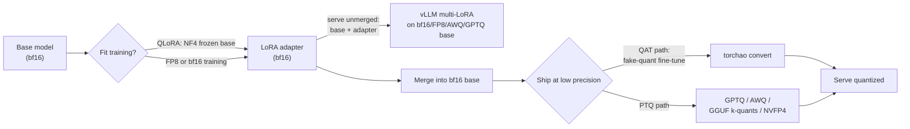

# 11 — Quantization Across the Lifecycle: QLoRA, QAT, FP8, and Export

> **Prerequisites:** module 06.
> **You will learn:** where quantization enters the fine-tuning lifecycle (to fit training, to
> train for low precision with QAT and FP8, to ship with PTQ and GGUF) and how
> each interacts with adapters.

Quantization shows up three times in a fine-tune's life. It shows up **to fit training**: QLoRA freezes the base in 4-bit, and FP8 runs the matmuls in 8 bits. It shows up **to make the deployed model accurate at low precision**: quantization-aware training (QAT). And it shows up **to ship**: GPTQ, AWQ, GGUF, NVFP4. Each of the three changes different numbers. A model fine-tuned in bf16 and then naively quantized can lose exactly the gains you paid for, because a two-point task improvement is easily smaller than the damage a careless 4-bit export does.

This module ties the three together. The NF4 internals of QLoRA (the NormalFloat codebook, double quantization, paged optimizers) belong to [module 06](./06-lora-and-qlora.md); here they get one line. Kernel-level PTQ detail belongs to the inference course's [GPTQ, AWQ, SmoothQuant, and calibration](/courses/inference/04-quantization/04-02-gptq-awq-smoothquant.html) chapter. This module covers what a fine-tuner has to decide: which precision to train in, whether to pay for QAT, how to export, and how to prove the shipped artefact still does the task.

---

## 11.1 Quantization in one page

### The affine map

A quantizer maps a real tensor $x$ onto a small integer grid with a **scale** $s$ and a **zero point** $z$:

$$
q = \text{clamp}\left(\text{round}\left(\frac{x}{s}\right) + z,\ q_{\min},\ q_{\max}\right), \qquad \hat x = s\,(q - z)
$$

$\hat x$ is the dequantized value that the matmul actually sees. Two choices define every scheme:

- **Symmetric** ($z = 0$). The grid is centred on zero. For signed int4, $q \in [-8, 7]$ and $s = \max|x| / 7$. One number per group, and the cheapest kernels.
- **Asymmetric** ($z \neq 0$). The grid covers $[\min x, \max x]$. For unsigned int4, $q \in [0, 15]$, $s = (\max x - \min x)/15$ and $z = -\text{round}(\min x / s)$. It costs a second number per group. It pays off when the values are not centred on zero, which is common for activations after a nonlinearity and for some weight rows.

Rounding error per element is at most $s/2$ inside the clamp range. So everything comes down to **how large $s$ has to be**, and $s$ is set by the largest magnitude in whatever block shares it. That is the outlier problem. The [numerical-methods note](../../notes/math/numerical-methods.md) covers floating-point rounding in general, and the inference course's [Numerics](/courses/inference/00-foundations/00-05-numerics.html) chapter derives the formats bit by bit.

### Granularity: who shares a scale

| Granularity | One scale per | Metadata cost at 4-bit | Outlier blast radius |
|---|---|---|---|
| Per-tensor | whole matrix | negligible | every weight in the matrix |
| Per-channel | output row | negligible | one row |
| Per-group ($g$ = 32/64/128) | $g$ consecutive weights | 16-bit scale: $16/g$ bits/weight (0.125 at $g=128$, 0.5 at $g=32$) | $g$ weights |
| Block scales (MX, NVFP4) | 32 or 16 elements, low-bit scale | 8 bits per block: 0.25 (MX) or 0.5 (NVFP4) bits/weight | 32 or 16 elements |

**Per-group quantization is the default for 4-bit LLM weights because outliers are real.** A handful of large-magnitude weights and activation channels show up in every large transformer (Dettmers et al., 2022, [LLM.int8()](https://arxiv.org/abs/2208.07339)). Under per-tensor scaling, one of them sets $s$ for millions of ordinary weights.

### Worked example: one outlier

Take 128 weights drawn from $\mathcal{N}(0, 0.02^2)$ and set one of them (index 5) to 1.0. With per-tensor symmetric int4, $s = 1.0/7 \approx 0.143$, so the rounding threshold is $s/2 \approx 0.071$. A typical weight has $|x| \approx 0.02$, well below the threshold, so **every normal weight rounds to exactly zero**: a 100% relative error on 127 of 128 values. The layer now computes with one nonzero weight.

With $g = 32$ the outlier only inflates the scale of its own group (indices 0–31). The other three groups get scales near $\max|x|/7 \approx 0.008$ and keep their information. The seeded check below measures this. Per-tensor quantization zeros **all 127** normal values. On the 96 values outside the outlier's group, per-tensor MSE is $4.42 \times 10^{-4}$ and per-group MSE is $5.23 \times 10^{-6}$, which is **1.2%** of the per-tensor error. On the same tensor shifted by $+0.05$, asymmetric per-group quantization has an MSE of $8.87 \times 10^{-5}$ against $6.62 \times 10^{-4}$ for symmetric, about **13%**, because the asymmetric grid stops wasting half its levels on a negative range the data barely uses.

This check proves the granularity and asymmetry claims on a fixed seeded tensor.

```python finetuning-check
import torch

torch.manual_seed(0)
x = torch.randn(128) * 0.02
x[5] = 1.0                                   # one outlier
normal = torch.ones(128, dtype=torch.bool)
normal[5] = False

def quant_sym(x, g):                         # int4 symmetric, q in [-8, 7]
    xg = x.reshape(-1, g)
    s = xg.abs().amax(dim=1, keepdim=True) / 7
    q = torch.clamp(torch.round(xg / s), -8, 7)
    return (q * s).reshape(-1)

def quant_asym(x, g):                        # int4 asymmetric, q in [0, 15]
    xg = x.reshape(-1, g)
    lo, hi = xg.amin(1, keepdim=True), xg.amax(1, keepdim=True)
    s = (hi - lo) / 15
    z = -torch.round(lo / s)
    q = torch.clamp(torch.round(xg / s) + z, 0, 15)
    return (s * (q - z)).reshape(-1)

per_tensor = quant_sym(x, 128)
per_group = quant_sym(x, 32)
zeros = int((per_tensor[normal] == 0).sum())
assert zeros >= 120 and zeros == 127         # every normal weight is flushed to 0

outside = torch.ones(128, dtype=torch.bool)
outside[:32] = False                         # the 96 values not sharing the outlier's group
mse_t = ((per_tensor - x)[outside] ** 2).mean().item()
mse_g = ((per_group - x)[outside] ** 2).mean().item()
assert abs(mse_t - 4.42e-4) < 0.01e-4 and abs(mse_g - 5.23e-6) < 0.01e-6
assert mse_g / mse_t < 0.05                  # measured: 0.012

shifted = x + 0.05
mse_sym = ((quant_sym(shifted, 32) - shifted) ** 2).mean().item()
mse_asym = ((quant_asym(shifted, 32) - shifted) ** 2).mean().item()
assert mse_asym <= mse_sym and mse_asym / mse_sym < 0.15   # measured: 0.134
```

It does not prove that real LLM weights have this outlier structure. That evidence comes from the LLM.int8() and AWQ papers, not from a 128-element toy.

### Formats you will meet

The 2025–26 formats add **block floating point**: small floating-point elements that share a scale per block.

- **MXFP4 / MXFP8** come from the OCP Microscaling (MX) v1.0 spec ([OCP spec](https://www.opencompute.org/documents/ocp-microscaling-formats-mx-v1-0-spec-final-pdf); Rouhani et al., 2023, [arXiv](https://arxiv.org/abs/2310.10537)). Every concrete MX format uses blocks of $k = 32$ elements that share one **E8M0** scale, which is an 8-bit power of two. MXFP4 elements are FP4 E2M1.
- **NVFP4** is NVIDIA's variant ([NVIDIA blog](https://developer.nvidia.com/blog/introducing-nvfp4-for-efficient-and-accurate-low-precision-inference/); [Transformer Engine docs](https://nvidia.github.io/TransformerEngine/features/low_precision_training/nvfp4/nvfp4.html)). It uses E2M1 elements in **blocks of 16** with an **FP8 E4M3 block scale**, plus a per-tensor **FP32 global scale** $s_{\text{global}} = \text{amax}/(448 \times 6)$. The finer block and the non-power-of-two scale make NVFP4 more accurate than MXFP4 at the same element width.

Table 1: formats, granularity, hardware.

| Format | Bits (element) | Scale granularity | Ampere (A100) | Hopper (H100) | Blackwell (B200) | Used for |
|---|---|---|---|---|---|---|
| bf16 | 16 | none | yes | yes | yes | train (default), merge target |
| int8 (W8A8) | 8 | per-channel weights, per-token activations | int8 tensor cores | int8 tensor cores | int8 tensor cores | serve (SmoothQuant) |
| int4 weight-only (W4A16) | 4 | per-group, $g$ = 32–128 | dequant kernels (Marlin) | dequant kernels | dequant kernels | serve (GPTQ, AWQ, GGUF) |
| NF4 | 4 | per-block of 64 + double-quantized scales | dequant to bf16 | dequant to bf16 | dequant to bf16 | train (QLoRA base) |
| FP8 E4M3 / E5M2 | 8 | per-tensor, per-row or 1×128 tiles | no FP8 tensor cores | FP8 tensor cores | FP8 tensor cores | train (FP8 mixed precision) and serve (W8A8-FP8) |
| MXFP4 | 4 (+8-bit scale per 32) | E8M0 per 32 | no | weight-only kernels | native | serve (gpt-oss ships MXFP4 experts), QAT target |
| NVFP4 | 4 (+8-bit scale per 16, FP32 per tensor) | E4M3 per 16 | no | no | native | serve, QAT target, frontier training |

The integer 4-bit tensor-core path ended with Ampere. PyTorch's QAT post notes that [Blackwell no longer supports int4 tensor cores](https://pytorch.org/blog/quantization-aware-training/), which is one reason 4-bit serving on new hardware is moving to NVFP4. The inference course's [Formats and kernels](/courses/inference/04-quantization/04-03-formats-and-kernels.html) chapter has the kernel-level view.

### The lifecycle



The adapter can stay unmerged at exactly one point: when you serve base + adapter, possibly on a quantized base. Every other export path goes through **merge into bf16 first**, the rule [module 06](./06-lora-and-qlora.md) establishes for QLoRA adapters.

## 11.2 Training on quantized weights

### The QLoRA family, in one line each

- **bitsandbytes NF4/FP4 and LLM.int8()**: the QLoRA base. Weights are frozen in NF4 (about 4.127 bits/weight with double quantization: $4 + 8/64 + 32/(64 \cdot 256)$), dequantized to bf16 inside each matmul, and LoRA trains in bf16. [Module 06](./06-lora-and-qlora.md) derives it all, including `BitsAndBytesConfig`, and [module 10](./10-distributed-fine-tuning-and-moe.md) covers FSDP + QLoRA.
- **HQQ (half-quadratic quantization)**: Mobius Labs' calibration-free method ([blog, now hosted by Dropbox](https://dropbox.tech/machine-learning/halfquadratic-quantization-of-large-machine-learning-models)). It fits the zero point and scale per group by minimizing a sparsity-promoting error with a half-quadratic solver. No data is needed, and its authors report that Llama-2-70B quantizes in under 5 minutes, "over 50x faster" than GPTQ. PEFT supports LoRA on HQQ-quantized models, loaded through Transformers' `HqqConfig(nbits=4, group_size=64)` ([PEFT quantization guide @ v0.21.2](https://github.com/huggingface/peft/blob/eaa35c777c7ba554a2a3639ac9c79bb690f39a57/docs/source/developer_guides/quantization.md)). Use it when you want a 2–4-bit frozen base fast and bitsandbytes is not an option.
- **torchao weight-only int8/int4**: PEFT supports LoRA on torchao-quantized bases. The same guide warns that **merging only works correctly with LoRA and `int8_weight_only`**. With other torchao dtypes, a merge errors or silently produces wrong weights.

### Adapters on GPTQ and AWQ bases, and the AutoGPTQ deprecation

You can train LoRA directly on top of a GPTQ- or AWQ-quantized checkpoint, the same way you train on an NF4 base. The plumbing changed in 2026. PEFT v0.19 (April 2026) moved both AutoGPTQ and AutoAWQ onto **GPTQModel** as the backend. [PEFT v0.20.0](https://github.com/huggingface/peft/releases/tag/v0.20.0) (July 2026) states that "AutoGPTQ is now formally deprecated". The current guide installs `gptqmodel>=7.0.0`. **Do not write `import auto_gptq` in 2026 code.**

The catch: a LoRA trained on a GPTQ base cannot be merged back into the GPTQ integers. $W_0 + B_{\text{lora}}A$ is a dense bf16 matrix that no longer sits on the quantization grid, so the merged model has to be re-quantized, which brings back PTQ error. **QA-LoRA** (Xu et al., 2023, [arXiv](https://arxiv.org/abs/2309.14717)) removes that step. It pools the adapter's input features group-wise, so the adapter's contribution is constant within each quantization group of $W_0$. The update then folds into each group's zero point, and "after fine-tuning, the LLM and auxiliary weights are naturally integrated into a quantized model without loss of accuracy". In PEFT this is `LoraConfig(use_qalora=True, qalora_group_size=...)`. It is implemented for GPTQ only and for linear layers only ([config @ v0.21.2](https://github.com/huggingface/peft/blob/eaa35c777c7ba554a2a3639ac9c79bb690f39a57/src/peft/tuners/lora/config.py#L873-L882)).

Teaching fragment (not executed; PEFT v0.21, Transformers v5, GPTQModel backend):

```python
from transformers import AutoModelForCausalLM
from peft import LoraConfig, get_peft_model

model = AutoModelForCausalLM.from_pretrained(
    "your-org/Qwen3-4B-GPTQ-Int4-g32",   # any 4-bit GPTQ checkpoint
    device_map="auto",
)
cfg = LoraConfig(
    r=16, lora_alpha=32, target_modules="all-linear",
    use_qalora=True, qalora_group_size=32,  # match the GPTQ group size
)
model = get_peft_model(model, cfg)
```

### Low-precision float checkpoints: FP8, NVFP4, MXFP4, gpt-oss

More and more checkpoints ship in a low-precision float format: FP8 releases, NVFP4 exports, and gpt-oss with MXFP4 expert weights. There are two ways to fine-tune them.

1. **Dequantize to bf16, train, re-quantize.** OpenAI's gpt-oss fine-tuning recipe loads the model with `Mxfp4Config(dequantize=True)` in bf16 on an 80 GB H100. It targets `all-linear` plus selected expert projections through `target_parameters` ([OpenAI cookbook](https://developers.openai.com/cookbook/articles/gpt-oss/fine-tune-transfomers)). This is simple and exact, but it costs bf16 memory for the whole model, about 4× the MXFP4 footprint for the expert weights.
2. **Keep the packed low-precision weights frozen and train LoRA on top.** PEFT v0.19 added LoRA on bases stored in `torch.float8_e4m3fn`. Unsloth's changelog (1 October 2026) lists "lower-memory 4-bit LoRA training for NVFP4, INT4, and MXFP4 checkpoints", with pre-quantized checkpoints "now train[ing] using their original packed weights", and says gpt-oss "retain[s] packed experts during LoRA training" ([Unsloth changelog](https://unsloth.ai/docs/new/changelog)). This is QLoRA's bargain applied to a different 4-bit format.

**The second path inherits QLoRA's caveat.** The adapter is fitted to the quantized $W_0$. If you later serve it on a different base precision, the function changes (section 11.6).

## 11.3 Quantization-aware training

### What QAT changes

PTQ quantizes a finished model, and the weights never got a chance to adapt to the grid. **QAT inserts the quantizer into training.** Every forward pass uses fake-quantized weights $\hat w = s(\text{clamp}(\text{round}(w/s)+z) - z)$, still in float, so the loss is the loss of the quantized model. The optimizer then moves the latent float weights toward values that round well together. One weight absorbs another's rounding error, and weights near a rounding boundary get pushed to the side that helps the loss.

The obstacle is that $\text{round}$ has zero gradient almost everywhere. The **straight-through estimator** (STE; Bengio et al., 2013, [arXiv](https://arxiv.org/abs/1308.3432)) pretends round is the identity in the backward pass. The clamp, however, is kept:

$$
\frac{\partial \hat x}{\partial x} \approx \mathbb{1}\left[q_{\min} \le \frac{x}{s} + z \le q_{\max}\right]
$$

Inside the representable range, the gradient passes through unchanged. Outside, it is zero, because nudging a clamped value does not change the output. In code, the trick is `x + (q(x) - x).detach()`: the forward value is $q(x)$ and the gradient is that of $x$. The masked variant below adds the clamp rule. **Observers** track running min/max statistics to set $s$ and $z$. **Learned-scale** variants such as LSQ (Esser et al., 2019, [arXiv](https://arxiv.org/abs/1902.08153)) make $s$ a trainable parameter with its own STE gradient.

### Check: STE gradient and a QAT win

The fixture is a linear regression $8 \to 1$ whose features are correlated in pairs. Correlation is what gives QAT room to compensate: rounding one weight down can be offset by rounding its correlated partner up. Path (a) is the ordinary fp32 least-squares optimum, rounded to int4 with one absmax scale (PTQ). Path (b) starts from the same optimum and runs 300 SGD steps with fake quantization in the forward pass and the STE in the backward pass, then converts with the identical rounding. Post-quantization MSE: fp32 $0.00224$, PTQ $0.0456$, QAT $0.0126$. **QAT is 72% lower than PTQ.** The check asserts at least 20%.

This check proves the masked STE gradient (1 inside the clamp range, 0 outside) and that QAT beats PTQ on this fixture with the same int4 scheme.

```python finetuning-check
import torch

def fake_quant(w, s, qmin=-8, qmax=7):
    q = torch.clamp(torch.round(w / s), qmin, qmax)
    inside = ((w / s) >= qmin) & ((w / s) <= qmax)
    wm = w * inside                       # gradient 1 inside the range, 0 where clamped
    return wm + (q * s - wm).detach()     # forward value is exactly q * s

# STE gradient with s = 0.1: the range [-8s, 7s] = [-0.8, 0.7]
w = torch.tensor([-1.0, -0.75, -0.05, 0.0, 0.3, 0.69, 0.71, 0.9], requires_grad=True)
fake_quant(w, torch.tensor(0.1)).sum().backward()
assert w.grad.tolist() == [0.0, 1.0, 1.0, 1.0, 1.0, 1.0, 0.0, 0.0]

# Regression 8 -> 1 with pairwise-correlated features
g = torch.Generator().manual_seed(10)
X = torch.randn(256, 8, generator=g)                       # (N, 8)
for a, b in ((1, 0), (3, 2), (5, 4), (7, 6)):
    X[:, a] = X[:, b] + 0.3 * torch.randn(256, generator=g)
w_true = torch.randn(8, generator=g) * 0.5
y = X @ w_true + 0.05 * torch.randn(256, generator=g)       # (N,)

def mse(w):
    return ((X @ w - y) ** 2).mean()

def absmax_scale(w):                                         # int4 symmetric, one channel
    return w.detach().abs().max() / 7

# (a) fp32 optimum, then PTQ
w_fp32 = torch.linalg.lstsq(X, y.unsqueeze(1)).solution.squeeze(1)
ptq = mse(fake_quant(w_fp32, absmax_scale(w_fp32))).item()

# (b) QAT: start at the same optimum, fake-quant forward, STE backward, then convert
w = w_fp32.clone().requires_grad_()
opt = torch.optim.SGD([w], lr=0.02)
sched = torch.optim.lr_scheduler.LambdaLR(opt, lambda t: 1 - t / 300)
for _ in range(300):
    loss = mse(fake_quant(w, absmax_scale(w)))
    opt.zero_grad(); loss.backward(); opt.step(); sched.step()
qat = mse(fake_quant(w.detach(), absmax_scale(w))).item()

assert abs(mse(w_fp32).item() - 0.00224) < 5e-5
assert abs(ptq - 0.0456) < 5e-4
assert qat < 0.8 * ptq                                       # measured: 0.0126, 72% lower
```

It does not prove that QAT always helps. The STE is a biased gradient, latent weights can oscillate across a rounding boundary, and on some seeds of this toy QAT gains little. Recovery on real LLMs is an empirical claim, so check the numbers below.

### torchao: `QATConfig` prepare and convert

The current PyTorch path is torchao's `quantize_` with a `QATConfig` that wraps **the same base config you would use for PTQ**. `step="prepare"` swaps linears for fake-quantized versions. You train. `step="convert"` produces the actual quantized model ([QATConfig @ torchao v0.18.0](https://github.com/pytorch/ao/blob/5f2baf9d575cf732362594c998c399902942531f/torchao/quantization/qat/api.py#L43-L72); [torchao QAT II blog](https://pytorch.org/blog/quantization-aware-training-in-torchao-ii/)). Older tutorials built on torchtune recipes are outdated, because torchtune is no longer maintained.

Teaching fragment (not executed; torchao 0.18):

```python
from torchao.quantization import quantize_, Int4WeightOnlyConfig
from torchao.quantization.qat import QATConfig

base_config = Int4WeightOnlyConfig(group_size=32)          # identical to the PTQ config
quantize_(model, QATConfig(base_config, step="prepare"))   # insert fake quantization
train(model)                                               # your SFT loop or trainer
quantize_(model, QATConfig(base_config, step="convert"))   # real int4 weights
```

As of torchao 0.16 the QAT blog lists four weight/activation pairings: int4 weight-only (`Int4WeightOnlyConfig`), FP8 activations + int4 weights (`Float8DynamicActivationInt4WeightConfig`), int8 activations + int4 weights for edge (`Int8DynamicActivationIntxWeightConfig`, the successor of the original "8da4w" quantizer), and NVFP4 + NVFP4 (prototype).

**QAT + LoRA.** Freeze the base, fake-quantize it (and optionally the activations), and train only the adapter. A PyTorch dev-discuss post by Andrew Or (December 2024) reports this was **1.89× faster than full QAT and used 36.1% less memory** on Llama-3-8B, 4×A100, Alpaca, rank 8, 8da4w ([post](https://dev-discuss.pytorch.org/t/speeding-up-qat-by-1-89x-with-lora/2700)). In that post's formulation the adapter itself is not fake-quantized. The 2026 torchao blog fake-quantizes the adapters as well, since they will be merged into the quantized weights. Either way, **the quantization scheme simulated during QAT must match the scheme you deploy.**

### How much does QAT recover?

"Recovery" means the fraction of the PTQ degradation that QAT wins back, with the same quantization scheme at deployment:

$$\text{recovered} = \frac{\text{metric}_{\text{QAT}} - \text{metric}_{\text{PTQ}}}{\text{metric}_{\text{bf16}} - \text{metric}_{\text{PTQ}}}$$

| Source | Model, scheme | Reported recovery vs PTQ |
|---|---|---|
| [PyTorch QAT blog](https://pytorch.org/blog/quantization-aware-training/) (Nov 2024) | Llama-3-8B, 8da4w (group 256), C4 fine-tune, 5,000 steps | up to **96%** of hellaswag accuracy degradation; 68% of wikitext word-perplexity degradation |
| same | Llama-2-7B, 8da4w | 62% on hellaswag |
| [Unsloth QAT docs](https://unsloth.ai/docs/blog/quantization-aware-training-qat) | int4 QAT + LoRA vs naive 4-bit PTQ | "up to **70%** of the lost accuracy", +1–3% on GPQA, MMLU-Pro |
| [torchao QAT II](https://pytorch.org/blog/quantization-aware-training-in-torchao-ii/) (Mar 2026) | Gemma3-4B GPQA, int4 QAT + LoRA (Unsloth) | 66.9% (1.5 points lost, 1.0 recovered) |
| same | Gemma3-27B, NVFP4 QAT (Axolotl, B200) | 71.6% |

Read these as **best cases reported by the tool authors** on the tasks they chose. The same blogs report much lower recovery elsewhere (36% on Qwen3-4B wikitext, 45.5% on Gemma3-12B BBH). The cost side is also real: PyTorch measured 8da4w QAT fine-tuning at about **34% lower throughput** than plain full fine-tuning on Llama-3-8B, with about 2.35 GB more memory per GPU.

### QAT in the tools

- **Unsloth**: `FastLanguageModel.get_peft_model(..., qat_scheme="int4")`. Its docs list `int4`, `int8-int4`, `fp8-int4` and `fp8-fp8`. After training, `quantize_(model, QATConfig(step="convert"))` and `save_pretrained_torchao` produce the export ([Unsloth QAT](https://unsloth.ai/docs/blog/quantization-aware-training-qat)).
- **Axolotl**: a `qat:` YAML block with `weight_dtype` (int4, fp8, nvfp4, or `ternary`), `activation_dtype` (int4, int8, float8), `group_size` (default 32) and `fake_quant_after_n_steps`, then `axolotl quantize` with the same config ([Axolotl QAT](https://docs.axolotl.ai/docs/qat.html); [quantize](https://docs.axolotl.ai/docs/quantize.html)). The quantize command writes torchao formats, not GGUF/GPTQ. As of October 2026 the docs list NVFP4 but not MXFP4 as a QAT weight dtype. [Module 08](./08-frameworks-and-tooling.md) covers Axolotl as a framework.

A practical knob from the PyTorch study: **turn fake quantization on only after the first $N$ steps** (they used 1,000) so the weights settle before quantization noise arrives. Axolotl exposes this as `fake_quant_after_n_steps`.

### QAT does not slow inference

**QAT changes only training.** `convert` produces the same quantized structure that PTQ with the same config would produce. The kernels, model size and tokens per second are the same, and only the integer values differ. PyTorch's ExecuTorch measurement shows it: 3.881 GB for both PTQ and QAT, with on-device speed within noise of each other. When someone says "QAT models are slower", they are confusing QAT with fake quantization left in the graph. Always run `convert`.

## 11.4 FP8 training

### Two formats, two jobs

FP8 mixed precision runs the big GEMMs in 8-bit floats (Micikevicius et al., 2022, [FP8 Formats for Deep Learning](https://arxiv.org/abs/2209.05433)):

| Format | Exponent / mantissa bits | Max finite | Relative step (ulp at 1) | Used for |
|---|---|---|---|---|
| E4M3 (`float8_e4m3fn`) | 4 / 3 | **448** | $2^{-3}$ | weights and activations (forward) |
| E5M2 (`float8_e5m2`) | 5 / 2 | **57,344** | $2^{-2}$ | gradients (backward) |

**Forward tensors need precision. Gradients need range**, because they span many orders of magnitude and a few are huge. E4M3 trades exponent for a mantissa bit. E5M2 trades a mantissa bit for exponent. Round-to-nearest gives a relative error of at most half an ulp for normal values, so the derived bound is $2^{-4} = 0.0625$ for E4M3 and $2^{-3} = 0.125$ for E5M2. Compare this with bf16 in [the transformers course](../transformers/13-training-considerations.md), which keeps fp32's 8-bit exponent and needs no loss scaling. The bf16-vs-fp16 story (T4 lacks bf16) lives in [module 02](./02-tokens-templates-and-the-causal-lm-objective.md).

### Scaling is mandatory

448 is a small number. Activations routinely exceed it, and many gradients sit below E4M3's smallest normal ($2^{-6}$). So every FP8 tensor carries a scale $s = \text{amax}/448$, and the cast is $x_{\text{fp8}} = \text{cast}(x/s)$. Recipes differ in **who shares $s$** and **when amax is measured**:

- **Delayed scaling** (Transformer Engine's original recipe) uses the max of an amax history from previous steps. It is cheap, but a sudden spike overflows.
- **Current (dynamic) scaling** computes amax from the tensor being cast. It is robust and costs one reduction. torchao's float8 training uses dynamic scaling.
- **Granularity**: per-tensor (fastest), per-row ("rowwise"), or **fine-grained tiles**. DeepSeek-V3 (2024, [arXiv](https://arxiv.org/abs/2412.19437)) scales activations per **1×128 tile** and weights per **128×128 block**, which confines outliers the same way per-group int4 does.

**What stays in higher precision.** Master weights and optimizer states stay in fp32 (or bf16 with care). So do the GEMM accumulators and outputs, and usually the embeddings, LM head, norms, softmax and anything with odd shapes. FP8 speeds up the matmuls, not the bookkeeping. Memory accounting (module [03](./03-training-mechanics-and-memory-math.md)) therefore barely changes. FP8 is a throughput tool.

### Check: FP8 ranges, scaled casts, and token KL

This check asserts the two maxima and the derived round-trip bounds on a seeded tensor of 4,096 values scaled by amax. Measured maximum relative error: 0.0587 for E4M3 (bound 0.0625) and 0.111 for E5M2 (bound 0.125). It then shows that an unscaled cast of 1,000 into E4M3 does not survive. PyTorch 2.8 and 2.11 both return NaN, since E4M3fn has no infinity, and a saturating cast would be just as wrong at 448. That is why scaling is mandatory. The second half previews section 11.7: on a toy 64-token head with int4-quantized weights, the token KL is positive and KL($p\|p$) is exactly 0. Measured over 16 positions: mean KL 0.0134 nats, p99 about 0.027, top-1 agreement 15/16.

```python finetuning-check
import torch

E4, E5 = torch.float8_e4m3fn, torch.float8_e5m2
assert torch.finfo(E4).max == 448.0
assert torch.finfo(E5).max == 57344.0

torch.manual_seed(0)
x = torch.randn(4096) * 3.0
for dt, fmax, smallest_normal, bound in ((E4, 448.0, 2.0 ** -6, 2.0 ** -4),
                                         (E5, 57344.0, 2.0 ** -14, 2.0 ** -3)):
    s = x.abs().max() / fmax                       # amax scaling
    y = (x / s).to(dt).float() * s
    normal = (x / s).abs() >= smallest_normal
    rel = ((y - x).abs() / x.abs())[normal].max().item()
    assert rel <= bound                            # half-ulp bound for normals
    if dt == E4:
        assert 0.055 < rel < 0.0625                # measured 0.0587

# Unscaled out-of-range values are destroyed (NaN, or saturation if a build saturates)
big = torch.tensor([1000.0])
plain = big.to(E4).float()
assert torch.isnan(plain).all() or plain.abs().max().item() <= 448.0
assert not bool(((plain - big).abs() / big < 0.5).any())

# Token-level KL between an fp32 head and its int4-quantized copy
torch.manual_seed(0)
V, d, n = 64, 32, 16
W = torch.randn(V, d) * 0.1                        # (V, d)
h = torch.randn(n, d) * 3                          # (n, d) hidden states
s = W.abs().amax(1, keepdim=True) / 7              # per-row int4 scales
Wq = torch.clamp(torch.round(W / s), -8, 7) * s
lp = torch.log_softmax(h @ W.T, -1)                # (n, V)
lq = torch.log_softmax(h @ Wq.T, -1)
kl = (lp.exp() * (lp - lq)).sum(-1)                # KL(p || q) per position
kl_self = (lp.exp() * (lp - lp)).sum(-1)
agree = (lp.argmax(-1) == lq.argmax(-1)).float().mean().item()
assert kl.mean().item() > 0 and torch.all(kl_self == 0)
assert 0.0 <= agree <= 1.0 and abs(agree - 15 / 16) < 1e-6
assert abs(kl.mean().item() - 0.0134) < 5e-4
```

It does not prove anything about FP8 training stability or speed. Those depend on kernels, scaling recipe and model, and need the GPU lab.

### Tools, gains, and when FP8 hurts

- **Transformer Engine** (NVIDIA) provides FP8 layers with delayed or current scaling, and NVFP4 training on Blackwell. PEFT can attach LoRA to TE layers, though merge is not supported there yet.
- **torchao float8**: `convert_to_float8_training(model, config=Float8LinearConfig.from_recipe_name("tensorwise"), module_filter_fn=...)` swaps `nn.Linear` for float8 linears. The recipes are `tensorwise` (fastest), `rowwise`, and `rowwise_with_gw_hp` (most accurate). The filter skips the final layer and any linear whose dims are not divisible by 16. As of October 2026 the [torchao training docs](https://docs.pytorch.org/ao/main/workflows/training.html) report Llama-3-8B pretraining on 8×H100 at **+25%** tokens/s (tensorwise, float8 all-gather) and +10% (rowwise), and MXFP8 on 8×B200 at +20%. They report up to 1.5× at 405B on 512 GPUs.

FP8 hurts or does not help in four situations. **Small models and small matmuls**: casting and amax reductions are overhead that a 1B model's GEMMs cannot amortize. **No FP8 tensor cores** (A100, T4). **Outlier-heavy activations under per-tensor scaling**: use rowwise or tiles. And **fine-tunes of a model whose released weights are bf16, where you need bitwise-faithful behaviour**: run a loss-parity check first. For LoRA on 1–8B models, FP8 compute rarely pays. Its biggest wins are in full fine-tunes and pretraining-scale runs.

### FP8 for RL

RL is dominated by generation. Unsloth reports that RL steps spend "<4%" of the time training and 96% in vLLM inference. So FP8 earns more in rollouts than in the backward pass. Unsloth's FP8 RL (late November 2025; [docs](https://unsloth.ai/docs/get-started/reinforcement-learning-rl-guide/fp8-reinforcement-learning)) runs vLLM rollouts in FP8, reported **about 1.4× faster than bf16**. It stores the frozen base weights in FP8, shared with vLLM's buffers, applies dynamic FP8 quantization to activations, and keeps LoRA adapters and optimizer state in bf16. It is enabled by `load_in_fp8=True` and runs on RTX 40/50-series as well as H100/B200, but not on T4. Treat the "no loss in accuracy" claim as Unsloth's own benchmark. Research on FP8 rollouts (Jet-RL, [arXiv 2601.14243](https://arxiv.org/abs/2601.14243)) reports that bf16-training + FP8-rollout setups can destabilize on long-horizon tasks, because the rollout policy no longer matches the trained one. That is the same train/serve precision mismatch as section 11.6, appearing inside the RL loop. [Module 13](./13-rl-with-verifiable-rewards.md) covers the importance-sampling corrections.

## 11.5 Post-training quantization for deployment

You fine-tuned in bf16 (or merged a QLoRA adapter into bf16). Now you shrink the result. Each method below gets one paragraph. The inference course's [GPTQ, AWQ, SmoothQuant](/courses/inference/04-quantization/04-02-gptq-awq-smoothquant.html) chapter has the algorithms and kernels, and its [design-space](/courses/inference/04-quantization/04-01-the-design-space.html) chapter places them in context.

**GPTQ** (Frantar et al., 2022, [arXiv](https://arxiv.org/abs/2210.17323)) quantizes one weight column at a time. It uses second-order information from a calibration set (the inverse Hessian $H = 2XX^\top$ of the layer's inputs) to **push each column's rounding error onto the columns not yet quantized**. It is layer-wise least squares, it needs a few hundred calibration sequences, and it produces int4/int3 with group scales. On a fine-tune, **calibrate on your task's distribution** (prompts in your chat template), not generic web text, or the Hessian weights the wrong directions.

**AWQ** (Lin et al., 2023, [arXiv](https://arxiv.org/abs/2306.00978)) starts from an observation: about 1% of weight channels are salient, and they are identified by **activation** magnitude, not weight magnitude. Instead of keeping those channels in fp16, AWQ multiplies them by a per-channel scale $> 1$ before quantization (and divides the activation by the same scale), which shrinks their relative rounding error. There is no backpropagation or reconstruction, and it needs only a small calibration set.

**SmoothQuant** (Xiao et al., 2022, [arXiv](https://arxiv.org/abs/2211.10438)) targets **W8A8**, where the problem is activation outliers rather than weights. It migrates difficulty with a per-channel factor: $Y = (X\,\text{diag}(s)^{-1})(\text{diag}(s)W)$. This flattens the activation outliers and makes the weights slightly harder, and both then fit int8.

**GGUF k-quants** (llama.cpp) are the edge and CPU format. The [k-quants PR](https://github.com/ggml-org/llama.cpp/pull/1684) defines `Q4_K` as 4-bit "type-1" (scale + min) quantization in **super-blocks of 8 blocks × 32 weights**, with the block scales and mins themselves quantized to **6 bits**, for 4.5 bits/weight. `Q4_K_M` is a mix: `Q6_K` for half of the `attention.wv` and `feed_forward.w2` tensors, `Q4_K` elsewhere, and 6-bit for the output matrix. That is why it lands at **4.89 bits/weight** on Llama-3.1-8B ([llama-quantize README @ 781dbc5](https://github.com/ggml-org/llama.cpp/blob/781dbc5ac98921dbdb5e5b2ec5b7a50960e937d4/tools/quantize/README.md)). NF4 + double quantization is 4.127, but NF4 is a training-time format that llama.cpp does not run. An **importance matrix** (`llama-imatrix`, [README](https://github.com/ggml-org/llama.cpp/blob/781dbc5ac98921dbdb5e5b2ec5b7a50960e937d4/tools/imatrix/README.md)) records activation statistics over calibration text, and `llama-quantize --imatrix` uses them to weight the rounding error. It is AWQ's insight applied to k-quants, and it matters most below 4 bits.

**Unsloth Dynamic quants** pick a quantization type per layer, keeping sensitive layers at higher precision. They are calibrated with a large imatrix set and evaluated by KL divergence and top-1 agreement rather than perplexity ([Unsloth Dynamic docs](https://unsloth.ai/docs/basics/unsloth-dynamic-2.0-ggufs)). Unsloth's changelog (July 2026) describes Dynamic NVFP4 as keeping "accuracy-sensitive layers in FP8 or BF16 while running the rest in W4A4". **NVFP4** PTQ is the Blackwell-native 4-bit path for vLLM, SGLang and TensorRT-LLM. Unsloth can export NVFP4, FP8 and imatrix GGUFs after training (changelog, July 2026).

Table 2: PTQ methods.

| Method | Calibration data? | Granularity | Typical bits | Engines | Adapter-friendly? |
|---|---|---|---|---|---|
| GPTQ | yes (hundreds of sequences) | per-group (128 typical, 32 for quality) | W4A16, W3, W8 | vLLM, SGLang, TensorRT-LLM; Transformers via GPTQModel | yes: LoRA on top in vLLM; QA-LoRA merges back |
| AWQ | yes (small) | per-group 128 | W4A16 | vLLM, SGLang, TensorRT-LLM | yes: LoRA on top in vLLM |
| SmoothQuant | yes (activation stats) | per-channel W, per-token A | W8A8 int8 | vLLM, TensorRT-LLM | merge first, then smooth |
| FP8 (W8A8-FP8) | optional (dynamic) | per-tensor or per-channel/row | 8 | vLLM, SGLang, TensorRT-LLM | yes, on Hopper+ |
| GGUF k-quants | optional (imatrix) | super-blocks of 256 | 2–8 (Q4_K_M ≈ 4.9) | llama.cpp, Ollama, LM Studio | merge first; llama.cpp also loads GGUF LoRA |
| HQQ | no | per-group (64 typical) | 1–8 | Transformers, torchao kernels | yes: PEFT LoRA |
| NVFP4 | yes (amax) | 16-element blocks + per-tensor | 4 (W4A4 or W4A16) | vLLM, SGLang, TensorRT-LLM on Blackwell | merge first, or QAT to NVFP4 |

The [when quantization pays](/courses/inference/04-quantization/04-04-when-quantization-pays.html) chapter covers the cost side: memory-bound decode benefits, compute-bound prefill much less. [Module 14 of the transformers course](../transformers/14-inference-optimizations.md) has the short version.

## 11.6 Adapters and quantized bases at serve time

### Serving a LoRA on a quantized base

You do not have to merge. vLLM serves LoRA adapters on top of GPTQ, AWQ and bitsandbytes bases: its LoRA-with-quantization example runs all three ([example @ v0.31.0](https://github.com/vllm-project/vllm/blob/db9527a46873454610df6dbedf79a36d6bf1a7f6/examples/features/lora/lora_with_quantization_offline.py)), and its test suite runs Qwen3-0.6B GPTQ and AWQ bases with LoRA. One shared int4 base with many bf16 adapters is the cheapest multi-tenant configuration. [Module 20](./20-production-serving-and-cost.md) covers the serving flags and economics.

### The precision mismatch

The adapter learned $\Delta W$ such that $f(x;\ W_0^{\text{train}} + \Delta W)$ does the task. If you serve on $W_0^{\text{serve}} \neq W_0^{\text{train}}$, the output shifts by $(W_0^{\text{serve}} - W_0^{\text{train}})\,x$ in every adapted layer. Common cases:

| Trained against | Served on | What changed |
|---|---|---|
| NF4 (QLoRA) | bf16 base | the NF4 rounding error disappears, though the adapter may have partly compensated for it |
| NF4 (QLoRA) | AWQ/GPTQ int4 base | a different rounding error, uncorrelated with the one the adapter saw |
| bf16 | int4 base | a fresh quantization error that the adapter never saw |
| FP8 rollouts | bf16 trainer (RL) | the policy that sampled differs from the policy being trained |

How much this matters depends on **how much of the quantization error the adapter absorbed**. The lab's smoke run shows both ends of that range. A full-rank adapter trained on an int4 base fits it almost exactly (MSE $2.5 \times 10^{-9}$), but served on the fp32 base its MSE rises to $6.0 \times 10^{-3}$, and on a different int4 scheme to $9.8 \times 10^{-3}$. A rank-8 adapter cannot absorb unstructured rounding noise. It does better on fp32 ($2.0 \times 10^{-3}$) than on its own int4 base ($4.0 \times 10^{-3}$), but worse on a different int4 scheme ($6.8 \times 10^{-3}$). **There is no safe rule of thumb, so measure.** Run the task eval and the token KL from section 11.7 on the exact base you will serve.

### Export: merge, then quantize

The export rule from [module 06](./06-lora-and-qlora.md) applies to every format: **dequantize the base to bf16, merge the adapter into the bf16 weights, then quantize the merged model.** Merging into 4-bit weights either fails or silently re-rounds $W_0 + \Delta W$ onto a grid that was fitted to $W_0$.

The llama.cpp path, from the repository root of a llama.cpp checkout:

```bash
# 1. merged bf16 HF checkpoint -> GGUF (bf16)
python convert_hf_to_gguf.py ./merged-bf16 --outtype bf16 --outfile model-bf16.gguf
# 2. optional: importance matrix from task-like calibration text
./build/bin/llama-imatrix -m model-bf16.gguf -f calib.txt -o imatrix.gguf
# 3. quantize to Q4_K_M
./build/bin/llama-quantize --imatrix imatrix.gguf model-bf16.gguf model-Q4_K_M.gguf Q4_K_M
```

Then give Ollama the **same chat template the model was trained with** and the right stop tokens. A wrong template costs more accuracy than any quantizer ([Modelfile reference](https://docs.ollama.com/modelfile)). For a Qwen3 ChatML-style model:

```text
FROM ./model-Q4_K_M.gguf
TEMPLATE """{{ if .System }}<|im_start|>system
{{ .System }}<|im_end|>
{{ end }}<|im_start|>user
{{ .Prompt }}<|im_end|>
<|im_start|>assistant
"""
PARAMETER stop "<|im_end|>"
PARAMETER stop "<|im_start|>"
```

Then run `ollama create support-extractor -f Modelfile`. If the GGUF metadata already carries the right template, check it rather than overriding it. Unsloth's `save_pretrained_gguf` wraps the same convert-and-quantize steps. Axolotl's `quantize` command writes torchao formats, not GGUF, so with Axolotl you merge (`axolotl merge-lora`) and run the llama.cpp steps above. [Module 20](./20-production-serving-and-cost.md) owns serving the result and the parity test on 50 eval prompts.

## 11.7 Evaluating quantized fine-tunes

**Run the same eval suite before and after every quantization step**: bf16 merged, int4, GGUF. Use the same prompts, template, decoding settings and scorer ([module 09](./09-evaluating-fine-tuned-models.md)). For the course's support-email extraction task, that means the 50-example golden set with field-level exact match and JSON validity. Report the deltas with confidence intervals. A 50-example set cannot resolve a one-point change.

Accuracy is a coarse instrument. Two models can score the same while disagreeing on many individual examples, with the gains and losses cancelling. Dutta et al. (2024, [Accuracy is Not All You Need](https://arxiv.org/abs/2407.09141)) document exactly this in compressed models and propose counting **flips** (answers that change). The token-level signal is sharper. On held-out prompts, compute the full next-token distributions of the bf16 model $p$ and the quantized model $q$ at every position and report:

$$
\text{KL}(p\,\|\,q) = \sum_{v} p(v)\,\log\frac{p(v)}{q(v)} \quad\text{(mean and p99 over positions)}, \qquad \text{top-1 agreement} = \Pr\left[\arg\max p = \arg\max q\right]
$$

The mean tells you about overall drift. The **p99** catches the rare positions where the quantized model is confidently different, and those are the tokens that break a JSON field or flip a refusal. KL is zero only if the distributions match ([information-theory note](../../notes/math/information-theory.md)). It needs no labels, and a few thousand tokens are enough to compare quantizers. Unsloth reports Dynamic quants with exactly this pair (mean KL and top-1 agreement). The check in 11.4 computes it on a toy head, and the lab computes it on Qwen3-4B. **Use KL to choose between quants and the task metric to accept one.**

Two things are easy to forget. First, evaluate **through the serving engine**, because llama.cpp's sampler and template handling differ from Transformers'. Second, keep **thinking mode** consistent for Qwen3 (enabled or disabled the same way in both runs). The [MLOps and serving note](../../notes/libraries/mlops-and-serving.md) covers registry and versioning so each artefact's eval is traceable.

**Frontier note: 1.58-bit fine-tuning.** BitNet b1.58 (Ma et al., 2024, [arXiv](https://arxiv.org/abs/2402.17764)) trains with ternary weights $\{-1, 0, 1\}$ and int8 activations from the start. That is QAT taken to its limit, using absmean scaling and the STE. In April 2026 Axolotl and TII published ternary fine-tuning of Falcon-E BitNet checkpoints ([HF blog](https://huggingface.co/blog/axolotl-ai-co/finetuning-ternary-llms-tii-axolotl)). Ternary quantization is simulated during training with STE, starting from "prequantized bf16" checkpoints, and the result is packed to 1.58-bit or converted to GGUF `TQ1_0`/`TQ2_0`. Axolotl's QAT docs now list `weight_dtype: ternary`. As of October 2026 only full fine-tuning is supported (LoRA for BitNet is unexplored), and GPU serving kernels in vLLM and SGLang are missing. Know it exists, and do not build a product on it yet.

## 11.8 Lab: fine-tune, merge, quantize, measure

**Goal.** Measure how much of a fine-tune survives each export path, and whether QAT and FP8 earn their cost. **Model:** `Qwen/Qwen3-4B` (base). **Task:** the course's support-email JSON extraction with its 50-example golden eval set. **Scripts:** [`quantize_and_eval.py`](./code/quantize_and_eval.py) and [`fp8_parity.py`](./code/fp8_parity.py).

Start with the CPU smoke runs. They exercise the same math on toys: int4 group quantization, PTQ vs QAT with STE on an MLP, token KL, the adapter/base mismatch, FP8 casts, delayed vs current scaling, and simulated-FP8 training parity.

```bash
python content/courses/finetuning/code/quantize_and_eval.py --smoke
python content/courses/finetuning/code/fp8_parity.py --smoke
```

### L11.1 (T1): bf16 LoRA → merge → GPTQ and GGUF

1. Train a bf16 LoRA on `Qwen/Qwen3-4B` for the extraction task (module 05/06 recipe: `target_modules="all-linear"`, completion-only loss).
2. Run the full mode. It merges into bf16, quantizes to GPTQ int4 (g=128) with GPTQModel, reports token KL (mean, p99) and top-1 agreement on held-out prompts, and prints the llama.cpp commands for Q4_K_M with an imatrix:

```bash
python content/courses/finetuning/code/quantize_and_eval.py --full \
    --base Qwen/Qwen3-4B --adapter ./out/qwen3-4b-lora \
    --prompts ./data/eval_prompts.jsonl --llama-cpp ./llama.cpp --out ./quant/
```

3. Run the 50-example eval on `merged-bf16`, `gptq-int4` and the Q4_K_M GGUF (through llama.cpp or Ollama with the correct template).

**Record:** field-level exact match, JSON validity, KL mean/p99, top-1 agreement and file size for each artefact. Expect a small but measurable KL for GPTQ and Q4_K_M. Task deltas are often within noise at 4B and 4-bit, and larger when calibration text is off-distribution. Try GPTQ calibrated on web text vs on your prompts.

### L11.2 (T1/T2): QAT targeting int4

1. Repeat the fine-tune with QAT. Use Unsloth `qat_scheme="int4"` (LoRA + fake-quant base), or Axolotl's `qat:` block with `weight_dtype: int4, group_size: 32`, or torchao's `QATConfig(Int4WeightOnlyConfig(group_size=32), step="prepare")` in your own loop.
2. Convert with the same config. Evaluate the int4 model and compare it with int4 PTQ of the L11.1 model **under the identical scheme**.

**Record:** recovery = (QAT − PTQ)/(bf16 − PTQ) on your metric, and the QAT training slowdown. Expect partial recovery that varies by task, and a run 20–40% slower than plain LoRA.

### L11.3 (T2, H100 or Blackwell): FP8 vs bf16 SFT

```bash
python content/courses/finetuning/code/fp8_parity.py --full \
    --model Qwen/Qwen3-4B --steps 200 --seq-len 2048 --batch 4 --recipe tensorwise
```

It runs the same full fine-tune twice (bf16, then torchao float8), both compiled, excludes warm-up steps from timing, and prints tokens/s and the tail loss. **Record:** speedup, loss gap, and the same comparison with `--recipe rowwise`. Expect a modest speedup on a 4B model (more on 8B or at longer sequences) and loss curves that track each other within noise. A divergence is a bug or an outlier problem, not a cost of FP8.

## Key takeaways

- **Quantization enters three times**: to fit training (QLoRA, FP8), to train for the target precision (QAT), and to ship (GPTQ, AWQ, GGUF, NVFP4). Each step needs its own measurement.
- **The scale is set by the largest value sharing it.** Per-tensor int4 with one outlier zeroed all 127 normal weights in the check. Per-group $g=32$ cut the error on the unaffected groups to 1.2%.
- **Asymmetric grids pay off on off-centre data** (13% of the symmetric MSE on a shifted tensor) at the cost of a zero point per group.
- **MXFP4 = E2M1 in blocks of 32 with an E8M0 scale. NVFP4 = E2M1 in blocks of 16 with an E4M3 scale plus an FP32 tensor scale.** Both are native on Blackwell, and int4 tensor cores are not.
- **Adapters train on any frozen low-precision base** (NF4, HQQ, GPTQ via GPTQModel, FP8, NVFP4/MXFP4), but only QA-LoRA on GPTQ merges back into the quantized grid without re-quantizing. AutoGPTQ is deprecated (PEFT v0.20).
- **QAT = fake quantization forward + STE backward.** The STE gradient is 1 inside the clamp range and 0 outside, and the weights move to grid-friendly values.
- **QAT costs training time, not serving time.** `convert` gives the same structure, size and speed as PTQ with the same config.
- **QAT recovery numbers are vendor best cases** (96% hellaswag on Llama-3-8B 8da4w, about 70% in Unsloth's docs) and are much lower on other tasks, so measure your own.
- **FP8 training uses E4M3 forward (max 448) and E5M2 for gradients (max 57,344), always with scales.** Master weights, optimizer states, accumulators and sensitive layers stay in higher precision.
- **FP8 is a throughput tool for large GEMMs on Hopper/Blackwell.** It is about +25% on Llama-3-8B pretraining in torchao's benchmarks, gives little for small LoRA runs, and gives nothing on A100.
- **Merge into bf16, then quantize.** Calibrate GPTQ/AWQ/imatrix on task-like text, and ship GGUF with the training chat template and stop tokens.
- **An adapter served on a different base precision computes a different function.** Whether that hurts depends on how much quantization error it absorbed, so evaluate on the exact serving base.
- **Use token KL (mean and p99) plus top-1 agreement to compare quants, and the task metric to accept one.** Accuracy alone hides offsetting flips.

## Self-check

1. QAT vs PTQ: what does fake quantization with a straight-through estimator change during training, when is QAT worth its cost, and what does it cost at inference?
2. You fine-tuned with QLoRA, merged, and exported to GGUF Q4_K_M; task accuracy dropped six points. Walk through where the error could have entered and how you would measure each stage.
3. Explain FP8 E4M3 vs E5M2, why training uses both, and what must stay in higher precision.

---

**Next → [12 — Preference Optimization: Reward Models, RLHF, DPO and Its Family](./12-preference-optimization.md)**
