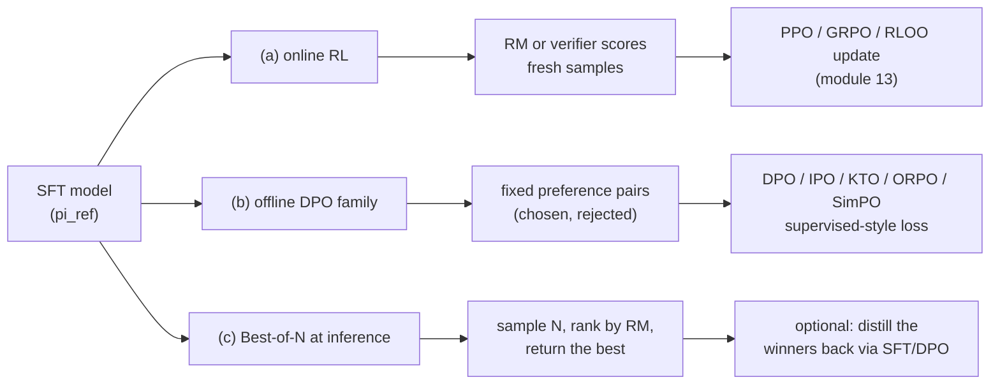
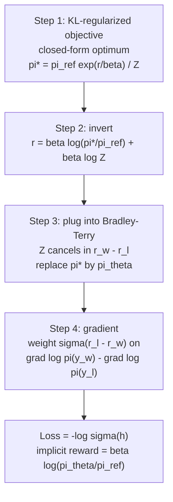

# 12 — Preference Optimization: Reward Models, RLHF, DPO and Its Family

> **Prerequisites:** modules 05, 06, 09.
> **You will learn:** the KL-regularised RLHF objective, reward modelling, the DPO derivation and
> gradient, the offline-preference zoo in TRL, KTO and online variants, and the
> diagnostics that tell you a run is healthy.

SFT teaches a model what a good answer looks like. It cannot teach the model which of two
plausible answers is *better*, because it never sees the worse one. Preference optimization
is the standard second stage after SFT for chat quality and policy behavior: refusals, tone,
verbosity, instruction adherence. The notes
([LLM prompting and alignment](../../notes/nlp/llm-prompting-and-alignment.md)) already state
the Bradley-Terry loss, the DPO loss and a method table. This module derives them, takes their
gradients, walks the whole TRL loss zoo, and tells you how to read a run's metrics.

All TRL defaults below are from **TRL v1.15.0** (October 2026), checked against the
[v1.15.0 DPO docs](https://huggingface.co/docs/trl/v1.15.0/en/dpo_trainer) and the source at
commit [`dae7b6a`](https://github.com/huggingface/trl/tree/dae7b6adc8d2729cfa8d21bc8480656ede769240).

---

## 12.1 The RLHF objective

Every method in this module optimizes, exactly or approximately, one objective. Given a prompt
distribution, a reward function $r(x,y)$ and a frozen reference policy $\pi_{\text{ref}}$
(usually the SFT model):

$$
\max_{\pi}\; \mathbb{E}_{x\sim\mathcal{D},\,y\sim\pi(\cdot\mid x)}\big[r(x,y)\big]\;-\;\beta\,\mathrm{KL}\big(\pi(\cdot\mid x)\,\|\,\pi_{\text{ref}}(\cdot\mid x)\big)
$$

**The KL term is doing three jobs at once.** It keeps the policy near the SFT model, which
already writes fluent, well-formatted text. It limits reward hacking: the reward is a learned
proxy, and an unconstrained optimizer finds its blind spots (hedging, flattery, length). And
it preserves diversity, since a reward-maximizing policy without the KL collapses onto the
single highest-scoring response. $\beta$ is the exchange rate between reward and drift. (KL
itself is covered in [information theory](../../notes/math/information-theory.md).)

### The InstructGPT pipeline

Ouyang et al. (2022), [InstructGPT](https://arxiv.org/abs/2203.02155), made this concrete in
three stages: (1) SFT on labeler demonstrations; (2) a reward model trained on labeler
rankings of several model outputs per prompt; (3) PPO against that reward model, with a
**per-token KL penalty folded into the reward**,
$r_t = r_\phi(x,y)\,\mathbb{1}[t=T] - \beta\log\frac{\pi(y_t\mid x,y_{<t})}{\pi_{\text{ref}}(y_t\mid x,y_{<t})}$.
Their headline result: labelers preferred the 1.3B InstructGPT model's outputs to the 175B
GPT-3's.

**PPO is expensive for structural reasons, not tuning reasons.** You hold four networks: the
policy (trained), the reference (frozen, for the KL), the reward model (frozen) and a value
model (trained, for advantages). Generation runs inside the training loop, so every step pays
for autoregressive sampling. PPO's clipped surrogate and GAE are derived in
[the deep-RL notes](../../notes/deep-learning/deep-rl.md) and applied to LLMs in
[module 13](./13-rl-with-verifiable-rewards.md); this module does not repeat them. Where the
KL lives (in the reward, as above, or in the loss) and how it is estimated (the k3 estimator,
bias correction) is also module 13's topic.

**`PPOTrainer`, `PPOConfig` and the value-head model classes were removed from TRL in
[v1.13](https://github.com/huggingface/trl/releases/tag/v1.13.0)** (September 2026). The
release notes cite near-zero usage and no maintenance. Treat RLHF-with-PPO as a concept you
must understand; in practice, online RL on LLMs in TRL means GRPO or RLOO (module 13), or a
dedicated RL framework.

### Best-of-N: the baseline every trained method must beat

Sample $N$ responses from $\pi_{\text{ref}}$, score them with the reward model, return the
best. No training at all. The commonly quoted KL of the best-of-$N$ policy from the base
policy is

$$
\mathrm{KL}_{\text{BoN}} \;=\; \log N - \frac{N-1}{N}.
$$

Beirami et al. (2024), [Theoretical guarantees on the best-of-n alignment policy](https://arxiv.org/abs/2401.01879),
prove this is an **upper bound**, not an equality, and propose a tighter estimator. The formula
is still useful for budgeting:

| $N$ | 2 | 4 | 16 | 64 | 256 |
|---|---|---|---|---|---|
| KL bound (nats) | 0.1931 | 0.6363 | 1.8351 | 3.1745 | 4.5491 |

The KL grows only logarithmically in $N$, and in Gao et al. (2022),
[Scaling Laws for Reward Model Overoptimization](https://arxiv.org/abs/2210.10760), best-of-$N$
reached a given gold reward at a much smaller KL than RL did (they caution that KL is an
imperfect common currency across methods). **That makes
best-of-$N$ a strong baseline:** if your DPO model does not beat best-of-16 from the SFT model
under the same reward model, the training bought you nothing except lower inference cost.
Best-of-$N$ distillation (SFT or DPO on the selected samples) is how you keep that quality and
drop the $N\times$ inference cost.



## 12.2 Reward models

### Bradley-Terry

Humans are more consistent at "which of these two is better" than at "rate this 1 to 10". The
Bradley-Terry model turns pairwise judgments into a scalar score:

$$
P(y_w \succ y_l \mid x) = \sigma\big(r_\phi(x,y_w) - r_\phi(x,y_l)\big),
\qquad
\mathcal{L}_{\text{RM}} = -\log\sigma\big(r_\phi(x,y_w) - r_\phi(x,y_l) - m\big),
$$

where $m \ge 0$ is an optional per-pair margin (for example, larger when annotators were more
confident). **This is logistic regression on reward differences:** the label is always 1, the
logit is $r_w - r_l$ (the logistic link is reviewed in [probability](../../notes/math/probability.md)).
Two consequences follow. Only differences matter, so adding a constant to
every reward changes nothing and the scale is pinned by $\sigma$'s slope; and because the
offset is free, a reward model can drift to large mean values that hurt downstream RL.
Eisenstein et al. (2023) add a **centering** term
$\eta\,\mathbb{E}[(r_w + r_l)^2]$ to pin the mean near zero.

The architecture is a causal LM with its LM head replaced by a scalar head that reads the hidden
state at the **last non-padding token**: `AutoModelForSequenceClassification` with
`num_labels=1`. TRL's stable `RewardTrainer`
([v1.15.0 docs](https://huggingface.co/docs/trl/v1.15.0/en/reward_trainer)) does exactly this.
It takes the same preference format as DPO (`prompt`/`chosen`/`rejected`, standard or
conversational, implicit or explicit prompt), accepts an optional `margin` column, defaults to
`learning_rate=1e-4`, and exposes centering as `center_rewards_coefficient` (recommended 0.01;
[loss lines](https://github.com/huggingface/trl/blob/dae7b6adc8d2729cfa8d21bc8480656ede769240/trl/trainer/reward_trainer.py#L766-L773)).

The check below shows that the BT loss is literally binary cross-entropy on the reward
difference, and that gradient descent recovers a known linear reward from 64 pairs.

```python finetuning-check
import torch
import torch.nn.functional as F

torch.manual_seed(0)
r_w = torch.tensor([1.3, -0.2, 0.7, 2.0])
r_l = torch.tensor([0.4, 0.5, 0.7, -1.0])
bt = -F.logsigmoid(r_w - r_l)
bce = F.binary_cross_entropy_with_logits(r_w - r_l, torch.ones(4), reduction="none")
torch.testing.assert_close(bt, bce)
# P(w > l) + P(l > w) = 1 for every pair
torch.testing.assert_close(torch.sigmoid(r_w - r_l) + torch.sigmoid(r_l - r_w), torch.ones(4))
# Shifting every reward by a constant changes nothing
torch.testing.assert_close(-F.logsigmoid((r_w + 5.0) - (r_l + 5.0)), bt)

# Fit a 3-feature linear reward model on 64 synthetic pairs from a known weight vector
g = torch.Generator().manual_seed(0)
w_true = torch.tensor([1.0, -2.0, 0.5])
a, b = torch.randn(64, 3, generator=g), torch.randn(64, 3, generator=g)
a_wins = (a @ w_true) > (b @ w_true)
x_w = torch.where(a_wins[:, None], a, b)
x_l = torch.where(a_wins[:, None], b, a)
w = torch.zeros(3, requires_grad=True)
for _ in range(300):
    loss = -F.logsigmoid(x_w @ w - x_l @ w).mean()
    loss.backward()
    with torch.no_grad():
        w -= 0.5 * w.grad
        w.grad.zero_()
cos = F.cosine_similarity(w.detach(), w_true, dim=0).item()
assert cos > 0.95, cos
assert ((x_w @ w) > (x_l @ w)).float().mean().item() > 0.95
print("Bradley-Terry == BCE on differences; linear RM recovered, cosine", round(cos, 4))
```

It does not show what makes real reward models fail: a linear reward on Gaussian features has
no spurious correlates (length, style) for the model to latch onto.

### Over-optimization and ensembles

**The reward model is a proxy, and optimizing a proxy hard enough makes the true objective
worse.** Gao et al. (2022) trained proxy RMs on labels from a fixed "gold" RM and optimized
policies against the proxy with RL and best-of-$N$. As the policy moves away from the
initial model (measured by $d=\sqrt{\mathrm{KL}}$), the proxy score keeps rising while the gold
score rises, peaks and falls, with coefficients that scale smoothly with RM size. Larger RMs
and more RM data push the peak further out; they do not remove it.

The mitigation with the best evidence is an **ensemble**. Coste et al. (2023),
[Reward Model Ensembles Help Mitigate Overoptimization](https://arxiv.org/abs/2310.02743),
optimize against conservative aggregates (worst-case or uncertainty-weighted). Eisenstein et
al. (2023), [Helping or Herding?](https://arxiv.org/abs/2312.09244), find ensembles whose
members differ in pretraining seed generalize better than ones differing only in fine-tuning
seed, but that **ensembles mitigate and do not eliminate** reward hacking: when all members
share an error, the policy exploits it. Pair ensembles with a KL budget and periodic human or
strong-judge spot checks ([module 09](./09-evaluating-fine-tuned-models.md)).

### Outcome, process and generative rewards

An **outcome reward model** (ORM) scores the final response. A **process reward model** (PRM)
scores each intermediate reasoning step, which gives denser credit assignment and catches
right-answer-wrong-reasoning. Uesato et al. (2022),
[process- and outcome-based feedback](https://arxiv.org/abs/2211.14275), found similar final
accuracy but far fewer reasoning errors with process supervision; Lightman et al. (2023),
[Let's Verify Step by Step](https://arxiv.org/abs/2305.20050), found a PRM beat an ORM at
selecting best-of-$N$ solutions on MATH. PRMs need step-level labels, which are expensive.
**TRL's experimental `PRMTrainer` was removed in
[v1.14](https://github.com/huggingface/trl/releases/tag/v1.14.0)** (September 2026); train a
PRM with your own token-classification loop if you need one.

The third option is a **generative reward**: prompt a strong LLM to judge. It needs no reward
training and transfers across tasks, but inherits judge biases (position, verbosity,
self-preference), covered in [module 09](./09-evaluating-fine-tuned-models.md). Where a
programmatic verifier exists, it beats all three; that is module 13.

## 12.3 DPO: derivation

Rafailov et al. (2023), [Direct Preference Optimization](https://arxiv.org/abs/2305.18290),
observed that you can skip both the reward model and the RL loop. Four steps.

**Step 1: the optimum of the KL-regularized objective has a closed form.** Fix $x$ and write
$\pi(y)$ for $\pi(y\mid x)$. Divide the objective by $-\beta$ and rearrange:

$$
\begin{aligned}
\max_\pi\;\mathbb{E}_{\pi}[r] - \beta\,\mathrm{KL}(\pi\,\|\,\pi_{\text{ref}})
&= -\beta\,\min_\pi\;\mathbb{E}_{y\sim\pi}\Big[\log\frac{\pi(y)}{\pi_{\text{ref}}(y)} - \frac{r(y)}{\beta}\Big]\\
&= -\beta\,\min_\pi\;\mathbb{E}_{y\sim\pi}\Big[\log\frac{\pi(y)}{\pi_{\text{ref}}(y)\,e^{r(y)/\beta}/Z}\Big] + \beta\log Z\\
&= -\beta\,\min_\pi\;\mathrm{KL}\big(\pi\,\|\,\pi^*\big) + \beta\log Z,
\qquad \pi^*(y) = \frac{\pi_{\text{ref}}(y)\,e^{r(y)/\beta}}{Z},\;\; Z=\sum_y \pi_{\text{ref}}(y)\,e^{r(y)/\beta}.
\end{aligned}
$$

$Z(x)$ does not depend on $\pi$, and $\pi^*$ is a valid distribution. By Gibbs' inequality the
KL is minimized, at zero, exactly when $\pi = \pi^*$. So

$$
\pi^*(y\mid x) = \frac{1}{Z(x)}\,\pi_{\text{ref}}(y\mid x)\exp\!\big(r(x,y)/\beta\big).
$$

**Step 2: invert it.** Take logs and solve for the reward:

$$
r(x,y) = \beta\log\frac{\pi^*(y\mid x)}{\pi_{\text{ref}}(y\mid x)} + \beta\log Z(x).
$$

Any reward can be written as a log-ratio of its own optimal policy, plus a prompt-only term.

**Step 3: substitute into Bradley-Terry.** BT only uses reward *differences* for the same
prompt, so $\beta\log Z(x)$ cancels. Parameterize $\pi^*$ by the policy you are training,
$\pi_\theta$, and maximize the likelihood of the observed preferences:

$$
\mathcal{L}_{\text{DPO}}(\theta) = -\mathbb{E}_{(x,y_w,y_l)}\Big[\log\sigma\Big(\beta\log\frac{\pi_\theta(y_w\mid x)}{\pi_{\text{ref}}(y_w\mid x)} - \beta\log\frac{\pi_\theta(y_l\mid x)}{\pi_{\text{ref}}(y_l\mid x)}\Big)\Big].
$$

The policy *is* the reward model. Its **implicit reward** is

$$
\hat r_\theta(x,y) = \beta\log\frac{\pi_\theta(y\mid x)}{\pi_{\text{ref}}(y\mid x)},
\qquad h = \hat r_\theta(x,y_w) - \hat r_\theta(x,y_l),
\qquad \mathcal{L}_{\text{DPO}} = -\log\sigma(h).
$$

Throughout this module $h$ is the **margin in implicit-reward units**.

**Step 4: the gradient.** With $\frac{d}{dh}[-\log\sigma(h)] = -\sigma(-h)$ and
$\nabla_\theta h = \beta\,(\nabla_\theta\log\pi_\theta(y_w) - \nabla_\theta\log\pi_\theta(y_l))$
(the reference is constant):

$$
\nabla_\theta\mathcal{L}_{\text{DPO}} = -\beta\,\mathbb{E}\Big[\underbrace{\sigma(\hat r_l - \hat r_w)}_{\text{weight}}\big(\nabla_\theta\log\pi_\theta(y_w\mid x) - \nabla_\theta\log\pi_\theta(y_l\mid x)\big)\Big].
$$

Read it term by term. The bracket raises the chosen log-likelihood and lowers the rejected
one. The weight $\sigma(\hat r_l - \hat r_w)$ is near 1 for pairs the implicit reward ranks
**wrong** and near 0 for pairs it already ranks right by a wide margin. **DPO is a self-paced
curriculum: pairs it has learned stop contributing.** At initialization $\pi_\theta =
\pi_{\text{ref}}$, so every log-ratio is 0: the loss is $\log 2 \approx 0.6931$ and the weight
is $\sigma(0)=0.5$, giving gradients of $-\beta/2 = -0.05$ on the chosen sequence log-prob and
$+0.05$ on the rejected one at $\beta=0.1$. At a margin $h = 2$ the weight drops to
$\sigma(-2) = 0.1192$.

The check builds a tiny token-level "policy" for one chosen and one rejected sequence, makes the
reference a detached copy, and verifies those numbers with autograd.

```python finetuning-check
import math
import torch
import torch.nn.functional as F

torch.manual_seed(0)
beta, V = 0.1, 5
chosen, rejected = torch.tensor([1, 3, 0]), torch.tensor([2, 2, 4])  # token ids, T=3
logits_w = torch.randn(3, V, requires_grad=True)                      # (T, V) policy
logits_l = torch.randn(3, V, requires_grad=True)
ref_w, ref_l = logits_w.detach().clone(), logits_l.detach().clone()   # reference = frozen copy

def seq_logp(logits, toks):                                           # summed token log-probs
    return F.log_softmax(logits, -1).gather(-1, toks[:, None]).sum()

lp_w, lp_l = seq_logp(logits_w, chosen), seq_logp(logits_l, rejected)
lp_w.retain_grad(); lp_l.retain_grad()
h = beta * ((lp_w - seq_logp(ref_w, chosen)) - (lp_l - seq_logp(ref_l, rejected)))
loss = -F.logsigmoid(h)
loss.backward()
assert abs(h.item()) < 1e-7
assert abs(loss.item() - math.log(2)) < 1e-6                          # 0.6931
assert abs(lp_w.grad.item() - (-0.05)) < 1e-7                         # -beta * sigma(0)
assert abs(lp_l.grad.item() - 0.05) < 1e-7
# Chain rule to the logits: -0.05 * (onehot - softmax)
expected = -0.05 * (F.one_hot(chosen, V).float() - F.softmax(ref_w, -1))
torch.testing.assert_close(logits_w.grad, expected)

# Perturb so the margin is h = 2.0: the weight is sigma(-2) and the gradient beta * sigma(-2)
lw = torch.tensor(2.0 / beta, requires_grad=True)                     # chosen log-ratio = 20
ll = torch.tensor(0.0, requires_grad=True)
loss2 = -F.logsigmoid(beta * (lw - ll))
loss2.backward()
weight = torch.sigmoid(torch.tensor(-2.0)).item()
assert abs(weight - 0.1192) < 1e-4
assert abs(lw.grad.item() - (-beta * weight)) < 1e-7                  # -0.0119
assert abs(ll.grad.item() - beta * weight) < 1e-7
print("DPO: loss log 2 at init, weight 0.5 -> sigma(-2) at margin 2")
```

It does not show what happens to the probability of *other* sequences when shared parameters
move; that is the likelihood-displacement story in 12.9.

### The role of $\beta$

**Higher $\beta$ keeps the policy closer to the reference, not "learns preferences harder".**
In the objective, $\beta$ multiplies the KL penalty. In the loss, $\beta$ scales the log-ratios
inside the sigmoid, so a given margin $h$ is reached with a log-ratio gap of only $h/\beta$:
at $\beta = 0.5$ the loss saturates after the policy moves 5 times less than at $\beta = 0.1$,
after which the weight $\sigma(-h)$ switches the gradient off. The TRL docstring says it
directly: "Higher β means less deviation from the reference model." The DPO paper used 0.1 and
0.5; TRL's default is 0.1.

### Assumptions and limits

The closed form holds for the **unrestricted** policy class, on the support of
$\pi_{\text{ref}}$, with the true reward. In practice: the policy is a finite network, so
$\pi_\theta$ cannot equal $\pi^*$ and a gradient on one pair moves others; the data is finite,
so the loss is minimized by driving $h\to\infty$ on training pairs (overfitting, which IPO
targets); and the pairs are **off-policy**, sampled from some other model, so DPO never sees
what the current policy would actually say. These three gaps explain most of the variants
below.



## 12.4 DPO in TRL

`DPOTrainer` and `DPOConfig` are stable in TRL v1. As of October 2026 (v1.15.0,
[`dpo_config.py`](https://github.com/huggingface/trl/blob/dae7b6adc8d2729cfa8d21bc8480656ede769240/trl/trainer/dpo_config.py)):

| Field | Default | Note |
|---|---|---|
| `beta` | `0.1` | for `ipo` it is IPO's $\tau$ |
| `learning_rate` | `1e-6` | full fine-tuning; TRL's docs suggest about `1e-5` for adapters |
| `loss_type` | `["sigmoid"]` | **a list**; combine several with `loss_weights` |
| `loss_weights` | `None` | equal weights `1.0` when unset |
| `max_length` | `1024` | prompt + completion; `truncation_mode="keep_start"` (`keep_end` deprecated) |
| `precompute_ref_log_probs` | `False` | one reference pass before training |
| `label_smoothing` | `0.0` | used by `robust` and `exo_pair` |
| `f_divergence_type` | `"reverse_kl"` | also `forward_kl`, `js_divergence`, `alpha_divergence` |
| `use_weighting` | `False` | WPO pair weights |
| `ld_alpha` | `None` | LD-DPO; `None` = plain DPO |
| `sync_ref_model` | `False` | TR-DPO; `ref_model_mixup_alpha=0.6`, `ref_model_sync_steps=512` |
| `padding_free` | `False` | **temporarily unavailable** after the DPO refactor; `True` warns and falls back to padding |
| `gradient_checkpointing`, `bf16` | `True`, `True` | differ from `TrainingArguments` |

There are no separate prompt/completion length caps in v1.15's `DPOConfig`; `max_length` is the
only truncation knob. `use_liger_kernel=True` is deprecated in `DPOTrainer`; pass
`model_init_kwargs={"use_kernels": True}` instead. A PEFT adapter targeting `lm_head` raises,
because log-probs are computed from `lm_head.weight` directly by the fused LM head; use
`modules_to_save=["lm_head"]`.

### Where the reference log-probs come from

**Standard DPO needs reference log-probs. It does not necessarily need a second model in
memory.** TRL picks the cheapest source available:

| Setup | Reference used | Memory cost |
|---|---|---|
| Full fine-tune, `ref_model=None` | a second copy of the initial model | 2x weights |
| Fresh LoRA via `peft_config` | the **same** model with the adapter disabled | none extra |
| Continue an existing adapter (e.g. your SFT LoRA) | a frozen copy of that adapter, loaded as `"ref"` | one extra adapter |
| `precompute_ref_log_probs=True` | one no-grad pass over the dataset before training, stored as columns | no reference at train time |
| `sync_ref_model=True` (TR-DPO) | a separate reference updated as $\pi_{\text{ref}} \leftarrow \alpha\pi_\theta + (1-\alpha)\pi_{\text{ref}}$ every $\tau$ steps | 2x weights |

The "continue an existing adapter" row is the SFT-then-DPO path of the lab: load the SFT
adapter with `is_trainable=True`, and the reference is the SFT policy, not the base model.
`precompute_ref_log_probs` is incompatible with `sync_ref_model` (a moving reference makes
cached values stale) and with `IterableDataset`. TR-DPO
([Gorbatovski et al. 2024](https://arxiv.org/abs/2404.09656)) argues a reference that slowly
tracks the policy lets you train longer before over-optimization; `sync_ref_model` is not
supported with PEFT models that have no standalone reference. A related experimental option
replaces the hard sync with a bias-corrected exponential moving average:
`trl.experimental.bema_for_ref_model.BEMACallback(update_ref_model=True)`
([docs](https://huggingface.co/docs/trl/v1.15.0/en/bema_for_reference_model)). Treat it as
experimental: no stability guarantee.

The full-mode function of [dpo_from_scratch.py](./code/dpo_from_scratch.py) shows both PEFT
paths against the v1.15 API (fresh `LoraConfig` versus a loaded SFT adapter).

### Padding

In v1.15 the text DPO collator concatenates prompt and completion, **right-pads** the batch,
and builds a `completion_mask` so only completion tokens enter the sequence log-prob. Left
padding matters wherever you *generate*: sampling on-policy completions for iterative DPO or
best-of-$N$ must use left padding, or new tokens are appended after pad tokens. Module 02
covers why ([module 02](./02-tokens-templates-and-the-causal-lm-objective.md)).

## 12.5 The loss zoo

`loss_type` accepts 15 values. Each is a different answer to "what function of the
log-ratios should we minimize?" Notation: $\Delta_w = \log\frac{\pi_\theta(y_w)}{\pi_{\text{ref}}(y_w)}$,
$\Delta_l$ likewise (summed over completion tokens), $\hat r_w = \beta\Delta_w$,
$\hat r_l = \beta\Delta_l$, $h = \hat r_w - \hat r_l$, and $\bar\Delta = \Delta_w/\lvert y_w\rvert - \Delta_l/\lvert y_l\rvert$
the difference of **per-token average** log-ratios. Every formula below was read off
[the v1.15.0 loss block](https://github.com/huggingface/trl/blob/dae7b6adc8d2729cfa8d21bc8480656ede769240/trl/trainer/dpo_trainer.py#L1329-L1504).

| `loss_type` | Paper | Per-pair loss in TRL | Motivation | Ref? |
|---|---|---|---|---|
| `sigmoid` | [DPO](https://arxiv.org/abs/2305.18290) | $-\log\sigma(h)$ | BT likelihood of the implicit reward | yes |
| `hinge` | [SLiC](https://arxiv.org/abs/2305.10425), [RSO](https://arxiv.org/abs/2309.06657) | $\max(0,\,1-h)$ | stop pushing once the margin passes 1; $\beta$ is the reciprocal margin in log-ratio units | yes |
| `ipo` | [IPO](https://arxiv.org/abs/2310.12036) | $\big(\bar\Delta - \tfrac{1}{2\tau}\big)^2$, $\tau=\beta$ | regress to a finite target instead of driving $h\to\infty$; length-averaged in TRL | yes |
| `exo_pair` | [EXO](https://arxiv.org/abs/2402.00856) | $\mathrm{KL}\big(\mathrm{softmax}(\hat r_w,\hat r_l)\,\Vert\,(1-\epsilon,\epsilon)\big)$ | reverse-KL (mode-seeking) fit to smoothed labels; needs $\epsilon>0$, e.g. 1e-3 | yes |
| `nca_pair` | [NCA](https://arxiv.org/abs/2402.05369) | $-\log\sigma(\hat r_w) - \tfrac12\log\sigma(-\hat r_w) - \tfrac12\log\sigma(-\hat r_l)$ | absolute, not relative, likelihood targets: keeps chosen from falling | yes |
| `robust` | [Robust DPO](https://arxiv.org/abs/2403.00409) | $\dfrac{-(1-\epsilon)\log\sigma(h) + \epsilon\log\sigma(-h)}{1-2\epsilon}$ | unbiased under label-flip probability $\epsilon\in[0,0.5)$ | yes |
| `bco_pair` | [BCO](https://arxiv.org/abs/2404.04656) | $-\log\sigma(\hat r_w) - \log\sigma(-\hat r_l)$ | binary classifier: chosen to 1, rejected to 0, independently | yes |
| `sppo_hard` | [SPPO](https://arxiv.org/abs/2405.00675) | $\big(\Delta_w - \tfrac{1}{2\beta}\big)^2 + \big(\Delta_l + \tfrac{1}{2\beta}\big)^2$ | self-play Nash target with hard win probabilities 1 and 0 | yes |
| `aot`, `aot_unpaired` | [AOT](https://arxiv.org/abs/2406.05882) | sigmoid loss on **sorted** (quantile-matched) log-ratio differences across the batch | distributional dominance; wants large per-GPU batches | yes |
| `apo_zero` | [APO](https://arxiv.org/abs/2408.06266) | $\big(1-\sigma(\hat r_w)\big) + \sigma(\hat r_l)$ | anchored: push chosen **up** and rejected down; use when chosen beats your model | yes |
| `apo_down` | APO | $\sigma(\hat r_w) + \big(1-\sigma(h)\big)$ | push both **down**, rejected more; use when your model already beats chosen | yes |
| `discopop` | [DiscoPOP](https://arxiv.org/abs/2406.08414) | $(1-\sigma(h/\tau_d))\,[-\log\sigma(h)] + \sigma(h/\tau_d)\,e^{-h}$, $\tau_d=0.05$ | LLM-discovered blend of logistic and exponential losses, modulated by the margin | yes |
| `sft` | (NLL) | mean token NLL on $y_w$ | anchors the chosen likelihood; usually combined | no |
| `sigmoid_norm` | [SimPO](https://arxiv.org/abs/2405.14734)-style | $-\log\sigma(\beta\bar\Delta)$ | length-normalized DPO: removes the reward for sheer length | yes |

Three readings worth internalizing. **`ipo` is the only one that stops at a finite margin**:
its minimum sits at $\bar\Delta = 1/(2\tau)$, so with the default $\beta=0.1$ it targets 5 nats
per token, which is far too aggressive; IPO runs use a larger $\tau$ (0.5 gives a target of 1).
**`apo_zero`, `bco_pair` and `nca_pair` act on each response's own log-ratio**, so they can
force the chosen likelihood up; `sigmoid`, `hinge` and `robust` only see the difference.
**`sigmoid_norm` is not SimPO**: it still divides *reference* log-ratios by length, and has no
margin $\gamma$. Exact, reference-free SimPO lives in the experimental CPO trainer (12.6).

### Multi-loss and variant knobs

Pass several losses with weights; the per-pair losses are averaged and summed with those
weights. The MPO recipe ([Wang et al. 2024](https://arxiv.org/abs/2411.10442)) combines
preference, quality and generation terms, and is the standard VLM recipe in
[module 16](./16-multimodal-and-embedding-fine-tuning.md):

```python
DPOConfig(loss_type=["sigmoid", "bco_pair", "sft"], loss_weights=[0.8, 0.2, 1.0])  # MPO
```

Three knobs modify the log-ratios before any loss sees them:

| Knob | Paper | What it changes |
|---|---|---|
| `f_divergence_type` | [f-DPO](https://arxiv.org/abs/2309.16240) | replaces each log-ratio $\log u$ by $f'(u)$ for the chosen divergence: reverse KL ($\log u$, default), forward KL ($1-1/u$), JS ($\log 2 + \log\sigma(\log u)$), $\alpha$-divergence ($\frac{u^{\alpha-1}-1}{\alpha-1}$, `f_alpha_divergence_coef=0.5`). Only for the difference-based losses |
| `ld_alpha` | [LD-DPO](https://arxiv.org/abs/2409.06411) | sequence log-prob = (first $\min(\lvert y_w\rvert,\lvert y_l\rvert)$ tokens) + $\alpha\times$(the excess tokens of the longer response). $\alpha<1$ down-weights the verbose tail, so length alone earns less margin |
| `use_weighting` | [WPO](https://arxiv.org/abs/2406.11827) | multiplies each pair's loss by $w_w w_l$, where each $w$ is the policy's (calibrated) per-token-average probability of that response. Pairs the current policy would plausibly generate count more, a cheap correction for off-policy data. Not supported with `aot` |

The check evaluates five TRL losses, plus SimPO from 12.6, on one fixture, exactly as the
tables write them. Fixture:
$\beta=0.1$, $\Delta_w = 3$, $\Delta_l = -2$ (so $h=0.5$), $\lvert y_w\rvert = 20$,
$\lvert y_l\rvert = 10$ (so $\bar\Delta = 0.35$). Values: sigmoid $0.4741$, hinge $0.5000$,
robust ($\epsilon=0.1$) $0.4116$, IPO ($\tau=0.5$) $0.4225$, `sigmoid_norm` $0.6758$. For SimPO
(12.6) with $\beta_s = 2.0$, $\gamma = 0.5$, policy log-probs $-12$ and $-9$: $0.6444$.

```python finetuning-check
import math
import torch
import torch.nn.functional as F

ls = F.logsigmoid
beta, eps = 0.1, 0.1
d_w, d_l, len_w, len_l = torch.tensor(3.0), torch.tensor(-2.0), 20.0, 10.0

def sigmoid_loss(h):            return -ls(h)
def hinge_loss(h):              return torch.relu(1 - h)
def robust_loss(h, e):          return (-(1 - e) * ls(h) + e * ls(-h)) / (1 - 2 * e)
def ipo_loss(avg_delta, tau):   return (avg_delta - 1 / (2 * tau)) ** 2
def sigmoid_norm_loss(avg_delta, b): return -ls(b * avg_delta)
def simpo_loss(lp_w, lp_l, n_w, n_l, b, gamma):
    return -ls(b * lp_w / n_w - b * lp_l / n_l - gamma)

h = beta * (d_w - d_l)
avg = d_w / len_w - d_l / len_l
assert abs(h.item() - 0.5) < 1e-7 and abs(avg.item() - 0.35) < 1e-7
vals = {
    "sigmoid": sigmoid_loss(h), "hinge": hinge_loss(h), "robust": robust_loss(h, eps),
    "ipo": ipo_loss(avg, 0.5), "sigmoid_norm": sigmoid_norm_loss(avg, beta),
    "simpo": simpo_loss(torch.tensor(-12.0), torch.tensor(-9.0), len_w, len_l, 2.0, 0.5),
}
stated = {"sigmoid": 0.4741, "hinge": 0.5000, "robust": 0.4116,
          "ipo": 0.4225, "sigmoid_norm": 0.6758, "simpo": 0.6444}
for k, v in stated.items():
    assert round(vals[k].item(), 4) == v, (k, vals[k].item())

# At h = 0: sigmoid = log 2, hinge = 1, robust reduces to sigmoid when eps = 0
z = torch.tensor(0.0)
assert abs(sigmoid_loss(z).item() - math.log(2)) < 1e-7
assert hinge_loss(z).item() == 1.0
for hv in (-1.0, 0.0, 0.5, 3.0):
    hv = torch.tensor(hv)
    torch.testing.assert_close(robust_loss(hv, 0.0), sigmoid_loss(hv))
# IPO is minimized (zero loss, zero gradient) at its target average margin 1/(2 tau)
tau = 0.5
a = torch.tensor(1 / (2 * tau), requires_grad=True)
loss = ipo_loss(a, tau)
loss.backward()
assert loss.item() == 0.0 and a.grad.item() == 0.0
assert ipo_loss(torch.tensor(1.5), tau) > 0 and ipo_loss(torch.tensor(0.5), tau) > 0
print("loss zoo fixture values verified")
```

It does not tell you which loss trains the better model; that is an empirical question, and L12.2
is how you answer it for your data.

## 12.6 Reference-free and single-stage methods

**ORPO** ([Hong et al. 2024](https://arxiv.org/abs/2403.07691)) folds SFT and preference
learning into one stage with no reference model. With $p(y) = \exp\big(\frac{1}{\lvert y\rvert}\log\pi_\theta(y\mid x)\big)$
(the per-token geometric-mean probability) and $\mathrm{odds}(y) = \frac{p}{1-p}$:

$$
\mathcal{L}_{\text{ORPO}} = \mathcal{L}_{\text{NLL}}(y_w) \;-\; \lambda\,\log\sigma\Big(\log\frac{\mathrm{odds}(y_w)}{\mathrm{odds}(y_l)}\Big).
$$

The NLL term teaches the format; the odds-ratio term pushes the rejected style down at the
same time. In TRL it is `trl.experimental.orpo.ORPOTrainer`, and `ORPOConfig.beta` is $\lambda$
(default 0.1; [source](https://github.com/huggingface/trl/blob/dae7b6adc8d2729cfa8d21bc8480656ede769240/trl/experimental/orpo/orpo_trainer.py#L690-L697)).
Use it when you have preference data and a base model, and want one run instead of two.

**SimPO** ([Meng et al. 2024](https://arxiv.org/abs/2405.14734)) drops the reference and uses
the length-normalized policy log-likelihood as the reward, with a target margin $\gamma$:

$$
\mathcal{L}_{\text{SimPO}} = -\log\sigma\Big(\frac{\beta}{\lvert y_w\rvert}\log\pi_\theta(y_w\mid x) - \frac{\beta}{\lvert y_l\rvert}\log\pi_\theta(y_l\mid x) - \gamma\Big).
$$

Normalizing by length matches how the model generates (per-token likelihood) and removes the
incentive to pad; $\gamma$ demands a gap rather than a mere ordering. SimPO's $\beta$ is on a
per-token scale, so it is much larger than DPO's (the paper sweeps roughly 2 to 10). **In TRL,
exact SimPO is `trl.experimental.cpo.CPOTrainer` with `loss_type="simpo"`, `cpo_alpha=0.0`, and
`simpo_gamma` (default 0.5)** ([source](https://github.com/huggingface/trl/blob/dae7b6adc8d2729cfa8d21bc8480656ede769240/trl/experimental/cpo/cpo_trainer.py#L715-L722)).
DPO's `sigmoid_norm` is the nearest stable-trainer option, but it keeps the reference.

**CPO** ([Xu et al. 2024](https://arxiv.org/abs/2401.08417)) came from machine translation:
$-\log\sigma\big(\beta\log\pi_\theta(y_w) - \beta\log\pi_\theta(y_l)\big) + \alpha\,\mathcal{L}_{\text{NLL}}(y_w)$,
a DPO loss with the reference dropped plus a behavior-cloning term (`cpo_alpha=1.0` by
default). Setting `loss_type="simpo"` with a non-zero `cpo_alpha` gives the CPO-SimPO
combination. All three trainers are **experimental**: importable from `trl.experimental`, with
no API stability promise.

## 12.7 KTO

**Pairs are expensive; thumbs are free.** Production logs give you "this answer was good" or
"bad", rarely two answers to the same prompt. KTO ([Ethayarajh et al. 2024](https://arxiv.org/abs/2402.01306))
learns from that unpaired binary signal using a prospect-theory value function. With implicit
reward $\hat r = \beta\log\frac{\pi_\theta(y\mid x)}{\pi_{\text{ref}}(y\mid x)}$ and a reference
point $z_0$:

$$
v(x,y) =
\begin{cases}
\lambda_D\,\sigma\big(\beta(\Delta - z_0)\big) & y \text{ desirable}\\
\lambda_U\,\sigma\big(\beta(z_0 - \Delta)\big) & y \text{ undesirable}
\end{cases}
\qquad
\mathcal{L}_{\text{KTO}} = \mathbb{E}\big[\lambda_y - v(x,y)\big],
$$

where $\Delta$ is the log-ratio and $z_0$ is a **batch estimate of
$\mathrm{KL}(\pi_\theta\,\|\,\pi_{\text{ref}})$**, computed on deliberately mismatched
(prompt, completion) pairs from the same batch, clamped at 0 and detached. A desirable output
only earns loss reduction for beating the policy's *typical* log-ratio, not for being likely in
absolute terms. The sigmoid saturates in both directions, which is the "loss aversion" story
and also why KTO is reported to be robust to noisy labels.

TRL's `KTOTrainer` is **stable** ([v1.15.0 docs](https://huggingface.co/docs/trl/v1.15.0/en/kto_trainer)).
Data is `{"prompt", "completion", "label": True/False}`; a paired dataset is split
automatically. `desirable_weight` and `undesirable_weight` (both 1.0) are $\lambda_D$,
$\lambda_U$. The paper's guidance, which TRL warns on, is to keep
$\frac{\lambda_D n_D}{\lambda_U n_U} \in [1, \tfrac{4}{3}]$: with 1,000 thumbs-up and 9,000
thumbs-down, set `desirable_weight` between 9.0 and 12.0. Because the KL estimate pairs each
prompt with a neighbor's completion, KTO needs `per_device_train_batch_size > 1` and the
default sequential sampling. TRL's KTO docs advise a learning rate no higher than about 1e-6 at
the default $\beta = 0.1$ for most models, and never outside 5e-7 to 5e-6. Use KTO for thumbs-up/down logs (see [module 04](./04-data-curation-and-synthesis.md)
for building them); use DPO when you genuinely have pairs.

## 12.8 Online and iterative preference learning

**Offline DPO trains on responses the current policy would never write.** The fix is to
generate fresh responses and label them during training.

- **Online DPO** ([Guo et al. 2024](https://arxiv.org/abs/2402.04792)): each step, sample two
  completions per prompt from the current policy, have a reward model or LLM judge pick the
  winner, take a DPO step on that pair. They report it beats offline DPO and RLHF in human
  evaluation. TRL: `trl.experimental.online_dpo.OnlineDPOTrainer`, with a reward model or
  judge passed as `reward_funcs` ([docs](https://huggingface.co/docs/trl/v1.15.0/en/online_dpo_trainer)).
- **Iterative DPO**: alternate rounds. Sample $k$ completions per prompt from the current
  model, rank them with an RM, keep (best, worst) as a pair, run offline DPO, repeat. This is
  the "rejection sampling plus DPO, in rounds" recipe of Llama 3 and the SFT, DPO, RLVR stack
  of Tulu 3, both summarized in [module 01](./01-when-to-fine-tune.md). L12.3 runs one round.
- **Self-rewarding loops** ([Yuan et al. 2024](https://arxiv.org/abs/2401.10020)): the model
  generates candidates *and* judges them via an LLM-as-judge prompt, then trains on its own
  preferences with DPO, for several iterations. The risk is a closed loop: the judge's biases
  (verbosity, self-preference) become the training target, and nothing external catches
  drift. Anchor such loops with a fixed external eval set and a held-out human or strong-judge
  check every round.
- **RLOO and REINFORCE-style methods** sit between online DPO and PPO: sample $k$ completions,
  use the mean reward of the *other* $k-1$ as a baseline, and do a policy-gradient step. No
  value model. `RLOOTrainer` is stable in TRL; RLOO and GRPO are
  [module 13](./13-rl-with-verifiable-rewards.md), where GRPO's TRL default `beta=0.0` means no
  reference model is even loaded.

### RLAIF and Constitutional AI

Bai et al. (2022), [Constitutional AI](https://arxiv.org/abs/2212.08073), replaced human
harmlessness labels with AI feedback guided by a short list of written principles. Stage 1
(supervised): the model critiques its own response against a principle, revises it, and is
fine-tuned on the revisions. Stage 2 (RL from AI feedback, RLAIF): a model compares pairs of
responses against the principles, those AI preferences train a preference model, and RL
optimizes against it. The same idea now powers most synthetic preference data: an LLM judge
scores several candidates and the dataset keeps (best, worst), as in UltraFeedback-style
pipelines (construction and decontamination are [module 04](./04-data-curation-and-synthesis.md)).

### Beyond chat

Preference tuning works the same way for VLMs: RLAIF-V provides AI-labeled image preference
data and MPO is the usual loss mix ([module 16](./16-multimodal-and-embedding-fine-tuning.md);
see also the HF post on [VLM alignment in TRL](https://huggingface.co/blog/trl-vlm-alignment)).
`DPOTrainer` takes an `image`/`images` column directly; set `max_length=None` so truncation
cannot cut image tokens. For tool calling, DPO pairs carry a `tools` column of JSON schemas, and
the rejected response is often a malformed or wrong call
([module 15](./15-agentic-and-tool-use-fine-tuning.md)).

## 12.9 Diagnostics

`DPOTrainer` logs these, per the
[metrics code](https://github.com/huggingface/trl/blob/dae7b6adc8d2729cfa8d21bc8480656ede769240/trl/trainer/dpo_trainer.py#L1557-L1577):

| Metric | Definition (batch mean) |
|---|---|
| `rewards/chosen` | $\beta(\log\pi_\theta(y_w) - \log\pi_{\text{ref}}(y_w))$ |
| `rewards/rejected` | $\beta(\log\pi_\theta(y_l) - \log\pi_{\text{ref}}(y_l))$ |
| `rewards/margins` | chosen minus rejected, i.e. mean $h$ |
| `rewards/accuracies` | fraction of pairs with $\hat r_w > \hat r_l$ |
| `logps/chosen`, `logps/rejected` | policy **summed** sequence log-probs |

A healthy start: rewards at 0, margins at 0, accuracy at 0 (ties count as wrong), loss at
$\log 2$. A healthy run: margins rise smoothly, held-out accuracy climbs well above 0.5 and plateaus,
loss falls without collapsing to zero, and samples improve under a judge.

### Both log-probs go down

Watch `rewards/chosen` in almost any DPO run and you will see it go **negative**. The chosen
response becomes *less* likely than under the reference, while the rejected one falls faster.
TRL's own docs say DPO typically widens the margin "by suppressing the likelihood of
dispreferred completions rather than by increasing the likelihood of preferred ones".

**This is not a bug in your code; it is what the loss allows.** $\mathcal{L}_{\text{DPO}}$
depends only on $h$. Moving both log-ratios down, the rejected one faster, lowers the loss as
surely as moving the chosen one up. The worked fixture: chosen log-prob falls from $-20$ to
$-22$ and rejected from $-20$ to $-30$ relative to the reference. Then
`rewards/chosen` $= 0.1 \times (-2) = -0.2$, `rewards/rejected` $= -1.0$, margin $0.8$,
accuracy 1, and the loss drops from $0.6931$ to $-\log\sigma(0.8) = 0.3711$.

**Where does the mass go?** Not to $y_w$ and $y_l$, so to other sequences. Pal et al. (2024),
[Smaug / DPO-Positive](https://arxiv.org/abs/2402.13228), prove standard DPO can reduce the
chosen likelihood whenever the relative probability increases, and see it most on pairs with
small edit distance. Razin et al. (2024),
[Likelihood Displacement](https://arxiv.org/abs/2410.08847), name the effect and show it can be
**catastrophic**: training to prefer "No" over "Never" can sharply raise "Yes", and in a
refusal-training experiment it cut Llama-3-8B-Instruct's refusal rate from 74.4% to 33.4%. The
driver is preferences whose responses have **similar hidden embeddings**: the gradient pushing
$y_l$ down also pushes $y_w$ down, and frees mass for whatever response loads most on the
direction separating them.

**When it is harmless:** the chosen log-prob falls a few nats, held-out judge win rate rises,
samples look right. The policy got sharper and moved mass from both training responses to
responses at least as good. **When it is harmful:** the chosen log-prob keeps sliding by tens
of nats, samples degrade, safety evals regress, or outputs drift to an unseen mode. Then
intervene:

| Mitigation | How |
|---|---|
| anchor the chosen likelihood | add `"sft"` to `loss_type` (e.g. `["sigmoid", "sft"]`), or use `nca_pair` / `bco_pair` |
| require chosen to rise | `apo_zero` when the chosen responses are better than your model's |
| penalize chosen falling | DPOP adds $\lambda\max\big(0,\log\frac{\pi_{\text{ref}}(y_w)}{\pi_\theta(y_w)}\big)$ inside the sigmoid (not a built-in `loss_type`; a custom loss) |
| fix the data | drop near-duplicate pairs; Razin et al.'s CHES score finds the worst offenders |
| train less | lower LR, fewer steps, larger $\beta$ |

The check computes the TRL metrics on a 4-pair fixture ($\beta=0.1$; rewards/chosen
$0.0125$, rewards/rejected $-0.2000$, margins $0.2125$, accuracy $0.75$, loss $0.5984$), then the
both-fall pair, then takes one real SGD step on a linear-feature policy where both log-probs
fall and the loss still drops.

```python finetuning-check
import math
import torch
import torch.nn.functional as F

def metrics(pol_w, pol_l, ref_w, ref_l, beta):
    cr, rr = beta * (pol_w - ref_w), beta * (pol_l - ref_l)
    m = cr - rr
    return {"chosen": cr.mean().item(), "rejected": rr.mean().item(), "margins": m.mean().item(),
            "accuracies": (cr > rr).float().mean().item(), "loss": (-F.logsigmoid(m)).mean().item()}

beta = 0.1
ref_w = torch.tensor([-30., -25., -40., -18.]); pol_w = torch.tensor([-28., -25., -41., -18.5])
ref_l = torch.tensor([-32., -27., -35., -20.]); pol_l = torch.tensor([-35., -26., -39., -22.])
m = metrics(pol_w, pol_l, ref_w, ref_l, beta)
for k, v in {"chosen": 0.0125, "rejected": -0.2, "margins": 0.2125,
             "accuracies": 0.75, "loss": 0.5984}.items():
    assert round(m[k], 4) == v, (k, m[k])

# The "both fall" pair: chosen -20 -> -22, rejected -20 -> -30 relative to the reference
b = metrics(torch.tensor([-22.]), torch.tensor([-30.]), torch.tensor([-20.]), torch.tensor([-20.]), beta)
assert round(b["chosen"], 4) == -0.2 and round(b["rejected"], 4) == -1.0
assert round(b["margins"], 4) == 0.8 and b["accuracies"] == 1.0
assert round(b["loss"], 4) == 0.3711 and b["loss"] < math.log(2)

# One real gradient step that lowers BOTH log-probs and still lowers the loss.
phi = torch.tensor([[1., 1.],    # chosen
                    [1., 0.],    # rejected (shares feature 0 with chosen)
                    [0., 4.],    # unseen response, loads on the chosen-minus-rejected direction
                    [0., 0.]])
theta = torch.zeros(2, requires_grad=True)
ref = F.log_softmax(phi @ torch.zeros(2), -1)
def step_stats(t):
    lp = F.log_softmax(phi @ t, -1)
    loss = -F.logsigmoid(beta * ((lp[0] - ref[0]) - (lp[1] - ref[1])))
    return lp, loss
lp0, loss0 = step_stats(theta)
loss0.backward()
with torch.no_grad():
    theta1 = theta - 1.0 * theta.grad
    lp1, loss1 = step_stats(theta1)
assert lp1[0] < lp0[0] and lp1[1] < lp0[1]           # chosen AND rejected log-probs fall
assert loss1 < loss0                                  # yet the DPO loss improves
assert lp1[2].exp() > lp0[2].exp()                    # the mass went to the unseen response
print("metrics fixture, both-fall pair and displacement step verified")
```

It does not show whether the unseen response that gained mass is better or worse; only a judge
or a human can tell you that, which is why diagnostics never replace evaluation.

### Length exploitation

Summed log-probs make long responses carry larger log-ratio magnitudes, and chosen responses
in most preference sets are longer than rejected ones. DPO can widen the margin by learning
"longer is better". Symptom: mean output length climbs every eval while win rate under a
length-controlled judge stays flat. Measure with length-controlled AlpacaEval or a judge with
explicit length control ([module 09](./09-evaluating-fine-tuned-models.md)); fix with
`sigmoid_norm`, `ld_alpha` (sweep values below 1), SimPO, or by length-balancing the pairs.

| Metric pattern | Interpretation | Action |
|---|---|---|
| accuracy stuck near 0.5, margins near 0 | no learning signal: LR too low, labels noisy, pairs near-identical | check data; raise LR within 5e-7 to 5e-6 (full FT) |
| train accuracy 1.0 within a few hundred steps, eval accuracy flat | memorizing the pairs | fewer epochs, larger $\beta$, `ipo`, more data |
| margins up, `rewards/chosen` slightly negative, judge win rate up | normal DPO dynamics | nothing |
| margins up, `logps/chosen` falling by tens of nats, samples degrade | harmful likelihood displacement | add `sft` term, `apo_zero`, lower LR, dedupe pairs |
| margins up, mean length up, LC win rate flat | length exploitation | `sigmoid_norm`, `ld_alpha`, length-balanced pairs |
| loss spikes or NaN | LR too high or bf16 overflow in log-probs | lower LR, check grad norm, enable gradient clipping |
| `rewards/rejected` collapsing towards very negative values, eval quality drops | over-optimization on off-policy pairs | stop early, iterative DPO with on-policy pairs |

## 12.10 Data issues and choosing a method

Most failed preference runs are data failures. Five recur ([module 04](./04-data-curation-and-synthesis.md)
covers construction):

- **Off-policy pairs.** Responses generated by other models are text your policy would not
  write. DPO learns to rank them, which transfers imperfectly to its own outputs. Mitigate with
  WPO weighting, or regenerate responses with your own SFT model and label those.
- **Noisy labels.** Even InstructGPT's trained labelers agreed with each other on only about
  73% of comparisons ([Ouyang et al. 2022](https://arxiv.org/abs/2203.02155)). Use
  `robust` with `label_smoothing` set to your estimated flip rate (0.1 is the paper's typical
  value), or `ipo`, which does not chase infinite margins on wrong labels.
- **Near-identical pairs.** If chosen and rejected differ by a word, the pair carries little
  signal and, per Razin et al., drives likelihood displacement. Filter by edit distance or
  embedding similarity.
- **Chosen from a much stronger model.** A GPT-class chosen paired with your 1.7B model's
  rejected teaches "be the stronger model", which the policy cannot do; the easy shortcut is
  to push its own outputs down. Prefer pairs where both responses are on-policy or close to it.
- **Length bias.** If chosen is systematically longer, the cheapest margin is verbosity.
  Measure the length ratio before training.

| Situation | Method | Why |
|---|---|---|
| cheap offline polish on existing pairs | DPO (`sigmoid`), maybe `+ sft` | stable, one trainer, LoRA reference is free |
| thumbs-up/down logs, no pairs | KTO | uses unpaired binary labels directly |
| no budget for reference log-probs, or want one stage from base | ORPO (one stage) or SimPO | reference-free |
| noisy labels | `robust` or `ipo` | bounded response to wrong labels |
| verifiable task (math, code, JSON validity) | online RL with GRPO/RLOO ([module 13](./13-rl-with-verifiable-rewards.md)) | on-policy, exact reward |
| a reward model, no RL infrastructure | best-of-$N$ distillation or iterative DPO | on-policy data without an RL loop |
| chat model that keeps getting longer | `sigmoid_norm`, `ld_alpha`, SimPO | removes the length reward |

Whatever you pick, preference tuning can erode safety behavior learned upstream; re-run the
safety evals from [module 19](./19-safety-forgetting-and-responsible-fine-tuning.md) after every
preference stage.

## 12.11 Lab: SFT → DPO, and the loss-type ablation

**Goal:** run the post-training stage the course has been building towards, read its
diagnostics, and measure what the loss choice does. **Tier:** CPU smoke for both scripts; T1
(24 GB) for L12.1 to L12.3; T0 (free T4) for L12.4. **Models:** `Qwen/Qwen3-1.7B` (or
`Qwen/Qwen3-4B` on T1 with LoRA). **Dataset:** `trl-lib/ultrafeedback_binarized`.

Scripts: [dpo_from_scratch.py](./code/dpo_from_scratch.py) and
[reward_model_bt.py](./code/reward_model_bt.py). Run the smoke modes first:

```bash
python content/courses/finetuning/code/dpo_from_scratch.py --smoke
python content/courses/finetuning/code/reward_model_bt.py --smoke
```

The DPO smoke trains a tabular policy (16 prompts, 6 candidate responses each, frozen
reference) on 48 synthetic pairs and prints the four reward metrics; it asserts accuracy
reaches 1.0 and margins rise every logging interval. Notice that `rewards/chosen` goes negative
even here: a response that is chosen in one pair is rejected in another. It then runs the
designed both-fall fixture and asserts that chosen and rejected log-probs fall while the
margin grows. The RM smoke fits a linear Bradley-Terry model and asserts held-out pairwise
accuracy above 0.9.

### L12.1 SFT → DPO (T1)

1. Take the SFT LoRA adapter from module 05's lab (or skip SFT and start from
   `Qwen/Qwen3-1.7B`).
2. Train DPO on top of it. With `--sft-adapter`, TRL loads a frozen `"ref"` copy of the adapter,
   so the reference is your SFT policy:

```bash
python content/courses/finetuning/code/dpo_from_scratch.py --full --sft-adapter ./sft-out --loss-type sigmoid
```

3. Record `rewards/margins`, `rewards/accuracies`, `logps/chosen` and `logps/rejected` every 10
   steps, plus mean generated length on 200 held-out prompts at each eval.
4. Evaluate the SFT and DPO models with module 09's tooling: a length-controlled pairwise judge
   (AlpacaEval-style) and IFEval (`google/IFEval`).

**Expect:** eval accuracy well above 0.5, chosen log-probs drifting down slowly, a judge win rate
gain over SFT, and some length growth. Do not expect a specific number; report yours with the
judge model and prompt set.

### L12.2 Loss-type ablation (T1)

Run four arms from the same starting point and step budget:

```bash
python content/courses/finetuning/code/dpo_from_scratch.py --full --loss-type sigmoid
python content/courses/finetuning/code/dpo_from_scratch.py --full --loss-type ipo --beta 0.5
python content/courses/finetuning/code/dpo_from_scratch.py --full --loss-type sigmoid_norm --beta 2.0
python content/courses/finetuning/code/dpo_from_scratch.py --full --loss-type apo_zero
```

`ipo` and `sigmoid_norm` operate on per-token averages, so they need a larger $\beta$ than
`sigmoid`. Plot **mean output length (x) against LC win rate (y)**, one point per arm. **Expect:**
`sigmoid` longest; `sigmoid_norm` shorter at a similar win rate; `apo_zero` with the chosen
log-prob rising instead of falling.

### L12.3 Reward model and one round of iterative DPO (T1)

```bash
python content/courses/finetuning/code/reward_model_bt.py --full --step train --rm-model Qwen/Qwen3-0.6B
python content/courses/finetuning/code/reward_model_bt.py --full --step rank --rm-path rm-out --policy Qwen/Qwen3-1.7B
```

The rank step samples 4 completions per prompt (left-padded), scores them with the RM, and
writes (best, worst) pairs, skipping near-ties. Train DPO on those on-policy pairs (point the
DPO trainer's `train_dataset` at the JSONL) and compare against the offline L12.1 model under
the same judge. Also compare against best-of-4 from the starting model: if iterative DPO does
not beat it, say so.

### L12.4 KTO on simulated thumbs (T0)

Take the module 01 support-email JSON extraction outputs, label each `True` when the JSON
parses and every field matches the gold record, `False` otherwise, and train KTO with
`Qwen/Qwen3-0.6B` in fp16 (T4 has no bf16). Teaching fragment (not executed):

```python
from trl import KTOConfig, KTOTrainer
from peft import LoraConfig

# rows: {"prompt": [...messages...], "completion": [{"role": "assistant", "content": json_str}], "label": bool}
n_good, n_bad = 1200, 4800
args = KTOConfig(output_dir="kto-thumbs", beta=0.1, learning_rate=5e-6,   # LoRA: top of TRL's range
                 per_device_train_batch_size=8,            # > 1: the KL estimate needs neighbors
                 desirable_weight=n_bad / n_good,          # 4.0: ratio lambda_D n_D / lambda_U n_U = 1
                 undesirable_weight=1.0, bf16=False, fp16=True)
trainer = KTOTrainer(model="Qwen/Qwen3-0.6B", args=args, train_dataset=dataset,
                     peft_config=LoraConfig(r=16, lora_alpha=32, target_modules="all-linear"))
trainer.train()
```

Record JSON validity and field accuracy on the 50-example golden set before and after.
**Expect:** validity up; if field accuracy drops, your "good" label is too lenient.

## Key takeaways

- **Every method here optimizes reward minus $\beta$ KL to a reference.** The KL keeps fluency,
  limits reward hacking, and preserves diversity; $\beta$ prices drift.
- **PPO-based RLHF is conceptually central but practically retired in TRL.** `PPOTrainer` was
  removed in v1.13; online RL in TRL is GRPO/RLOO (module 13).
- **Best-of-$N$ is the baseline to beat.** Its KL is at most $\log N - (N-1)/N$, and it is
  very KL-efficient; distill it to drop the inference cost.
- **A reward model is logistic regression on reward differences.** Only differences are
  identified; centering pins the offset; ensembles mitigate but do not eliminate
  over-optimization.
- **DPO is exact algebra on an idealized problem.** The closed-form optimum inverts to an
  implicit reward $\beta\log(\pi_\theta/\pi_{\text{ref}})$, and $Z(x)$ cancels in Bradley-Terry.
- **The DPO gradient is self-paced.** Pairs are weighted by $\sigma(\hat r_l - \hat r_w)$: 0.5 at
  initialization, near zero once a pair is learned.
- **Higher $\beta$ means staying closer to the reference.** It is not a "learn harder" dial.
- **Standard DPO needs reference log-probs, not necessarily a reference model.** LoRA disables
  the adapter, `precompute_ref_log_probs` caches them; ORPO and SimPO need none.
- **`loss_type` is a list.** Fifteen losses differ in whether they act on the margin or on each
  log-ratio, and whether they stop at a finite target.
- **`sigmoid_norm` is length-normalized DPO, not SimPO.** Exact SimPO is experimental
  `CPOTrainer(loss_type="simpo", cpo_alpha=0)`.
- **KTO trades pairs for thumbs.** It needs class-ratio weighting and a batch size above 1.
- **Falling chosen log-probs are normal; falling quality is not.** Likelihood displacement is
  driven by similar pairs; anchor with `sft`, `apo_zero` or better data.
- **Most failed preference runs are data failures.** Off-policy, noisy, near-identical,
  stronger-model and length-biased pairs each have a known fix.

## Self-check

1. Derive the DPO loss from the KL-regularized RLHF objective. What is the implicit reward, and
   what does the gradient's weighting term do?
2. In a DPO run, both chosen and rejected log-probs fall while the margin grows. Is that a bug?
   Explain likelihood displacement and when you would intervene.
3. Compare DPO, IPO, KTO, ORPO and SimPO. When would you use each, and which need a reference
   model?

---

**Next → [13 — RL with Verifiable Rewards: GRPO and Its Successors](./13-rl-with-verifiable-rewards.md)**
