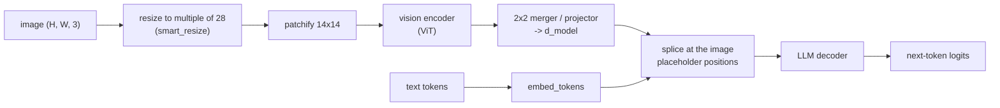

# 16 — Multimodal Fine-Tuning: Vision-Language, Audio, and Embedding Models

> **Prerequisites:** modules 05, 06 (12–13 for the alignment sections).
> **You will learn:** how to fine-tune vision-language models (what to train, what never to
> truncate), align them with DPO and GRPO, survey audio fine-tuning, and train
> embedding and reranker models with contrastive losses.

Two requests now dominate "fine-tune it for us" work outside plain chat. The first
is a vision-language model (VLM) that reads documents: receipts, invoices, charts,
screenshots, forms. TRL, Unsloth and Axolotl all support VLM SFT, DPO and GRPO, and
most of what you learned in modules 05, 06, 12 and 13 carries over. A few
VLM-specific traps do not, and they fail silently or with confusing shape errors.
The second request is "make our RAG retrieval better", which means fine-tuning an
**embedding model or a reranker**. That is a different model family with a different
loss family: contrastive, not next-token. Audio sits between the two and gets a
survey here. Read this after [module 05](./05-supervised-fine-tuning.md) (SFT) and
[module 06](./06-lora-and-qlora.md) (LoRA); the alignment sections assume
[module 12](./12-preference-optimization.md) and [module 13](./13-rl-with-verifiable-rewards.md),
and the framework surface is compared in [module 08](./08-frameworks-and-tooling.md).

---

## 16.1 How a VLM is put together

Almost every open VLM in 2026 has the same three parts:

1. A **vision encoder**: a ViT, often initialised from SigLIP or trained natively at
   dynamic resolution. It turns an image into a grid of patch vectors.
2. A **projector** (also called the connector or merger): an MLP, or a cross-attention
   resampler in older designs, that maps patch vectors into the LLM's embedding space
   and usually compresses them.
3. An **LLM decoder**: an ordinary causal LM (module 02) that sees the projected
   image vectors as if they were token embeddings.



The splice is the part that matters for fine-tuning. The text contains a placeholder
token (`<|image_pad|>` in the Qwen family) repeated **once per image token**. The model
computes image features, then overwrites the embeddings at exactly those positions. If
the number of placeholder positions differs from the number of feature vectors, the
forward pass fails with a "tokens do not match features" error.

### Dynamic resolution and the token budget

Older VLMs (LLaVA 1.5, [Liu et al., 2023](https://arxiv.org/abs/2304.08485)) resized every
image to a fixed square, so every image cost the same number of tokens. The Qwen2-VL line
([Wang et al., 2024](https://arxiv.org/abs/2409.12191)) instead patchifies at **native
resolution**: the image is resized only to the nearest size divisible by the token side,
then cut into 14×14 patches, and each 2×2 block of neighbouring patches is merged into
one token. So one image token covers 28×28 pixels in Qwen2.5-VL
([Bai et al., 2025](https://arxiv.org/abs/2502.13923)). Qwen3-VL
([Qwen Team, 2025](https://arxiv.org/abs/2511.21631)) keeps the 2×2 merge but uses 16-px
patches, so one token covers 32×32 pixels (`patch_size: 16, merge_size: 2` in the
[Qwen3-VL-8B processor config](https://huggingface.co/Qwen/Qwen3-VL-8B-Instruct/blob/0c351dd01ed87e9c1b53cbc748cba10e6187ff3b/preprocessor_config.json)).

The resize rule is `smart_resize` in Transformers
([source at v5.19.0](https://github.com/huggingface/transformers/blob/v5.19.0/src/transformers/models/qwen2_vl/image_processing_qwen2_vl.py#L63-L89)).
With $f = \text{patch} \times \text{merge} = 28$:

$$\bar h = f \cdot \text{round}(h/f), \qquad \bar w = f \cdot \text{round}(w/f), \qquad N_{\text{img}} = \frac{\bar h}{14}\cdot\frac{\bar w}{14}\cdot\frac{1}{4}$$

If $\bar h \bar w$ exceeds `max_pixels`, both sides are scaled down by
$\beta=\sqrt{hw/\text{max\_pixels}}$ and floored to multiples of $f$; if it falls below
`min_pixels`, they are scaled up and ceiled. Worked through for a 1024×1024 scan:
1024/28 = 36.57, which rounds to 37, so the image becomes 1036×1036, a 74×74 patch grid,
and **37 × 37 = 1,369 image tokens**. A 448×448 crop costs 16 × 16 = 256 tokens.

The budget depends on the checkpoint's processor config, not only the class. The
`Qwen2.5-VL-3B-Instruct` [preprocessor config](https://huggingface.co/Qwen/Qwen2.5-VL-3B-Instruct/blob/66285546d2b821cf421d4f5eb2576359d3770cd3/preprocessor_config.json)
sets `max_pixels: 12845056`, so the 1024×1024 image keeps all 1,369 tokens. The
Transformers class default is much tighter (`longest_edge = 28*28*1280` = 1,003,520
pixels), under which the same image is scaled to 980×980 and costs 1,225 tokens.
**Always compute the budget from the processor you will actually load.**

Video is the same mechanism along time: frames are sampled, consecutive pairs are
grouped (`temporal_patch_size: 2`), and positions carry a time coordinate as well as
height and width. Qwen2-VL introduced multimodal RoPE (M-RoPE), which splits the rotary
dimensions into temporal, height and width sections; Qwen3-VL's report describes an
"interleaved-MRoPE" and replaces Qwen2.5-VL's absolute time encoding with textual
timestamps. RoPE itself is in
[Transformers module 05](../transformers/05-positional-encodings.md); for the
architecture family see
[module 15 of the Transformers course](../transformers/15-modern-architecture-case-studies.md),
and for the vision side's convolutional ancestry, the [CNNs note](../../notes/deep-learning/cnns.md).

### Processors, not tokenizers

For a text model, `processing_class` is a tokenizer. For a VLM it is a **processor**,
loaded with `AutoProcessor.from_pretrained(...)`, which bundles three things:

| Part | Does | Fine-tuning consequence |
|---|---|---|
| Image processor | resize (`smart_resize`), normalise, patchify into `pixel_values`, report `image_grid_thw` | owns the pixel budget, therefore the sequence length |
| Tokenizer | text to ids, special tokens | same as module 02 |
| Chat template | renders each `{"type": "image"}` block as vision-start, one image-pad placeholder, vision-end | the processor then **expands** the placeholder into $N_{\text{img}}$ copies |

In Transformers v5 the image processors are the fast torchvision-backed ones
(the Qwen2-VL class subclasses `TorchvisionBackend` as of v5.19). The pixel budget is set with
`min_pixels`/`max_pixels` (the processor maps them onto `size={"shortest_edge",
"longest_edge"}`; Qwen3-VL's config uses the `size` dict directly). Lowering
`max_pixels` is the single biggest memory lever in VLM fine-tuning: activation memory is
linear in sequence length (attention scores are not materialised with FlashAttention or
SDPA, module 03), and one high-resolution page can cost more tokens than the whole
conversation around it. For a receipt-extraction task, 512 to 1,024 tokens per image
(`max_pixels = 1024*28*28`) is a reasonable starting range; check by eye that small print
survives the resize on your own documents before you train.

### Never truncate image tokens

TRL's `SFTConfig.max_length` defaults to **1024** (as of TRL v1.15,
[`sft_config.py`](https://github.com/huggingface/trl/blob/dae7b6adc8d2729cfa8d21bc8480656ede769240/trl/trainer/sft_config.py#L201-L210)).
Now add a 1024×1024 receipt (1,369 image tokens) to a 60-token prompt. The sequence is
already longer than 1,024 before the answer starts. Truncating at 1,024 cuts off the last
405 image tokens. `pixel_values` still holds features for 1,369 tokens, but the
text now has only 964 placeholders, so the model either crashes on the mismatch or,
worse, trains with no answer tokens at all. The TRL docs are explicit: "For VLMs,
truncating may remove image tokens, leading to errors during training. To avoid this, set
`max_length=None`"
([SFT trainer docs, v1.15.0](https://huggingface.co/docs/trl/v1.15.0/en/sft_trainer)).
The same advice is repeated for `DPOConfig`. TRL v1.15 also refuses
`truncation_mode="keep_end"` for vision datasets, because cutting from the left removes
the prompt where the images live.

**The fix is `max_length=None` plus a bounded pixel budget.** You control sequence length
through `max_pixels` and through filtering over-long text, not by cutting tokens.

The check below implements `smart_resize` with the Qwen2.5-VL-3B constants and proves the
numbers in this section, including that cutting at 1,024 breaks the placeholder count.

```python finetuning-check
import math
import torch

PATCH, MERGE = 14, 2
F_SIDE = PATCH * MERGE  # 28 px per image-token side

def smart_resize(h, w, factor=F_SIDE, min_pixels=3136, max_pixels=12845056):
    hb, wb = round(h / factor) * factor, round(w / factor) * factor
    if hb * wb > max_pixels:
        beta = math.sqrt(h * w / max_pixels)
        hb = max(factor, math.floor(h / beta / factor) * factor)
        wb = max(factor, math.floor(w / beta / factor) * factor)
    elif hb * wb < min_pixels:
        beta = math.sqrt(min_pixels / (h * w))
        hb = math.ceil(h * beta / factor) * factor
        wb = math.ceil(w * beta / factor) * factor
    return hb, wb

def n_image_tokens(h, w, **kw):
    hb, wb = smart_resize(h, w, **kw)
    return (hb // PATCH) * (wb // PATCH) // (MERGE * MERGE)

assert smart_resize(1024, 1024) == (1036, 1036)
assert n_image_tokens(1024, 1024) == 1369
assert n_image_tokens(448, 448) == 256
# the class default budget (28*28*1280 pixels) shrinks the same image to 980x980
assert smart_resize(1024, 1024, max_pixels=28 * 28 * 1280) == (980, 980)
assert n_image_tokens(1024, 1024, max_pixels=28 * 28 * 1280) == 1225

# a sequence: 60 prompt tokens, one image, then a 40-token answer
IMG = 99
prompt = list(range(1000, 1060))
seq = prompt + [IMG] * n_image_tokens(1024, 1024) + list(range(2000, 2040))
assert len(seq) == 60 + 1369 + 40 > 1024

def truncate(ids, max_length):
    return ids if max_length is None else ids[:max_length]

cut = truncate(seq, 1024)
features_expected = n_image_tokens(1024, 1024)
assert cut.count(IMG) == 1024 - 60 == 964 and cut.count(IMG) != features_expected
assert not any(2000 <= t < 2040 for t in cut)  # every answer token is gone too
kept = truncate(seq, None)
assert kept.count(IMG) == features_expected
```

It does not prove anything about other model families: LLaVA-style fixed-resolution
models, Gemma 3 and Idefics use different resize and token rules, so read their
processor source before you set a budget.

---

## 16.2 What to train

A VLM has three separately freezable parts, and the right choice depends on where
your domain shift is. For `Qwen2.5-VL-3B-Instruct` the split is 632M vision-encoder
parameters, 37M merger parameters, and 3.09B language-model parameters including the
tied embeddings (counted on the meta device from the
[config](https://huggingface.co/Qwen/Qwen2.5-VL-3B-Instruct/blob/66285546d2b821cf421d4f5eb2576359d3770cd3/config.json)).
For `Qwen3-VL-8B-Instruct` it is 416M vision, 161M across the merger and DeepStack
mergers, and 8.2B language model.

The memory column below uses module 03's mixed-precision AdamW accounting: 16 bytes per
**trainable** parameter (bf16 weight and gradient, fp32 master weight and two Adam
moments), plus 2 bytes per frozen bf16 parameter, for Qwen2.5-VL-3B. LoRA here means
$r=16$ on all seven linear projections of all 36 decoder layers:
$r(d_{in}+d_{out})$ summed per layer is
$16\cdot[2(2048+2048) + 2(2048+256) + 3(2048+11008)] = 831{,}488$, times 36 layers
$\approx 29.9$M parameters.

| Component trained | When | Extra state (Qwen2.5-VL-3B) | Main risk |
|---|---|---|---|
| LLM LoRA only (vision + projector frozen) | default; new output format, extraction schema, domain vocabulary, reasoning style | 29.9M × 16 B ≈ 0.48 GB | cannot fix what the encoder cannot see (tiny print, unusual modality) |
| LLM LoRA + projector (full) | images are in-distribution but the mapping to language is off (new chart types, dense layouts) | + 37M × 16 B ≈ 0.59 GB | small; projector overfits on tiny datasets |
| + vision tower (LoRA or full) | genuine pixel-level domain shift: medical scans, satellite, microscopy, handwriting in a new script | full: + 632M × 16 B ≈ 10.1 GB; LoRA: tens of MB | forgetting general visual skills; vLLM cannot serve LoRA on vision layers |
| Full fine-tune of everything | large in-domain corpus, T2+ hardware | 3.75B × 16 B ≈ 60 GB before activations | catastrophic forgetting (module 19), cost |

The base weights add about 7.5 GB in bf16 (or roughly 2.5 GB with 4-bit QLoRA), and the
activations of a 1,400-token multimodal sequence come on top. **LLM-only LoRA is the right
first experiment for document extraction**; you move the vision tower only after an error
analysis shows the model misreads pixels rather than mis-formats answers.

In Unsloth the switches are explicit
([vision fine-tuning docs](https://unsloth.ai/docs/basics/vision-fine-tuning), as of
October 2026). All four default to `True`:

```python
# Teaching fragment: not executed (needs unsloth and a GPU).
from unsloth import FastVisionModel

model, processor = FastVisionModel.from_pretrained("unsloth/Qwen2.5-VL-3B-Instruct", load_in_4bit=True)
model = FastVisionModel.get_peft_model(
    model,
    finetune_vision_layers=False,     # keep the ViT frozen (and vLLM-servable)
    finetune_language_layers=True,
    finetune_attention_modules=True,
    finetune_mlp_modules=True,
    r=16, lora_alpha=16, lora_dropout=0, bias="none",
)
```

With PEFT directly, express the same choice with a regex over module names, for
example `target_modules=r".*language_model.*\.(q_proj|k_proj|v_proj|o_proj|gate_proj|up_proj|down_proj)"`,
and add the merger to `modules_to_save` if you want it fully trained. Module 06 covers
the LoRA mechanics.

---

## 16.3 VLM SFT

### Data formats

TRL detects a vision dataset by an `image` column (one image per row) or an `images`
column (a list). Messages carry **content blocks**, so the template knows where each image
goes ([dataset formats, v1.15.0](https://huggingface.co/docs/trl/v1.15.0/en/dataset_formats)):

```json
{"images": ["<PIL.Image 1036x1036>"],
 "messages": [
   {"role": "user", "content": [
     {"type": "image"},
     {"type": "text", "text": "Extract merchant, date, total and items as JSON."}]},
   {"role": "assistant", "content": [
     {"type": "text", "text": "{\"merchant\": \"Cafe Lumen\", \"total\": 45500, ...}"}]}]}
```

The $k$-th `{"type": "image"}` block binds to `images[k]`, which is how multi-image and
interleaved examples work (two pages of an invoice, a before/after pair). Grounding
targets are just text, but the **coordinate convention is model-specific**: Qwen2.5-VL
emits absolute pixel coordinates in the *resized* image, Qwen3-VL is reported to use
coordinates normalised to [0, 1000], and PaliGemma uses `<locXXXX>` location tokens.
Train in the convention your base model was pretrained on, or you spend data teaching it a
new one. For general instruction data, LLaVA-Instruct-style mixes such as
[`trl-lib/llava-instruct-mix`](https://huggingface.co/datasets/trl-lib/llava-instruct-mix)
are the standard source; mixing 10 to 30 percent of general data into a narrow task set is
the usual guard against forgetting (module 19 has the evidence).

### SFTTrainer and DataCollatorForVisionLanguageModeling

VLM data cannot be pre-tokenised the way text data is, because the token count depends on
the image processor. TRL therefore **skips dataset preparation for vision datasets** and does
everything in `DataCollatorForVisionLanguageModeling`
([source at v1.15.0](https://github.com/huggingface/trl/blob/dae7b6adc8d2729cfa8d21bc8480656ede769240/trl/trainer/sft_trainer.py#L249-L292)).
Per batch it renders the chat template, runs the processor (which expands placeholders and
builds `pixel_values` and `image_grid_thw`), pads, and builds `labels`.

Be precise about what it masks. As of v1.15 the language-modelling path sets labels to
-100 for **padding**, and additionally for every non-assistant token when
`assistant_only_loss=True`; the prompt-completion path masks the prompt when
`completion_only_loss` is on (the default for prompt-completion data). Image tokens sit in
the user turn, so they leave the loss **only through one of those masks**. With a plain
`messages` dataset and `assistant_only_loss=False`, the loss includes every placeholder
position, a target the model can never predict usefully. So turn on assistant-only loss.
For vision datasets it requires `transformers>=5.18.0` (the trainer raises otherwise) and a
chat template with `` markers. TRL patches the template automatically for some
known families (its docs name Qwen3); for any other VLM, check the template yourself.

```python
# Teaching fragment: not executed (needs a GPU and downloads).
from peft import LoraConfig
from trl import SFTConfig, SFTTrainer

trainer = SFTTrainer(
    model="Qwen/Qwen2.5-VL-3B-Instruct",
    args=SFTConfig(
        max_length=None,             # never truncate image tokens
        assistant_only_loss=True,    # masks prompt AND image tokens; transformers>=5.18
        per_device_train_batch_size=2,
        gradient_accumulation_steps=8,
        gradient_checkpointing=True,
        learning_rate=2e-4,
        bf16=True,
        model_init_kwargs={"dtype": "bfloat16"},
    ),
    train_dataset=train_rows,        # list or Dataset with "images" + "messages"
    peft_config=LoraConfig(r=16, lora_alpha=32, target_modules=r".*language_model.*\.(q|k|v|o|gate|up|down)_proj"),
)
trainer.train()
```

Three other v1.15 constraints: `packing=True` and `padding_free=True` both raise on vision
datasets, and the trainer refuses a vision dataset paired with a text-only model. Unsloth's
docs add a practical one: with multi-image rows, build the training list with a
Python list comprehension instead of `Dataset.map`, which applies stricter Arrow
standardisation to nested image columns.

### Task patterns

| Pattern | Data | Target text | Watch out for |
|---|---|---|---|
| OCR / document extraction (receipts, invoices, forms) | scans + gold JSON, e.g. [CORD-v2](https://huggingface.co/datasets/naver-clova-ix/cord-v2) (800/100/100 receipts, CC-BY-4.0) | JSON with a fixed schema | pixel budget vs small print; normalise numbers before scoring |
| Chart and table QA | ChartQA-style (chart, question, short answer) | short answer, optionally a rationale | answers that paraphrase labels; relaxed numeric match |
| Grounding / detection | referring expressions + boxes ([grounding cookbook](https://huggingface.co/learn/cookbook/en/fine_tuning_vlm_object_detection_grounding), PaliGemma 2 on RefCOCO) | boxes in the model's native coordinate format | resize changes absolute coordinates |
| Screenshot / GUI agents | screenshots + actions | tool calls (`click(x, y)`, typed text) | coordinates again; multi-turn trajectories (module 15) |

---

## 16.4 VLM preference optimisation and RL

The DPO, GRPO and RLOO trainers accept the same `image`/`images` columns as SFT, and the
same `max_length=None` rule applies to `DPOConfig`
([DPO docs, v1.15.0](https://huggingface.co/docs/trl/v1.15.0/en/dpo_trainer)). The losses are
unchanged: [module 12](./12-preference-optimization.md) derives DPO and its implicit reward
([Rafailov et al., 2023](https://arxiv.org/abs/2305.18290)), and [module 13](./13-rl-with-verifiable-rewards.md) derives the
group-normalised advantages, $\hat A_i = (r_i - \text{mean}(r))/\text{std}(r)$ in the original
GRPO form. What changes is the data and which failure you are attacking.

**Hallucination is the dominant VLM failure.** The model describes objects, text or fields
that are not in the image. RLAIF-V ([Yu et al., 2024](https://arxiv.org/abs/2405.17220))
builds preference pairs aimed at it without human labels: sample several responses, split
each into atomic claims, have an open-source MLLM verify each claim against the image, and
prefer the response with fewer unsupported claims. The resulting
[`openbmb/RLAIF-V-Dataset`](https://huggingface.co/datasets/openbmb/RLAIF-V-Dataset) is
licensed CC-BY-NC-4.0, so it is fine for research and not for a commercial model; TRL ships a
pre-formatted copy, `HuggingFaceH4/rlaif-v_formatted`, in its DPO docs example. The general
lesson transfers: **for VLM DPO, the rejected answer should differ from the chosen one in
grounding, not in style**.

**MPO (Mixed Preference Optimization)**
([Wang et al., 2024](https://arxiv.org/abs/2411.10442)) addresses two problems the authors
observed in multimodal reasoning: SFT alone suffers distribution shift, and DPO alone can
produce incoherent or repetitive rationales. MPO sums three losses: the DPO sigmoid
preference loss, a BCO quality loss (each response judged good or bad on its own), and an SFT
loss on the chosen answer. In TRL it is a configuration of `DPOTrainer`, since `loss_type`
accepts a list (module 12 lists the loss types):

```python
# Teaching fragment: not executed.
from trl import DPOConfig
mpo_config = DPOConfig(
    loss_type=["sigmoid", "bco_pair", "sft"],
    loss_weights=[0.8, 0.2, 1.0],   # the MPO paper's weights, per the TRL docs
    max_length=None,
)
```

The HF [VLM alignment post](https://huggingface.co/blog/trl-vlm-alignment) relays the
paper's claim that switching to this combined loss gave 6.2 points on MathVista; that is
the authors' result on their model and data, not a guarantee for yours.

**GRPO for visual reasoning** works whenever the answer is checkable: a number for a
geometry figure, a multiple-choice letter, a JSON object that must match. The reference
recipe is TRL's `grpo_visual_math.py` on
[`lmms-lab/multimodal-open-r1-8k-verified`](https://huggingface.co/datasets/lmms-lab/multimodal-open-r1-8k-verified)
(7,689 image/problem/solution rows) with Qwen2.5-VL-3B, a format reward and an accuracy
reward checked with `math_verify`. Advantages are the group-normalised rewards of
module 13; nothing about them is visual. The practical differences are memory (every one of
the $G$ completions re-encodes the image's tokens in the policy forward pass) and serving:
the TRL GRPO docs list Gemma 3, LLaVA-NeXT, Qwen2-VL, Qwen2.5-VL and SmolVLM2 as tested, and
Unsloth's vision-RL guide warns that **vLLM does not support LoRA on vision layers**, so set
`finetune_vision_layers=False` when generation runs in vLLM. Unsloth added multi-image
GRPO in May 2026 ([PR #5197](https://github.com/unslothai/unsloth/pull/5197)), which
matters for tasks such as "compare these two pages". GRPO tools can also return images
to the model mid-rollout (screenshots, plots), the basis for VLM agent RL (module 15).

---

## 16.5 Evaluating VLM fine-tunes

[Module 09](./09-evaluating-fine-tuned-models.md) owns evaluation design. Three things are
specific to VLMs.

**Task metric: field-level precision, recall and F1.** Exact-match on the whole JSON object
is too harsh (one wrong digit zeroes a 20-field receipt), and string similarity is too
lenient. Score each field as a unit after **normalisation**: strip and lowercase strings,
collapse whitespace, parse money to a number (`"45,500"` and `"45500"` agree), parse dates
to ISO. A list field such as `items` contributes one unit per element, matched as a
multiset. Then count over every unit in the eval set:

- true positive: predicted field present and equal to gold after normalisation;
- false positive: a predicted field that is wrong, **or present when gold has no such field**
  (a hallucinated field);
- false negative: a gold field that is missing or wrong.

A wrong value counts as one FP and one FN. Micro-averaging pools the counts:
$P = \frac{\sum TP}{\sum TP + \sum FP}$, $R = \frac{\sum TP}{\sum TP + \sum FN}$,
$F_1 = \frac{2PR}{P+R}$.

Worked example with two receipts. The model gets both merchants (one only after stripping
and lowercasing), both totals (one written `45500`, one `18,000.00`), one of two dates, and
4 of 5 items. That is TP = 9, FP = 1 (the wrong date), FN = 2 (the wrong date and the missed
item): **P = 0.9, R = 9/11 = 0.8182, F1 = 0.8571**. Now let the model also invent a `tax`
field that is not on the first receipt. FP rises to 2, nothing else changes:
**P = 9/11 = 0.8182, R still 0.8182**. Recall cannot see hallucinations; precision can.

```python finetuning-check
from collections import Counter

def norm_text(s):
    return " ".join(str(s).strip().lower().split())

def norm_money(s):
    return round(float(str(s).replace(",", "").strip()), 2)

def units(rec):
    u = Counter()
    for k, v in rec.items():
        if k == "items":
            for it in v:
                u[("items", norm_text(it))] += 1
        elif k in ("total", "tax"):
            u[(k, norm_money(v))] += 1
        else:
            u[(k, norm_text(v))] += 1
    return u

def score(gold, pred):
    per, tp, fp, fn = {}, 0, 0, 0
    for g, p in zip(gold, pred):
        G, P = units(g), units(p)
        for key in set(G) | set(P):
            t = min(G[key], P[key]); a = P[key] - t; b = G[key] - t
            row = per.setdefault(key[0], [0, 0, 0])
            row[0] += t; row[1] += a; row[2] += b
            tp += t; fp += a; fn += b
    return per, tp, fp, fn

gold = [
    {"merchant": "Cafe Lumen", "date": "2026-03-14", "total": "45,500",
     "items": ["Real Ganache", "Egg Tart", "Pizza Toast"]},
    {"merchant": "Kopi Pagi", "date": "2026-03-15", "total": "18,000",
     "items": ["Iced Latte", "Croissant"]},
]
pred = [
    {"merchant": " cafe lumen ", "date": "2026-03-14", "total": "45500",
     "items": ["real ganache", "egg tart"]},
    {"merchant": "Kopi Pagi", "date": "2026-03-16", "total": "18,000.00",
     "items": ["Iced Latte", "Croissant"]},
]
per, tp, fp, fn = score(gold, pred)
assert (tp, fp, fn) == (9, 1, 2)
assert per["merchant"] == [2, 0, 0] and per["total"] == [2, 0, 0]
assert per["date"] == [1, 1, 1]           # P = R = 0.5 for the date field
assert per["items"] == [4, 0, 1]          # items: P = 1.0, R = 0.8
P, R = tp / (tp + fp), tp / (tp + fn)
F1 = 2 * P * R / (P + R)
assert round(P, 4) == 0.9 and round(R, 4) == 0.8182 and round(F1, 4) == 0.8571

# hallucinated field: precision drops, recall does not move
pred_h = [dict(pred[0], tax="4,136"), pred[1]]
_, tp2, fp2, fn2 = score(gold, pred_h)
P2, R2 = tp2 / (tp2 + fp2), tp2 / (tp2 + fn2)
assert (tp2, fp2, fn2) == (9, 2, 2)
assert P2 < P and R2 == R and round(P2, 4) == 0.8182
```

It does not prove your normalisation rules are right for your documents (currencies with
"." thousands separators, dates in day-month order); write them per field and test them
on real disagreements.

**Capability regression: MMMU and ChartQA.** A narrow fine-tune can quietly damage general
visual reasoning. lm-evaluation-harness has `hf-multimodal` and `vllm-vlm` model types with
an `mmmu_val` group (accuracy over 900 validation questions, some multi-image) and a
`chartqa` task (exact match, with `chartqa_llama` variants)
([task READMEs at v0.4.13](https://github.com/EleutherAI/lm-evaluation-harness/tree/v0.4.13/lm_eval/tasks/mmmu)).
Its README still describes multimodal support as a prototype and points to
[lmms-eval](https://github.com/EvolvingLMMs-Lab/lmms-eval) for broader coverage. Run the
same harness, prompt and image budget before and after; the delta matters, not the
absolute number.

**Hallucination checks.** Count fields and objects the model asserts that are not in the
image. For extraction, the per-field FP rate on fields absent from gold (the `tax` case
above) is the direct measure. For captioning or VQA, sample outputs, extract claimed
objects, and check them against annotations or a stronger judge. Report it separately
from F1, because a model can gain F1 while hallucinating more.

---

## 16.6 Audio and speech (survey)

Audio follows the same encoder-plus-decoder logic; the [speech and audio note](../../notes/nlp/speech-and-audio.md)
covers the signal-processing basics.

**ASR with Whisper.** Whisper ([Radford et al., 2022](https://arxiv.org/abs/2212.04356)) is an
encoder-decoder transformer trained on 680k hours of weakly supervised audio. Input is a
30-second window converted to a log-Mel spectrogram (80 bins; 128 in large-v3); the
decoder generates text with special tokens for language and task. Fine-tuning is plain
seq2seq cross-entropy on (audio, transcript) pairs with `WhisperProcessor` (feature
extractor plus tokenizer) and `Seq2SeqTrainer`; common reasons are an under-served
language, accents, or domain vocabulary such as drug names. The metric is **word error
rate**, $\text{WER} = (S + D + I)/N$ (substitutions, deletions, insertions over reference
words), computed after the same text normalisation on both sides. Freezing the encoder and
training the decoder (or LoRA on both) is the usual low-memory recipe.

**TTS.** Speaker or style adaptation fine-tunes a pretrained TTS model on minutes to hours
of one voice. Modern open TTS models are LLMs over discrete audio-codec tokens, so the
training step is ordinary next-token SFT on codec tokens; quality is judged by listening
tests and by the WER of an ASR model run on the output. Consent and voice-cloning misuse
belong in module 19's checklist.

**Audio-LLMs.** Models such as Voxtral ([Mistral, 2025](https://arxiv.org/abs/2507.13264);
3B and 24B, Apache-2.0) put an audio encoder and projector in front of an LLM, exactly like a
VLM. Axolotl has a [Voxtral guide](https://docs.axolotl.ai/docs/models/voxtral.html) with
text-only and text-plus-audio QLoRA configs in OpenAI-style multi-content messages. As of
October 2026 that guide lists preference tuning and RL for Voxtral as future work, so treat
audio-LLM fine-tuning as SFT-only in Axolotl.

---

## 16.7 Embedding models

An embedding model maps a text (or image) to one vector so that cosine similarity tracks
relevance. RAG retrieval quality is mostly decided here (see the
[RAG and retrieval note](../../notes/nlp/rag-and-retrieval.md) and
[text representation note](../../notes/nlp/text-representation.md)). Off-the-shelf
embedders are trained on web-scale pairs; on your domain (internal tickets, legal
clauses, part numbers) they often rank a near-miss above the answer. Fine-tuning fixes that
with a few thousand (query, relevant passage) pairs, which you can mine from logs or
synthesise with an LLM (module 04).

### MultipleNegativesRankingLoss: InfoNCE with in-batch negatives

The [contrastive learning note](../../notes/deep-learning/self-supervised-learning.md) has the
general idea. Concretely: a batch holds $B$ pairs $(q_i, d_i)$. Every other document in the
batch serves as a negative for $q_i$, so you get $B-1$ negatives per query for free. With
scale $s$:

$$\mathcal{L}_{\text{MNRL}} = -\frac{1}{B}\sum_{i=1}^{B} \log \frac{\exp\big(s\cos(q_i,d_i)\big)}{\sum_{j=1}^{B}\exp\big(s\cos(q_i,d_j)\big)}$$

This is cross-entropy over a $B\times B$ similarity matrix with the diagonal as the target
class. In Sentence Transformers, `MultipleNegativesRankingLoss` defaults to `scale=20.0`,
equivalent to temperature 0.05, with cosine similarity
([source at v6.1.0](https://github.com/huggingface/sentence-transformers/blob/b0bf39968ba461c34b29372144794eff1be06f6d/sentence_transformers/sentence_transformer/losses/multiple_negatives_ranking.py#L17-L31)).
The scale matters because cosines live in $[-1,1]$: without it, the softmax is nearly
uniform and gradients are weak.

**Why batch size matters.** The loss is a $B$-way classification. With $B=8$ the model only
has to beat 7 random passages; with $B=256$ it has to beat 255, and the hardest of them start
to look like real competitors. Larger batches give harder, more informative negatives, which
is why embedding papers train with batches in the thousands. Two consequences:

- **Duplicates poison the batch.** If two rows share a positive, one row's positive is the
  other's "negative". Use `batch_sampler=BatchSamplers.NO_DUPLICATES`.
- **Memory caps $B$.** `CachedMultipleNegativesRankingLoss` implements GradCache
  ([Gao et al., 2021](https://arxiv.org/abs/2101.06983)): embed the whole batch without
  gradients in mini-batches (`mini_batch_size=32` by default), compute the loss and the
  gradient with respect to the **embeddings**, then re-run each mini-batch with gradients and
  backpropagate those cached embedding gradients. The result matches the large-batch loss
  with roughly mini-batch memory, at the cost of about one extra forward pass. On a single
  T4 this is how you train with $B=1024$.

### Hard negatives and the false-negative trap

Random in-batch negatives become easy quickly. **Hard negatives** are passages that look
relevant but are not: the same product's other manual page, the clause from the previous
contract version. Adding one per row turns the batch into $(q_i, d_i, n_i)$, and the
denominator now runs over $2B$ candidates: all positives and all hard negatives.
`sentence_transformers.util.mine_hard_negatives` retrieves top candidates with an existing
embedder (optionally rescored by a cross-encoder) and writes them as new columns; key
arguments are `range_min`/`range_max` (which ranks to sample from), `num_negatives`,
`absolute_margin`/`relative_margin`, and `sampling_strategy`.

The danger is the **false negative**: your corpus contains a second passage that also answers
the query, but only one is labelled. Mining it as a negative teaches the model to push away a
correct answer. Two standard filters: skip the very top ranks (`range_min=10`), and require
the negative to score clearly below the positive (a margin, e.g. `relative_margin=0.05` keeps
only candidates scoring under 95 percent of the positive's similarity). The lab's smoke run
skips candidates within an absolute margin of 0.05.

### Matryoshka embeddings

Storage and search cost scale with dimension. Matryoshka Representation Learning
([Kusupati et al., 2022](https://arxiv.org/abs/2205.13147)) trains the first $m$ coordinates
to work as an embedding on their own, for several $m$ at once:

$$\mathcal{L}_{\text{Matryoshka}} = \sum_{m \in \{768, 512, 256, 128, 64\}} c_m \,\mathcal{L}_{\text{MNRL}}\big(q_{1:m},\, d_{1:m}\big)$$

where $q_{1:m}$ is truncated **then** re-normalised inside the cosine. `MatryoshkaLoss(model,
base_loss, matryoshka_dims=[...], matryoshka_weights=[...])` wraps any base loss this way. At
serving time you truncate to 256 or 128 dimensions and lose a little quality instead of a lot.

### The trainer

Sentence Transformers v3 replaced `model.fit` with `SentenceTransformerTrainer`, a
Transformers-`Trainer` subclass taking a `datasets.Dataset`, a loss, and
`SentenceTransformerTrainingArguments`. v4 brought the same design to `CrossEncoderTrainer`,
v5 added `SparseEncoder`, and v6 (August 2026) added `MultiVectorEncoder` and moved to
Transformers v5. In v6 the losses import from `sentence_transformers.sentence_transformer.losses`
([training overview](https://sbert.net/docs/sentence_transformer/training_overview.html)).

```python
# Teaching fragment: not executed (needs sentence-transformers[train] 6.x and downloads).
from sentence_transformers import SentenceTransformer, SentenceTransformerTrainer, SentenceTransformerTrainingArguments
from sentence_transformers.sentence_transformer.losses import MatryoshkaLoss, MultipleNegativesRankingLoss
from sentence_transformers.sentence_transformer.training_args import BatchSamplers
from sentence_transformers.util import mine_hard_negatives

model = SentenceTransformer("BAAI/bge-small-en-v1.5")            # 384-dim
train = mine_hard_negatives(pairs, model, num_negatives=1, range_min=10, range_max=50,
                            relative_margin=0.05, output_format="triplet")   # anchor, positive, negative
loss = MatryoshkaLoss(model, MultipleNegativesRankingLoss(model), matryoshka_dims=[384, 256, 128, 64])
args = SentenceTransformerTrainingArguments(output_dir="out", per_device_train_batch_size=64,
                                            learning_rate=2e-5, num_train_epochs=3,
                                            batch_sampler=BatchSamplers.NO_DUPLICATES)
SentenceTransformerTrainer(model=model, args=args, train_dataset=train, loss=loss).train()
```

**LoRA for embedders** works through `model.add_adapter(LoraConfig(...))`; it helps when the
backbone is a multi-billion-parameter LLM-based embedder, less so for a 33M-parameter
`bge-small`, where full fine-tuning already fits on a T4.

### Measuring retrieval: NDCG@10

Retrieval metrics score the ranked list. With graded relevance $rel_i$ at rank $i$:

$$\text{DCG@}k = \sum_{i=1}^{k} \frac{2^{rel_i}-1}{\log_2(i+1)}, \qquad \text{NDCG@}k = \frac{\text{DCG@}k}{\text{IDCG@}k}$$

where IDCG is the DCG of the ideal ordering. Example: a query has one passage with relevance
3, two with 2 and one with 1. A model ranks them at positions 2, 4, 9 and 6 (relevances in
rank order `[0, 3, 0, 2, 0, 1, 0, 0, 2, 0]`): DCG = 6.9678, IDCG = 10.8235,
**NDCG@10 = 0.6438**. Moving the best passage to rank 1 and tightening the rest
(`[3, 2, 0, 1, 0, 0, 2, 0, 0, 0]`) gives 0.9538.

The check below computes MNRL by hand and against `F.cross_entropy`, shows that pulling a
query toward its positive lowers the loss and adding a hard-negative column raises it, and
reproduces both NDCG numbers.

```python finetuning-check
import math
import torch
import torch.nn.functional as F

torch.manual_seed(0)
B, d, s = 4, 8, 20.0
q = torch.randn(B, d)
docs = torch.randn(B, d)

def cos_matrix(a, b):
    return F.normalize(a, dim=-1) @ F.normalize(b, dim=-1).T   # (B, B') cosines

def mnrl(q, docs, s=20.0):
    return F.cross_entropy(s * cos_matrix(q, docs), torch.arange(q.shape[0]))

# by hand: log-softmax over each row, take the diagonal
logits = s * cos_matrix(q, docs)
by_hand = -(logits.diag() - torch.logsumexp(logits, dim=1)).mean()
torch.testing.assert_close(by_hand, mnrl(q, docs), atol=1e-6, rtol=1e-6)

# moving query 0 toward its positive lowers the loss
q_moved = q.clone()
q_moved[0] = 0.5 * q[0] + 0.5 * docs[0]
assert mnrl(q_moved, docs) < mnrl(q, docs)

# a hard negative for query 0 (close to its positive) adds a column and raises the loss
hard = docs[0] + 0.1 * torch.randn(d)
negs = torch.stack([hard] + [torch.randn(d) for _ in range(B - 1)])
with_hard = F.cross_entropy(s * cos_matrix(q, torch.cat([docs, negs])), torch.arange(B))
assert with_hard > mnrl(q, docs)

def ndcg_at_k(rels, k=10):
    dcg = sum((2 ** r - 1) / math.log2(i + 2) for i, r in enumerate(rels[:k]))
    ideal = sorted(rels, reverse=True)[:k]
    idcg = sum((2 ** r - 1) / math.log2(i + 2) for i, r in enumerate(ideal))
    return dcg, idcg, dcg / idcg

dcg, idcg, ndcg = ndcg_at_k([0, 3, 0, 2, 0, 1, 0, 0, 2, 0])
assert round(dcg, 4) == 6.9678 and round(idcg, 4) == 10.8235 and round(ndcg, 4) == 0.6438
assert round(ndcg_at_k([3, 2, 0, 1, 0, 0, 2, 0, 0, 0])[2], 4) == 0.9538
```

It does not prove that a larger batch or mined negatives improve *your* retriever; that is an
empirical question you answer with NDCG@10 on held-out queries, as in the lab.

| Loss | Data format | Use when |
|---|---|---|
| `MultipleNegativesRankingLoss` | (anchor, positive) or (anchor, positive, negative...) | default for retrieval; only positives needed |
| `CachedMultipleNegativesRankingLoss` | same | you want batch sizes of 512+ on limited memory (GradCache) |
| `CoSENTLoss` / `AnglELoss` | (text1, text2, score in [0,1]) | graded similarity labels (STS-style), not retrieval pairs |
| `TripletLoss` | (anchor, positive, negative) | legacy margin objective; MNRL with a negative column is usually stronger |
| `MatryoshkaLoss` (wrapper) | whatever the base loss takes | you will truncate embeddings to save index memory |
| `MarginMSELoss` (distillation) | (query, pos, neg, teacher margin) | distil a cross-encoder's score margins into a bi-encoder |

---

## 16.8 Rerankers, sparse and late-interaction models

Retrieval stacks usually combine a fast first stage with a slower, sharper second stage.
Four model types, all trainable in Sentence Transformers v6:

| Model | Scores | Index | Cost per query | Train with |
|---|---|---|---|---|
| Bi-encoder (dense) | $\cos(E(q), E(d))$ | one vector per doc | one encode + ANN search | MNRL family (16.7) |
| Cross-encoder (reranker) | $f([q; d])$, joint attention | none | one forward per (q, d) pair | `CrossEncoderTrainer` |
| Sparse (SPLADE) | dot product of vocab-sized sparse vectors | inverted index | one encode + sparse lookup | `SparseEncoder`, `SpladeLoss` |
| Late interaction (ColBERT) | MaxSim over token vectors | one vector per token | encode + MaxSim over candidates | `MultiVectorEncoder` (v6) |

**Cross-encoders** read query and document together, so every query token can attend to every
document token. They are the most accurate and cannot be pre-computed, so you use them to
rerank the top 50 to 100 from a first stage. Training uses `BinaryCrossEntropyLoss` on
(query, passage, label) rows, `CachedMultipleNegativesRankingLoss`, or listwise losses
(`ListNetLoss`, `LambdaLoss`) over a candidate list, usually with mined hard negatives as
the 0-labelled rows.

**SPLADE** ([Formal et al., 2021](https://arxiv.org/abs/2107.05720)) uses the MLM head to put a
weight on every vocabulary entry, so a document about "car" also lights up "vehicle". To keep
the vectors sparse enough for an inverted index, training adds a **FLOPS regulariser**, the sum
over vocabulary terms of the squared mean activation across the batch, which penalises terms
that fire often. In Sentence Transformers, `SpladeLoss` wraps a ranking loss plus
`FlopsLoss` with separate query and document regulariser weights. Sparse models are strong on
exact identifiers and out-of-domain text, and they compose naturally with BM25-style
infrastructure. Note that the popular `naver/splade-v3` checkpoint is CC-BY-NC-SA-4.0.

**ColBERT** ([Khattab and Zaharia, 2020](https://arxiv.org/abs/2004.12832)) keeps one vector
per token and scores with $\text{MaxSim}(Q,D) = \sum_i \max_j Q_i\cdot D_j$. The Sentence
Transformers v6 release reports a controlled comparison: LightOn's LateOn (multi-vector, 128-d)
and DenseOn (dense, 768-d), same ModernBERT backbone, data and size, average NDCG@10 0.6868 vs
0.6764 over 13 NanoBEIR sets, with LateOn winning 9 of 13. The cost was index size: about 125
token vectors per Natural Questions passage, so the float32 index was roughly 20 to 40 times
larger than the dense baselines in the same table. That is the trade-off in one line: about a
point of NDCG for a much bigger index.

**How to choose.** Start with a fine-tuned bi-encoder; add a cross-encoder reranker when
top-10 precision matters more than latency; consider SPLADE or hybrid BM25 when queries hinge
on exact codes and names; consider ColBERT when you can afford the index and need token-level
matching, including on page images. Decide with NDCG@10 and Recall@100 on your held-out
queries, measured end to end (first stage plus reranker), plus p95 latency.

**Classifiers and reward heads.** `AutoModelForSequenceClassification` on an LLM backbone (a
pooled last-token head) is the same "score, don't generate" idea;
[module 05](./05-supervised-fine-tuning.md) covers LoRA for classification heads and module 12 covers reward models.

**Frontier awareness: diffusion LMs.** TRL v1.15 ships an
[`sft_diffusion_gemma.py` example](https://github.com/huggingface/trl/blob/dae7b6adc8d2729cfa8d21bc8480656ede769240/examples/sft_diffusion_gemma/sft_diffusion_gemma.py)
for `google/diffusiongemma-26B-A4B-it`, a block-diffusion LM: a causal encoder reads the clean
context, and a bidirectional decoder denoises a block of response tokens ("the canvas")
corrupted by replacing tokens with random vocabulary tokens at a sampled rate. The loss is
cross-entropy against the clean block, plus an autoregressive co-loss on the encoder; LoRA
rank 16 on attention and dense-MLP linears, with experts and the vision tower frozen. You do
not need this for production in 2026, but it shows SFT's data and masking ideas surviving a
change of generative objective.

For serving, embedders and rerankers are "pooling models" in vLLM
([inference course: LoRA and pooling models](/courses/inference/07-architectures/07-05-lora-and-pooling-models.html)),
and VLMs have their own serving constraints
([multimodal serving](/courses/inference/07-architectures/07-04-multimodal-serving.html));
[module 20](./20-production-serving-and-cost.md) covers adapter deployment.

---

## 16.9 Lab: receipts with a VLM, and a domain retriever

Two scripts, each with a CPU smoke path and a GPU full path:
[`vlm_sft.py`](./code/vlm_sft.py) and [`embedding_finetune.py`](./code/embedding_finetune.py).

### L16.1 VLM LoRA SFT on receipts (T0/T1)

- **Model:** `Qwen/Qwen2.5-VL-3B-Instruct` (T0 with QLoRA in fp16, or T1 in bf16; licence
  is the Qwen Research licence, so check it before commercial use) or
  `Qwen/Qwen3-VL-8B-Instruct` (Apache-2.0; T1 with `--qlora`).
- **Data:** [`naver-clova-ix/cord-v2`](https://huggingface.co/datasets/naver-clova-ix/cord-v2)
  (CC-BY-4.0): 800 train, 100 validation, 100 test receipts; `ground_truth` holds a `gt_parse`
  JSON with `menu` items (`nm`, `cnt`, `price`) and `total`.
- **Steps:** convert each row to `images` + `messages` with the target JSON as the assistant
  turn; set `max_pixels` for about 1,024 image tokens; LoRA $r=16$ on the language model only;
  `max_length=None`, `assistant_only_loss=True`; train 2 epochs; generate greedily on the test
  split and score field-level micro P/R/F1 with the normalisation from 16.5.
- **Smoke first.** The CPU path checks the token budget (1,369 and 256 tokens), builds
  assistant-only labels and asserts that no image or padding token reaches the loss, confirms
  the truncation guard rejects `max_length=1024` for a 1024×1024 image, and trains a toy VLM
  with a frozen vision encoder until it reads a colour from the image (accuracy 1.00).

```bash
python content/courses/finetuning/code/vlm_sft.py --smoke
python content/courses/finetuning/code/vlm_sft.py --full --model Qwen/Qwen2.5-VL-3B-Instruct
python content/courses/finetuning/code/vlm_sft.py --full --model Qwen/Qwen3-VL-8B-Instruct --qlora
```

**Record:** base-model F1 vs fine-tuned F1, per-field P/R, the FP count on fields absent from
gold, peak memory, and tokens per image. **Expect** a large jump in JSON validity and field F1
over the zero-shot base model, mostly from the schema; remaining errors concentrate in item
names and small print. If they do, raise the pixel budget before touching the vision tower.

### L16.2 VLM GRPO on visual math (T1/T2)

Run TRL's reference recipe on
[`lmms-lab/multimodal-open-r1-8k-verified`](https://huggingface.co/datasets/lmms-lab/multimodal-open-r1-8k-verified)
with `Qwen/Qwen2.5-VL-3B-Instruct`, LoRA on the language model, colocated vLLM and
`max_completion_length=1024`, following the
[GRPO docs' VLM section](https://huggingface.co/docs/trl/v1.15.0/en/grpo_trainer) (the script is
`examples/grpo_visual_math/grpo_visual_math.py` in the TRL repository at v1.15.0). The CPU
smoke for the GRPO mechanics lives in module 13. **Record** accuracy reward, format reward,
completion length and the fraction of groups with zero reward variance. **Expect** the format
reward to saturate early and accuracy to move slowly; on a 3B model treat it as a mechanics lab.

### L16.3 Embedding fine-tune with MNRL and hard negatives (T0)

- **Model:** `BAAI/bge-small-en-v1.5` (MIT, 384-d).
- **Data:** [`philschmid/finanical-rag-embedding-dataset`](https://huggingface.co/datasets/philschmid/finanical-rag-embedding-dataset)
  (7,000 question/context pairs from a 10-K filing; the card states no licence, so use it for
  learning only). Hold out 10 percent of questions; retrieve over all 7,000 contexts.
- **Steps:** NDCG@10 of the base model with `InformationRetrievalEvaluator`; mine one hard
  negative per pair (`range_min=10`, `relative_margin=0.05`); train MNRL inside
  `MatryoshkaLoss` with `NO_DUPLICATES` batches of 64 for 3 epochs; NDCG@10 again, at 384 and at
  64 dimensions.
- **Smoke first.** The CPU path trains a bag-of-embeddings encoder on a synthetic corpus where
  queries use synonyms of the document tokens. It asserts NDCG@10 on held-out queries rises
  from under 0.35 (0.107 in the reference run) to over 0.80 (0.903), and that 16-dimensional
  Matryoshka truncation still scores over 0.70 (0.893).

```bash
python content/courses/finetuning/code/embedding_finetune.py --smoke
python content/courses/finetuning/code/embedding_finetune.py --full
```

**Record:** NDCG@10 before and after, with and without mined negatives, and at each Matryoshka
dimension. **Expect** a clear gain on held-out in-domain questions, a smaller gain from hard
negatives than from fine-tuning itself (the smoke run shows the same pattern: 0.900 after pairs,
0.903 after hard negatives), and a modest drop at 64 dimensions.

---

## Key takeaways

- **A VLM is encoder + projector + LLM, joined at placeholder tokens.** One placeholder per
  image token; feature count and placeholder count must match or training breaks.
- **Image tokens are often most of the sequence.** Qwen2.5-VL spends one token per 28×28 pixels:
  1,369 tokens for a 1024×1024 page under the 3B checkpoint's budget, versus 256 for 448×448.
- **Set `max_length=None` for VLM SFT and DPO, and bound length with `max_pixels`.** TRL's default
  of 1,024 would cut image tokens mid-image.
- **The processor, not the tokenizer, owns the sequence length.** Compute budgets from the
  checkpoint's processor config, which can differ from the class default (1,369 vs 1,225 tokens).
- **Start with LLM-only LoRA.** About 30M trainable parameters on Qwen2.5-VL-3B; train the
  projector next, and the vision tower only for real pixel-level domain shift.
- **Use assistant-only loss for vision chat data.** TRL's VLM collator masks padding; image and
  prompt tokens leave the loss only through assistant-only or completion-only masking
  (`transformers>=5.18` for vision).
- **VLM preference data should target grounding.** RLAIF-V pairs differ in unsupported claims, and
  MPO adds BCO and SFT terms to DPO to keep rationales coherent.
- **VLM GRPO is module 13's GRPO with images in the prompt.** You need a checkable answer, and if
  rollouts run in vLLM, the vision layers have to stay frozen.
- **Score extraction with normalised, micro-averaged field-level F1, and report hallucinations as
  their own number.** Hallucinated fields lower precision and leave recall unchanged.
- **MNRL is a $B$-way softmax over scaled cosines.** Bigger batches mean more negatives, and
  GradCache (CachedMNRL) gets you those batches without the memory.
- **Hard negatives help only if they are truly negative.** Skip the top ranks and require a
  margin below the positive to avoid mining false negatives.
- **Matryoshka training makes truncated embeddings usable.** It sums the loss over nested
  prefixes, so you can choose index size at serving time.
- **Choose the retriever by measurement.** Bi-encoder first, a cross-encoder to rerank, SPLADE or
  ColBERT when exact matching or token-level evidence matters; compare with end-to-end NDCG@10
  and latency.

## Self-check

1. How would you fine-tune a VLM for invoice extraction on a single 24 GB GPU? What would you
   train, what would you freeze, and what must never be truncated?
2. How do you fine-tune an embedding model for domain retrieval, and why do batch size and
   hard negatives matter for MNRL?
3. When would you choose a cross-encoder reranker, a bi-encoder, or a late-interaction model,
   and how would you evaluate the choice?

---

**Next → [17 — Long-Context Extension and Long-Sequence Training](./17-long-context-extension.md)**
