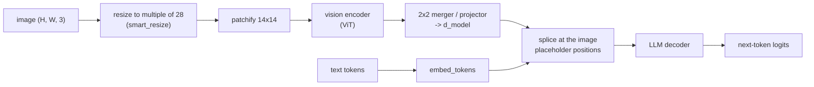

# 16 — Multimodal Fine-Tuning: Vision-Language, Audio, and Embedding Models

> **Prerequisites:** modules 05, 06 (12–13 for the alignment sections).
> **You will learn:** how to fine-tune vision-language models (what to train, what never to
> truncate), align them with DPO and GRPO, survey audio fine-tuning, and train
> embedding and reranker models with contrastive losses.

Two requests dominate fine-tuning work outside plain chat. The first is a vision-language
model (VLM) that reads documents: receipts, invoices, charts, screenshots. Most of
[module 05](./05-supervised-fine-tuning.md) carries over, but a few VLM traps fail silently or
with confusing shape errors. The second is "make our RAG retrieval better", which means
fine-tuning an **embedding model or a reranker**: a different model family with a contrastive
loss. Audio sits between the two and gets a survey.

---

## 16.1 How a VLM is put together

Almost every open VLM in 2026 has three parts: a **vision encoder** (a ViT, often from
SigLIP) that turns an image into patch vectors; a **projector** (connector, merger), usually
an MLP that maps and compresses those vectors into the LLM's embedding space; and an ordinary
causal **LLM decoder** (module 02) that treats them as token embeddings.



The splice is what matters for fine-tuning. The text holds a placeholder (`<|image_pad|>` in
Qwen) repeated **once per image token**, and the model overwrites those embeddings with image
features. If placeholder count and feature count differ, the forward pass fails with a
"tokens do not match features" error.

### Dynamic resolution and the token budget

LLaVA 1.5 ([Liu et al., 2023](https://arxiv.org/abs/2304.08485)) resized every image to a fixed
square, so every image cost the same tokens. The Qwen2-VL line
([Wang et al., 2024](https://arxiv.org/abs/2409.12191)) patchifies at **native resolution**:
resize to the nearest multiple of the token side, cut 14×14 patches, merge each 2×2 block into
one token. One token covers 28×28 pixels in Qwen2.5-VL ([Bai et al., 2025](https://arxiv.org/abs/2502.13923))
and 32×32 in Qwen3-VL ([Qwen Team, 2025](https://arxiv.org/abs/2511.21631); `patch_size: 16, merge_size: 2` in the
[Qwen3-VL-8B processor config](https://huggingface.co/Qwen/Qwen3-VL-8B-Instruct/blob/0c351dd01ed87e9c1b53cbc748cba10e6187ff3b/preprocessor_config.json)).

The resize rule is `smart_resize` in Transformers
([source at v5.19.0](https://github.com/huggingface/transformers/blob/v5.19.0/src/transformers/models/qwen2_vl/image_processing_qwen2_vl.py#L63-L89)).
With $f = \text{patch} \times \text{merge} = 28$:

$$\bar h = f \cdot \text{round}(h/f), \qquad \bar w = f \cdot \text{round}(w/f), \qquad N_{\text{img}} = \frac{\bar h}{14}\cdot\frac{\bar w}{14}\cdot\frac{1}{4}$$

If $\bar h \bar w$ exceeds `max_pixels`, both sides are scaled down by
$\lambda=\sqrt{hw/\text{max\_pixels}}$ and floored to multiples of $f$; if it falls below
`min_pixels`, they are scaled up and ceiled. Worked through for a 1024×1024 scan:
1024/28 = 36.57, which rounds to 37, so the image becomes 1036×1036, a 74×74 patch grid,
and **37 × 37 = 1,369 image tokens**. A 448×448 crop costs 16 × 16 = 256 tokens.

The budget depends on the checkpoint's processor config, not only the class. The
`Qwen2.5-VL-3B-Instruct` [preprocessor config](https://huggingface.co/Qwen/Qwen2.5-VL-3B-Instruct/blob/66285546d2b821cf421d4f5eb2576359d3770cd3/preprocessor_config.json)
sets `max_pixels: 12845056`, so the image keeps all 1,369 tokens; under the class default
(`longest_edge = 28*28*1280` = 1,003,520 pixels) it shrinks to 980×980 and 1,225 tokens.
**Compute the budget from the processor you will actually load.**

Video is the same mechanism along time: frames are sampled and consecutive pairs grouped
(`temporal_patch_size: 2`). Qwen2-VL's multimodal RoPE (M-RoPE) splits the rotary dimensions
into temporal, height and width sections, so each position carries all three coordinates
(RoPE itself is in [Transformers module 05](../transformers/05-positional-encodings.md)).

### Processors, not tokenizers

For a text model, `processing_class` is a tokenizer. For a VLM it is a **processor**,
loaded with `AutoProcessor.from_pretrained(...)`, which bundles three things:

| Part | Does | Fine-tuning consequence |
|---|---|---|
| Image processor | resize (`smart_resize`), normalise, patchify into `pixel_values`, report `image_grid_thw` | owns the pixel budget, therefore the sequence length |
| Tokenizer | text to ids, special tokens | same as module 02 |
| Chat template | renders each `{"type": "image"}` block as vision-start, one image-pad placeholder, vision-end | the processor then **expands** the placeholder into $N_{\text{img}}$ copies |

In Transformers v5 the image processors are the fast torchvision-backed ones (the Qwen2-VL
class subclasses `TorchvisionBackend` as of v5.19). Set the budget with `min_pixels`/`max_pixels`
(mapped onto `size={"shortest_edge", "longest_edge"}`; Qwen3-VL's config uses `size` directly).
**Lowering `max_pixels` is the biggest memory lever in VLM fine-tuning**: activation memory is
linear in sequence length (FlashAttention and SDPA's fused kernels never materialise the scores,
module 03). For receipts, 512 to 1,024 tokens per image (`max_pixels = 1024*28*28`) is a
reasonable start; check by eye that small print survives the resize.

### Never truncate image tokens

TRL's `SFTConfig.max_length` defaults to **1024** (as of TRL v1.15,
[`sft_config.py`](https://github.com/huggingface/trl/blob/dae7b6adc8d2729cfa8d21bc8480656ede769240/trl/trainer/sft_config.py#L201-L210)).
A 60-token prompt plus a 1024×1024 receipt (1,369 image tokens) is already past 1,024 before the
answer starts. Cutting at 1,024 leaves 964 placeholders against 1,369 feature vectors, so the
forward pass raises the tokens-versus-features mismatch. In a slightly shorter example where the
image fits, truncation fails silently instead: it cuts the answer, and the row trains on no target
tokens. The TRL docs are explicit: "For VLMs, truncating may remove image tokens, leading to errors
during training. To avoid this, set `max_length=None`" ([SFT trainer docs,
v1.15.0](https://huggingface.co/docs/trl/v1.15.0/en/sft_trainer)). The same advice is repeated for
`DPOConfig`. TRL v1.15 also refuses `truncation_mode="keep_end"` for vision datasets, because
cutting from the left removes the prompt where the images live.

**The fix is `max_length=None` plus a bounded pixel budget**: control length through
`max_pixels` and by filtering over-long text, never by cutting tokens. The check below
implements `smart_resize` with the Qwen2.5-VL-3B constants and proves this section's numbers,
including that cutting at 1,024 breaks the placeholder count.

```python finetuning-check
import math
import torch

PATCH, MERGE = 14, 2
F_SIDE = PATCH * MERGE  # 28 px per image-token side

def smart_resize(h, w, factor=F_SIDE, min_pixels=3136, max_pixels=12845056):
    hb, wb = round(h / factor) * factor, round(w / factor) * factor
    if hb * wb > max_pixels:
        beta = math.sqrt(h * w / max_pixels)
        hb = max(factor, math.floor(h / beta / factor) * factor)
        wb = max(factor, math.floor(w / beta / factor) * factor)
    elif hb * wb < min_pixels:
        beta = math.sqrt(min_pixels / (h * w))
        hb = math.ceil(h * beta / factor) * factor
        wb = math.ceil(w * beta / factor) * factor
    return hb, wb

def n_image_tokens(h, w, **kw):
    hb, wb = smart_resize(h, w, **kw)
    return (hb // PATCH) * (wb // PATCH) // (MERGE * MERGE)

assert smart_resize(1024, 1024) == (1036, 1036)
assert n_image_tokens(1024, 1024) == 1369
assert n_image_tokens(448, 448) == 256
# the class default budget (28*28*1280 pixels) shrinks the same image to 980x980
assert smart_resize(1024, 1024, max_pixels=28 * 28 * 1280) == (980, 980)
assert n_image_tokens(1024, 1024, max_pixels=28 * 28 * 1280) == 1225

# a sequence: 60 prompt tokens, one image, then a 40-token answer
IMG = 99
prompt = list(range(1000, 1060))
seq = prompt + [IMG] * n_image_tokens(1024, 1024) + list(range(2000, 2040))
assert len(seq) == 60 + 1369 + 40 > 1024

def truncate(ids, max_length):
    return ids if max_length is None else ids[:max_length]

cut = truncate(seq, 1024)
features_expected = n_image_tokens(1024, 1024)
assert cut.count(IMG) == 1024 - 60 == 964 and cut.count(IMG) != features_expected
assert not any(2000 <= t < 2040 for t in cut)  # every answer token is gone too
kept = truncate(seq, None)
assert kept.count(IMG) == features_expected
```

It proves nothing about other families: LLaVA-style models, Gemma 3 and Idefics use different
resize and token rules, so read their processor source before you set a budget.

---

## 16.2 What to train

Which of the three parts to train depends on where your domain shift is. For
`Qwen2.5-VL-3B-Instruct` the split is 632M vision-encoder parameters, 37M merger parameters, and
3.09B language-model parameters including the tied embeddings (counted on the meta device from the
[config](https://huggingface.co/Qwen/Qwen2.5-VL-3B-Instruct/blob/66285546d2b821cf421d4f5eb2576359d3770cd3/config.json)).

The memory column uses module 03's mixed-precision AdamW accounting: 16 bytes per
**trainable** parameter, 2 per frozen bf16 parameter. LoRA means $r=16$ on all seven linear
projections of all 36 decoder layers: $r(d_{in}+d_{out})$ summed per layer is
$16\cdot[2(2048+2048) + 2(2048+256) + 3(2048+11008)] = 831{,}488$, times 36 $\approx 29.9$M.

| Component trained | When | Extra state (Qwen2.5-VL-3B) | Main risk |
|---|---|---|---|
| LLM LoRA only (vision + projector frozen) | default; new output format, extraction schema, domain vocabulary, reasoning style | 29.9M × 16 B ≈ 0.48 GB | cannot fix what the encoder cannot see (tiny print, unusual modality) |
| LLM LoRA + projector (full) | images are in-distribution but the mapping to language is off (new chart types, dense layouts) | + 37M × 16 B ≈ 0.59 GB | small; projector overfits on tiny datasets |
| + vision tower (LoRA or full) | genuine pixel-level domain shift: medical scans, satellite, microscopy, handwriting in a new script | full: + 632M × 16 B ≈ 10.1 GB; LoRA: tens of MB | forgetting general visual skills; vLLM serves vision-tower LoRA only behind the experimental `enable_tower_connector_lora` flag (some models, e.g. the Qwen-VL series) |
| Full fine-tune of everything | large in-domain corpus, T2+ hardware | 3.75B × 16 B ≈ 60 GB before activations | catastrophic forgetting (module 19), cost |

The base weights add about 7.5 GB in bf16. With 4-bit QLoRA the 3.09B language model takes
about 1.6 GB in NF4, plus about 1.3 GB if the 669M vision encoder and merger stay bf16: roughly
2.5 to 3 GB, with activations on top. **LLM-only LoRA is the right first experiment for document
extraction**; move the vision tower only after error analysis shows the model misreads pixels.

In Unsloth the switches are explicit and all four default to `True`
([vision fine-tuning docs](https://unsloth.ai/docs/basics/vision-fine-tuning), October 2026):

```python
# Teaching fragment: not executed (needs unsloth and a GPU).
from unsloth import FastVisionModel

model, processor = FastVisionModel.from_pretrained("unsloth/Qwen2.5-VL-3B-Instruct", load_in_4bit=True)
model = FastVisionModel.get_peft_model(
    model,
    finetune_vision_layers=False,     # keep the ViT frozen (vLLM tower LoRA is experimental)
    finetune_language_layers=True,
    finetune_attention_modules=True,
    finetune_mlp_modules=True,
    r=16, lora_alpha=32, lora_dropout=0, bias="none",
)
```

With plain PEFT, use the `target_modules` regex in the 16.3 fragment, and add the merger to
`modules_to_save` to train it fully ([module 06](./06-lora-and-qlora.md) covers the mechanics).

---

## 16.3 VLM SFT

### Data formats

TRL detects a vision dataset by an `image` column (one image per row) or an `images`
column (a list). Messages carry **content blocks**, so the template knows where each image
goes ([dataset formats, v1.15.0](https://huggingface.co/docs/trl/v1.15.0/en/dataset_formats)):

```json
{"images": ["<PIL.Image 1024x1024>"],
 "messages": [
   {"role": "user", "content": [
     {"type": "image"},
     {"type": "text", "text": "Extract merchant, date, total and items as JSON."}]},
   {"role": "assistant", "content": [
     {"type": "text", "text": "{\"merchant\": \"Cafe Lumen\", \"total\": 45500, ...}"}]}]}
```

The $k$-th `{"type": "image"}` block binds to `images[k]`, which is how multi-image examples
work. Grounding targets are text, but the **coordinate convention is model-specific**:
Qwen2.5-VL emits absolute pixels in the *resized* image, Qwen3-VL is reported to use [0, 1000]
normalised coordinates, and PaliGemma uses `<locXXXX>` tokens. Train in your base model's
convention. Mixing some general data back in, such as
[`trl-lib/llava-instruct-mix`](https://huggingface.co/datasets/trl-lib/llava-instruct-mix),
guards against forgetting (10 to 30 percent is a common starting heuristic, not a measured
optimum; module 19 has the evidence).

### SFTTrainer and DataCollatorForVisionLanguageModeling

The token count depends on the image processor, so TRL **skips dataset preparation for vision
datasets** and does everything per batch in `DataCollatorForVisionLanguageModeling`
([source at v1.15.0](https://github.com/huggingface/trl/blob/dae7b6adc8d2729cfa8d21bc8480656ede769240/trl/trainer/sft_trainer.py#L249-L292)):
render the template, run the processor (expanding placeholders, building `pixel_values` and
`image_grid_thw`), pad, build `labels`.

As of v1.15 it sets labels to -100 for **padding**, plus every non-assistant token when
`assistant_only_loss=True` (the prompt-completion path masks the prompt under
`completion_only_loss`). Image tokens sit in the user turn, so they leave the loss **only
through one of those masks**. Without them, the loss includes every placeholder position, a
target the model can never predict usefully. So turn on assistant-only loss. For vision
datasets it requires `transformers>=5.18.0` (the trainer raises otherwise) and a
chat template with `` markers. TRL patches the template automatically for some
known families (its docs name Qwen3); for any other VLM, check the template yourself.

```python
# Teaching fragment: not executed (needs a GPU and downloads).
from peft import LoraConfig
from trl import SFTConfig, SFTTrainer

trainer = SFTTrainer(
    model="Qwen/Qwen2.5-VL-3B-Instruct",
    args=SFTConfig(
        max_length=None,             # never truncate image tokens
        assistant_only_loss=True,    # masks prompt AND image tokens; transformers>=5.18
        per_device_train_batch_size=2,
        gradient_accumulation_steps=8,
        gradient_checkpointing=True,
        learning_rate=2e-4,
        bf16=True,
        model_init_kwargs={"dtype": "bfloat16"},
    ),
    train_dataset=train_rows,        # list or Dataset with "images" + "messages"
    peft_config=LoraConfig(r=16, lora_alpha=32, target_modules=r".*language_model.*\.(q|k|v|o|gate|up|down)_proj"),
)
trainer.train()
```

Three other v1.15 constraints: `packing=True` and `padding_free=True` both raise on vision
datasets, and the trainer refuses a vision dataset paired with a text-only model.

### Task patterns

| Pattern | Data | Target text | Watch out for |
|---|---|---|---|
| OCR / document extraction (receipts, invoices, forms) | scans + gold JSON, e.g. [CORD-v2](https://huggingface.co/datasets/naver-clova-ix/cord-v2) (800/100/100 receipts, CC-BY-4.0) | JSON with a fixed schema | pixel budget vs small print; normalise numbers before scoring |
| Chart and table QA | ChartQA-style (chart, question, short answer) | short answer, optionally a rationale | answers that paraphrase labels; relaxed numeric match |
| Grounding / detection | referring expressions + boxes ([grounding cookbook](https://huggingface.co/learn/cookbook/en/fine_tuning_vlm_object_detection_grounding), PaliGemma 2 on RefCOCO) | boxes in the model's native coordinate format | resize changes absolute coordinates |
| Screenshot / GUI agents | screenshots + actions | tool calls (`click(x, y)`, typed text) | coordinates again; multi-turn trajectories (module 15) |

---

## 16.4 VLM preference optimisation and RL

The DPO, GRPO and RLOO trainers accept the same `image`/`images` columns as SFT, and the same
`max_length=None` rule applies to `DPOConfig`
([DPO docs, v1.15.0](https://huggingface.co/docs/trl/v1.15.0/en/dpo_trainer)). The losses are
unchanged ([module 12](./12-preference-optimization.md) for DPO,
[module 13](./13-rl-with-verifiable-rewards.md) for GRPO); the data and the target failure change.

**Hallucination is the dominant VLM failure**: the model describes objects or fields that are
not in the image. RLAIF-V ([Yu et al., 2024](https://arxiv.org/abs/2405.17220)) builds
preference pairs against it without human labels: split sampled responses into atomic claims,
have an open MLLM verify each against the image, and prefer the response with fewer unsupported
claims. [`openbmb/RLAIF-V-Dataset`](https://huggingface.co/datasets/openbmb/RLAIF-V-Dataset) is
CC-BY-NC-4.0 (research only); TRL's DPO docs use a pre-formatted copy,
`HuggingFaceH4/rlaif-v_formatted`. The lesson transfers: **for VLM DPO, the rejected answer should differ from the chosen one in
grounding, not in style**.

**MPO (Mixed Preference Optimization)** ([Wang et al., 2024](https://arxiv.org/abs/2411.10442))
targets two observed problems: SFT alone suffers distribution shift, and DPO alone can produce
incoherent rationales. It sums the DPO sigmoid loss, a BCO quality loss (each response judged
on its own) and an SFT loss on the chosen answer; the authors report 6.2 points on MathVista from the switch
(relayed in the HF [VLM alignment post](https://huggingface.co/blog/trl-vlm-alignment)), a
result on their model and data. In TRL it is a configuration of `DPOTrainer`, since
`loss_type` accepts a list (module 12 lists the loss types):

```python
# Teaching fragment: not executed.
from trl import DPOConfig
mpo_config = DPOConfig(
    loss_type=["sigmoid", "bco_pair", "sft"],
    loss_weights=[0.8, 0.2, 1.0],   # the MPO paper's weights, per the TRL docs
    max_length=None,
)
```

**GRPO for visual reasoning** works whenever the answer is checkable: a number, a
multiple-choice letter, a JSON object. TRL's reference recipe, `grpo_visual_math.py` (lab
L16.2), uses 7,689 verified image/problem/solution rows with a format reward and a
`math_verify` accuracy reward. Nothing about the advantages is visual. The differences are
memory (each of the $G$ completions re-encodes the image tokens) and serving. Unsloth's
vision-RL guide recommends `finetune_vision_layers=False` when generation runs in vLLM, because
vLLM's LoRA for the vision tower and connector is **experimental and off by default**
(`enable_tower_connector_lora=False`); as of v0.31 it covers only some multimodal models, such
as the Qwen-VL series
([vLLM LoRA config](https://docs.vllm.ai/en/v0.31.0/api/vllm/config/lora/),
[LoRA adapters docs](https://docs.vllm.ai/en/v0.31.0/features/lora/)). Unsloth added
multi-image GRPO in May 2026 ([PR #5197](https://github.com/unslothai/unsloth/pull/5197)),
which matters for tasks such as "compare these two pages".

---

## 16.5 Evaluating VLM fine-tunes

[Module 09](./09-evaluating-fine-tuned-models.md) owns evaluation design. Three things are
specific to VLMs.

**Task metric: field-level precision, recall and F1.** Whole-object exact match is too harsh
(one wrong digit zeroes a 20-field receipt); string similarity is too lenient. Score each field
as a unit after **normalisation**: strip, lowercase, collapse whitespace, parse money to a
number (`"45,500"` = `"45500"`), dates to ISO. A list field such as `items` contributes one unit
per element, matched as a multiset. Then count over every unit:

- true positive: predicted field present and equal to gold after normalisation;
- false positive: a predicted field that is wrong, **or present when gold has no such field**
  (a hallucinated field);
- false negative: a gold field that is missing or wrong.

A wrong value counts as one FP and one FN. Micro-averaging pools the counts:
$P = \frac{\sum TP}{\sum TP + \sum FP}$, $R = \frac{\sum TP}{\sum TP + \sum FN}$,
$F_1 = \frac{2PR}{P+R}$.

Worked example with two receipts. The model gets both merchants (one only after stripping
and lowercasing), both totals (one written `45500`, one `18,000.00`), one of two dates, and
4 of 5 items. That is TP = 9, FP = 1 (the wrong date), FN = 2 (the wrong date and the missed
item): **P = 0.9, R = 9/11 = 0.8182, F1 = 0.8571**. Now let the model also invent a `tax`
field that is not on the first receipt. FP rises to 2, nothing else changes:
**P = 9/11 = 0.8182, R still 0.8182**. Recall cannot see hallucinations; precision can.

```python finetuning-check
from collections import Counter

def norm_text(s):
    return " ".join(str(s).strip().lower().split())

def norm_money(s):
    return round(float(str(s).replace(",", "").strip()), 2)

def units(rec):
    u = Counter()
    for k, v in rec.items():
        if k == "items":
            for it in v:
                u[("items", norm_text(it))] += 1
        elif k in ("total", "tax"):
            u[(k, norm_money(v))] += 1
        else:
            u[(k, norm_text(v))] += 1
    return u

def score(gold, pred):
    per, tp, fp, fn = {}, 0, 0, 0
    for g, p in zip(gold, pred):
        G, P = units(g), units(p)
        for key in set(G) | set(P):
            t = min(G[key], P[key]); a = P[key] - t; b = G[key] - t
            row = per.setdefault(key[0], [0, 0, 0])
            row[0] += t; row[1] += a; row[2] += b
            tp += t; fp += a; fn += b
    return per, tp, fp, fn

gold = [
    {"merchant": "Cafe Lumen", "date": "2026-03-14", "total": "45,500",
     "items": ["Real Ganache", "Egg Tart", "Pizza Toast"]},
    {"merchant": "Kopi Pagi", "date": "2026-03-15", "total": "18,000",
     "items": ["Iced Latte", "Croissant"]},
]
pred = [
    {"merchant": " cafe lumen ", "date": "2026-03-14", "total": "45500",
     "items": ["real ganache", "egg tart"]},
    {"merchant": "Kopi Pagi", "date": "2026-03-16", "total": "18,000.00",
     "items": ["Iced Latte", "Croissant"]},
]
per, tp, fp, fn = score(gold, pred)
assert (tp, fp, fn) == (9, 1, 2)
assert per["merchant"] == [2, 0, 0] and per["total"] == [2, 0, 0]
assert per["date"] == [1, 1, 1]           # P = R = 0.5 for the date field
assert per["items"] == [4, 0, 1]          # items: P = 1.0, R = 0.8
P, R = tp / (tp + fp), tp / (tp + fn)
F1 = 2 * P * R / (P + R)
assert round(P, 4) == 0.9 and round(R, 4) == 0.8182 and round(F1, 4) == 0.8571

# hallucinated field: precision drops, recall does not move
pred_h = [dict(pred[0], tax="4,136"), pred[1]]
_, tp2, fp2, fn2 = score(gold, pred_h)
P2, R2 = tp2 / (tp2 + fp2), tp2 / (tp2 + fn2)
assert (tp2, fp2, fn2) == (9, 2, 2)
assert P2 < P and R2 == R and round(P2, 4) == 0.8182
```

It does not prove your normalisation rules fit your documents ("." thousands separators,
day-month dates); write them per field and test them on real disagreements.

**Capability regression: MMMU and ChartQA.** A narrow fine-tune can quietly damage general
visual reasoning. lm-evaluation-harness (`hf-multimodal`, `vllm-vlm` model types) has an
`mmmu_val` group (900 validation questions) and a `chartqa` task
([task READMEs at v0.4.13](https://github.com/EleutherAI/lm-evaluation-harness/tree/v0.4.13/lm_eval/tasks/mmmu));
its README calls multimodal support a prototype and points to
[lmms-eval](https://github.com/EvolvingLMMs-Lab/lmms-eval). Run the same harness, prompt and
image budget before and after; the delta matters, not the absolute number.

**Hallucination checks.** For captioning or VQA, sample outputs, extract claimed objects, and
check them against annotations or a stronger judge. Report hallucinations separately from F1,
because a model can gain F1 while hallucinating more.

---

## 16.6 Audio and speech (survey)

Audio follows the same encoder-plus-decoder logic; the [speech and audio note](../../notes/nlp/speech-and-audio.md)
covers the signal-processing basics.

**ASR with Whisper.** Whisper ([Radford et al., 2022](https://arxiv.org/abs/2212.04356)) is an
encoder-decoder transformer over 30-second log-Mel spectrograms (80 bins; 128 in large-v3).
Fine-tuning is plain seq2seq cross-entropy on (audio, transcript) pairs with
`WhisperProcessor` and `Seq2SeqTrainer`. The metric is **word error rate**,
$\text{WER} = (S + D + I)/N$ (substitutions, deletions, insertions over reference words),
after the same text normalisation on both sides. Freezing the encoder and training the
decoder (or LoRA on both) is the usual low-memory recipe.

**TTS.** Speaker or style adaptation fine-tunes a pretrained TTS model on minutes to hours of
one voice. Many recent open TTS models are LLMs over discrete audio-codec tokens; for those,
the training step is ordinary next-token SFT on codec tokens. Judge quality by listening tests
and by the WER of an ASR model run on the output. Consent and voice-cloning misuse belong in
module 19's checklist.

**Audio-LLMs.** Voxtral ([Mistral, 2025](https://arxiv.org/abs/2507.13264); 3B and 24B,
Apache-2.0) puts an audio encoder and projector in front of an LLM, exactly like a VLM.
Axolotl's [Voxtral guide](https://docs.axolotl.ai/docs/models/voxtral.html) has QLoRA SFT
configs and, as of October 2026, lists preference tuning and RL as future work.

---

## 16.7 Embedding models

An embedding model maps a text (or image) to one vector so that cosine similarity tracks
relevance; RAG retrieval quality is mostly decided here
([RAG and retrieval note](../../notes/nlp/rag-and-retrieval.md),
[text representation note](../../notes/nlp/text-representation.md)). On your domain (tickets,
legal clauses, part numbers) off-the-shelf embedders often rank a near-miss above the answer.
A few thousand (query, passage) pairs, mined from logs or synthesised (module 04), fix that.

### MultipleNegativesRankingLoss: InfoNCE with in-batch negatives

The [contrastive learning note](../../notes/deep-learning/self-supervised-learning.md) has the
general idea. A batch holds $B$ pairs $(q_i, d_i)$, and every other document in the batch is a
negative for $q_i$, so you get $B-1$ negatives per query for free. With scale $s$:

$$\mathcal{L}_{\text{MNRL}} = -\frac{1}{B}\sum_{i=1}^{B} \log \frac{\exp\big(s\cos(q_i,d_i)\big)}{\sum_{j=1}^{B}\exp\big(s\cos(q_i,d_j)\big)}$$

This is cross-entropy over a $B\times B$ similarity matrix with the diagonal as the target.
Sentence Transformers' `MultipleNegativesRankingLoss` defaults to cosine with `scale=20.0`
(temperature 0.05) ([source at v6.1.0](https://github.com/huggingface/sentence-transformers/blob/b0bf39968ba461c34b29372144794eff1be06f6d/sentence_transformers/sentence_transformer/losses/multiple_negatives_ranking.py#L17-L31)).
Cosines live in $[-1,1]$, so without the scale the softmax is nearly uniform and gradients weak.

**Why batch size matters.** With $B=8$ the model only has to beat 7 random passages; with
$B=256$ it beats 255, and the hardest start to look like real competitors. That is why
embedding papers train with batches in the thousands. Two consequences:

- **Duplicates poison the batch.** If two rows share a positive, one row's positive is the
  other's "negative". Use `batch_sampler=BatchSamplers.NO_DUPLICATES`.
- **Memory caps $B$.** `CachedMultipleNegativesRankingLoss` implements GradCache
  ([Gao et al., 2021](https://arxiv.org/abs/2101.06983)): embed the batch without gradients in
  mini-batches (`mini_batch_size=32` by default), compute the gradient with respect to the
  **embeddings**, then re-run each mini-batch with gradients and backpropagate those cached
  gradients. Same loss as the large batch at roughly mini-batch memory, for about one extra
  forward pass; on a single T4 this is how you train with $B=1024$.

### Hard negatives and the false-negative trap

Random in-batch negatives become easy quickly. **Hard negatives** look relevant but are not:
the same product's other manual page, last year's version of a clause. One per row makes the
batch $(q_i, d_i, n_i)$, and the denominator runs over $2B$ candidates.
`sentence_transformers.util.mine_hard_negatives` retrieves them with an existing embedder
(optionally rescored by a cross-encoder); key arguments are `range_min`/`range_max`,
`num_negatives`, `absolute_margin`/`relative_margin` and `sampling_strategy`.

The danger is the **false negative**: a second, unlabelled passage that also answers the query.
Mining it teaches the model to push away a correct answer. Two filters: skip the top ranks
(`range_min=10`), and require a margin below the positive (`relative_margin=0.05` keeps only
candidates under 95 percent of the positive's similarity; the smoke run uses an absolute 0.05).

### Matryoshka embeddings

Storage and search cost scale with dimension. Matryoshka Representation Learning
([Kusupati et al., 2022](https://arxiv.org/abs/2205.13147)) trains the first $m$ coordinates
to work as an embedding on their own, for several $m$ at once (dims shown for the 384-d
`bge-small` below; a 768-d model would start at 768):

$$\mathcal{L}_{\text{Matryoshka}} = \sum_{m \in \{384, 256, 128, 64\}} c_m \,\mathcal{L}_{\text{MNRL}}\big(q_{1:m},\, d_{1:m}\big)$$

where $c_m$ is the per-dimension weight (`matryoshka_weights`, all 1 by default) and $q_{1:m}$
is truncated **then** re-normalised inside the cosine. `MatryoshkaLoss(model, base_loss,
matryoshka_dims=[...])` wraps any base loss this way; at serving time you truncate and lose a
little quality instead of a lot.

### The trainer

Sentence Transformers v3+ trains with `SentenceTransformerTrainer`; as of v6 (August 2026)
losses import from `sentence_transformers.sentence_transformer.losses`
([training overview](https://sbert.net/docs/sentence_transformer/training_overview.html)).

```python
# Teaching fragment: not executed (needs sentence-transformers[train] 6.x and downloads).
from sentence_transformers import SentenceTransformer, SentenceTransformerTrainer, SentenceTransformerTrainingArguments
from sentence_transformers.sentence_transformer.losses import MatryoshkaLoss, MultipleNegativesRankingLoss
from sentence_transformers.sentence_transformer.training_args import BatchSamplers
from sentence_transformers.util import mine_hard_negatives

model = SentenceTransformer("BAAI/bge-small-en-v1.5")            # 384-dim
# pairs: Dataset with "anchor", "positive" columns
train = mine_hard_negatives(pairs, model, num_negatives=1, range_min=10, range_max=50,
                            relative_margin=0.05, output_format="triplet")   # anchor, positive, negative
loss = MatryoshkaLoss(model, MultipleNegativesRankingLoss(model), matryoshka_dims=[384, 256, 128, 64])
args = SentenceTransformerTrainingArguments(output_dir="out", per_device_train_batch_size=64,
                                            learning_rate=2e-5, num_train_epochs=3,
                                            batch_sampler=BatchSamplers.NO_DUPLICATES)
SentenceTransformerTrainer(model=model, args=args, train_dataset=train, loss=loss).train()
```

**LoRA for embedders** works through `model.add_adapter(LoraConfig(...))`; it helps when the
backbone is a multi-billion-parameter LLM-based embedder, less so for a 33M-parameter
`bge-small`, where full fine-tuning already fits on a T4.

### Measuring retrieval: NDCG@10

Retrieval metrics score the ranked list. With graded relevance $rel_i$ at rank $i$:

$$\text{DCG@}k = \sum_{i=1}^{k} \frac{2^{rel_i}-1}{\log_2(i+1)}, \qquad \text{NDCG@}k = \frac{\text{DCG@}k}{\text{IDCG@}k}$$

where IDCG is the DCG of the ideal ordering. Example: a query has one passage with relevance
3, two with 2 and one with 1. A model ranks them at positions 2, 4, 9 and 6 (relevances in
rank order `[0, 3, 0, 2, 0, 1, 0, 0, 2, 0]`): DCG = 6.9678, IDCG = 10.8235,
**NDCG@10 = 0.6438**. Moving the best passage to rank 1 and tightening the rest
(`[3, 2, 0, 1, 0, 0, 2, 0, 0, 0]`) gives 0.9538.

The check below computes MNRL by hand and against `F.cross_entropy`, shows that pulling a
query toward its positive lowers the loss, and that adding negative columns always raises the
loss, a hard negative more than a random one. It also reproduces both NDCG numbers.

```python finetuning-check
import math
import torch
import torch.nn.functional as F

torch.manual_seed(0)
B, d, s = 4, 8, 20.0
q = torch.randn(B, d)
docs = torch.randn(B, d)

def cos_matrix(a, b):
    return F.normalize(a, dim=-1) @ F.normalize(b, dim=-1).T   # (B, B') cosines

def mnrl(q, docs, s=20.0):
    return F.cross_entropy(s * cos_matrix(q, docs), torch.arange(q.shape[0]))

# by hand: log-softmax over each row, take the diagonal
logits = s * cos_matrix(q, docs)
by_hand = -(logits.diag() - torch.logsumexp(logits, dim=1)).mean()
torch.testing.assert_close(by_hand, mnrl(q, docs), atol=1e-6, rtol=1e-6)

# moving query 0 toward its positive lowers the loss
q_moved = q.clone()
q_moved[0] = 0.5 * q[0] + 0.5 * docs[0]
assert mnrl(q_moved, docs) < mnrl(q, docs)

# extra negative columns always enlarge the softmax denominator, so any of them raise the loss;
# a hard negative (one that scores high for query 0) raises it more than a random one
hard = q[0] + 0.1 * torch.randn(d)
easy = torch.randn(B, d)                              # random negatives, one per query
hard_negs = easy.clone()
hard_negs[0] = hard                                   # same columns, except query 0's is hard
with_easy = F.cross_entropy(s * cos_matrix(q, torch.cat([docs, easy])), torch.arange(B))
with_hard = F.cross_entropy(s * cos_matrix(q, torch.cat([docs, hard_negs])), torch.arange(B))
assert with_hard > with_easy > mnrl(q, docs)

def ndcg_at_k(rels, k=10):
    dcg = sum((2 ** r - 1) / math.log2(i + 2) for i, r in enumerate(rels[:k]))
    ideal = sorted(rels, reverse=True)[:k]
    idcg = sum((2 ** r - 1) / math.log2(i + 2) for i, r in enumerate(ideal))
    return dcg, idcg, dcg / idcg

dcg, idcg, ndcg = ndcg_at_k([0, 3, 0, 2, 0, 1, 0, 0, 2, 0])
assert round(dcg, 4) == 6.9678 and round(idcg, 4) == 10.8235 and round(ndcg, 4) == 0.6438
assert round(ndcg_at_k([3, 2, 0, 1, 0, 0, 2, 0, 0, 0])[2], 4) == 0.9538
```

It does not prove that a larger batch or mined negatives improve *your* retriever; answer that
with NDCG@10 on held-out queries, as in the lab.

| Loss | Data format | Use when |
|---|---|---|
| `MultipleNegativesRankingLoss` | (anchor, positive) or (anchor, positive, negative...) | default for retrieval; only positives needed |
| `CachedMultipleNegativesRankingLoss` | same | you want batch sizes of 512+ on limited memory (GradCache) |
| `CoSENTLoss` / `AnglELoss` | (text1, text2, score in [0,1]) | graded similarity labels (STS-style), not retrieval pairs |
| `TripletLoss` | (anchor, positive, negative) | legacy margin objective; MNRL with a negative column is usually stronger |
| `MatryoshkaLoss` (wrapper) | whatever the base loss takes | you will truncate embeddings to save index memory |
| `MarginMSELoss` (distillation) | (query, pos, neg, teacher margin) | distil a cross-encoder's score margins into a bi-encoder |

---

## 16.8 Rerankers, sparse and late-interaction models

Retrieval stacks pair a fast first stage with a slower, sharper second. Four model types, all
trainable in Sentence Transformers v6:

| Model | Scores | Index | Cost per query | Train with |
|---|---|---|---|---|
| Bi-encoder (dense) | $\cos(E(q), E(d))$ | one vector per doc | one encode + ANN search | MNRL family (16.7) |
| Cross-encoder (reranker) | $f([q; d])$, joint attention | none | one forward per (q, d) pair | `CrossEncoderTrainer` |
| Sparse (SPLADE) | dot product of vocab-sized sparse vectors | inverted index | one encode + sparse lookup | `SparseEncoder`, `SpladeLoss` |
| Late interaction (ColBERT) | MaxSim over token vectors | one vector per token | encode + MaxSim over candidates | `MultiVectorEncoder` (v6) |

**Cross-encoders** read query and document together with joint attention. They are the most
accurate and cannot be pre-computed, so they rerank the top 50 to 100 from a first stage.
Train with `BinaryCrossEntropyLoss` on (query, passage, label) rows,
`CachedMultipleNegativesRankingLoss`, or listwise losses (`ListNetLoss`, `LambdaLoss`), with
mined hard negatives as the 0-labelled rows.

**SPLADE** ([Formal et al., 2021](https://arxiv.org/abs/2107.05720)) uses the MLM head to weight
every vocabulary entry, so "car" also lights up "vehicle". A **FLOPS regulariser** (sum over
terms of the squared mean activation across the batch) penalises terms that fire often and
keeps vectors sparse enough for an inverted index; `SpladeLoss` wraps a ranking loss plus
`FlopsLoss`. Sparse models are strong on exact identifiers and fit BM25-style infrastructure.
The popular `naver/splade-v3` checkpoint is CC-BY-NC-SA-4.0.

**ColBERT** ([Khattab and Zaharia, 2020](https://arxiv.org/abs/2004.12832)) keeps one vector
per token and scores with $\text{MaxSim}(Q,D) = \sum_i \max_j Q_i\cdot D_j$. The
[Sentence Transformers v6.0.0 release notes](https://github.com/huggingface/sentence-transformers/releases/tag/v6.0.0)
report a controlled comparison on one ModernBERT backbone: multi-vector LateOn averages NDCG@10
0.6868 against dense DenseOn's 0.6764 over 13 NanoBEIR sets and wins 9 of 13, with an index 20
to 40 times larger. About a point of NDCG for a much bigger index.

**How to choose.** Start with a fine-tuned bi-encoder; add a cross-encoder reranker when
top-10 precision matters more than latency; consider SPLADE or hybrid BM25 when queries hinge
on exact codes and names; consider ColBERT when you can afford the index and need token-level
matching, including on page images. Decide with NDCG@10 and Recall@100 on your held-out
queries, measured end to end (first stage plus reranker), plus p95 latency.

**Frontier awareness: diffusion LMs.** TRL v1.15 ships an
[`sft_diffusion_gemma.py` example](https://github.com/huggingface/trl/blob/dae7b6adc8d2729cfa8d21bc8480656ede769240/examples/sft_diffusion_gemma/sft_diffusion_gemma.py)
for a block-diffusion LM: a bidirectional decoder denoises a randomly corrupted block of
response tokens, trained with cross-entropy against the clean block. SFT's data and masking
ideas survive the change of objective.

Serving: embedders and rerankers are vLLM "pooling models"
([LoRA and pooling models](/courses/inference/07-architectures/07-05-lora-and-pooling-models.html)),
VLMs have their own constraints ([multimodal serving](/courses/inference/07-architectures/07-04-multimodal-serving.html)),
and [module 20](./20-production-serving-and-cost.md) covers adapter deployment.

---

## 16.9 Lab: receipts with a VLM, and a domain retriever

Two scripts with CPU smoke and GPU full paths: [`vlm_sft.py`](./code/vlm_sft.py) and
[`embedding_finetune.py`](./code/embedding_finetune.py).

### L16.1 VLM LoRA SFT on receipts (T0/T1)

- **Model:** `Qwen/Qwen2.5-VL-3B-Instruct` (T0 with QLoRA in fp16, or T1 in bf16; licence
  is the Qwen Research licence, so check it before commercial use) or
  `Qwen/Qwen3-VL-8B-Instruct` (Apache-2.0; T1 with `--qlora`).
- **Data:** [`naver-clova-ix/cord-v2`](https://huggingface.co/datasets/naver-clova-ix/cord-v2)
  (CC-BY-4.0): 800 train, 100 validation, 100 test receipts; `ground_truth` holds a `gt_parse`
  JSON with `menu` items (`nm`, `cnt`, `price`) and `total`.
- **Steps:** score the base model; convert rows to `images` + `messages`; `max_pixels` for about
  1,024 image tokens; LoRA $r=16$ on the language model; `max_length=None`,
  `assistant_only_loss=True`; 2 epochs; score again with the 16.5 normalisation, adapted to
  CORD's "." thousands separator (see the script). `--eval-only` stops after the base score.
- **Smoke first.** `--smoke` checks the token budget, the masks and the truncation guard, then
  trains a toy VLM with a frozen vision encoder.

```bash
python content/courses/finetuning/code/vlm_sft.py --smoke
python content/courses/finetuning/code/vlm_sft.py --full --model Qwen/Qwen2.5-VL-3B-Instruct --qlora   # T0
python content/courses/finetuning/code/vlm_sft.py --full --model Qwen/Qwen2.5-VL-3B-Instruct           # T1
python content/courses/finetuning/code/vlm_sft.py --full --model Qwen/Qwen3-VL-8B-Instruct --qlora     # T1
python content/courses/finetuning/code/vlm_sft.py --full --eval-only    # base-model score only
```

**Record** (all printed by the script): base vs fine-tuned micro F1, per-field P/R/F1, JSON
validity, FP on fields absent from gold, peak training memory, mean image tokens per receipt.
**Expect** a large jump in JSON validity and F1 over the base model, mostly from the schema;
if remaining errors sit in item names and small print, raise the pixel budget before touching
the vision tower.

### L16.2 VLM GRPO on visual math (T1/T2)

Run the [GRPO docs' VLM quick start](https://huggingface.co/docs/trl/v1.15.0/en/grpo_trainer) on
[`lmms-lab/multimodal-open-r1-8k-verified`](https://huggingface.co/datasets/lmms-lab/multimodal-open-r1-8k-verified)
from the root of a TRL v1.15.0 checkout. Its `q_proj v_proj` targets are the docs' choice;
module 06 explains why all-linear usually does better.

```bash
accelerate launch --config_file=examples/accelerate_configs/deepspeed_zero3.yaml \
  examples/grpo_visual_math/grpo_visual_math.py \
  --model_name_or_path Qwen/Qwen2.5-VL-3B-Instruct --output_dir grpo-Qwen2.5-VL-3B-Instruct \
  --learning_rate 1e-5 --dtype bfloat16 --max_completion_length 1024 \
  --use_vllm --vllm_mode colocate --use_peft --lora_target_modules q_proj v_proj --log_completions
```

The CPU smoke for GRPO lives in module 13. **Record** accuracy and format reward, completion
length and the fraction of zero-variance groups. **Expect** format reward to saturate early and
accuracy to move slowly; on a 3B model treat it as a mechanics lab.

### L16.3 Embedding fine-tune with MNRL and hard negatives (T0)

- **Model:** `BAAI/bge-small-en-v1.5` (MIT, 384-d).
- **Data:** [`philschmid/finanical-rag-embedding-dataset`](https://huggingface.co/datasets/philschmid/finanical-rag-embedding-dataset)
  (7,000 question/context pairs from a 10-K; no licence stated, so learning only). Hold out 10
  percent of questions; retrieve over all 7,000 contexts.
- **Steps:** NDCG@10 of the base model at 384 and 64 dims; mine one hard negative per pair
  (`range_min=10`, `relative_margin=0.05`); MNRL inside `MatryoshkaLoss`, `NO_DUPLICATES`
  batches of 64, 3 epochs; NDCG@10 again at both dims. `--no-hard-negatives` trains on pairs.
- **Smoke first.** `--smoke` trains a bag-of-embeddings encoder on a synthetic synonym corpus
  and asserts NDCG@10 rises from under 0.35 (0.107) to over 0.80 (0.903), with 16-dim
  truncation over 0.70 (0.893).

```bash
python content/courses/finetuning/code/embedding_finetune.py --smoke
python content/courses/finetuning/code/embedding_finetune.py --full
python content/courses/finetuning/code/embedding_finetune.py --full --no-hard-negatives
```

**Record:** NDCG@10 at 384 and 64 dims, before and after, with and without mined negatives.
**Expect** a clear in-domain gain, a smaller gain from hard negatives than from fine-tuning
itself (smoke: 0.900 after pairs, 0.903 after negatives), and a modest drop at 64 dims.

---

## Key takeaways

- **A VLM is encoder + projector + LLM, joined at placeholder tokens.** One placeholder per
  image token; feature count and placeholder count must match or training breaks.
- **Set `max_length=None` for VLM SFT/DPO and bound length with the processor's `max_pixels`.**
  One Qwen2.5-VL token covers 28×28 px, so a 1024×1024 page is 1,369 tokens under the 3B
  checkpoint's config (1,225 under the class default); TRL's default 1,024 would cut mid-image.
- **Start with LLM-only LoRA and assistant-only loss.** About 30M trainable parameters on
  Qwen2.5-VL-3B; train the projector next and the vision tower only for real pixel-level shift.
  TRL's VLM collator masks padding; image tokens leave the loss only through assistant-only or
  completion-only masking (`transformers>=5.18` for vision).
- **VLM preference data should target grounding.** RLAIF-V pairs differ in unsupported claims, and
  MPO adds BCO and SFT terms to DPO to keep rationales coherent.
- **VLM GRPO is module 13's GRPO with images in the prompt.** You need a checkable answer. If
  rollouts run in vLLM, keep the vision layers frozen unless you have enabled and tested vLLM's
  experimental tower LoRA (`enable_tower_connector_lora`).
- **Score extraction with normalised, micro-averaged field-level F1, and report hallucinations as
  their own number.** Hallucinated fields lower precision and leave recall unchanged.
- **MNRL is a $B$-way softmax over scaled cosines.** Bigger batches mean more negatives, and
  GradCache (CachedMNRL) gets you those batches without the memory.
- **Hard negatives help only if they are truly negative.** Skip the top ranks and require a
  margin below the positive to avoid mining false negatives.
- **Matryoshka training makes truncated embeddings usable.** It sums the loss over nested
  prefixes, so you can choose index size at serving time.
- **Choose the retriever by measurement.** Bi-encoder first, a cross-encoder to rerank, SPLADE or
  ColBERT when exact matching or token-level evidence matters; compare with end-to-end NDCG@10
  and latency.

## Self-check

1. How would you fine-tune a VLM for invoice extraction on a single 24 GB GPU? What would you
   train, what would you freeze, and what must never be truncated?
2. How do you fine-tune an embedding model for domain retrieval, and why do batch size and
   hard negatives matter for MNRL?
3. When would you choose a cross-encoder reranker, a bi-encoder, or a late-interaction model,
   and how would you evaluate the choice?

---

**Next → [17 — Long-Context Extension and Long-Sequence Training](./17-long-context-extension.md)**
