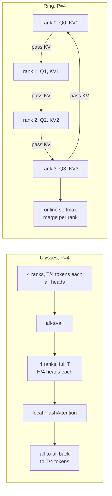

# 17 — Long-Context Extension and Long-Sequence Training

> **Prerequisites:** modules 03, 10.
> **You will learn:** why RoPE models fail beyond their trained window, how position
> interpolation, NTK-aware scaling, YaRN and LongRoPE extend it, and the data,
> memory and context-parallel techniques for long-sequence training.

RAG over long documents, agents that carry hours of tool calls, and reasoning
traces that run past 30k tokens all need more context than most base models handle
well. Getting there is three problems at once. **Positions:** the model has never
seen position 100,000, so you rescale RoPE. **Data:** the model must learn to use
distant tokens, which only genuinely long examples teach. **Systems:** a single
128k-token sequence produces logits, activations and attention traffic that do not
fit on one GPU without help.

Two recaps first. Transformers [module 05](../transformers/05-positional-encodings.md)
derives RoPE (rotate each query/key pair by an angle proportional to position, so
scores depend only on relative distance) and names YaRN as the standard rescaling.
Transformers [module 10](../transformers/10-sparse-and-long-context.md) covers the
architectural route to long context (sliding windows, linear attention, SSMs).
This module takes a dense, full-attention RoPE model as given and asks how you
fine-tune it to read further.

---

## 17.1 RoPE refresher and why extrapolation fails

RoPE splits each head's $d_{\text{head}}$-dimensional query and key into
$d_{\text{head}}/2$ pairs. Pair $i$ of a token at position $m$ is rotated by angle
$m\theta_i$, with

$$
\theta_i = b^{-2i/d_{\text{head}}}, \qquad i = 0, \dots, d_{\text{head}}/2 - 1, \qquad \lambda_i = \frac{2\pi}{\theta_i}.
$$

$b$ is the **base** (`rope_theta` in `config.json`) and $\lambda_i$ is the
**wavelength** of pair $i$: the number of tokens it takes that pair to complete one
full rotation. In this section $d$ means the head dimension, since that is the
dimension RoPE acts on. Pair 0 has $\theta_0 = 1$ and a wavelength of $2\pi \approx 6.3$
tokens. The last pair has a wavelength near $2\pi b$. The original Llama used
$b = 10{,}000$; many long-context models raise it to 1,000,000. Qwen3-8B ships
`rope_theta` = 1,000,000, `head_dim` 128 and `max_position_embeddings` 40,960, and
its [model card](https://huggingface.co/Qwen/Qwen3-8B) calls the native window
32,768 tokens with 131,072 "validated" using YaRN.

Now count. With $T_0$ the trained context length, the ratio

$$
r_i = \frac{T_0}{\lambda_i}
$$

is how many full rotations pair $i$ completed inside the training window.

| Base $b$ | $T_0$ | Pairs with $r_i > 32$ (many rotations) | Pairs with $r_i < 1$ (never a full turn) |
|---|---|---|---|
| 10,000 | 4,096 | 21 of 64 | 18 of 64 |
| 1,000,000 | 32,768 | 24 of 64 | 24 of 64 |

**High-frequency pairs have seen every angle many times.** Position $T_0 + 500$
produces an angle the pair has already met, modulo $2\pi$. These pairs extrapolate
fine. **Low-frequency pairs have not.** A pair with $r_i = 0.08$ only ever saw angles
in $[0, 0.08 \cdot 2\pi]$ during training. At position $4T_0$ it rotates to four times
that, into a region the attention weights never learned to interpret. The scores
become values the query/key projections were never fitted against, attention
spreads or spikes in ways unrelated to content, and perplexity climbs. That is the
whole failure: **extrapolation fails on the slow dimensions, not the fast ones.**

The TRL long-context guide shows the effect on Qwen3-4B: per-token loss on a
160k-token sequence stays reasonable to roughly 70k, then climbs until it ends above
the text's unigram entropy, worse than ignoring the context entirely
([TRL v1.15 guide](https://huggingface.co/docs/trl/v1.15.0/en/long_context_training)).

### Where the knobs live

As of October 2026, Transformers v5 configures RoPE through a single
`rope_parameters` dictionary; `rope_theta` lives inside it, and `rope_type` selects
the variant: `default`, `linear`, `dynamic`, `yarn`, `longrope` or `llama3`
([Transformers RoPE utilities](https://huggingface.co/docs/transformers/main/en/internal/rope_utils)).
Older model cards, including Qwen3's, still show the v4-era `rope_scaling` key with
the same inner fields. Teaching fragment (not executed):

```json
{
  "max_position_embeddings": 131072,
  "rope_parameters": {
    "rope_type": "yarn",
    "rope_theta": 1000000,
    "factor": 4.0,
    "original_max_position_embeddings": 32768
  }
}
```

One subtlety on Qwen3. The config says 40,960 positions, the card says 32,768 native
and uses `original_max_position_embeddings: 32768` in its YaRN snippet, while the TRL
guide uses 40,960. Either can work. What breaks things is **training with one value
and serving with another** (section 17.8).

---

## 17.2 Extension methods

Every method below answers one question: how do you change $\theta_i$ (or the
positions) so that a sequence of length $s T_0$ produces angles the model knows?
Call $s$ the **scale factor** (`factor`).

### Position interpolation (PI)

[Chen et al. (2023)](https://arxiv.org/abs/2306.15595) divide every position by $s$:
token $m$ is rotated as if it sat at $m/s$. Equivalently, every frequency becomes
$\theta_i / s$. Position $sT_0$ now produces exactly the maximum angle position $T_0$
produced in training, for every pair. Nothing is out of range.

They show the interpolated attention score's upper bound is at least about 600 times
smaller than the extrapolated one, which is why PI trains stably, and they extend
Llama 7B to 65B up to 32,768 tokens within 1,000 fine-tuning steps.

**The cost is local resolution.** The high-frequency pairs that tell token 5 from
token 6 now see an angle difference of $\theta_0/s$ instead of $\theta_0$. With
$s = 4$ the model sees neighbours as a quarter of a step apart, a spacing it never
saw in training. It must be fine-tuned to recover, and it gives up some short-context
precision even then. PI is `rope_type: "linear"` in Transformers.

### NTK-aware scaling

The fix, first posted by "bloc97" on Reddit and analysed in the YaRN paper, is to
stretch the slow dimensions and leave the fast ones alone. Instead of dividing
frequencies, **change the base**. Require the lowest frequency to be interpolated
exactly by $s$:

$$
(b')^{-(d-2)/d} = \frac{b^{-(d-2)/d}}{s}
\;\Longrightarrow\;
(b')^{(d-2)/d} = s\, b^{(d-2)/d}
\;\Longrightarrow\;
b' = b\, s^{d/(d-2)} .
$$

The highest frequency is $\theta_0 = (b')^0 = 1$, untouched. In between, the ratio is
$\theta'_i / \theta_i = s^{-2i/(d-2)}$: a geometric blend from 1 (no change) down to
$1/s$ (full interpolation). Worked for $b = 10{,}000$, $d = 128$, $s = 4$:

$$
b' = 10{,}000 \cdot 4^{128/126} = 40{,}889.9 .
$$

This is the "NTK" in the name: by neural-tangent-kernel arguments, networks struggle
to learn high-frequency detail, so you should not squash the high frequencies the
model already learned. Static NTK scaling is just a new `rope_theta`; there is no
special type.

**Dynamic NTK** recomputes $s = \max(1, T_{\text{current}}/T_0)$ at every forward
pass, so sequences inside the original window run with the original base and see no
change. It works zero-shot, without fine-tuning, which made it popular for inference.
Two caveats: a model fine-tuned at one fixed $s$ sees a different $s$ at inference,
and keys already in a KV cache were rotated with an older base. Transformers calls it
`rope_type: "dynamic"`.

The check below proves the NTK derivation numerically: the base, the exact
interpolation of the slowest pair, the untouched fastest pair, and PI's angle
preservation.

```python finetuning-check
import math
import torch

b, d, s, T0 = 10_000.0, 128, 4.0, 4096
i = torch.arange(d // 2, dtype=torch.float64)
theta = b ** (-2.0 * i / d)                      # (d/2,)

# Position interpolation: rotating position m/s with theta == rotating m with theta/s
m = torch.arange(0, 4 * T0, 997, dtype=torch.float64)[:, None]
torch.testing.assert_close((m / s) * theta, m * (theta / s), rtol=1e-15, atol=0)
pi = theta / s
torch.testing.assert_close(pi, theta / 4, rtol=0, atol=0)
# max angle at position s*T0 under PI equals the original max angle at T0, every pair
torch.testing.assert_close((s * T0) * pi, T0 * theta, rtol=1e-15, atol=0)

# NTK-aware base change b' = b * s^(d/(d-2))
b_ntk = b * s ** (d / (d - 2))
assert round(b_ntk, 1) == 40889.9
theta_ntk = b_ntk ** (-2.0 * i / d)
assert math.isclose(theta_ntk[-1].item(), theta[-1].item() / s, rel_tol=1e-9)
assert theta_ntk[0].item() == theta[0].item() == 1.0
ratio = theta_ntk / theta
torch.testing.assert_close(ratio, s ** (-2.0 * i / (d - 2)), rtol=1e-12, atol=0)
assert bool((ratio[1:] < ratio[:-1]).all())      # monotone blend from 1 down to 1/s

# Pairs that never complete a rotation inside the trained window
r = T0 / (2 * math.pi / theta)
assert int((r < 1).sum()) == 18
r_qwen = 32768 / (2 * math.pi / (1e6 ** (-2.0 * i / d)))
assert int((r_qwen < 1).sum()) == 24 and int((r_qwen > 32).sum()) == 24
```

It does not prove that either method produces a model that *uses* long context;
that is an empirical claim about weights, tested in section 17.7.

### YaRN

[Peng et al. (2023)](https://arxiv.org/abs/2309.00071) make the NTK intuition
explicit per dimension, using the rotation count $r_i = T_0/\lambda_i$ from 17.1.
(The paper writes $L$ for the original context; this course reserves $L$ for layers.)
Define a ramp with two thresholds $\alpha$ and $\beta$:

$$
\gamma(r) =
\begin{cases}
0 & r < \alpha \\
1 & r > \beta \\
\dfrac{r - \alpha}{\beta - \alpha} & \text{otherwise}
\end{cases}
\qquad
\theta'_i = (1 - \gamma(r_i))\,\frac{\theta_i}{s} + \gamma(r_i)\,\theta_i .
$$

- $r_i > \beta$: the pair rotated many times in training. Leave it alone ($\gamma = 1$).
- $r_i < \alpha$: the pair never completed a rotation. Interpolate it fully, like PI.
- In between: blend linearly.

The paper uses $\alpha = 1$, $\beta = 32$ for Llama; Transformers exposes them as
`beta_slow` (default 1) and `beta_fast` (default 32). For $b = 10{,}000$, $d = 128$,
$T_0 = 4{,}096$ that leaves 21 pairs untouched, 18 fully interpolated and 25 on the ramp.

**Attention temperature.** Interpolation packs more tokens into the same angular
range, which flattens the softmax as context grows. YaRN rescales the logits by
$1/t$, applied as a factor $\sqrt{1/t}$ on both queries and keys, with

$$
\sqrt{1/t} = 0.1 \ln s + 1, \qquad s = 4 \;\Rightarrow\; \sqrt{1/t} = 1.1386 .
$$

Transformers stores this as `attention_factor` and infers it from `factor` when you
leave it unset. YaRN reports that it reaches extended context with "10x less tokens
and 2.5x less training steps than previous methods", and it can extrapolate somewhat
beyond the length of its own fine-tuning data.

The check below implements the ramp and proves its shape, the temperature value, and
that YaRN always lies between PI and the original frequencies.

```python finetuning-check
import math
import torch

b, d, s, T0, alpha, beta = 10_000.0, 128, 4.0, 4096, 1.0, 32.0
i = torch.arange(d // 2, dtype=torch.float64)
theta = b ** (-2.0 * i / d)
lam = 2 * math.pi / theta                       # wavelength in tokens
r = T0 / lam                                    # rotations inside the trained window
gamma = ((r - alpha) / (beta - alpha)).clamp(0.0, 1.0)
theta_yarn = (1 - gamma) * theta / s + gamma * theta

assert gamma[0].item() == 1.0                   # fastest pair: unchanged
assert gamma[-1].item() == 0.0                  # slowest pair: fully interpolated
assert bool((gamma[1:] <= gamma[:-1]).all())    # monotone non-increasing in i
assert (int((gamma == 1).sum()), int(((gamma > 0) & (gamma < 1)).sum()), int((gamma == 0).sum())) == (21, 25, 18)
assert theta_yarn[0].item() == theta[0].item()
assert math.isclose(theta_yarn[-1].item(), theta[-1].item() / s, rel_tol=1e-12)
# YaRN frequencies lie between PI (theta/s) and the original, elementwise
assert bool((theta_yarn >= theta / s - 1e-15).all() and (theta_yarn <= theta + 1e-15).all())
# attention temperature sqrt(1/t) = 0.1 ln s + 1
sqrt_inv_t = 0.1 * math.log(s) + 1
assert round(sqrt_inv_t, 4) == 1.1386
```

It does not prove that $\alpha = 1$, $\beta = 32$ or the $0.1 \ln s$ constant are
optimal for your model; the paper fitted them empirically on Llama.

### LongRoPE and LongRoPE2

YaRN's ramp is hand-designed. [LongRoPE (Ding et al., 2024)](https://arxiv.org/abs/2402.13753)
**searches** a separate rescale factor per frequency pair (and a number of initial
tokens left unscaled) with an evolutionary search scored on perplexity, then
fine-tunes. In Transformers this is `rope_type: "longrope"` with `short_factor` and
`long_factor` lists of length $d_{\text{head}}/2$: one set for inputs inside the original
window, one for longer inputs. Phi-3's long-context checkpoints ship this way.

[LongRoPE2 (Shang et al., 2025)](https://arxiv.org/abs/2502.20082) adds two ideas. The
search is scored by **needle-driven perplexity** (loss only on the answer tokens of a
synthetic retrieval document, so irrelevant tokens do not dominate), and training uses
**mixed context windows**: short sequences keep the original RoPE, long ones use the
rescaled one, and inference switches by input length. It extends Llama 3 8B to 128k
effective context with 10B tokens, "80x fewer than Meta's approach", and reports the
short-context regression of the alternatives in the same 128k setting. On Phi3-mini-3.8B
(its Table 4a), MMLU drops from 70.78 to 63.22 with YaRN and to 66.43 with NTK, versus
70.04 with LongRoPE2; GSM8K drops from 78.54 to 57.39 with YaRN.

### Table 1: the methods side by side

| Method | What it changes | Fine-tuning needed | Short-context cost | Transformers `rope_type` |
|---|---|---|---|---|
| Position interpolation | all frequencies divided by $s$ | yes (about 1,000 steps in Chen et al.) | high-frequency resolution lost; uniform across dims | `linear` |
| NTK-aware (static) | base $b \to b\,s^{d/(d-2)}$ | helps; partial zero-shot | small for fast dims, mid dims compressed | none: set `rope_theta` |
| Dynamic NTK | base recomputed from current length | no (inference trick) | none inside $T_0$ | `dynamic` |
| YaRN | per-pair ramp by $r_i$ plus temperature | short fine-tune on long data | static YaRN applies to short inputs too; measurable drops (LongRoPE2 Table 4) | `yarn` |
| LongRoPE / LongRoPE2 | searched per-pair factors, short/long sets | search plus fine-tune | smallest reported (LongRoPE2: 97.6% retained on Phi3-mini) | `longrope` |
| Llama 3.1 style | piecewise by wavelength, fixed bands | trained in during pretraining | small | `llama3` |

### Scaling alone is not long context

A common misconception says you can set `rope_type: "yarn"`, `factor: 4` and get a
128k model. You get a model that **does not break** at 128k: positions are in range,
perplexity stays flat. That is not the same as a model that **uses** token 3,000 to
answer a question at token 120,000. Learning to route attention across 100k tokens
needs gradient signal from examples where the answer depends on distant tokens. And
the rescaling is static: Qwen's own card warns that static YaRN may hurt
shorter texts and advises adding the `rope_scaling` block "only when processing long
contexts is required", with `factor` 2.0 if your inputs top out at 65,536 tokens.
**Budget a fine-tune on genuinely long data, and measure short-context quality before
and after.**

---

## 17.3 Fine-tuning recipes for extension

### LongLoRA and shifted sparse attention

[LongLoRA (Chen et al., 2023)](https://arxiv.org/abs/2309.12307) asked whether you can
extend context with LoRA instead of full fine-tuning. Two findings matter.

**First, plain LoRA fails at context extension, unless embeddings and norms are
trainable.** In their words, "LoRA for context extension works well under the premise
of trainable embedding and normalization." These are a tiny fraction of parameters
(norm weights are $O(d)$ per layer) but they carry the global statistics that shift
when the attention distribution changes.

**Second, shifted sparse attention (S²-Attn)** cuts training cost. Split the sequence
into groups of $G$ tokens and attend only within each group. That alone would stop
information flowing between groups, so in **half the heads** shift the tokens by $G/2$
before grouping: those heads' groups straddle the boundaries of the other half's
groups. Information diffuses across the whole sequence through depth. Teaching
fragment (not executed):

```python
import torch

def s2_attn_groups(qkv, G):
    """qkv: (B, T, 3, H, d_head). Returns (B * T // G, G, 3, H, d_head) groups."""
    B, T, _, H, dh = qkv.shape
    q = qkv.clone()
    # shift the second half of the heads by G/2 tokens so their groups straddle boundaries
    q[:, :, :, H // 2:] = qkv[:, :, :, H // 2:].roll(-G // 2, dims=1)
    return q.reshape(B * T // G, G, 3, H, dh)   # attention then runs inside each group
```

S²-Attn is used **only during training**; inference uses ordinary full attention and
the model works, because the weights never learned anything specific to the grouping.
The paper extends Llama 2 7B from 4k to 100k, or 70B to 32k, on a single 8×A100 node,
using PI for the positions. In 2026, with FlashAttention, chunked losses and sequence
parallelism, S²-Attn's compute savings matter less; the **trainable embeddings and
norms** lesson is the part that lasts.

[LongQLoRA (Yang, 2023)](https://arxiv.org/abs/2311.04879) combines PI, QLoRA and
S²-Attn, and extends Llama 2 7B and 13B from 4,096 to 8,192 (and up to 12k) on one
32 GB V100 within 1,000 steps. It is the recipe to reach for on small hardware; the
QLoRA mechanics are in [module 06](./06-lora-and-qlora.md), and memory-efficient full
tuning alternatives in [module 07](./07-the-wider-peft-landscape.md).

### Progressive length schedules

Do not jump from 32k to 128k in one step. Large labs extend in stages: Llama 3
went from 8K to 128K in six stages over about 800B tokens, moving to the next length
only when "model performance on short-context evaluations has recovered completely"
and needle retrieval was perfect at the current length
([Llama 3 report](https://arxiv.org/abs/2407.21783)). For a fine-tune, a two- or
three-stage schedule (for example 32k → 64k → 128k, each a few hundred steps) gives
the model intermediate targets, and the early stages are cheap because memory and
step time grow with $T$.

### Data with genuine long-range dependencies

**Concatenating short documents does not teach long context.** If you pack twenty
2k-token articles into one 40k sequence and mask across document boundaries (as you
should, see [module 05](./05-supervised-fine-tuning.md) on `bfd` packing and
`padding_free` batching), every token's useful context is still under 2k. If you do
not mask, the model learns to attend to unrelated text, which is noise. Either way,
no gradient rewards reaching 30k tokens back.

What does teach it:

| Source | Why it has long-range dependencies |
|---|---|
| Whole books (PG-19, `emozilla/pg19`) | characters, plot and terms introduced early are referenced late |
| Code repositories, files concatenated in dependency order | a call at the end depends on a definition at the start |
| Long legal, financial or scientific documents | cross-references, defined terms, tables cited pages later |
| Synthetic long-context instructions | the question is generated *about* a long document, so answering needs it |

[LongMagpie (2025)](https://arxiv.org/abs/2505.17134) generalises Magpie self-synthesis
(the short-context version is in [module 04](./04-data-curation-and-synthesis.md)):
feed an aligned long-context model a document followed by the tokens that open a user
turn, let it generate a query grounded in that document, then collect the response.
No human annotation; the authors report strong HELMET, RULER and LongBench v2 results
while staying competitive on short tasks. Whatever the source, **mix in short data**
at the original length (LongRoPE2's mixed-window training is one formal version of
this), or short-context quality drifts.

### Packing at long context

Packing still saves compute at long context, but two constraints interact with the
systems in 17.5. Accelerate's FSDP2 context parallelism supports only causal or no
mask with SDPA, so TRL refuses `packing=True` with `cp_size`; Ulysses sequence
parallelism with FlashAttention handles packed sequences through `position_ids`. When
your examples are already near the maximum length, packing buys little anyway.

---

## 17.4 Memory at long context

Start from what [module 03](./03-training-mechanics-and-memory-math.md) taught: weights,
gradients and optimizer state are fixed in $T$; activations are not. With
FlashAttention ([transformers module 11](../transformers/11-hardware-aware-attention.md))
the $T \times T$ score matrix is never materialized, so **every remaining activation
term is linear in $T$**. Linear is still large. For a Qwen3-8B config ($d = 4096$,
$d_{ff} = 12{,}288$, $L = 36$, $V = 151{,}936$, 32 query heads, 8 KV heads,
$d_{\text{head}} = 128$, verified against the
[model card](https://huggingface.co/Qwen/Qwen3-8B)), one sequence, bf16, GB = $10^9$ bytes:

### Table 2: the T-dependent terms

| Term | Formula (bytes) | $T$ = 8,192 | $T$ = 32,768 | $T$ = 131,072 | Mitigation |
|---|---|---|---|---|---|
| Logits | $T \cdot V \cdot 2$ | 2.49 GB | 9.96 GB | 39.8 GB | chunked / fused LM-head loss (TRL default) |
| Checkpointed layer inputs | $L \cdot T \cdot d \cdot 2$ | 2.42 GB | 9.66 GB | 38.7 GB | activation offload to CPU; shard $T$ across GPUs |
| MLP intermediates during recompute (4 tensors) | $4 \cdot T \cdot d_{ff} \cdot 2$ | 0.81 GB | 3.22 GB | 12.9 GB | TiledMLP; shard $T$ |
| Naive attention scores, one layer, all heads | $H \cdot T^2 \cdot 2$ | 4.29 GB | 68.7 GB | 1,099.5 GB | FlashAttention / SDPA (never materialized) |
| KV cache (inference only) | $2 \cdot L \cdot H_{kv} \cdot d_{\text{head}} \cdot T \cdot 2$ | 1.21 GB | 4.83 GB | 19.3 GB | GQA, paged attention, KV quantization |

### The logits are the first wall

$131{,}072 \times 151{,}936 \times 2 = 39.8$ GB for one sequence's bf16 logits, before
any upcast to fp32 for the softmax (double it) and before the gradient of the logits
(the same size again). A large vocabulary makes this the first thing to run out of
memory, earlier than the model. The fix is to never hold the full $T \times V$
matrix: compute the LM head and cross-entropy over chunks of rows and sum, which is
exact because the loss is a sum over positions. TRL's fused LM-head loss is on by
default for SFT, DPO, KTO, GRPO, RLOO and Distillation as of v1.15 (the long-context
guide uses 256-row chunks); module 03 covers the mechanics. In the TRL guide's
Qwen3-4B experiment, this one change moves the single-GPU limit from 32k to 160k tokens.

### Checkpointed activations and offloading

With gradient checkpointing (module 03), each layer keeps only its input, a
$T \times d$ tensor. At 128k that is still 38.7 GB across 36 layers. Those tensors are
written in the forward pass and not read until the backward pass reaches that layer,
so they can live in CPU memory meanwhile. In Transformers v5.17+ this is
`gradient_checkpointing_kwargs={"offload": True}`; the TRL guide reports a Qwen3-4B
peak dropping from 59.9 GB to 48.8 GB and the single-card limit moving from 160k to
256k tokens. The cost is PCIe traffic that must overlap with compute, and at extreme
lengths host RAM becomes the limit: ALST estimates about 915 GiB of CPU memory per
node for Llama-70B offloads at 3M tokens.

### TiledMLP

Checkpointing does not help *inside* a layer. When the backward pass recomputes the
SwiGLU MLP, `gate_proj(x)`, its activation, `up_proj(x)` and their product all exist
at width $d_{ff}$: 12.9 GB at 128k for Qwen3-8B, and 76 GB at 1M tokens for the TRL
guide's Qwen3-4B example. But the MLP is **per token**: no position reads another.
So compute it over tiles of the sequence, forward and backward, and only one tile's
intermediates exist at a time. This is exact, not an approximation. TiledMLP comes
from Snowflake's [Arctic Long Sequence Training (ALST)](https://arxiv.org/abs/2506.13996),
which picks $\lceil T/d \rceil$ tiles (63 tiles for 256K tokens at $d = 4096$) and reports
roughly 10× lower memory on a single Llama-8B MLP layer. Attention cannot be tiled
this way, because every query needs every earlier key; that is what section 17.5 is for.

ALST combines TiledMLP, tiled logits and loss, activation offload and Ulysses sequence
parallelism to train Llama 8B at 500K tokens on one H100, 3.7M on one 8×H100 node and
over 15M on four nodes (paper abstract). The lab's memory calculator (17.9)
reproduces Table 2 for any config and any parallel degree.

---

## 17.5 Sequence and context parallelism

Once one GPU's memory is spent, the remaining move is to **split the sequence**. Give
each of $P$ GPUs $T/P$ tokens. Everything per-token (embeddings, norms, MLP, logits,
checkpointed inputs) shrinks by $P$ for free, because it never looks at other positions.
Attention is the one operation that needs the whole sequence. The two methods differ in
how they give it that. (Module 10 covers data, tensor and pipeline parallelism; this is
the fourth axis.)

### DeepSpeed Ulysses and ALST

[DeepSpeed-Ulysses (Jacobs et al., 2023)](https://arxiv.org/abs/2309.14509) switches
the sharding dimension around attention:

1. Each rank holds $T/P$ tokens and computes Q, K, V for them: shape $(T/P, H, d_{\text{head}})$.
2. **All-to-all:** re-shard by head. Each rank now holds the **full sequence** for
   $H/P$ heads: $(T, H/P, d_{\text{head}})$.
3. Run ordinary FlashAttention or SDPA locally. Heads are independent, so this is exact.
4. **All-to-all back** to $(T/P, d)$ for the output projection and MLP.

**Communication per layer.** Each all-to-all moves a rank's $1/P$ share of a
$T \times d$ tensor. With MHA that is $T d / P$ elements each for Q, K, V and the
output: $4Td/P$ per rank per layer forward, falling as $P$ grows. With GQA, K and V
are only $T H_{kv} d_{\text{head}}$ wide, so per rank the forward payload is
$2T(d + H_{kv} d_{\text{head}})/P$ elements. For Qwen3-8B at $T = 131{,}072$, $P = 8$,
bf16: **0.336 GB per layer forward**.

**The head constraint.** A head cannot be split across ranks, because step 3 needs a
whole head's full-length Q, K and V. So $P$ must divide the query-head count, and each
rank needs at least one **whole KV head**. With $H_{kv} = 8$ that caps $P$ at 8 unless
KV heads are replicated. ALST does exactly that ("if kv_heads < SP then we replicate
kv_heads to match SP degree"), which raises the ceiling to the query-head count (32
for Qwen3-8B) at the cost of extra KV memory and traffic. The TRL guide states the
practical limit as "up to the number of KV heads, 8 here".

### Ring Attention

[Ring Attention (Liu et al., 2023)](https://arxiv.org/abs/2310.01889) keeps the
sequence sharded throughout. Rank $j$ keeps its query block $Q_j$ and passes its KV
block around a ring. After $P - 1$ hops every rank has seen every KV block, and it
combines the partial results with **online softmax**: keep a running row max $m$, a
running denominator $\ell$, and a running output $o$; when a new block arrives with
scores $S$, set $m' = \max(m, \max S)$, rescale the old $\ell$ and $o$ by $e^{m - m'}$,
and add the new block's contribution. This is the same algebra FlashAttention uses
inside one GPU (see the inference course's
[online-softmax page](/courses/inference/03-attention-kernels/03-01-naive-attention-and-online-softmax.html)),
and it is exact.

There is **no head constraint**: any $P$ works. The price is traffic that does not
shrink with $P$. Each rank receives $(P-1)$ KV blocks of $2 (T/P) H_{kv} d_{\text{head}}$
elements, about $2 T H_{kv} d_{\text{head}}$ in total: 0.470 GB per layer forward for
the same Qwen3-8B example at $P = 8$. The ratio of the two is

$$
\frac{\text{Ulysses}}{\text{Ring}} = \frac{d + H_{kv} d_{\text{head}}}{H_{kv} d_{\text{head}}\,(P-1)} = \frac{5}{P - 1}
\quad \text{for Qwen3-8B,}
$$

so with aggressive GQA Ring actually moves fewer bytes at small $P$, the two tie at
$P = 6$, and Ulysses moves less from $P = 7$ upward. Volume is not the whole story: Ulysses is one collective that is
latency-sensitive and wants fast all-to-all (NVLink), while Ring is $P-1$ sequential
point-to-point hops that overlap with compute when they are well tuned.

**Causal load balancing.** With a causal mask, the rank holding the first $T/P$ tokens
has almost nothing to attend to, and the last rank does the most work. The standard
fix (zig-zag) splits the sequence into $2P$ chunks and gives rank $j$ chunks $j$ and
$2P-1-j$, pairing a cheap chunk with an expensive one. That is why TRL asks you to pad
sequences to a multiple of `cp_size * 2` under context parallelism.

**USP** ([Fang and Zhao, 2024](https://arxiv.org/abs/2405.07719)) runs Ulysses within a
node, where all-to-all is fast, and Ring across nodes, where the head cap would bind;
Accelerate's docs note it is not yet integrated there.



The check below proves the claim Ring Attention rests on: causal attention computed
block by block, as if KV blocks arrived from four ranks, with online-softmax
accumulation, equals full causal attention. It then asserts the memory and traffic
arithmetic stated in 17.4 and above.

```python finetuning-check
import math
import torch

torch.manual_seed(17)
T, d, P = 16, 8, 4
q, k, v = torch.randn(T, d), torch.randn(T, d), torch.randn(T, d)
scale = 1.0 / math.sqrt(d)

# reference: full causal softmax attention
scores = (q @ k.T) * scale
causal = torch.ones(T, T, dtype=torch.bool).tril()
ref = torch.softmax(scores.masked_fill(~causal, float("-inf")), dim=-1) @ v

# blockwise: rank j owns query block j; KV blocks arrive one at a time
blk = T // P
out = torch.empty_like(ref)
for j in range(P):
    qj = q[j * blk:(j + 1) * blk]
    q_pos = torch.arange(j * blk, (j + 1) * blk)[:, None]
    m = torch.full((blk, 1), float("-inf"))      # running row max
    l = torch.zeros(blk, 1)                      # running denominator
    o = torch.zeros(blk, d)                      # running unnormalised output
    for step in range(P):                        # ring order: own block first
        src = (j - step) % P
        kb, vb = k[src * blk:(src + 1) * blk], v[src * blk:(src + 1) * blk]
        k_pos = torch.arange(src * blk, (src + 1) * blk)[None, :]
        s = (qj @ kb.T) * scale
        s = s.masked_fill(k_pos > q_pos, float("-inf"))
        if torch.isinf(s).all():                 # block entirely in the future: skip
            continue
        m_new = torch.maximum(m, s.max(dim=-1, keepdim=True).values)
        p = torch.exp(s - m_new)
        corr = torch.exp(m - m_new)
        l = l * corr + p.sum(dim=-1, keepdim=True)
        o = o * corr + p @ vb
        m = m_new
    out[j * blk:(j + 1) * blk] = o / l
torch.testing.assert_close(out, ref, atol=1e-5, rtol=1e-5)

# arithmetic stated in prose (Qwen3-8B config, bf16, GB = 1e9)
L_layers, d_model, V, H_kv, d_head, T_long, GB = 36, 4096, 151_936, 8, 128, 131_072, 1e9
assert round(T_long * V * 2 / GB, 1) == 39.8                          # logits
assert round(2 * L_layers * H_kv * d_head * T_long * 2 / GB, 1) == 19.3  # KV cache
uly = lambda P_: 2 * T_long * (d_model + H_kv * d_head) / P_ * 2
ring = lambda P_: (P_ - 1) * 2 * (T_long / P_) * H_kv * d_head * 2
assert round(uly(8) / GB, 3) == 0.336 and round(ring(8) / GB, 3) == 0.470
for P_ in range(2, 9):
    assert math.isclose(uly(P_) / ring(P_), 5 / (P_ - 1), rel_tol=1e-12)
assert uly(5) > ring(5) and math.isclose(uly(6), ring(6)) and uly(7) < ring(7)
```

It does not prove anything about distributed performance (overlap, latency, load
balance); exactness of the merge is the only claim.

### Turning it on in TRL and Accelerate

As of October 2026 the two methods are tied to different backends
([TRL guide](https://huggingface.co/docs/trl/v1.15.0/en/long_context_training),
[HF Ulysses blog, March 2026](https://huggingface.co/blog/ulysses-sp)):

| | Context parallelism (Ring) | Ulysses sequence parallelism |
|---|---|---|
| Backend | FSDP2 | DeepSpeed (ZeRO 2/3) |
| Setting | `cp_size` | `sp_size`, `sp_backend="deepspeed"` |
| Splits | tokens | attention heads |
| Scales to | any $P$ | $P$ up to KV heads (more with replication) |
| Attention | SDPA, causal or no mask only | SDPA, FlashAttention 2/3 |
| Packing | refused | via `position_ids` with FlashAttention |
| Requires | accelerate 1.11 | accelerate 1.12, DeepSpeed 0.18.1 |
| Pad to | multiple of `cp_size * 2` | multiple of `sp_size` |

Teaching fragment (not executed), Accelerate config fragments and the matching
`SFTConfig`:

```yaml
# FSDP2 + context parallelism (Ring), 8 GPUs, one sequence shared by 4
distributed_type: FSDP
fsdp_config:
  fsdp_version: 2
parallelism_config:
  parallelism_config_dp_shard_size: 2
  parallelism_config_cp_size: 4
---
# DeepSpeed + Ulysses, 8 GPUs, dp_replicate * dp_shard * sp_size = 8
distributed_type: DEEPSPEED
parallelism_config:
  parallelism_config_dp_replicate_size: 1
  parallelism_config_dp_shard_size: 1
  parallelism_config_sp_size: 8
  parallelism_config_sp_backend: deepspeed
  parallelism_config_sp_attn_implementation: flash_attention_2
```

```python
from trl import SFTConfig

args = SFTConfig(
    max_length=131072,              # global length, before splitting across ranks
    pad_to_multiple_of=8,           # cp_size * 2 for CP=4; sp_size for Ulysses
    packing=False,                  # required with cp_size
    gradient_checkpointing=True,
    gradient_checkpointing_kwargs={"offload": True},   # transformers >= 5.17
    model_init_kwargs={"dtype": "bfloat16",
                       "rope_parameters": {"rope_type": "yarn", "rope_theta": 1_000_000,
                                           "factor": 4.0,
                                           "original_max_position_embeddings": 32768}},
)
```

For scale: the HF blog's Qwen3-4B run on 4×H100 (ZeRO-3, SP=4) peaked at 66.0 GB at
96K tokens and matched data-parallel losses to about $4 \times 10^{-6}$; the TRL guide
trains Qwen3-8B on one 1,049,000-token sequence per step on 8×H100 with CP, and
measures 34.6 s, 17.8 s and 9.5 s per step at 131k tokens on 2, 4 and 8 GPUs.

---

## 17.6 Long-context RL

Reasoning models emit long traces, and agents accumulate long trajectories, so RL
([module 13](./13-rl-with-verifiable-rewards.md)) now runs at long context too. Two
memory budgets compete. **Rollout memory** is the inference engine's KV cache: GRPO
samples $G$ completions per prompt, and for Qwen3-8B with $G = 8$ completions of 32,768
tokens each the KV cache alone is $8 \times 32{,}768 \times 147{,}456$ bytes $= 38.7$ GB,
before weights. **Training memory** is everything in 17.4, paid for the policy and, when
$\beta > 0$, again for the reference model's log-probs over the same long sequences. The
logits problem is worse here, because RL needs per-token log-probs and entropies, which
is why fused log-prob kernels matter.

Practitioner reports show the frontier moving fast. Unsloth reported (February 2026)
training gpt-oss with QLoRA at 380K context on a single 192 GB B200, and batching
changes that "enable ~7x longer context RL" against setups already using FA3, kernels
and chunked losses ([Unsloth update](https://unslothai.substack.com/p/unsloth-2026-update-faster-moe)).
Treat these as vendor-reported, not independently replicated. Two practical
consequences: raise `max_completion_length` deliberately (TRL's default is 512 tokens)
and size the rollout engine's memory for the longest trace, not the average one; and
the systems of 17.5 apply to the training side of the loop unchanged.

---

## 17.7 Evaluating long context

### Needle in a haystack tests retrieval, nothing more

The needle-in-a-haystack test hides one fact ("the passkey is 73914") at a chosen depth
in filler text and asks for it back, sweeping length and depth into a heat map. It is
cheap and it catches broken positions immediately: a model whose RoPE scaling is wrong
fails it outright. But **passing it proves only single-fact lexical retrieval.** The
needle usually looks nothing like the haystack, so attention can find it by surface
mismatch, with no reasoning over the document.

[RULER (Hsieh et al., 2024)](https://arxiv.org/abs/2404.06654) keeps the synthetic,
length-controllable design and adds harder tasks: needle variants with multiple keys,
multiple values and multiple queries; **multi-hop tracing** (variable tracking: follow
`X1 = 12345`, `X2 = X1`, ... through the context); **aggregation** (extract the most
common or frequent words); and QA with distractors. Across 17 models and 13 tasks,
almost all scored near-perfectly on vanilla needle tests yet dropped substantially as
length grew, and only half of the models claiming 32K or more held satisfactory
performance at 32K. LongRoPE2's 128k results (17.2) are RULER averages for that reason.

### Real documents and position sweeps

Synthetic tasks are controlled; real ones are representative. Evaluate on long-document
QA in your domain and on a public set such as LongBench v2
(`zai-org/LongBench-v2`, multiple choice over realistic long contexts, with a length
field to filter on). And sweep **where** the evidence sits. [Liu et al. (2023)](https://arxiv.org/abs/2307.03172)
found a U-shaped curve, "lost in the middle": accuracy is highest when the relevant
passage is at the start or end of the context and drops when it is in the middle. A
fine-tune that only improves the ends hides behind an average.

### Short-context regression is part of the evaluation

Every extension method changes the positions short inputs see (static YaRN does it
explicitly), and long-data fine-tuning shifts the data distribution. Run the general
suite from [module 09](./09-evaluating-fine-tuned-models.md) (instruction following,
knowledge, math, your own task's golden set) **before and after**, with identical
decoding settings.

| Test | Measures | Failure it catches |
|---|---|---|
| Needle sweep (length × depth) | retrieval of one planted fact | broken or mismatched RoPE scaling |
| RULER-style tasks | multi-key retrieval, tracing, aggregation | "finds needles, cannot use context" |
| Real long-document QA | the job you actually care about | synthetic-only gains |
| Position sweep | accuracy vs evidence depth | lost in the middle |
| Short-context suite | general capability at normal length | the regression you paid for the extension |

---

## 17.8 Serving long-context fine-tunes

Training-side memory was dominated by logits and activations; serving-side memory is
dominated by the KV cache:

$$
\text{KV bytes} = 2 \cdot L \cdot H_{kv} \cdot d_{\text{head}} \cdot T \cdot \text{bytes}.
$$

For Qwen3-8B at 131,072 tokens in bf16: $2 \times 36 \times 8 \times 128 \times 131{,}072 \times 2 = 19.3$ GB
**per sequence**, next to about 16.4 GB of bf16 weights. On one 80 GB GPU that is two
or three concurrent full-length requests, which is why GQA
([transformers module 09](../transformers/09-mqa-gqa-mla.md)) and KV quantization
matter so much here. The inference course's
[KV sizing page](/courses/inference/02-memory-and-kv-cache/02-01-kv-cache-sizing.html)
works the same formula for other models. Paged attention removes fragmentation so
long and short requests share the pool, and **prefix caching** pays off especially well
when many requests share one long document; both are covered in
[module 20](./20-production-serving-and-cost.md) along with continuous batching.

### rope_scaling must match in the serving engine

The quiet failure: you fine-tune with YaRN, `factor: 4`, and the engine serves with
the base config, or a different `original_max_position_embeddings`. Positions beyond
the native window are then unscaled, the attention temperature is missing, and quality
collapses exactly on the long inputs you trained for, while short-prompt smoke tests
pass. Three rules:

1. **Save the scaling in the checkpoint.** After merging adapters, confirm
   `config.json` has the `rope_parameters` you trained with, and `max_position_embeddings`
   at the extended length.
2. **Pass it explicitly to the engine.** As of vLLM v0.20, `--rope-scaling` "is no
   longer supported"; use `--hf-overrides` with `rope_parameters`
   ([vLLM context-extension docs](https://docs.vllm.ai/en/v0.20.2/features/context_extension/)).
   Qwen's model card still shows the older flag. For llama.cpp, the card gives
   `--rope-scaling yarn --rope-scale 4 --yarn-orig-ctx 32768`.
3. **Test above the native window after deployment**, with a needle at depth 0.5 at
   1.5× the original length. It is a one-minute test that catches the mismatch.

Teaching fragment (not executed):

```bash
vllm serve ./qwen3-8b-128k-merged \
  --hf-overrides '{"rope_parameters": {"rope_type": "yarn", "factor": 4.0, "original_max_position_embeddings": 32768, "rope_theta": 1000000}}' \
  --max-model-len 131072
```

The inference course's
[positional-encoding and long-context page](/courses/inference/03-attention-kernels/03-06-positional-encoding-and-long-context.html)
covers the kernel side of RoPE scaling at serve time.

---

## 17.9 Lab: extend Qwen3-1.7B with YaRN

Two labs: one you can run on a single consumer GPU, one that needs a node. Both have
CPU smoke paths that exercise the math.

### Smoke runs (CPU)

```bash
python content/courses/finetuning/code/rope_scaling_lab.py --smoke
python content/courses/finetuning/code/long_context_memory.py --smoke
```

[`rope_scaling_lab.py`](./code/rope_scaling_lab.py) prints the PI, NTK and YaRN
frequency ratios per pair for $(b, d, s, T_0) = (10{,}000, 128, 4, 4{,}096)$, asserts
$b' = 40{,}889.9$ and $\sqrt{1/t} = 1.1386$, and runs a tiny attention layer to
4× its trained length: unscaled RoPE drives four of eight frequency pairs to score
values never reachable inside the window, PI-scaled RoPE drives none.
[`long_context_memory.py`](./code/long_context_memory.py) prints Table 2 and the
Ulysses/Ring traffic for any $P$.

### L17.1 (tier T1): YaRN plus a short LoRA fine-tune

- **Goal:** extend `Qwen/Qwen3-1.7B` from its 32,768-token native window by 2–4× and
  measure what the scaling alone buys versus scaling plus fine-tuning.
- **Hardware:** one 24 GB Ampere-or-newer GPU (bf16).
- **Data:** `emozilla/pg19` books for training; PG-19 validation text as needle filler;
  `zai-org/LongBench-v2` for real long-document QA (filter to items your length budget
  fits).
- **Recipe:** YaRN with `factor` 4 (or 2 if you only need 65k), LoRA on all linear
  layers, embeddings and norms trainable (the LongLoRA finding), sequences of 32k
  (raise toward 64k with `--offload`), TRL's default chunked loss, gradient checkpointing.

```bash
python content/courses/finetuning/code/rope_scaling_lab.py --full --factor 4 --train-len 32768 --max-steps 200
python content/courses/finetuning/code/rope_scaling_lab.py --full --factor 4 --train-len 65536 --offload
```

The script runs a passkey sweep three times: native RoPE (up to 32k), YaRN with no
training, and YaRN after the LoRA fine-tune, then saves a merged checkpoint. Run the
short-context regression and RULER with lm-evaluation-harness (install
`"lm_eval[hf,ifeval,ruler]"`; check the RULER task README for the current length
metadata keys):

```bash
lm_eval --model hf --model_args pretrained=Qwen/Qwen3-1.7B,dtype=bfloat16 --tasks ifeval,mmlu_pro --limit 200
lm_eval --model hf --model_args pretrained=/tmp/qwen3-1.7b-yarn/merged,dtype=bfloat16 --tasks ifeval,mmlu_pro --limit 200
lm_eval --model hf --model_args pretrained=/tmp/qwen3-1.7b-yarn/merged,dtype=bfloat16 --tasks ruler --metadata '{"max_seq_lengths":[32768,65536]}'
```

**Record:** passkey accuracy by length for the three conditions, LongBench v2 accuracy
on your filtered subset, IFEval and MMLU-Pro deltas, peak GPU memory, step time.
**Expect:** native RoPE fails past the window; YaRN alone recovers much of the needle
sweep; the fine-tune adds more on RULER and real QA than on needles; short-context
scores move by a small amount in one direction or the other. Report the deltas, not a
single headline number.

### L17.2 (tier T3): 128k SFT of Qwen3-8B with sequence parallelism

- **Goal:** measure per-GPU memory and step time against $P$ for 131,072-token SFT.
- **Hardware:** one 8×H100 (or A100 80 GB) node.
- **Model and data:** `Qwen/Qwen3-8B` with the YaRN `rope_parameters` above; PG-19
  books truncated to 131,072 tokens.
- **Steps:** run the `SFTConfig` from 17.5 under the FSDP2 + `cp_size` config with
  $P \in \{2, 4, 8\}$, then under DeepSpeed + `sp_size` with $P \in \{4, 8\}$. Ten steps
  each is enough. Log `torch.cuda.max_memory_allocated()` per rank and seconds per step.
  Set `PYTORCH_CUDA_ALLOC_CONF=expandable_segments:True`, which the TRL guide needed at
  the largest lengths.
- **Compare** measured peaks with `long_context_memory.py --seq 131072 --P 2,4,8`.
  The constant part (sharded weights, optimizer state) explains the gap.
- **Expect:** per-GPU activation memory roughly halves as $P$ doubles; CP and SP give the
  same loss to logging precision; step time scales sublinearly, with the communication
  share growing at large $P$.

---

## Key takeaways

- **RoPE extrapolation fails on the slow dimensions.** Pairs that never completed a
  rotation inside the trained window (24 of 64 for Qwen3 at 32k) see unseen angles
  beyond it; fast pairs are fine.
- **PI keeps every angle in range but blurs local order.** Dividing all frequencies by
  $s$ compresses neighbour spacing by $s$, so it needs fine-tuning and costs precision.
- **NTK-aware scaling changes the base, not the positions.** $b' = b\,s^{d/(d-2)}$
  interpolates the slowest pair by exactly $s$ and leaves $\theta_0$ untouched
  (40,889.9 for $b = 10{,}000$, $d = 128$, $s = 4$).
- **YaRN interpolates per dimension by wavelength and adds a temperature.** A ramp on
  $r_i = T_0/\lambda_i$ with $\alpha = 1$, $\beta = 32$, and $\sqrt{1/t} = 0.1\ln s + 1$
  (1.1386 at $s = 4$).
- **Scaling makes long inputs safe, fine-tuning makes them useful.** Positions in range
  is not the same as attention that retrieves and reasons across 100k tokens.
- **Extension costs short-context quality; measure it.** LongRoPE2 reports Phi3-mini MMLU
  70.78 to 63.22 under YaRN at 128k; static YaRN applies to short prompts too.
- **Train embeddings and norms when extending with LoRA.** LongLoRA's central finding;
  S²-Attn is an optional training-time saving.
- **Long-context data needs long-range dependencies.** Packed short documents teach
  nothing about distance; books, repositories and LongMagpie-style synthesis do. Mix in
  short data.
- **The logits are the first memory wall.** 39.8 GB of bf16 logits for one 128k sequence
  with a 152k vocabulary; chunked or fused LM-head loss removes it.
- **Everything per-token tiles or shards exactly.** TiledMLP, activation offload and
  sequence sharding fix the rest; only attention needs communication.
- **Ulysses is capped by heads, Ring is not.** Ulysses re-shards by head with two
  all-to-alls; Ring passes KV blocks with exact online-softmax merging and works for any $P$.
- **Needle tests catch broken positions, not long-context skill.** Use RULER-style tasks,
  real long-document QA and position sweeps.
- **The serving engine must apply the same `rope_parameters`.** vLLM takes them through
  `--hf-overrides`; a mismatch fails silently on exactly the long inputs.

## Self-check

1. How does YaRN differ from linear position interpolation and NTK-aware scaling, and
   why does any of them still need fine-tuning?
2. Why is Ulysses sequence parallelism capped by the number of (KV) heads, and how does
   Ring Attention avoid that cap?
3. Which parallelism and memory techniques would you use for 128k-context SFT of an 8B
   model on 8 GPUs? Estimate the logits memory you must avoid materializing.

---

**Next → [18 — Model Merging and Adapter Composition](./18-model-merging-and-composition.md)**
