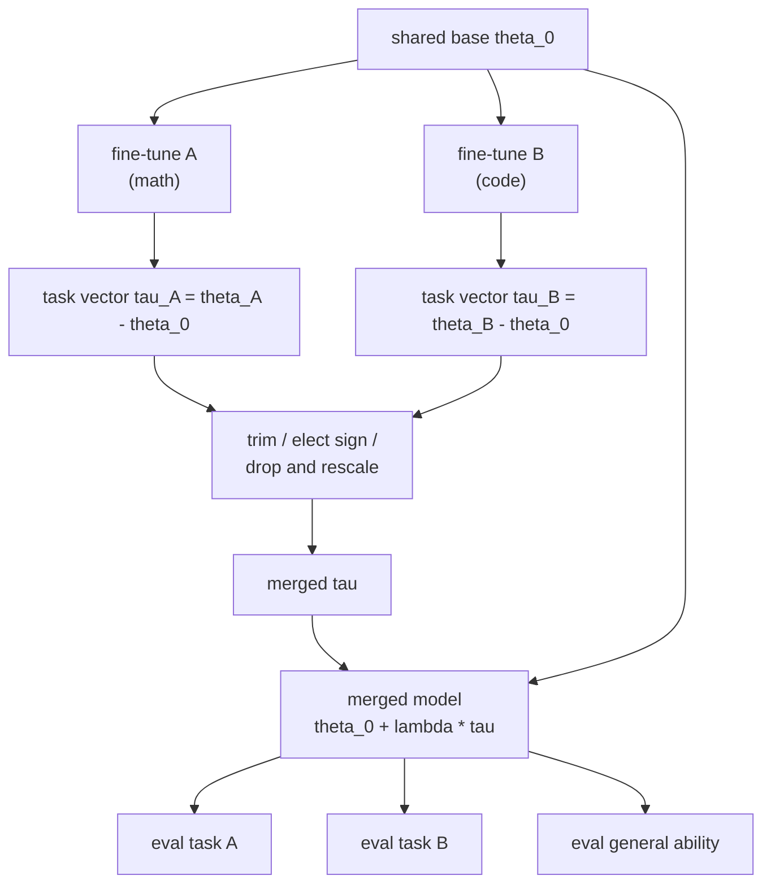

# 18 — Model Merging and Adapter Composition

> **Prerequisites:** modules 06, 09.
> **You will learn:** why weight-space merging works on a shared base, the methods from model
> soups to TIES and DARE, adapter combination in PEFT, mergekit, and how to
> evaluate a merge.

Merging is the cheapest post-training operation there is. With no gradient steps and
no GPU you can combine two skills, pull a specialised model back toward general
ability, or turn a folder of adapters into one multi-task model. Open-weight releases
and leaderboard entries use it all the time. It also fails silently: a merge always
produces a checkpoint, and nothing in the file tells you whether the checkpoint is any
good. This module teaches the methods, the one assumption they all rest on (a shared
base), and the evaluation discipline that makes a merge a measured result rather than
a lucky one.

The notes treat "merging" only as folding a LoRA update into its base matrix
([transfer learning and fine-tuning](../../notes/deep-learning/transfer-learning-and-finetuning.md),
"Initial gradients, merging and memory"). That is one adapter and one base. Here you
combine several fine-tunes, and the algebra gets more interesting.

---

## 18.1 Why weight averaging works at all

### The puzzle

Take two networks with the same architecture, each trained to low loss on the same
data, and average their weights. Usually you get garbage. Hidden units have no fixed
identity: permute the neurons of one layer, and permute the next layer's input weights
to match, and the function is unchanged. Two independently initialised networks
arrive at their solutions under different, arbitrary permutations, so averaging them
mixes neuron 7 of one with an unrelated neuron 7 of the other. Entezari et al. (2022)
[conjecture](https://arxiv.org/abs/2110.06296) that most of the loss barrier between
independent solutions disappears once you undo the permutation, and Ainsworth et al.
(2023) [Git Re-Basin](https://arxiv.org/abs/2209.04836) align units explicitly before
averaging. Fine-tuners never do this alignment. They don't need to.

### Linear mode connectivity

Frankle et al. (2020) [Linear Mode Connectivity and the Lottery Ticket Hypothesis](https://arxiv.org/abs/1912.05671)
define the test. Train two copies from the same starting point under different SGD
noise (data order, augmentation). Then evaluate the loss along the straight line
$\theta(t) = (1-t)\theta_a + t\theta_b$. If the loss never rises above the endpoints
(no **barrier**), the two solutions are **linearly mode connected**. Frankle et al. find
that vision networks become stable in this sense early in training. After that point
the outcome is confined to one linearly connected region.

Neyshabur et al. (2020) [What is being transferred in transfer learning?](https://arxiv.org/abs/2008.11687)
make the observation that matters to you. Models fine-tuned from the **same pretrained
checkpoint** stay in the same basin, and interpolating between them shows no barrier.
Models trained from scratch from different random inits do not. Wortsman et al.
(2022) [model soups](https://arxiv.org/abs/2203.05482) turned that into a recipe.
Fine-tunes of CLIP and ViT-G that differ only in hyperparameters "often appear to lie
in a single low error basin", so averaging them improves accuracy. Their greedy soup
reached 90.94% ImageNet top-1 with ViT-G, at the inference cost of one model.

**The pretrained checkpoint is the shared coordinate system.** Fine-tuning moves a
short distance from it, and the neurons keep their identity. That is why merging
works for LLM fine-tunes and why it fails for models with different lineages.

### Task vectors

Ilharco et al. (2023) [Editing Models with Task Arithmetic](https://arxiv.org/abs/2212.04089)
named the displacement. For a base $\theta_0$ and a fine-tune $\theta_i$ on task $i$:

$$
\tau_i = \theta_i - \theta_0
$$

Three operations follow.

| Operation | Formula | What Ilharco et al. report |
|---|---|---|
| Addition (multi-task) | $\theta = \theta_0 + \lambda\sum_i \tau_i$ | one model improves on several tasks at once |
| Negation (forgetting) | $\theta = \theta_0 - \lambda\tau$ | lowers performance on the target task (their example is toxic generation), with little change on control tasks |
| Analogy | $\theta = \theta_0 + \lambda(\tau_C + \tau_B - \tau_A)$ | "A is to B as C is to D" improves task D with no D data |

The scale $\lambda$ is a real hyperparameter. Summing two task vectors at $\lambda=1$
moves you twice as far from $\theta_0$ as either fine-tune did. The TIES paper's
no-validation recipe uses $\lambda=0.4$ for plain task arithmetic and $\lambda=1$ for TIES
(Yadav et al. 2023, section 5).

### The misconception to unlearn

"Model merging requires the same training data." It does not. Merging requires a
**shared base**: same architecture, same tokenizer and vocabulary layout, and
fine-tunes that descend from the same initial weights. Two models trained on identical
data from different random inits will not merge. Two models trained on completely
different data from the same base usually will, and interference between their
updates, not the difference in data, is what TIES and DARE are built to manage.

So a Llama-3.1-8B fine-tune and a Qwen3-8B fine-tune cannot be merged. Two fine-tunes
of Qwen3-8B can. Fine-tunes of Qwen3-8B-Base and of the post-trained Qwen3-8B share a
lineage but sit much further apart, so expect more interference.



---

## 18.2 The methods

Every method below answers the same question differently: given two or more points in
weight space that share an origin, which single point do you ship?

### Linear averaging and model soups

The simplest merge is a weighted average, $\theta = \sum_i w_i\theta_i$ with
$\sum_i w_i = 1$. Wortsman et al. call the uniform average a **uniform soup**. Their
**greedy soup** sorts candidates by held-out accuracy and adds each one only if the
held-out score of the running average improves. The greedy version matters because
some fine-tunes sit outside the basin, and a uniform average drags the result toward
them.

A uniform soup of $n$ fine-tunes is task arithmetic with $\lambda = 1/n$:
$\frac{1}{n}\sum_i \theta_i = \theta_0 + \frac{1}{n}\sum_i \tau_i$. That identity
explains why linear merges of *different-task* models are weak. Each task's update is
diluted by $1/n$.

### SLERP

Spherical linear interpolation treats each tensor as a vector and moves along the arc
between the two instead of the chord:

$$
\text{slerp}(a, b; t) = \frac{\sin((1-t)\Omega)}{\sin\Omega}\,a + \frac{\sin(t\Omega)}{\sin\Omega}\,b,
\qquad \cos\Omega = \hat a \cdot \hat b
$$

where $\hat a = a/\lVert a\rVert$ and $t$ runs from model A ($t=0$) to model B ($t=1$).
Why bother? For two unit vectors at angle $\Omega$ the chord midpoint has norm
$\cos(\Omega/2)$, which is 0.707 at $\Omega = 90°$. **Linear interpolation shrinks the
tensor**, and norm sets activation scale in every later layer. SLERP stays on the
sphere for every $t$. Its direction matches normalised lerp only at
$t\in\{0, \tfrac12, 1\}$. Near-parallel inputs make $\sin\Omega \to 0$ unstable, so
implementations fall back to lerp. mergekit does so when $|\cos\Omega| > 0.9995$, and
measures the angle per output row
([`slerp.py`](https://github.com/arcee-ai/mergekit/blob/9eeb539892c6753b032ea164e818b44a8c7a401b/mergekit/merge_methods/slerp.py)).
SLERP takes exactly **two** models, and its norm guarantee is exact only when the two
tensors have equal norms. For more models mergekit has `multislerp` and `karcher`.

### Task arithmetic, TIES and DARE

**Task arithmetic** is $\theta = \theta_0 + \lambda\sum_i w_i\tau_i$. It keeps each task's
full update, but every coordinate where tasks disagree is a tug of war, and
coordinates one task barely touched add noise to the others.

**TIES-Merging** (Yadav et al. 2023, [arXiv 2306.01708](https://arxiv.org/abs/2306.01708))
names two sources of interference: redundant small updates, and sign disagreement. It
fixes them in three steps.

1. **Trim.** In each task vector keep the top $k\%$ of entries by magnitude and zero
   the rest. The paper's default keeps 20%.
2. **Elect sign.** For each parameter, sum the trimmed values across tasks. The sign of
   the sum is the elected sign $\gamma$. A large update in one task outweighs several
   small opposing ones.
3. **Disjoint mean.** For each parameter, average only the trimmed values whose sign
   matches $\gamma$. Zeros and dissenters are excluded from the denominator.

Then $\theta = \theta_0 + \lambda\,\tau_{\text{TIES}}$. The disjoint mean is the key step.
A parameter that only one task moved keeps that task's full value instead of being
divided by $n$.

Here is a worked example with three task vectors over six parameters. Trimming keeps the top 50% (three
of six) by magnitude. $\tau_3$ has a tie at magnitude 0.2 (positions 2 and 4), broken
in favour of the **lower index**, so position 2 survives.

| | p0 | p1 | p2 | p3 | p4 | p5 |
|---|---|---|---|---|---|---|
| $\tau_1$ | 0.5 | −0.1 | 0.3 | 0.0 | −0.4 | 0.2 |
| $\tau_2$ | 0.4 | 0.2 | −0.6 | 0.1 | −0.3 | 0.0 |
| $\tau_3$ | −0.1 | 0.3 | 0.2 | −0.5 | −0.2 | 0.1 |
| trimmed $\tau_1$ | 0.5 | 0 | 0.3 | 0 | −0.4 | 0 |
| trimmed $\tau_2$ | 0.4 | 0 | −0.6 | 0 | −0.3 | 0 |
| trimmed $\tau_3$ | 0 | 0.3 | 0.2 | −0.5 | 0 | 0 |
| trimmed sum | 0.9 | 0.3 | −0.1 | −0.5 | −0.7 | 0.0 |
| elected sign $\gamma$ | + | + | − | − | − | + (no voters) |
| agreeing values | 0.5, 0.4 | 0.3 | −0.6 | −0.5 | −0.4, −0.3 | none |
| **TIES merged** | **0.45** | **0.30** | **−0.60** | **−0.50** | **−0.35** | **0.00** |
| plain mean $\frac13\sum\tau_i$ | 0.267 | 0.133 | −0.033 | −0.133 | −0.300 | 0.100 |

Look at p2. Two tasks pushed it up a little, one pushed it down hard. The plain mean
cancels to −0.033, a value no task wanted. Sign election, by summed mass rather than
by vote count, picks "down", and the disjoint mean keeps −0.6. Look at p3. One task
moved it, and TIES keeps the full −0.5 where the mean would dilute it to −0.133.

**DARE** (Yu et al. 2024, [arXiv 2311.03099](https://arxiv.org/abs/2311.03099))
sparsifies randomly instead of by magnitude. Drop each delta with probability $p$ and
rescale the survivors:

$$
\tilde\tau_j = \frac{m_j\,\tau_j}{1-p}, \qquad m_j \sim \text{Bernoulli}(1-p)
$$

The rescale makes it **unbiased**: $\mathbb{E}[\tilde\tau_j] = \frac{(1-p)\tau_j}{1-p} = \tau_j$.
It is far from low-variance. $\text{Var}[\tilde\tau_j] = \tau_j^2\,\frac{p}{1-p}$, so at
$p=0.9$ each surviving coordinate is ten times its original value and the
per-coordinate standard deviation is $3|\tau_j|$. DARE works anyway because a layer's
output sums thousands of coordinates and the noise averages out in that sum, *if* the
deltas are small. Yu et al. report SFT deltas "typically small (within 0.002)" and
that DARE can drop 90% or even 99% of them without hurting the SFT model. DARE is
a preprocessing step, so it gets paired with a combiner: **DARE-linear** (task
arithmetic on the dropped vectors) or **DARE-TIES** (sign election and disjoint mean
on the dropped vectors).

### Breadcrumbs, model stock, passthrough

**Model breadcrumbs** (Davari and Belilovsky 2023, [arXiv 2312.06795](https://arxiv.org/abs/2312.06795))
trims *both* tails of each task vector: the tiny updates (noise) and the largest
outliers, which they find hurt merges. In mergekit, `gamma` is the fraction of largest
entries removed and `density` the fraction retained overall.

**Model stock** (Jang et al. 2024, [arXiv 2403.19522](https://arxiv.org/abs/2403.19522))
is for several fine-tunes of the *same* task, the model soup setting, and computes the
interpolation weight from geometry instead of a sweep. With $k$ fine-tunes whose task
vectors have average pairwise cosine $\cos\theta$, it interpolates between the base and
the fine-tunes' average with

$$
t = \frac{k\cos\theta}{1 + (k-1)\cos\theta}, \qquad
\theta_{\text{merged}} = t\,\bar\theta_{\text{ft}} + (1-t)\,\theta_0
$$

per layer ([mergekit implementation](https://github.com/arcee-ai/mergekit/blob/9eeb539892c6753b032ea164e818b44a8c7a401b/mergekit/merge_methods/model_stock.py)).
Two fine-tunes at cosine 0.5 give $t = 1/1.5 = 0.67$. Nearly orthogonal fine-tunes give
$t \to 0$ (stay near the base). Identical ones give $t = 1$.

**Passthrough and frankenmerges** are not averages at all. Passthrough copies tensors
unchanged. Combined with mergekit's `slices`, it stacks layer ranges from one or more
donor models into a deeper model. SOLAR 10.7B's "depth up-scaling" of a 32-layer
model into a 48-layer one (Kim et al. 2023, [arXiv 2312.15166](https://arxiv.org/abs/2312.15166))
is the best-known case. mergekit ships a layer-stacking example,
`orcamini-platy-44layer.yml`. The result has a different depth, a different parameter
count, and usually needs further training to repair the seams. Treat it as model
surgery, not merging.

### Table 1: the method zoo

| Method | Formula (per tensor) | Models | Hyperparameters | When to use | mergekit `merge_method` |
|---|---|---|---|---|---|
| Linear / soup | $\sum_i w_i\theta_i$, $\sum w_i = 1$ | ≥2 | `weight`, `normalize` | several fine-tunes of the same task; base-vs-fine-tune interpolation | `linear` |
| SLERP | arc between $a$ and $b$ at $t$ | exactly 2 | `t` (can vary per layer) | blending two related models, norm-sensitive | `slerp` (`nuslerp`, `multislerp` for variants) |
| Task arithmetic | $\theta_0 + \lambda\sum_i w_i\tau_i$ | ≥2 + base | `weight`, `lambda` | few tasks, little overlap; negation | `task_arithmetic` |
| TIES | trim top-$k$, elect sign, disjoint mean | ≥2 + base | `density`, `weight`, `lambda` | several tasks with conflicting updates | `ties` |
| DARE-TIES | drop $p$, rescale $\frac{1}{1-p}$, then TIES | ≥2 + base | `density` ($=1-p$), `weight` | LLM SFT deltas (small, redundant) | `dare_ties` |
| DARE-linear | drop and rescale, then sum | ≥2 + base | `density`, `weight`, `rescale` | as above, no sign election | `dare_linear` |
| Breadcrumbs | trim smallest and largest tails | ≥2 + base | `density`, `gamma` | many tasks, outlier-heavy deltas | `breadcrumbs`, `breadcrumbs_ties` |
| Model stock | $t\bar\theta_{\text{ft}} + (1-t)\theta_0$, $t$ from cosines | ≥2 + base | `filter_wise` | several runs of the same task | `model_stock` |
| Passthrough | copy tensors; stack slices | 1 per slice | `slices`, `layer_range`, `scale` | depth up-scaling, surgery | `passthrough` |

Names are from mergekit's method registry at commit
[`9eeb539`](https://github.com/arcee-ai/mergekit/blob/9eeb539892c6753b032ea164e818b44a8c7a401b/mergekit/merge_methods/registry.py),
which also registers `della`, `sce`, `karcher`, `nearswap`, `ram` and `arcee_fusion`.

### Check 18.1: arithmetic, interpolation and SLERP

This check verifies the task arithmetic and negation formulas, that lerp at
$t=0.5$ is the mean, that SLERP of two unit vectors stays on the unit sphere while the
chord midpoint shrinks to $\cos(\Omega/2)$, that SLERP's direction matches normalised
lerp only at $t\in\{0, 0.5, 1\}$, and that it falls back to lerp for parallel inputs.

```python finetuning-check
import math
import torch

torch.manual_seed(0)
theta0 = torch.randn(32, dtype=torch.float64)
tau1, tau2 = (0.01 * torch.randn(32, dtype=torch.float64) for _ in range(2))
lam = 0.4
by_hand = torch.tensor([theta0[i] + lam * (tau1[i] + tau2[i]) for i in range(32)], dtype=torch.float64)
torch.testing.assert_close(theta0 + lam * (tau1 + tau2), by_hand, atol=1e-12, rtol=0)
theta1 = theta0 + tau1                                       # negation, lambda = -1
torch.testing.assert_close(theta0 - 1.0 * (theta1 - theta0), theta0 - tau1, atol=1e-12, rtol=0)
a_full, b_full = theta0 + tau1, theta0 + tau2                # lerp at t = 0.5 is the mean
torch.testing.assert_close(0.5 * a_full + 0.5 * b_full, (a_full + b_full) / 2, atol=1e-12, rtol=0)

def slerp(a, b, t, dot_threshold=0.9995):
    dot = torch.dot(a / a.norm(), b / b.norm()).clamp(-1.0, 1.0)
    if dot.abs() > dot_threshold:
        return (1 - t) * a + t * b
    om = torch.acos(dot)
    return torch.sin((1 - t) * om) / torch.sin(om) * a + torch.sin(t * om) / torch.sin(om) * b

a = torch.zeros(8, dtype=torch.float64); a[0] = 1.0          # 90 degrees apart
b = torch.zeros(8, dtype=torch.float64); b[1] = 1.0
assert abs(((a + b) / 2).norm().item() - math.cos(math.pi / 4)) < 1e-12   # 0.7071
u = torch.randn(8, dtype=torch.float64); u = u / u.norm()
v = torch.randn(8, dtype=torch.float64); v = v / v.norm()
for t in (0.25, 0.5, 0.75):
    assert abs(slerp(u, v, t).norm().item() - 1.0) < 1e-6   # stays on the sphere
    assert ((1 - t) * u + t * v).norm().item() < 1.0 - 1e-3  # the chord shrinks
for t, same in ((0.0, True), (0.25, False), (0.5, True), (0.75, False), (1.0, True)):
    sl, li = slerp(u, v, t), (1 - t) * u + t * v
    assert (abs(torch.dot(sl / sl.norm(), li / li.norm()).item() - 1.0) < 1e-9) == same, t
w = 2.5 * u                                                  # parallel: falls back to lerp
torch.testing.assert_close(slerp(u, w, 0.3), 0.7 * u + 0.3 * w, atol=1e-12, rtol=0)
print("task arithmetic, negation, lerp and SLERP verified")
```

It does not show that SLERP merges *score* better than linear ones. Norm preservation
is a geometric property, and whether it matters for a given pair of LLMs is an
empirical question you answer with the evaluation in 18.6.

### Check 18.2: TIES by hand

This check implements trim, elect and disjoint mean with the lower-index tie rule
and reproduces the table above to $10^{-9}$, including the plain-mean contrast.

```python finetuning-check
import torch

taus = torch.tensor([
    [0.5, -0.1, 0.3, 0.0, -0.4, 0.2],
    [0.4, 0.2, -0.6, 0.1, -0.3, 0.0],
    [-0.1, 0.3, 0.2, -0.5, -0.2, 0.1],
], dtype=torch.float64)

def trim(row, density):
    k = int(round(density * row.numel()))
    order = sorted(range(row.numel()), key=lambda i: (-abs(float(row[i])), i))  # ties: lower index wins
    keep = torch.zeros_like(row, dtype=torch.bool)
    keep[order[:k]] = True
    return row * keep

trimmed = torch.stack([trim(r, 0.5) for r in taus])
expected_trimmed = torch.tensor([
    [0.5, 0.0, 0.3, 0.0, -0.4, 0.0],
    [0.4, 0.0, -0.6, 0.0, -0.3, 0.0],
    [0.0, 0.3, 0.2, -0.5, 0.0, 0.0],
], dtype=torch.float64)
torch.testing.assert_close(trimmed, expected_trimmed, atol=1e-12, rtol=0)

elected = torch.where(trimmed.sum(0) >= 0, 1.0, -1.0).to(torch.float64)
assert elected.tolist() == [1.0, 1.0, -1.0, -1.0, -1.0, 1.0]

agree = (torch.sign(trimmed) == elected) & (trimmed != 0)
merged = (trimmed * agree).sum(0) / agree.sum(0).clamp_min(1)
expected = torch.tensor([0.45, 0.30, -0.60, -0.50, -0.35, 0.00], dtype=torch.float64)
assert (merged - expected).abs().max().item() < 1e-9

plain_mean = taus.mean(0)
assert (plain_mean - torch.tensor([0.8, 0.4, -0.1, -0.4, -0.9, 0.3], dtype=torch.float64) / 3).abs().max() < 1e-9
assert abs(plain_mean[2].item()) < 0.04 and merged[2].item() == -0.6   # cancellation vs election
print("TIES hand example verified")
```

It does not prove TIES helps on real models. The example shows the mechanics. Whether
the trimmed 50% or 80% carried task knowledge is something only an evaluation sweep
over `density` can tell you.

### Check 18.3: DARE is unbiased, and noisy

This check verifies that DARE at $p=0.9$ keeps about 10% of entries per draw, that the average
of many draws converges to $\tau$, and that the convergence is slow in exactly the
way the variance formula predicts. With 200 draws the relative error is about
$\sqrt{2/\pi}\sqrt{9/200} \approx 0.17$. Getting under 5% needs thousands of draws.
Skipping the rescale gives an estimate biased to $0.1\tau$.

```python finetuning-check
import math
import torch

gen = torch.Generator().manual_seed(0)
tau = torch.randn(10_000, generator=gen, dtype=torch.float64) * 0.002   # SFT-sized deltas
p = 0.9
mean_abs = tau.abs().mean().item()

def dare(t, p, g, rescale=True):
    keep = (torch.rand(t.shape, generator=g, dtype=torch.float64) >= p).to(t.dtype)
    return t * keep / (1 - p) if rescale else t * keep

one = dare(tau, p, torch.Generator().manual_seed(1))
frac = (one != 0).double().mean().item()
assert 0.09 <= frac <= 0.11, frac
assert abs(one[one != 0].abs().mean().item() / tau[one != 0].abs().mean().item() - 10.0) < 1e-9

g = torch.Generator().manual_seed(2)
acc = torch.zeros_like(tau)
for n in range(1, 4001):
    acc += dare(tau, p, g)
    if n == 200:
        rel200 = (acc / n - tau).abs().mean().item() / mean_abs
rel4000 = (acc / 4000 - tau).abs().mean().item() / mean_abs
predicted200 = math.sqrt(2 / math.pi) * math.sqrt(p / (1 - p) / 200)    # about 0.169
assert abs(rel200 - predicted200) < 0.03, (rel200, predicted200)
assert rel4000 < 0.05, rel4000

g = torch.Generator().manual_seed(3)
no_rescale = sum(dare(tau, p, g, rescale=False) for _ in range(400)) / 400
ratio = (no_rescale @ tau).item() / (tau @ tau).item()
assert abs(ratio - 0.1) < 0.01, ratio
print("DARE unbiasedness and variance verified")
```

It does not show why one DARE draw works inside a network. That depends on the layer
summing many noisy coordinates, which the lab's toy model exercises and this check
does not.

---

## 18.3 Tooling

### mergekit

mergekit (Goddard et al. 2024, [arXiv 2403.13257](https://arxiv.org/abs/2403.13257))
is the standard tool for full-checkpoint merges. A YAML file names the method, the
models, a base, and per-model or global parameters. `mergekit-yaml config.yml out/`
does the rest. It processes the merge tensor by tensor, loads weights lazily
(`--lazy-unpickle` for lower memory use), and writes output in shards (5B parameters
per shard by default), so large merges run on a CPU machine without ever holding whole
models in memory. GPU execution (`--cuda`) is optional. Here is a TIES merge of
two fine-tunes of the same base, following the repository's
[`examples/ties.yml`](https://github.com/arcee-ai/mergekit/blob/9eeb539892c6753b032ea164e818b44a8c7a401b/examples/ties.yml)
and [README](https://github.com/arcee-ai/mergekit/blob/9eeb539892c6753b032ea164e818b44a8c7a401b/README.md):

```yaml
# ties.yml: mergekit-yaml ties.yml ./qwen3-1.7b-math-code-ties --lazy-unpickle
merge_method: ties
base_model: Qwen/Qwen3-1.7B           # the base both adapters were trained on
models:
  - model: ./single-math          # full checkpoint (LoRA already merged in bf16)
    parameters:
      weight: 1.0
      density: 0.5                # keep top 50% of this task vector by magnitude
  - model: ./single-code
    parameters:
      weight: [0.6, 1.0]          # a gradient: interpolated across layers
      density: 0.5
parameters:
  normalize: true                 # divide by the sum of weights
  int8_mask: true                 # store masks compactly
dtype: bfloat16
tokenizer:
  source: base                    # output vocabulary = base model's
```

- **Parameters** sit on a slice, a model, or globally. A list is a gradient across
  layers, and a `filter:` entry targets tensors by name (`mlp` versus `self_attn`).
- **Tokenizer.** The `tokenizer:` block picks the output vocabulary (`base`, `union`, or
  a model path) and per-token embedding sources, which matters when fine-tunes added
  special tokens. The legacy `tokenizer_source:` key is mutually exclusive with it. Set
  `chat_template` deliberately when parents use different templates.
- **LoRA extraction.** `mergekit-extract-lora --model <ft> --base-model <base>
  --out-path <dir> --max-rank 64` turns a full fine-tune's (or a merge's) delta into a
  PEFT LoRA by truncated SVD.
- **Evolutionary search.** `mergekit-evolve` (18.5).

**License.** mergekit moved from LGPL-3.0 to the Business Source License in its v0.1
release (February 2025) and returned to **LGPL-3.0** in v0.1.4 (October 31 2025,
commit "Return to LGPL"). As of October 2026 the repository's
[LICENSE](https://github.com/arcee-ai/mergekit/blob/9eeb539892c6753b032ea164e818b44a8c7a401b/LICENSE)
is LGPL-3.0. If your pipeline pins an older version, check which license that version carries.

### PEFT `add_weighted_adapter`

When your inputs are LoRA adapters on one base, you can merge at the adapter level and
never materialise full checkpoints. As of PEFT v0.21.2 (October 2026) the signature is
([`LoraModel.add_weighted_adapter`](https://github.com/huggingface/peft/blob/eaa35c777c7ba554a2a3639ac9c79bb690f39a57/src/peft/tuners/lora/model.py#L786-L935)):

```python
# Teaching fragment: not executed. PEFT >= 0.21, Transformers v5.
import torch
from peft import PeftModel
from transformers import AutoModelForCausalLM

base = AutoModelForCausalLM.from_pretrained("Qwen/Qwen3-1.7B", dtype=torch.bfloat16)
model = PeftModel.from_pretrained(base, "./out/math-lora", adapter_name="math")
model.load_adapter("./out/code-lora", adapter_name="code")

model.add_weighted_adapter(
    adapters=["math", "code"],
    weights=[1.0, 1.0],              # negative weights subtract an adapter's effect
    adapter_name="math_code",
    combination_type="ties",         # default is "svd"
    density=0.5,                     # for ties / dare_* / magnitude_prune
    majority_sign_method="total",    # or "frequency"
)
model.set_adapter("math_code")
merged = model.merge_and_unload()    # returns the base with the adapter folded in
```

The full `combination_type` list is `svd`, `linear`, `cat`, `ties`, `ties_svd`,
`dare_ties`, `dare_linear`, `dare_ties_svd`, `dare_linear_svd`, `magnitude_prune`, and
`magnitude_prune_svd`. The defaults and constraints are in the source, not the
prose docs:

| `combination_type` | Operates on | Rank of result | Rank constraint |
|---|---|---|---|
| `cat` | concatenated factors | $\sum_i r_i$ | none |
| `linear` | $A$ and $B$ factors, separately | $r$ | all ranks equal |
| `ties`, `dare_ties`, `dare_linear`, `magnitude_prune` | $A$ and $B$ factors, separately | $r$ | all ranks equal |
| `svd` and the `*_svd` variants | the full $\Delta W_i$, then truncated SVD | `svd_rank` or $\max_i r_i$ | none |

The second row is the trap. Plain `ties` on LoRA adapters trims and elects signs **on
the factor matrices**, not on $\Delta W$. Use `ties_svd` if you want TIES semantics on the
actual weight update. The new adapter is created with `lora_alpha = r`, so its scaling
is 1, and each source adapter's own $\alpha/r$ is folded into the combined factors.
The PEFT [model merging guide](https://huggingface.co/docs/peft/v0.21.0/en/developer_guides/model_merging)
shows TIES and DARE-TIES on three public TinyLlama adapters. For TIES it recommends
weights of 1.0 or more because they "preserve the correct scale". The disjoint mean
already averages, so weights that sum to 1 would shrink the update a second time. Arrow
(learned routing over a library of LoRAs) and GenKnowSub (a refinement of those LoRAs
before routing) live in the same LoRA tuner and are covered in
[module 07](./07-the-wider-peft-landscape.md). The un-merge lifecycle
(`merge_and_unload` returns a new model, `merge_adapter`/`unmerge_adapter` toggle in
place) is [module 06](./06-lora-and-qlora.md)'s.

---

## 18.4 Merging adapters versus full models

### Why `linear` on LoRA factors is not linear in $\Delta W$

A LoRA update is a product, $\Delta W_i = s_i B_i A_i$ with $s_i = \alpha_i/r_i$,
$B_i \in \mathbb{R}^{d_{out}\times r}$ and $A_i\in\mathbb{R}^{r\times d_{in}}$. Here $B$ is
the LoRA up-projection, not a batch size. The merge you want is
$\sum_i w_i s_i B_iA_i$. Averaging the factors does not give it.

PEFT's `linear` uses a square-root convention so that one adapter alone round-trips
exactly. With $c_i = w_i s_i$ it builds
([source, lines 1006–1060](https://github.com/huggingface/peft/blob/eaa35c777c7ba554a2a3639ac9c79bb690f39a57/src/peft/tuners/lora/model.py#L1006-L1060)):

$$
A' = \sum_i \operatorname{sign}(c_i)\sqrt{|c_i|}\,A_i, \qquad B' = \sum_i \sqrt{|c_i|}\,B_i
$$

For two adapters with positive $c_i$:

$$
B'A' = c_1 B_1A_1 + c_2 B_2A_2 + \sqrt{c_1c_2}\,\big(B_1A_2 + B_2A_1\big)
$$

The last term is the error. $B_1A_2$ routes adapter 2's input directions through adapter
1's output directions, an update neither adapter learned. With $w = 0.5$ and $s = 1$
for both, the cross term has coefficient 0.5, as large as the terms you wanted.
PEFT's docstring calls `linear` "a very rough approximation". The method also
requires equal ranks, because it adds $A_1$ and $A_2$ elementwise.

### `cat` is exact

Stack the factors instead of adding them. PEFT puts the weights on $A$
([lines 891–909](https://github.com/huggingface/peft/blob/eaa35c777c7ba554a2a3639ac9c79bb690f39a57/src/peft/tuners/lora/model.py#L891-L909)):

$$
B' = [\,B_1 \;\; B_2\,], \qquad
A' = \begin{bmatrix} c_1 A_1 \\ c_2 A_2 \end{bmatrix}, \qquad
B'A' = c_1B_1A_1 + c_2B_2A_2
$$

Block multiplication has no cross terms. The cost is rank: two rank-16 adapters give a
rank-32 adapter, and ten give rank 160. That matters for serving (vLLM's
`max_lora_rank`, see [module 20](./20-production-serving-and-cost.md)). `cat` merges
adapters of **different ranks** without complaint.

### `svd` is exact up to the rank you keep

`svd` forms the exact sum $\Delta = \sum_i c_iB_iA_i$ and refactorises it with a truncated SVD,
$\Delta \approx U_k\Sigma_kV_k^\top$, setting $B' = U_k\Sigma_k$ and $A' = V_k^\top$. The rank
of $\Delta$ is at most $\sum_i r_i$. Keep that many singular values and the result is exact.
Keep fewer, and Eckart–Young says the truncation is the best possible rank-$k$
approximation, with spectral-norm error exactly $\sigma_{k+1}$ and Frobenius error
$\sqrt{\sum_{j>k}\sigma_j^2}$ (recap: [linear algebra notes](../../notes/math/linear-algebra.md)).
PEFT's default `svd_rank` is the maximum input rank, so merging two rank-4 adapters
with `svd` silently truncates a rank-8 sum to rank 4. Pass `svd_rank` explicitly. The
SVD runs per target module on $d_{out}\times d_{in}$ matrices, which is slower than
`cat` but still CPU-feasible.

### Check 18.4: `cat` is exact, `linear` is not, `svd` obeys Eckart–Young

This check builds two rank-4 LoRAs on a 16×12 weight with weights 0.5/0.5 and scaling 1
($\alpha = r$). It verifies that PEFT's `cat` construction reproduces
$0.5B_1A_1 + 0.5B_2A_2$ exactly with rank 8, that `linear`'s product differs by exactly
the stated cross term, and that SVD re-compression is exact at rank 8 with error
$\sigma_5$ at rank 4.

```python finetuning-check
import math
import torch

g = torch.Generator().manual_seed(0)
d_out, d_in, r = 16, 12, 4
A1, A2 = (torch.randn(r, d_in, generator=g, dtype=torch.float64) for _ in range(2))
B1, B2 = (torch.randn(d_out, r, generator=g, dtype=torch.float64) for _ in range(2))
w, s = [0.5, 0.5], [1.0, 1.0]                 # adapter weights, LoRA scalings alpha/r
c = [wi * si for wi, si in zip(w, s)]
target = c[0] * B1 @ A1 + c[1] * B2 @ A2      # (16, 12) the update you actually want

# cat: weights on A (PEFT convention), B concatenated along rank.
A_cat = torch.cat([c[0] * A1, c[1] * A2], dim=0)          # (8, 12)
B_cat = torch.cat([B1, B2], dim=1)                         # (16, 8)
assert A_cat.shape[0] == 8
torch.testing.assert_close(B_cat @ A_cat, target, atol=1e-6, rtol=0)

# linear: sqrt-weighted sums of factors (sign on A only).
A_lin = sum(math.copysign(math.sqrt(abs(ci)), ci) * a for ci, a in zip(c, (A1, A2)))
B_lin = sum(math.sqrt(abs(ci)) * b for ci, b in zip(c, (B1, B2)))
lin = B_lin @ A_lin
assert (lin - target).abs().max().item() > 1e-3
cross = math.sqrt(c[0] * c[1]) * (B1 @ A2 + B2 @ A1)
torch.testing.assert_close(lin, target + cross, atol=1e-6, rtol=0)

# svd: exact at rank 8, Eckart-Young error at rank 4.
U, S, Vh = torch.linalg.svd(target, full_matrices=False)
assert S[8:].abs().max().item() < 1e-10                    # true rank is at most 8
for k in (8, 4):
    B_svd, A_svd = U[:, :k] @ torch.diag(S[:k]), Vh[:k]
    err = B_svd @ A_svd - target
    if k == 8:
        torch.testing.assert_close(B_svd @ A_svd, target, atol=1e-6, rtol=0)
    else:
        assert abs(torch.linalg.matrix_norm(err, ord=2).item() - S[4].item()) < 1e-5
        assert abs(torch.linalg.matrix_norm(err).item() - S[4:].pow(2).sum().sqrt().item()) < 1e-5
print("LoRA cat/linear/svd combination verified")
```

It does not cover the `ties`/`dare_*` adapter variants. Those apply sparsification to
factor matrices, so their effect on $\Delta W$ has no closed form and has to be measured.

### Merging a LoRA fine-tune with a full fine-tune

mergekit merges full checkpoints. To merge a LoRA-tuned model with a fully fine-tuned
one, first fold the adapter into a **bf16** copy of the base with `merge_and_unload()`
and save it. Do not fold it into a 4-bit QLoRA base. Then merge the two full
checkpoints with the original base as `base_model`. Going the other way
(`mergekit-extract-lora` on the full fine-tune) lets you stay in adapter space, at the
cost of the SVD truncation error from Check 18.4. The quantised-merge pitfall is
[module 06](./06-lora-and-qlora.md)'s.

---

## 18.5 Merging as a tool

### Forgetting recovery

Domain SFT usually costs general ability. The cheapest fix is to interpolate back:

$$
\theta(w) = w\,\theta_{\text{domain}} + (1-w)\,\theta_{\text{instruct}}, \qquad w \in [0.3, 0.7]
$$

If the domain model was fine-tuned *from* the instruct model, this is task arithmetic
with $\lambda = w$ on the domain task vector: you shrink the domain update until general
ability returns, and measure how much domain gain survives. In the lab's toy run a
fine-tune at 0.914 task accuracy and 0.691 generic accuracy becomes 0.695 and 0.844 at
$w = 0.5$. Alexandrov et al. (2024) [Branch-and-Merge](https://arxiv.org/abs/2407.08699)
build this into training: fine-tune on data subsets, merge iteratively, and they report
less forgetting with matched or better target-language results for Bulgarian and German.
Measuring forgetting and the other mitigations (replay, lower LR, KL) belong to
[module 19](./19-safety-forgetting-and-responsible-fine-tuning.md).

The same move merges a **reasoning** model with a **domain** model when both descend
from one base. Check the result's chat template and thinking-token handling before its
scores. Across tokenizers, merging does not apply; cross-tokenizer transfer is a
distillation problem ([module 14](./14-distillation-and-reasoning.md)).

### Safety re-alignment

Fine-tuning, even on benign data, can erode refusal behaviour (harmful fine-tuning
attacks and defences are [module 19](./19-safety-forgetting-and-responsible-fine-tuning.md)'s).
SafeMERGE (Djuhera et al. 2025, [arXiv 2503.17239](https://arxiv.org/abs/2503.17239))
is a post-hoc fix. It compares each layer of the fine-tuned model against a
safety-aligned reference and merges the two **only in layers that deviate from safe
behaviour**, using a cosine-similarity criterion. Across four LLMs the authors report
fewer harmful outputs than other defences with negligible or positive utility impact.
The general lesson is that **merges can be layer-wise**. mergekit's `filter:` and
per-slice parameters express the same idea by hand.

### Evolutionary merge search

Choosing weights and densities per layer by hand does not scale. Akiba et al. (2024)
[Evolutionary Optimization of Model Merging Recipes](https://arxiv.org/abs/2403.13187)
(Sakana AI) search two spaces with an evolutionary algorithm, scored by a task eval:

- **Parameter space (PS):** per-layer TIES/DARE densities and weights.
- **Data-flow space (DFS):** which layer of which model a token passes through next, a
  searched frankenmerge.

Their Japanese math LLM, merged from a Japanese LLM and English math models, is
reported to reach state-of-the-art results on several Japanese LLM benchmarks,
surpassing much larger models. mergekit packages the PS half as `mergekit-evolve`. The
trap is the **fitness set**: the search fits it as hard as gradient descent fits a
train set, so report on a separate held-out test set
([module 09](./09-evaluating-fine-tuned-models.md)).

### Upcycling and layer duplication

Merging can also *grow* a model. LLaMA Pro (Wu et al. 2024,
[arXiv 2401.02415](https://arxiv.org/abs/2401.02415)) interleaves copies of existing blocks
with zero-initialised output projections and trains only the new blocks. PEFT exposes
the duplication as `layer_replication`. These are training methods, owned by
[module 07](./07-the-wider-peft-landscape.md). Passthrough frankenmerges are their
untrained cousins.

### Dynamic composition at inference

A static merge picks one point for every request. The alternative keeps adapters
separate and composes them per request:

| Approach | What happens per request | Cost | Where |
|---|---|---|---|
| Static merge | one merged model, no choice | zero overhead | this module |
| Per-request adapter switching | the router (or the user) names an adapter. The server batches requests for different adapters over one base | adapter memory, rank-bounded kernels | vLLM multi-LoRA ([inference course](/courses/inference/07-architectures/07-05-lora-and-pooling-models.html), [module 20](./20-production-serving-and-cost.md)) |
| Learned routing over a LoRA library | per token and layer, a router weights the top-$k$ adapters (Arrow: Ostapenko et al. 2024, [arXiv 2405.11157](https://arxiv.org/abs/2405.11157)) | extra router compute, all adapters resident | PEFT `ArrowConfig` ([module 07](./07-the-wider-peft-landscape.md)) |
| Mixture of LoRA experts | a trained gate mixes adapter outputs per token | gate training, all adapters resident | research code, MoE-style |

Merge statically when tasks are few and known and serving simplicity matters. Compose
dynamically when tasks conflict too much to share weights, or when skills come and go.

---

## 18.6 Evaluating merges

**A merge is a hyperparameter search with no training signal.** Every knob changes
the model, and nothing during the merge tells you whether it helped. Evaluate it like
any model change ([module 09](./09-evaluating-fine-tuned-models.md)):

1. **Per-task metrics** on held-out sets for every input task (GSM8K for math, MBPP or
   HumanEval for code, the support-email golden set for extraction).
2. **General ability**: IFEval, a knowledge benchmark, and a safety refusal set. Run
   these on the base, each single-task model, and the merge.
3. **Format checks**: does the merged model still emit EOS, use the chat template, and
   respect the thinking toggle? Mixed lineages break these first.
4. **Sensitivity sweeps**: `density` ∈ {0.2, 0.5, 0.8} × `weight` or `lambda` ∈
   {0.5, 1.0, 1.5}. **Report the sweep, not the best point.** Pick on a dev split,
   report on test; the best of nine cells chosen on test is selection bias.
5. **DARE seeds**: the drop mask is random. Report the spread over three or more seeds.

### Interference diagnostics

Before running evals you can predict trouble from the task vectors themselves.

| Diagnostic | Definition | Reading |
|---|---|---|
| Cosine similarity | $\cos(\tau_i, \tau_j)$ per layer | near 0: mostly independent updates, merges well. Strongly negative: the tasks undo each other |
| Sign-conflict rate | fraction of coordinates, among those both trimmed vectors keep, with opposite signs | high rates predict losses for task arithmetic. TIES exists for this case |
| Norm ratio | $\lVert\tau_i\rVert / \lVert\tau_j\rVert$ per layer | one task dominating a layer will win every sign election there |
| Distance from base | $\lVert\tau_i\rVert / \lVert\theta_0\rVert$ | large values (long training, high LR) leave the basin, and merging degrades |

Yadav et al. show sign conflicts rise as you merge more models and as you trim less
(their Fig. 4 and Appendix B.3). Xiong et al. (2024)
[Adaptive Weight Disentanglement](https://arxiv.org/abs/2411.18729) argue that
interference is minimised when task vectors are **orthogonal**, which is why cosine
similarity is the first number to compute. The 2026 survey by Song and Zheng
([arXiv 2603.09938](https://arxiv.org/abs/2603.09938)) catalogues the newer methods and
benchmarks if you need to go past TIES and DARE.

### When merging fails

- **No shared base.** Different pretrained checkpoints, or a vocabulary resized in one
  fine-tune but not the other. The fix is not a better method. Do not merge.
- **Fine-tunes too far from the base.** Long runs at high LR, or full fine-tunes on
  large corpora, drift out of the basin. Learning rate is the main knob on that
  distance ([optimisation notes](../../notes/deep-learning/optimization-and-training.md)).
  Test it directly: evaluate along $\theta(t)$ and look for a loss barrier.
- **Genuinely conflicting objectives.** Two tasks that need opposite behaviour from the
  same inputs (terse versus verbose, refuse versus comply) cannot both survive in one
  set of weights. Route instead (18.5).
- **Template and special-token mismatches.** Weights merge; the model emits the wrong
  end-of-turn token.
- **Unmeasured general regressions.** Task metrics rise while IFEval or the safety set
  quietly drop, which is why item 2 is not optional.

---

## 18.7 Provenance and licensing

Merging launders lineage. "Merge of X and Y" hides that X was itself a merge of three
models, one trained on data with restrictive terms. Treat parents like software
dependencies:

- **License propagation.** A merge is a derivative of every parent. In practice **the
  most restrictive parent's terms bind the merge**: a non-commercial parent makes the
  merge non-commercial, and acceptable-use policies and attribution or naming
  requirements carry over. Check each parent's license *and* each parent's training-data
  terms, including terms on outputs of proprietary models
  ([module 01](./01-when-to-fine-tune.md)). This is engineering guidance, not legal
  advice. When the stakes are commercial, ask counsel.
- **Recursive provenance.** Walk the tree. Hub model cards often list `base_model` in
  metadata. Follow it to the leaves and record what you find.
- **Fingerprints and watermarks.** A parent's weight-space fingerprint or output
  watermark can survive merging in degraded form, so a merge is not anonymous; equally,
  your own watermark may not survive someone else's merge.
- **Document the recipe.** Put the exact mergekit YAML or `add_weighted_adapter` call,
  the base revision, every parent's revision, the tool version, and the evaluation sweep
  in the model card. mergekit writes a basic `README.md` card by default. Extend it
  with evaluation and safety results ([module 19](./19-safety-forgetting-and-responsible-fine-tuning.md)).

---

## 18.8 Lab: merge a math and a code LoRA, then recover general ability

**Goal.** Merge two task adapters on one base with linear, TIES and DARE-TIES (PEFT and
mergekit), measure both tasks and general ability, then trace the
domain-versus-general curve of an instruct-recovery merge.

**Tiers.** Merging runs on CPU. Evaluation runs on T0 (T4 16 GB, fp16) for 0.6B/1.7B
models. The 4B recovery sweep in L18.2 needs T1 (24 GB, bf16).

**Script.** [`merge_lab.py`](./code/merge_lab.py).

```bash
python content/courses/finetuning/code/merge_lab.py --smoke
python content/courses/finetuning/code/merge_lab.py --full \
    --base Qwen/Qwen3-1.7B --math-adapter ./out/math-lora \
    --code-adapter ./out/code-lora --out ./merges/
```

### Step 1: the CPU smoke run

`--smoke` implements every method here in pure torch on state dicts. It pretrains a
small MLP on a generic task, fine-tunes two copies from that base on tasks A and B,
and scores every merge on A, B and the generic task in a few CPU seconds (digits vary
by torch version):

```text
model                           A      B    gen  joint
ft_A                        0.914  0.116  0.691  0.515
ft_B                        0.170  0.908  0.704  0.539
linear 0.5/0.5              0.672  0.623  0.780  0.647
task_arith lam=1            0.723  0.711  0.601  0.717
ties d=0.5 lam=1            0.762  0.725  0.698  0.743
dare_ties p=0.5             0.684  0.579  0.647  0.632
linear, different inits     0.539  0.477  0.695  0.508
```

It asserts that TIES beats the single-task models' average joint score by a clear
margin, that a merge across *different* inits is worse than one from the shared base,
that the recovery sweep trades task-A for generic accuracy between its endpoints, and
the Check 18.4 identities. Read the table critically. Linear averaging halves each
update. Task arithmetic keeps full updates but costs generic accuracy. DARE trails TIES
because this toy's deltas are large and few, the opposite of the LLM SFT regime Yu et
al. studied.

### Step 2: train or fetch the adapters (L18.1)

Train two LoRAs on the **same** base with the recipe from
[module 05](./05-supervised-fine-tuning.md) and [module 06](./06-lora-and-qlora.md)
(`target_modules="all-linear"`, same `r` for both if you want to try `linear` and
`ties`). Use a 2–5k example subset of GSM8K
([`openai/gsm8k`](https://huggingface.co/datasets/openai/gsm8k)) for math and of MBPP
([`google-research-datasets/mbpp`](https://huggingface.co/datasets/google-research-datasets/mbpp))
or another permissively licensed code-instruction set for code. Qwen3-1.7B fits on T0.
To skip training and just exercise the tooling, the PEFT guide's three public TinyLlama
adapters (`smangrul/tinyllama_lora_norobots`, `_sql`, `_adcopy`) share one base.

### Step 3: merge with PEFT and mergekit

`--full` builds `linear`, `cat`, `svd`, `ties` and `dare_ties` adapters with
`add_weighted_adapter`, folds each into a fresh bf16 base, and saves it. It also saves
each single-task model as a full checkpoint and writes `ties.yml` for mergekit, so
you can compare adapter-level TIES (on factors) with checkpoint-level TIES (on
$\Delta W$). Run the printed `mergekit-yaml` command.

### Step 4: evaluate

Score base, singles and every merge with lm-evaluation-harness
([v0.4.13](https://github.com/EleutherAI/lm-evaluation-harness/tree/v0.4.13)):

```bash
lm_eval --model hf --model_args pretrained=./merges/peft-ties,dtype=bfloat16 \
    --tasks gsm8k,mbpp,ifeval --confirm_run_unsafe_code --batch_size auto \
    --output_path ./merges/peft-ties/eval
```

MBPP executes generated code, which is why the harness requires
`--confirm_run_unsafe_code`. Run it in a sandboxed machine.

### Step 5: recover general ability (L18.2)

Pass a domain SFT of Qwen3-4B (instruct) as `--domain` and the original as
`--instruct`. The script writes linear mergekit configs at
$w \in \{0.3, 0.4, 0.5, 0.6, 0.7\}$. Plot domain metric against IFEval, endpoints
included.

**Record:** a table of every candidate × {GSM8K, MBPP pass@1, IFEval, domain metric},
the TIES `density` sweep, and the recovery curve.

**Expected outcome (qualitative).** Merges keep most, not all, of each single-task
gain; TIES or DARE-TIES beat linear averaging when the adapters conflict; `linear`
adapter combination trails `cat` and `svd`. The recovery curve is roughly monotone
with a knee where most of the IFEval loss returns at modest domain cost. If a merge
beats both parents on their own tasks, rule out contamination and seed luck first.

---

## Key takeaways

- **Merging needs a shared base, not shared data.** Fine-tunes of one checkpoint share a
  linearly connected basin; independent inits do not, because of permutation symmetry.
- **A task vector is $\theta_{\text{ft}} - \theta_0$.** Add to combine skills, negate to
  remove a behaviour, and treat $\lambda$ as a real hyperparameter.
- **Linear averaging dilutes.** A uniform soup of $n$ different-task models is task
  arithmetic with $\lambda = 1/n$; soups shine for same-task fine-tunes.
- **SLERP preserves norm for exactly two models.** The lerp midpoint of unit vectors at
  angle $\Omega$ shrinks to $\cos(\Omega/2)$.
- **TIES = trim, elect sign by summed mass, disjoint mean.** Small updates and sign
  conflicts stop cancelling the updates that matter.
- **DARE is unbiased but high-variance.** Survivors scale by $1/(1-p)$, variance is
  $\tau^2 p/(1-p)$, so it needs tiny, redundant deltas like LLM SFT's.
- **PEFT `linear` is not the sum of updates.** Cross terms $\sqrt{c_1c_2}(B_1A_2+B_2A_1)$
  appear; `cat` is exact at summed rank; `svd` is exact up to `svd_rank`, so set it.
- **PEFT `ties`/`dare_*` on adapters act on factors.** Use `*_svd` variants or mergekit
  on merged checkpoints for TIES on $\Delta W$.
- **mergekit is the standard full-model tool.** YAML, lazy CPU merges, tokenizer
  control, LoRA extraction, evolutionary search; LGPL-3.0 again since v0.1.4.
- **Merging is a forgetting and safety tool.** Interpolating back to the instruct model
  ($w$ 0.3–0.7) trades domain gain for general ability; layer-wise merges restore safety.
- **A merge is unvalidated until you sweep.** Per-task and general metrics over
  `density`/`weight` grids and DARE seeds, chosen on dev, reported on test.
- **Merges inherit every parent's obligations.** Trace lineage to the leaves, apply the
  most restrictive terms, publish the exact recipe.

## Self-check

1. Explain TIES and DARE merging step by step. When does merging fail?
2. Why does PEFT's `linear` combination of two LoRA adapters not equal the sum of their
   weight updates, and which combination types are exact?
3. After domain SFT, IFEval dropped 10 points. How would you use merging to recover it,
   and what would you measure to choose the merge weight?

---

**Next → [19 — Safety, Forgetting, and Responsible Fine-Tuning](./19-safety-forgetting-and-responsible-fine-tuning.md)**
