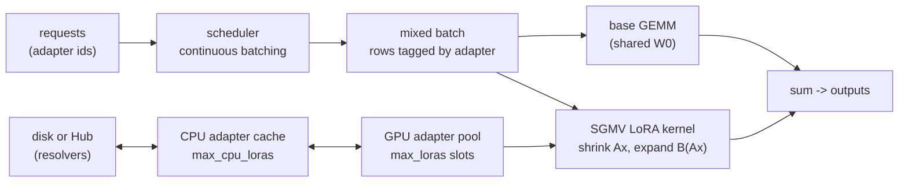
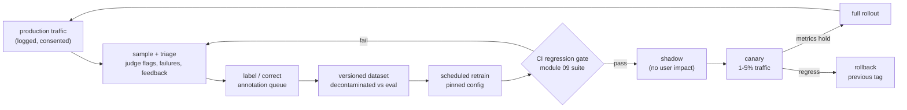

# 20 — Production: Serving Adapters, MLOps, and Cost Planning

> **Prerequisites:** modules 06, 09, 11 (10 for large-scale cost planning).
> **You will learn:** how to serve fine-tunes (merged vs multi-LoRA), the training-to-serving
> compatibility checklist, the MLOps loop, and a defensible cost model for
> training and serving.

A fine-tune that scores well in a notebook is not yet a product. It becomes useful only
when it is served reliably, at a latency users accept, for a cost the business can carry,
and when you can retrain and roll it back without drama. This module covers the
training-side half of that contract: choosing between merged models and multi-LoRA
serving, the files and flags that must agree between trainer and engine, the
retraining loop, and cost arithmetic you can defend in a design review.

The [Inference course](/courses/inference/) owns engine internals (schedulers, kernels,
KV-cache management). This module links into it rather than re-teaching it; start with
[LoRA and pooling models](/courses/inference/07-architectures/07-05-lora-and-pooling-models.html)
if you want the engine-side view of adapters. General MLOps (experiment tracking,
containers, deployment strategies, drift) lives in the
[MLOps and serving note](../../notes/libraries/mlops-and-serving.md); here we only add what
is specific to fine-tuned LLMs.

---

## 20.1 Merged model or base plus adapters?

You have trained a LoRA adapter (module 06). There are exactly two ways to serve it, and
the choice is mostly about how many fine-tunes share one base.

**Merge** when there is one task, one model, and latency matters. Merging computes
$W = W_0 + \gamma_r B_{\text{lora}} A$ once and writes a plain checkpoint, so inference
costs exactly what the base costs. Merge into a **bf16 copy of the base, then quantize**
(AWQ, GPTQ, FP8, GGUF; see [module 11](./11-quantization-qat-and-fp8.md)). Merging into an
already-quantized base rounds the small update away. PEFT's `merge_and_unload()` returns a
new model rather than mutating in place, and `merge_adapter()`/`unmerge_adapter()` let you
toggle; the lifecycle is in [module 06](./06-lora-and-qlora.md).

**Serve unmerged adapters** when many tenants or tasks share one base. One copy of an 8B
base plus 200 small adapters fits on one GPU; 200 merged 8B models do not. The price is a
per-token overhead: every adapted linear layer runs the base GEMM plus two thin matmuls,
$x \mapsto B_{\text{lora}}(Ax)$, with inner dimension $r$.

How large is that overhead? For Qwen3-8B (36 layers, $d = 4096$, $d_{ff} = 12288$, 8 KV
heads of dim 128) with `target_modules="all-linear"` and $r = 16$, one layer's adapter has
$r \cdot \sum (d_{\text{in}} + d_{\text{out}}) = 16 \times 75{,}776$ parameters, so the
whole adapter has 43.6M parameters (87 MB in bf16). That is about 0.55% of the base's
FLOPs per token. **FLOPs are not the problem; memory traffic and kernel efficiency are.**
Each thin matmul is memory-bound, and in a mixed batch different rows need different
$A, B$ pairs. Section 20.3 is about making that gather cheap.

Exotic adapters change the calculus. DoRA rescales the merged weight's column norms
(see [module 07](./07-the-wider-peft-landscape.md)); IA3, prefix tuning, and the long tail
of 2025-26 PEFT methods are not supported by the multi-LoRA kernels in mainstream
engines. **If it is not plain LoRA on supported module types, plan to merge.** A
deployed engine also needs `--max-lora-rank` at least as large as your largest adapter
(section 20.2), so rank-256 research adapters often end up merged too.

Inside Python, PEFT can hold several adapters on one model and switch with
`load_adapter()`/`set_adapter()` (module 06). That is fine for evaluation and hot-swapping
in a notebook. It is not a serving system: it runs one adapter per forward pass and has no
mixed-adapter batching.

**Table 1. Serving options for a fine-tune.**

| Option | Latency per token | GPU memory | Ops complexity | When |
|---|---|---|---|---|
| Merged bf16 | same as base | one full model per fine-tune | lowest: one artifact | one task, highest quality, ample GPUs |
| Merged then quantized (AWQ/GPTQ/FP8/GGUF) | lower than bf16 (memory-bound decode) | 25-50% of bf16 | low, plus a quantization eval gate | one task, cost- or edge-constrained |
| Base + adapters, unmerged (multi-LoRA) | base plus a few percent to tens of percent, depending on kernel, rank mix, and batch | one base plus about 0.1-2% per resident adapter | medium: adapter registry, limits, cache sizing | many tenants or tasks on one base |
| Base + adapters, with quantized base | as above, on a cheaper base | smallest for many tenants | medium-high: adapter must have been trained against (or validated on) the quantized base | many tenants, cost-constrained |
| Full fine-tunes as 1-bit deltas (BitDelta) | base plus delta kernel | base plus about 1/16 of a bf16 model per tenant | high: research-grade kernels | many full fine-tunes of one base |

Do not take the latency column as a benchmark. Measure on your traffic with the
[profiling and capacity](/courses/inference/10-benchmarking/10-05-profiling-and-capacity.html)
method; Lab L20.1 does exactly that comparison.

## 20.2 Serving engines

### vLLM

vLLM is the default open engine for multi-LoRA serving. As of the
[v0.31.0 LoRA docs](https://docs.vllm.ai/en/v0.31.0/features/lora/) (October 2026), you
enable adapters at launch and select one per request by putting the adapter's name in the
OpenAI `model` field. A request that names the base model runs without an adapter.

Teaching fragment: not executed (needs a GPU and vLLM).

```bash
vllm serve Qwen/Qwen3-8B \
  --enable-lora \
  --lora-modules billing=./adapters/billing support=./adapters/support legal=./adapters/legal \
  --max-loras 4 \
  --max-lora-rank 16 \
  --max-cpu-loras 32

curl http://localhost:8000/v1/chat/completions -H "Content-Type: application/json" \
  -d '{"model": "support", "messages": [{"role": "user", "content": "Where is order 8812?"}]}'
```

The three limits are the knobs you size. From the
[engine-args reference](https://docs.vllm.ai/en/v0.31.0/configuration/engine_args/):

| Flag | Default (v0.31.0) | Meaning | Sizing rule |
|---|---|---|---|
| `--max-loras` | 1 | adapters that can appear **in one batch** (GPU slots) | the number of distinct adapters you expect concurrently in a step; each slot reserves rank-`max_lora_rank` buffers |
| `--max-lora-rank` | 16 | largest rank any loaded adapter may have; allowed values 1, 8, 16, 32, 64, 128, 256, 320, 512 | the maximum rank among your adapters, no higher (it sets buffer sizes and padded compute) |
| `--max-cpu-loras` | none listed; must be at least `max_loras` | adapters cached in host memory | the working set of tenants; must be at least `max_loras` |

The default `--max-loras 1` is the most common surprise: mixed-adapter batches serialize
until you raise it. Keep `--max-lora-rank` tight. A server sized for rank 64 pads every
rank-8 adapter's compute to 64 (section 20.3).

**Dynamic loading.** With the environment variable `VLLM_ALLOW_RUNTIME_LORA_UPDATING=True`,
vLLM exposes `POST /v1/load_lora_adapter` (`lora_name`, `lora_path`) and
`POST /v1/unload_lora_adapter` (`lora_name`). The vLLM docs warn that this feature "comes
with security risks" and should not be used in production outside an isolated, fully
trusted environment. **The reason is simple: anyone who can reach the endpoint can make
your server load arbitrary weights from an arbitrary path.** If you need it, put it behind
an authenticated admin API on a separate network path from user traffic, allow-list the
adapter directory, and log every load. **LoRA resolvers** are the on-demand variant: the
`lora_filesystem_resolver` plugin loads adapters from `VLLM_LORA_RESOLVER_CACHE_DIR`, and
`lora_hf_hub_resolver` from the repos in `VLLM_LORA_RESOLVER_HF_REPO_LIST` (both enabled
via `VLLM_PLUGINS`); the docs call remote download "insecure and not intended for use in
production environments".

**Multimodal and MoE caveats.** vLLM's LoRA support for the vision tower and connector of
multimodal models is marked experimental; by default adapters apply to the language
model. For MoE models, PEFT-style fused "3D" expert LoRA weights and per-expert "2D"
weights are different layouts; serving both requires `--enable-mixed-moe-lora-format` and
a per-adapter `is_3d_lora_weight`, and the docs warn that vLLM trusts the declared layout,
so a wrong value gives load failures or wrong outputs. Expert LoRA training is in
[module 10](./10-distributed-fine-tuning-and-moe.md).

### The rest of the map

- **SGLang.** Multi-LoRA with mixed-adapter batches, `--lora-paths`, `--max-loras-per-batch`
  (default 8), `--max-lora-rank`, a `--lora-backend` of `triton` or `csgmv`, runtime
  `/load_lora_adapter`, and adapter pinning; its docs credit S-LoRA and Punica for the
  design ([SGLang LoRA docs](https://docs.sglang.io/docs/advanced_features/lora), as of
  October 2026). OpenAI-compatible requests select an adapter as `base-model:adapter-name`.
- **TGI.** The [text-generation-inference README](https://github.com/huggingface/text-generation-inference)
  says it is "now in maintenance mode" and recommends vLLM and SGLang (or llama.cpp and
  MLX locally) going forward; the repository was archived on 21 March 2026. Do not start
  new deployments on it.
- **`transformers serve`.** Transformers v5 ships an OpenAI-compatible server
  (`/v1/chat/completions`, `/v1/responses`, `/v1/completions`, `/v1/models`) with
  `--continuous-batching`, tool calling, and reasoning-field parsing. Its own
  [docs](https://huggingface.co/docs/transformers/v5.19.0/serve-cli/serving) position it for
  "evaluation, experimentation, and moderate load deployments" and recommend vLLM or SGLang
  for large-scale production (the [Hugging Face note](../../notes/libraries/huggingface.md)'s
  Deployment section maps ONNX, TensorRT, and managed options). **Use it to smoke-test a checkpoint behind the same API your
  app uses, before you bring up a real engine.**
- **llama.cpp, Ollama, LM Studio.** GGUF-based local runtimes for CPU, Apple silicon, and
  consumer GPUs. Ship a merged, quantized GGUF (section 20.8). llama.cpp can also apply a
  GGUF LoRA at load time (`convert_lora_to_gguf.py`), which is useful for testing.
- **MLX (`mlx-lm`).** Apple-silicon training and serving with LoRA, DoRA, and full
  fine-tuning plus `mlx_lm.fuse` to merge.

**Table 2. Engines for a fine-tuned model (October 2026).**

| Engine | LoRA support | Quantized bases | Tool/reasoning parsers | Best for |
|---|---|---|---|---|
| vLLM | multi-LoRA batching, runtime load, resolvers; MoE and vision-tower LoRA with caveats | FP8, AWQ, GPTQ, bitsandbytes, others | `--tool-call-parser` (e.g. `hermes`), `--reasoning-parser` (e.g. `qwen3`) | production, many adapters, RL rollouts |
| SGLang | multi-LoRA batching, runtime load, pinning, `csgmv` backend | FP8, AWQ, GPTQ, others | tool and reasoning parsers | production, structured output, prefix-heavy agents |
| TGI | multi-LoRA (legacy) | yes | yes | existing deployments only (maintenance mode) |
| `transformers serve` | via loading a PEFT model in Python | whatever Transformers loads | built-in, from the tokenizer's response template | dev/test, moderate load, parity checks |
| llama.cpp / Ollama / LM Studio | GGUF LoRA at load time; usually ship merged | GGUF k-quants (Q4_K_M, Q5_K_M, Q8_0, ...) | template-driven, per runtime | laptops, on-prem CPU, edge |
| MLX (`mlx-lm`) | LoRA/DoRA training, fuse to merge | MLX 4/8-bit | limited | Apple silicon dev and local serving |

For the engine decision itself (throughput, hardware, operational maturity) read
[choosing an engine](/courses/inference/13-comparison-and-frontier/13-02-choosing-an-engine.html).

## 20.3 Multi-tenant LoRA serving

### The problem

You have one base and many adapters. A naive server either (a) batches only requests that
share an adapter, starving throughput when traffic is spread across tenants, or (b) merges
and unmerges per batch, which is far too slow. What you want is one batch with rows from
many adapters: one large GEMM for the shared base, plus a per-row low-rank correction.

### Punica: SGMV

Chen et al. (2023) [Punica](https://arxiv.org/abs/2310.18547) introduced **SGMV
(segmented gather matrix-vector multiplication)**. Sort the batch so rows with the same
adapter are contiguous (segments), gather each segment's $A$ and $B$ by adapter index, and
run the two thin products for all segments in one kernel launch. The base GEMM runs once
over the whole batch. Punica reports 12x higher throughput than then-current serving
systems on a fixed cluster, adding about 2 ms latency per token. vLLM's LoRA kernels
descend from this design (a gather-by-index "shrink" $Ax$ followed by an "expand"
$B_{\text{lora}}(\cdot)$), and rows with no adapter are masked out.

### S-LoRA: unified paging

Sheng et al. (2023) [S-LoRA](https://arxiv.org/abs/2311.03285) attacked memory. Adapters
live in host memory; the ones needed by running requests are fetched to the GPU. Adapter
weights (whose size varies with rank) and KV-cache blocks (whose size varies with sequence
length) share **one paged memory pool** ("Unified Paging"), so neither fragments the
other. With custom kernels for heterogeneous batching and a tensor-parallel scheme, S-LoRA
reports serving thousands of adapters on one GPU with up to 4x the throughput of vLLM's
then-naive LoRA path. vLLM's `max_loras` (GPU slots) and `max_cpu_loras` (host cache) are
the operator-facing version of this hierarchy.



### Proving the gather is exact

The check below builds a base weight of shape `(16, 12)`, three adapters with ranks 2, 4,
and 8, and seven requests with adapter ids `[0, 2, 1, 1, 0, 2, -1]` (the last uses no
adapter). It computes outputs once with a per-request Python loop and once SGMV-style:
zero-pad every adapter to rank 8, stack them, gather by id, and run two batched matmuls.
It asserts the two agree, that only one side of the padding needs to be zero, and it
counts the wasted FLOPs. For the six adapted rows, padding to rank 8 computes
$6 \times 2 \cdot 8 \cdot (12 + 16) = 2{,}688$ LoRA FLOPs, of which only
$2 \cdot 28 \cdot (2+8+4+4+2+8) = 1{,}568$ are useful: **1,120 FLOPs, 41.7%, are spent on
zeros.**

```python finetuning-check
import torch

torch.manual_seed(0)
d_out, d_in = 16, 12
W0 = torch.randn(d_out, d_in)
ranks = [2, 4, 8]
alpha = 16.0
As = [torch.randn(r, d_in) * 0.1 for r in ranks]          # (r, d_in)
Bs = [torch.randn(d_out, r) * 0.1 for r in ranks]         # (d_out, r)
scales = [alpha / r for r in ranks]
ids = torch.tensor([0, 2, 1, 1, 0, 2, -1])
X = torch.randn(len(ids), d_in)                            # (n, d_in), one token per request

# Reference: one request at a time.
ref = []
for i, a in enumerate(ids.tolist()):
    y = W0 @ X[i]
    if a >= 0:
        y = y + scales[a] * (Bs[a] @ (As[a] @ X[i]))
    ref.append(y)
ref = torch.stack(ref)                                     # (n, d_out)

# Batched: pad to max rank, extra slot = "no adapter" (all zeros).
R = max(ranks)
n_slots = len(ranks) + 1
A_pad = torch.zeros(n_slots, R, d_in)
B_pad = torch.zeros(n_slots, d_out, R)
for k, r in enumerate(ranks):
    A_pad[k, :r] = As[k]
    B_pad[k, :, :r] = scales[k] * Bs[k]                    # fold the scale into B
slot = torch.where(ids < 0, torch.tensor(n_slots - 1), ids)

def batched(A_stack, B_stack):
    shrink = torch.bmm(A_stack[slot], X.unsqueeze(-1))     # (n, R, 1)
    expand = torch.bmm(B_stack[slot], shrink).squeeze(-1)  # (n, d_out)
    return X @ W0.T + expand

out = batched(A_pad, B_pad)
torch.testing.assert_close(out, ref, atol=1e-6, rtol=0)

# Padding only needs zeros on one side: garbage in B's padded columns is harmless
# because the matching rows of A are zero, so the shrink output is zero there.
B_garbage = B_pad.clone()
for k, r in enumerate(ranks):
    B_garbage[k, :, r:] = 123.0
torch.testing.assert_close(batched(A_pad, B_garbage), ref, atol=1e-6, rtol=0)

# FLOP accounting for the adapted rows (2 FLOPs per multiply-add).
adapted = [a for a in ids.tolist() if a >= 0]
flops_padded = sum(2 * R * (d_in + d_out) for _ in adapted)
flops_useful = sum(2 * ranks[a] * (d_in + d_out) for a in adapted)
assert flops_padded == 2688
assert flops_useful == 1568
assert flops_padded - flops_useful == 1120
assert round((flops_padded - flops_useful) / flops_padded, 3) == 0.417
```

The check proves the algebra of gather-and-pad; it does not prove anything about kernel
speed, memory bandwidth, or how a real engine schedules segments.

### Heterogeneous ranks

The waste in the check is the general problem. A batch's LoRA cost is set by its largest
rank when kernels pad, so one rank-64 tenant makes every rank-8 tenant in the same batch
pay rank-64 compute and buffer memory. Mitigations, from cheapest to most involved:

1. **Standardize ranks per base.** Pick one rank (8 or 16 is usually enough for
   post-training; see module 06 on "LoRA Without Regret") and enforce it at adapter
   registration.
2. **Bucket by rank.** Run separate server pools (or separate `max_lora_rank` settings) for
   small-rank and large-rank tenants.
3. **Rank-aware kernels and placement.** Jaiswal et al. (2025)
   [LoRAServe](https://arxiv.org/abs/2511.22880) argue that co-batching heterogeneous ranks
   without accounting for size causes performance skew, and rebalance adapters across GPUs
   by rank (with GPU-Direct RDMA for remote adapter access). On production traces they
   report up to 2x throughput, up to 9x lower TTFT, and up to 50% fewer GPUs under SLOs,
   relative to the state-of-the-art systems they compare against.

### BitDelta: multi-tenant full fine-tunes

What if your tenants are full fine-tunes, not LoRAs? Liu et al. (2024)
[BitDelta](https://arxiv.org/abs/2402.10193) decompose each fine-tuned weight into base
plus delta, $W_{\text{ft}} = W_0 + \Delta$, and replace $\Delta$ by
$\hat\Delta = \alpha \cdot \operatorname{sign}(\Delta)$ with one scale per matrix
(initialized to the mean absolute delta, then refined by a short distillation against the
fine-tuned model). Storage drops from 16 bits to about 1 bit per delta parameter, so a
tenant costs about 1/16 of a bf16 model. The paper reports more than 10x lower GPU memory
for multi-tenant serving with minimal degradation on Llama-2 and Mistral models up to 70B.
**What it establishes:** fine-tuning deltas are highly compressible. **What it does not:**
that a mainstream engine serves 1-bit deltas today; treat it as a design option, not a flag.

## 20.4 The compatibility checklist

Most "the model got worse after deployment" incidents are not model problems. They are
contract violations between what the trainer saw and what the engine does. The files that
carry the contract:

| Artifact | What must match | Owning module |
|---|---|---|
| `chat_template` (in `tokenizer_config.json` or `chat_template.jinja`) | byte-identical to the template used in training, including the generation prompt and system-prompt defaults | [02](./02-tokens-templates-and-the-causal-lm-objective.md) |
| `generation_config.json` `eos_token_id` | a **list** containing every end-of-turn token the template emits | [02](./02-tokens-templates-and-the-causal-lm-objective.md) |
| tokenizer files (`tokenizer.json`, added/special tokens) | same vocabulary and special-token ids; new tokens shipped | 02 |
| tool-call and reasoning parsers | engine parser matches the template's tool-call and thinking format | [15](./15-agentic-and-tool-use-fine-tuning.md) |
| `rope_scaling` in `config.json` | engine uses the same scaling and `max_model_len` the model was trained with | [17](./17-long-context-extension.md) |
| weight format | `.safetensors` only | this section |
| adapter `adapter_config.json` | `base_model_name_or_path` (and revision) equals the served base; `r` within `max_lora_rank`; target modules supported | 06 |
| base precision | adapter trained on bf16 base vs served on an AWQ/FP8 base: validate, do not assume | [11](./11-quantization-qat-and-fp8.md) |

Qwen3 is a good example of why EOS must be a list. Its
[generation_config.json](https://huggingface.co/Qwen/Qwen3-1.7B/blob/70d244cc86ccca08cf5af4e1e306ecf908b1ad5e/generation_config.json)
sets `eos_token_id` to `[151645, 151643]`: `<|im_end|>` (end of turn) and `<|endoftext|>`.
If a re-saved checkpoint keeps only `151643`, the chat model ends its turn with
`<|im_end|>`, the engine does not stop, and the model rambles into a fabricated next user
turn.

### "Works in `generate()`, garbage in vLLM or Ollama": eight checks, in order

1. **Template.** Render one conversation with the training template and with the engine's
   (`/v1/chat/completions` request logged at debug level, or Ollama's `TEMPLATE`). Diff
   the strings. Missing generation prompt, a different system default, or a thinking toggle
   (Qwen3's `enable_thinking`) are the usual culprits.
2. **Token ids, not strings.** Tokenize both renderings. A double BOS (template adds one,
   tokenizer adds another) changes every position.
3. **Stop tokens.** Every end-of-turn token must be in `eos_token_id` (vLLM reads
   `generation_config.json` by default via `--generation-config auto`) or in Ollama's
   `PARAMETER stop`.
4. **Sampling defaults.** `generation_config.json` carries `temperature`, `top_p`, `top_k`
   that engines apply as defaults. Your Python test probably used greedy. Compare with
   temperature 0 first.
5. **Adapter actually applied.** In vLLM the request's `model` must be the adapter name;
   naming the base silently skips the adapter. Check `adapter_config.json`'s
   `base_model_name_or_path` and that `r` is at most `--max-lora-rank`.
6. **Precision and quantization.** A LoRA trained against a bf16 base and served on a
   4-bit base sees different activations. A merged model quantized without calibration on
   your format can break JSON. Evaluate the served artifact, not its parent.
7. **Context and RoPE.** A `rope_scaling` present in training but missing in serving (or
   vice versa), or a `max_model_len` shorter than your prompts, gives fluent nonsense on
   long inputs only. vLLM accepts config overrides through `--hf-overrides`.
8. **Parsers.** Tool calls returned as plain text, or `<think>` blocks leaking into
   `content`, mean the engine parser does not match the template. In vLLM v0.31 that is
   `--enable-auto-tool-choice --tool-call-parser <name>`
   ([tool calling docs](https://docs.vllm.ai/en/v0.31.0/features/tool_calling/)) and
   `--reasoning-parser qwen3` for Qwen3, which returns thinking in the `reasoning` field
   (formerly `reasoning_content`;
   [reasoning outputs](https://docs.vllm.ai/en/v0.31.0/features/reasoning_outputs/)).

Several of these checks are mechanical, so automate them in CI. The check below is a
minimal validator over config dicts. With fixtures shaped like a Qwen3 deployment, it must
flag exactly four problems (missing `<|im_end|>` id in the EOS list, adapter rank 64 above
`max_lora_rank` 16, a `rope_scaling` mismatch, and an adapter trained on a different
base), and return nothing once the fixtures are corrected.

```python finetuning-check
import copy

END_OF_TURN_MARKERS = ["<|im_end|>", "<|eot_id|>", "<end_of_turn>"]
VLLM_ALLOWED_RANKS = {1, 8, 16, 32, 64, 128, 256, 320, 512}

def validate(tokenizer_config, generation_config, added_tokens, model_config,
             adapter_config, serving_config):
    problems = []
    eos = generation_config["eos_token_id"]
    eos = eos if isinstance(eos, list) else [eos]
    template = tokenizer_config["chat_template"]
    for marker in END_OF_TURN_MARKERS:
        if marker in template and added_tokens.get(marker) not in eos:
            problems.append("eos_missing:" + marker)
    if serving_config["max_lora_rank"] not in VLLM_ALLOWED_RANKS:
        problems.append("max_lora_rank_not_allowed")
    if adapter_config["r"] > serving_config["max_lora_rank"]:
        problems.append("adapter_rank_exceeds_max_lora_rank")
    if model_config.get("rope_scaling") != serving_config.get("rope_scaling"):
        problems.append("rope_scaling_mismatch")
    if adapter_config["base_model_name_or_path"] != serving_config["base_model"]:
        problems.append("adapter_base_mismatch")
    return problems

tokenizer_config = {"chat_template": "<|im_start|>{{ m.role }}\n"
                                     "{{ m.content }}<|im_end|>\n"}
generation_config = {"eos_token_id": [151643]}               # <|im_end|> dropped
added_tokens = {"<|im_start|>": 151644, "<|im_end|>": 151645, "<|endoftext|>": 151643}
yarn = {"rope_type": "yarn", "factor": 4.0, "original_max_position_embeddings": 32768}
model_config = {"rope_scaling": yarn}
adapter_config = {"base_model_name_or_path": "Qwen/Qwen3-4B", "r": 64}
serving_config = {"base_model": "Qwen/Qwen3-8B", "max_lora_rank": 16, "rope_scaling": None}

found = validate(tokenizer_config, generation_config, added_tokens, model_config,
                 adapter_config, serving_config)
assert sorted(found) == sorted([
    "eos_missing:<|im_end|>",
    "adapter_rank_exceeds_max_lora_rank",
    "rope_scaling_mismatch",
    "adapter_base_mismatch",
]), found

fixed_gen = {"eos_token_id": [151645, 151643]}
fixed_adapter = {"base_model_name_or_path": "Qwen/Qwen3-8B", "r": 64}
fixed_serving = copy.deepcopy(serving_config)
fixed_serving["max_lora_rank"] = 64
fixed_serving["rope_scaling"] = copy.deepcopy(yarn)
assert validate(tokenizer_config, fixed_gen, added_tokens, model_config,
                fixed_adapter, fixed_serving) == []

# A rank the engine does not accept is caught even if it is large enough.
bad_rank = dict(fixed_serving, max_lora_rank=96)
assert validate(tokenizer_config, fixed_gen, added_tokens, model_config,
                fixed_adapter, bad_rank) == ["max_lora_rank_not_allowed"]
```

It proves the validator's logic on fixtures; it does not prove that templates render
identically or that a served model's outputs match, which only a parity eval (Lab L20.2)
shows.

### Security: weights are code-adjacent

- **`trust_remote_code=True` executes Python from the model repository** on your machine
  (and vLLM's `--trust-remote-code`, default `False`, does the same in the server). Only
  enable it for repos you have read and pinned to a commit.
- **Pickle (`.bin`, `.pt`) can execute arbitrary code on load; safetensors cannot.** It is
  a flat tensor container with a JSON header. Ship and accept safetensors only;
  `save_pretrained` writes safetensors by default.
- **Community adapters are a supply chain.** Pin `revision=` to a commit SHA, scan
  repositories, prefer orgs you trust, and record the hash in your model registry. An
  adapter can also be behaviorally malicious (backdoored) while being format-safe, so run
  your safety regression suite ([module 19](./19-safety-forgetting-and-responsible-fine-tuning.md))
  on third-party adapters too.
- **Runtime adapter loading** (section 20.2) turns your inference API into a weight-upload
  API. Keep it off, or behind auth on an admin plane.

## 20.5 Latency and throughput (pointer section)

The engine techniques below belong to the Inference course. For each, here is the one
thing a fine-tuner must preserve.

**Continuous batching.** The scheduler admits and retires sequences every decode step
instead of waiting for a whole batch to finish, keeping the GPU full when output lengths
vary ([continuous batching](/courses/inference/01-the-core-loop/01-03-continuous-batching.html);
also [transformers module 14](../transformers/14-inference-optimizations.md)). Your job:
make outputs short and terminating. A fine-tune that forgets to stop holds a batch slot to
`max_tokens` and wrecks throughput for everyone.

**Paged attention.** KV cache is allocated in fixed-size blocks through a block table, so
memory is not reserved for the maximum length up front
([PagedAttention](/courses/inference/02-memory-and-kv-cache/02-02-pagedattention.html)).
Your job: know your KV cost. Qwen3-8B stores
$2 \cdot 36 \cdot 8 \cdot 128 \cdot 2 = 147{,}456$ bytes (about 0.15 MB) of bf16 KV per token, so a 700-token request holds about
103 MB. Long-context fine-tunes (module 17) multiply that.

**Prefix caching.** Requests that share a prefix reuse its KV blocks
([prefix caching](/courses/inference/02-memory-and-kv-cache/02-03-prefix-caching-hash.html)).
Your job: train with, and serve with, a **stable system prompt at the start** of the
template. A timestamp or user id injected at position 0 destroys the cache hit rate. With
multi-LoRA, caches are per adapter, because the same tokens yield different KV under
different adapters.

**Speculative decoding.** A cheap drafter proposes several tokens and the target verifies
them in one pass ([speculative decoding](/courses/inference/06-decoding-algorithms/06-02-speculative-decoding.html)).
Drafters are separate small models, EAGLE-style heads trained on the target's hidden
states, or the model's own **MTP heads** (DeepSeek-V3, Qwen3-Next, GLM-4.5 and others).
Fine-tuning shifts the target's distribution, so a drafter trained for the base sees its
acceptance rate drop. If your base has MTP heads, check whether your training stack
updates or at least preserves them (some exporters drop them; Unsloth's changelog notes a
fix for exporting Qwen3.5/3.6 MTP models to GGUF in July 2026). Measure acceptance rate
after fine-tuning; re-train the EAGLE head on your fine-tune's outputs if it falls.
vLLM configures this via `--speculative-config`; Ollama exposes a `draft_num_predict`
parameter for draft and embedded MTP tensors.

**Quantized serving.** Weight-only int4 (AWQ/GPTQ) helps memory-bound decode; FP8
weights and activations help compute-bound prefill on Hopper and newer. The fine-tuner's
job is the eval gate: run [module 09](./09-evaluating-fine-tuned-models.md)'s suite on the quantized artifact
([module 11](./11-quantization-qat-and-fp8.md) owns the methods).

## 20.6 Packaging and the MLOps loop

### Package for reproducibility

Every served artifact should answer three questions from its repository alone: what
base, what data, what config. The Hugging Face Hub is the usual registry.

- **Private or gated repos.** `hub_private_repo=True` creates a private repo (if `None`,
  the org default applies; the setting is ignored if the repo exists). Gated repos add an
  access-request step for external sharing.
- **`push_to_hub` and `hub_strategy`.** With `push_to_hub=True`, the Trainer (and every
  TRL trainer built on it) pushes on save. As of the
  [Transformers v5.19 Trainer docs](https://huggingface.co/docs/transformers/v5.19.0/en/main_classes/trainer),
  `hub_strategy` defaults to `"every_save"` (push each save, asynchronously); `"checkpoint"`
  also pushes the latest checkpoint to a `last-checkpoint` folder so a preempted spot job
  can resume; `"end"` pushes once; `"all_checkpoints"` pushes every checkpoint.
  `hub_revision` targets a branch, tag, or commit.
- **Version adapters by revision.** Tag each promoted adapter (`v2026-10-01-support`) and
  pin the tag's commit SHA in serving configs. "Latest `main`" is not a version.
- **Model cards.** Base model and revision, data sources and licences, eval results with
  CIs, safety evals, intended use, known failure modes
  ([module 19](./19-safety-forgetting-and-responsible-fine-tuning.md) owns the template).
- **Reproducible configs.** Commit the exact TRL/Axolotl YAML, library versions, seeds,
  and the dataset revision next to the weights. ZeRO-3 and FSDP checkpoints need
  consolidation into a normal state dict before export
  ([module 10](./10-distributed-fine-tuning-and-moe.md)).

Teaching fragment: not executed.

```python
from trl import SFTConfig

args = SFTConfig(
    output_dir="qwen3-8b-support-lora",
    push_to_hub=True,
    hub_model_id="acme/qwen3-8b-support-lora",
    hub_private_repo=True,
    hub_strategy="checkpoint",       # resumable on spot instances
    save_strategy="steps",
    save_steps=200,
    eval_strategy="steps",
    max_length=2048,
    model_init_kwargs={"dtype": "bfloat16"},
)
```

### The loop

A fine-tune decays. Users change, products change, and the base model you started from is
superseded. **Treat the fine-tune as a pipeline that runs on a schedule, not a model you
trained once.**



The pieces that are specific to LLM fine-tunes:

- **Data flywheel.** Sample production conversations (with consent and PII scrubbing),
  prioritize failures: format failures, thumbs-down, judge-flagged answers, escalations.
  Correct them by hand or with a stronger model plus human review, and add them to the
  training set. Keep the eval set frozen and decontaminate new training data against it
  ([module 04](./04-data-curation-and-synthesis.md)).
- **Regression gates in CI.** A retrain is promoted only if module 09's suite passes
  thresholds: task metric not below the incumbent's lower CI bound, JSON parse rate at or
  above 99.5%, safety refusal rate within tolerance, general-capability probes (IFEval-style)
  not down more than an agreed margin.
- **Shadow, then canary.** Shadow mode runs the candidate on mirrored traffic without
  returning its output, so you compare format and judge scores on real inputs at zero
  risk. Canary sends a small slice of real traffic and watches the monitoring table below.
- **Rollback.** Because adapters are small and versioned by tag, rollback is a config
  change: point the `--lora-modules` entry (or the alias your router maps) back at the
  previous revision. Keep the previous adapter resident during canary.

### Monitoring in production

| Signal | How to compute | Why it matters for a fine-tune |
|---|---|---|
| Input drift | embedding centroid distance or a classifier between this week's and the training inputs; length and language histograms | the fine-tune was trained on last quarter's distribution |
| Format-failure rate | fraction of outputs that fail JSON parse or schema validation | the first thing a bad template, quantization, or stop-token bug breaks |
| Tool-call validity | parsed tool calls with valid name and argument schema | parser/template mismatch shows here first |
| Refusal rate | refusal classifier or keyword heuristics, by segment | over-refusal after safety tuning, under-refusal after domain tuning |
| User feedback | thumbs, edits, escalations, task completion | the only ground truth you get for free |
| Latency | TTFT and inter-token latency, p50/p95/p99 | adapter overhead and longer outputs show up here |
| Cost per request | GPU-seconds (or API spend) divided by requests, per tenant | the number finance asks about; drives section 20.7 |

The [observability and failure page](/courses/inference/09-serving-system/09-05-observability-and-failure.html)
covers engine metrics; the [MLOps note](../../notes/libraries/mlops-and-serving.md) covers
drift statistics and deployment strategies in general.

## 20.7 Cost and hardware planning

### Memory first

Before cost, check that the job fits. Training memory is weights plus gradients plus
optimizer state plus activations; full fine-tuning with AdamW in mixed precision is about
16-18 bytes per parameter before activations, and LoRA/QLoRA shrink every term but the
frozen weights ([module 03](./03-training-mechanics-and-memory-math.md) has the
calculator and Unsloth's VRAM table: for an 8B model Unsloth lists about 6 GB minimum for
QLoRA 4-bit and 22 GB for LoRA 16-bit, per its
[requirements page](https://unsloth.ai/docs/get-started/fine-tuning-for-beginners/unsloth-requirements)).
Serving memory is weights plus KV cache plus resident adapters. For weights-only
estimates of a Hub checkpoint, [`hf-mem`](https://github.com/alvarobartt/hf-mem) reads safetensors or GGUF
headers via HTTP range requests (KV-cache estimation sits behind its `--experimental` flag).

### Compute: why LoRA costs about two-thirds

Take one linear layer, $Y = XW^\top$ with $W \in \mathbb{R}^{d_{\text{out}} \times d_{\text{in}}}$,
and count FLOPs per token (a multiply-add is 2 FLOPs):

| Pass | Operation | FLOPs per token |
|---|---|---|
| forward | $Y = XW^\top$ | $2 d_{\text{in}} d_{\text{out}}$ |
| backward, input gradient | $\partial X = \partial Y\, W$ | $2 d_{\text{in}} d_{\text{out}}$ |
| backward, weight gradient | $\partial W = \partial Y^\top X$ | $2 d_{\text{in}} d_{\text{out}}$ |

Summed over every weight matrix, $\sum d_{\text{in}} d_{\text{out}} \approx N$, so full
fine-tuning costs about $6N$ FLOPs per token and $6ND$ for $D$ tokens (the Kaplan et al.
(2020) [rule](https://arxiv.org/abs/2001.08361), ignoring attention-score FLOPs).

With LoRA the base weights are frozen. You still need the forward pass and the input
gradient (to backpropagate to earlier layers' adapters), but the weight-gradient GEMM for
$W_0$ disappears. The adapter adds $O(r(d_{\text{in}} + d_{\text{out}}))$ per matrix,
negligible for $r \ll d$. So

$$
C_{\text{LoRA}} \approx 4ND \approx \tfrac{2}{3}\, C_{\text{full}}.
$$

Thinking Machines' [LoRA Without Regret](https://thinkingmachines.ai/blog/lora/) (Schulman
et al., September 2025) states the same: LoRA takes "slightly more than 2/3 of the FLOPs
that full fine-tuning does per pass". QLoRA adds dequantization work, so it is usually
slower than LoRA in wall-clock even though the FLOP count is the same.

Convert FLOPs to time with

$$
\text{GPU-hours} = \frac{C}{\text{peak FLOP/s} \times \text{MFU} \times 3600}.
$$

Peak for an H100 SXM in dense bf16 is 989 TFLOP/s (NVIDIA's
[H100 page](https://www.nvidia.com/en-us/data-center/h100/) lists 1,979 "with sparsity";
dense is half). MFU of 30-50% is typical for well-tuned fine-tuning; we use 40%,
so the effective rate is $3.956 \times 10^{14}$ FLOP/s.

### Scenario (a): SFT of an 8B model with LoRA on 50M tokens

$$
C_{\text{full}} = 6 \cdot 8\times10^{9} \cdot 5\times10^{7} = 2.4\times10^{18},\qquad
C_{\text{LoRA}} = 4 \cdot 8\times10^{9} \cdot 5\times10^{7} = 1.6\times10^{18}.
$$

That is 1.685 GPU-hours for full fine-tuning and 1.123 for LoRA. At an **assumed** USD 2.50
per H100-hour (an illustrative on-demand price, not a quote), the LoRA run is about USD
2.81 of compute. The surprise is how cheap SFT is: the real cost of scenario (a) is data
curation and evaluation, not GPUs. In practice add 20-50% for evaluation passes, restarts,
and sweeps.

### Scenario (b): GRPO of an 8B model

GRPO with $G = 8$ generations, 512 prompts per step, 500 steps, and an average completion
of 1,024 tokens generates

$$
8 \cdot 512 \cdot 500 \cdot 1024 = 2{,}097{,}152{,}000 \text{ tokens}.
$$

**Generation.** Assume vLLM decodes an 8B model at 2,500 tokens/s per GPU at the batch sizes
RL produces (an assumption; measure yours). Then generation takes
$2.097\times10^9 / 2500 / 3600 = 233.0$ GPU-hours.

**Training.** The policy update processes the same completion tokens:
$6 \cdot 8\times10^9 \cdot 2.097\times10^9 = 1.007\times10^{20}$ FLOPs, or 70.7 GPU-hours at
40% MFU (47.1 with LoRA). With TRL's default `beta=0.0` there is no reference-model forward;
setting $\beta > 0$ adds one forward ($2N$ per token).

**Generation is about 77% of the 303.7 GPU-hours** (USD 759 at the assumed price). This is
the general shape of RL fine-tuning: you pay for decode, which is memory-bound and runs far
below peak FLOP/s, while training on those tokens is a dense, efficient pass. What to cut
first:

1. **Completion length.** Cost is linear in it. Cap `max_completion_length` and penalize
   overlong outputs (module 13).
2. **Useless prompts.** Prompts where all $G$ completions get the same reward give zero
   advantage. Filter them (dynamic sampling) or pre-filter by pass rate.
3. **Decode throughput.** Server-mode vLLM on dedicated GPUs, larger rollout batches, FP8
   rollouts, and asynchronous generation; correct the train/inference mismatch with
   importance sampling ([module 13](./13-rl-with-verifiable-rewards.md) covers colocate vs
   server mode and TIS/MIS).
4. **$G$.** Fewer generations per prompt reduce cost linearly but make advantages noisier.

The check below asserts the numbers above for scenarios (a) and (b).

```python finetuning-check
N = 8e9
peak, mfu = 989e12, 0.40
eff = peak * mfu                                   # FLOP/s actually achieved

def gpu_hours(flops):
    return flops / eff / 3600

# Scenario (a): SFT on 50M tokens.
D = 5e7
full = 6 * N * D
lora = 4 * N * D
assert abs(full - 2.4e18) < 1e6 and abs(lora - 1.6e18) < 1e6
assert abs(lora / full - 2 / 3) < 1e-12
assert round(gpu_hours(full), 3) == 1.685
assert round(gpu_hours(lora), 3) == 1.123

# Scenario (b): GRPO, 8 generations x 512 prompts x 500 steps x 1,024 tokens.
G, prompts, steps, completion = 8, 512, 500, 1024
gen_tokens = G * prompts * steps * completion
assert gen_tokens == 2_097_152_000
decode_tps_per_gpu = 2500                          # stated assumption
gen_hours = gen_tokens / decode_tps_per_gpu / 3600
train_hours = gpu_hours(6 * N * gen_tokens)
assert round(gen_hours, 1) == 233.0
assert round(train_hours, 1) == 70.7
assert round(gpu_hours(4 * N * gen_tokens), 1) == 47.1
assert gen_hours > train_hours
total = gen_hours + train_hours
assert round(total, 1) == 303.7
assert round(gen_hours / total, 2) == 0.77
assert round(total * 2.50) == 759                  # USD at the assumed hourly price
```

It proves the arithmetic is consistent with the prose; it does not prove the assumed
throughput, MFU, or price, which you must measure or quote for your own setup.

### Scenario (c): serving 1M requests per day

Each request has 500 input and 200 output tokens. That is 11.57 requests/s on average,
or 2,315 output tokens/s and 5,787 prefill tokens/s. Traffic is not flat, so provision
for a **peak factor of 2**. **Assume** one H100 serving the 8B model in vLLM sustains
3,000 output tokens/s for this request shape at your latency SLO (an assumption; get the
real number from a load test as in
[profiling and capacity](/courses/inference/10-benchmarking/10-05-profiling-and-capacity.html)).
GPUs needed: $2{,}315 \times 2 / 3{,}000 = 1.54$, so **2 GPUs, plus 1 for redundancy = 3**.
At USD 2.50/h that is USD 180/day, or USD 0.00018 per request, or about USD 0.26 per 1M
tokens (input plus output). Compare an API **assumed** at USD 0.40 per 1M input and USD
1.60 per 1M output tokens: USD 0.00052 per request, USD 520/day.

### GPU selection

| GPU | Memory | bf16 | FP8 | FP4 | Interconnect | Fine-tuning sweet spot |
|---|---|---|---|---|---|---|
| T4 | 16 GB | no (fp16 only) | no | no | PCIe | free-tier QLoRA up to about 8B (tier T0) |
| L4 | 24 GB | yes | yes | no | PCIe | cheap LoRA on 1-8B, inference |
| A10G | 24 GB | yes | no | no | PCIe | LoRA up to about 8B (tier T1) |
| RTX 4090 | 24 GB | yes | yes | no | PCIe, no NVLink | local LoRA/QLoRA, fast per dollar |
| A100 | 40/80 GB | yes | no | no | NVLink (SXM) | full FT of 1-3B, LoRA to 32B (tier T2) |
| H100 | 80 GB | yes | yes | no | NVLink | default for RL and multi-GPU (T2/T3) |
| H200 | 141 GB | yes | yes | no | NVLink | long-context and larger-batch RL rollouts |
| B200 | 180-192 GB (by SKU) | yes | yes | yes (NVFP4, MXFP4) | NVLink 5 | large MoE, FP4 training/serving |
| AMD MI300X | 192 GB | yes | yes | no | Infinity Fabric | memory-heavy jobs; check framework support |

Memory figures are vendor specifications. Two 2026 changes widen the menu: Unsloth's
[changelog](https://unsloth.ai/docs/new/changelog) records AMD GPU training and inference
support (July 2026) and Intel XPU support for Arc and Data Center GPUs (July 2026).
Verify your exact framework and kernel path before you buy time on them.

**Spot vs on-demand.** Spot (preemptible) capacity is typically much cheaper. It is safe
for training if you checkpoint often and can resume (`hub_strategy="checkpoint"`, or
checkpoints on durable storage). It is unsafe for serving without a fallback pool.
**Serverless jobs** (Hugging Face Jobs, Modal-style platforms, Nebius serverless) bill per
second and remove cluster management; Axolotl documents both
[HF Jobs](https://docs.axolotl.ai/docs/hf-jobs.html) and
[Nebius serverless](https://docs.axolotl.ai/docs/nebius-serverless.html) launches, and
[module 08](./08-frameworks-and-tooling.md) covers training services including Tinker.

### Build vs buy

[Module 01](./01-when-to-fine-tune.md) asked whether a fine-tune beats prompting a frontier
API. Here we add the infrastructure. Let $R$ be requests per day, $a$ the API cost per
request, $v$ the variable self-hosted GPU cost per request, and $F$ the fixed monthly cost
of owning the model (ops time, monitoring, the redundant GPU, amortized training). Over a
30-day month:

$$
C_{\text{API}}(R) = 30Ra,\qquad
C_{\text{self}}(R) = F + 30Rv,\qquad
R^{*} = \frac{F}{30\,(a - v)}.
$$

Self-hosting wins above $R^*$, and only if $a > v$. The variable cost follows from
throughput: $v = t_{\text{out}} \cdot k_{\text{peak}} \cdot p_{\text{GPU}} / (\text{tok/s} \cdot 3600)$.
With the scenario (c) assumptions ($t_{\text{out}} = 200$, $k_{\text{peak}} = 2$,
USD 2.50/h, 3,000 tok/s), $v \approx$ USD 0.0000926 per request. Take $F$ = USD 5,000/month of
ops plus a USD 3,000 training run amortized over 6 months = USD 5,500/month. Then
$R^* \approx 428{,}943$ requests/day. This is a **fluid** model: it ignores that GPUs come
in integers, so near $R^*$ also check the integer GPU count.

The check below asserts the three-volume comparison, the break-even, and the throughput
sensitivity.

```python finetuning-check
# Stated assumptions (illustrative, not quotes).
t_in, t_out = 500, 200
api_in, api_out = 0.40, 1.60          # USD per 1M tokens
gpu_price = 2.50                      # USD per GPU-hour
tps = 3000                            # sustained output tokens/s per GPU at SLO
peak = 2.0                            # provisioning factor
F_ops = 5000.0                        # USD per month
train_once, amortize_months = 3000.0, 6

a = (t_in * api_in + t_out * api_out) / 1e6
def v_of(tps):
    return t_out * peak * gpu_price / (tps * 3600)
v = v_of(tps)
F = F_ops + train_once / amortize_months
assert abs(a - 0.00052) < 1e-12
assert abs(v - 9.259259e-5) < 1e-10
assert F == 5500.0

def api_month(R):
    return 30 * R * a
def self_month(R, tps=tps):
    return F + 30 * R * v_of(tps)

expected = {100_000: (1560.00, 5777.78), 1_000_000: (15600.00, 8277.78),
            10_000_000: (156000.00, 33277.78)}
for R, (api_c, self_c) in expected.items():
    assert round(api_month(R), 2) == api_c
    assert round(self_month(R), 2) == self_c
assert api_month(100_000) < self_month(100_000)        # low volume: buy
assert api_month(1_000_000) > self_month(1_000_000)    # high volume: build

R_star = F / (30 * (a - v))
assert round(R_star) == 428943
assert abs(api_month(R_star) - self_month(R_star)) < 1e-6

# Doubling throughput halves the variable self-hosted cost.
var = lambda R, t: self_month(R, t) - F
assert abs(var(1_000_000, 2 * tps) - var(1_000_000, tps) / 2) < 1e-9
```

It proves the break-even algebra and its sensitivity; it does not prove the API price,
your throughput, or that the fine-tuned small model matches the API model's quality,
which is module 09's job.

**Table 3. The three worked cost scenarios (all prices and throughputs are stated
assumptions).**

| Scenario | Workload | Key assumption | GPU-hours | Cost at USD 2.50/h | Dominant term |
|---|---|---|---|---|---|
| (a) LoRA SFT, 8B | 50M tokens | H100, 40% MFU | 1.12 (full FT 1.69) | about USD 2.81 (full FT 4.21) | data and eval labour, not compute |
| (b) GRPO, 8B | 8 x 512 x 500 x 1,024 = 2.10B generated tokens | 2,500 decode tok/s/GPU; 40% MFU for training | 233.0 generation + 70.7 training = 303.7 | about USD 759 | generation (77%) |
| (c) Serving, 8B | 1M requests/day, 500 in + 200 out | 3,000 out tok/s/GPU, peak factor 2, N+1 | 72 per day (3 GPUs) | USD 180/day vs USD 520/day API | GPU count (integer, peak-driven) |

## 20.8 Edge and on-device

### Pick a quant by memory budget

On-device, weight memory is roughly $N \times \text{bits per weight} / 8$, plus KV cache
and runtime overhead (budget about 1-2 GB on top for short contexts). llama.cpp's
[quantize README](https://github.com/ggml-org/llama.cpp/blob/781dbc5ac98921dbdb5e5b2ec5b7a50960e937d4/tools/quantize/README.md#L165-L174)
measures Llama-3.1-8B at:

| GGUF type | Bits/weight | 8B size (GiB) | Use when |
|---|---|---|---|
| Q4_K_M | 4.89 | 4.58 | default for 8 GB laptops and phones with 8B; small JSON-format loss is common, so eval it |
| Q5_K_M | 5.70 | 5.33 | 16 GB machines; closer to bf16 on structured output |
| Q8_0 | 8.50 | 7.95 | near-lossless reference; parity testing; larger machines |
| F16 | 16.00 | 14.96 | the conversion intermediate, not a deployment target |

Rules of thumb for 1-8B fine-tunes: a 1.7B model at Q8_0 or a 4B at Q4_K_M fits a phone
with 8 GB RAM; an 8B at Q4_K_M fits a 16 GB laptop with room for context. **Fine-tunes
for narrow formats (JSON) are more fragile under aggressive quantization than chat models,
so run the parity eval at the quant you ship.**

### Export to GGUF and Ollama

The pipeline, pinned to llama.cpp commit `781dbc5`: merge the adapter into a bf16 base
(module 06), convert with
[`convert_hf_to_gguf.py`](https://github.com/ggml-org/llama.cpp/blob/781dbc5ac98921dbdb5e5b2ec5b7a50960e937d4/convert_hf_to_gguf.py#L60)
(output types `f32`, `f16`, `bf16`, `q8_0`, ...), then quantize with `llama-quantize`.

Teaching fragment: not executed (needs llama.cpp built and a merged model).

```bash
python convert_hf_to_gguf.py ./qwen3-1.7b-support-merged --outtype bf16 \
  --outfile qwen3-1.7b-support-bf16.gguf
./build/bin/llama-quantize qwen3-1.7b-support-bf16.gguf qwen3-1.7b-support-Q4_K_M.gguf Q4_K_M
ollama create qwen3-support -f Modelfile
```

The GGUF embeds the tokenizer and usually the chat template, but **do not rely on what a
runtime infers from GGUF metadata: set Ollama's `TEMPLATE` (Go template syntax) and one
`PARAMETER stop` per end-of-turn token explicitly**
([Modelfile reference, v0.40.2](https://github.com/ollama/ollama/blob/v0.40.2/docs/modelfile.mdx)).
For a ChatML-style Qwen3 fine-tune:

```text
FROM ./qwen3-1.7b-support-Q4_K_M.gguf
TEMPLATE """{{ if .System }}<|im_start|>system
{{ .System }}<|im_end|>
{{ end }}{{ if .Prompt }}<|im_start|>user
{{ .Prompt }}<|im_end|>
{{ end }}<|im_start|>assistant
"""
PARAMETER stop "<|im_end|>"
PARAMETER stop "<|endoftext|>"
PARAMETER temperature 0
```

If you trained with thinking disabled, the template must render the assistant turn the
same way your training template did (Qwen3's template inserts an empty think block when
`enable_thinking=False`); otherwise the prompt the model sees in Ollama is one it never
saw in training. **Verify parity on the eval set, not on one prompt** (Lab L20.2).

Other tools write GGUF too: Unsloth exports GGUF (including full fine-tunes from Unsloth
Studio since March 2026, and NVFP4/FP8/imatrix GGUF since July 2026 per its changelog) and
Axolotl has `axolotl export`. Whatever the tool, run the same parity check.

### Apple MLX and mobile runtimes

- **MLX.** [`mlx-lm`](https://github.com/ml-explore/mlx-lm/blob/ba8a08fd2ed72bbc53de84f89933f91fe4743e4a/mlx_lm/LORA.md)
  trains LoRA, DoRA, or full fine-tunes on Apple silicon (`mlx_lm.lora --train`), fuses
  adapters (`mlx_lm.fuse`), and can export GGUF, though its docs limit GGUF export to
  Mistral, Mixtral, and Llama-style models in fp16. For other architectures, fuse in MLX
  or PEFT and convert with llama.cpp.
- **Mobile.** llama.cpp runs on Android and iOS with GGUF. PyTorch's
  [ExecuTorch](https://github.com/pytorch/executorch/blob/f2575be5ac0e8f1c937a07931d2e08b79353e524/README.md)
  provides LLM runners for Android and Apple platforms with XNNPACK (CPU), Vulkan,
  Core ML, and vendor NPU backends (Qualcomm, MediaTek and others), and recommends
  `export_llm` or Optimum ExecuTorch for exporting Hugging Face LLMs. Export the merged
  model, never an unmerged adapter.

## 20.9 Lab: serve three adapters, export to GGUF, cost it

Scripts: [`multi_lora_serving.py`](./code/multi_lora_serving.py),
[`gguf_parity.py`](./code/gguf_parity.py), [`cost_model.py`](./code/cost_model.py). Each
has a CPU `--smoke` mode (under a minute, no downloads) that exercises the core logic and
asserts its result:

```bash
python content/courses/finetuning/code/multi_lora_serving.py --smoke
python content/courses/finetuning/code/gguf_parity.py --smoke
python content/courses/finetuning/code/cost_model.py --smoke
```

The smoke modes check the batched multi-adapter layer against a per-request loop and
simulate `max_loras`/`max_cpu_loras` hit rates under skewed tenant traffic; validate a
Modelfile template and stop-token checker on fixtures; and reproduce every number in
section 20.7.

### L20.1: one base, three adapters, one dynamic load (T1)

- **Model and data:** `Qwen/Qwen3-1.7B` plus three LoRA adapters you trained in modules
  05-06 (three seeds, or three `issue_type` subsets); module 01's 50-example support-email
  eval set (`eval.jsonl` written by `fit_or_not_baseline.py --out ./ft_data/`).
- **Versions:** vLLM 0.31.x, PEFT 0.21.x, one 24 GB GPU.
- **What `--full` does:** launches `vllm serve --enable-lora --max-loras 3
  --max-lora-rank 16 --max-cpu-loras 8` bound to `127.0.0.1`, sends the eval prompts
  round-robin across the adapters at concurrency 1, 8, and 32, loads a fourth adapter via
  `/v1/load_lora_adapter` (setting `VLLM_ALLOW_RUNTIME_LORA_UPDATING=True` for this local
  process only), then repeats the load test against a merged model.

```bash
python content/courses/finetuning/code/multi_lora_serving.py --full \
  --base Qwen/Qwen3-1.7B --adapters a=./adapters/a b=./adapters/b c=./adapters/c \
  --dynamic d=./adapters/d --merged ./merged-a --eval-jsonl ./ft_data/eval.jsonl
```

- **Record:** output tokens/s and p95 latency per concurrency, mixed adapters vs merged.
- **Expect:** the merged model is faster at every concurrency, with the gap narrowing as
  the base GEMM dominates at high concurrency. Requests naming the base model return
  un-adapted answers, a useful negative control.

### L20.2: GGUF export and parity (T0 or CPU)

- **Steps:** merge your best adapter into bf16 (module 06); convert and quantize to Q8_0
  and Q4_K_M (llama.cpp at or after commit `781dbc5`); write a Modelfile; generate
  greedily with Transformers v5, the GGUF in llama.cpp, and Ollama 0.40.x; score with
  module 01's metrics.

```bash
python content/courses/finetuning/code/gguf_parity.py --full \
  --hf-model ./qwen3-1.7b-support-merged --gguf ./qwen3-1.7b-support-Q8_0.gguf \
  --ollama-model qwen3-support --modelfile ./Modelfile --eval-jsonl ./ft_data/eval.jsonl
```

- **Record:** JSON parse rate and all-fields exact match per runtime and quant, and the
  count of prompts whose outputs differ from Transformers.
- **Expect:** Q8_0 matches Transformers on nearly all prompts and Q4_K_M loses a little.
  A large drop at Q8_0 is a template or stop-token bug, not quantization.

### L20.3: cost model (no GPU)

Every assumption in `cost_model.py` is a flag (`--gpu-price`, `--mfu`, `--decode-tps`,
`--serve-tps`, `--api-in`, `--api-out`, `--ops-monthly`, ...). Rerun with your quotes and
measured throughput, and record the break-even volume and the generation share of GRPO
cost:

```bash
python content/courses/finetuning/code/cost_model.py --gpu-price 3.10 --decode-tps 1800
```

### L20.4: capstone (T1 to T3)

Take one task end to end: scope, data pipeline, SFT, a preference or RL stage, an eval
report with confidence intervals and a safety regression, a quantized deployment, and a
cost report. The support-email task is the default; a task from your own work is better.

| Criterion | Evidence required | Module |
|---|---|---|
| Scoping | metric, golden set, prompting baseline, fine-tune-or-not memo | 01 |
| Data | dataset card, dedup and decontamination report, template rendering check | 02, 04 |
| SFT | config, loss curves, LoRA settings justified | 05, 06 |
| Preference or RL stage | reward/pair design, KL or reference choice, reward-hacking checks | 12, 13 |
| Evaluation | task metric with CIs vs baseline, judge calibration, error analysis | 09 |
| Safety | refusal and harmful-compliance regression vs base, model card | 19 |
| Deployment | served artifact (merged+quantized or multi-LoRA), compatibility validator passing, parity eval | 11, 20 |
| Cost | training GPU-hours and serving cost per request from this module's model, with assumptions | 20 |

---

## Key takeaways

- **Merge for one task; serve adapters for many.** Merging costs nothing at inference; multi-LoRA lets one base serve hundreds of tenants at a small per-token overhead.
- **Merge into bf16, then quantize.** Merging into a quantized base rounds away the update; the served artifact must pass its own eval.
- **Size `max_loras`, `max_lora_rank`, and `max_cpu_loras` deliberately.** vLLM defaults to 1 adapter per batch and rank 16; padding to a large max rank wastes compute on every smaller adapter.
- **SGMV gathers per-row adapters into one kernel, and S-LoRA pages adapters with the KV cache.** Together they make mixed-adapter batches practical; heterogeneous ranks remain a cost you manage by standardizing or bucketing.
- **Runtime adapter loading is an arbitrary-weights upload endpoint.** Keep `VLLM_ALLOW_RUNTIME_LORA_UPDATING` off in production or put it behind auth on an admin plane.
- **TGI is in maintenance mode and archived; `transformers serve` is for dev and moderate load.** Start new production deployments on vLLM or SGLang.
- **Most deployment regressions are contract violations.** Template, EOS list, sampling defaults, adapter routing, precision, RoPE, and parsers must match training; automate the checks.
- **Safetensors only, `trust_remote_code` only for pinned and read code.** Pickle executes on load and community adapters are a supply chain.
- **Fine-tunes must preserve serving accelerators.** Stable system prompts keep prefix caching useful; drafters and MTP heads lose acceptance when the target shifts.
- **A fine-tune is a pipeline, not an artifact.** Production logs feed a flywheel, retrains pass CI gates, and promotion goes shadow, canary, rollout, with tag-based rollback.
- **LoRA costs about 4ND FLOPs vs 6ND for full fine-tuning.** Frozen weights skip the weight-gradient GEMM, so a step is about two-thirds of full FT.
- **RL cost is generation cost.** In the worked GRPO example, decode is 77% of GPU-hours; shorten completions and drop zero-variance prompts before buying GPUs.
- **Build vs buy is a break-even in requests per day.** Self-hosting wins above $F/(30(a-v))$ and only if your measured throughput keeps $v$ below the API's per-request cost.
- **On-device, choose the quant by memory and verify parity.** Q4_K_M, Q5_K_M, and Q8_0 trade size for fidelity, and Ollama's template and stop tokens must match training.

## Self-check

1. Serve 200 customer-specific LoRA adapters on one base model: describe the architecture, the engine flags, the limits, and the cost drivers.
2. Estimate the GPU-hours to GRPO-train an 8B model with 8 generations per prompt, 512 prompts per step, and 500 steps. Where does the time go, and what would you change first to cut it?
3. Your fine-tuned model works in Python `generate()` but produces garbage or never stops in vLLM or Ollama. What do you check, and in what order?

---

**Next → [21 — Glossary, Cheat Sheet & Interview Bank](./21-glossary-cheatsheet-and-interview-bank.md)**
