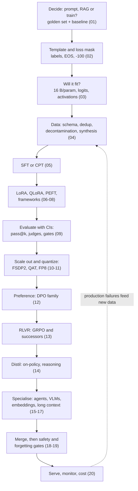

# 21 — Glossary, Cheat Sheet & Interview Bank

> **Prerequisites:** none; a standalone reference to modules 01–20.
> **You will learn:** the course on one page: decision tables, comparison tables, formulas, a
> debugging table, the glossary, numbers worth remembering, a 67-question
> interview bank with model answers, and the bibliography.

Standalone reference. Every entry links back to the module that derives it.

Related notes: [transfer learning and fine-tuning](../../notes/deep-learning/transfer-learning-and-finetuning.md) · [LLM prompting and alignment](../../notes/nlp/llm-prompting-and-alignment.md) · [deep RL](../../notes/deep-learning/deep-rl.md) · [Hugging Face](../../notes/libraries/huggingface.md). Sibling reference page: [Transformers glossary and cheat sheet](../transformers/17-glossary-and-cheatsheet.md); pretraining background: [Transformers module 13](../transformers/13-training-considerations.md); serving internals: the [Inference course](/courses/inference/). Defaults are as of October 2026: TRL v1.15, PEFT 0.21.x, Transformers v5.19, vLLM 0.31.

---

## Part 1 — Decision tables

### 1.1 Should you fine-tune?

Start from a measured gap on a golden set, never from a method. Knowledge gaps go to retrieval or tools; behaviour gaps go to prompting first, then training. The full prompting vs RAG vs fine-tuning framework and its break-even arithmetic are in [01](./01-when-to-fine-tune.md).

| Problem | First thing to try | Fine-tune when | Module |
|---|---|---|---|
| Wrong output format | schema in the system prompt, few-shot, constrained decoding | the format must hold at very high reliability on a small model, or the schema is too long to repeat | [01](./01-when-to-fine-tune.md) |
| Inconsistent tone | style guide plus 3–5 exemplars | the style is easier to demonstrate than describe and you have hundreds of examples | [01](./01-when-to-fine-tune.md) |
| Missing proprietary facts | RAG over the documents | almost never for the facts; possibly SFT so the model uses retrieved context well | [01](./01-when-to-fine-tune.md) |
| Facts change weekly | RAG or a live tool/API | never for the facts | [01](./01-when-to-fine-tune.md) |
| Too slow or expensive on a frontier API | a smaller prompted model, prompt caching | volume is high and a small fine-tune matches quality on your eval (SFT or distillation) | [01](./01-when-to-fine-tune.md), [14](./14-distillation-and-reasoning.md) |
| Malformed tool calls | better tool descriptions, fewer tools, strict parser with retry | the base's format is close but brittle and you can log thousands of real calls | [01](./01-when-to-fine-tune.md), [15](./15-agentic-and-tool-use-fine-tuning.md) |
| Refuses benign domain requests | system prompt stating the deployment context | refusals persist and you can build a vetted dataset (then re-test safety) | [01](./01-when-to-fine-tune.md), [19](./19-safety-forgetting-and-responsible-fine-tuning.md) |
| Multi-step math or code | a reasoning checkpoint, CoT, tools | answers are verifiable, so SFT then RLVR can sharpen a capable base | [01](./01-when-to-fine-tune.md), [13](./13-rl-with-verifiable-rewards.md) |
| New language | a family whose tokenizer and pretraining already cover it | coverage is weak: continued pretraining on a large corpus, then SFT | [01](./01-when-to-fine-tune.md), [05](./05-supervised-fine-tuning.md) |

### 1.2 Which adaptation method?

| Situation | Use | Why | Module |
|---|---|---|---|
| Default task SFT (format, extraction, style) | **LoRA**, `target_modules="all-linear"`, r = 8–32 | matches full FT when the data fits adapter capacity; the MLP holds two thirds of the all-linear LoRA parameters and 81% of Llama-3-8B's base linear weights | [06](./06-lora-and-qlora.md) |
| Memory-bound (8–32B on one 24 GB GPU) | **QLoRA** (NF4 + double quantization, bf16 compute) | frozen base at 4.127 bits/param; adapters still bf16 | [06](./06-lora-and-qlora.md) |
| RL with verifiable rewards | **LoRA**, any rank (even 1) | an episode carries about one scalar of information | [06](./06-lora-and-qlora.md), [13](./13-rl-with-verifiable-rewards.md) |
| Low rank forced, merge before serving | **DoRA** | separate magnitude vector; gains largest at low rank; vLLM rejects it unmerged | [07](./07-the-wider-peft-landscape.md) |
| Large SFT, new skills | LoRA r = 64–256 with **rsLoRA**, or full FT | raise rank only when loss plateaus above full FT | [06](./06-lora-and-qlora.md) |
| Continued pretraining on billions of tokens | **full FT** with replay; on one GPU **GaLore**, APOLLO or BAdam | update is high-rank; GaLore keeps 4.7% of Adam state per 4096² matrix at r = 128 | [06](./06-lora-and-qlora.md), [07](./07-the-wider-peft-landscape.md) |
| Full FT but GPU-short, Axolotl stack | **Spectrum** 25–50% | trains only the highest-SNR matrices per module type | [07](./07-the-wider-peft-landscape.md) |
| Thousands of tenants, kilobyte adapters, frozen serving graph | **prompt tuning** or **IA3**, measured first | tiny; but weaker below a few billion parameters and LR-sensitive | [07](./07-the-wider-peft-landscape.md) |
| Preserve base behaviour above all | LoRA (learns less, forgets less) or OFT | small or angle-preserving updates move the model less | [06](./06-lora-and-qlora.md), [07](./07-the-wider-peft-landscape.md) |
| Many adapters on one base in vLLM | **plain LoRA** (optionally trained with LoRA+, LoRA-FA or the Riemannian optimiser) | only standard LoRA up to `max_lora_rank` is servable unmerged | [07](./07-the-wider-peft-landscape.md), [20](./20-production-serving-and-cost.md) |

### 1.3 Which post-training stage?

| Data you have | Method | Note | Module |
|---|---|---|---|
| Demonstrations (prompt, response) | **SFT** | completion-only or assistant-only loss | [05](./05-supervised-fine-tuning.md) |
| A much stronger teacher, text only | **sequence-level KD** (SFT on filtered teacher traces) | Monte Carlo forward KL; suffers exposure bias | [14](./14-distillation-and-reasoning.md) |
| Same-prompt preference pairs | **DPO** (`sigmoid`, often plus `sft`) | needs reference log-probs, not necessarily a second model | [12](./12-preference-optimization.md) |
| Thumbs-up/down logs, no pairs | **KTO** | unpaired; set `desirable_weight` so the class ratio sits in [1, 4/3] | [04](./04-data-curation-and-synthesis.md), [12](./12-preference-optimization.md) |
| Pairs plus a base model, want one stage, no reference | **ORPO** (experimental) | NLL plus odds-ratio term | [12](./12-preference-optimization.md) |
| Pairs with length exploitation | **SimPO** (experimental `CPOTrainer`, `loss_type="simpo"`, `cpo_alpha=0`) or DPO `sigmoid_norm` | `sigmoid_norm` is length-normalised DPO and keeps the reference | [12](./12-preference-optimization.md) |
| Noisy labels | DPO `robust` or `ipo` | bounded response to flipped labels | [12](./12-preference-optimization.md) |
| A reward model, no RL infrastructure | **Best-of-N** distillation or iterative DPO | Best-of-N is the baseline every trained method must beat | [12](./12-preference-optimization.md) |
| Prompts plus a programmatic verifier | **GRPO** (TRL defaults) | group baseline, no critic | [13](./13-rl-with-verifiable-rewards.md) |
| Prompts plus verifier, want an unbiased baseline with KL in the reward | **RLOO** | leave-one-out baseline, `beta=0.05` | [13](./13-rl-with-verifiable-rewards.md) |
| A better teacher with the same tokenizer | **on-policy distillation** (`DistillationTrainer`, `beta=1.0`) | dense per-token reverse KL, no exposure bias | [14](./14-distillation-and-reasoning.md) |
| A better teacher with a different tokenizer | **GOLD** (experimental) | text-aligned spans plus ULD | [14](./14-distillation-and-reasoning.md) |

### 1.4 Which GRPO settings?

All names are `GRPOConfig` fields in TRL v1.15 ([13](./13-rl-with-verifiable-rewards.md)).

| Symptom or goal | Setting | Module |
|---|---|---|
| Sensible start | `loss_type="dapo"`, `scale_rewards="group"`, `beta=0.0`, `num_generations=8`, `learning_rate=1e-6`, temperature 1.0 (all defaults) | [13](./13-rl-with-verifiable-rewards.md) |
| Group std over-weights nearly solved or hopeless prompts | `scale_rewards="batch"` (Lite PPO) or `False` | [13](./13-rl-with-verifiable-rewards.md) |
| Must stay near the base (keep chat ability) | `beta>0` (DeepSeek-R1 used 0.001); loads a reference; `use_bias_correction_kl=True` is the default | [13](./13-rl-with-verifiable-rewards.md) |
| MoE instability, off-policy updates | `importance_sampling_level="sequence"` (GSPO) with `loss_type="grpo"`, `epsilon=3e-4`, `epsilon_high=4e-4` | [13](./13-rl-with-verifiable-rewards.md) |
| Truncated answers penalised as wrong | `mask_truncated_completions=True` or `trl.rewards.get_soft_overlong_punishment` | [13](./13-rl-with-verifiable-rewards.md) |
| Clipped tokens lose all gradient | `loss_type="cispo"`, `epsilon_high≈5` | [13](./13-rl-with-verifiable-rewards.md) |
| Several rewards, one dominates the std | `multi_objective_aggregation="normalize_then_sum"` (GDPO) | [13](./13-rl-with-verifiable-rewards.md) |
| vLLM and trainer log-probs disagree | keep `vllm_importance_sampling_correction=True` (`sequence_mask`, `vllm_importance_sampling_clip_max=3.0`); `cast_lm_head_to_fp32=True` | [13](./13-rl-with-verifiable-rewards.md) |

### 1.5 Which parallelism?

| Model size × context × GPUs | Use | Why | Module |
|---|---|---|---|
| Model and optimizer fit on one GPU, several GPUs available | **DDP** via `accelerate launch` | replicate, all-reduce gradients; TRL refuses `nn.DataParallel` | [10](./10-distributed-fine-tuning-and-moe.md) |
| Weights fit, optimizer state does not | **ZeRO-1/2** | same traffic as DDP | [10](./10-distributed-fine-tuning-and-moe.md) |
| Full FT beyond one GPU (8B full FT on 8×80 GB) | **FSDP2** (`fsdp_version: 2`) or **ZeRO-3** | shard params, grads, optimizer; about 1.5× DDP traffic | [10](./10-distributed-fine-tuning-and-moe.md) |
| 70B QLoRA on two 24 GB GPUs | FSDP + QLoRA, `bnb_4bit_quant_storage=torch.bfloat16`, CPU offload | quantized storage must be a float dtype matching the model | [10](./10-distributed-fine-tuning-and-moe.md) |
| Multi-node | **HSDP**: shard inside a node, replicate across | keeps parameter all-gathers off the network | [10](./10-distributed-fine-tuning-and-moe.md) |
| Layer weights or activations too big | **TP** inside NVLink | two activation all-reduces per layer, forward and backward | [10](./10-distributed-fine-tuning-and-moe.md) |
| 64k+ token sequences | **CP** (Ring, FSDP2 `cp_size`) or **Ulysses** (DeepSpeed `sp_size` ≤ KV heads) | only attention needs communication | [17](./17-long-context-extension.md) |
| Large MoE | **EP** (`ep_size`) plus FSDP2 | memory follows total parameters | [10](./10-distributed-fine-tuning-and-moe.md) |
| PCIe-only box | ZeRO-2 or LoRA; avoid TP | ZeRO-3 is communication-bound over PCIe | [10](./10-distributed-fine-tuning-and-moe.md) |
| Dense past ~100B, pipeline needed | Megatron-Core / NeMo | more mature TP/PP/CP/EP | [08](./08-frameworks-and-tooling.md), [10](./10-distributed-fine-tuning-and-moe.md) |

### 1.6 Which framework?

| Situation | Use | Why | Module |
|---|---|---|---|
| One GPU, standard model, want it fast | **Unsloth** | custom kernels, offloaded checkpointing, GGUF export; multi-GPU preliminary | [08](./08-frameworks-and-tooling.md) |
| Team, several GPUs, repeatable runs | **Axolotl** | one YAML covers packing, FSDP2/DeepSpeed, CP/TP/EP, QAT, RL | [08](./08-frameworks-and-tooling.md) |
| New loss or RL idea | **raw TRL** | subclass the nearest stable trainer; pin the version | [08](./08-frameworks-and-tooling.md) |
| Non-programmers or exotic optimizers | **LLaMA-Factory** | LLaMA Board GUI; GaLore, BAdam, APOLLO, Muon, OFT | [08](./08-frameworks-and-tooling.md) |
| No GPUs, own script | **HF Jobs** | pay per second; default 30-minute timeout | [08](./08-frameworks-and-tooling.md) |
| No GPUs, LoRA is enough, keep the loop | **Tinker** | `forward_backward`, `optim_step`, `sample`, `save_state`; summed losses | [08](./08-frameworks-and-tooling.md) |

### 1.7 Merge or serve adapters?

| Situation | Do | Module |
|---|---|---|
| One task, latency matters | merge into a **bf16** base, then quantize (AWQ/GPTQ/FP8/GGUF) and re-evaluate | [06](./06-lora-and-qlora.md), [20](./20-production-serving-and-cost.md) |
| Many tenants on one base | vLLM multi-LoRA; size `max_loras`, `max_lora_rank`, `max_cpu_loras` | [20](./20-production-serving-and-cost.md) |
| Adapter is DoRA, IA3, prefix, or rank above `max_lora_rank` | merge (or `save_as_lora` conversion) | [07](./07-the-wider-peft-landscape.md), [20](./20-production-serving-and-cost.md) |
| Trained with QLoRA | never merge into the 4-bit base; dequantize to bf16 first | [06](./06-lora-and-qlora.md), [11](./11-quantization-qat-and-fp8.md) |
| Different bases or tokenizers | do not merge; distil instead | [18](./18-model-merging-and-composition.md), [14](./14-distillation-and-reasoning.md) |

### 1.8 OOM triage in priority order

| Order | Where it dies | Bucket | Fix | Module |
|---|---|---|---|---|
| 1 | in the loss, long $T$, big $V$ | **logits** $(B, T, V)$ in fp32 | fused or chunked CE (TRL fused LM head, Liger, CCE), shorter `max_length` | [03](./03-training-mechanics-and-memory-math.md), [17](./17-long-context-extension.md) |
| 2 | forward or backward, grows with $B$ and $T$ | **activations** | gradient checkpointing, smaller micro-batch with more accumulation, FlashAttention, activation offload, TiledMLP, CP/SP | [03](./03-training-mechanics-and-memory-math.md), [17](./17-long-context-extension.md) |
| 3 | at the first `optimizer.step()` | **optimizer state** | 8-bit or paged AdamW, or switch to LoRA | [03](./03-training-mechanics-and-memory-math.md), [06](./06-lora-and-qlora.md) |
| 4 | at model load | **weights** | QLoRA base, FSDP2 or ZeRO-3 sharding, CPU-RAM-efficient loading | [06](./06-lora-and-qlora.md), [10](./10-distributed-fine-tuning-and-moe.md) |
| 5 | after hundreds of steps, or at save | **spikes / gathers** | cap `max_length`, packing, paged optimizer; sharded checkpoints | [03](./03-training-mechanics-and-memory-math.md), [10](./10-distributed-fine-tuning-and-moe.md) |

---

## Part 2 — Comparison tables

### 2.1 PEFT methods

| Method | Trainable params | Train memory | Inference overhead | Mergeable | vLLM unmerged | Module |
|---|---|---|---|---|---|---|
| LoRA | $r(d_{\text{in}}+d_{\text{out}})$ per matrix | frozen base 2 B/p + adapter 16 B/p | none merged; small unmerged | yes | yes, rank ≤ `max_lora_rank` | [06](./06-lora-and-qlora.md) |
| QLoRA | as LoRA | base 4.127 bits/p | as LoRA | into a bf16 copy only | yes (validate the base precision) | [06](./06-lora-and-qlora.md) |
| DoRA | LoRA + one magnitude per output feature | LoRA + a norm every step | +139% unmerged (PEFT bench) | yes | no | [07](./07-the-wider-peft-landscape.md) |
| IA3 | $2d_{kv}+d_{ff}$ per layer (16,384 per layer, 524,288 over 32 layers for Llama-3-8B) | tiny | none merged | yes (row/column scaling) | no | [07](./07-the-wider-peft-landscape.md) |
| Prompt tuning | $n\,d$ | tiny | $n$ context positions | no | no | [07](./07-the-wider-peft-landscape.md) |
| Prefix tuning | $n \cdot 2L \cdot d_{kv}$ | tiny | KV prefix at every layer | no | no | [07](./07-the-wider-peft-landscape.md) |
| OFT | block-diagonal, $(d/b)\cdot b(b-1)/2$ per matrix | LoRA-range | none merged | yes | no | [07](./07-the-wider-peft-landscape.md) |
| VeRA | about $d_{\text{out}}+r$ per adapted matrix | tiny | none merged | yes | no | [07](./07-the-wider-peft-landscape.md) |
| AdaLoRA | about 1–2× LoRA at init, pruned to a budget | LoRA-range | none merged | yes | no | [07](./07-the-wider-peft-landscape.md) |

### 2.2 Preference objectives

Notation: $\hat r = \beta\log\frac{\pi_\theta}{\pi_{\text{ref}}}$, $h = \hat r_w - \hat r_l$, $\bar\Delta$ the difference of per-token average log-ratios.

| Objective | Needs reference? | Paired? | Per-pair loss (TRL v1.15) | Module |
|---|---|---|---|---|
| DPO (`sigmoid`) | yes | yes | $-\log\sigma(h)$ | [12](./12-preference-optimization.md) |
| IPO (`ipo`) | yes | yes | $(\bar\Delta - \frac{1}{2\tau})^2$, $\tau=\beta$, per-token averages | [12](./12-preference-optimization.md) |
| hinge / SLiC (`hinge`) | yes | yes | $\max(0, 1-h)$ | [12](./12-preference-optimization.md) |
| Robust DPO (`robust`) | yes | yes | $\frac{-(1-\epsilon)\log\sigma(h) + \epsilon\log\sigma(-h)}{1-2\epsilon}$ | [12](./12-preference-optimization.md) |
| `sigmoid_norm` | yes | yes | $-\log\sigma(\beta\bar\Delta)$: length-normalised DPO, not SimPO | [12](./12-preference-optimization.md) |
| SimPO | no (experimental `CPOTrainer`, `loss_type="simpo"`) | yes | $-\log\sigma\big(\frac{\beta}{\lvert y_w\rvert}\log\pi(y_w) - \frac{\beta}{\lvert y_l\rvert}\log\pi(y_l) - \gamma\big)$ | [12](./12-preference-optimization.md) |
| ORPO | no (experimental) | yes | $\mathcal{L}_{\text{NLL}}(y_w) - \lambda\log\sigma(\log\frac{\text{odds}(y_w)}{\text{odds}(y_l)})$ | [12](./12-preference-optimization.md) |
| KTO | yes | no | $\lambda_y - v(x,y)$, $v = \lambda\,\sigma(\beta(\Delta - z_0))$ | [12](./12-preference-optimization.md) |
| APO-zero (`apo_zero`) | yes | yes | $(1-\sigma(\hat r_w)) + \sigma(\hat r_l)$: pushes chosen up | [12](./12-preference-optimization.md) |
| BCO (`bco_pair`; `BCOTrainer` removed in v1.14) | yes | yes | $-\log\sigma(\hat r_w) - \log\sigma(-\hat r_l)$ | [12](./12-preference-optimization.md) |

### 2.3 RL objectives

| Objective | Baseline | Ratio level | Clipping | Aggregation / normalisation | Module |
|---|---|---|---|---|---|
| REINFORCE | any $b(x)$ | none | none | sequence | [13](./13-rl-with-verifiable-rewards.md) |
| RLOO | mean of the other $k-1$ | sequence (summed token log-ratios) in TRL | $[1-\epsilon, 1+\epsilon_{\text{high}}]$ per sequence; inert at `num_iterations=1` | KL in the reward, `beta=0.05` | [13](./13-rl-with-verifiable-rewards.md) |
| PPO | learned value + GAE | token | $[1-\epsilon, 1+\epsilon]$ | per token | [13](./13-rl-with-verifiable-rewards.md) |
| GRPO (DeepSeekMath) | group mean, divide by group std | token | $[1-\epsilon, 1+\epsilon]$ | $\frac{1}{\lvert o_i\rvert}$ per sequence, then mean over $G$ | [13](./13-rl-with-verifiable-rewards.md) |
| Dr. GRPO | group mean, no std | token | same | constant (sequences × `max_completion_length`) | [13](./13-rl-with-verifiable-rewards.md) |
| DAPO | group mean/std | token | clip-higher 0.2 / 0.28 | token-level over the global batch; dynamic sampling; overlong shaping | [13](./13-rl-with-verifiable-rewards.md) |
| GSPO | group | sequence (geometric mean) | per sequence, 3e-4 / 4e-4 | per sequence | [13](./13-rl-with-verifiable-rewards.md) |
| GMPO | group | geometric mean of clipped token log-ratios | $(e^{-0.4}, e^{0.4})$ | per sequence | [13](./13-rl-with-verifiable-rewards.md) |
| CISPO | group | token weight $\operatorname{sg}(\min(\rho,\epsilon_{\max}))$ | weight capped, gradient kept | REINFORCE loss | [13](./13-rl-with-verifiable-rewards.md) |
| SAPO | group | token | soft sigmoid gate | per token | [13](./13-rl-with-verifiable-rewards.md) |
| GDPO | each reward normalised per group, then summed | token | as GRPO | as GRPO | [13](./13-rl-with-verifiable-rewards.md) |

### 2.4 Distillation

| Method | Who samples / data | Divergence | Exposure bias | Module |
|---|---|---|---|---|
| Sequence-level KD (Kim & Rush) | teacher samples, student SFT | Monte Carlo forward KL | yes | [14](./14-distillation-and-reasoning.md) |
| Logit KD (Hinton) | fixed tokens, teacher distributions | token-level KL, $T^2$ scaling | yes | [14](./14-distillation-and-reasoning.md) |
| GKD | mix by `lmbda` (0 = dataset, 1 = student) | generalised JSD, `beta` | reduced as `lmbda`→1 | [14](./14-distillation-and-reasoning.md) |
| On-policy distillation | student samples, teacher scores each token | reverse KL ($A_t = \log p_T - \log q_S$); `DistillationTrainer` uses JSD with `beta=1.0` | no | [14](./14-distillation-and-reasoning.md) |
| GOLD | student samples, different tokenizers | ULD sorted L1 + hybrid JSD | reduced | [14](./14-distillation-and-reasoning.md) |

### 2.5 Quantization formats and methods

| Format / method | What it is | Bits | Where used | Module |
|---|---|---|---|---|
| NF4 | 16 normal-quantile levels, absmax per 64; double-quantized scales | 4.5 → 4.127 with DQ | QLoRA base (training) | [06](./06-lora-and-qlora.md) |
| FP4 (bitsandbytes) | E2M1 fixed grid | 4 | alternative QLoRA base; NF4 beat it | [06](./06-lora-and-qlora.md) |
| int8 (LLM.int8 / W8A8) | vector-wise scales with outlier decomposition (threshold 6.0); SmoothQuant for W8A8 | 8 | loading, serving | [06](./06-lora-and-qlora.md), [11](./11-quantization-qat-and-fp8.md) |
| int4 group (W4A16) | one scale per $g$ = 32–128 weights ($16/g$ bits overhead) | ~4.1–4.5 | GPTQ, AWQ serving | [11](./11-quantization-qat-and-fp8.md) |
| FP8 E4M3 / E5M2 | 4/3 and 5/2 exponent/mantissa (maxima in Part 6) | 8 | forward / gradients in FP8 training; W8A8-FP8 serving | [11](./11-quantization-qat-and-fp8.md) |
| MXFP4 | E2M1, one E8M0 scale per 32 | 4.25 | gpt-oss experts; Blackwell | [11](./11-quantization-qat-and-fp8.md) |
| NVFP4 | E2M1, E4M3 scale per 16 + FP32 tensor scale | 4.5 | Blackwell training and serving | [11](./11-quantization-qat-and-fp8.md) |
| GPTQ | column-wise rounding with inverse-Hessian error compensation; calibration data | 3–8 | vLLM, SGLang; QA-LoRA merges back | [11](./11-quantization-qat-and-fp8.md) |
| AWQ | scale up the ~1% salient channels found by activation magnitude | 4 | vLLM, SGLang | [11](./11-quantization-qat-and-fp8.md) |
| GGUF k-quants | super-blocks of 8×32 with 6-bit scales; Q4_K_M mixes Q6_K tensors; optional imatrix | Q4_K_M 4.89 | llama.cpp, Ollama | [11](./11-quantization-qat-and-fp8.md), [20](./20-production-serving-and-cost.md) |
| QAT | fake-quant forward + STE backward; torchao `QATConfig` prepare/convert | target format | costs training time, not inference | [11](./11-quantization-qat-and-fp8.md) |

### 2.6 Context extension

| Method | What it changes | Fine-tuning needed | Short-context cost | `rope_type` | Module |
|---|---|---|---|---|---|
| PI | all frequencies divided by $s$ | yes (~1,000 steps) | local resolution lost uniformly | `linear` | [17](./17-long-context-extension.md) |
| NTK-aware (static) | base $b \to b\,s^{d/(d-2)}$ | helps | small for fast dims | set `rope_theta` | [17](./17-long-context-extension.md) |
| Dynamic NTK | base recomputed from current length | no | none inside $T_0$ | `dynamic` | [17](./17-long-context-extension.md) |
| YaRN | per-pair ramp on $r_i$ plus attention temperature | short fine-tune on long data | measurable (static YaRN hits short inputs too) | `yarn` | [17](./17-long-context-extension.md) |
| LongRoPE / LongRoPE2 | searched per-pair factors, short and long sets | search plus fine-tune | smallest reported | `longrope` | [17](./17-long-context-extension.md) |
| LongLoRA | LoRA + trainable embeddings and norms; S²-Attn at train time only | yes | as the RoPE method used | (with PI) | [17](./17-long-context-extension.md) |

### 2.7 Merging methods

| Method | Per-tensor rule | Models | Use when | Module |
|---|---|---|---|---|
| Linear / soup | $\sum_i w_i\theta_i$ | ≥2 | several fine-tunes of the same task | [18](./18-model-merging-and-composition.md) |
| SLERP | arc between $a$ and $b$ at $t$ | exactly 2 | blending two related models, norm-sensitive | [18](./18-model-merging-and-composition.md) |
| Task arithmetic | $\theta_0 + \lambda\sum_i w_i\tau_i$ | ≥2 + base | few tasks, little overlap; negation | [18](./18-model-merging-and-composition.md) |
| TIES | trim top-$k$%, elect sign by summed mass, disjoint mean | ≥2 + base | conflicting task updates | [18](./18-model-merging-and-composition.md) |
| DARE | drop with probability $p$, rescale by $\frac{1}{1-p}$, then linear or TIES | ≥2 + base | small, redundant SFT deltas | [18](./18-model-merging-and-composition.md) |
| Breadcrumbs | trim both the smallest and largest entries | ≥2 + base | outlier-heavy deltas | [18](./18-model-merging-and-composition.md) |
| Model stock | $t\bar\theta_{\text{ft}} + (1-t)\theta_0$, $t$ from pairwise cosines | ≥2 + base | several runs of the same task | [18](./18-model-merging-and-composition.md) |
| Passthrough | copy or stack layer slices | 1 per slice | depth up-scaling; model surgery, not merging | [18](./18-model-merging-and-composition.md) |

### 2.8 Deprecated and removed (do not use)

The stale arguments readers hit most. The full stale-API table, with sources, is in [08](./08-frameworks-and-tooling.md).

| Stale | Current | Version | Module |
|---|---|---|---|
| `tokenizer=` in TRL trainers | `processing_class=` | renamed TRL v0.12 | [08](./08-frameworks-and-tooling.md) |
| `SFTConfig(max_seq_length=...)` | `max_length=` (default 1024) | renamed TRL v0.16 | [08](./08-frameworks-and-tooling.md) |
| `evaluation_strategy=` | `eval_strategy=` | gone in Transformers v5 | [08](./08-frameworks-and-tooling.md) |
| `torch_dtype=` | `dtype=` (v5 infers from config); TRL `model_init_kwargs={"dtype": ...}` else float32 | deprecated in Transformers v5 (still accepted with a warning); TRL switched v1.10 | [02](./02-tokens-templates-and-the-causal-lm-objective.md), [08](./08-frameworks-and-tooling.md) |
| `warmup_ratio=` | `warmup_steps=` float in [0, 1) | deprecated v5.0, absent from v5.19 | [08](./08-frameworks-and-tooling.md) |
| `DataCollatorForCompletionOnlyLM` | `completion_only_loss`, `assistant_only_loss=True` with `` | removed TRL v0.20 | [05](./05-supervised-fine-tuning.md), [08](./08-frameworks-and-tooling.md) |
| `truncation_mode="keep_end"`, `pad_token=`, `compute_loss_func=` | `keep_start`; set `tokenizer.pad_token` | deprecated, removal in TRL v2.0 | [04](./04-data-curation-and-synthesis.md), [08](./08-frameworks-and-tooling.md) |
| `use_liger_kernel=True` in DPO/KTO/GRPO/RLOO | `model_init_kwargs={"use_kernels": True}` | deprecated TRL v1.15 | [08](./08-frameworks-and-tooling.md) |
| `loss_type="chunked_nll"` | `loss_type="nll"` (the default, fused LM head since v1.15) | deprecated alias | [05](./05-supervised-fine-tuning.md), [08](./08-frameworks-and-tooling.md) |
| `PPOTrainer`, `PPOConfig`, value-head models | GRPO/RLOO, or verl/OpenRLHF/slime | removed TRL v1.13 | [08](./08-frameworks-and-tooling.md), [12](./12-preference-optimization.md) |
| BCO, PRM, XPO, NashMD, GRPOWithReplayBuffer, GSPO-token trainers; `trl.losses` | KTO; GRPO `importance_sampling_level="sequence"` | removed TRL v1.14 | [08](./08-frameworks-and-tooling.md) |
| `nn.DataParallel` | `accelerate launch` (DDP/FSDP2) | refused TRL v1.15 | [10](./10-distributed-fine-tuning-and-moe.md) |
| `trl vllm-serve` | `vllm serve --weight-transfer-config '{"backend": "nccl"}'` | deprecated in v1.15, removal in v2.0.0 ([source](https://github.com/huggingface/trl/blob/v1.15.0/trl/scripts/vllm_serve.py#L286-L290)) | [13](./13-rl-with-verifiable-rewards.md) |
| FSDP1 flags (`fsdp_use_orig_params`, `fsdp_sync_module_states`, `fsdp_backward_prefetch`, `fsdp_sharding_strategy`) | `fsdp_version: 2`, `fsdp_reshard_after_forward`; `accelerate to-fsdp2` | FSDP2 | [10](./10-distributed-fine-tuning-and-moe.md) |
| vLLM `--rope-scaling` | `--hf-overrides` with `rope_parameters` | vLLM v0.20 | [17](./17-long-context-extension.md) |

---

## Part 3 — Formulas

**Causal-LM loss with mask, and token vs sequence averaging** ([02](./02-tokens-templates-and-the-causal-lm-objective.md)) — mean NLL over the trained set $\mathcal{M}$ (`-100` positions leave numerator and denominator); HF/TRL average per token, so with 2 and 6 trained tokens at losses 1.0 and 0.5 they give 0.625, not the per-sequence 0.75.

$$\mathcal{L} = -\frac{1}{|\mathcal{M}|}\sum_{(b,t)\in\mathcal{M}} \log p_\theta(x_{b,t+1}\mid x_{b,\le t}) \qquad \mathcal{L}_{\text{tok}} = \frac{\sum_b\sum_t \ell_{b,t}}{\sum_b n_b} \qquad \mathcal{L}_{\text{seq}} = \frac{1}{B}\sum_b \frac{1}{n_b}\sum_t \ell_{b,t}$$

**Bytes per parameter** ([03](./03-training-mechanics-and-memory-math.md)) — full FT with AdamW in mixed precision; LoRA pays 16 B only on adapters; QLoRA base is 4.127 bits.

$$\underbrace{2}_{\text{bf16 w}} + \underbrace{2}_{\text{grad}} + \underbrace{4}_{\text{fp32 master}} + \underbrace{4 + 4}_{m,\,v} = 16 \text{ B/p} \qquad M_{\text{LoRA}} \approx 2N + 16N_{\text{adapter}}$$

**Effective batch and gradient accumulation** ([03](./03-training-mechanics-and-memory-math.md)) — equivalence to a big batch needs normalisation by the global trained-token count ($B$ micro-batch size, $K$ accumulation steps, $R$ data-parallel ranks; $S_k$ and $n_k$ the loss sum and trained-token count of micro-batch $k$).

$$B_{\text{eff}} = B \times K \times R \qquad \mathcal{L}_{\text{correct}} = \frac{\sum_k S_k}{\sum_k n_k} \neq \frac{1}{K}\sum_k \frac{S_k}{n_k}$$

**Warmup plus cosine, and MFU** ([03](./03-training-mechanics-and-memory-math.md)) — linear warmup for $t < t_w$, then cosine to $\eta_{\min}$; MFU counts $6N$ FLOPs per token for full FT (forward $2N$, backward $4N$), and LoRA is closer to $4N$.

$$\eta_t = \eta_{\max}\frac{t}{t_w} \;(t<t_w), \qquad \eta_t = \eta_{\min} + \tfrac12(\eta_{\max}-\eta_{\min})\Big(1+\cos\big(\pi\tfrac{t-t_w}{T_{\text{tot}}-t_w}\big)\Big) \qquad \text{MFU} = \frac{6N \cdot \text{tokens/s}}{\text{peak FLOP/s}}$$

**LoRA update, parameter count, rsLoRA scale and NF4 bits** ([06](./06-lora-and-qlora.md)) — $B$ (the up-projection) starts at zero, so $\nabla_A = 0$ at step 0; rsLoRA's $\alpha/\sqrt r$ keeps high ranks learning without retuning the LR (4× $\alpha/r$ at $r=16$). NF4 stores an fp32 absmax per 64 weights; double quantization makes those absmaxes 8-bit with one fp32 constant per 256 blocks.

$$\begin{gathered} W' = W_0 + \gamma_r B A,\quad \gamma_r = \frac{\alpha}{r}\ \text{or}\ \frac{\alpha}{\sqrt r} \qquad \#\text{params} = r\,(d_{\text{in}} + d_{\text{out}}) \text{ per matrix} \\ 4 + \tfrac{32}{64} = 4.5 \;\longrightarrow\; 4 + \tfrac{8}{64} + \tfrac{32}{64\cdot 256} = 4.126953125 \text{ bits} \end{gathered}$$

**DoRA** ([07](./07-the-wider-peft-landscape.md)) — one magnitude per output feature (PEFT `norm(dim=1)`), initialised to $\lVert W_0\rVert$ so step 0 is the base.

$$W' = m \odot \frac{W_0 + \gamma_r BA}{\lVert W_0 + \gamma_r BA\rVert_c}$$

**Unbiased pass@k and the Wilson interval** ([09](./09-evaluating-fine-tuned-models.md)) — $n$ samples with $c$ correct, product form avoids overflow ($n=10$, $c=3$, $k=5$ gives 0.917; plug-in 0.832); Wilson for $k$ of $n$ ($n = 50$ at 0.8 gives [0.670, 0.888]).

$$\widehat{\text{pass@}k} = 1 - \frac{\binom{n-c}{k}}{\binom{n}{k}} = 1 - \prod_{i=n-c+1}^{n}\Big(1 - \frac{k}{i}\Big) \qquad \frac{\hat p + \frac{z^2}{2n}}{1 + \frac{z^2}{n}} \pm \frac{z}{1 + \frac{z^2}{n}}\sqrt{\frac{\hat p(1-\hat p)}{n} + \frac{z^2}{4n^2}}$$

**ZeRO per-GPU model state** ([10](./10-distributed-fine-tuning-and-moe.md)) — $\Psi$ parameters, $N_d$ data-parallel degree, $K=12$ optimizer bytes per parameter for mixed-precision Adam; stages 1, 2, 3.

$$4\Psi + \frac{K\Psi}{N_d} \qquad 2\Psi + \frac{(2+K)\Psi}{N_d} \qquad \frac{(2+2+K)\Psi}{N_d}$$

**Affine quantization and the straight-through estimator** ([11](./11-quantization-qat-and-fp8.md)) — symmetric when $z=0$, error at most $s/2$ inside the clamp; QAT's STE passes the gradient inside the clamp range and zeroes it outside.

$$q = \operatorname{clamp}\big(\operatorname{round}(x/s) + z,\ q_{\min},\ q_{\max}\big),\quad \hat x = s\,(q - z) \qquad \frac{\partial \hat x}{\partial x} \approx \mathbb{1}\Big[q_{\min} \le \frac{x}{s} + z \le q_{\max}\Big]$$

**RLHF objective and Bradley–Terry reward model** ([12](./12-preference-optimization.md)) — the KL keeps fluency, limits reward hacking and preserves diversity; the reward model is logistic regression on reward differences with an optional margin $m$.

$$\max_\pi\ \mathbb{E}_{x,\,y\sim\pi}\big[r(x,y)\big] - \beta\,\mathrm{KL}\big(\pi\,\|\,\pi_{\text{ref}}\big) \qquad P(y_w \succ y_l) = \sigma(r_w - r_l),\quad \mathcal{L}_{\text{RM}} = -\log\sigma(r_w - r_l - m)$$

**DPO closed form and implicit reward** ([12](./12-preference-optimization.md)) — invert the optimum; $Z(x)$ cancels in Bradley–Terry.

$$\pi^*(y\mid x) = \frac{\pi_{\text{ref}}(y\mid x)\,e^{r(x,y)/\beta}}{Z(x)} \qquad \hat r_\theta(x,y) = \beta\log\frac{\pi_\theta(y\mid x)}{\pi_{\text{ref}}(y\mid x)}$$

**DPO loss and gradient, KTO value, SimPO** ([12](./12-preference-optimization.md)) — the per-pair losses with TRL's names are in table 2.2. DPO's loss is $\log 2 \approx 0.693$ at initialisation and its gradient is self-paced, with weight 0.5 at init and near 0 once a pair is learned. KTO: $\Delta$ the log-ratio, $z_0$ a detached batch KL estimate. SimPO: reference-free, length-normalised, target margin $\gamma$ (default 0.5 in TRL's CPO).

$$\begin{gathered} \mathcal{L}_{\text{DPO}} = -\mathbb{E}\big[\log\sigma(\hat r_w - \hat r_l)\big] \qquad \nabla_\theta\mathcal{L}_{\text{DPO}} = -\beta\,\mathbb{E}\big[\sigma(\hat r_l - \hat r_w)\,(\nabla\log\pi_\theta(y_w) - \nabla\log\pi_\theta(y_l))\big] \\ v = \begin{cases}\lambda_D\,\sigma(\beta(\Delta - z_0)) & \text{desirable}\\ \lambda_U\,\sigma(\beta(z_0 - \Delta)) & \text{undesirable}\end{cases} \quad \mathcal{L}_{\text{KTO}} = \mathbb{E}[\lambda_y - v] \qquad \mathcal{L}_{\text{SimPO}} = -\log\sigma\Big(\frac{\beta}{\lvert y_w\rvert}\log\pi_\theta(y_w) - \frac{\beta}{\lvert y_l\rvert}\log\pi_\theta(y_l) - \gamma\Big) \end{gathered}$$

**RLOO and GRPO advantages, clipped surrogate, GSPO sequence ratio** ([13](./13-rl-with-verifiable-rewards.md)) — both advantages sum to zero over a group, so equal rewards give zero gradient; TRL's GRPO std is Bessel-corrected with $\varepsilon = 10^{-4}$. The clipped surrogate gives zero gradient once a token has moved past the band in the advantage's direction; GSPO replaces $\rho_t$ with the geometric mean of token ratios, clipped once per sequence.

$$\begin{gathered} \hat A_i^{\text{RLOO}} = \frac{k}{k-1}(r_i - \bar r) \qquad \hat A_i^{\text{GRPO}} = \frac{r_i - \operatorname{mean}(r)}{\operatorname{std}(r) + \varepsilon} \\ \mathcal{L}^{\text{clip}}_t = \min\big(\rho_t\hat A_t,\ \operatorname{clip}(\rho_t, 1-\epsilon, 1+\epsilon_{\text{high}})\hat A_t\big),\quad \rho_t = \frac{\pi_\theta(y_t\mid\cdot)}{\pi_{\text{old}}(y_t\mid\cdot)} \qquad s_i(\theta) = \Big(\frac{\pi_\theta(o_i\mid q)}{\pi_{\text{old}}(o_i\mid q)}\Big)^{1/|o_i|} = \exp\Big(\frac{1}{|o_i|}\sum_t\log\rho_{i,t}\Big) \end{gathered}$$

**k3 KL estimator, TIS and MIS** ([13](./13-rl-with-verifiable-rewards.md)) — $k_3$ with $r = \pi_{\text{ref}}/\pi$ is unbiased and never negative; for IS, $\rho = \pi^{\text{train}}_{\text{old}}/\pi^{\text{vllm}}$, and TRL's default is `sequence_mask` on the full product of token ratios with $C_{\max} = 3$.

$$k_3 = (r - 1) - \log r, \qquad \mathbb{E}_\pi[k_3] = \mathrm{KL}(\pi\,\|\,\pi_{\text{ref}}) \qquad w_{\text{TIS}} = \operatorname{clip}(\rho, C_{\min}, C_{\max}) \qquad w_{\text{MIS}} = \rho\cdot\mathbb{1}[C_{\min}\le\rho\le C_{\max}]$$

**Forward KL, reverse KL, generalised JSD, and the on-policy distillation advantage** ([14](./14-distillation-and-reasoning.md)) — forward is mass-covering, reverse mode-seeking, $\mathrm{JSD}_{0.5} \le \log 2$. With $p = p_T$, $q = q_S$ the JSD expression vanishes at $\beta \in \{0, 1\}$, so TRL defines those endpoints as the pure forward (`beta=0`) and reverse (`beta=1`) KL; the OPD path sum is a one-sample estimate of $-\mathrm{KL}(q_S\|p_T)$.

$$\mathrm{KL}(p_T\|q_S) \qquad \mathrm{KL}(q_S\|p_T) \qquad \mathrm{JSD}_\beta = \beta\,\mathrm{KL}(p\|m) + (1-\beta)\,\mathrm{KL}(q\|m),\ m = \beta p + (1-\beta)q \qquad A_t = \log p_T(y_t\mid y_{<t}) - \log q_S(y_t\mid y_{<t})$$

**InfoNCE / MNRL and NDCG@k** ([16](./16-multimodal-and-embedding-fine-tuning.md)) — a $B$-way softmax over in-batch candidates with scale $s = 20$ by default; IDCG is the DCG of the ideal ordering.

$$\mathcal{L}_{\text{MNRL}} = -\frac{1}{B}\sum_{i=1}^{B}\log\frac{\exp(s\cos(q_i,d_i))}{\sum_{j=1}^{B}\exp(s\cos(q_i,d_j))} \qquad \text{DCG@}k = \sum_{i=1}^{k}\frac{2^{rel_i}-1}{\log_2(i+1)}, \qquad \text{NDCG@}k = \frac{\text{DCG@}k}{\text{IDCG@}k}$$

**RoPE frequency, PI, NTK base, YaRN ramp and temperature** ([17](./17-long-context-extension.md)) — $r_i = T_0/\lambda_i$ counts rotations in the trained window; PI divides every $\theta_i$ by $s$. YaRN's ramp bounds are $\alpha = 1$ and $\beta = 32$ (Transformers' `beta_slow` and `beta_fast`, not LoRA's α or DPO's β); $\sqrt{1/t} = 1.1386$ at $s = 4$.

$$\begin{gathered} \theta_i = b^{-2i/d},\quad \lambda_i = \frac{2\pi}{\theta_i} \qquad \theta_i^{\text{PI}} = \frac{\theta_i}{s} \qquad b' = b\,s^{d/(d-2)} \\ \gamma(r) = \operatorname{clamp}\Big(\frac{r-\alpha}{\beta-\alpha}, 0, 1\Big),\quad \theta'_i = (1-\gamma(r_i))\frac{\theta_i}{s} + \gamma(r_i)\,\theta_i,\quad \sqrt{1/t} = 0.1\ln s + 1 \end{gathered}$$

**Task arithmetic, DARE, TIES and SLERP** ([18](./18-model-merging-and-composition.md)) — the per-tensor rules are in table 2.7. Add task vectors to combine, negate to forget, and treat $\lambda$ as a real hyperparameter; DARE's drop-and-rescale is unbiased with variance $\tau_j^2\,p/(1-p)$; TIES trims to top-$k$%, elects $\gamma_p$ by summed mass and averages only the agreeing values $\mathcal{A}_p$; SLERP follows the arc, so equal-norm inputs stay on the sphere (the lerp midpoint of unit vectors shrinks to $\cos(\Omega/2)$), and its direction matches normalised lerp only at $t \in \{0, \tfrac12, 1\}$.

$$\begin{gathered} \tau_i = \theta_i - \theta_0,\quad \theta = \theta_0 + \lambda\sum_i w_i\tau_i \qquad \tilde\tau_j = \frac{m_j\,\tau_j}{1-p},\ m_j\sim\text{Bernoulli}(1-p) \\ \gamma_p = \operatorname{sign}\Big(\sum_i\hat\tau_{i,p}\Big),\quad \tau_p = \frac{1}{|\mathcal{A}_p|}\sum_{i\in\mathcal{A}_p}\hat\tau_{i,p} \qquad \text{slerp}(a,b;t) = \frac{\sin((1-t)\Omega)}{\sin\Omega}a + \frac{\sin(t\Omega)}{\sin\Omega}b,\quad \cos\Omega = \hat a\cdot\hat b \end{gathered}$$

**L2-SP and KL-to-base** ([19](./19-safety-forgetting-and-responsible-fine-tuning.md)) — decay toward the pretrained weights, or penalise behaviour drift on general prompts.

$$\mathcal{L} = \mathcal{L}_{\text{task}} + \lambda\lVert\theta - \theta_0\rVert_2^2 \qquad \mathcal{L} = \mathcal{L}_{\text{task}} + \lambda\,\mathbb{E}_{x}\big[\mathrm{KL}(\pi_\theta\,\|\,\pi_0)\big]$$

**Training compute** ([20](./20-production-serving-and-cost.md)) — LoRA skips the weight-gradient GEMM of frozen weights.

$$C_{\text{full}} \approx 6ND, \qquad C_{\text{LoRA}} \approx 4ND, \qquad \text{GPU-h} = \frac{C}{\text{peak}\times\text{MFU}\times 3600}$$

**Break-even** ([01](./01-when-to-fine-tune.md), [20](./20-production-serving-and-cost.md)) — few-shot prompt vs fine-tune; self-host vs API per day. $C_{\text{train}}$ training cost, $P_{\text{shot}}$ prompt tokens removed at price $c_{\text{in}}$, $\Delta c$ the fine-tune's extra serving cost per request; $a$ API and $v$ self-hosted variable cost per request, $F$ fixed monthly cost.

$$n^* = \frac{C_{\text{train}}}{P_{\text{shot}}\,c_{\text{in}} - \Delta c} \qquad R^* = \frac{F}{30\,(a - v)}$$

---

## Part 4 — Debugging table

| Symptom | Likely cause | Check | Fix | Module |
|---|---|---|---|---|
| Never stops generating | pad = eos with id-based masking; turn-end outside the loss mask; `generation_config` missing the turn-end id | count EOS targets in the label table; read `eos_token_id` | mask by position, distinct pad, `eos_token="<\|im_end\|>"` for Qwen bases, EOS **list** in `generation_config` | [02](./02-tokens-templates-and-the-causal-lm-objective.md), [05](./05-supervised-fine-tuning.md) |
| Double BOS | `tokenize=False` output re-tokenized with special tokens (Llama 3.x, Gemma 3) | BOS ids at positions 0 and 1 (97 ids instead of 96 for Llama 3.2) | `add_special_tokens=False` or `apply_chat_template(tokenize=True)` | [02](./02-tokens-templates-and-the-causal-lm-objective.md) |
| Loss near $\ln V$ (11.9 for Qwen3) and flat | broken labels, wrong tokenizer, all targets masked, fresh embeddings | trained tokens per batch; decode the labels | fix template and mask; match tokenizer to model | [03](./03-training-mechanics-and-memory-math.md), [02](./02-tokens-templates-and-the-causal-lm-objective.md) |
| Loss suspiciously low from step 1 | prompt or template tokens in the loss | decode the trained tokens of one batch | completion-only or `assistant_only_loss=True` | [03](./03-training-mechanics-and-memory-math.md), [05](./05-supervised-fine-tuning.md) |
| Eval loss up while train loss falls | overfitting (too many epochs, LR too high, duplicates) | train loss < 0.2, `mean_token_accuracy` near 1, saw-tooth at epochs | 1–3 epochs, lower LR, early stopping, dedup | [03](./03-training-mechanics-and-memory-math.md), [04](./04-data-curation-and-synthesis.md) |
| NaN in fp16 on a T4 | fp16 overflow (max 65,504) on a bf16-trained model; no scaler | skipped steps, scale halving; `fp16=True` set? | `GradScaler` + fp32 master, lower LR; bf16 on Ampere+ | [02](./02-tokens-templates-and-the-causal-lm-objective.md), [03](./03-training-mechanics-and-memory-math.md) |
| OOM at long context | logits $(B,T,V)$ in fp32 (4.98 GB at 8k for Qwen3), activations | estimate $T\cdot V\cdot 4$; does it die in the loss? | fused/chunked CE (TRL default), checkpointing + offload, TiledMLP, CP/SP | [03](./03-training-mechanics-and-memory-math.md), [17](./17-long-context-extension.md) |
| OOM at checkpoint save | ZeRO-3 `stage3_gather_16bit_weights_on_model_save` or `FULL_STATE_DICT` gathers on rank 0 | dies at the end, not during training | `SHARDED_STATE_DICT`; `zero_to_fp32.py` or `accelerate merge-weights` offline | [10](./10-distributed-fine-tuning-and-moe.md) |
| Distributed hang at step N | rank-divergent collective: reward fn, rank-0-only eval or save | `TORCH_DISTRIBUTED_DEBUG=DETAIL`, `py-spy dump`, `NCCL_DEBUG=INFO` | every rank calls the same collectives; `save_model()` on all ranks | [10](./10-distributed-fine-tuning-and-moe.md) |
| GA run differs from the big-batch run | mean per micro-batch, then averaged | logged loss changes with `gradient_accumulation_steps` | divide by global trained tokens (`num_items_in_batch`, `average_tokens_across_devices=True`) | [03](./03-training-mechanics-and-memory-math.md) |
| LoRA no better than base | PEFT fallback targets q/v only; full-FT LR; alpha changed without the LR; adapter not applied | `print_trainable_parameters()`, `targeted_module_names` | `"all-linear"`, LR ≈ 10× full FT (2e-4), fix alpha then sweep LR | [06](./06-lora-and-qlora.md) |
| Merged QLoRA model worse than the adapter | merged into the 4-bit base, update re-rounded | logits of merged vs QLoRA reference | dequantize to bf16, merge, then GPTQ/AWQ/GGUF; KL + task eval | [06](./06-lora-and-qlora.md), [11](./11-quantization-qat-and-fp8.md) |
| DPO: chosen and rejected log-probs both fall | likelihood displacement (usually normal) | `logps/chosen` sliding by tens of nats? judge win rate | if harmful: add `"sft"`, `apo_zero`, lower LR, drop near-identical pairs | [12](./12-preference-optimization.md) |
| DPO outputs keep getting longer | length exploitation; chosen longer than rejected | mean length up, LC win rate flat | `sigmoid_norm`, `ld_alpha` < 1, SimPO, length-balanced pairs | [12](./12-preference-optimization.md) |
| GRPO reward flat at 0 | parser never matches, all-wrong groups, truncation, template | feed gold answers to the reward; `frac_reward_zero_std`; `clipped_ratio` | fix the verifier; keep $0<\hat p<1$; raise `max_completion_length`; cold-start SFT | [13](./13-rl-with-verifiable-rewards.md) |
| GRPO length grows, accuracy flat | `grpo` length bias, truncation, length hacking | length split by correctness; `clipped_ratio` | `dapo`/`dr_grpo`, `scale_rewards=False`, `mask_truncated_completions`, overlong penalty | [13](./13-rl-with-verifiable-rewards.md) |
| GRPO entropy collapse | symmetric clipping, low temperature | entropy cliff early; `frac_reward_zero_std` rising | `epsilon_high=0.28`, entropy bonus, temperature 1.0 | [13](./13-rl-with-verifiable-rewards.md) |
| vLLM vs trainer log-prob mismatch | kernels, precision (FP8 KV), batch variance | `sampling/sampling_logp_difference/mean`, IS ratio stats | keep IS correction on; `cast_lm_head_to_fp32`; pin vLLM | [13](./13-rl-with-verifiable-rewards.md) |
| Works in Python, garbage in vLLM or Ollama | template, stop list, sampling defaults, adapter routing, RoPE, parsers | diff rendered strings and token ids; temperature 0; request `model` = adapter name | ship template + EOS list; Ollama `TEMPLATE` and `PARAMETER stop`; `--tool-call-parser`; `--hf-overrides` | [02](./02-tokens-templates-and-the-causal-lm-objective.md), [20](./20-production-serving-and-cost.md) |
| IFEval dropped after domain SFT | catastrophic forgetting | paired IFEval delta; KL to base on general prompts | fewer epochs, lower LR, LoRA, replay, merge back, self-distillation | [19](./19-safety-forgetting-and-responsible-fine-tuning.md), [18](./18-model-merging-and-composition.md) |
| Refusals dropped after benign SFT | shallow alignment eroded | harmful refusal and over-refusal with Wilson + McNemar | 1–5% safety data with answered lookalikes; guard model; SafeMERGE / Safe LoRA | [19](./19-safety-forgetting-and-responsible-fine-tuning.md) |
| Image tokens truncated in VLM SFT | `max_length=1024` cuts placeholders | "tokens do not match features" error | `max_length=None`; bound `max_pixels` | [16](./16-multimodal-and-embedding-fine-tuning.md) |
| Long-context model worse on short prompts | static YaRN scales short inputs; long-only data | short-context suite before vs after | mix short data; add `rope_parameters` only when needed; mixed windows | [17](./17-long-context-extension.md) |
| vLLM rejects the adapter | rank > `--max-lora-rank` (default 16); DoRA; `modules_to_save`; wrong base | `adapter_config.json` (`r`, `use_dora`, `base_model_name_or_path`) | raise rank limit to an allowed value, standardise ranks, merge non-LoRA adapters | [20](./20-production-serving-and-cost.md), [07](./07-the-wider-peft-landscape.md) |
| "element 0 of tensors does not require grad" with LoRA | reentrant checkpointing over a frozen embedding output | custom loop or own wrapping | `model.enable_input_require_grads()` or non-reentrant checkpointing | [05](./05-supervised-fine-tuning.md) |
| Assistant mask all zeros | template lacks `` markers | inspect `assistant_masks` | TRL patched training templates, or offset-based masking | [02](./02-tokens-templates-and-the-causal-lm-objective.md), [05](./05-supervised-fine-tuning.md) |
| Model writes its own tool results | tool outputs in the loss, or end-of-turn masked after the call | decode trained tokens of one trajectory | mask observations; train the closing end-of-turn token | [15](./15-agentic-and-tool-use-fine-tuning.md) |
| MoE routing collapses | aux loss off (`output_router_logits=False`) | per-expert token counts | `output_router_logits=True`, keep `router_aux_loss_coef`, or freeze the router | [10](./10-distributed-fine-tuning-and-moe.md) |

---

## Part 5 — Glossary

- **-100 (ignore index)** — label value that removes a position from both numerator and denominator of the cross-entropy; its logits get zero gradient. ([02](./02-tokens-templates-and-the-causal-lm-objective.md))
- **Adapter** — small trainable parameters added to a frozen base (for example LoRA matrices), saved and served separately. ([06](./06-lora-and-qlora.md))
- **Advantage** — reward minus a baseline, $\hat A = R - b$; the per-sample weight on $\nabla\log\pi$. ([13](./13-rl-with-verifiable-rewards.md))
- **Alpha (`lora_alpha`)** — sets the LoRA scale $\gamma_r = \alpha/r$; coupled to the learning rate, so fix it and sweep the LR. ([06](./06-lora-and-qlora.md))
- **APIGen** — function-call data generation with format, execution and semantic checks (xLAM 60k). ([04](./04-data-curation-and-synthesis.md), [15](./15-agentic-and-tool-use-fine-tuning.md))
- **Assistant mask / `assistant_only_loss`** — trains only assistant tokens; needs `` markers in the template. ([02](./02-tokens-templates-and-the-causal-lm-objective.md), [05](./05-supervised-fine-tuning.md))
- **Async GRPO** — `AsyncGRPOTrainer`: rollouts stream from a vLLM server into a queue; samples older than `max_staleness` are dropped. ([13](./13-rl-with-verifiable-rewards.md))
- **AWQ** — post-training int4 that scales up the ~1% salient channels found from activation magnitude before rounding. ([11](./11-quantization-qat-and-fp8.md))
- **BEMA** — bias-corrected exponential moving average of the policy's iterates, used as a moving DPO reference (experimental `BEMACallback(update_ref_model=True)`). ([12](./12-preference-optimization.md))
- **Bits-per-byte** — total NLL in bits divided by UTF-8 bytes; compares models across tokenizers. ([02](./02-tokens-templates-and-the-causal-lm-objective.md))
- **BOS / EOS / PAD** — begin, end and padding tokens; EOS (or the turn-end token) must be a training target. ([02](./02-tokens-templates-and-the-causal-lm-objective.md))
- **Bradley–Terry** — $P(y_w\succ y_l) = \sigma(r_w - r_l)$; reward models are logistic regression on reward differences. ([12](./12-preference-optimization.md))
- **Budget forcing** — decode-time thinking control from s1: cap by forcing the end tag, extend by replacing it with "Wait". ([14](./14-distillation-and-reasoning.md))
- **Catastrophic forgetting** — loss of general ability after narrow fine-tuning; controllable, not inevitable. ([19](./19-safety-forgetting-and-responsible-fine-tuning.md))
- **Chat template** — Jinja program that renders messages into the exact token string the model was trained on. ([02](./02-tokens-templates-and-the-causal-lm-objective.md))
- **CISPO** — clips the importance weight under a stop-gradient with a REINFORCE loss, so every token keeps a gradient. ([13](./13-rl-with-verifiable-rewards.md))
- **Clip-higher** — DAPO's decoupled upper clip, $\epsilon_{\text{high}} = 0.28$ with $\epsilon = 0.2$, to protect exploration. ([13](./13-rl-with-verifiable-rewards.md))
- **Completion-only loss** — loss masked to the completion field of prompt-completion data (prompt labels set to −100); TRL's default for that format. ([05](./05-supervised-fine-tuning.md))
- **Constitutional AI / RLAIF** — critiques and revisions against written principles, then AI preference labels in place of human ones. ([12](./12-preference-optimization.md))
- **Context distillation** — prompt baking: the model with a long system prompt or few-shot context teaches the same model without it (SFT or token KL on its outputs). ([14](./14-distillation-and-reasoning.md))
- **Context parallelism (CP)** — sharding the sequence across GPUs; in Accelerate, Ring-style CP on FSDP2 via `cp_size`. ([17](./17-long-context-extension.md), [10](./10-distributed-fine-tuning-and-moe.md))
- **Continued pretraining (CPT)** — next-token training on raw domain text, every token a target; for stable knowledge and new languages. ([05](./05-supervised-fine-tuning.md))
- **Cross-encoder (reranker)** — scores a (query, document) pair with joint attention; accurate, not precomputable. ([16](./16-multimodal-and-embedding-fine-tuning.md))
- **DAPO** — token-level loss, clip-higher, dynamic sampling and overlong handling; TRL's default `loss_type`. ([13](./13-rl-with-verifiable-rewards.md))
- **DARE** — drop delta entries with probability $p$ and rescale survivors by $1/(1-p)$ before merging. ([18](./18-model-merging-and-composition.md))
- **Decontamination** — removing eval items from training data with normalised n-gram (13-gram) and embedding checks. ([04](./04-data-curation-and-synthesis.md))
- **DFT (Dynamic Fine-Tuning)** — SFT loss with each token's NLL scaled by its stop-gradient probability (`loss_type="dft"`). ([05](./05-supervised-fine-tuning.md))
- **DistillationTrainer** — TRL's stable, always on-policy distillation trainer; generalised JSD with `beta=1.0` (reverse KL) by default; shared vocabulary. ([14](./14-distillation-and-reasoning.md))
- **DoRA** — LoRA on the direction plus a learned magnitude per output feature. ([07](./07-the-wider-peft-landscape.md))
- **DPO** — preference loss $-\log\sigma(\hat r_w - \hat r_l)$ on implicit-reward margins; no reward model, no RL loop. ([12](./12-preference-optimization.md))
- **Dr. GRPO** — removes GRPO's per-sequence length normalisation and std scaling (`loss_type="dr_grpo"`, `scale_rewards=False`). ([13](./13-rl-with-verifiable-rewards.md))
- **Dynamic sampling** — DAPO's resampling until every group has mixed rewards; not supported in TRL `GRPOTrainer`. ([13](./13-rl-with-verifiable-rewards.md))
- **Embedding model (bi-encoder)** — maps text to one vector so cosine tracks relevance. ([16](./16-multimodal-and-embedding-fine-tuning.md))
- **Emergent misalignment** — narrow fine-tuning (insecure code) producing broad misaligned behaviour on unrelated prompts. ([19](./19-safety-forgetting-and-responsible-fine-tuning.md))
- **`enable_tower_connector_lora`** — vLLM `LoRAConfig` flag for LoRA on a VLM's vision tower and connector; experimental, off by default, some models only (Qwen-VL series). ([16](./16-multimodal-and-embedding-fine-tuning.md), [20](./20-production-serving-and-cost.md))
- **Entropy collapse** — per-token entropy falls early, groups become identical, learning stops silently. ([13](./13-rl-with-verifiable-rewards.md))
- **`environment_factory`** — GRPO argument building one stateful environment per rollout: `reset()`, public methods as tools, optional `get_reward()`. ([15](./15-agentic-and-tool-use-fine-tuning.md))
- **Evol-Instruct** — rewrites instructions to be harder (in-depth) or rarer (in-breadth), with an elimination step. ([04](./04-data-curation-and-synthesis.md))
- **Exposure bias** — training on reference prefixes but generating from your own; errors compound with length. ([14](./14-distillation-and-reasoning.md), [09](./09-evaluating-fine-tuned-models.md))
- **`frac_reward_zero_std`** — TRL metric: fraction of groups with identical rewards, i.e. wasted generation. ([13](./13-rl-with-verifiable-rewards.md))
- **FSDP2** — PyTorch per-parameter `DTensor` sharding; frozen and trainable, mixed dtypes coexist. ([10](./10-distributed-fine-tuning-and-moe.md))
- **Fused LM head** — computes per-token log-probs from hidden states in tiles without building the logits tensor; TRL default since v1.15, replacing Liger's fused cross-entropy (other kernels now come from the Kernels Hub via `use_kernels`). ([03](./03-training-mechanics-and-memory-math.md), [08](./08-frameworks-and-tooling.md))
- **GaLore** — projects gradients to a low-rank subspace refreshed by SVD; full-rank weights, compressed optimizer state. ([07](./07-the-wider-peft-landscape.md))
- **GGUF / k-quants** — llama.cpp file format; Q4_K_M is about 4.89 bits/weight. ([11](./11-quantization-qat-and-fp8.md))
- **GKD** — generalised knowledge distillation: `lmbda` mixes on-policy data, `beta` sets the JSD. ([14](./14-distillation-and-reasoning.md))
- **GOLD** — General Online Logit Distillation: on-policy distillation across tokenizers via text-aligned spans and ULD. ([14](./14-distillation-and-reasoning.md))
- **Golden set** — small, frozen, versioned eval set with known-correct outputs; never in training data. ([09](./09-evaluating-fine-tuned-models.md))
- **GradCache** — embed a big batch without gradients, then backprop cached embedding gradients mini-batch by mini-batch (`CachedMultipleNegativesRankingLoss`). ([16](./16-multimodal-and-embedding-fine-tuning.md))
- **Gradient checkpointing** — keep block inputs, recompute internals in backward: about 33% more step time. ([03](./03-training-mechanics-and-memory-math.md))
- **GRPO** — group-relative policy optimisation: the group mean reward as the baseline (optionally divided by the group std), no critic. ([13](./13-rl-with-verifiable-rewards.md))
- **GSPO** — sequence-level, length-normalised importance ratio clipped per sequence; stable for MoE. ([13](./13-rl-with-verifiable-rewards.md))
- **Guard model** — separate classifier on inputs and/or outputs (Llama Guard, WildGuard). ([19](./19-safety-forgetting-and-responsible-fine-tuning.md))
- **Hard negatives** — passages that look relevant but are not; mined with a margin to avoid false negatives. ([16](./16-multimodal-and-embedding-fine-tuning.md))
- **IA3** — learned vectors that rescale keys, values and the MLP intermediate activation (input of `down_proj`); mergeable. ([07](./07-the-wider-peft-landscape.md))
- **Implicit reward** — $\beta\log\frac{\pi_\theta}{\pi_{\text{ref}}}$; the DPO policy is its own reward model. ([12](./12-preference-optimization.md))
- **Importance sampling (TIS / MIS)** — corrects the training–inference mismatch (sampler and trainer log-probs differ even with identical weights, so "on-policy" RL is off-policy) by reweighting with $\pi^{\text{train}}/\pi^{\text{vllm}}$, truncated (TIS) or masked outside a band (MIS). ([13](./13-rl-with-verifiable-rewards.md))
- **Inoculation prompting** — framing reward hacking as acceptable during RL training, which limited how far the learned hacking generalised into broad misalignment. ([19](./19-safety-forgetting-and-responsible-fine-tuning.md))
- **Intruder dimensions** — new high-ranking singular vectors in LoRA-trained weights; `reduce_intruder_dimension` mitigates. ([06](./06-lora-and-qlora.md))
- **IPO** — squared loss to a finite target margin $1/(2\tau)$ on per-token average log-ratios. ([12](./12-preference-optimization.md))
- **KTO** — preference learning from unpaired desirable/undesirable labels with a prospect-theory value function. ([12](./12-preference-optimization.md))
- **Likelihood displacement** — DPO lowering both chosen and rejected likelihoods, moving mass to unseen responses. ([12](./12-preference-optimization.md))
- **Linear mode connectivity** — no loss barrier on the straight line between two solutions; typically holds for fine-tunes of one pretrained base, the premise of weight averaging. ([18](./18-model-merging-and-composition.md))
- **LLM-as-judge** — an LLM grading or comparing outputs; biased by position, length and self-preference. Length-controlled AlpacaEval fits a GLM and reports the win rate with the length difference set to zero. ([09](./09-evaluating-fine-tuned-models.md))
- **LoftQ** — alternates quantization and low-rank fitting so $Q + \gamma_r BA \approx W$ at QLoRA init. ([06](./06-lora-and-qlora.md))
- **LoRA** — low-rank update $W_0 + \gamma_r BA$ with $B=0$ at init. ([06](./06-lora-and-qlora.md))
- **Magpie** — self-synthesis from only the pre-query template; the aligned model writes the user turn. ([04](./04-data-curation-and-synthesis.md))
- **Matryoshka embeddings** — loss summed over nested prefix dimensions so truncated embeddings work. ([16](./16-multimodal-and-embedding-fine-tuning.md))
- **MCP (Model Context Protocol)** — JSON-RPC protocol through which servers expose tools (`tools/list`, `inputSchema`); the client renders them as the template's `tools=` list, so the model never sees MCP. ([15](./15-agentic-and-tool-use-fine-tuning.md))
- **mergekit** — standard tool for full-checkpoint merges from YAML; LGPL-3.0 again since v0.1.4. ([18](./18-model-merging-and-composition.md))
- **MinHash / LSH** — Jaccard estimate from $k$ hash minima; banding finds near-duplicate candidates. ([04](./04-data-curation-and-synthesis.md))
- **MNRL** — MultipleNegativesRankingLoss: InfoNCE with in-batch negatives. ([16](./16-multimodal-and-embedding-fine-tuning.md))
- **MoE (mixture of experts)** — router picks top-$k$ of $E$ expert MLPs; memory follows total parameters. ([02](./02-tokens-templates-and-the-causal-lm-objective.md), [10](./10-distributed-fine-tuning-and-moe.md))
- **MPO** — DPO `sigmoid` + `bco_pair` + `sft` losses with weights 0.8/0.2/1.0; the usual VLM recipe. ([16](./16-multimodal-and-embedding-fine-tuning.md))
- **NEFTune** — uniform noise scaled by $\alpha/\sqrt{Td}$ on input embeddings during training. ([03](./03-training-mechanics-and-memory-math.md))
- **NF4** — 4-bit NormalFloat: 16 levels at normal quantiles, absmax per 64 weights. ([06](./06-lora-and-qlora.md))
- **On-policy distillation (OPD)** — student samples, teacher scores each token, per-token reverse KL as the advantage. ([14](./14-distillation-and-reasoning.md))
- **On-policy / off-policy** — training on the current model's own samples vs on another model's or a fixed dataset. ([01](./01-when-to-fine-tune.md), [12](./12-preference-optimization.md))
- **ORPO** — single-stage SFT plus odds-ratio preference term, no reference model. ([12](./12-preference-optimization.md))
- **Over-refusal** — refusing benign-but-edgy prompts (XSTest safe set). ([19](./19-safety-forgetting-and-responsible-fine-tuning.md))
- **Packing** — several examples per row; boundaries kept by position-id resets and varlen attention. ([05](./05-supervised-fine-tuning.md))
- **Padding-free** — flatten a batch into one sequence with no pad tokens; needs FlashAttention 2/3. ([05](./05-supervised-fine-tuning.md))
- **Paged optimizer** — optimizer state in unified memory that pages to CPU on spikes. ([03](./03-training-mechanics-and-memory-math.md), [06](./06-lora-and-qlora.md))
- **pass@k** — probability that at least one of $k$ samples is correct; estimate without bias from $n \ge k$. ([09](./09-evaluating-fine-tuned-models.md))
- **PiSSA** — initialises LoRA from the top-$r$ singular vectors of $W$; the frozen part is the residual. ([06](./06-lora-and-qlora.md))
- **Policy** — the model being trained when generation is treated as acting, $\pi_\theta$. ([12](./12-preference-optimization.md), [13](./13-rl-with-verifiable-rewards.md))
- **Prefix-preserving template** — rendering turns $1..k$ is a prefix of rendering $1..k{+}1$; required for multi-turn RL. ([02](./02-tokens-templates-and-the-causal-lm-objective.md), [15](./15-agentic-and-tool-use-fine-tuning.md))
- **Process reward model (PRM)** — scores each reasoning step rather than only the outcome. ([12](./12-preference-optimization.md))
- **Punica / SGMV and S-LoRA** — a segmented gather matrix-vector kernel doing per-row adapter shrink/expand in one launch; S-LoRA pages adapter weights and KV cache in one unified pool. ([20](./20-production-serving-and-cost.md))
- **QA-LoRA** — group-pooled LoRA whose update folds into GPTQ zero points, so it merges without re-quantization. ([11](./11-quantization-qat-and-fp8.md))
- **QAT** — quantization-aware training: fake quantization (quantize-dequantize) in the forward pass so the loss sees the quantized model, STE backward. ([11](./11-quantization-qat-and-fp8.md))
- **QLoRA** — LoRA on an NF4, double-quantized frozen base with paged optimizers. ([06](./06-lora-and-qlora.md))
- **Red teaming** — adversarial search for failures (jailbreak suites, automated attackers, multi-turn, tool injection). ([19](./19-safety-forgetting-and-responsible-fine-tuning.md))
- **Reference model** — frozen starting policy $\pi_{\text{ref}}$ for the KL term or the DPO loss. ([12](./12-preference-optimization.md))
- **ReFT / LoReFT** — low-rank interventions on hidden states at chosen layers and positions instead of weights; not mergeable, not vLLM-servable (pyreft). ([07](./07-the-wider-peft-landscape.md))
- **Rejection sampling** — sample $k$ per prompt, keep those passing a verifier or reward threshold; the data engine of modern recipes. ([04](./04-data-curation-and-synthesis.md), [01](./01-when-to-fine-tune.md))
- **Replay** — mixing general data into fine-tuning to limit forgetting (5–20% heuristic). ([04](./04-data-curation-and-synthesis.md), [19](./19-safety-forgetting-and-responsible-fine-tuning.md))
- **Reward hacking** — optimising the reward's blind spots instead of the intent. ([13](./13-rl-with-verifiable-rewards.md))
- **Reward model** — network trained on preference pairs to output a scalar score. ([12](./12-preference-optimization.md))
- **RFT (hosted) and graders** — vendor reinforcement fine-tuning: you supply prompts and a grader (string check, similarity, sandboxed Python, score model, weighted multi-grader) but not the algorithm. ([08](./08-frameworks-and-tooling.md))
- **Ring Attention** — keep queries local, pass KV blocks around a ring, merge with online softmax; no head cap. ([17](./17-long-context-extension.md))
- **RL's Razor** — forgetting tracks forward KL from base to fine-tune on new-task inputs; on-policy RL stays KL-close. ([19](./19-safety-forgetting-and-responsible-fine-tuning.md))
- **RLOO** — REINFORCE with a leave-one-out baseline; KL in the reward in TRL. ([13](./13-rl-with-verifiable-rewards.md))
- **RLVR** — RL with verifiable rewards: sample, check with a program, reinforce passing answers. ([13](./13-rl-with-verifiable-rewards.md))
- **Rollout** — a completion sampled from the current policy during RL. ([13](./13-rl-with-verifiable-rewards.md))
- **rsLoRA** — LoRA scale $\alpha/\sqrt r$ (`use_rslora=True`). ([06](./06-lora-and-qlora.md))
- **RULER** — synthetic long-context suite: multi-key needles, variable tracking, aggregation, QA. ([17](./17-long-context-extension.md))
- **Safetensors** — tensor container with a JSON header; unlike pickle, cannot execute code on load. ([20](./20-production-serving-and-cost.md))
- **`scale_rewards`** — GRPO std scaling: `"group"` (default), `"batch"` (Lite PPO) or `False` (Dr. GRPO). ([13](./13-rl-with-verifiable-rewards.md))
- **SDFT** — self-distilled fine-tuning: the model with a demonstration in context teaches the model without it. ([14](./14-distillation-and-reasoning.md))
- **SFT** — supervised fine-tuning on demonstrations with the loss masked to responses. ([05](./05-supervised-fine-tuning.md))
- **Shallow alignment** — safety concentrated in the first few output tokens, so small updates undo it. ([19](./19-safety-forgetting-and-responsible-fine-tuning.md))
- **SimPO** — reference-free, length-normalised preference loss with target margin $\gamma$. ([12](./12-preference-optimization.md))
- **SLERP** — spherical interpolation between two models' tensors along the arc, so the midpoint does not shrink the way a linear average of unit vectors does. ([18](./18-model-merging-and-composition.md))
- **SPLADE / ColBERT** — learned sparse vocabulary vectors / late-interaction token vectors scored by MaxSim. ([16](./16-multimodal-and-embedding-fine-tuning.md))
- **Superficial alignment hypothesis** — LIMA's claim that alignment mostly selects formats learned in pretraining. ([01](./01-when-to-fine-tune.md))
- **Task vector** — $\tau = \theta_{\text{ft}} - \theta_0$. ([18](./18-model-merging-and-composition.md))
- **Thinking mode fusion** — Qwen3 SFT stage mixing thinking and non-thinking data (empty think blocks) in one template. ([01](./01-when-to-fine-tune.md), [14](./14-distillation-and-reasoning.md))
- **TIES** — trim, elect sign, disjoint mean merging. ([18](./18-model-merging-and-composition.md))
- **TiledMLP** — compute the per-token MLP over sequence tiles so intermediates never coexist; exact. ([17](./17-long-context-extension.md))
- **`trainable_token_indices`** — PEFT option training only selected embedding rows (new tokens). ([06](./06-lora-and-qlora.md))
- **`trl.experimental`** — TRL namespace with no API stability promise (ORPO, CPO, GKD, GOLD, Async trainers). ([08](./08-frameworks-and-tooling.md))
- **Ulysses** — all-to-all re-sharding from sequence to heads around attention; capped by KV heads. ([17](./17-long-context-extension.md))
- **Verifier** — program that checks a completion (tests, answer checker, schema) and returns a reward. ([13](./13-rl-with-verifiable-rewards.md))
- **vLLM colocate vs server mode** — rollouts in the trainer's process on shared GPUs vs a separate `vllm serve` with NCCL weight sync. ([13](./13-rl-with-verifiable-rewards.md))
- **WSD schedule** — warmup, stable, decay; decide training length late and resume from the stable phase. ([03](./03-training-mechanics-and-memory-math.md))
- **YaRN** — per-dimension RoPE interpolation by wavelength plus an attention temperature. ([17](./17-long-context-extension.md))
- **ZeRO** — sharding optimizer state (1), plus gradients (2), plus parameters (3) across data-parallel ranks. ([10](./10-distributed-fine-tuning-and-moe.md))

---

## Part 6 — Numbers worth remembering

| Quantity | Value | Module |
|---|---|---|
| Full-FT AdamW state (mixed precision) | 16 B/param (18 with an fp32 accumulation buffer): 128 GB for 8B, 112 GB for 7B before activations | [03](./03-training-mechanics-and-memory-math.md) |
| Llama-3-8B, all-linear, r = 16 | 41,943,040 LoRA params (≈0.52%); 0.67 GB state; 84 MB bf16 file | [03](./03-training-mechanics-and-memory-math.md), [06](./06-lora-and-qlora.md) |
| NF4 | 4.5 bits without DQ, 4.127 (4.126953125) with DQ; blocks of 64, DQ blocks of 256 | [06](./06-lora-and-qlora.md) |
| QLoRA headline; FSDP + QLoRA | 65B on one 48 GB GPU; 70B on two 24 GB GPUs (with CPU offload) | [06](./06-lora-and-qlora.md), [10](./10-distributed-fine-tuning-and-moe.md) |
| LoRA vs full FT | LR ≈ 10× the full-FT optimum; compute ≈ 2/3 ($4N$ vs $6N$ FLOPs per token) | [06](./06-lora-and-qlora.md), [20](./20-production-serving-and-cost.md) |
| Typical peak LRs | SFT full 2e-5 (1e-5–2e-5); LoRA 2e-4 (1e-4–2e-4); DPO 1e-6; GRPO full 1e-6, LoRA 5e-6 | [03](./03-training-mechanics-and-memory-math.md) |
| `SFTConfig` defaults | LR 2e-5, `max_length` 1024, checkpointing on, bf16 on, 3 epochs, `keep_start`, float32 load unless `dtype` | [05](./05-supervised-fine-tuning.md) |
| DPO | β = 0.1, LR 1e-6; loss at zero margin $\ln 2 \approx 0.693$; initial gradient ∓0.05 per sequence | [12](./12-preference-optimization.md) |
| GRPO TRL defaults | β = 0, `loss_type="dapo"`, `scale_rewards="group"`, G = 8, ε = 0.2, `max_completion_length` 512, LR 1e-6 | [13](./13-rl-with-verifiable-rewards.md) |
| DeepSeek-R1 KL coefficient | β = 0.001 | [13](./13-rl-with-verifiable-rewards.md) |
| DAPO clip | ε = 0.2, ε_high = 0.28 | [13](./13-rl-with-verifiable-rewards.md) |
| ZeRO, 7.5B on 64 GPUs | 120 / 31.4 / 16.6 / 1.9 GB (baseline, stages 1–3) | [10](./10-distributed-fine-tuning-and-moe.md) |
| Logits, Qwen3, one 8k sequence fp32 | 151,936 × 8,192 × 4 B ≈ 4.98 GB (39.8 GB bf16 at 131k) | [03](./03-training-mechanics-and-memory-math.md), [17](./17-long-context-extension.md) |
| KV cache, Qwen3-4B/8B bf16 | 147,456 B ≈ 0.15 MB per token | [02](./02-tokens-templates-and-the-causal-lm-objective.md), [20](./20-production-serving-and-cost.md) |
| YaRN | α = 1, β = 32; $\sqrt{1/t}$ = 1.1386 at s = 4 | [17](./17-long-context-extension.md) |
| FP8 maxima | E4M3 448, E5M2 57,344 | [11](./11-quantization-qat-and-fp8.md) |
| OPD vs RL (Qwen3-8B, Qwen3 report Table 21) | 1,800 vs 17,920 GPU-hours; AIME'24 74.4 vs 67.6 | [14](./14-distillation-and-reasoning.md) |
| LIMA | 1,000 curated examples, 65B base | [01](./01-when-to-fine-tune.md) |
| Qi et al. harmful fine-tuning | 10 examples, under USD 0.20, jailbreak GPT-3.5 Turbo; benign Alpaca 5.5% → 31.8% harmful | [19](./19-safety-forgetting-and-responsible-fine-tuning.md) |
| Wilson, n = 50 at 0.8 | [0.670, 0.888], about ±11 points | [09](./09-evaluating-fine-tuned-models.md) |
| pass@5, n = 10, c = 3 | 0.917 (plug-in 0.832) | [09](./09-evaluating-fine-tuned-models.md) |
| GRPO cost, 8B, 8 × 512 × 500 × 1,024 | 2.10B tokens; 233.0 + 70.7 = 303.7 GPU-h; generation 77% | [20](./20-production-serving-and-cost.md) |
| LoRA SFT, 8B, 50M tokens | 1.6e18 FLOPs ≈ 1.12 H100-hours at 40% MFU | [20](./20-production-serving-and-cost.md) |

This check recomputes the headline numbers from first principles and asserts each equals the value in the table above.

```python finetuning-check
import math
import torch

bpp = 2 + 2 + 4 + 4 + 4                       # bf16 w, grad, fp32 master, Adam m, v
assert bpp == 16 and bpp * 8e9 / 1e9 == 128.0 and bpp * 7e9 / 1e9 == 112.0

d, d_kv, d_ff, L, r = 4096, 1024, 14336, 32, 16   # Llama-3-8B, LoRA r=16, all-linear
shapes = [(d, d), (d, d_kv), (d, d_kv), (d, d), (d, d_ff), (d, d_ff), (d_ff, d)]
lora = L * sum(r * (i + o) for i, o in shapes)
assert lora == 41_943_040 and round(100 * lora / 8.03e9, 2) == 0.52
mlp_lora, mlp_base = 3 * r * (d + d_ff), 3 * d * d_ff         # per layer
assert round(mlp_lora / (lora / L), 3) == 0.675              # two thirds of the LoRA params
assert round(mlp_base / sum(i * o for i, o in shapes), 2) == 0.81   # 81% of base linear weights

assert 4 + 32 / 64 == 4.5 and 4 + 8 / 64 + 32 / (64 * 256) == 4.126953125   # NF4, NF4+DQ

loss0 = -torch.nn.functional.logsigmoid(torch.tensor(0.0, dtype=torch.float64)).item()
assert abs(loss0 - math.log(2)) < 1e-12 and round(loss0, 3) == 0.693        # DPO at zero margin

def zero_gb(psi, n_d, stage, k=12):            # ZeRO per-GPU model state, GB
    per_gpu = {0: (4 + k) * psi, 1: 4 * psi + k * psi / n_d,
               2: 2 * psi + (2 + k) * psi / n_d, 3: (4 + k) * psi / n_d}[stage]
    return per_gpu / 1e9
for stage, want in enumerate([120.0, 31.40625, 16.640625, 1.875]):
    assert math.isclose(zero_gb(7.5e9, 64, stage), want, rel_tol=1e-12)

assert round(151_936 * 8_192 * 4 / 1e9, 2) == 4.98        # fp32 logits, one 8k sequence
assert round(151_936 * 32_768 * 4 / 1e9, 1) == 19.9       # fp32 logits, one 32k sequence
assert round(131_072 * 151_936 * 2 / 1e9, 1) == 39.8      # bf16 logits at 131k
assert round(math.log(151_936), 1) == 11.9                # uniform-prediction loss
assert round(0.1 * math.log(4) + 1, 4) == 1.1386          # YaRN sqrt(1/t) at s = 4
assert torch.finfo(torch.float8_e4m3fn).max == 448.0
assert torch.finfo(torch.float8_e5m2).max == 57344.0
assert 2 * 36 * 8 * 128 * 2 == 147_456                    # Qwen3-8B bf16 KV bytes per token
print("numbers worth remembering verified")
```

It does not prove the measured numbers (VRAM minimums, benchmark scores, GPU-hours from vendors or papers); those come from the cited sources under their stated conditions.

---

## Part 7 — The one-page summary



---

## Part 8 — Interview bank

Sixty-seven questions grouped by theme in module order. Each answer is the short version; the linked modules hold the derivations.

### 8.1 Deciding and the objective

**Q1. How do you choose between SFT, DPO and GRPO for a new task?** Let the data and the checkability decide. Demonstrations of the target behaviour mean SFT; same-prompt preference pairs mean DPO (thumbs logs mean KTO); a program that can verify the outcome means GRPO, usually after SFT so the model already emits the format. Budget matters: SFT and DPO are cheap offline passes, while RL pays mostly for generation (77% of GPU-hours in the course's worked example). Always start from a golden set and a prompting baseline, because many projects stop there. ([01](./01-when-to-fine-tune.md), [05](./05-supervised-fine-tuning.md), [12](./12-preference-optimization.md), [13](./13-rl-with-verifiable-rewards.md))

**Q2. A team wants the model to "know" a price list that changes weekly. What do you recommend, and what could still justify fine-tuning?** Put the prices in retrieval or a live pricing tool: update the index, not the weights, so answers stay current, citable and access-controlled per user. Fine-tuning injects facts unreliably (new facts are learned slowly and raise hallucination elsewhere, per Gekhman et al.) and would need a weekly train-evaluate-deploy cycle. Behaviour can still justify it: the quote format, the tone, using retrieved context faithfully, or calling the pricing tool reliably. Measure that gap against a prompting-plus-RAG baseline on a golden set first. ([01](./01-when-to-fine-tune.md))

**Q3. A 5-shot prompt adds 1,500 input tokens per request; a fine-tune costs USD 90 and serves at the base's price. At USD 3 per million input tokens, when does it pay off?** The saving is 1,500 × 3e-6 = USD 0.0045 per request, so $n^* = C_{\text{train}}/(P_{\text{shot}}c_{\text{in}} - \Delta c) = 90/0.0045 = 20{,}000$ requests, ten days at 2,000 a day. A serving premium $\Delta c$ of USD 0.0015 raises it to 30,000, and a premium at or above the saving means it never pays. The estimate breaks with prompt caching (use the cached-input price), retraining and evaluation cadence, engineering time, output-length changes and quality differences. The larger win is usually replacing a big prompted model with a small fine-tuned one, which changes the prices themselves. ([01](./01-when-to-fine-tune.md))

**Q4. Compare the Llama 3, Tulu 3 and DeepSeek-R1 post-training recipes. Why did Llama 3 avoid complex RL?** Llama 3 ran six rounds of reward-model training, rejection sampling (10–30 samples per prompt, keep the best), SFT and DPO, so its post-SFT signal is a reward model's preferences, applied offline. Tulu 3 runs SFT, length-normalised DPO on on-policy pairs, then RLVR: PPO with a binary verifiable reward on math and constraint prompts. DeepSeek-R1 centres on GRPO with rule-based accuracy and format rewards (R1-Zero went from 15.6% to 77.9% AIME 2024 pass@1 with RL alone), plus ~800k rejection-sampled SFT samples that also distilled six students. Llama 3's team explored PPO but found DPO cheaper at scale and better on instruction following, and complex RL less stable and harder to scale; iterated rejection sampling plus DPO keeps much of on-policy RL's benefit. ([01](./01-when-to-fine-tune.md))

**Q5. How do you turn a base model into a chat model, and what breaks if the EOS token is wrong?** Pick a chat template (`chat_template_path` or `clone_chat_template`), add any special tokens it needs and resize embeddings, and train the new rows (`trainable_token_indices` or `modules_to_save`), because LoRA alone never touches them. Set the tokenizer EOS to the template's turn-end token (`SFTConfig(eos_token="<|im_end|>")` for Qwen bases, which TRL prepends to `generation_config.eos_token_id`), use completion- or assistant-only loss so that token is a target, and use a pad distinct from it. If EOS is wrong, the model learns to emit `<|im_end|>` but the server stops only on `<|endoftext|>`, so it rambles into an invented user turn; with pad = eos and id-based masking it never receives a gradient toward stopping at all. ([02](./02-tokens-templates-and-the-causal-lm-objective.md), [05](./05-supervised-fine-tuning.md))

**Q6. What are the common chat-template pitfalls?** Double BOS: tokenizing `tokenize=False` output with default special tokens adds a second BOS on Llama 3.x and Gemma 3 (97 ids instead of 96 for Llama 3.2); fix with `add_special_tokens=False` or `tokenize=True`. Pad = eos combined with id-based label masking deletes every EOS target. Shipped templates lack `` markers, so the assistant mask is all zeros unless TRL patches the template. Templates that strip old reasoning (Qwen3's) are not prefix-preserving, which breaks multi-turn RL log-probs. Llama 3.x's date-stamped system turn renders differently on different days unless you pass `date_string`. ([02](./02-tokens-templates-and-the-causal-lm-objective.md))

### 8.2 Memory and mechanics

**Q7. Walk through the memory of full fine-tuning a 7B model with AdamW in bf16 mixed precision, and how LoRA and QLoRA change each term.** Full FT keeps 2 (bf16 weights) + 2 (gradients) + 4 (fp32 master) + 4 + 4 (Adam moments) = 16 bytes/param: 112 GB for 7B before activations (18 B/p with an fp32 accumulation buffer). LoRA freezes the base at 2 B/p (14 GB) with no gradients or optimizer state, and only adapter parameters pay 16 B/p (under 1 GB at r = 16). QLoRA stores the base in NF4 with double quantization, 4.127 bits ≈ 0.516 B/p (about 3.6 GB), with the same adapter cost; real footprints are higher because embeddings, norms and often `lm_head` stay 16-bit. Activations and logits are untouched by LoRA; checkpointing and fused cross-entropy address those. ([03](./03-training-mechanics-and-memory-math.md), [06](./06-lora-and-qlora.md))

**Q8. Is gradient accumulation the same as a larger batch?** Only if the loss is normalised by the total trained-token count across all micro-batches (and across ranks). Averaging per-micro-batch means weights short micro-batches more: with 2 and 6 trained tokens at losses 1.0 and 0.5 the correct loss is 0.625 and the naive one 0.75. The same numbers show which average a long response dominates: token averaging (the HF/TRL default) lets the long, low-loss response pull the batch toward 0.5, while sequence averaging weights each example equally. This was the 2024 Trainer bug, fixed by passing `num_items_in_batch` into the loss; `average_tokens_across_devices=True` is the default for the cross-rank version. Batch-dependent layers (BatchNorm, in-batch negatives, per-micro-batch MoE aux losses) also break the equivalence. ([03](./03-training-mechanics-and-memory-math.md))

**Q9. Why does the logits tensor dominate memory at long context, and what fixes it?** Logits are $B \cdot T \cdot V$ and are upcast to fp32 for the softmax: one 8k Qwen3 sequence is 151,936 × 8,192 × 4 B ≈ 4.98 GB and one 32k sequence ≈ 19.9 GB, so at 32k with checkpointing and batch 1 the loss is the first suspect; the transient peak is several times that with the bf16 copy and the gradient. At 131k tokens the bf16 logits alone are 39.8 GB. Chunked or fused cross-entropy computes the LM head and loss over tiles and never materialises the full matrix, and it is exact because the loss is a sum over positions. TRL v1.15 makes its fused LM head the default for SFT, DPO, KTO, GRPO, RLOO and Distillation (`loss_type="nll"`, with `chunked_nll` a deprecated alias; up to 6.9× longer sequences on a 1B model with a 262k vocabulary); Liger and Cut Cross-Entropy are the alternatives. If memory is still short, add activation offload, then TiledMLP and CP/SP. ([03](./03-training-mechanics-and-memory-math.md), [17](./17-long-context-extension.md))

### 8.3 Data

**Q10. How do you turn six months of thumbs-up/down logs into preference data?** The logs are unpaired binary labels, so the natural fit is KTO (`prompt`, `completion`, `label`), with class weights keeping the desirable-to-undesirable ratio in [1, 4/3]. DPO needs same-prompt pairs: from A/B or regenerate events, or by sampling several fresh responses per logged prompt from the current model and ranking them with a judge or reward model. Design around selection bias, label noise (a thumbs-down may be about latency), per-user caps and off-policy staleness. Deduplicate prompts before splitting, check that "rejected" really is bad in absolute terms, and decontaminate against your evals. ([04](./04-data-curation-and-synthesis.md), [12](./12-preference-optimization.md))

**Q11. How do you detect and prevent contamination in synthetic data from a strong teacher?** Run normalised 13-gram overlap (lowercase, strip punctuation; without normalisation a casing change defeats the match) plus embedding similarity for paraphrases, against every eval you report, including your own golden set. Do it after generation and before mixing, and deduplicate before splitting. A teacher that memorised a benchmark can leak answers into its traces, so check those too. On the eval side, search for canary strings and score post-cutoff items separately (LiveCodeBench dates its problems). ([04](./04-data-curation-and-synthesis.md), [09](./09-evaluating-fine-tuned-models.md))

**Q12. Describe Magpie, its failure modes, and how you filter it.** Give an aligned chat model only the pre-query template (for ChatML, `<|im_start|>user\n`) and it writes a plausible user query; send that back through the normal template for the answer. No seeds are needed; the paper generated about 4M pairs and selected 300K. It fails by topic collapse toward the model's favourite topics, by producing easy and safety-filtered queries, and by self-agreement since the same model answers. Filter with a calibrated judge for quality and difficulty, a topic classifier to rebalance, MinHash and semantic dedup, and decontamination; steer the domain with a system prompt before the pre-query template. ([04](./04-data-curation-and-synthesis.md))

**Q13. How do you generate and verify function-calling data?** Follow APIGen: propose queries and calls for real APIs, then keep only examples passing a format check (parses, function exists, arguments match the schema), an execution check (the call runs), and a semantic check (a judge confirms the result answers the query). ToolACE synthesises the API pool too and verifies with rule plus model checks. Verification proves a call runs, not that it was needed, so deliberately include no-call/irrelevance rows (10–20% is a reasonable start), clarification, parallel and dependent calls, error recovery, refusals of out-of-policy actions, and a different tool list per row. ([04](./04-data-curation-and-synthesis.md), [15](./15-agentic-and-tool-use-fine-tuning.md))

### 8.4 SFT and continued pretraining

**Q14. What does `assistant_only_loss=True` require, and what happens if the template lacks it?** The template must wrap assistant output in `` / `` so `apply_chat_template(..., return_assistant_tokens_mask=True)` returns a mask; the header sits outside the block and the turn-end token inside it. Most shipped templates lack the markers. TRL v1.15 swaps in patched training templates for known families (Qwen3, Llama 3.x, Gemma, DeepSeek-V3, gpt-oss and others) and raises a `RuntimeError` otherwise. Hand-rolled stacks get an all-zero mask: no training signal, or a silent fallback to full-sequence loss. Decode the trained tokens of one batch before any long run. ([05](./05-supervised-fine-tuning.md), [02](./02-tokens-templates-and-the-causal-lm-objective.md))

**Q15. Explain sequence packing and how modern implementations prevent cross-example attention.** Packing places several examples in one `max_length` row; TRL's default `bfd` uses best-fit decreasing and discards overflow, `bfd_split` splits overlong examples, and `wrapped` cuts mid-example. Position ids reset to 0 at each boundary, FlashAttention 2/3 varlen kernels use those resets (`cu_seqlens`) to attend only within each example without building a mask, and the label at each boundary is masked. Padding-free batching flattens the batch with zero pad tokens and is only supported with FlashAttention 2/3; with plain SDPA you get contamination. On lengths [7, 5, 4, 3, 3, 2, 1] at 8, padding to the longest wastes 24 tokens, BFD rows padded to 8 waste 7, padding-free wastes 0. ([05](./05-supervised-fine-tuning.md))

**Q16. When do you run continued pretraining before SFT, and how do you set the embedding learning rate?** When you have a large stable domain or language corpus (far more tokens than the SFT set, typically hundreds of millions or more), when the tokenizer fragments the language, or when domain perplexity is much worse than general. Train every token, use a higher LR than SFT (5e-5 to 1e-4 full FT) or high-rank LoRA (64–256), and train `embed_tokens` and `lm_head` at a 2–10× smaller LR (Unsloth: 5e-5 vs 5e-6), because frequent rows get gradient every step. Mix 10–30% general text, track general and domain perplexity, and follow with a short SFT to restore instruction following. ([05](./05-supervised-fine-tuning.md))

**Q17. How do you add 2,000 domain tokens?** First ask whether you need them; often plain text the tokenizer already handles is better. Otherwise add them, `resize_token_embeddings(len(tok), pad_to_multiple_of=64)` (Transformers samples new rows from the old embeddings' mean and covariance, which makes them harmless but meaningless), and train them: `trainable_token_indices` trains only the new rows (2,000 × d) while `modules_to_save=["embed_tokens", "lm_head"]` trains full copies (hundreds of millions of parameters at a 150k vocabulary). Check weight tying (`ensure_weight_tying`), and use CPT data that actually contains the tokens; a frozen-base LoRA never learns to emit them. ([02](./02-tokens-templates-and-the-causal-lm-objective.md), [06](./06-lora-and-qlora.md))

### 8.5 LoRA, QLoRA and the PEFT landscape

**Q18. Why does LoRA initialise B to zero, and what if both are random or both zero?** With $B = 0$ the adapted model equals the pretrained model at step 0. From $h = W_0x + \gamma_r B(Ax)$, $\nabla_B = \gamma_r g(Ax)^\top \neq 0$ because $A$ is random, while $\nabla_A = \gamma_r B^\top g x^\top = 0$; so $B$ moves first and $A$ from step 2. Both random starts from a randomly perturbed model whose noise must be unlearned; both zero is a saddle where no gradient ever flows. ([06](./06-lora-and-qlora.md))

**Q19. Explain the α/r scaling, why α couples with the learning rate, and why rsLoRA uses α/√r.** The update is $\gamma_r BA$ with $\gamma_r = \alpha/r$. One SGD step from $B=0$ gives $\Delta W_1 = -\eta\gamma_r^2 g x^\top A^\top A$, so doubling α acts like quadrupling the LR (roughly doubling it under Adam): fix α and sweep the LR. Dividing by $r$ shrinks the scale as rank grows, which Kalajdzievski shows stunts high-rank learning; $\alpha/\sqrt r$ keeps adapter outputs and gradients rank-stable (at r = 16 it is 4× α/r). Thinking Machines found that, under α/r, the optimal LR is roughly rank-independent (they re-swept the LR per rank); rsLoRA matters when you raise rank without re-sweeping. ([06](./06-lora-and-qlora.md))

**Q20. What are NF4, double quantization and paged optimizers?** NF4 places 16 levels at quantiles of $\mathcal{N}(0,1)$ (7 negative, an exact zero, 8 positive), with one fp32 absmax per 64-weight block. Double quantization stores those absmaxes as 8-bit values with one fp32 constant per 256 blocks: $4 + 8/64 + 32/(64\cdot256) = 4.127$ bits instead of 4.5. Paged optimizers keep state in unified memory that pages to CPU on memory spikes. Weights are storage only: each matmul dequantizes to the bf16 compute dtype, and only bf16 adapters train; together this fits a 65B model on one 48 GB GPU. ([06](./06-lora-and-qlora.md))

**Q21. Full fine-tuning or LoRA, with evidence?** LoRA Without Regret (Thinking Machines, 2025): with all layers (especially the MLP), about 10× the full-FT LR and moderate batches, LoRA matches full FT's sample efficiency in post-training when the data fits its capacity, and rank 1 suffices for RL; large batches hurt LoRA more. LoRA Learns Less and Forgets Less (Biderman et al., 2024): in capacity-bound regimes (code and math CPT up to 20B tokens, large IFT) LoRA underperforms full FT but forgets less, and full FT learns updates of 10–100× higher rank. So use LoRA for format, style, extraction and RL; full FT (or high-rank rsLoRA) for CPT-scale data. ([06](./06-lora-and-qlora.md))

**Q22. Which modules should LoRA target, and how do you pick the rank?** Use `target_modules="all-linear"`: the MLP holds about two thirds of the per-layer LoRA parameters (and 81% of Llama-3-8B's base linear weights), attention-only at rank 256 underperforms MLP-only at rank 128, and PEFT's fallback for Llama and Qwen3 is still q/v only. Pick rank by information to absorb: 8–32 for format and extraction, 64–256 with rsLoRA for large SFT, any rank down to 1 for RL. Raise rank only when training loss plateaus above full FT on the same data; rank does nothing for a bad LR or a too-large batch. ([06](./06-lora-and-qlora.md))

**Q23. How do you merge a QLoRA adapter for deployment correctly?** Load the base in bf16 (or dequantize the NF4 weights to bf16, which reproduces exactly what training saw), apply the adapter, call `merge_and_unload()` and use its return value (the base with the LoRA layers removed), save, then run a real quantizer (GPTQ, AWQ, GGUF, FP8) calibrated on task-like text. Never merge into the 4-bit base: PEFT re-quantizes $W_0 + \Delta W$ to NF4, and because $\Delta W$ is smaller than the level spacing most of the update rounds away. Verify the shipped artifact with token KL (mean and p99), top-1 agreement and the task eval through the serving engine; QA-LoRA on GPTQ is the one path that merges back into the quantized grid. If a QLoRA → merge → GGUF Q4_K_M model loses six points, measure each stage: adapter on its training base vs the bf16 merge (should match), bf16 merge vs the GGUF (token KL, top-1 agreement, task eval, calibration text), then the Ollama template and stop tokens against training. ([06](./06-lora-and-qlora.md), [11](./11-quantization-qat-and-fp8.md))

**Q24. Compare LoRA, DoRA, IA3 and prompt tuning.** LoRA trains $r(d_{\text{in}}+d_{\text{out}})$ per matrix, merges with zero overhead and is servable unmerged in vLLM. DoRA writes $W' = m \odot (W_0+\gamma_r BA)/\lVert W_0+\gamma_r BA\rVert_c$ with one magnitude per output feature initialised to $\lVert W_0\rVert_c$, so with $B = 0$ step 0 is exactly the base. It often helps at low rank but recomputes that norm from the full adapted weight every step (+139% unmerged inference time in PEFT's bench), has no mixed-adapter batching and is rejected by vLLM, so merge it. IA3 learns tiny scaling vectors (524,288 params for Llama-3-8B shapes), merges, but can only amplify or suppress features. Prompt tuning trains $n\,d$ embeddings, never merges, costs context, and is weak on small models and LR-sensitive. In PEFT's single-seed MetaMathQA suite on Llama-3.2-3B: LoRA (q,v) 47.8%, DoRA 46.9%, IA3 39.8%, prompt tuning 34.3%. ([07](./07-the-wider-peft-landscape.md))

**Q25. When would you choose GaLore or Spectrum over LoRA, and what does GaLore save on a 4096×4096 matrix at rank 128?** In pretraining-like, high-rank regimes (large-corpus continued pretraining, big domain shifts) where LoRA's fixed subspace runs out of capacity and you want full-parameter updates on limited GPUs. GaLore projects each gradient onto its top-$r$ singular subspace, refreshed by SVD every 200 steps, and runs Adam there: $2rn + mr = 1{,}572{,}864$ floats instead of $2mn = 33{,}554{,}432$, which is 4.7%. It saves optimizer state only; weights and gradients stay full size and the SVDs cost time. Spectrum scores matrices by singular-value SNR against the Marchenko–Pastur noise edge and fully trains the top 25–50% per module type (an Axolotl plugin), with no state for the rest. Both yield a full model that serves like any checkpoint; for ordinary SFT, all-linear LoRA is usually as good and cheaper. ([07](./07-the-wider-peft-landscape.md))

### 8.6 Frameworks

**Q26. What changed in TRL v1 and Transformers v5 that breaks a 2024 script?** `tokenizer=` → `processing_class=`; `max_seq_length` → `max_length` (default 1024); `evaluation_strategy` → `eval_strategy`; `torch_dtype` → `dtype` (a deprecated alias that still works with a warning; v5 infers dtype, TRL loads float32 unless `model_init_kwargs={"dtype": ...}`); `warmup_ratio` → float `warmup_steps`; `DataCollatorForCompletionOnlyLM` → `completion_only_loss` or `assistant_only_loss`; `keep_end` deprecated; `use_liger_kernel` → `use_kernels`; `PPOTrainer` removed (v1.13); experimental trainers moved to `trl.experimental` and six were deleted in v1.14; `nn.DataParallel` refused; vLLM mode defaults to colocate; Transformers v5 is PyTorch-only with unified tokenizers; PEFT must be ≥ 0.18; Accelerate needs `fsdp_version: 2` set explicitly. ([08](./08-frameworks-and-tooling.md))

**Q27. How do you choose between Unsloth, Axolotl, LLaMA-Factory and raw TRL?** One GPU and a standard model: Unsloth, for its kernels, offloaded checkpointing, dynamic 4-bit quants and GGUF export (multi-GPU is preliminary). A team running repeatable multi-GPU jobs: Axolotl, where one YAML in version control covers packing, FSDP2/DeepSpeed, CP/TP/EP, QAT and RL. A new loss or RL idea: raw TRL, subclassing the nearest stable trainer with the version pinned. Non-programmers or exotic optimizers: LLaMA-Factory with LLaMA Board. Whatever you pick, diff the resolved configs: defaults for loss mask, scheduler, warmup rounding and LoRA alpha differ between tools. ([08](./08-frameworks-and-tooling.md))

**Q28. A training API exposes only `forward_backward`, `optim_step` and `sample`. How do you do gradient accumulation and evaluation, and what do you give up?** Call `forward_backward` on each micro-batch and `optim_step` once. That is exact because Tinker's losses are sums over weighted tokens, so gradients compose across calls; pre-scale token weights by $1/N_{\text{total}}$ for the whole step (or divide once at step time), and never average per-chunk means of unequal chunks. Evaluate by saving a sampler checkpoint, calling `sample`, and scoring with your own code. You give up full fine-tuning (LoRA only), custom architectures and kernels, control over precision and parallelism, and data residency; you gain freedom from CUDA and OOM debugging, and any loss you can write over log-probs. ([08](./08-frameworks-and-tooling.md))

### 8.7 Evaluation

**Q29. How would you evaluate a fine-tuned customer-support model before launch?** Start with error analysis on 50–100 baseline outputs to build a failure taxonomy, then a frozen, stratified golden set scored by code checks (parse rate, schema validity, per-field exact match). Add a regression suite: general capability (IFEval, an MMLU-Pro subset), safety refusal plus over-refusal, format adherence, and latency/output length. Where you need a judge, compare pairwise against the baseline with order swapping, length control and an anchored rubric, calibrated on 100+ human labels with Cohen's kappa. Report Wilson intervals, paired bootstrap or McNemar deltas and three seeds for small claims; gate release automatically, then shadow and canary. ([09](./09-evaluating-fine-tuned-models.md), [20](./20-production-serving-and-cost.md))

**Q30. What is pass@k, how do you estimate it without bias, and why does k matter for RL models?** The probability that at least one of $k$ samples is correct. Draw $n \ge k$ samples, count $c$ correct, and use $1 - \binom{n-c}{k}/\binom{n}{k}$ in product form; the plug-in $1-(1-c/n)^k$ underestimates (0.832 vs 0.917 for $n=10$, $c=3$, $k=5$). Yue et al. found RLVR models win at pass@1 but base models catch up and can overtake at large $k$, suggesting RL mostly sharpens; ProRL reports broader, longer RL expanding coverage. Report pass@1 and pass@k at several $k$ from the same samples. ([09](./09-evaluating-fine-tuned-models.md), [13](./13-rl-with-verifiable-rewards.md))

**Q31. How do you control length and position bias in LLM-as-judge?** Judge every pair in both orders and count a win only if both agree (GPT-4 was order-consistent on only 65% of near-identical pairs in Zheng et al.). Control length with length-controlled win rates (LC AlpacaEval fits a GLM and predicts with the length difference set to zero, raising Arena correlation from 0.94 to 0.98) or explicit instructions you spot-check, and report mean output length. Use anchored rubrics or binary checks, references where they exist, judges from a different family, and calibration against human labels with kappa. ([09](./09-evaluating-fine-tuned-models.md))

### 8.8 Distributed and long-context training

**Q32. Compare FSDP2 and ZeRO-3, and explain why per-parameter sharding helps LoRA and QLoRA.** They shard the same three things (parameters, gradients, optimizer state) with the same collectives and cost about 1.5× DDP traffic; they differ in implementation, configuration, checkpoint format and ecosystem (offload engines and ZeRO++ vs DTensor composition and `torch.compile`). FSDP1 flattened each unit into one `FlatParameter` with a single dtype and `requires_grad`, so frozen-plus-trainable or bf16-plus-4-bit units needed workarounds. FSDP2 shards each parameter as a `DTensor` on dim 0, so LoRA needs no special wrap policy and QLoRA works with `bnb_4bit_quant_storage=torch.bfloat16` matching the model dtype. Set `fsdp_version: 2` explicitly; the FSDP1 flags are gone. In numbers, for 7.5B on 64 GPUs ($K = 12$) the per-GPU model state is 120 GB with plain data parallelism, then 31.4, 16.6 and 1.9 GB for stages 1–3; stages 1 and 2 keep DDP's traffic, and stage 3 adds parameter all-gathers for about 1.5×. ([10](./10-distributed-fine-tuning-and-moe.md))

**Q33. You are fine-tuning a 30B-total / 3B-active MoE. Why does it not fit where a 3B dense model does, and which parallelism and adapter choices would you make?** Any token can route to any expert, so every expert is resident every step: memory follows total parameters, compute follows active ones. Qwen3-30B-A3B (30.5B total, 3.3B active) needs 61.1 GB of bf16 weights against 6.6 GB for a 3.3B dense model, and about 490 GB of model state for full FT. Use FSDP2 plus expert parallelism (`ep_size`) across GPUs, or QLoRA on one large card. Adapt attention with `target_modules` and the 3-D expert parameters with PEFT's `target_parameters`; per-expert LoRA multiplies by $E$ (830M parameters at $r = 16$), so set `rank_pattern` to `r // num_experts` (51.9M). Keep the router aux loss on (`output_router_logits=True`) or freeze the router, watch per-expert token counts, prefer GSPO for RL, and merge before serving. ([10](./10-distributed-fine-tuning-and-moe.md))

**Q34. What do TP, SP/CP, PP and EP split, and how would you run 128k-context SFT of an 8B model on 8 GPUs?** TP splits weight matrices (column then row parallel; two activation all-reduces per layer, so keep it on NVLink); SP/CP splits the sequence; PP splits layers into stages with a bubble of $(p-1)/(m+p-1)$; EP places MoE experts on different ranks with all-to-all. For 128k on 8 GPUs: FSDP2 plus context parallelism (`cp_size`, Ring, pad to `cp_size*2`, no packing) or DeepSpeed Ulysses (`sp_size` up to the 8 KV heads), the fused LM-head loss to avoid 39.8 GB of bf16 logits, gradient checkpointing with CPU offload, TiledMLP for the MLP intermediates, and YaRN `rope_parameters` matching serving. ([10](./10-distributed-fine-tuning-and-moe.md), [17](./17-long-context-extension.md))

**Q35. Why is Ulysses sequence parallelism capped by the number of KV heads, and how does Ring Attention avoid it?** Ulysses does an all-to-all that re-shards from sequence to heads, so each rank holds the full sequence for $H/P$ heads and runs ordinary attention locally. A head cannot be split, so $P$ must divide the query heads and each rank needs at least one whole KV head: with GQA's 8 KV heads $P$ caps at 8 unless KV heads are replicated (ALST does, up to the query-head count). Ring Attention keeps queries local and passes KV blocks around the ring, merging with exact online softmax, so any $P$ works, but its traffic does not shrink with $P$. Counted as bytes each rank sends, Ulysses/Ring = $5/P$ for Qwen3-8B: they tie at $P = 5$ and Ulysses sends less above that, though it needs fast all-to-all. ([17](./17-long-context-extension.md))

**Q36. How does YaRN differ from position interpolation and NTK-aware scaling, and why do they still need fine-tuning?** PI divides every frequency by $s$, keeping all angles in range but blurring local order. NTK-aware scaling raises the base to $b\,s^{d/(d-2)}$, leaving the fastest pair untouched and interpolating the slowest by exactly $s$. YaRN interpolates per dimension by wavelength ($r_i = T_0/\lambda_i$, ramp between α = 1 and β = 32) and adds an attention temperature $\sqrt{1/t} = 0.1\ln s + 1$. Scaling only makes long inputs safe; using token 3,000 to answer at token 120,000 needs gradient from genuinely long examples, and static scaling costs short-context quality you must measure. ([17](./17-long-context-extension.md))

**Q37. Give a long-context extension recipe and an evaluation that goes beyond the needle test.** Set YaRN `rope_parameters` (factor and `original_max_position_embeddings`), fine-tune on data with real long-range dependencies (books, repositories, LongMagpie-style synthesis) mixed with short data, extend progressively (32k → 64k → 128k), and with LoRA make embeddings and norms trainable. Use fused CE, checkpoint offload, TiledMLP and CP/SP for memory. Evaluate with a needle sweep as a sanity check only, RULER-style multi-key, tracing and aggregation tasks, real long-document QA (LongBench v2), a position sweep for lost-in-the-middle, and a short-context regression suite; serve with identical `rope_parameters` via `--hf-overrides`. ([17](./17-long-context-extension.md))

### 8.9 Quantization

**Q38. QAT vs PTQ: what changes during training, when is QAT worth it, and what does it cost at inference?** PTQ quantizes a finished model; QAT inserts fake quantization in the forward pass and uses the straight-through estimator (gradient 1 inside the clamp range, 0 outside) so weights move to grid-friendly values. It pays at aggressive formats (int4, NVFP4) where PTQ loses accuracy you care about; vendor-reported recovery ranges from about 96% (Llama-3-8B hellaswag, 8da4w) down to 36% on other tasks, so measure. It costs training throughput (about 34% lower in PyTorch's study) and nothing at inference: `convert` yields the same structure and speed as PTQ with the same config. The simulated scheme must match the deployed one. ([11](./11-quantization-qat-and-fp8.md))

**Q39. Explain FP8 E4M3 vs E5M2, why training uses both, and what stays in higher precision.** E4M3 has 4 exponent and 3 mantissa bits with max 448: precision for forward weights and activations. E5M2 has 5 and 2 with max 57,344: range for gradients. Scaling is mandatory (delayed or current amax; per-tensor, rowwise, or 1×128 activation tiles and 128×128 weight blocks as in DeepSeek-V3). Master weights, optimizer states, GEMM accumulators, embeddings, the LM head, norms and softmax stay in higher precision, so FP8 is a throughput tool on Hopper/Blackwell (about +25% for Llama-3-8B pretraining in torchao), not a memory saver, and does nothing on A100 or T4. ([11](./11-quantization-qat-and-fp8.md))

### 8.10 Preference optimisation

**Q40. Derive DPO from the KL-regularised objective. What is the implicit reward, and what does the gradient weight do?** Fixing $x$, the objective equals $-\beta\min_\pi\mathrm{KL}(\pi\|\pi^*) + \beta\log Z$ with $\pi^* = \pi_{\text{ref}}e^{r/\beta}/Z$, so the optimum is $\pi^*$ by Gibbs' inequality. Inverting gives $r = \beta\log(\pi^*/\pi_{\text{ref}}) + \beta\log Z(x)$; substituting into Bradley–Terry cancels $Z(x)$, and parameterising $\pi^*$ by $\pi_\theta$ gives $-\log\sigma(h)$ on the implicit-reward margin. The implicit reward is $\beta\log(\pi_\theta/\pi_{\text{ref}})$. The gradient weight $\sigma(\hat r_l - \hat r_w)$ is 0.5 at init (loss $\ln 2$, ∓0.05 per sequence at β = 0.1) and near 0 for learned pairs: a self-paced curriculum. Higher β keeps the policy closer to the reference. ([12](./12-preference-optimization.md))

**Q41. Compare DPO, IPO, KTO, ORPO and SimPO; which need a reference model?** DPO: pairs plus reference log-probs, $-\log\sigma(h)$. IPO: pairs plus reference, regresses per-token average log-ratio margins to $1/(2\tau)$ so it stops at a finite target (use τ ≈ 0.5, since the default 0.1 targets 5 nats per token). KTO: unpaired desirable/undesirable labels plus reference, needs class weighting and batch size > 1. ORPO: no reference, one stage, NLL plus odds-ratio term (experimental in TRL). SimPO: no reference, length-normalised policy log-likelihood with margin γ, exact in experimental `CPOTrainer(loss_type="simpo", cpo_alpha=0)`; DPO's `sigmoid_norm` is length-normalised DPO and still uses the reference. ([12](./12-preference-optimization.md))

**Q42. Both chosen and rejected log-probs fall during DPO. Is that a bug?** Usually not. The loss depends only on the margin, so pushing both down with the rejected falling faster lowers it; TRL's docs note DPO typically widens the margin by suppressing dispreferred completions. The freed mass goes to other sequences (likelihood displacement); Razin et al. show it can be catastrophic when pairs have similar embeddings, cutting a refusal rate from 74.4% to 33.4%. Intervene when `logps/chosen` keeps sliding by tens of nats or samples degrade: add an `sft` term, use `apo_zero` or `nca_pair`, lower the LR, raise β, or drop near-identical pairs. ([12](./12-preference-optimization.md))

**Q43. What is reward-model over-optimisation and how do you mitigate it?** Gao et al. optimised policies against proxy reward models: as KL from the start grows, the proxy keeps rising while the gold reward rises, peaks and falls; larger RMs push the peak out but do not remove it. Mitigate with a KL budget (β), reward-model ensembles with conservative aggregation (members differing in pretraining seed generalise better, but shared errors are still exploited), early stopping on held-out or strong-judge evaluation, length controls, and Best-of-N as the KL-efficient baseline. ([12](./12-preference-optimization.md))

### 8.11 RL with verifiable rewards

**Q44. How does GRPO compute advantages, how does it differ from PPO, and why can it drop the critic?** For each prompt it samples $G$ completions and z-scores their rewards within the group, broadcasting each advantage to every token; group advantages sum to zero and an all-equal group gives zero gradient. PPO estimates per-token advantages from a learned value network with GAE. Dropping the critic saves a policy-sized network (16 B/p again) and avoids learning per-token values from one sparse terminal reward, which is mostly noise early in training. For [1,0,1,0,0,1,0,0], advantages are +1.2910 and −0.7746 with population std, or +1.2074 and −0.7244 with TRL's Bessel-corrected std plus ε = 1e-4. ([13](./13-rl-with-verifiable-rewards.md))

**Q45. What biases did Dr. GRPO identify, and how do DAPO and GSPO address instability?** Dr. GRPO: per-sequence $1/|o_i|$ normalisation penalises each token of a long wrong answer far less (a 100-token wrong answer gets 1/10 of the per-token weight of a 10-token right one), so failing models ramble; dividing by the group std inflates nearly-solved and hopeless prompts. Fix: constant normalisation (`dr_grpo`) and no std. DAPO: token-level loss over the batch (TRL's default `dapo`), clip-higher (0.2/0.28), dynamic sampling, overlong masking or shaping; 50 points AIME 2024 from Qwen2.5-32B base. GSPO uses one length-normalised sequence ratio clipped per sequence, stabilising MoE RL where token ratios jump with routing. ([13](./13-rl-with-verifiable-rewards.md))

**Q46. What is the training–inference mismatch with vLLM rollouts, and how do TIS and MIS correct it?** vLLM and the trainer compute different log-probs for the same tokens (kernels, precision, batch composition), so even one-pass GRPO samples from $\pi^{\text{vllm}}$ while differentiating $\pi^{\text{train}}$; the gap grows with long sequences, MoE and FP8. Correct with $\rho = \pi^{\text{train}}_{\text{old}}/\pi^{\text{vllm}}$: TIS truncates the weight, MIS zeroes samples outside a band. TRL enables `vllm_importance_sampling_correction` by default in `sequence_mask` mode with the full product of token ratios and `clip_max` 3.0; watch `sampling/sampling_logp_difference/mean`. ([13](./13-rl-with-verifiable-rewards.md))

**Q47. Design rewards for a text-to-SQL GRPO run, and say how you would detect reward hacking.** Main reward: execution match, running predicted and gold queries in a sandboxed, read-only test database with time limits and comparing result sets. Add a small saturating syntax/format bonus (0.1–0.2) and a length or timeout penalty; with several rewards consider GDPO normalisation. Use several databases per schema so a query that coincidentally matches on one fails on another, and keep held-out databases the policy never trains against. Detect hacking by reading high-reward samples, looking for trivial queries that match empty results, and watching training reward rise while the held-out verifier stays flat. ([13](./13-rl-with-verifiable-rewards.md), [01](./01-when-to-fine-tune.md))

**Q48. GRPO reward is flat at zero for 200 steps. What do you check?** (1) The verifier: feed it gold answers in the model's output format; a parser that never matches is the commonest cause. (2) Whether the model ever succeeds: `frac_reward_zero_std` near 1 with reward 0 means all-wrong groups, so filter to prompts with $0 < \hat p < 1$ or cold-start with SFT. (3) Truncation: high `completions/clipped_ratio` means answers never reach the box; raise `max_completion_length`. (4) Template and thinking toggle versus what the reward parses. (5) Whether it is just early: under ~300 steps a flat start is normal if some groups already succeed (`frac_reward_zero_std` < 1, `reward_std` > 0) even though the mean is near zero. ([13](./13-rl-with-verifiable-rewards.md))

**Q49. Completion length keeps growing while accuracy plateaus. Diagnose it.** Check the loss: `grpo` aggregation dilutes the penalty on long failures, so switch to `dapo` (default) or `dr_grpo` and consider `scale_rewards=False`. Split length by correctness; if only wrong answers lengthen, blame aggregation or a length-correlated reward, not deeper reasoning. Rising `clipped_ratio` means hitting the cap: enable `mask_truncated_completions` or soft overlong punishment. Read samples for repetition, hedged multiple answers or padded think blocks; if entropy collapsed into loops, use clip-higher or an entropy bonus, then confirm held-out accuracy moves. ([13](./13-rl-with-verifiable-rewards.md))

**Q50. Compare the k1 and k3 KL estimators and explain GRPO's β default.** With $r = \pi_{\text{ref}}/\pi$, $k_1 = -\log r$ is unbiased but has negative samples and high variance; $k_3 = (r-1) - \log r$ is unbiased, never negative, and far lower variance when the policies are close (it degrades when they are far apart). GRPO adds β·k3 per token to the loss; TRL's `use_bias_correction_kl=True` (default since v1.10) fixes its gradient off-policy. TRL defaults β to 0.0, loading no reference model, following Open-Reasoner-Zero, Dr. GRPO and DAPO; DeepSeek-R1 used 0.001. Turn it on when staying near the base matters. RLOO puts the KL in the reward instead. Separately, `scale_rewards` sets the divisor after the group mean is subtracted: the group std (`"group"`, default, which inflates nearly solved and hopeless prompts), the batch std (`"batch"`, Lite PPO), or none (`False`, Dr. GRPO). ([13](./13-rl-with-verifiable-rewards.md))

**Q51. "SFT memorizes, RL generalizes" and RL's Razor: what do they claim?** Chu et al. found outcome-reward RL generalising to unseen rule and visual variants in GeneralPoints and V-IRL while SFT degraded, yet SFT was still needed first to stabilise the format; the tasks are synthetic and narrow. RL's Razor (Shenfeld et al.) finds forgetting predicted by the forward KL from base to fine-tune on new-task inputs ($R^2$ 0.96 on MNIST, 0.71 on Qwen 2.5 3B), and argues on-policy RL is implicitly biased toward KL-minimal solutions, so it forgets less than SFT at equal task gains; Retaining by Doing attributes this to on-policy data. ([13](./13-rl-with-verifiable-rewards.md), [19](./19-safety-forgetting-and-responsible-fine-tuning.md))

### 8.12 Distillation and reasoning

**Q52. Explain on-policy distillation and why it can be more efficient than SFT on traces or RL.** The student samples, the teacher scores each sampled token in one forward pass, and the per-token advantage $\log p_T - \log q_S$ drives a policy-gradient step; the path sum is a one-sample estimate of the negative reverse KL. It gives a dense signal on the student's own prefixes (no exposure bias) and needs no reward function. The Qwen3 report has OPD reaching AIME'24 74.4 in 1,800 GPU-hours versus RL's 67.6 in 17,920; Thinking Machines report ~9× fewer FLOPs than extrapolated SFT (~30× counting teacher generation). It needs a better teacher with the same tokenizer (GOLD otherwise). ([14](./14-distillation-and-reasoning.md))

**Q53. Forward vs reverse KL in distillation: which is mode-seeking, and which does SFT on teacher samples approximate?** Forward $\mathrm{KL}(p_T\|q_S)$ takes the expectation under the teacher and is mass-covering: a small student spreads mass between modes (in the course's toy, its optimum sits between them at 4.99 nats). Reverse $\mathrm{KL}(q_S\|p_T)$ is mode-seeking and collapses onto one mode (0.91 nats). SFT on teacher samples is a Monte Carlo estimate of sequence-level forward KL, since its expected loss is teacher entropy plus forward KL; on-policy distillation optimises reverse KL. In TRL, `beta=0.0` is forward, `1.0` reverse, `0.5` the bounded JSD. ([14](./14-distillation-and-reasoning.md))

**Q54. Describe a full post-training pipeline for a small open reasoning model.** Choose the student by deployment budget. Build verifiable prompts and decontaminate them. Rejection-sample teacher traces, filter by correctness and length, and SFT with a `max_length` covering the trace histogram, keeping both thinking modes for a hybrid model. Close the gap with on-policy distillation (`DistillationTrainer`) if a same-tokenizer teacher exists, or GRPO with a verifier to go beyond it. Evaluate pass@1 averaged over $k$ samples and pass@k with reported settings and an accuracy-vs-thinking-budget curve; run forgetting and safety gates; quantize with a parity eval; serve with matching template and parsers. ([01](./01-when-to-fine-tune.md), [13](./13-rl-with-verifiable-rewards.md), [14](./14-distillation-and-reasoning.md))

### 8.13 Agents, multimodal and embeddings

**Q55. How does GRPO with `environment_factory` differ from `tools=`, and how do you assign credit across turns?** `tools=` takes stateless Python functions whose schemas come from type hints and docstrings; nothing persists between calls. `environment_factory` builds one environment instance per rollout: `reset(**kwargs)` starts it with the row's columns, public methods become tools, raised exceptions are fed back as tool responses, and an optional `get_reward()` scores the finished rollout. Both need a prefix-preserving template, and tool-result tokens carry zero loss. Credit: start with outcome-only rewards; add discounting ($\gamma^{K-1}$ prefers shorter solutions) or per-turn rewards with per-turn group-normalised returns only when success is near zero. ([15](./15-agentic-and-tool-use-fine-tuning.md))

**Q56. In SFT on multi-turn tool trajectories, which tokens get loss, and what goes wrong if tool outputs are trained on?** Train actions: the assistant's tool calls (markers included), reasoning, final answers, and each assistant turn's closing end-of-turn token, which teaches the model to stop and wait for the tool. Mask observations to −100: the system prompt and tool schemas, user turns, tool results, and the assistant header the server writes. Trained on tool outputs, the model learns to predict the environment and writes `{"status": "shipped"}` itself instead of waiting, one route to hallucinated results; long outputs also dominate the gradient. Use `assistant_only_loss=True` with a `` template and check the mask on one rendered example (13 of 56 tokens are trained in the module's toy). ([15](./15-agentic-and-tool-use-fine-tuning.md))

**Q57. How would you fine-tune a VLM for invoice extraction on one 24 GB GPU?** Start with LoRA (or QLoRA) on the language model only, freezing the vision tower and projector: about 30M trainable parameters on Qwen2.5-VL-3B, and vLLM serves vision-tower and connector LoRA only behind the experimental, off-by-default `enable_tower_connector_lora` (some models, such as the Qwen-VL series). Set `max_length=None` so image placeholders are never truncated, and bound sequence length with `max_pixels` (512–1,024 tokens per image is a reasonable start; a 1024×1024 page is 1,369 tokens). Use `assistant_only_loss=True` (transformers ≥ 5.18 for vision) so prompt and image tokens leave the loss. Evaluate with normalised, micro-averaged field-level F1 and report hallucinated fields separately; touch the vision tower only if error analysis shows misread pixels. ([16](./16-multimodal-and-embedding-fine-tuning.md))

**Q58. How do you fine-tune an embedding model, and why do batch size and hard negatives matter?** Train with `MultipleNegativesRankingLoss` (InfoNCE over in-batch negatives, scale 20) on (query, positive) pairs with `NO_DUPLICATES` batching. The loss is a $B$-way classification, so larger batches give more and harder negatives; `CachedMultipleNegativesRankingLoss` (GradCache) gets large batches at mini-batch memory. Mined hard negatives sharpen the model, but skip the top ranks (`range_min=10`) and require a margin below the positive (`relative_margin=0.05`) to avoid false negatives. Add Matryoshka if you will truncate dimensions, and choose by NDCG@10 on held-out queries. ([16](./16-multimodal-and-embedding-fine-tuning.md))

**Q59. When would you choose a bi-encoder, a cross-encoder reranker or a late-interaction model, and how do you evaluate the choice?** Start with a fine-tuned bi-encoder: one precomputable vector per document and cheap search. Add a cross-encoder to rerank the top candidates when top-10 precision matters more than latency; joint attention is accurate but costs one forward per (query, document) pair. Consider SPLADE or hybrid BM25 when queries hinge on exact codes and names, and ColBERT when you can afford a per-token index and need token-level matching. Decide on held-out queries with NDCG@10 and Recall@100 measured end to end (first stage plus reranker), plus p95 latency. ([16](./16-multimodal-and-embedding-fine-tuning.md))

### 8.14 Merging, safety and forgetting

**Q60. Explain TIES and DARE step by step, and say when merging fails.** Both work on task vectors $\tau_i = \theta_i - \theta_0$ of one base. TIES trims each to its top-$k$% by magnitude, elects a sign per parameter by summed mass, and averages only the values that agree (a disjoint mean, so a parameter moved by one task keeps its full value). DARE drops entries with probability $p$ and rescales survivors by $1/(1-p)$, unbiased but with variance $\tau^2 p/(1-p)$, so it suits small, redundant SFT deltas; it is paired with linear or TIES combination. Merging fails without a shared base or tokenizer, when fine-tunes drift far from the base, when objectives genuinely conflict, and on template mismatches; sweep density and weight on a dev split and report the sweep. ([18](./18-model-merging-and-composition.md))

**Q61. Why does PEFT's `linear` combination of two LoRAs not equal the sum of their updates, and which types are exact?** `linear` adds square-root-weighted factors, $A' = \sum\operatorname{sign}(c_i)\sqrt{|c_i|}A_i$, $B' = \sum\sqrt{|c_i|}B_i$ with $c_i = w_i\alpha_i/r_i$, so $B'A'$ includes cross terms $\sqrt{c_1c_2}(B_1A_2 + B_2A_1)$ that neither adapter learned, and it requires equal ranks. `cat` stacks the factors and is exact at rank $r_1 + r_2$. `svd` (the default) forms the exact sum and truncates; it is exact if `svd_rank` ≥ the summed rank, but defaults to the maximum input rank, so set it. `ties`, `dare_*` and `magnitude_prune` act on the factors separately; the `*_svd` variants act on $\Delta W$. ([18](./18-model-merging-and-composition.md))

**Q62. After domain SFT, IFEval dropped 10 points. List mitigations in order and say what RL's Razor predicts.** Treat it as a defect, not a cost. In order: fewer epochs with early stopping on a general metric; a lower learning rate; LoRA instead of full FT; replay of general instruction data; a KL or L2-SP penalty toward the base; merging back toward the instruct model ($w$ 0.3–0.7); and on-policy methods or self-distillation (in Thinking Machines' example, mid-training on documents cut IF-eval from 85% to 79% even with a 70/30 chat mix; OPD with the original model as teacher brought it back to 83% with knowledge intact). To choose the merge-back weight, sweep $w \in [0.3, 0.7]$ on a dev split, measure the domain metric and IFEval with paired confidence intervals, and take the knee of the recovery curve. RL's Razor predicts on-policy methods forget less because they stay KL-close to the base on the new task. ([19](./19-safety-forgetting-and-responsible-fine-tuning.md), [18](./18-model-merging-and-composition.md), [14](./14-distillation-and-reasoning.md))

**Q63. Why can fine-tuning on benign data reduce safety, and how do you measure and fix it?** Safety alignment is shallow, living mostly in the first few output tokens, and helpful answers always open compliantly, so ordinary SFT pushes those tokens toward compliance; Qi et al. saw one epoch of Alpaca raise GPT-3.5 Turbo's harmfulness from 5.5% to 31.8%. Measure harmful-prompt refusal and benign-edgy over-refusal together (XSTest), with two judges, Wilson intervals and paired McNemar tests. Fix with 1–5% safety data pairing helpful refusals with answered lookalikes, input and output guard models, and post-hoc repair such as SafeMERGE or Safe LoRA; gate release on numbers fixed before training. ([19](./19-safety-forgetting-and-responsible-fine-tuning.md))

**Q64. What is emergent misalignment, and what does it imply for evaluation?** Betley et al. fine-tuned models on 6,000 examples of silently insecure code; GPT-4o then gave misaligned answers on unrelated questions about 20% of the time. The same code requested "for a security class" did not cause it, a trigger-gated version stayed hidden without the trigger, and in-context examples did not cause it. Soligo et al. find the general misaligned solution reaches lower loss than the narrow one. So run a broad behavioural suite on every narrow fine-tune, audit the intent your data implies and its provenance, and remember that a trigger-free eval cannot certify a model trained on data you did not create. ([19](./19-safety-forgetting-and-responsible-fine-tuning.md))

### 8.15 Production

**Q65. How do you serve 200 customer-specific LoRA adapters on one base?** Use vLLM (or SGLang) multi-LoRA: `--enable-lora`, `--max-loras` sized to the adapters you expect in one batch (default 1, which serialises mixed batches), `--max-lora-rank` equal to your largest rank (default 16), `--max-cpu-loras` for the tenant working set; requests pick an adapter via the `model` field. SGMV-style kernels (Punica) gather per-row adapters in one launch and S-LoRA-style paging shares memory with the KV cache. Standardise or bucket ranks (padding to a large max rank wastes compute), keep runtime loading off or behind auth, and validate adapters on a quantized base if you use one. Cost drivers: base GPU count at peak, rank padding, adapter memory (about 87 MB each for Qwen3-8B at r = 16), and per-adapter prefix caches. ([20](./20-production-serving-and-cost.md))

**Q66. Estimate the GPU-hours to GRPO-train an 8B model with G = 8, 512 prompts per step and 500 steps.** At 1,024 tokens per completion that is 8 × 512 × 500 × 1,024 = 2,097,152,000 generated tokens. At an assumed 2,500 decode tokens/s per GPU, generation takes 233.0 GPU-hours; training on those tokens at $6N$ FLOPs is $1.007\times10^{20}$, or 70.7 GPU-hours at 40% MFU on H100s (47.1 with LoRA). Total 303.7 GPU-hours, 77% of it generation (about USD 759 at an assumed USD 2.50/hour). Cut completion length first, then drop zero-variance prompts, then improve decode throughput (server mode, FP8 or async rollouts with IS correction), then $G$. ([20](./20-production-serving-and-cost.md), [13](./13-rl-with-verifiable-rewards.md))

**Q67. The model works in Python `generate()` but produces garbage or never stops in vLLM or Ollama. What do you check, in order?** (1) Template: diff the rendered strings, including generation prompt, system default and thinking toggle. (2) Token ids: a double BOS changes every position. (3) Stop tokens: every turn-end id in `generation_config.eos_token_id`, or Ollama `PARAMETER stop`. (4) Sampling defaults from `generation_config.json`; compare at temperature 0. (5) Adapter actually applied: the request `model` names the adapter; base and rank match. (6) Precision and quantization of the served artifact. (7) Context and RoPE scaling (`--hf-overrides`, `max_model_len`). (8) Tool-call and reasoning parsers matching the template. ([02](./02-tokens-templates-and-the-causal-lm-objective.md), [20](./20-production-serving-and-cost.md))

### 8.16 Quick math, verified

This check recomputes the interview quick-math answers: pass@5, the GRPO group advantages in both conventions, the 6ND/4ND SFT compute, the GRPO token count and GPU-hours, the BFD packing waste and the Wilson interval for a 50-item golden set.

```python finetuning-check
import math
import torch

def pass_at_k(n, c, k):
    return 1.0 if n - c < k else 1.0 - math.prod(1 - k / i for i in range(n - c + 1, n + 1))
assert round(pass_at_k(10, 3, 5), 5) == 0.91667
assert math.isclose(pass_at_k(10, 3, 5), 1 - math.comb(7, 5) / math.comb(10, 5))
assert round(1 - 0.7 ** 5, 5) == 0.83193                 # biased plug-in estimate

r = torch.tensor([1, 0, 1, 0, 0, 1, 0, 0], dtype=torch.float64)
adv = (r - r.mean()) / r.std(correction=0)                # population std
assert round(adv[0].item(), 4) == 1.2910 and round(adv[1].item(), 4) == -0.7746
assert abs(adv.sum().item()) < 1e-12                      # group advantages sum to zero
adv_trl = (r - r.mean()) / (r.std() + 1e-4)               # TRL: Bessel-corrected std + eps
assert round(adv_trl[0].item(), 4) == 1.2074 and round(adv_trl[1].item(), 4) == -0.7244

N, D = 8e9, 5e7
assert math.isclose(6 * N * D, 2.4e18) and math.isclose(4 * N * D, 1.6e18)
gen = 8 * 512 * 500 * 1024
assert gen == 2_097_152_000
gen_h, train_h = gen / 2500 / 3600, 6 * N * gen / (989e12 * 0.4 * 3600)
assert round(gen_h, 1) == 233.0 and round(train_h, 1) == 70.7
assert round(gen_h / (gen_h + train_h), 2) == 0.77

bins, room = [], []                                       # best-fit decreasing into rows of 8
lens = [7, 5, 4, 3, 3, 2, 1]
for n in sorted(lens, reverse=True):
    fits = [i for i, left in enumerate(room) if left >= n]
    if fits:
        i = min(fits, key=lambda j: room[j]); bins[i].append(n); room[i] -= n
    else:
        bins.append([n]); room.append(8 - n)
assert max(lens) * len(lens) - sum(lens) == 24               # pad to longest
assert len(bins) == 4 and len(bins) * 8 - sum(lens) == 7      # BFD rows of 8

p, n, z = 0.8, 50, 1.96                                   # Wilson, 40/50 correct
centre = (p + z * z / (2 * n)) / (1 + z * z / n)
half = z / (1 + z * z / n) * math.sqrt(p * (1 - p) / n + z * z / (4 * n * n))
assert (round(centre - half, 3), round(centre + half, 3)) == (0.670, 0.888)
print("interview quick math verified")
```

It does not prove the assumptions behind the cost answer (2,500 decode tokens/s per GPU, 40% MFU, 1,024-token completions); change them to your measured values before quoting a budget.

---

## Further reading

**Foundations and recipes** — Ouyang et al., [*Training language models to follow instructions with human feedback* (InstructGPT)](https://arxiv.org/abs/2203.02155) (2022) · Zhou et al., [*LIMA: Less Is More for Alignment*](https://arxiv.org/abs/2305.11206) (2023) · Grattafiori et al., [*The Llama 3 Herd of Models*](https://arxiv.org/abs/2407.21783) (2024) · Lambert et al., [*Tulu 3*](https://huggingface.co/papers/2411.15124) (2024) · Qwen Team, [*Qwen3 Technical Report*](https://arxiv.org/abs/2505.09388) (2025) · DeepSeek-AI, [*DeepSeek-R1*](https://huggingface.co/papers/2501.12948) (2025)

**Data** — Wang et al., [*Self-Instruct*](https://arxiv.org/abs/2212.10560) (2022) · Xu et al., [*WizardLM / Evol-Instruct*](https://arxiv.org/abs/2304.12244) (2023) · Xu et al., [*Magpie*](https://arxiv.org/abs/2406.08464) (2024) · Ge et al., [*Persona Hub*](https://arxiv.org/abs/2406.20094) (2024) · Cui et al., [*UltraFeedback*](https://arxiv.org/abs/2310.01377) (2023) · Liu et al., [*APIGen*](https://arxiv.org/abs/2406.18518) (2024) · Liu et al., [*ToolACE*](https://arxiv.org/abs/2409.00920) (2024) · Ye et al., [*LIMO*](https://arxiv.org/abs/2502.03387v3) (2025; v3 uses 800 examples) · Muennighoff et al., [*s1: Simple test-time scaling*](https://arxiv.org/abs/2501.19393) (2025) · Ding et al., [*Fewer Truncations Improve Language Modeling*](https://huggingface.co/papers/2404.10830) (2024) · Abbas et al., [*SemDeDup*](https://arxiv.org/abs/2303.09540) (2023)

**PEFT** — Hu et al., [*LoRA*](https://arxiv.org/abs/2106.09685) (2021) · Dettmers et al., [*QLoRA*](https://arxiv.org/abs/2305.14314) (2023) · Kalajdzievski, [*rsLoRA*](https://arxiv.org/abs/2312.03732) (2023) · Liu et al., [*DoRA*](https://arxiv.org/abs/2402.09353) (2024) · Meng et al., [*PiSSA*](https://arxiv.org/abs/2404.02948) (2024) · Li et al., [*LoftQ*](https://arxiv.org/abs/2310.08659) (2023) · Liu et al., [*IA3 / T-Few*](https://arxiv.org/abs/2205.05638) (2022) · Li & Liang, [*Prefix-Tuning*](https://arxiv.org/abs/2101.00190) (2021) · Lester et al., [*The Power of Scale for Parameter-Efficient Prompt Tuning*](https://arxiv.org/abs/2104.08691) (2021) · Qiu et al., [*Orthogonal Finetuning (OFT)*](https://arxiv.org/abs/2306.07280) (2023) · Zhao et al., [*GaLore*](https://arxiv.org/abs/2403.03507) (2024) · Biderman et al., [*LoRA Learns Less and Forgets Less*](https://arxiv.org/abs/2405.09673) (2024) · Schulman et al. (Thinking Machines), [*LoRA Without Regret*](https://thinkingmachines.ai/blog/lora/) (2025) · Shuttleworth et al., [*LoRA vs Full Fine-tuning: An Illusion of Equivalence*](https://arxiv.org/abs/2410.21228) (2024) · Wu et al., [*ReFT: Representation Finetuning for Language Models*](https://arxiv.org/abs/2404.03592) (2024)

**Systems** — Rajbhandari et al., [*ZeRO*](https://arxiv.org/abs/1910.02054) (2020) · Zhao et al., [*PyTorch FSDP*](https://arxiv.org/abs/2304.11277) (2023) · Shoeybi et al., [*Megatron-LM*](https://arxiv.org/abs/1909.08053) (2019) · Jacobs et al., [*DeepSpeed Ulysses*](https://arxiv.org/abs/2309.14509) (2023) · Snowflake, [*Arctic Long Sequence Training (ALST)*](https://arxiv.org/abs/2506.13996) (2025) · Liu et al., [*Ring Attention*](https://arxiv.org/abs/2310.01889) (2023) · Hsu et al., [*Liger Kernel*](https://arxiv.org/abs/2410.10989) (2024) · Wijmans et al., [*Cut Cross-Entropy*](https://arxiv.org/abs/2411.09009) (2024) · Chen et al., [*Punica*](https://arxiv.org/abs/2310.18547) (2023) · Sheng et al., [*S-LoRA*](https://arxiv.org/abs/2311.03285) (2023)

**Quantization** — Frantar et al., [*GPTQ*](https://arxiv.org/abs/2210.17323) (2022) · Lin et al., [*AWQ*](https://arxiv.org/abs/2306.00978) (2023) · Xiao et al., [*SmoothQuant*](https://arxiv.org/abs/2211.10438) (2022) · Dettmers et al., [*LLM.int8()*](https://arxiv.org/abs/2208.07339) (2022) · Micikevicius et al., [*FP8 Formats for Deep Learning*](https://arxiv.org/abs/2209.05433) (2022) · Xu et al., [*QA-LoRA*](https://arxiv.org/abs/2309.14717) (2023) · Ma et al., [*BitNet b1.58*](https://arxiv.org/abs/2402.17764) (2024)

**Preference** — Rafailov et al., [*Direct Preference Optimization*](https://arxiv.org/abs/2305.18290) (2023) · Azar et al., [*IPO: A General Theoretical Paradigm*](https://arxiv.org/abs/2310.12036) (2023) · Ethayarajh et al., [*KTO*](https://arxiv.org/abs/2402.01306) (2024) · Hong et al., [*ORPO*](https://arxiv.org/abs/2403.07691) (2024) · Meng et al., [*SimPO*](https://arxiv.org/abs/2405.14734) (2024) · Bai et al., [*Constitutional AI*](https://arxiv.org/abs/2212.08073) (2022) · Gao et al., [*Scaling Laws for Reward Model Overoptimization*](https://arxiv.org/abs/2210.10760) (2022) · Coste et al., [*Reward Model Ensembles Help Mitigate Overoptimization*](https://arxiv.org/abs/2310.02743) (2023) · Eisenstein et al., [*Helping or Herding?*](https://arxiv.org/abs/2312.09244) (2023) · Guo et al., [*Online AI Feedback (Online DPO)*](https://arxiv.org/abs/2402.04792) (2024) · Razin et al., [*Likelihood Displacement*](https://arxiv.org/abs/2410.08847) (2024) · Block & Zhang, [*EMA Without the Lag (BEMA)*](https://arxiv.org/abs/2508.00180) (2025)

**RL** — Schulman et al., [*PPO*](https://arxiv.org/abs/1707.06347) (2017) · Schulman et al., [*GAE*](https://arxiv.org/abs/1506.02438) (2015) · Shao et al., [*DeepSeekMath (GRPO)*](https://huggingface.co/papers/2402.03300) (2024) · Ahmadian et al., [*Back to Basics (RLOO)*](https://arxiv.org/abs/2402.14740) (2024) · Yu et al., [*DAPO*](https://huggingface.co/papers/2503.14476) (2025) · Liu et al., [*Understanding R1-Zero-Like Training (Dr. GRPO)*](https://huggingface.co/papers/2503.20783) (2025) · Zheng et al., [*GSPO*](https://huggingface.co/papers/2507.18071) (2025) · MiniMax, [*MiniMax-M1 (CISPO)*](https://huggingface.co/papers/2506.13585) (2025) · Khatri et al., [*The Art of Scaling RL Compute (ScaleRL)*](https://huggingface.co/papers/2510.13786) (2025) · Wang et al., [*Beyond the 80/20 Rule: high-entropy minority tokens*](https://huggingface.co/papers/2506.01939) (2025) · Yao et al., [*off-policy RL and truncated importance sampling (blog)*](https://fengyao.notion.site/off-policy-rl) (2025) · Ling Team, [*Ring-1T (IcePop masking)*](https://huggingface.co/papers/2510.18855) (2025) · Yue et al., [*Does RL Really Incentivize Reasoning Capacity Beyond the Base Model?*](https://arxiv.org/abs/2504.13837) (2025) · Liu et al., [*ProRL*](https://arxiv.org/abs/2505.24864) (2025) · Chu et al., [*SFT Memorizes, RL Generalizes*](https://arxiv.org/abs/2501.17161) (2025) · Weng, [*Reward Hacking in Reinforcement Learning*](https://lilianweng.github.io/posts/2024-11-28-reward-hacking/) (2024)

**Distillation** — Hinton et al., [*Distilling the Knowledge in a Neural Network*](https://arxiv.org/abs/1503.02531) (2015) · Kim & Rush, [*Sequence-Level Knowledge Distillation*](https://arxiv.org/abs/1606.07947) (2016) · Agarwal et al., [*GKD: On-Policy Distillation of Language Models*](https://huggingface.co/papers/2306.13649) (2024) · Gu et al., [*MiniLLM*](https://huggingface.co/papers/2306.08543) (2023) · Lu et al. (Thinking Machines), [*On-Policy Distillation*](https://thinkingmachines.ai/blog/on-policy-distillation/) (2025) · Hugging Face H4, [*GOLD: Unlocking On-Policy Distillation for Any Model Family*](https://huggingface.co/spaces/HuggingFaceH4/general-on-policy-logit-distillation) (Hugging Face Space) · Shenfeld et al., [*Self-Distillation Enables Continual Learning (SDFT)*](https://huggingface.co/papers/2601.19897) (2026) · Snell et al., [*Learning by Distilling Context*](https://arxiv.org/abs/2209.15189) (2022)

**Long context** — Chen et al., [*Position Interpolation*](https://arxiv.org/abs/2306.15595) (2023) · Peng et al., [*YaRN*](https://arxiv.org/abs/2309.00071) (2023) · Ding et al., [*LongRoPE*](https://arxiv.org/abs/2402.13753) (2024) · Shang et al., [*LongRoPE2*](https://arxiv.org/abs/2502.20082) (2025) · Chen et al., [*LongLoRA*](https://arxiv.org/abs/2309.12307) (2023) · Hsieh et al., [*RULER*](https://arxiv.org/abs/2404.06654) (2024) · Liu et al., [*Lost in the Middle*](https://arxiv.org/abs/2307.03172) (2023)

**Merging** — Wortsman et al., [*Model Soups*](https://arxiv.org/abs/2203.05482) (2022) · Ilharco et al., [*Editing Models with Task Arithmetic*](https://arxiv.org/abs/2212.04089) (2023) · Yadav et al., [*TIES-Merging*](https://arxiv.org/abs/2306.01708) (2023) · Yu et al., [*DARE (Language Models are Super Mario)*](https://arxiv.org/abs/2311.03099) (2024) · Goddard et al., [*Arcee's MergeKit*](https://arxiv.org/abs/2403.13257) (2024) · Akiba et al., [*Evolutionary Optimization of Model Merging Recipes*](https://arxiv.org/abs/2403.13187) (2024) · Jang et al., [*Model Stock*](https://arxiv.org/abs/2403.19522) (2024)

**Safety** — Qi et al., [*Fine-tuning Aligned Language Models Compromises Safety*](https://arxiv.org/abs/2310.03693) (2023) · Qi et al., [*Safety Alignment Should Be Made More Than Just a Few Tokens Deep*](https://arxiv.org/abs/2406.05946) (2024) · Betley et al., [*Emergent Misalignment*](https://arxiv.org/abs/2502.17424) (2025) · MacDiarmid et al., [*Natural Emergent Misalignment from Reward Hacking in Production RL*](https://arxiv.org/abs/2511.18397) (2025) · Inan et al., [*Llama Guard*](https://arxiv.org/abs/2312.06674) (2023) · Han et al., [*WildGuard*](https://arxiv.org/abs/2406.18495) (2024) · Shenfeld et al., [*RL's Razor*](https://arxiv.org/abs/2509.04259) (2025) · Huang et al., [*Harmful Fine-tuning Attacks and Defenses: A Survey*](https://arxiv.org/abs/2409.18169) (2024) · Röttger et al., [*XSTest*](https://arxiv.org/abs/2308.01263) (2024)

**Evaluation** — Zheng et al., [*Judging LLM-as-a-Judge with MT-Bench and Chatbot Arena*](https://arxiv.org/abs/2306.05685) (2023) · Dubois et al., [*Length-Controlled AlpacaEval*](https://arxiv.org/abs/2404.04475) (2024) · Li et al., [*Arena-Hard / BenchBuilder*](https://arxiv.org/abs/2406.11939) (2024) · Zhou et al., [*IFEval*](https://arxiv.org/abs/2311.07911) (2023) · Patil et al., [*Berkeley Function Calling Leaderboard*](https://proceedings.mlr.press/v267/patil25a.html) (ICML 2025) · Chen et al., [*Evaluating Large Language Models Trained on Code (HumanEval, pass@k)*](https://arxiv.org/abs/2107.03374) (2021)

**Tooling docs** — [TRL v1.15](https://huggingface.co/docs/trl/v1.15.0/en/index) · [PEFT v0.21](https://huggingface.co/docs/peft/v0.21.0/en/package_reference/lora) · [Transformers v5.19](https://huggingface.co/docs/transformers/v5.19.0/en/main_classes/trainer) · [Accelerate FSDP](https://huggingface.co/docs/accelerate/v1.15.0/en/usage_guides/fsdp) · [Unsloth](https://unsloth.ai/docs/get-started/fine-tuning-llms-guide/lora-hyperparameters-guide) · [Axolotl](https://docs.axolotl.ai/docs/qat.html) · [vLLM LoRA](https://docs.vllm.ai/en/v0.31.0/features/lora/)

---

**Back to → [00 — README](./00-README.md)**
