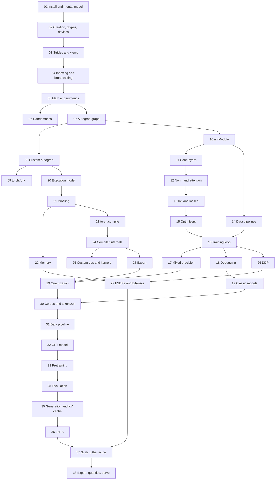

# PyTorch from Tensors to LLMs — A 2026 Course

A sequential, test-backed course on PyTorch 2.8. It starts with installing it
and reading a tensor's strides, works through autograd internals,
`torch.compile`, distributed training, custom kernels, export and
quantization, and ends with you building, training, evaluating, fine-tuning
and exporting a GPT-style language model from scratch on a CPU.

## Who this is for

You can program in Python and have used NumPy arrays. You can multiply
matrices and take a derivative of a scalar function. You do **not** need prior
PyTorch experience: module 01 starts at `pip install`. Daily PyTorch users
are the other audience. Calling `loss.backward()` is easy; explaining what the
version counter protects, why a transposed view is not contiguous, what
Dynamo guards on, or where the bytes go when FSDP2 shards a model is what
interviews and production incidents ask for.

The [PyTorch library notes](../../notes/libraries/pytorch.md) give a one-page
overview. This course goes deeper. The architecture itself is derived in the
[Transformers Deep Dive](../transformers/00-README.md), and this course links
to it rather than deriving it again.

## Module map

**Start here.** This page.

**Tensors (01–06).**
[01 Installing PyTorch and the Eager Mental Model](./01-installation-and-eager-mental-model.md) ·
[02 Tensor Creation, Dtypes, and Devices](./02-tensor-creation-dtypes-devices.md) ·
[03 Storage, Strides, Views, and Copies](./03-storage-strides-views-copies.md) ·
[04 Indexing, Broadcasting, and Shape Manipulation](./04-indexing-broadcasting-shapes.md) ·
[05 Tensor Math, Linear Algebra, and Numerics](./05-tensor-math-linear-algebra-numerics.md) ·
[06 Randomness, Distributions, and Reproducibility](./06-randomness-and-reproducibility.md)

**Autograd and nn (07–13).**
[07 The Autograd Graph, Leaves, and backward()](./07-autograd-graph-and-backward.md) ·
[08 Custom Autograd Functions, Hooks, and Higher-Order Gradients](./08-custom-autograd-and-hooks.md) ·
[09 torch.func: vmap, grad, and Functional Models](./09-torch-func-transforms.md) ·
[10 nn.Module from the Inside](./10-nn-module-internals.md) ·
[11 Linear, Embedding, Convolution, and Recurrent Layers](./11-linear-embedding-conv-recurrent-layers.md) ·
[12 Normalization, Dropout, Activations, and Attention Layers](./12-normalization-dropout-attention-layers.md) ·
[13 Initialization, Loss Functions, and Stable Outputs](./13-initialization-and-losses.md)

**Training in practice (14–19).**
[14 Data Pipelines: Dataset, DataLoader, Samplers, and Collation](./14-data-pipelines.md) ·
[15 Optimizers and Learning-Rate Schedules](./15-optimizers-and-schedules.md) ·
[16 The Training Loop: Evaluation, Checkpointing, and Exact Resume](./16-training-loop-checkpointing.md) ·
[17 Mixed Precision and Numerical Formats](./17-mixed-precision.md) ·
[18 Debugging and Testing PyTorch Code](./18-debugging-and-testing.md) ·
[19 Classic Models End to End: MLP, CNN, RNN, and Transfer Learning](./19-classic-models-end-to-end.md)

**Performance and compilers (20–25).**
[20 How PyTorch Executes: Dispatcher, Tensor Subclasses, and Devices](./20-execution-model-dispatch-devices.md) ·
[21 Profiling and Benchmarking](./21-profiling-and-benchmarking.md) ·
[22 Memory Accounting, Activation Checkpointing, and Offload](./22-memory-accounting-and-checkpointing.md) ·
[23 torch.compile in Practice](./23-torch-compile-in-practice.md) ·
[24 Compiler Internals: Dynamo, FX, AOTAutograd, and Inductor](./24-compiler-internals-fx-inductor.md) ·
[25 Custom Operators and Kernels: torch.library, C++ Extensions, and Triton](./25-custom-ops-and-kernels.md)

**Scale and deployment (26–29).**
[26 Distributed Training: Process Groups, Collectives, and DDP](./26-distributed-collectives-and-ddp.md) ·
[27 Sharded Training: FSDP2, DTensor, Tensor and Pipeline Parallelism](./27-fsdp2-dtensor-parallelism.md) ·
[28 Export and Deployment: torch.export, AOTInductor, ONNX, and ExecuTorch](./28-export-and-deployment.md) ·
[29 Quantization, Pruning, and Compression](./29-quantization-and-compression.md)

**Capstone: build an LLM (30–38).**
[30 Corpus and a Byte-Level BPE Tokenizer](./30-capstone-corpus-and-tokenizer.md) ·
[31 Token Datasets and the Training Data Pipeline](./31-capstone-data-pipeline.md) ·
[32 The GPT Model, Line by Line](./32-capstone-gpt-model.md) ·
[33 Pretraining the GPT on CPU](./33-capstone-pretraining.md) ·
[34 Evaluating the Model: Perplexity, Bits per Byte, and Baselines](./34-capstone-evaluation.md) ·
[35 Generation and the KV Cache](./35-capstone-generation-kv-cache.md) ·
[36 Fine-Tuning with LoRA from Scratch](./36-capstone-lora-finetuning.md) ·
[37 Scaling the Recipe: compile, DDP, FSDP, and Profiling](./37-capstone-scaling-the-recipe.md) ·
[38 Export, Quantize, and Serve the LLM](./38-capstone-export-quantize-serve.md)

### Dependency graph



## How to read this course

1. **Read 01–19 in order.** They form the spine. Modules 03 (strides) and 07
   (the autograd graph) carry the most weight: nearly every later bug, from a
   silent copy to an in-place error during backward, comes back to one of them.
2. **Treat 20–29 as a branching tree.** Follow the graph above. The compiler
   path (20→25) and the distributed path (26→27) do not depend on each other.
3. **Do the capstone in order.** Modules 30–38 build one package,
   `./code/llm/`, and each module imports the previous module's code.
4. **Run every check**, then change a number and watch the assert fail.
5. **Answer the self-check questions** before moving on. They are phrased the
   way an interviewer would ask them.

## Conventions used throughout

### Preparation and reproducibility

Tested with Python 3.11 and PyTorch 2.8.0 on CPU. No GPU, network or
pretrained download is needed. GPU-only
behaviour (CUDA streams, TF32, CUDA graphs, NCCL, Triton) is explained from
docs and source pinned to PyTorch 2.8, and every such passage is labelled as
not executed here. From the repository root:

```bash
python3.11 -m venv .venv-pytorch
.venv-pytorch/bin/python -m pip install torch==2.8.0 --index-url https://download.pytorch.org/whl/cpu
.venv-pytorch/bin/python -m pip install numpy==1.26.4
.venv-pytorch/bin/python site/test_pytorch_course.py
.venv-pytorch/bin/python -m unittest discover -s site -p "test_pytorch_[0-9]*.py"
```

Those two packages are all the fences, labs and tests import. NumPy backs the
memmapped token files of modules 14 and 31, the NumPy RNG state in module 16's checkpoints, and a few fences in modules 02,
05, 25 and 31. One optional extra: `pip install tokenizers==0.22.1` enables
`30_build_tokenizer.py --compare-hf`, which is skipped without it and never run
by the tests. Nothing imports `transformers`. Plain fragments that mention
torchao, ExecuTorch, ONNX, FastAPI or Triton are not executed, and none of
those packages is needed.

The first test command runs the **`pytorch-check` fences**. These are code
blocks whose info string is exactly `python pytorch-check`. Each fence is a
self-contained CPU program: it has its own imports and at least one
`assert`, and it ends with a `print`. The runner executes each fence in a
fresh namespace with stdout captured. It seeds `torch.manual_seed(0)` first,
refuses network sockets, and fails any fence that takes more than 10 s or
leaves the default dtype, thread count, grad mode, deterministic-algorithms flag or quantized engine changed. Plain `python`
blocks are teaching fragments. They may show CUDA or Triton code and are
not executed. The second command runs the lab tests. Each lab is a script in
`./code/` with a matching `site/test_pytorch_NN_*.py`. The tests check
contracts and relative quality bars, never exact losses or wall-clock
speedups.

### Milestones

1. **After module 13**, your scalar micrograd engine matches `torch.autograd`
   gradients, a custom `autograd.Function` passes `gradcheck`, and you can
   predict every parameter, buffer and `state_dict` key of a module before
   printing it.
2. **After module 19**, you can stop a training run mid-way and resume it to
   bit-identical weights (module 16), find five seeded bugs by symptom alone,
   and train an MLP, a small CNN, a character GRU and a fine-tuned frozen
   backbone end to end.
3. **After module 29**, you can trace dispatcher keys, profile a step,
   explain each graph break, register a custom op that passes `opcheck`,
   show that 2-process gloo DDP and FSDP2 match single-process training, and
   round-trip a model through `torch.export` and int8 quantization.
4. **After module 38**, you have an 875,264-parameter GPT that you built on
   your own byte-level BPE tokenizer (217,572 training tokens), pretrained on
   CPU (val 2.946 nats per token at stride 64, against 3.669 for the best
   bigram baseline), sampled through a verified KV cache, fine-tuned with a
   45,056-parameter LoRA adapter, checked under compile, DDP and FSDP2,
   exported with `torch.export` and quantized to int8 (2.98× smaller). Each
   step is backed by a test that runs in CI.

| Symbol | Meaning |
|---|---|
| `B` | batch size |
| `T` | sequence length (tokens) |
| `d_model` | residual width (`n_embd` in nanoGPT, "emb_dim" in Raschka) |
| `H`, `d_head` | attention heads, per-head width (`d_model / H`) |
| `d_ff` | MLP hidden width (4·d_model in the capstone) |
| `V` | vocabulary size |
| `L` | number of Transformer blocks |
| `N`, `C`, `H_img`, `W_img` | image batch, channels, height, width (NCHW) |
| `P` | parameter count |
| `world`, `rank` | distributed world size and rank |

Shapes are written as `(B, T, d_model)` and image tensors as
`(N, C, H_img, W_img)`. Dtypes are spelled out as `torch.float32` or
`torch.bfloat16`, and byte sizes use binary units (MiB, GiB).

---

**Start here → [01 — Installing PyTorch and the Eager Mental Model](./01-installation-and-eager-mental-model.md)**
