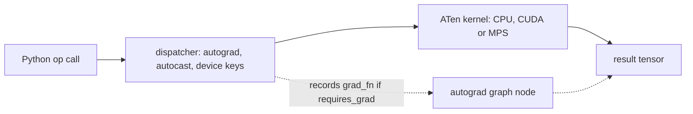

# 01 — Installing PyTorch and the Eager Mental Model

> **Prerequisites:** none. You can write Python functions and use a terminal.
> **You will learn:** how to install and verify a build for your hardware (CPU,
> CUDA, ROCm, MPS, XPU) with pip, uv or conda; how to read `2.8.0+cu128`, the
> stability labels and why the course pins 2.8.0; the eager mental model; the
> ecosystem map; and what this course's checks and labs prove.

Most PyTorch bugs that cost a day are not modelling bugs: a CPU-only wheel on a
GPU box, a driver older than the wheel's CUDA runtime, or assuming code ran when
it was merely queued. This module fixes the
install and the mental model the rest of the course leans on: each operator
executes when Python calls it, the autograd graph records what actually ran, and
compilers are optional layers that must reproduce those eager semantics. The
overview note [PyTorch](../../notes/libraries/pytorch.md) is the one-page
summary; this course goes much deeper.

---

## 1.1 Why PyTorch looks the way it does

PyTorch descends from Torch7, a Lua framework. Facebook AI Research rebuilt the
frontend in Python with tape-based autograd and released it in January 2017;
1.0 (December 2018) added TorchScript; 2.0 (March 2023) added `torch.compile`
(Ansel et al., ["PyTorch 2"](https://doi.org/10.1145/3620665.3640366), ASPLOS
2024). Since 2022 the PyTorch Foundation, under the Linux Foundation, governs it.
The design paper (Paszke et al., [arXiv 1912.01703](https://arxiv.org/abs/1912.01703))
opens: "Deep learning frameworks have often focused on either usability or
speed, but not both." Its answer: the program *is* the Python code, and speed
comes from a small C++ core (`c10` for tensor and device primitives, ATen for
operators) that each Python call drops into quickly.

| Framework style | What your Python does | When math runs | Debugging a shape bug |
|---|---|---|---|
| TF1 graph + `Session.run` | builds a symbolic graph | later, when the session runs it | error points into the graph, not your line |
| JAX `jit` | traces a pure function with abstract values | after tracing and XLA compilation | `print` inside `jit` shows tracers, not values |
| PyTorch eager | calls operators on real tensors | immediately, on that line | `print`, `pdb`, stack trace at the failing line |

The [TensorFlow note](../../notes/libraries/tensorflow.md) covers the
static-graph lineage.

## 1.2 Choosing a build: the install matrix

The same version is built against several accelerator stacks, and the stack is
part of the binary. The [previous-versions page](https://pytorch.org/get-started/previous-versions/)
(living page, accessed 2026-10-10) lists these commands for v2.8.0; the
[install selector](https://docs.pytorch.org/get-started/locally/) now shows a
newer release.

| Build | Index URL (2.8.0) | Platforms | Version string |
|---|---|---|---|
| CPU only | `https://download.pytorch.org/whl/cpu` | Linux, Windows, macOS arm64 | `2.8.0+cpu` (macOS: `2.8.0`) |
| CUDA 12.6 | `https://download.pytorch.org/whl/cu126` | Linux x86_64, Windows | `2.8.0+cu126` |
| CUDA 12.8 | `https://download.pytorch.org/whl/cu128` | Linux x86_64, Windows | `2.8.0+cu128` |
| CUDA 12.9 | `https://download.pytorch.org/whl/cu129` | Linux x86_64 and aarch64, Windows | `2.8.0+cu129` |
| ROCm 6.4 | `https://download.pytorch.org/whl/rocm6.4` | Linux only | `2.8.0+rocm6.4` |
| Intel XPU | `https://download.pytorch.org/whl/xpu` | Linux, Windows | `2.8.0+xpu` |
| Plain PyPI | none (`pip install torch==2.8.0`) | all | `2.8.0` |

The `+cu128` suffix is a PEP 440 local version label, so `torch==2.8.0` matches
every row, and pip happily keeps a `+cpu` build on a GPU machine. Plain PyPI
wheels carry no label; on Linux x86_64 the 2.8.0 PyPI wheel depends on
`nvidia-cuda-runtime-cu12==12.8.90` and `triton==3.4.0` (PyPI metadata), so it
is a CUDA 12.8 build. macOS and Windows PyPI wheels are CPU-only, with MPS
included on macOS arm64.

**Driver vs toolkit.** CUDA wheels bundle the runtime, cuBLAS, cuDNN and NCCL as
`nvidia-*` pip packages, so you do *not* need the CUDA toolkit (`nvcc`) unless
you build extensions (module [25](./25-custom-ops-and-kernels.md)). You *do*
need a new-enough driver: the "CUDA Version" printed by `nvidia-smi` is the
newest runtime the driver supports and should be at least the wheel's. CUDA 12's
[minor-version compatibility](https://docs.nvidia.com/deploy/cuda-compatibility/)
lets some older 12.x drivers work, with caveats; do not plan around it. The
[v2.8.0 release notes](https://github.com/pytorch/pytorch/releases/tag/v2.8.0)
also drop Maxwell and Pascal (sm50–sm60) from the 12.8 and 12.9 builds; those
GPUs need `cu126`.

**ROCm** reuses the CUDA Python API: the [HIP notes](https://docs.pytorch.org/docs/2.8/notes/hip.html)
say "'rocm' or 'hip' are not valid, use 'cuda'", so `torch.cuda.is_available()`
is the check and `torch.version.hip` tells you which stack you have. **Apple
silicon** uses the `mps` device, which needs macOS 12.3+ ([MPS notes](https://docs.pytorch.org/docs/2.8/notes/mps.html)).
**Intel GPUs** need the Intel GPU driver first, then the `xpu` wheel ([XPU
getting started](https://docs.pytorch.org/docs/2.8/notes/get_start_xpu.html)).

```bash
# pip, CUDA 12.8 build
python -m pip install torch==2.8.0 --index-url https://download.pytorch.org/whl/cu128

# uv, CPU build into the active environment
uv pip install torch==2.8.0 --index-url https://download.pytorch.org/whl/cpu

# conda/mamba: create the env with conda, install torch with pip inside it
conda create -n pt28 python=3.11 && conda activate pt28
python -m pip install torch==2.8.0 --index-url https://download.pytorch.org/whl/cu128
```

`--index-url` *replaces* PyPI; `--extra-index-url` adds the PyTorch index
beside it, and then pip may pick the PyPI build. In uv projects, declare the
index with `explicit = true` so only `torch` resolves from it ([uv PyTorch
guide](https://docs.astral.sh/uv/guides/integration/pytorch/)). PyTorch 2.5 was
the last release on the official `pytorch` conda channel
([pytorch#138506](https://github.com/pytorch/pytorch/issues/138506)), so
`conda install pytorch -c pytorch` cannot give you 2.8: use pip inside conda,
and never install torch with both.

On Windows, use 64-bit Python. The [Windows notes](https://docs.pytorch.org/docs/2.8/notes/windows.html)
cover the two usual failures: `DLL load failed` (missing Visual C++
redistributable) and a multiprocessing `RuntimeError` when a script that starts
workers lacks the `if __name__ == '__main__':` guard, because Windows spawns
rather than forks (module [14](./14-data-pipelines.md)).

## 1.3 Verifying an install

Ask the interpreter you will actually run, not the install log:

```bash
python -c "
import torch
print('version     ', torch.__version__)
print('cuda runtime', torch.version.cuda, '| hip', torch.version.hip)
print('cuda avail  ', torch.cuda.is_available())
print('mps avail   ', torch.backends.mps.is_available())
print('accelerator ', torch.accelerator.is_available(), torch.accelerator.current_accelerator())
print('threads     ', torch.get_num_threads())
print(torch.__config__.show())
print(torch.__config__.parallel_info())
"
```

On the course's reference machine (Apple M2 Pro) this printed `2.8.0`, CUDA and
HIP `None`, MPS available, accelerator `True mps`, and 6 threads on a 10-core
chip. `show()` reported `CPU capability usage: NO AVX` (correct on arm64, which
vectorises with NEON), `BLAS_INFO=accelerate` and `USE_CUDA=OFF`;
`parallel_info()` reported `ATen parallel backend: OpenMP`.

| Field | What it tells you | Typical surprise |
|---|---|---|
| `torch.__version__` | release plus local label | `+cpu` on a GPU machine |
| `torch.version.cuda` | CUDA runtime the binary was **built** with | not the driver's version |
| `torch.version.hip` | ROCm version, else `None` | ROCm reports through `torch.cuda` |
| `torch.cuda.is_available()` | CUDA/HIP build **and** working driver **and** ≥ 1 visible device | `False` with `CUDA_VISIBLE_DEVICES=""` |
| `torch.accelerator.*` | device-agnostic checks ([accelerator docs](https://docs.pytorch.org/docs/2.8/accelerator.html)) | `current_accelerator()` defaults to `check_available=False`: it names the build's type, not a working device |
| `get_num_threads()` | intra-op CPU threads | containers oversubscribe |
| `__config__.show()` | compiler, BLAS, MKL/oneDNN, CPU ISA ([config docs](https://docs.pytorch.org/docs/2.8/config_mod.html)) | `NO AVX` on x86 means an emulated or wrong build |

| Symptom | Likely cause | Distinguishing check |
|---|---|---|
| `cuda.is_available()` False, version `+cpu` | CPU wheel, often pulled in by a dependency | `pip show torch`; reinstall from the `cu128` index |
| False, `+cu128`, warning mentions the driver | driver too old for the runtime | `nvidia-smi` "CUDA Version" below 12.8 |
| False, `nvidia-smi` fine | `CUDA_VISIBLE_DEVICES` empty, or container without GPU passthrough | `echo $CUDA_VISIBLE_DEVICES`; `nvidia-smi` inside the container |
| wrong version imported | pip and conda both installed torch | `python -c "import torch; print(torch.__file__)"` |
| "OMP: Error #15" or hang at first matmul | two OpenMP runtimes loaded by different packages | `parallel_info()`; find which packages ship OpenMP |

For bug reports, run `python -m torch.utils.collect_env`.

## 1.4 Versions, release cadence and backwards compatibility

Minor releases arrive roughly quarterly. The [release cadence table in
RELEASE.md at v2.8.0](https://github.com/pytorch/pytorch/blob/v2.8.0/RELEASE.md)
planned 2.8 for July 2025 ("Patch Releases are optional"); the [v2.8.0
tag](https://github.com/pytorch/pytorch/releases/tag/v2.8.0) and PyPI wheels
shipped on 6 August 2025. Newer releases exist; this course does not track them.

The [classification post](https://pytorch.org/blog/pytorch-feature-classification-changes/)
defines **stable** (breaking changes only "with notice given one release ahead
of time"), **beta** ("not committing to Backwards Compatibility") and
**prototype** (shipped for feedback; may be dropped). The [2.8 release
blog](https://pytorch.org/blog/pytorch-2-8/) files new features under
"API-Unstable": usable, but expect edits on upgrade. The release notes also say
"`torch.ao.quantization` is deprecated and will be removed in 2.10" (module
[29](./29-quantization-and-compression.md)), and the ONNX exporter's default
moves from TorchScript to `torch.export` in 2.9 (module [28](./28-export-and-deployment.md)).

This course pins `torch==2.8.0` because its assertions are about exact
behaviour: `grad_fn` names, what `torch.export` emits, defaults, deprecation
warnings. Read the matching docs at `https://docs.pytorch.org/docs/2.8/`, never
`stable/`, which changes under you.

## 1.5 The eager mental model

Three lines, narrated:

```python
x = torch.randn(3, 4)                       # factory kernel runs now; x owns 12 floats
w = torch.randn(4, 2, requires_grad=True)   # a leaf that autograd will track
y = (x @ w).relu()                          # aten::mm runs, then aten::relu; y is (3, 2)
print(y.grad_fn, y.grad_fn.next_functions)  # ReluBackward0 -> ((MmBackward0, 0),)
```

Each call crosses into C++, where the **dispatcher** reads the inputs' dispatch
keys (autograd needed? autocast active? which device?) and routes to a kernel.
Because `w` requires grad, the autograd layer attaches a backward node to the
output as `grad_fn`. When `y` comes back it is a finished tensor.



Three consequences follow.

**Debugging is ordinary Python.** A shape bug fails on the line that has it;
`print(t.shape)` and `pdb` work mid-forward (module [18](./18-debugging-and-testing.md)).

**Control flow is plain Python.** `if`, `while` and early returns just work, and
the graph contains only the branch that ran: "define-by-run", a fresh graph per
forward pass. It is also why the [FAQ](https://docs.pytorch.org/docs/2.8/notes/faq.html)
warns "Don't accumulate history across your training loop": summing a loss that
requires grad keeps every iteration's graph alive.

**Every op pays fixed overhead.** One local PyTorch 2.8 CPU run on an Apple M2
Pro (4 threads, `torch.utils.benchmark`) measured:

| Operation | Median time |
|---|---|
| `x + x`, 1 element | 0.58 µs |
| `x + x`, 1,000 elements | 0.69 µs |
| `x + x`, 1 element, `requires_grad=True` | 1.05 µs |
| `x + x`, 1,000,000 elements | 84 µs |
| NumPy `a + a`, 1 element | 0.22 µs |

Up to thousands of elements the cost is dispatch, not arithmetic, so many tiny
ops are overhead-bound (modules [20](./20-execution-model-dispatch-devices.md),
[21](./21-profiling-and-benchmarking.md), [23](./23-torch-compile-in-practice.md)).

On CUDA, an op call *enqueues* a kernel on a stream and returns before the GPU
finishes. Anything that needs the value (`.item()`, `print`, `bool(t)`, `.cpu()`)
blocks until the queue drains, and timing without `torch.cuda.synchronize()`
measures the enqueue. This follows the [CUDA semantics notes](https://docs.pytorch.org/docs/2.8/notes/cuda.html)
and is not executed here; module 20 covers streams.

## 1.6 Eager plus opt-in compilers

PyTorch 2 kept eager and added other ways to run the same model:

| Mode | What it does | When you use it | Module |
|---|---|---|---|
| eager | runs each op as Python calls it | always the reference; research, debugging | all |
| `torch.compile` | Dynamo captures graphs from bytecode, falls back to Python on graph breaks, a backend (Inductor by default) generates fused kernels | training/inference speed with Python still in charge | [23](./23-torch-compile-in-practice.md), [24](./24-compiler-internals-fx-inductor.md) |
| `torch.export` | captures one whole graph ahead of time, no Python fallback, into an `ExportedProgram` | deployment, AOTInductor, ONNX | [28](./28-export-and-deployment.md) |
| ExecuTorch | runs exported programs on mobile and edge runtimes | on-device inference | [28](./28-export-and-deployment.md) |

Compiled and exported programs must compute what eager computes, up to
floating-point reassociation. That is why eager comes first: a compiler bug is,
by definition, a difference from eager.

## 1.7 The ecosystem map

| Library | Purpose | Status (2.8 era) | In this course |
|---|---|---|---|
| torchvision, torchaudio | image and audio datasets, transforms, models | active; 0.23.0 / 2.8.0 pair with torch 2.8.0 | out of scope (not in CI) |
| torchtext | text pipelines | stopped at 0.18 (April 2024); archived | module [30](./30-capstone-corpus-and-tokenizer.md) writes its own tokenizer |
| TorchRec | sharded embedding tables for recommenders | active | out of scope |
| torchao | quantization, low-precision training, sparsity | active; `v0.13.0` tested with 2.8.0 | module [29](./29-quantization-and-compression.md) |
| torchtune | fine-tuning recipes | no longer actively maintained (2025) | module [36](./36-capstone-lora-finetuning.md) builds LoRA from scratch |
| torchtitan | reference large-scale pretraining with FSDP2/TP/PP | active | read in module [27](./27-fsdp2-dtensor-parallelism.md) |
| ExecuTorch | on-device runtime for exported programs | active; `v0.7.0` pins torch 2.8.0 | module [28](./28-export-and-deployment.md) |
| torchdata | `StatefulDataLoader`, `torchdata.nodes` | refocused on checkpointable loading | module [14](./14-data-pipelines.md) uses `torch.utils.data` |
| Lightning | training-loop framework | third party | module [16](./16-training-loop-checkpointing.md) writes the loop |
| Hugging Face transformers, accelerate, PEFT | pretrained models, launch helpers, adapters | third party | see [Hugging Face](../../notes/libraries/huggingface.md) |
| vLLM, SGLang | high-throughput LLM serving | third party | see [the inference course](/courses/inference/) and [MLOps and serving](../../notes/libraries/mlops-and-serving.md) |
| `torch.hub` | load models by GitHub repo name | in core | not used: CI is offline |

`torch.hub.load` downloads a repository and *executes* its `hubconf.py`; the
[hub docs](https://docs.pytorch.org/docs/2.8/hub.html) add `trust_repo` so
"users only run code from repos that they trust". The companion [Transformers
course](../transformers/00-README.md) covers the architecture the capstone builds.

## 1.8 How this course runs its code

The course has one environment and two CI commands. From the repository root:

```bash
python -m venv .venv-pytorch
.venv-pytorch/bin/python -m pip install torch==2.8.0 --index-url https://download.pytorch.org/whl/cpu
.venv-pytorch/bin/python -m pip install numpy==1.26.4
.venv-pytorch/bin/python site/test_pytorch_course.py
.venv-pytorch/bin/python -m unittest discover -s site -p "test_pytorch_[0-9]*.py"
```

There are three kinds of fence. A plain `python` fence is a teaching fragment,
never executed, and may use CUDA or Triton. A `python pytorch-check` fence is a
self-contained CPU program run by `site/test_pytorch_course.py`: it seeds any
randomness, asserts its own numbers, ends with one `print`, restores global
state, and uses no network. A `bash` fence is a command for you.

Labs are scripts under `code/` with a fixed contract: a docstring with the run
command, `argparse` with `--seed` and `--json-out`, and `main(argv=None) -> dict`
returning JSON-serialisable results. Each has a `site/test_pytorch_NN_*.py`
unittest asserting contracts and quality bars, never one machine's loss or
timing.

A passing check proves a contract on CPU with PyTorch 2.8.0: a gradient matches,
an exported graph equals eager, a resume is bit-exact. It does not prove GPU
speed, multi-GPU behaviour, or numerics on other hardware; GPU behaviour is
described from pinned docs and labelled not executed. The default Inductor
backend needs a C++ toolchain and failed on the reference Mac during course
probing, so checks use `backend="eager"` or `"aot_eager"`: graph capture, no code
generation.

Tested with Python 3.11 and PyTorch 2.8.0 on CPU.

## 1.9 A five-minute tour

Orientation only: each comment names the module that explains the line.

```python
import torch, torch.nn as nn

t = torch.arange(6.0).reshape(2, 3)              # 02 creation, 03 strides/views
a = torch.tensor(3.0, requires_grad=True)
(a ** 2).backward(); print(a.grad)               # 07 autograd: tensor(6.)

layer = nn.Linear(3, 2)                          # 10 nn.Module, 11 layers
opt = torch.optim.SGD(layer.parameters(), lr=0.1)  # 15 optimizers
loss = layer(t).pow(2).mean()                    # 13 losses
loss.backward(); opt.step(); opt.zero_grad()     # 16 the training loop

fast = torch.compile(layer, backend="eager")     # 23 torch.compile
ep = torch.export.export(layer, (t,))            # 28 export
```

## Worked environment verification

**Environment facts.** This proves the interpreter imports a 2.x torch with
default dtype `torch.float32`, introspectable build configuration and a CPU
device. It does not assert `2.8.0`: CI pins the version at install time, and the
check stays version-agnostic.

```python pytorch-check
import torch

assert torch.__version__.startswith("2."), torch.__version__
assert torch.get_default_dtype() is torch.float32
config = torch.__config__.show()
assert isinstance(config, str) and "PyTorch built with" in config
assert torch.device("cpu").type == "cpu"
assert torch.zeros(2, 3).device.type == "cpu"
first = torch.__config__.parallel_info().splitlines()[0]
print(torch.__version__, "|", first)
```

**Eager is immediate and define-by-run.** The loop runs a data-dependent number
of times because `while` calls `bool()` on a real comparison. The check proves
the graph holds exactly one `MulBackward0` per iteration that ran, ending at the
leaf's `AccumulateGrad`, and that the gradient is $2^k$; two starting points give
two graphs from one piece of code. It proves nothing about speed, and on CUDA
that `bool()` would be a synchronisation point.

```python pytorch-check
import torch

def double_until(x, limit=10.0):
    steps = 0
    while x.norm() < limit:          # Python control flow on a tensor value
        x = x * 2
        steps += 1
    return x, steps

def mul_chain(node):
    count = 0
    while node is not None and type(node).__name__ == "MulBackward0":
        count += 1
        node = node.next_functions[0][0]
    return count, type(node).__name__

seen = []
for start in ([0.3, 0.4], [0.03, 0.04]):        # norms 0.5 and 0.05
    a = torch.tensor(start, requires_grad=True)
    y, k = double_until(a)
    count, tail = mul_chain(y.grad_fn)
    assert count == k and tail == "AccumulateGrad", (count, k, tail)
    y.sum().backward()
    torch.testing.assert_close(a.grad, torch.full_like(a, 2.0 ** k))
    seen.append(k)
assert seen == [5, 8], seen
print("iterations per start:", seen, "graph length tracks the loop")
```

**Compilers preserve eager semantics.** A function compiled with
`backend="eager"` (Dynamo captures the graph, eager kernels run it) and a module
captured by `torch.export.export` must both match eager, and the exported graph
must be three ATen calls (`linear`, `gelu`, `linear`). This proves faithful
capture for these programs, not Inductor codegen or speed. Locally the first
`torch.compile` in a process paid about 0.6 s of one-time imports; a warm rerun
took about 20 ms.

```python pytorch-check
import torch
import torch.nn as nn

torch._dynamo.reset()
try:
    torch.manual_seed(0)
    x = torch.randn(4, 3)

    def f(t):
        return torch.sin(t) * 2 + t.relu()

    compiled = torch.compile(f, backend="eager")
    torch.testing.assert_close(compiled(x), f(x), atol=0.0, rtol=0.0)

    model = nn.Sequential(nn.Linear(3, 5), nn.GELU(), nn.Linear(5, 2)).eval()
    ep = torch.export.export(model, (x,))
    calls = [str(n.target) for n in ep.graph.nodes if n.op == "call_function"]
    assert calls == ["aten.linear.default", "aten.gelu.default", "aten.linear.default"], calls
    with torch.no_grad():
        torch.testing.assert_close(ep.module()(x), model(x), atol=1e-6, rtol=1e-5)
finally:
    torch._dynamo.reset()
print("compile(eager) and export match eager; exported ops:", len(calls))
```

## Key takeaways

- The accelerator stack is part of the wheel. `torch==2.8.0` matches every local
  label (`+cpu`, `+cu128`), so choose the index URL deliberately.
- CUDA wheels bundle the runtime: you need a new-enough driver, not the toolkit.
  `torch.version.cuda` is the build's runtime, not the driver's.
- The official conda channel stopped at 2.5; use pip inside conda.
- Eager dispatches and executes each op when Python calls it; the autograd graph
  records what ran and is rebuilt every forward pass.
- Eager makes debugging and control flow trivial and costs about a microsecond
  of dispatch per CPU op, which dominates tiny ops. On CUDA, calls enqueue and
  return early; reading a value synchronises.
- `torch.compile` and `torch.export` are opt-in and must match eager. Course
  checks prove CPU contracts on 2.8.0, not GPU speed.

## Self-check

1. A colleague's `torch.cuda.is_available()` is False on a machine with an A100.
   List three distinct causes you would check, in order, and the command that
   distinguishes each.
2. What does "eager" buy you when debugging a shape bug, and what does it cost
   you on a GPU for a model made of many tiny ops?
3. Your team pins `torch==2.8.0` but a dependency pulls in a library built
   against 2.7. What can break (Python API vs C++ ABI vs custom ops), and how
   would you detect it?

---

**Next → [02 — Tensor Creation, Dtypes, and Devices](./02-tensor-creation-dtypes-devices.md)**
