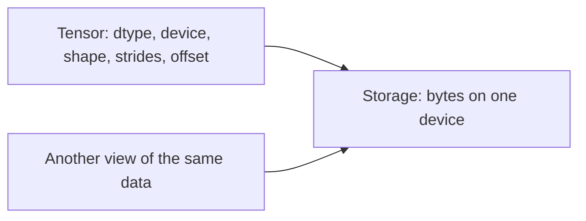
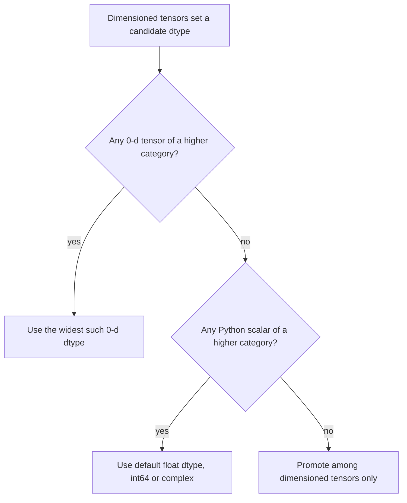

# 02 — Tensor Creation, Dtypes, and Devices

> **Prerequisites:** module 01.
> **You will learn:** which tensor factories copy and which share memory; the
> dtype table, `torch.finfo`/`torch.iinfo`, the default dtype, and the exact
> type-promotion rules; 0-d tensors, `.item()` and why it synchronises on
> accelerators; the NumPy and DLPack bridges and their failure modes; and
> devices, `.to()` semantics, and the `torch.accelerator` API.

Most PyTorch bugs that are not shape bugs are dtype or device bugs: float64
batches meeting float32 weights, a NumPy array mutated under a tensor sharing
it, a `.item()` stalling a GPU loop. Each follows from four facts: how
a tensor is built, which dtype it gets, where its bytes live, and when an
operation copies them.

This module states those rules exactly and checks them on CPU against PyTorch
2.8. Module 03 then opens the tensor up and looks at storage and strides.

---

## 2.1 A tensor is metadata plus a buffer

A `torch.Tensor` is a small descriptor pointing into a block of bytes. The
descriptor holds dtype, device, shape, strides, storage offset, layout, and
autograd state. The bytes live in a `Storage` on exactly one device, and two
tensors can describe the same storage differently, which is what views are
(module 03). So "create a tensor" is two decisions: which descriptor, and
whether new bytes are allocated.



| Attribute | On `torch.zeros(2, 3)` | Notes |
|---|---|---|
| `.dtype` | `torch.float32` | element type |
| `.device` | `device(type='cpu')` | where the storage lives |
| `.shape` / `.size()` | `torch.Size([2, 3])` | `torch.Size` is a `tuple` subclass |
| `.ndim` | `2` | 0 for a scalar tensor |
| `.numel()` | `6` | product of the shape |
| `.element_size()` | `4` | bytes per element |
| `.nbytes` | `24` | `numel * element_size` of this view, not of the storage |
| `.layout` | `torch.strided` | sparse layouts exist |
| `.is_contiguous()` | `True` | row-major, no gaps (module 03) |

[The PyTorch notes](../../notes/libraries/pytorch.md) survey these attributes;
this course goes deeper, with each rule checked by an executable fence. See
[Tensor Attributes](https://docs.pytorch.org/docs/2.8/tensor_attributes.html),
[torch.Size](https://docs.pytorch.org/docs/2.8/size.html),
[torch.Tensor](https://docs.pytorch.org/docs/2.8/tensors.html).

## 2.2 Factories, and which ones copy

The creation ops are indexed under "Creation Ops" in the
[torch namespace docs](https://docs.pytorch.org/docs/2.8/torch.html). The
question that matters in production is whether the result owns new memory or
aliases something that already exists.

| Factory | Copies? | Dtype from | Comment |
|---|---|---|---|
| `torch.tensor(data)` | always | inferred, or `dtype=` | on a tensor input it warns and suggests `detach().clone()` |
| `torch.as_tensor(data)` | only if needed | `data`, or `dtype=` | shares with a NumPy array or tensor of matching dtype/device |
| `torch.from_numpy(arr)` | never | `arr.dtype` | mutations visible both ways |
| `torch.asarray(obj, copy=None)` | `None`: if needed; `True`: always; `False`: never | `obj`, or `dtype=` | array-API constructor |
| `zeros / ones / full` | new | default dtype; `full` infers from the value | `full((2,), 7)` is int64 |
| `empty` | new, uninitialised | default dtype | contents are leftover memory |
| `*_like(t)`, `t.new_*` | new | `t` | keeps dtype, device, layout (and memory format for `*_like`) |
| `arange / linspace / logspace / eye` | new | inferred / default | sequences, identity |
| `rand / randn / randint / randperm` | new | float32 / float32 / int64 / int64 | take `generator=` (module [06](./06-randomness-and-reproducibility.md)) |

**`empty` is not zeros.** It returns recycled memory: right for an output buffer
you will fully overwrite, a bug if anything reads it first. Never assert on its
contents.

**`*_like` copies the descriptor, not the data.** `torch.zeros_like(x)` on a
`(2, 3, 4, 5)` tensor in `channels_last` format returned strides
`(60, 1, 15, 3)`, the same layout as `x`. Optimizer state made with
`zeros_like` lands on the parameter's device and dtype automatically.

**`arange` with a float step is a trap.** Its length is
`ceil((end - start) / step)` computed in floating point. `torch.arange(0, 1, 0.1)`
has 10 elements, but `torch.arange(1, 1.3, 0.1)` returned 4 here,
`[1.0, 1.1, 1.2, 1.3]`, including the "excluded" endpoint because `0.3 / 0.1`
rounds just above 3. Use `torch.linspace(0, 1, 11)` (a count, both ends
included) for float grids; keep `arange` for integers.

## 2.3 The dtype table

Every number was read from `torch.finfo` / `torch.iinfo` in PyTorch 2.8
([type_info](https://docs.pytorch.org/docs/2.8/type_info.html)).

| Dtype | Bytes | Range / eps | Typical use |
|---|---|---|---|
| `torch.bool` | 1 | `True` / `False` | masks |
| `torch.uint8` | 1 | 0 to 255 | images, bytes |
| `torch.int8` / `int16` | 1 / 2 | ±127 / ±32767 | int8 quantised weights / rare |
| `torch.int32` | 4 | ±2.1e9 | compact indices |
| `torch.int64` | 8 | ±9.2e18 | default integer: token ids, labels, indices |
| `torch.uint16/32/64` | 2/4/8 | unsigned | limited ops: `ones(2, dtype=torch.uint16) + 1` raised `NotImplementedError` |
| `torch.float16` | 2 | max 65504, eps 2^-10, tiny 6.1e-5 | inference; training needs loss scaling |
| `torch.bfloat16` | 2 | max 3.39e38, eps 2^-7, tiny 1.18e-38 | mixed-precision training |
| `torch.float32` | 4 | max 3.40e38, eps 1.19e-7 | default for parameters |
| `torch.float64` | 8 | max 1.80e308, eps 2.2e-16 | numerics checks, gradcheck |
| `torch.complex64` / `complex128` | 8 / 16 | pairs of float32 / float64 | FFTs, complex rotary |
| `torch.float8_e4m3fn` | 1 | max 448, eps 0.125 | FP8 weights/activations |
| `torch.float8_e5m2` | 1 | max 57344, eps 0.25 | FP8 gradients |

On CPU the float8 types are storage formats, not compute formats:
`torch.ones(2, dtype=torch.float8_e4m3fn) + 1` raised
`NotImplementedError: "add_stub" not implemented for 'Float8_e4m3fn'`. You cast
into them to store or feed a scaled-matmul kernel (module
[17](./17-mixed-precision.md)).

### Why bf16 and fp16 trade range for precision in opposite directions

A binary float with $e$ exponent bits and $m$ stored mantissa bits represents
$(-1)^s \cdot 1.f \cdot 2^{E - \text{bias}}$ with $\text{bias} = 2^{e-1} - 1$.
The gap above 1.0 is $\epsilon = 2^{-m}$, giving about $(m+1)\log_{10} 2$
decimal digits. The largest finite value is just under $2^{\text{bias}+1}$, set
by $e$ alone.

| Format | Sign/exp/mantissa | $\epsilon$ | Decimal digits | Max |
|---|---|---|---|---|
| float32 | 1 / 8 / 23 | $2^{-23}$ ≈ 1.19e-7 | ≈ 7.2 | 3.40e38 |
| bfloat16 | 1 / 8 / 7 | $2^{-7}$ ≈ 7.8e-3 | ≈ 2.4 | 3.39e38 |
| float16 | 1 / 5 / 10 | $2^{-10}$ ≈ 9.8e-4 | ≈ 3.3 | 65504 |

bfloat16 is float32 with the low 16 mantissa bits cut off. It keeps all 8
exponent bits, so its max is within 0.4 % of float32's, but its 7 mantissa bits
carry only 2–3 significant digits. float16 spends its bits the other way: better
precision, but 5 exponent bits cap the range at
$(2 - 2^{-10}) \cdot 2^{15} = 65504$. Hence fp16 training needs loss scaling
and bf16 training usually does not.

The precision cost is concrete. In bfloat16, `1.0 + 2**-9` rounds back to exactly
`1.0`, because the increment is below half of eps; float32 gave `1.0020`. Any
accumulation of small updates into a large bf16 value silently loses them, which
is why optimizers keep float32 master weights. The inference course's
[numerics page](/courses/inference/00-foundations/00-05-numerics.html) carries
this into int8 and FP8 formats.

## 2.4 Default dtype and inference rules

| Input to `torch.tensor` | Resulting dtype |
|---|---|
| Python `float` (or int/float mix) | `torch.get_default_dtype()`, float32 unless changed |
| Python `int` / `bool` | `torch.int64` / `torch.bool` |
| Python `complex` | `complex64` (follows the default dtype) |
| NumPy array or scalar | its own dtype, so float64 for `np.ones(3)` |

The NumPy row causes a classic first-week error. NumPy defaults to float64,
PyTorch to float32, and `from_numpy` must preserve dtype because it shares the
buffer:

```python
lin = torch.nn.Linear(3, 2)                    # weight: float32
x = torch.from_numpy(np.ones((1, 3)))          # float64
lin(x)
# RuntimeError: mat1 and mat2 must have the same dtype, but got Double and Float
```

Matmul does not promote. Cast once at the data boundary, in the dataset or
collate function (module [14](./14-data-pipelines.md)), with
`torch.as_tensor(arr, dtype=torch.float32)`; it copies, since the bytes change.

`torch.set_default_dtype(torch.float64)` changes what Python floats and float
factories produce, and the complex default with it (`torch.tensor(1j)` became
`complex128`). It accepts only floating types (`int64` raised `TypeError`). It is
process-global, so any code that changes it must restore it in `finally`, as
fence 4 does. `torch.set_default_device("cuda")` is the device analogue: handy in
a notebook, dangerous in a library, because it changes every factory call in
every module imported afterwards.

## 2.5 Type promotion

When an elementwise op sees mixed dtypes, PyTorch picks the result dtype by
rule, and "Unlike numpy, we do not inspect values when determining the minimum
dtypes of an operand"
([tensor_attributes](https://docs.pytorch.org/docs/2.8/tensor_attributes.html)).
Two dimensions decide it.

**Category:** `bool < integer < floating < complex`. The highest category present
always wins.

**Priority within a category:** dimensioned tensors > 0-d tensors > Python
scalars. A lower-priority operand affects the result only if its category is
higher than every higher-priority operand's. Then the result is the narrowest
type of that category holding those operands: the default dtype for a Python
float, int64 for a Python int, the 0-d tensor's own dtype for a 0-d tensor.



`torch.result_type(a, b)` ([docs](https://docs.pytorch.org/docs/2.8/generated/torch.result_type.html))
applies the rule without computing. The Python reference is `elementwise_dtypes`
in [`torch/_prims_common/__init__.py` at v2.8.0](https://github.com/pytorch/pytorch/blob/v2.8.0/torch/_prims_common/__init__.py#L1480),
whose `ELEMENTWISE_TYPE_PROMOTION_KIND` (line 1423) encodes per-op twists such
as true division. Fence 2 asserts every row:

| # | Expression | Result | Why |
|---|---|---|---|
| 1 | `int64 tensor + 1.5` | `float32` | higher-category Python scalar: default dtype |
| 2 | `uint8 tensor + int8 tensor` | `int16` | narrowest signed type holding 0–255 and -128 |
| 3 | `float16 tensor + float64 0-d tensor` | `float16` | same category: the dimensioned tensor wins |
| 4 | `int32 tensor + float64 0-d tensor` | `float64` | higher-category 0-d tensor keeps its own width |
| 5 | `int32 tensor + 2.5` | `float32` | higher-category Python scalar: default dtype |
| 6 | `bool tensor + bool tensor` | `bool` | no promotion (`True + True` is `True`) |
| 7 | `int64 tensor / int64 tensor` | `float32` | true division returns floating |
| 8 | `int64 tensor // 2` | `int64` | floor: `-7 // 2 == -4`, not truncation |

Rows 3 and 4 are the subtle pair. A 0-d float64 tensor is weak against float16
(same category) but decides the width outright against int32. Integers behave
the same way: `uint8 tensor + torch.tensor(1000)` stays `uint8`, and
`torch.tensor([1, 2], dtype=torch.uint8) + 1000` produced `[233, 234]` here, a
silent wraparound (1001 mod 256 = 233). In image code, widen before arithmetic.

The weak-scalar rule is deliberate: `x * 0.5` on a bf16 activation stays bf16
instead of upcasting the whole tensor to float32.

**In-place ops cannot promote.** `t += 1.5` on an int64 tensor raises
`RuntimeError: result type Float can't be cast to the desired output type Long`.
Out-of-place `t = t + 1.5` is fine; `out=` arguments follow the in-place rule.

NumPy 2 adopted a closely related model in
[NEP 50](https://numpy.org/neps/nep-0050-scalar-promotion.html) (weak Python
scalars, no value inspection), though there an out-of-range Python integer
raises where PyTorch 2.8 wrapped. The pinned NumPy 1.26.4 predates NEP 50; see
[the NumPy notes](../../notes/libraries/numpy.md).

## 2.6 Scalars, 0-d tensors, and getting values out

`torch.tensor(5)` has shape `torch.Size([])`; `torch.tensor([5])` has shape
`(1,)`. They broadcast identically but differ in promotion priority. Indexing
down to one element returns a 0-d tensor, not a Python number:
`torch.tensor([[1, 2]])[0, 1]` is `tensor(2)`.

| Call | Returns | Constraint |
|---|---|---|
| `t.item()` | Python `int`/`float`/`bool` | exactly one element |
| `float(t)`, `int(t)` | Python number | one element; `int(torch.tensor(2.7))` is `2` |
| `t.tolist()` | nested lists | any shape; copies everything to host |
| `bool(t)`, `if t:` | `bool` | one element, else `Boolean value of Tensor with more than one value is ambiguous` |

For multi-element truth use `t.any()`, `t.all()` or `torch.equal(a, b)`.

On an accelerator every row is a synchronisation point. A CUDA tensor's value
does not exist on the host until the device has finished every kernel queued
before it and copied the bytes back, so `.item()`, `.tolist()`, `print(t)` and
`if t:` block Python. A per-step `loss.item()` stops the CPU running ahead to
queue the next step's kernels, so the GPU idles. Keep running values on the device
(`total += loss.detach()`) and read them every N steps. Module
[20](./20-execution-model-dispatch-devices.md) explains the asynchronous model
this breaks; module [21](./21-profiling-and-benchmarking.md) shows the stalls in
a profile. (From the
[CUDA semantics notes](https://docs.pytorch.org/docs/2.8/notes/cuda.html); not
executed here.)

## 2.7 NumPy and DLPack bridges

`t.numpy()` and `torch.from_numpy(arr)` are zero-copy for CPU tensors; in the
probe, `n = t.numpy(); n[0] = 5` changed `t[0]` to 5. That is a performance
feature and an aliasing hazard. The bridge refuses in four situations:

| Situation | What happens (2.8, CPU) | Fix |
|---|---|---|
| `t.requires_grad` | `RuntimeError: Can't call numpy() on Tensor that requires grad` | `t.detach().numpy()` |
| `t` on CUDA/MPS | error: NumPy sees only host memory | `t.cpu().numpy()` (copy) |
| `t.dtype` is bfloat16 | `TypeError: Got unsupported ScalarType BFloat16` | `t.float().numpy()` (copy) |
| `from_numpy(arr[::-1])` | `ValueError: At least one stride in the given numpy array is negative...` | `arr[::-1].copy()` |

The last row previews module 03: PyTorch strides are non-negative, so
`torch.flip` copies while NumPy's `[::-1]` is a free view.

**DLPack** generalises the bridge across frameworks
([dlpack](https://docs.pytorch.org/docs/2.8/dlpack.html)): a capsule describing
pointer, shape, strides, dtype and device, wrapped by the consumer without a
copy. `torch.from_dlpack(x)` accepts any object with `__dlpack__` (NumPy ≥ 1.22,
JAX, CuPy); `np.from_dlpack(t)` goes the other way. Because it carries the
device, GPU tensors cross frameworks without a host round trip. A raw capsule from `t.__dlpack__()` is single-use;
consuming it twice raised `RuntimeError: from_dlpack received an invalid
capsule`. Pass the object, not a stored capsule.

| Conversion | Copies? | Constraints |
|---|---|---|
| `torch.from_numpy(arr)` | no | CPU, non-negative strides, NumPy-supported dtype |
| `t.numpy()` | no | CPU, no grad, not bf16 |
| `torch.as_tensor(arr)` | no if dtype/device match | copies to honour `dtype=`/`device=` |
| `torch.tensor(arr)` | yes | never aliases |
| `torch.from_dlpack(obj)` | no | producer implements `__dlpack__` |
| `t.cpu().numpy()` from GPU | yes | synchronises |

## 2.8 Devices and `.to()`

A `torch.device` is a type plus optional index: `"cpu"`, `"cuda:1"`, `"mps"`.
The `"meta"` device holds shape and dtype with no storage:
`torch.empty(2, 3, device="meta")` reports `nbytes == 24` yet allocates nothing. Modules
[10](./10-nn-module-internals.md) and
[22](./22-memory-accounting-and-checkpointing.md) use it to build models without
allocating them.

`.to()` takes a device, a dtype, or another tensor (match both). Its contract
([Tensor.to](https://docs.pytorch.org/docs/2.8/generated/torch.Tensor.to.html)):
"If the self Tensor already has the correct torch.dtype and torch.device, then
self is returned. Otherwise, the returned tensor is a copy." Consequences:

- `t.to("cpu") is t` for a CPU tensor, so mutating the result mutates the
  original; `.to()` is not a defensive copy. `copy=True` forces one; `t.clone()`
  is the ordinary spelling.
- `Tensor.to` is not in-place; `nn.Module.to` is (module 10).
- `non_blocking=True` lets a host-to-device copy overlap with other work only
  when the source is pinned memory. A non-blocking device-to-host copy returns
  before the data lands, so reading it without a synchronisation is a race
  (modules 14 and 20). (From the docs; not executed here.)

**Create on the target device.** `torch.zeros(B, T, device=d)` allocates and
fills on the device; `torch.zeros(B, T).to(d)` fills on the CPU and then pays a
transfer. The
[Performance Tuning Guide](https://docs.pytorch.org/tutorials/recipes/recipes/tuning_guide.html)
(living page, accessed 2026-10-10) lists this explicitly. Pass `dtype=` too.

**Cross-device operands raise** "Expected all tensors to be on the same device",
with one deliberate exception: a 0-d CPU tensor may combine with a CUDA tensor.
TensorIterator allows one CPU scalar operand when `allow_cpu_scalars` is set
([TensorIterator.cpp at v2.8.0](https://github.com/pytorch/pytorch/blob/v2.8.0/aten/src/ATen/TensorIterator.cpp#L469)),
so `cuda_t * torch.tensor(2.0)` works and `cuda_t * torch.tensor([2.0])` does
not. (Read from source; not executed here.)

## 2.9 Device-agnostic code with `torch.accelerator`

The classic idiom hard-codes a backend list:

```python
device = "cuda" if torch.cuda.is_available() else ("mps" if torch.backends.mps.is_available() else "cpu")
```

PyTorch 2.8 ships [`torch.accelerator`](https://docs.pytorch.org/docs/2.8/accelerator.html),
a backend-neutral layer over CUDA, ROCm (which presents as `cuda`), MPS, XPU and
others: `is_available()`, `current_accelerator()` (a `torch.device` or `None`),
`device_count()`, `current_device_index()`, `set_device_index()`,
`current_stream()`, `synchronize()`
([source at v2.8.0](https://github.com/pytorch/pytorch/blob/v2.8.0/torch/accelerator/__init__.py)).

```python
acc = torch.accelerator.current_accelerator()
device = acc if acc is not None and torch.accelerator.is_available() else torch.device("cpu")
```

On the Apple-silicon machine used here, `is_available()` returned `True` and
`current_accelerator()` returned `mps`, so this code picks MPS, with its own gaps:
`torch.zeros(2, dtype=torch.float64, device="mps")` raised `TypeError` because
MPS has no float64. This course's fences pin CPU so they behave identically
everywhere.

The design rule: resolve the device once at the entry point, pass it
explicitly, create with `device=` and `dtype=`, derive buffers with `*_like`, and
keep `set_default_*` out of library code.

## Worked creation and promotion verification

Four fences, CPU-only, no randomness.

**Fence 1: copy versus share.** Proves `from_numpy` aliases the NumPy buffer
(same address, mutation visible), `torch.tensor` copies, and `as_tensor` shares
unless it must cast. Says nothing about non-CPU devices.

```python pytorch-check
import numpy as np
import torch

arr = np.arange(3.0)                      # NumPy default float64
addr = arr.__array_interface__["data"][0]

shared = torch.from_numpy(arr)
assert shared.dtype == torch.float64      # preserved, not float32
assert shared.data_ptr() == addr
arr[0] = 42.0
assert shared[0].item() == 42.0           # mutation visible through the tensor

copied = torch.tensor(arr)
assert copied.data_ptr() != addr
arr[1] = -1.0
assert copied[1].item() == 1.0            # copy unaffected

assert torch.as_tensor(arr).data_ptr() == addr
cast = torch.as_tensor(arr, dtype=torch.float32)
assert cast.data_ptr() != addr and cast.dtype == torch.float32
assert torch.asarray(arr, copy=True).data_ptr() != addr
print("fence 1 ok: from_numpy/as_tensor share, tensor/asarray(copy=True)/cast copy")
```

**Fence 2: the promotion table.** Asserts the eight rows of 2.5, floor
semantics, the weak 0-d integer and the in-place error, under default dtype
float32. Does not cover `matmul`, which refuses mixed dtypes.

```python pytorch-check
import torch

R = torch.result_type
i64 = torch.tensor([1, 2, 3])
i32 = torch.tensor([1, 2, 3], dtype=torch.int32)
u8 = torch.tensor([1, 2], dtype=torch.uint8)
i8 = torch.tensor([1, 2], dtype=torch.int8)
f16 = torch.ones(2, dtype=torch.float16)
f64_0d = torch.tensor(2.0, dtype=torch.float64)
b = torch.tensor([True, False])

cases = [
    ("int64 + 1.5", R(i64, 1.5), torch.float32),
    ("uint8 + int8", R(u8, i8), torch.int16),
    ("float16 + float64 0-d", R(f16, f64_0d), torch.float16),
    ("int32 + float64 0-d", R(i32, f64_0d), torch.float64),
    ("int32 + 2.5", R(i32, 2.5), torch.float32),
    ("bool + bool", R(b, b), torch.bool),
    ("int64 / int64", (i64 / i64).dtype, torch.float32),
    ("int64 // 2", (i64 // 2).dtype, torch.int64),
]
for name, got, want in cases:
    assert got == want, (name, got, want)
assert torch.equal(torch.tensor([-7]) // 2, torch.tensor([-4]))   # floor
assert R(u8, torch.tensor(1000)) == torch.uint8                    # weak 0-d int

t = torch.tensor([1, 2, 3])
try:
    t += 1.5
    raise AssertionError("in-place promotion should have raised")
except RuntimeError as e:
    assert "can't be cast" in str(e)
assert (t + 1.5).dtype == torch.float32
print(f"fence 2 ok: {len(cases)} promotion cases + in-place error")
```

**Fence 3: `finfo` facts and bf16 absorption.** Asserts the numbers derived in
2.3 and a small increment vanishing in bfloat16 but not float32. Says nothing
about matmul accumulation (module 17).

```python pytorch-check
import torch

fb, f16, f32 = (torch.finfo(d) for d in (torch.bfloat16, torch.float16, torch.float32))
assert abs(fb.max - f32.max) / f32.max < 0.01          # same exponent bits
assert f16.max == 65504.0
assert fb.eps == 2 ** -7 and f16.eps == 2 ** -10 and f32.eps == 2 ** -23
assert f16.tiny == 2 ** -14 and fb.tiny == f32.tiny

assert (torch.tensor(1.0, dtype=torch.bfloat16) + 2 ** -9).item() == 1.0  # absorbed
assert (torch.tensor(1.0) + 2 ** -9).item() != 1.0                         # kept
assert torch.iinfo(torch.int64).max == 2 ** 63 - 1
print(f"fence 3 ok: bf16 eps={fb.eps}, fp16 max={f16.max}, bf16/fp32 max={fb.max / f32.max:.4f}")
```

**Fence 4: `.to()` identity and default-dtype restoration.** Proves the no-op
contract and its aliasing, that a dtype change or `copy=True` yields a new
tensor, and that the default dtype is restored. No real device transfer.

```python pytorch-check
import torch

t = torch.zeros(3)
assert t.to("cpu") is t and t.to(torch.float32) is t and t.to(t) is t
assert t.to(torch.float64) is not t
c = t.to("cpu", copy=True)
assert c is not t and c.data_ptr() != t.data_ptr()
t.to("cpu")[0] = 7.0
assert t[0].item() == 7.0                      # the no-op .to() aliases

prev = torch.get_default_dtype()
try:
    torch.set_default_dtype(torch.float64)
    assert torch.tensor(1.0).dtype == torch.float64
    assert torch.zeros(2).dtype == torch.float64
    assert torch.tensor(1).dtype == torch.int64    # ints unaffected
finally:
    torch.set_default_dtype(prev)
assert torch.get_default_dtype() == torch.float32
print("fence 4 ok: .to() identity semantics and default dtype restored")
```

## Key takeaways

- `torch.tensor` always copies; `from_numpy`, `t.numpy()`, dtype-matching
  `as_tensor` and DLPack share, so in-place edits show on both sides.
- bfloat16 has float32's range with eps 2^-7; float16 has eps 2^-10 and max
  65504. Small updates to large bf16 values vanish.
- Python floats become float32, ints int64, NumPy arrays keep float64. Cast at
  the data boundary.
- Promotion: category first, then dimensioned > 0-d > Python scalar; values are
  never inspected; in-place ops cannot promote.
- `.item()`, `print` and `if tensor:` are host syncs on accelerators.
- `.to()` returns `self` when nothing changes. Create on the target device.

## Self-check

1. `x = torch.from_numpy(np_array)` and later `np_array *= 2` in a
   data-augmentation routine. What happens to `x`, and what one change makes the
   pipeline safe?
2. Predict the dtype of `torch.ones(3, dtype=torch.float16) * torch.tensor(2.0, dtype=torch.float64)`
   and of `torch.ones(3, dtype=torch.int32) * 2.5`. State the rule you used.
3. Why is `if loss.item() < best:` inside a GPU training loop a performance
   problem, and how would you restructure it?

---

**Next → [03 — Storage, Strides, Views, and Copies](./03-storage-strides-views-copies.md)**
