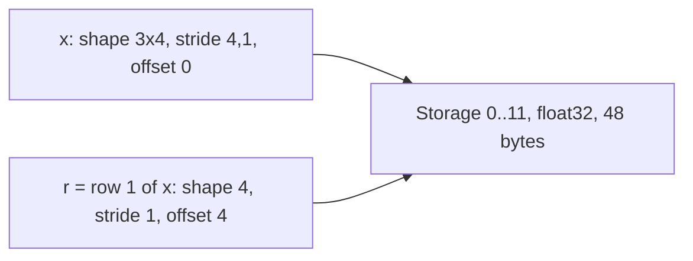

# 03 — Storage, Strides, Views, and Copies

> **Prerequisites:** module 02.
> **You will learn:** how a tensor maps an index `(i, j, k)` to a memory address
> with `offset + Σ index·stride`, and how to compute strides by hand; which
> operations return views (shared storage) and which return copies, and how to
> tell (`untyped_storage().data_ptr()`, `_base`, `is_contiguous`); `view` vs
> `reshape` vs `contiguous`, `transpose`/`permute`/`T`/`mT`, `expand` vs
> `repeat`, `as_strided`, `unfold`, `narrow`, `diagonal`; in-place operations,
> the `_` suffix, `out=` semantics, and the version counter that protects
> autograd; memory formats (`contiguous_format`, `channels_last`) and why layout
> affects speed.

A PyTorch tensor is a small header (sizes, strides, offset, dtype, device)
pointing into a flat, untyped buffer called a storage. Transposes, slices,
broadcasts and sliding windows only edit the header: they copy nothing, and
writing through one tensor can silently change another.

That one fact explains why `view` fails after `transpose`, why `reshape`
sometimes aliases and sometimes doesn't, why an in-place add into a broadcast
tensor raises, why autograd complains about a variable "modified by an
inplace operation", and why `channels_last` speeds up convolutions without
changing a shape. [The PyTorch notes](../../notes/libraries/pytorch.md) have a
short table; this module derives the mechanism.

---

## 3.1 Storage: the flat buffer underneath

Every dense tensor references a `Storage`, a block of bytes on a device,
exposed in 2.x as `t.untyped_storage()` (a `torch.UntypedStorage`). The older
`t.storage()` warns in 2.8 that "TypedStorage is deprecated" (observed; see the
[storage docs](https://docs.pytorch.org/docs/2.8/storage.html)). Where a
tensor lives inside its storage:

| Accessor | Unit | Meaning |
|---|---|---|
| `t.untyped_storage().nbytes()` | bytes | size of the whole buffer, shared by every alias |
| `t.untyped_storage().data_ptr()` | address | start of the buffer; equal for all tensors that alias it |
| `t.storage_offset()` | elements | where element `t[0, 0, ...]` sits, counted from the buffer start |
| `t.data_ptr()` | address | `storage.data_ptr() + storage_offset() · element_size()` |

The last row is what
[`c10/core/TensorImpl.h` at v2.8.0](https://github.com/pytorch/pytorch/blob/v2.8.0/c10/core/TensorImpl.h)
computes (`data + data_type_.itemsize() * storage_offset_`); that class holds
`storage_`, `sizes_and_strides_`, `storage_offset_` and `version_counter_`
(§3.7). Edward Yang's [PyTorch internals](http://blog.ezyang.com/2019/05/pytorch-internals/)
(2019, conceptual) draws the same picture.

Take `x = torch.arange(12, dtype=torch.float32).reshape(3, 4)` and its second
row `r = x[1]`. Both tensors point at the same 48-byte buffer; they differ only
in the header:



Measured: `r.storage_offset() == 4`, `r.data_ptr() - x.data_ptr() == 16`
bytes, and the two `untyped_storage().data_ptr()` values are equal. That
comparison is the reliable aliasing test; `t.data_ptr()` is not, since views
of one storage can start at different addresses.

The other signal is `_base`, which points at the *root* tensor, not the
immediate parent. Here `x` is itself a view of the `arange` result, so
`r._base is x` is `False` while `r._base is x._base` is `True`. Code that
asserts `y._base is x` breaks the day someone adds a harmless `reshape`
upstream; compare storages instead.

## 3.2 Strides, derived

A stride is "how many elements to skip in storage to move one step along this
dimension". For a tensor with sizes $(d_0, \dots, d_{n-1})$, strides
$(s_0, \dots, s_{n-1})$ and offset $o$, element $(i_0, \dots, i_{n-1})$ lives at

$$
\text{addr}(i_0,\dots,i_{n-1}) \;=\; o + \sum_{k=0}^{n-1} i_k\, s_k \quad\text{(elements)},
\qquad \text{bytes} = \text{addr} \cdot \texttt{element\_size()}.
$$

**Row-major strides.** In a fresh tensor the last index varies fastest, so
$s_{n-1} = 1$, and one step along dimension $k$ skips a whole block of the
dimensions to its right, $\prod_{m>k} d_m$ elements:

$$
s_k = \prod_{m=k+1}^{n-1} d_m, \qquad \text{for shape }(d_0, d_1, d_2):\; (d_1 d_2,\; d_2,\; 1).
$$

For shape `(2, 3, 4)` that is `(12, 4, 1)`. Element `[1, 2, 3]` sits at
$1\cdot12 + 2\cdot4 + 3\cdot1 = 23$, the last of 24 elements, as it should.

**Transposes permute the header.** `transpose(0, 2)` swaps entry 0 and entry 2
of *both* the sizes and the strides and leaves the buffer alone:

| Tensor | Shape | Strides | Offset | Contiguous |
|---|---|---|---|---|
| `x = arange(24).reshape(2,3,4)` | (2, 3, 4) | (12, 4, 1) | 0 | yes |
| `x.transpose(0, 2)` | (4, 3, 2) | (1, 4, 12) | 0 | no |
| `x[1:, 1:, ::2]` | (1, 2, 2) | (12, 4, 2) | 16 | no |
| `x.permute(2, 0, 1)` | (4, 2, 3) | (1, 12, 4) | 0 | no |

In the slice row, starting at `1` on dimensions 0 and 1 adds
$1\cdot12 + 1\cdot4 = 16$ to the offset, and step `2` doubles the last stride.

**Contiguity** means the strides equal the row-major strides computed from the
current sizes, with one relaxation: dimensions of size 1 are ignored, because
you can never step along them. A `(2, 1, 3)` tensor transposed to `(1, 2, 3)`
has strides `(3, 3, 1)`, not the "expected" `(6, 3, 1)`, and still reports
`is_contiguous() == True` (measured). Contiguous means row-major iteration
walks the storage linearly with no gaps, which most kernels assume.

NumPy uses the same model ([NumPy notes](../../notes/libraries/numpy.md)) with
one unit difference: NumPy `.strides` are in **bytes**, PyTorch `.stride()` in
**elements**. A float32 `(3, 4)` array has NumPy strides `(16, 4)` and PyTorch
strides `(4, 1)`.

## 3.3 View operations and how to recognise them

The [Tensor Views page](https://docs.pytorch.org/docs/2.8/tensor_view.html)
lists the ops that return views ("No data movement occurs when creating a
view"). The important ones, with the header edit each performs:

| Operation | View? | Header edit / notes |
|---|---|---|
| basic slicing `t[0, 2:, 1:7:2]` | view | offset += start·stride; stride *= step |
| `select(dim, i)` / `t[i]` | view | drops a dim, offset += i·stride |
| `narrow(dim, start, length)` | view | slice with a length; same as `t[..., start:start+length]` |
| `view(shape)`, `view_as` | view | new sizes/strides; fails if impossible (§3.4) |
| `unsqueeze` / `squeeze` / `unflatten` | view | add/remove size-1 dims or split one dim |
| `transpose`, `swapaxes`, `permute`, `movedim`, `t()` | view | permute sizes and strides |
| `T`, `mT`, `mH` | view | `T` reverses all dims; `mT` swaps the last two |
| `expand(shape)`, `expand_as` | view | **stride 0** on broadcast dims |
| `view_as_real`, `real`, `imag` | view | complex reinterpreted as float |
| `diagonal()` | view | one dim with stride = sum of the two strides |
| `unfold(dim, size, step)` | view | overlapping windows (§3.5) |
| `as_strided(size, stride, offset)` | view | arbitrary header, no checks beyond storage bounds |
| `split`, `chunk`, `tensor_split`, `unbind` | views | each piece is a slice |
| `detach()` | view | same data, no autograd history (§3.6) |
| advanced indexing `t[[0, 2]]`, `t[mask]` | **copy** | gathers into new storage (module [04](./04-indexing-broadcasting-shapes.md)) |
| `repeat`, `clone`, `tile` | **copy** | materialise data |
| `contiguous()` | copy iff non-contiguous | returns `self` when already contiguous |
| `reshape`, `reshape_as`, `flatten` | view **or** copy | "user code shouldn't rely on whether it's view or not" (docs) |

`diagonal()` of a contiguous `(3, 4)` tensor steps one row and one column at
once, so its stride is $4 + 1 = 5$ (measured `(5,)`). `.T` on a 3-D tensor
warns in 2.8 that it "is deprecated and it will throw an error in a future
release"; use `mT`, which on `(2, 3, 4)` gives strides `(12, 1, 4)`.

### expand: broadcasting without allocating

`torch.zeros(1, 1000).expand(1000, 1000)` has strides `(0, 1)`: every "row"
is the same 1,000 floats, still 4,000 bytes of storage, where
`repeat(1000, 1)` would allocate 4,000,000 bytes (about 3.8 MiB). Because many
logical elements share one address, an in-place write would be
order-dependent, so `expanded.add_(1)` raises:

```
RuntimeError: unsupported operation: more than one element of the written-to
tensor refers to a single memory location. Please clone() the tensor before
performing the operation.
```

The check catches stride-0 overlap. It does *not* catch every overlap: in
§3.5 we build an overlapping `as_strided` view that an in-place op silently
corrupts.

## 3.4 view vs reshape vs contiguous

`view(new_shape)` never copies; it succeeds only if new strides over the same
memory can express the new shape. The condition (from the [`view` docs](https://docs.pytorch.org/docs/2.8/generated/torch.Tensor.view.html)):
each new dimension must be a subspace of an original dimension, or span
consecutive original dimensions $d, \dots, d+k$ that satisfy the docs'
"contiguity-like condition" $\text{stride}[i] = \text{stride}[i+1] \times \text{size}[i+1]$. Merging two
dimensions $a, b$ into one is legal iff $s_a = s_b \cdot d_b$.

After `y = x.t()` on a `(3, 4)` tensor, `y` has shape `(4, 3)` and strides
`(1, 4)`. Flattening needs $s_0 = s_1 \cdot d_1$, i.e. $1 = 4\cdot3$, which is
false, and you get the classic error (verbatim from 2.8):

```
RuntimeError: view size is not compatible with input tensor's size and stride
(at least one dimension spans across two contiguous subspaces). Use .reshape(...) instead.
```

`reshape` is `view` if possible, else a copy, so whether its result aliases
the input depends on layout. Measured:

```python
x = torch.arange(6.).reshape(2, 3)
r = x.reshape(-1); r[0] = 100     # x[0, 0] is now 100: r was a view
x = torch.arange(6.).reshape(2, 3).t()
r = x.reshape(-1); r[0] = 100     # x[0, 0] is still 0: r was a copy
```

If you mutate the result, make aliasing unconditional: `x.view(...)` (aliases
or raises) or `x.reshape(...).clone()` (never aliases). `contiguous()` returns
`self` when already contiguous (`x.contiguous() is x`), so it is cheap to call
defensively but never a way to get a private copy.

| Need | Use | Aliases input? | Can fail? |
|---|---|---|---|
| reinterpret shape, must not copy | `view` | always | yes, on incompatible strides |
| reshape, don't care about aliasing, read-only use | `reshape` | sometimes | no |
| reshape and then mutate safely | `reshape(...).clone()` | never | no |
| dense row-major buffer for a kernel or `.view` | `contiguous()` | if already contiguous | no |
| a private copy regardless of layout | `clone()` | never | no |

`flatten` follows `reshape`: `x.t().flatten()` returned fresh storage
(`_base is None`) when measured.

## 3.5 as_strided and unfold: building sliding windows without copies

`unfold(dim, size, step)` cuts `dim` into windows of length `size` spaced
`step` apart and appends a window dimension, by header arithmetic alone. For
a contiguous 1-D tensor of length $n$:

- number of windows: $\lfloor (n - \text{size}) / \text{step} \rfloor + 1$;
- stride along the window-index dimension: $\text{step} \cdot 1$;
- stride along the new within-window dimension: the original stride, $1$.

So `torch.arange(10.).unfold(0, 4, 2)` has shape `(4, 4)` and strides `(2, 1)`:
rows `[0..3]`, `[2..5]`, `[4..7]`, `[6..9]`: sixteen logical elements, ten
stored.

For a token stream, `ids.unfold(0, T + 1, T)` yields `(T+1)`-long windows
whose first `T` positions are inputs and last `T` targets; `step=1` yields
every window for free (the capstone pipeline in
[module 31](./31-capstone-data-pipeline.md) windows this way). Applied twice
to a `(1, 1, 4, 4)` image, `img.unfold(2, 2, 2).unfold(3, 2, 2)` gives a 2×2
grid of 2×2 patches, shape `(1, 1, 2, 2, 2, 2)`, strides
`(16, 16, 8, 2, 4, 1)`, still a view: the first half of im2col in
[module 11](./11-linear-embedding-conv-recurrent-layers.md).

`as_strided(size, stride, storage_offset)` sets any header you ask for. Its
only check is the storage bound:

```
RuntimeError: setStorage: sizes [4, 4], strides [3, 1], storage offset 0, and
itemsize 4 requiring a storage size of 52 are out of bounds for storage of size 40
```

The highest element it would touch is $3\cdot3 + 3\cdot1 = 12$, so it needs 13
floats (52 bytes) and the storage holds 10 (40 bytes); it refused.
Within bounds it trusts you. `w = a.as_strided((4, 4), (2, 1))` on
`a = arange(10.)` builds the same windows as `unfold`, and `w.mul_(2)` did
**not** raise (the overlap detector only proves stride-0 overlap). It left `a`
as `[0, 2, 8, 12, 16, 20, 24, 28, 16, 18]`: elements 2–7 were doubled twice.
The [`as_strided` docs](https://docs.pytorch.org/docs/2.8/generated/torch.as_strided.html)
say in-place ops on an "overlapped" view are "undefined". Use `as_strided` only with derived strides, and prefer `unfold`, `expand` and
`diagonal`, whose strides PyTorch derives for you.

## 3.6 clone, detach, and copy_

These four are routinely confused:

| Expression | New storage? | Autograd connection to source | Typical use |
|---|---|---|---|
| `y = x.clone()` | yes | kept (`grad_fn=CloneBackward0`) | private copy inside a differentiable function |
| `y = x.detach()` | no (view) | dropped (`requires_grad=False`) | read values without tracking; writes still hit `x` |
| `y = x.detach().clone()` | yes | dropped | snapshot a parameter or activation for logging/EMA |
| `dst.copy_(src)` | no (writes into `dst`) | `dst` becomes a function of `src` if either tracks grad | fill a preallocated buffer |

`clone()` defaults to `memory_format=torch.preserve_format`, so layout
survives. `copy_(src)` broadcasts and converts dtype and device: measured,
`torch.zeros(2, 3, dtype=torch.float64).copy_(torch.tensor([1, 2, 3], dtype=torch.int32))`
fills both rows with `1., 2., 3.`. `torch.empty_like(x).copy_(x)` is a
layout-preserving copy that skips initialising memory you will overwrite.
The `detach()` row bites: `x.detach().zero_()` zeroes `x` itself.

## 3.7 In-place ops, `out=`, and the version counter

A trailing underscore means in-place (`add_`, `clamp_`, `zero_`, `copy_`):
the op mutates `self` and returns `self`. On a view it writes through to the
base, which is why `x[0].add_(1)` modifies `x` (indexed assignment such as
`x[mask] = 0` is itself in-place on `x`).

### out=

Many functions accept `out=` to write into a preallocated tensor. The
[Out Notes](https://docs.pytorch.org/docs/2.8/notes/out.html) define the
contract; the last column is what we triggered on CPU:

| Situation | Contract | Observed in 2.8 |
|---|---|---|
| `out` has no elements | resized to the result's shape, strides, format | — |
| `out` has wrong shape | error, *or* resize with a deprecation warning | `torch.add(ones(3), 1, out=empty(5))` resized `out` to `(3,)` and warned "This behavior is deprecated" |
| `out` dtype is a lower "type kind" (bool < int < float < complex) | error | float result into int64 `out`: "result type Float can't be cast to the desired output type Long" |
| `out` dtype is a higher kind or wider | safe copy | float32 result into float64 `out` worked |
| any input requires grad | not supported | "functions with out=... arguments don't support automatic differentiation" |

`out=` saves an allocation, but the caching allocator already makes
allocation cheap, it is not differentiable, and compilers reuse buffers
anyway. Keep it out of models.

### The version counter

Every tensor has a version counter, `t._version`, bumped by each in-place
op and shared by views. Measured: `0`, then `1` for both `x` and the view
after `x[0].add_(1)`, then `2` after `x.mul_(2)`. When a backward formula
needs a tensor (for `z = y * y`, it needs `y`), autograd saves it with its
current version and compares at backward time:

```
w = torch.ones(3, requires_grad=True); y = w * 2; z = y * y; y.add_(1)
z.sum().backward()
RuntimeError: one of the variables needed for gradient computation has been modified
by an inplace operation: [torch.FloatTensor [3]], which is output 0 of AddBackward0,
is at version 1; expected version 0 instead. ...
```

It fires only when a *saved* value changed: `z = y.exp()` saves its output,
so mutating `y` afterwards passes (measured).
[Module 07](./07-autograd-graph-and-backward.md) covers saved tensors.
Compilers instead *functionalize*, rewriting `y.add_(1)` into `y2 = y + 1`
plus a copy-back so the optimiser sees pure dataflow
([module 24](./24-compiler-internals-fx-inductor.md)).

## 3.8 Memory formats: channels_last

An image batch has logical shape `(N, C, H, W)` (in this section `H` is image
height, not attention heads). The default `torch.contiguous_format` stores it
NCHW: width fastest, then height, then channel. `torch.channels_last` keeps the
**same logical shape and indexing** but stores it NHWC: the channel index
varies fastest. Deriving the strides from that physical order: moving one
channel moves 1 element; one column skips all $C$ channels of a pixel, so
$s_W = C$; one row skips $W$ pixels, $s_H = W C$; one image skips
$s_N = H W C$. Hence

$$
\text{strides}_{\text{channels\_last}}(N, C, H, W) = (H W C,\; 1,\; W C,\; C).
$$

For `(2, 3, 4, 5)` that is `(60, 1, 15, 3)`, against the default `(60, 20, 5, 1)`.
Measured: `x.to(memory_format=torch.channels_last).stride() == (60, 1, 15, 3)`,
`is_contiguous()` became `False`, and
`is_contiguous(memory_format=torch.channels_last)` `True`; values are
unchanged. The `memory_format` values are listed in
[Tensor Attributes](https://docs.pytorch.org/docs/2.8/tensor_attributes.html).
`empty_like`, `clone` and `x + 1` all preserved `(60, 1, 15, 3)` when measured.

The [channels_last tutorial](https://docs.pytorch.org/tutorials/intermediate/memory_format_tutorial.html)
(living page, accessed 2026-10-10) explains the payoff: GPU convolution
kernels for Tensor Cores, especially in float16, want each pixel's channels
as one contiguous vector. It reports "over 22% performance gains" for
ResNet-50 AMP training (vendor-reported, old cuDNN, not executed here). The
recipe is `model.to(memory_format=torch.channels_last)` plus converting
inputs once; an op without support returns contiguous output and stops the
propagation, which is correct but slow.

## 3.9 Why layout matters for speed

Memory moves in cache lines (64 bytes on most x86 CPUs; `sysctl hw.cachelinesize`
reports 128 on the M2 Pro used below), and a GPU warp's loads coalesce only
when adjacent threads touch adjacent addresses. Walking the stride-1
dimension uses every byte fetched; walking a large-stride dimension uses one
element per line. Try it with `torch.utils.benchmark`
([module 21](./21-profiling-and-benchmarking.md)):

```python
import torch, torch.utils.benchmark as benchmark
torch.set_num_threads(4)
m = torch.randn(4096, 4096)
for stmt in ["m.sum(dim=1)", "m.sum(dim=0)", "m.clone()", "m.t().contiguous()"]:
    t = benchmark.Timer(stmt, globals={"m": m}).blocked_autorange(min_run_time=0.5)
    print(stmt, f"{t.median * 1e3:.1f} ms")
```

One local PyTorch 2.8 CPU run on an Apple M2 Pro with 4 threads produced
medians of 1.2 ms for `sum(dim=1)`, 12.8 ms for `sum(dim=0)`, 1.7 ms for
`clone()` and 23.4 ms for `m.t().contiguous()`. Both copies move 64 MiB; the
transposing one is strided on one side. Direction, not targets.

Consequences: do not "fix" a transposed matmul operand with `.contiguous()`.
On CPU,
`addmm_impl_cpu_` in
[`aten/src/ATen/native/LinearAlgebra.cpp` at v2.8.0](https://github.com/pytorch/pytorch/blob/v2.8.0/aten/src/ATen/native/LinearAlgebra.cpp)
inspects each operand's strides and sets `transpose_a`/`transpose_b` instead
of copying when one stride is 1, so `x @ W.t()` (`nn.Linear`)
costs no copy (implementation-reviewed). Do pay for one `.contiguous()` when a strided tensor is
consumed many times or a consumer (`view`, a custom kernel, NCCL) requires
it. Per-backend layout choice is in [module 20](./20-execution-model-dispatch-devices.md).

## Worked strides verification

**Fence 1** checks the §3.2 address formula against indexing on a
contiguous tensor, a transpose, and an offset slice (ten random indices each).
It proves nothing about sparse or nested layouts or kernel iteration order.

```python pytorch-check
import torch

def addr(t, idx):
    return t.storage_offset() + sum(i * s for i, s in zip(idx, t.stride()))

flat = torch.arange(24)
x = flat.view(2, 3, 4)
assert x.stride() == (12, 4, 1)
xt = x.transpose(0, 2)
assert xt.shape == (4, 3, 2) and xt.stride() == (1, 4, 12)
xs = x[1:, 1:, ::2]
assert xs.storage_offset() == 16 and xs.stride() == (12, 4, 2)

g = torch.Generator().manual_seed(3)
for t in (x, xt, xs):
    for _ in range(10):
        idx = tuple(int(torch.randint(0, d, (1,), generator=g)) for d in t.shape)
        assert flat[addr(t, idx)] == t[idx], (t.shape, idx)
        assert t.untyped_storage().data_ptr() == flat.untyped_storage().data_ptr()
print("address formula matches indexing on 3 headers x 10 indices")
```

**Fence 2** classifies ops as views or copies by storage identity and
reproduces the §3.4 `view`/`reshape` split. It proves 2.8 behaviour for these
inputs, not that `reshape` will always copy here (the docs say not to rely on it).

```python pytorch-check
import torch

x = torch.arange(12.).reshape(3, 4)
sp = lambda t: t.untyped_storage().data_ptr()
for name, v in {"slice": x[1:, ::2], "transpose": x.transpose(0, 1),
                "expand": x[:1].expand(5, 4), "unfold": x.reshape(-1).unfold(0, 4, 2),
                "diagonal": x.diagonal(), "narrow": x.narrow(1, 1, 2)}.items():
    assert sp(v) == sp(x), name

xt = x.transpose(0, 1)
assert xt.is_contiguous() is False
try:
    xt.view(-1)
    raise AssertionError("view should fail on transposed tensor")
except RuntimeError as e:
    assert "view size is not compatible" in str(e)
r = xt.reshape(-1)
assert sp(r) != sp(x) and r.is_contiguous()
assert sp(x[[0, 2]]) != sp(x) and sp(x.repeat(2, 1)) != sp(x)
assert x.contiguous() is x

e = torch.zeros(1, 1000).expand(1000, 1000)
assert e.stride() == (0, 1) and e.untyped_storage().nbytes() == 4000
try:
    e.add_(1)
    raise AssertionError("in-place on expanded tensor should fail")
except RuntimeError as err:
    assert "single memory location" in str(err)
print("views share storage; reshape after transpose copies; expand has stride 0")
```

**Fence 3** checks write-through, the shared version counter, the autograd
version error, and `clone`/`detach` storage. It does not establish which ops
save inputs versus outputs; module 07 does.

```python pytorch-check
import torch

x = torch.zeros(2, 3)
v = x[0]
v0 = x._version
v.add_(1)
assert torch.equal(x[0], torch.ones(3)) and torch.equal(x[1], torch.zeros(3))
assert x._version == v0 + 1 and v._version == x._version

sp = lambda t: t.untyped_storage().data_ptr()
w = torch.ones(3, requires_grad=True)
c, d = w.clone(), w.detach()
assert sp(c) != sp(w) and c.grad_fn is not None
assert sp(d) == sp(w) and d.requires_grad is False

y = w * 2
z = y * y
y.add_(1)
try:
    z.sum().backward()
    raise AssertionError("backward should detect the in-place change")
except RuntimeError as err:
    assert "modified by an inplace operation" in str(err)
print("write-through, shared version counter, and autograd check behave as described")
```

**Fence 4** checks the derived `channels_last` strides, unchanged values,
and propagation. It proves layout bookkeeping, nothing about speed.

```python pytorch-check
import torch

N, C, H, W = 2, 3, 4, 5
x = torch.arange(N * C * H * W, dtype=torch.float32).reshape(N, C, H, W)
cl = x.to(memory_format=torch.channels_last)
assert cl.shape == x.shape
assert cl.stride() == (H * W * C, 1, W * C, C) == (60, 1, 15, 3)
assert not cl.is_contiguous() and cl.is_contiguous(memory_format=torch.channels_last)
torch.testing.assert_close(cl, x)
assert (cl + 1).stride() == cl.stride() and torch.empty_like(cl).stride() == cl.stride()
print("channels_last strides", cl.stride())
```

**Fence 5** checks the §3.5 `unfold` formula and that no copy happens. It
leaves overlapping in-place writes unasserted, since they are undefined.

```python pytorch-check
import torch

a = torch.arange(10)
u = a.unfold(0, 4, 2)
expected = torch.tensor([[0, 1, 2, 3], [2, 3, 4, 5], [4, 5, 6, 7], [6, 7, 8, 9]])
assert torch.equal(u, expected)
assert u.shape == ((10 - 4) // 2 + 1, 4) and u.stride() == (2, 1)
assert u.untyped_storage().data_ptr() == a.untyped_storage().data_ptr()
assert torch.equal(a.as_strided((4, 4), (2, 1)), u)
print("unfold windows", tuple(u.shape), "stride", u.stride())
```

## Key takeaways

- A tensor is a header over a flat untyped storage; element address =
  `offset + Σ index·stride`, in elements. Row-major strides are suffix
  products of sizes; permutes permute strides; slices shift the offset.
- Test aliasing with `untyped_storage().data_ptr()`, not `data_ptr()` or
  `_base is x` (`_base` points at the root).
- `view` never copies and can fail; `reshape` and `flatten` may silently copy,
  so mutating their result is conditional aliasing; `contiguous()` returns
  `self` when it can.
- `expand` broadcasts with stride 0 and refuses in-place writes; `unfold`
  builds windows for free; overlapping in-place writes via `as_strided` are
  undefined.
- `clone` copies and keeps autograd; `detach` shares and drops it;
  `detach().clone()` snapshots.
- In-place ops bump a version counter shared by views; autograd uses it to
  refuse gradients computed from mutated saved tensors. `out=` is not
  differentiable.
- `channels_last` changes strides to `(HWC, 1, WC, C)` without changing shape;
  it helps GPU convolutions and propagates through most ops.

## Self-check

1. Give shape and strides of `x.permute(2,0,1)` for contiguous `x` of shape `(4,5,6)`, and say whether `.view(4,30)` on the result will work.
2. Why can `expand` broadcast a `(1,1000)` tensor to `(1000,1000)` without allocating 4 MB, and why does an in-place add into that expanded tensor fail?
3. A function returns `x.reshape(-1)` and the caller mutates the result. When does this mutate `x`, and how would you make the behaviour unconditional?

---

**Next → [04 — Indexing, Broadcasting, and Shape Manipulation](./04-indexing-broadcasting-shapes.md)**
