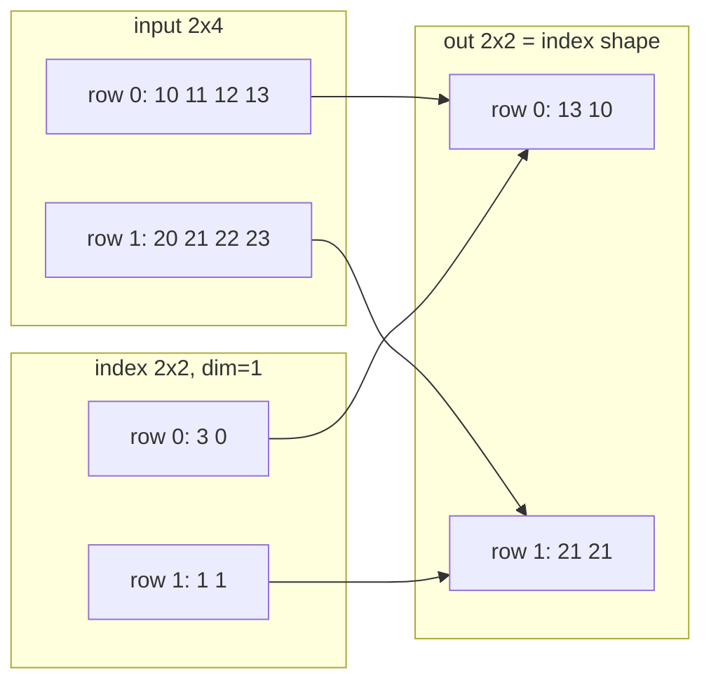

# 04 — Indexing, Broadcasting, and Shape Manipulation

> **Prerequisites:** modules 02–03.
> **You will learn:** basic vs advanced indexing, which returns a view and which
> a copy, and how index tensors broadcast to form the result shape; boolean
> masks, `where`, `masked_fill`, `masked_select`, `nonzero` and why it is a sync
> point; the gather/scatter family with exact index-shape rules; broadcasting
> rules applied to `(B, H, T, T)` masks, plus the bugs broadcasting silently
> creates; and `cat`/`stack`/`split`/`chunk`/`unbind`, `squeeze`/`unsqueeze`,
> `flatten`/`unflatten`, `movedim`, `einsum`, and named tensors.

The shape bugs that reach production are the ones that raise no error. A loss
over a `(B, B)` matrix instead of a `(B,)` vector still trains. A padding mask
broadcast along the wrong axis still yields finite attention weights. A
`squeeze()` that drops a batch of size one still returns a tensor. The remedy is
a small set of exact rules (what an index expression returns, its shape, whether
it aliases memory) that you apply mechanically and assert in code.

Every operation here either makes a new view of the same storage (new sizes,
strides, offset; [module 03](./03-storage-strides-views-copies.md)) or
allocates and copies. The [PyTorch notes](../../notes/libraries/pytorch.md) list
these ops; this module goes deeper into the shape algebra. The
[NumPy notes](../../notes/libraries/numpy.md) cover the semantics PyTorch copies.

---

## 4.1 Basic indexing returns views

*Basic* indexing uses only Python integers, slices, `...` and `None`. Each is
stride arithmetic, so the result is always a view: an integer removes its dim
and moves the storage offset; a slice `a:b:s` keeps the dim, shrinks it, and
multiplies its stride by `s`; `None` inserts a size-1 dim; `...` expands to as
many full slices as needed.

One rule differs from NumPy: **negative steps are not allowed**. `x[::-1]`
raises `ValueError: step must be greater than zero` in 2.8 (run here), because
PyTorch kernels assume non-negative strides. Reverse with `torch.flip`, which
copies.

On activations `x` of shape `(B, T, d_model)`:

| Expression | Result shape | Meaning |
|---|---|---|
| `x[0]` | `(T, d_model)` | first sequence |
| `x[:, -1]` | `(B, d_model)` | last-token state, what the LM head reads when generating |
| `x[..., :64]` | `(B, T, 64)` | first 64 channels |
| `x[:, None]` | `(B, 1, T, d_model)` | insert a head axis for broadcasting |
| `x[0, 1:5, ::2]` | `(4, d_model/2)` | strided channel subsample |
| `x[..., None]` | `(B, T, d_model, 1)` | trailing singleton |

All six share storage with `x`; writes through them land in `x`. The
[tensor views page](https://docs.pytorch.org/docs/2.8/tensor_view.html) states
the contract: "basic indexing returns views, while advanced indexing returns a
copy. Assignment via either basic or advanced indexing is in-place."

## 4.2 Advanced (integer-tensor) indexing returns copies

Once any index is a tensor, list or boolean array, indexing is *advanced*.
Rows `[3, 0, 3]` are not an arithmetic progression in memory, so no stride can
describe them and PyTorch gathers into a fresh allocation.

### The shape rule

PyTorch follows the
[NumPy indexing rules](https://numpy.org/doc/1.26/user/basics.indexing.html):

1. All advanced indices **broadcast against each other** (section 4.5) to a
   common shape $S$.
2. Dims indexed by plain slices are kept.
3. If the advanced indices are **adjacent**, $S$ replaces them in place. If a
   slice **separates** them, $S$ moves to the **front**, since there is no
   unambiguous place to put it.

On `x` of shape `(5, 6, 7)`:

| Expression | $S$ | Adjacent? | Result |
|---|---|---|---|
| `x[:, [0,1], [2,3]]` | `(2,)` | yes | `(5, 2)` |
| `x[[0,1], :, [2,3]]` | `(2,)` | no, moved to front | `(2, 6)` |
| `x[idx]`, `idx` shape `(2,2)` | `(2, 2)` | n/a | `(2, 2, 6, 7)` |
| `x[[[0],[1]], :, [2,3]]` | `(2,1)` with `(2,)` → `(2, 2)` | no | `(2, 2, 6)` |

The second row is the interview favourite: `x[[0,1], :, [2,3]]` returns
`x[0,:,2]` and `x[1,:,3]` stacked, shape `(2, 6)`. Indices are **zipped, not
crossed**. For the cross product, broadcast them yourself (last row).

A measured divergence from NumPy: PyTorch treats a Python integer as *basic*
indexing even beside advanced indices. `x[0, :, [1,2]]` is `(6, 2)` in PyTorch
2.8 and `(2, 6)` in NumPy 1.26 (both run here), because NumPy counts the scalar
as an advanced index separated by a slice. Ported code can silently transpose.
Select the scalar first (`x[0][:, [1, 2]]`), which means the same in both.

### One value per row

The most common advanced index in LLM code picks one entry per row, e.g. the
target token's logit:

```python
picked = logits[torch.arange(B), targets]   # logits (B, V), targets (B,) -> (B,)
```

`torch.arange(B)` and `targets` broadcast to `(B,)`, and element `b` is
`logits[b, targets[b]]`. `gather` (section 4.4) returns the same values.

### Assignment and duplicates

`x[idx] = v` dispatches to `index_put_`, which writes in place. The
[`index_put_` docs](https://docs.pytorch.org/docs/2.8/generated/torch.Tensor.index_put_.html):
"If accumulate is False, the behavior is undefined if indices contain duplicate
elements." On CPU, `z[[0,0,1]] = [1.,2.,3.]` gave `[2, 3, 0]` (last write won),
an observation rather than a guarantee; on CUDA the winning thread is arbitrary.
For histogram-like updates use `index_put_(..., accumulate=True)` (gave
`[3, 3, 0]`) or `index_add_`.

## 4.3 Boolean masks, `where`, and masked ops

`x[mask]` with `mask.shape == x.shape` returns a **1-D** tensor of length
`mask.sum()`, a length that depends on data, not shapes. Two consequences:

- **GPU sync.** The host must learn the count before allocating the output, so
  it waits for queued kernels. The
  [`nonzero` docs](https://docs.pytorch.org/docs/2.8/generated/torch.nonzero.html):
  "When input is on CUDA, `torch.nonzero()` causes host-device synchronization."
  Boolean indexing goes through `nonzero`. (From the docs; GPU not executed here.)
  [Module 21](./21-profiling-and-benchmarking.md) shows how these syncs look in a
  profiler trace.
- **Graph break under `torch.compile`.** `torch._dynamo.explain` on
  `lambda x: (x[x > 0] * 2).sum()` reported 2 graphs, 1 break, reason "Operator
  `aten.nonzero.default`'s output shape depends on input Tensor data"; the
  `torch.where` version gave 1 graph, 0 breaks (measured locally on CPU, 2.8).
  [Module 23](./23-torch-compile-in-practice.md) covers the knobs that capture
  such ops.

The shape-static alternative keeps the full shape and neutralises masked
positions. `torch.where(cond, a, b)` selects elementwise and broadcasts all three
arguments; `masked_fill(mask, value)` is the common special case. Attention sets
disallowed scores to `-inf` so softmax gives them zero weight (semantics in
[transformers 08](../transformers/08-encoder-decoder-masking.md)). For a masked
mean, multiply by the mask and divide by `mask.sum(dim, keepdim=True)`.

| Op | Output shape static? | GPU host sync? | Notes |
|---|---|---|---|
| `x[mask]`, `masked_select(x, mask)` | no, 1-D of length count | yes | `masked_select` broadcasts the mask |
| `nonzero(m)`, `argwhere(m)` | no, `(count, ndim)` | yes | `as_tuple=True` gives per-dim index vectors |
| `torch.where(cond)` (one arg) | no | yes | equals `nonzero(as_tuple=True)` |
| `torch.where(cond, a, b)` | yes, broadcast shape | no | compile-friendly default |
| `masked_fill(mask, v)` | yes | no | `-inf` for attention |
| `nonzero_static(m, size=k)` | yes, `(k, ndim)` padded with `fill_value` | designed to avoid it | needs an upper bound `k` |

`torch.where(cond, a, b)` evaluates both branches everywhere, so
`torch.where(x > 0, x.log(), 0.)` still computes `log` of zeros and negatives.
The forward output is clean, but the backward multiplies the zero mask by the
unused branch's local gradient $1/x$: at `x = 0` that is `0 · inf = nan`. On
`x = [-1, 0, 2]` the gradient was `[-0., nan, 0.5]`. Sanitise the input first:
`x.clamp_min(eps).log()` (module 05 returns to this).

## 4.4 gather and scatter, with the index-shape rule

Advanced indexing broadcasts its indices; the gather/scatter family does not.
It takes one index tensor with the **same ndim** as the input and reads or
writes along one dim. For a 3-D input and `dim=1` the
[`gather` docs](https://docs.pytorch.org/docs/2.8/generated/torch.gather.html)
define

$$\text{out}[i][j][k] = \text{input}[i][\,\text{index}[i][j][k]\,][k]$$

Every output coordinate is copied into the input coordinate except the one along
`dim`, which is replaced by the index value. Hence: `index.ndim == input.ndim`;
`out.shape == index.shape`; `index.size(d) <= input.size(d)` for `d != dim`.
Along `dim` the index may even be longer than the input (a `(1, 5)` index on a
`(3, 4)` input along dim 1 ran here); only its *values* must lie in
`[0, input.size(dim))`.



Row `i` of the output reads row `i` of the input at the columns in row `i` of
the index; duplicates are fine for a read. `torch.take_along_dim` is the
NumPy-named equivalent that also broadcasts the non-`dim` sizes. The per-row
pick becomes `logits.gather(1, targets[:, None]).squeeze(1)`.

### Scatter: the inverse write

`self.scatter_(dim, index, src)` writes `self[i][index[i][j]] = src[i][j]` for
`dim=1`, with the mirrored shape rules. With duplicate indices it is
non-deterministic and, per the
[`scatter_` docs](https://docs.pytorch.org/docs/2.8/generated/torch.Tensor.scatter_.html),
"the gradient will be incorrect". The reducing variants handle collisions:
`scatter_add_` sums them, and `scatter_reduce_(dim, index, src, reduce,
include_self=True)` supports `"sum"`, `"prod"`, `"mean"`, `"amax"`, `"amin"`.
`include_self=True` lets the existing value in `self` join the reduction, so for
`"mean"` an initial zero counts as a sample. Values `[1, 2, 3, 4]` with segment
ids `[0, 0, 2, 2]` into `zeros(3)` gave `[1.5, 0, 3.5]` with
`include_self=False` and `[1.0, 0, 2.333]` with `True`; the empty segment kept
its initial value. The
[`scatter_reduce_` docs](https://docs.pytorch.org/docs/2.8/generated/torch.Tensor.scatter_reduce_.html)
mark it **beta**, implement backward only when `src.shape == index.shape`, and
warn of CUDA non-determinism.

### The `index_*` family: whole slices

`index_select`, `index_add_`, `index_copy_` and `index_fill_` take a **1-D**
index and move entire slices along `dim`, the natural form when whole rows
(tokens, embedding vectors) move together.

| Op | Index shape | Moves | Typical use |
|---|---|---|---|
| `gather` / `take_along_dim` | same ndim as input | single elements | pick target logit |
| `index_select(dim, idx)` | 1-D | whole slices | embedding lookup `W.index_select(0, ids)` |
| `scatter_` | same ndim as `src` | single elements | one-hot |
| `scatter_add_` / `scatter_reduce_` | same ndim as `src` | elements, reduced | segment sum/mean/max |
| `index_add_(dim, idx, src)` | 1-D | whole slices, summed | segment sum of vectors |
| `index_copy_(dim, idx, src)` | 1-D | whole slices, overwritten | write cache rows |
| `index_put_(indices, v, accumulate)` | tuple, broadcast | anything advanced indexing addresses | `x[idx] = v` |

`index_add_(0, ids, src)` on `src` of shape `(N, D)` equals
`scatter_add_(0, ids[:, None].expand(N, D), src)`: scatter needs an
element-level index, `index_add_` does not. `EmbeddingBag`-style pooling sums
token vectors per bag this way, and mixture-of-experts layers
([transformers 12](../transformers/12-mixture-of-experts.md)) combine expert
outputs back to token positions with `index_add_`, because a token routed to two
experts receives two contributions that must sum.

## 4.5 Broadcasting, derived

The [broadcasting note](https://docs.pytorch.org/docs/2.8/notes/broadcasting.html)
gives the rule: align shapes at the **trailing** dim, prepending size-1 dims to
the shorter; each pair of sizes must be equal or contain a 1; the result takes
the max. It is cheap because a size-1 dim can be stretched with stride 0, which
is what `expand` does: `torch.randn(3, 1).expand(3, 4)` has strides `(1, 0)`
here. Inputs are never materialised at the broadcast shape; only the op's
output is allocated.

| Left | Right | Result | Comment |
|---|---|---|---|
| `(B, T, d_model)` | `(d_model,)` | `(B, T, d_model)` | bias add |
| `(B, H, T, T)` | `(T, T)` | `(B, H, T, T)` | one causal mask for all batches and heads |
| `(B, 1, 1, T)` | `(1, 1, T, T)` | `(B, 1, T, T)` | key-padding OR causal |
| `(B, 1, T, T)` | `(B, H, T, T)` | `(B, H, T, T)` | combined mask on scores |
| `(B,)` | `(B, 1)` | `(B, B)` | **silent bug** |
| `(B, T)` | `(B,)` | error unless `B == T` | missing `keepdim=True` |

Rows three and four are the attention-mask pipeline. A padding mask marks which
**keys** are padding per sequence, so it varies over `B` and the last axis:
`(B, 1, 1, T)`. The causal mask varies over query and key: `(1, 1, T, T)`. Their
OR is `(B, 1, T, T)`, `H` times smaller than the scores, and `masked_fill` on
`(B, H, T, T)` broadcasts it across heads. A padding mask built as
`(B, 1, T, 1)` masks *queries* instead of keys: a valid broadcast and a wrong
model.

**In-place ops cannot broadcast the destination.**
`torch.zeros(3, 1).add_(torch.ones(3, 4))` raised "output with shape [3, 1]
doesn't match the broadcast shape [3, 4]". The source may broadcast; the
destination never grows.

### The bug catalogue

**`(B,)` vs `(B, 1)`.** A regression head outputs `(B, 1)`; the dataset yields
targets of shape `(B,)`. `pred - target` aligns `(B, 1)` with `(1, B)` and
returns `(B, B)`: every prediction minus every target. The mean is finite,
gradients flow, and the model learns to predict roughly the batch mean.
`F.mse_loss` warns on mismatched sizes; a hand-written loss does not.

**Dropped `keepdim`.** `x - x.mean(1)` for `x` of shape `(B, T)` aligns the
`(B,)` mean with the *last* dim. With `B=4, T=5` it raised "The size of tensor a
(5) must match the size of tensor b (4) at non-singleton dimension 1". With
`B=T=5` it returned `(5, 5)` silently, each column centred by the wrong row's
mean. Square test shapes hide this, so give every axis a distinct size in tests
(`B=2, T=3, d_model=8`), assert shapes at function boundaries, and keep
reductions `keepdim=True` until the end.

## 4.6 Combining and splitting

`torch.cat(tensors, dim)` joins along an **existing** dim; `torch.stack` inserts
a **new** dim and needs identical shapes (it is `cat` of `unsqueeze`). `hstack`
is `cat` on dim 1 (dim 0 for 1-D); `vstack` stacks 1-D inputs as rows. All
allocate. The split family returns **views**:

| Op | Splits by | Edge case (run here) |
|---|---|---|
| `split(3, dim)` | piece size | 10 rows → `3, 3, 3, 1` |
| `split([3, 7], dim)` | explicit sizes | must sum to the dim size |
| `chunk(n, dim)` | piece count, size `ceil(len/n)` | `arange(6).chunk(4)` gave **3** chunks of 2 |
| `tensor_split(n, dim)` | exactly `n` pieces | `arange(7).tensor_split(3)` gave `3, 2, 2` |
| `unbind(dim)` | removes `dim`, returns a tuple | `[x.select(dim, i) ...]` |

The [`chunk` docs](https://docs.pytorch.org/docs/2.8/generated/torch.chunk.html)
warn it "may return fewer than the specified number of chunks".
`q, k, v = qkv.chunk(3, dim=-1)` is safe only because `3 * d_model` divides by 3;
splitting a batch across `n` workers with `chunk` can leave one with nothing.
Use `tensor_split` when the count matters.

**Repeated `cat` in a loop is quadratic.** `out = torch.cat([out, row])` copies
the accumulated tensor every step, so `K` steps copy $K(K+1)/2$ rows. Collect a
list and `cat` once, or preallocate and write `buf[k] = row`. A KV cache grown
with `cat` per decode step pays this cost; module 35 preallocates.

## 4.7 Adding and removing dimensions

| Op | Shape change | View? |
|---|---|---|
| `unsqueeze(d)` | insert size-1 at `d` | yes |
| `squeeze(d)` | remove `d` if size 1, else no-op | yes |
| `flatten(s, e)` | merge dims `s..e` | view if strides allow, else copy |
| `unflatten(d, sizes)` | split dim `d` | yes |
| `movedim(src, dst)` | move dims, others keep order | yes |
| `swapaxes(a, b)` / `transpose(a, b)` | swap two dims | yes |

**Always pass a dim to `squeeze`.** `squeeze()` removes every size-1 dim: on
`(1, 3)` it returned `(3,)`. If that 1 was a batch of size one (the last batch
of an epoch, single-example inference), the batch axis vanishes and later
broadcasting misaligns. `squeeze(0)` on `(2, 3)` is a no-op, which is what
shape-generic code needs. Measured: `randn(2, 12).unflatten(1, (3, 4))` →
`(2, 3, 4)`; `randn(2, 3, 4, 5).flatten(1, 2)` → `(2, 12, 5)`;
`randn(2, 3, 4).movedim(0, -1)` → `(3, 4, 2)`.

### The canonical example: splitting heads

Multi-head attention ([transformers 04](../transformers/04-multi-head-attention.md))
makes each head a batch entry:

```python
q = x.view(B, T, H, d_head)        # (B, T, d_model) -> (B, T, H, d_head): view
q = q.transpose(1, 2)              # (B, H, T, d_head): view, non-contiguous
y = attn(q, k, v)                  # (B, H, T, d_head): fresh, contiguous
y = y.transpose(1, 2)              # (B, T, H, d_head): view, non-contiguous
y = y.reshape(B, T, d_model)       # copies: H and d_head not adjacent in memory
```

The first `view` works because `d_model` is the innermost contiguous dim, so
splitting it only needs strides `(d_head, 1)`. The attention output is laid out
`(B, H, T, d_head)`; after `transpose(1, 2)` the `H` and `d_head` dims are not
adjacent in memory, so `.view(B, T, d_model)` raises and `.reshape` copies
(module 03's view-vs-reshape rule). `unflatten(-1, (H, d_head))` and
`flatten(-2)` are more readable spellings.

## 4.8 `einsum` as a shape language

[`torch.einsum`](https://docs.pytorch.org/docs/2.8/generated/torch.einsum.html)
names every axis with a letter. A letter in the inputs but not the output is
**summed**; output letters appear in the written order; a repeated letter must
have equal size; `...` covers unnamed broadcast dims.

| Subscripts | Computes | Equivalent |
|---|---|---|
| `bij,bjk->bik` | batched matmul | `a @ b` |
| `bhqd,bhkd->bhqk` | attention scores | `q @ k.transpose(-2, -1)` |
| `bhqk,bhkd->bhqd` | weighted values | `p @ v` |
| `i,j->ij` | outer product | `torch.outer(u, v)` |
| `ii->` | trace | `torch.trace(A)` |
| `i,ij,j->` | bilinear form $u^\top A v$ | `u @ A @ v` |

The subscript string *is* the shape comment, and it removes an easily misplaced
`transpose`. With three or more operands the contraction order sets the cost.
If the `opt_einsum` package is installed, PyTorch picks an order through
`torch.backends.opt_einsum`; the einsum docs say this "occurs when there are at
least three inputs" and otherwise contraction runs left to right. Here
`torch.backends.opt_einsum.is_available()` returned `True` with `strategy`
`"auto"` (see [backends](https://docs.pytorch.org/docs/2.8/backends.html)). The
submodule is not loaded by `import torch`: `torch.backends.opt_einsum` raised
`AttributeError` until `import torch.backends.opt_einsum` ran.

einsum lowers to permutes, reshapes and `bmm`. When the output order forces
non-contiguous intermediates, extra copies can make it slower than a `matmul`
with the right layout. Profile hot paths (module 21); no timing claim is made
here.

## 4.9 Named tensors (prototype)

`torch.zeros(2, 3, names=('B', 'T'))` names each dim. `refine_names` names (or
checks) dims, `rename(B='N')` renames, `rename(None)` drops names, and
`align_to('T', 'B')` permutes by name. Binary ops check names: adding a `('X',)`
tensor to `('B', 'T')` raised "dim 'T' and dim 'X' are at the same position from
the right but do not match", exactly the check that would catch the `(B,)` vs
`(B, 1)` bug.

The [named tensor page](https://docs.pytorch.org/docs/2.8/named_tensor.html)
calls the API "a prototype feature and subject to change", and creating one
emits a UserWarning in 2.8. Coverage is partial: `view` and `einsum` (via
`permute`) raised "not yet supported with named tensors", and the docs list
indexing as unsupported. Learn it to read older code; do not build on it. This
course uses a shape comment on every tensor-producing line (`# (B, H, T, d_head)`)
and `assert x.shape == (B, T, d_model)` at boundaries: free at these sizes,
stripped under `python -O`, and failing with a line number.

## Worked indexing verification

These fences prove the shape and value rules above on small CPU inputs. They do
not prove performance, GPU behaviour, or CUDA determinism of duplicate-index
scatters.

**1. Advanced-index shape rule.** Proves zipping, move-to-front, index
broadcasting, copy-vs-view, and the scalar-index divergence from NumPy.

```python pytorch-check
import torch

torch.manual_seed(0)
x = torch.randn(5, 6, 7)
assert x[[0, 1], :, [2, 3]].shape == (2, 6)          # separated -> front
assert x[:, [0, 1], [2, 3]].shape == (5, 2)          # adjacent -> in place
assert x[torch.tensor([[0, 1], [2, 3]])].shape == (2, 2, 6, 7)
assert x[[[0], [1]], :, [2, 3]].shape == (2, 2, 6)   # (2,1) x (2,) broadcast
assert x[..., None].shape == (5, 6, 7, 1)
torch.testing.assert_close(x[[0, 1], :, [2, 3]][1], x[1, :, 3])  # zipped

base = x.untyped_storage().data_ptr()
assert x[[0, 1]].untyped_storage().data_ptr() != base   # advanced: copy
assert x[0:2].untyped_storage().data_ptr() == base      # basic: view
assert x[0, :, [1, 2]].shape == (6, 2)                  # NumPy gives (2, 6)
try:
    x[::-1]
    raise AssertionError("negative step should raise")
except ValueError:
    pass
print("advanced-index shape rules hold")
```

**2. gather equals the formula and advanced indexing.** Proves both per-row
picks agree, the diagram's values, and that a scatter of ones equals
`F.one_hot`. Gradients are not tested.

```python pytorch-check
import torch
import torch.nn.functional as F

g = torch.Generator().manual_seed(4)
B, V = 4, 10
logits = torch.randn(B, V, generator=g)
t = torch.randint(0, V, (B,), generator=g)

picked = logits.gather(1, t[:, None]).squeeze(1)          # (B,1) -> (B,)
torch.testing.assert_close(picked, logits[torch.arange(B), t])
assert all(picked[b] == logits[b, t[b]] for b in range(B))

one_hot = torch.zeros(B, V, dtype=torch.long).scatter_(1, t[:, None], 1)
assert torch.equal(one_hot, F.one_hot(t, V))

inp = torch.tensor([[10, 11, 12, 13], [20, 21, 22, 23]])
assert inp.gather(1, torch.tensor([[3, 0], [1, 1]])).tolist() == [[13, 10], [21, 21]]
print("gather == advanced indexing; scatter one-hot == F.one_hot")
```

**3. Segment mean and `index_add_` vs `scatter_add_`.** Proves the
`include_self=False` mean matches a loop (empty segment untouched) and that the
slice-level and element-level sums agree.

```python pytorch-check
import torch

g = torch.Generator().manual_seed(3)
vals = torch.randn(8, generator=g)
ids = torch.tensor([0, 2, 0, 2, 2, 0, 2, 0])               # segment 1 empty

got = torch.zeros(3).scatter_reduce(0, ids, vals, "mean", include_self=False)
ref = torch.zeros(3)
for s in (0, 2):
    ref[s] = vals[ids == s].sum() / (ids == s).sum()
torch.testing.assert_close(got, ref, atol=1e-6, rtol=1e-6)
assert got[1] == 0.0

N, D = 6, 4
src = torch.randn(N, D, generator=g)
seg = torch.tensor([1, 0, 1, 2, 0, 1])
a = torch.zeros(3, D).index_add_(0, seg, src)                          # 1-D index
b = torch.zeros(3, D).scatter_add_(0, seg[:, None].expand(N, D), src)  # element index
torch.testing.assert_close(a, b, atol=1e-6, rtol=1e-6)
print("scatter_reduce mean matches loop; index_add_ == scatter_add_")
```

**4. Mask composition and the `(B,)` vs `(B, 1)` bug.** Proves padding plus
causal lands at `(B, 1, T, T)`, masks the right entries in every head, and
documents the silent `(B, B)`. Softmax numerics are not checked.

```python pytorch-check
import torch

B, H, T = 2, 3, 4
lengths = torch.tensor([4, 2])                                   # seq 1: 2 pad keys
causal = torch.triu(torch.ones(T, T, dtype=torch.bool), 1)       # True = disallowed
pad = (torch.arange(T)[None, :] >= lengths[:, None])[:, None, None, :]
mask = causal[None, None] | pad
assert pad.shape == (B, 1, 1, T) and mask.shape == (B, 1, T, T)
assert mask[0, 0, 1, 2] and not mask[0, 0, 3, 2]   # future key / past real key
assert mask[1, 0, 3, 2] and not mask[1, 0, 1, 1]   # padding key / real key

torch.manual_seed(0)
scores = torch.randn(B, H, T, T).masked_fill(mask, float("-inf"))
assert torch.isinf(scores[1, :, :, 2:]).all()      # every head, every query

assert (torch.zeros(4) - torch.zeros(4, 1)).shape == (4, 4)   # the silent bug
print("mask (B,1,T,T) composes; (B,) - (B,1) silently gives (B,B)")
```

**5. Head-split round trip and einsum.** Proves the reshape pair is an exact
inverse, that `view` fails on a transposed contiguous attention output, and that
einsum scores match `matmul` within float32 tolerance. Speed is not compared.

```python pytorch-check
import torch

torch.manual_seed(0)
B, T, H, dh = 2, 5, 3, 4
D = H * dh
x = torch.randn(B, T, D)
heads = x.view(B, T, H, dh).transpose(1, 2)               # (B,H,T,dh)
assert heads.shape == (B, H, T, dh) and not heads.is_contiguous()
assert torch.equal(heads.transpose(1, 2).reshape(B, T, D), x)

y = heads.contiguous()                                    # like an attention output
try:
    y.transpose(1, 2).view(B, T, D)
    raise AssertionError("view should fail after transpose")
except RuntimeError:
    pass

q, k = torch.randn(B, H, T, dh), torch.randn(B, H, T, dh)
s = torch.einsum("bhqd,bhkd->bhqk", q, k)
assert s.shape == (B, H, T, T)
torch.testing.assert_close(s, q @ k.transpose(-2, -1), atol=1e-5, rtol=1e-5)
print("head split round-trips; einsum scores match matmul")
```

## Key takeaways

- Basic indexing (ints, slices, `...`, `None`) is stride arithmetic and returns a
  view; any tensor or list index is advanced and copies. Assignment through
  either writes in place via `index_put_`.
- Advanced indices broadcast, are zipped not crossed, and move to the front when
  a slice separates them. A Python int is basic indexing in PyTorch, unlike NumPy.
- `x[mask]`, `masked_select` and `nonzero` have data-dependent shapes: a host
  sync on GPU and a graph break under compile. `where` and `masked_fill` stay
  static.
- gather/scatter take same-ndim indices, do not broadcast, and output the index
  shape; `index_*` ops move whole slices with a 1-D index. Duplicate writes need
  `accumulate=True`, `scatter_add_`, `scatter_reduce_` or `index_add_`.
- Broadcasting aligns trailing dims and stretches size-1 dims with stride 0. Its
  silent bugs are `(B,)` vs `(B, 1)` and dropped `keepdim`; test with distinct
  axis sizes and assert shapes.
- Always `squeeze(dim)`, use `tensor_split` when the count matters, never grow
  with `cat` in a loop, and treat named tensors as read-only knowledge.

## Self-check

1. `pred` has shape `(B,)` and `target` has shape `(B,1)`. What does `((pred - target)**2).mean()` compute, why doesn't it error, and what are two ways to make such bugs fail loudly?
2. Implement "for each row, keep the value at the argmax column and zero the rest" with gather/scatter only; state every intermediate shape.
3. Why is `x[mask]` a problem inside a `torch.compile`d function on GPU, and what is the shape-static alternative?

---

**Next → [05 — Tensor Math, Linear Algebra, and Numerics](./05-tensor-math-linear-algebra-numerics.md)**
