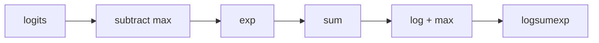

# 05 — Tensor Math, Linear Algebra, and Numerics

> **Prerequisites:** modules 02–04.
> **You will learn:** reductions and their dtype rules; the matmul family and its
> `2·m·n·k` FLOP count; `torch.linalg` and why `solve` beats an inverse; FFT,
> special functions and complex tensors; sparse, nested and masked layouts; and
> floating-point error, from non-associativity to stable `logsumexp`.

Modules 02–04 covered what a tensor *is*; this one covers what you *compute* with
it. A Transformer is pointwise maps, reductions and matrix multiplies, and knowing
which is which tells you where FLOPs, bytes and precision go.

The second half is numerics. Floating-point numbers are not real numbers: addition
is not associative, subtraction of nearly equal quantities destroys digits, and
`exp` overflows at 89 in `torch.float32`. Stable softmax, cross-entropy on logits
and LayerNorm variance are workarounds for these facts. The
[PyTorch notes](../../notes/libraries/pytorch.md) give the overview; this module
goes deeper.

---

## 5.1 Elementwise operations and ufunc-style semantics

A pointwise op maps each element independently: `torch.exp`, `a * b`,
`torch.clamp(x, min=0)`, `torch.where(cond, a, b)`. Binary ops broadcast with the
rules from [module 04](./04-indexing-broadcasting-shapes.md) and promote dtypes
per module 02. Comparisons return `torch.bool`, so `(x > 0).sum()` is a count.

Every Python operator is sugar for a function: `a + b` is `torch.add`, `a * b` is
`torch.mul`, `a @ b` is `torch.matmul`, `-a` is `torch.neg`, `a ** 2` is
`torch.pow`; profiler traces (module 21) show `aten::add` and `aten::matmul`.

Two traps. First, `torch.where` evaluates **both** branches everywhere.
`torch.where(x > 0, x.log(), 0.)` hides `log(0) = -inf` in the forward pass, but
at `x == 0` the backward multiplies a zero mask by `1/x = inf` and returns `nan`.
Sanitise the dangerous branch's input instead:
`torch.where(x > 0, x.clamp_min(1e-12).log(), 0.)`.

Second, equality of floats. `torch.isclose(a, b)` tests
$|a - b| \le \text{atol} + \text{rtol}\cdot|b|$ with fixed defaults
(`rtol=1e-5`, `atol=1e-8`) regardless of dtype. For tests, prefer
`torch.testing.assert_close`: it picks tolerances by dtype (in 2.8:
`float32` rtol 1.3e-6 / atol 1e-5, `float64` 1e-7 / 1e-7, `bfloat16` 1.6e-2 /
1e-5), checks shape, dtype and device, and prints the worst mismatch.
[Module 18](./18-debugging-and-testing.md) builds on it.

Cost model: a pointwise op does a few FLOPs per element but reads and writes
every element: on an `(8, 128, 512)` float32 activation, 2 MiB in and 2 MiB out.
Pointwise ops are **memory-bound** (time ≈ bytes / bandwidth), which is why
profiling (module 21) and fusion with
`torch.compile` ([module 23](./23-torch-compile-in-practice.md)) target them.

## 5.2 Reductions

A [reduction](https://docs.pytorch.org/docs/2.8/torch.html) collapses one or more dimensions: `sum`, `mean`, `prod`, `amax`,
`amin`, `max`, `min`, `argmax`, `std`, `var`, `logsumexp`, `norm`. Scans
(`cumsum`, `cumprod`) keep the dimension but accumulate along it.

`dim` takes an int or a tuple; `keepdim=True` keeps size-1 dims so the result
broadcasts back:

```python
x = torch.ones(2, 3, 4)
x.sum(dim=(0, 2), keepdim=True).shape   # torch.Size([1, 3, 1])
x - x.mean(dim=-1, keepdim=True)        # centring, shape (2, 3, 4)
```

Without `keepdim`, `x - x.mean(-1)` aligns `(2, 3)` against `(2, 3, 4)` from the
right: an error if lucky, silently wrong if sizes happen to match.

`max`/`min` with `dim` return a namedtuple `(values, indices)`, so
`vals, idx = logits.max(dim=-1)` gives greedy tokens. `amax`/`amin` return values
only, accept a tuple of dims, and split the gradient evenly between tied maxima;
`max(dim)` sends it to one index.

`std` and `var` take `correction` (default 1, Bessel's $N-1$); `correction=0` is
the population statistic. The old `unbiased=False` still works and means
`correction=0`. LayerNorm uses the population variance, so if you reimplement it
with `x.var(-1)` you are off by a factor $N/(N-1)$. Measured on
`[1., 2., 3., 4.]`: `std()` is 1.2910 and `std(correction=0)` is 1.1180.

The dtype rules are the part people get wrong:

| Reduction | Input → output dtype | Notes |
|---|---|---|
| `sum`, `prod`, `cumsum`, `cumprod` | bool / any int → `torch.int64`; float keeps its dtype | `mask.sum()` cannot overflow `uint8` |
| `mean` | float/complex only | int input raises `could not infer output dtype` |
| `std`, `var` | float/complex only | `correction=1` default |
| `amax`, `amin`, `max`, `min` | keeps input dtype (`int32` stays `int32`) | `max(dim)` adds `indices` as `int64` |
| `argmax`, `argmin` | `torch.int64` | ties: the docs return the first maximal index |
| `logsumexp` | int input promoted to float (`int32` → `float32`) | stable by construction (5.9) |
| `linalg.vector_norm` | float/complex only | `ord=2` default |

All verified on CPU with 2.8.0. For a wider accumulator, `x.sum(dtype=torch.float64)`
casts before reducing.

## 5.3 The matmul family and its cost

| Function | Shapes | Broadcasting | Use |
|---|---|---|---|
| `torch.mm(a, b)` | `(m, k) @ (k, n)` | none, 2-D only | explicit 2-D GEMM |
| `torch.bmm(a, b)` | `(b, m, k) @ (b, k, n)` | none, 3-D only, batch sizes equal | batched heads you already flattened |
| `torch.matmul(a, b)`, `a @ b` | 1-D to N-D | batch dims broadcast | default choice |
| `torch.addmm(c, a, b, beta, alpha)` | `β·c + α·(a @ b)` | `c` broadcasts | fused bias add, what `F.linear` lowers to |
| `torch.baddbmm(c, a, b)` | batched `addmm` | `c` broadcasts | attention scores with an additive bias |
| `F.linear(x, W, b)` | `x @ W.T + b` | leading dims of `x` | `nn.Linear` |

`matmul`'s rule set, derived rather than memorised:

1. If an argument is 1-D, it is promoted: the first argument gets a 1 **prepended**
   (`(k,)` → `(1, k)`, a row vector), the second gets a 1 **appended**
   (`(k,)` → `(k, 1)`, a column vector). After the multiply the promoted dimension
   is removed. Hence `(3,) @ (3, 4)` → `(1, 4)` → `(4,)` and `(3,) @ (3,)` is a
   0-d dot product.
2. The last two dimensions are the matrix dimensions and must satisfy the
   `(m, k) @ (k, n)` contract.
3. All dimensions before the last two are batch dimensions and broadcast with the
   module 04 rules. `(5, 1, 3, 4) @ (2, 4, 6)`: batch shapes `(5, 1)` and `(2,)`
   broadcast to `(5, 2)`, so the result is `(5, 2, 3, 6)`. A plain 2-D weight
   `(4, 6)` broadcasts against any batch, which is how
   `(2, 5, 3, 4) @ (4, 6)` → `(2, 5, 3, 6)` works.

`bmm` does none of this: it rejects non-3-D input (`batch1 must be a 3D tensor`)
and unequal batch sizes even when they would broadcast, a useful strictness.

`nn.Linear(in_features, out_features)` stores `weight` as `(out, in)`, and
`F.linear` computes $y = xW^\top + b$; weights from a framework that stores
`(in, out)` must be transposed on load
([module 11](./11-linear-embedding-conv-recurrent-layers.md)).

### Matmul from scratch, three ways

The fast.ai route to matmul makes the shape rules concrete. For `a` of shape
`(m, k)` and `b` of shape `(k, n)`:

```python
# teaching fragment; all three matched a @ b within 1e-5 on (64, 32) @ (32, 48)
c1 = torch.zeros(m, n)                       # 1. Python loops: one dot per output
for i in range(m):
    for j in range(n):
        c1[i, j] = (a[i] * b[:, j]).sum()
c2 = (a[:, :, None] * b[None, :, :]).sum(1)  # 2. broadcast (m,k,1)*(1,k,n) -> (m,k,n), sum k
c3 = torch.einsum("ik,kj->ij", a, b)         # 3. einsum: k absent from output, so summed
```

Version 2 is module 04's broadcasting with a reduction: correct, but it
materialises an `(m, k, n)` intermediate, $k$ times the output. Version 1 pays
Python overhead per element: one local CPU run took 11.6 ms against 1.6 µs for
`a @ b`. A BLAS GEMM avoids both by tiling the $k$ loop through cache and
registers, which is why every real model calls `matmul`.

### Counting FLOPs and bytes

Each of the $m \cdot n$ outputs of an `(m, k) @ (k, n)` product is a length-$k$ dot
product: $k$ multiplies and $k$ adds. So

$$\text{FLOPs} = 2mnk,\qquad \text{bytes} \ge (mk + kn + mn)\cdot s$$

where $s$ is bytes per element. Their ratio is the **arithmetic intensity**;
compare it to the hardware's FLOPs-per-byte ridge to decide whether a kernel is
compute- or memory-bound (the
[roofline lesson](/courses/inference/00-foundations/00-04-roofline-and-arithmetic-intensity.html)
and [module 21](./21-profiling-and-benchmarking.md)). For `x` of shape
`(B, T, d_model)` hitting a weight, $m = B\cdot T$ because the leading dims flatten.

At the capstone-like setting `(B, T, d_model) = (8, 128, 128)`, `d_ff = 512`,
so `m = 1024`:

| Op in one block | Product | FLOPs |
|---|---|---|
| fused QKV projection | `(1024, 128) @ (128, 384)` | 100.7 M |
| scores `Q Kᵀ` (all heads) | $2 \cdot B \cdot T^2 \cdot d_{model}$ | 33.6 M |
| `softmax(S) V` (all heads) | same shape count | 33.6 M |
| output projection | `(1024, 128) @ (128, 128)` | 33.6 M |
| MLP up | `(1024, 128) @ (128, 512)` | 134.2 M |
| MLP down | `(1024, 512) @ (512, 128)` | 134.2 M |
| **total** | | **469.8 M** |

The MLP is 57 % of block FLOPs at this width. Its up-projection in float32 moves
at least $(1024\cdot128 + 128\cdot512 + 1024\cdot512)\cdot 4 = 2{,}883{,}584$
bytes, an intensity of 46.5 FLOPs/byte. The GELU in between reads and writes the
same `(1024, 512)` tensor for a few FLOPs per element: intensity well under 1,
negligible in FLOPs but bandwidth-bound in time.

## 5.4 torch.linalg

[`torch.linalg`](https://docs.pytorch.org/docs/2.8/linalg.html) mirrors `numpy.linalg` ([NumPy notes](../../notes/libraries/numpy.md))
and batches over leading dims: `(B, n, n)` gives `B` independent decompositions.
Theory: [linear algebra notes](../../notes/math/linear-algebra.md).

| Function | Use |
|---|---|
| `vector_norm`, `matrix_norm` | gradient-clipping norms (`ord=2`), Frobenius norms of weights |
| `det`, `slogdet` | log-likelihoods of Gaussians; `slogdet` because `det` overflows |
| `solve(A, B)` | $AX = B$ via LU with partial pivoting |
| `lstsq(A, B)` | overdetermined least squares, linear probes |
| `cholesky` | SPD factor $LL^\top$; add `eps·I` jitter for merely PSD covariances |
| `qr` | orthonormal bases, orthogonal init (`nn.init.orthogonal_`) |
| `eigh` / `eigvalsh` | symmetric/Hermitian: real eigenvalues, **ascending** order |
| `eig` | general matrices: always complex output (`torch.complex64` for `float32` input) |
| `svd` / `svdvals` | low-rank structure, LoRA analysis, spectral norms |
| `inv`, `pinv` | explicit (pseudo)inverse; rarely what you want |
| `matrix_exp` | continuous-time dynamics, orthogonal parametrisations |
| `cond` | the number that predicts how many digits a solve loses |

**Prefer `solve` to `inv`.** The `linalg.inv` docs: `solve` "is faster and more
numerically stable than computing the inverse explicitly". Cost: LU factorisation is about $\tfrac{2}{3}n^3$ FLOPs and the two
triangular solves are $O(n^2)$ per right-hand side; forming $A^{-1}$ costs about
$2n^3$, three times the work, before you multiply. On a 1000×1000 `float64`
system, one local CPU run measured 5.4 ms for `solve` against 10.7 ms for
`inv(A) @ b`. Stability: LU with pivoting is backward stable, so its answer
exactly solves a nearby system and its residual
$\|Ax - b\|$ is on the order of machine epsilon times $\|A\|\|x\|$. The explicit
inverse carries an error proportional to $\kappa(A)$ into the multiply, so its
residual can be larger by up to a condition-number factor.

That describes the method, not every right-hand side. On the 8×8 Hilbert matrix ($\kappa \approx 1.5\times10^{10}$), `solve` had the smaller
residual for 72 of 100 seeded right-hand sides in a local run; seed 1 went the
other way. Tests should assert it for a fixed seed and say so.

**Eigen and singular vectors are not unique.** Flipping the sign of an eigenvector
(or of a pair of singular vectors) gives another valid answer, and the docs warn
that different hardware may return different ones. Compare reconstructions
(`U @ diag(S) @ Vh` against `A`) or subspaces, never raw factors. When eigenvalues
or singular values are close or repeated, the gradients of `eigh` and `svd` involve
$1/(\lambda_i - \lambda_j)$ terms and blow up; if you only need the values, use
`eigvalsh`/`svdvals`, whose gradients the docs call "always numerically stable".

## 5.5 FFT, special functions, signal windows

[`torch.fft`](https://docs.pytorch.org/docs/2.8/fft.html) follows NumPy. For real signals `rfft` returns the
$\lfloor n/2 \rfloor + 1$ non-redundant bins (16 samples → 9); invert with
`irfft(X, n=16)`, passing `n` or odd lengths come back one short. `norm="backward"` (default) puts the
$1/n$ on the inverse, `"ortho"` splits $1/\sqrt{n}$ across both and makes the
transform unitary, `"forward"` puts $1/n$ on the forward.

The reason to care is the **convolution theorem**: circular convolution in time is
pointwise multiplication in frequency,

$$(a \circledast b)[t] = \sum_{k=0}^{n-1} a[k]\, b[(t-k) \bmod n]
\quad\Longleftrightarrow\quad \mathcal{F}(a \circledast b) = \mathcal{F}(a)\cdot\mathcal{F}(b),$$

turning $O(n^2)$ into $O(n \log n)$; zero-pad to $2n$ for linear convolution.

[`torch.special`](https://docs.pytorch.org/docs/2.8/special.html) holds careful versions of functions you could write naively:

| Function | Naive version | Why the special one |
|---|---|---|
| `log1p(x)`, `expm1(x)` | `log(1+x)`, `exp(x)-1` | at `x = 1e-10` in float32 the naive forms return 0; these return `1e-10` (measured) |
| `xlogy(x, y)` | `x * log(y)` | defines `0·log 0 = 0` (naive gives `nan`); entropy terms |
| `expit`, `logit` | `1/(1+exp(-x))`, `log(p/(1-p))` | sigmoid and its inverse with stable tails |
| `erf`, `erfinv` | none in plain Python | exact GELU is $x\,\Phi(x)$ with $\Phi$ via `erf` |
| `gammaln` | `log(gamma(x))` | `gamma` overflows past ~35 in float32 |
| `logsumexp` | `log(sum(exp(x)))` | 5.9 |

[`torch.signal.windows`](https://docs.pytorch.org/docs/2.8/signal.html) provides `hann`, `hamming`, `kaiser` and friends; they
default to `sym=True` (`hann(4)` = `[0, .75, .75, 0]`).

## 5.6 Complex numbers

`torch.complex64` and `torch.complex128` are first-class dtypes; `.real`/`.imag`
are views, `.abs()`/`.angle()` give polar form. `torch.view_as_real(z)` reinterprets a complex tensor of shape `S` as
a real tensor of shape `(*S, 2)` and `torch.view_as_complex` goes back, both
zero-copy (they share storage; the last dim must have stride 1 for the reverse).

`z.conj()` is lazy: it sets a conjugate bit on a view (`z.conj().is_conj()` is
`True`) that kernels read, so `A.conj().T @ B` needs no copy; `resolve_conj()`
materialises it.

The motivating use is RoPE ([positional encodings](../transformers/05-positional-encodings.md)):
pair up features, treat each pair as a complex number, multiply by
$e^{i\,m\theta_j}$, unpack.

```python
# teaching fragment: RoPE via complex multiply, q is (B, H, T, d_head)
qc = torch.view_as_complex(q.float().reshape(*q.shape[:-1], -1, 2))  # (B,H,T,d_head/2)
freqs = torch.polar(torch.ones_like(angles), angles)                   # (T, d_head/2)
q_rot = torch.view_as_real(qc * freqs).flatten(-2).type_as(q)          # (B,H,T,d_head)
```

Autograd works for complex tensors and computes the **conjugate Wirtinger**
derivative, whose negative is the steepest-descent direction for a real loss, so
existing optimisers apply unchanged
([complex numbers docs](https://docs.pytorch.org/docs/2.8/complex_numbers.html)).

## 5.7 Sparse, nested and masked tensors (overview)

Dense tensors store every element. [Sparse](https://docs.pytorch.org/docs/2.8/sparse.html), [nested](https://docs.pytorch.org/docs/2.8/nested.html) and [masked](https://docs.pytorch.org/docs/2.8/masked.html) tensors relax that:

| Layout | What it stores | Worth it when |
|---|---|---|
| `torch.sparse_coo` | indices `(ndim, nnz)` + values | very high sparsity, irregular patterns, graph adjacency |
| `torch.sparse_csr` / `sparse_csc` | compressed row/col pointers + indices + values | sparse-dense matmul at very high sparsity |
| `torch.sparse_bsr` / `sparse_bsc` | the same over dense blocks | block-sparse weights; blocks keep tensor-core-friendly tiles |
| semi-structured 2:4 (`to_sparse_semi_structured`) | 2 of every 4 values + metadata | 50 % weight sparsity on Ampere+ GPUs ([module 29](./29-quantization-and-compression.md)); not executed here |
| `torch.nested` with `layout=torch.jagged` | packed values + offsets | variable-length sequences without padding |
| `torch.masked.MaskedTensor` | data + boolean mask | masked reductions with explicit semantics; **prototype** API |

Sparse formats pay index overhead and irregular memory access, so they win only
at high sparsity or with a kernel built for the structure; otherwise dense wins
(a rule of thumb, not benchmarked here). Nested tensors matter for LLM work:
`torch.nested.nested_tensor([a, b], layout=torch.jagged)`
with `a` of shape `(2, 4)` and `b` of shape `(5, 4)` reports shape `(2, j1, 4)`,
where `j1` is a symbolic ragged dimension, and SDPA can consume it without padding
([module 12](./12-normalization-dropout-attention-layers.md)). MaskedTensor is a
prototype: explore with it, do not depend on it.

## 5.8 Floating point is not real arithmetic

A float32 has a 24-bit significand: about 7 decimal digits. Adding 1 to $10^8$
needs the 27th bit, so `(1e8 + 1) - 1e8` is `0` in float32 and `1` in float64.
Addition is commutative but not associative. References: Goldberg,
["What Every Computer Scientist Should Know About Floating-Point Arithmetic"](https://doi.org/10.1145/103162.103163);
Higham, *Accuracy and Stability of Numerical Algorithms*; the
[numerical methods notes](../../notes/math/numerical-methods.md); the inference
course's [numerics lesson](/courses/inference/00-foundations/00-05-numerics.html).

### Summation order

A sequential sum's error bound grows like $n$, because each small addend is
rounded against a large accumulator; pairwise (tree) summation grows like
$\log n$. PyTorch reductions are blocked and tree-shaped. One local CPU run summing $10^6$ copies of `0.1` in float32:

```python
# measured locally on CPU, PyTorch 2.8.0; teaching fragment
v = torch.full((10**6,), 0.1)
v.sum()                  # 100000.015625  (blocked/tree reduction)
# sequential np.float32 loop  ->  100958.34
v.double().sum()         # 100000.0015
```

The sequential loop is wrong in the fourth significant digit.

### Why devices and thread counts disagree

The tree shape depends on thread count, vector width, and on GPU the block size
and SM count. Different trees round differently. Summing the same $10^6$ seeded normals locally gave `-984.28638` with one thread
and `-984.28656` with six. The
[numerical accuracy note](https://docs.pytorch.org/docs/2.8/notes/numerical_accuracy.html)
says bitwise identical results are not guaranteed across releases, platforms,
or CPU vs GPU; batched results may differ from slice-by-slice ones; extremal
values and denormals can behave differently per backend; and on Ampere+ GPUs
matmuls may run in TF32 with a 10-bit mantissa (not executed here;
[module 17](./17-mixed-precision.md)). A CPU-vs-GPU `torch.equal` test checks the
reduction tree, not your code; use `assert_close` with tolerances justified by
dtype and reduction length. Determinism settings ([module 06](./06-randomness-and-reproducibility.md)) can make one
machine repeatable; they do not make two machines agree.

### Catastrophic cancellation

Subtracting two nearly equal numbers keeps their absolute error and discards
their leading digits. The textbook variance formula
$\mathrm{Var}(x) = E[x^2] - E[x]^2$ subtracts two numbers near $10^8$ when
$x \approx 10^4$; in float32 the difference has no correct digits left. The
two-pass formula $E[(x - \bar x)^2]$ subtracts the mean first, and Welford's
one-pass update does the same incrementally:

```python
# teaching fragment: Welford's online mean/variance
n, mean, m2 = 0, 0.0, 0.0
for v in stream:
    n += 1
    delta = v - mean
    mean += delta / n
    m2 += delta * (v - mean)
var_pop = m2 / n
```

Locally, for 10,000 float32 samples of `1e4 + 0.1·N(0,1)`, the naive formula
returned 16.0, `torch.var(correction=0)` 0.0100382, and the float64 two-pass
reference 0.0100374: a 1600× error from one subtraction. This is why
normalisation kernels never use $E[x^2]-E[x]^2$ in low precision.

## 5.9 Stable softmax, logsumexp, and log_softmax

`exp(89.)` already overflows float32 (max ≈ $3.4\times10^{38}$), and logits in
the hundreds appear with bad initialisation or scaling. Naively,
`softmax([1000, 1000])` is `inf / inf = nan`.

The fix is one identity. For any constant $m$,

$$\log\sum_i e^{x_i} = \log\Big(e^{m}\sum_i e^{x_i - m}\Big) = m + \log\sum_i e^{x_i - m}.$$

Choose $m = \max_i x_i$: every exponent is $\le 0$, so nothing overflows, and the
largest term is $e^0 = 1$, so the log cannot be $-\infty$. Softmax gets the same treatment, since
$\mathrm{softmax}(x)_i = e^{x_i - m} / \sum_j e^{x_j - m}$.



Shifting fixes overflow but not underflow of the *output*. For `x = [0., -200.]`,
$e^{-200} \approx 10^{-87}$ is below float32's smallest subnormal, so
`softmax(x)` is `[1., 0.]` and `softmax(x).log()` is `[0., -inf]`. A `-inf`
log-probability times a zero target is `nan` in a loss. `log_softmax` never forms
the probability: it computes $x_i - \mathrm{logsumexp}(x)$ directly and returns
`[0., -200.]`, the exact answer.

This is why `F.cross_entropy` takes **logits**, not probabilities: it fuses
`log_softmax` with the negative log-likelihood so no probability is ever
materialised ([module 13](./13-initialization-and-losses.md)). Attention uses the
same max-subtraction inside its softmax
([self-attention from scratch](../transformers/03-self-attention-from-scratch.md)),
and FlashAttention's online softmax is this identity applied block by block.

## Worked numerics verification

Five `pytorch-check` fences, CPU only, each well under 0.1 s locally. **Tested with Python 3.11 and PyTorch 2.8.0 on CPU.**

**Fence 1: matmul rules.** Proves the 1-D promotion and batch-broadcast rules,
`F.linear = x @ W.T + b` with an `(out, in)` weight, and `bmm` refusing 2-D
input. Says nothing about performance or kernel choice.

```python pytorch-check
import torch
import torch.nn.functional as F

torch.manual_seed(0)
assert (torch.randn(3) @ torch.randn(3, 4)).shape == (4,)                 # 1-D prepend, then drop
assert (torch.randn(3, 4) @ torch.randn(4)).shape == (3,)                 # 1-D append, then drop
assert (torch.randn(2, 5, 3, 4) @ torch.randn(4, 6)).shape == (2, 5, 3, 6)
assert (torch.randn(5, 1, 3, 4) @ torch.randn(2, 4, 6)).shape == (5, 2, 3, 6)  # (5,1) x (2,) -> (5,2)

x = torch.randn(8, 16, 32)          # (B, T, in)
W = torch.randn(64, 32)             # (out, in), the nn.Linear layout
b = torch.randn(64)
y = F.linear(x, W, b)
assert y.shape == (8, 16, 64)
torch.testing.assert_close(y, x @ W.T + b, rtol=1e-5, atol=1e-5)

try:
    torch.bmm(torch.randn(3, 4), torch.randn(4, 5))
    raise AssertionError("bmm accepted 2-D input")
except RuntimeError as e:
    assert "3D" in str(e)
print("matmul rules ok:", tuple(y.shape))
```

**Fence 2: solve vs inverse, SVD, eigh.** Proves that for one seeded `b` on the
8×8 Hilbert matrix `solve`'s residual is no larger than `inv(A) @ b`'s, that the SVD
reconstructs `A`, and that `eigh` is ascending. It does not prove `solve` wins for
every `b` (72 of 100 seeds), and compares no factors, since they are not unique.

```python pytorch-check
import torch

n = 8
i = torch.arange(n, dtype=torch.float64)
A = 1.0 / (i[:, None] + i[None, :] + 1.0)          # Hilbert matrix, cond ~ 1.5e10
g = torch.Generator().manual_seed(0)
b = torch.randn(n, 1, generator=g, dtype=torch.float64)

x_solve = torch.linalg.solve(A, b)
x_inv = torch.linalg.inv(A) @ b
r_solve = torch.linalg.vector_norm(A @ x_solve - b)
r_inv = torch.linalg.vector_norm(A @ x_inv - b)
# single conditioned example with a fixed seed, not a universal law
assert r_solve <= r_inv, (r_solve.item(), r_inv.item())
assert torch.linalg.cond(A) > 1e9

U, S, Vh = torch.linalg.svd(A)
torch.testing.assert_close(U @ torch.diag(S) @ Vh, A, rtol=0, atol=1e-10)

evals = torch.linalg.eigh(A).eigenvalues
assert torch.all(evals[1:] >= evals[:-1])
print(f"residual solve={r_solve.item():.2e} inv={r_inv.item():.2e}")
```

**Fence 3: convolution theorem and complex views.** Proves FFT circular
convolution matches a direct loop to 1e-10 in float64, and that
`view_as_real`/`view_as_complex` round-trip on shared storage. Does not cover
linear convolution or `norm=` modes.

```python pytorch-check
import torch

g = torch.Generator().manual_seed(1)
n = 16
a = torch.randn(n, generator=g, dtype=torch.float64)
b = torch.randn(n, generator=g, dtype=torch.float64)

direct = torch.zeros(n, dtype=torch.float64)
for t in range(n):
    for k in range(n):
        direct[t] += a[k] * b[(t - k) % n]

via_fft = torch.fft.irfft(torch.fft.rfft(a) * torch.fft.rfft(b), n=n)
assert torch.fft.rfft(a).shape == (n // 2 + 1,)
torch.testing.assert_close(via_fft, direct, rtol=0, atol=1e-10)

z = torch.randn(4, generator=g, dtype=torch.complex64)
r = torch.view_as_real(z)
assert r.shape == (4, 2)
z2 = torch.view_as_complex(r)
assert z2.data_ptr() == z.data_ptr()
r[0, 0] = 42.0
assert z[0].real.item() == 42.0                     # same storage
print("convolution theorem ok:", round(via_fft.sum().item(), 6))
```

**Fence 4: non-associativity and cancellation.** Proves the `1e8 + 1` example in
both dtypes, and that naive float32 variance is over 10× further from the float64
reference than `torch.var` or a float32 Welford pass. It asserts no exact error
size, which depends on the platform's reduction tree.

```python pytorch-check
import numpy as np
import torch

big32 = torch.tensor(1e8, dtype=torch.float32)
assert ((big32 + 1) - 1e8).item() == 0.0
big64 = torch.tensor(1e8, dtype=torch.float64)
assert ((big64 + 1) - 1e8).item() == 1.0

g = torch.Generator().manual_seed(0)
x = 1e4 + 0.1 * torch.randn(4096, generator=g)             # float32
x64 = x.double()
ref = ((x64 - x64.mean()) ** 2).mean()                      # float64 two-pass

naive = (x * x).mean() - x.mean() ** 2
lib = x.var(correction=0)

mean, m2 = np.float32(0), np.float32(0)
for k, v in enumerate(x.numpy(), start=1):                  # float32 Welford
    delta = v - mean
    mean = mean + delta / np.float32(k)
    m2 = m2 + delta * (v - mean)
welford = torch.tensor(m2 / np.float32(len(x)), dtype=torch.float64)

err = lambda est: (est.double() - ref).abs() / ref
assert err(naive) > 10 * err(lib), (err(naive).item(), err(lib).item())
assert err(naive) > 10 * err(welford), (err(naive).item(), err(welford).item())
print(f"rel err naive={err(naive).item():.2e} var={err(lib).item():.2e} welford={err(welford).item():.2e}")
```

**Fence 5: stable logsumexp.** Proves the naive overflow, that
`logsumexp([1000, 1000]) = 1000 + log 2` matches the derivation, and that
`softmax(x).log()` hits `-inf` where `log_softmax` stays exact. Does not test
gradients or reduced precision.

```python pytorch-check
import math
import torch

x = torch.tensor([1000.0, 1000.0])
assert torch.isinf(x.exp().sum().log())                     # exp(1000) = inf
lse = torch.logsumexp(x, dim=0)
torch.testing.assert_close(lse, torch.tensor(1000.0 + math.log(2.0)))

m = x.max()
manual = m + (x - m).exp().sum().log()                      # the derivation
torch.testing.assert_close(manual, lse)

y = torch.tensor([0.0, -200.0], dtype=torch.float32)
naive = torch.softmax(y, dim=0).log()
stable = torch.log_softmax(y, dim=0)
assert torch.isneginf(naive[1])
assert torch.isfinite(stable).all()
torch.testing.assert_close(stable, torch.tensor([0.0, -200.0]), rtol=0, atol=1e-6)
print("logsumexp:", round(lse.item(), 4), "log_softmax:", stable.tolist())
```

## Key takeaways

- Pointwise ops are memory-bound; matmuls carry the FLOPs (the MLP is 268 M of a
  block's 470 M at `(8, 128, 128)`).
- Reductions: `sum` of bool/int is `int64`, `mean`/`std`/`var` demand float,
  `max(dim)` returns `(values, indices)`, `correction=1` is the default.
- `matmul` promotes 1-D operands (prepend for the first, append for the second),
  then broadcasts batch dims; `bmm` does neither. `nn.Linear` weights are
  `(out, in)`.
- Use `solve`, not `inv`: a third of the work of forming $A^{-1}$ and a
  backward-stable residual. Assert it per seed, not as a law.
- Never compare eigen/singular vectors directly; compare reconstructions.
- Naive `log(softmax)`, `log(1+x)` and $E[x^2]-E[x]^2$ lose digits or emit
  `inf`/`nan`; use `log_softmax`, `torch.special`, two-pass variance.
- Different reduction trees give different bits. CPU vs GPU, thread count and
  batch shape all change the tree; tests need `assert_close` with tolerances.

## Self-check

1. Count the FLOPs of `x @ W.T` for `x` of shape `(B, T, d_model)` and `W` of shape
   `(d_ff, d_model)`, then for the whole capstone MLP (two matmuls). Why is the
   elementwise GELU between them usually not the bottleneck in FLOPs but can be in
   time?
2. Your unit test compares a CPU and a GPU reduction with `torch.equal` and fails
   intermittently. Explain why and what you replace it with.
3. Derive the stable `logsumexp` and show where naive `log(softmax(x))` fails while
   `log_softmax` does not.

---

**Next → [06 — Randomness, Distributions, and Reproducibility](./06-randomness-and-reproducibility.md)**
