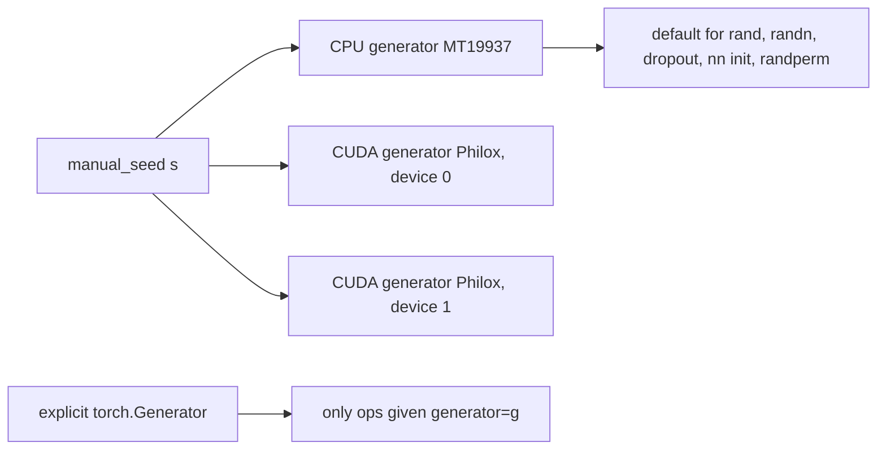

# 06 — Randomness, Distributions, and Reproducibility

> **Prerequisites:** module 05.
> **You will learn:** how PyTorch's global and explicit `torch.Generator` RNGs work (MT19937 on CPU, Philox on CUDA, per-device state, `get_rng_state`/`set_rng_state`, `fork_rng`); the sampling ops and which accept a `generator`; `torch.distributions` (`sample` vs `rsample`, `log_prob`, `entropy`, `kl_divergence`, constraints and transforms); what "reproducible" can and cannot mean across runs, threads, devices and versions; and a seeding recipe for training that modules 14, 16 and 33 reuse.

A training run is a chain of random draws: init, shuffling, dropout, augmentation, sampling. "Set the seed" is a third of the answer to making it repeatable. The rest is *which* generator each draw comes from, and whether the arithmetic downstream is deterministic.

This module treats randomness as state you own: the global generator is shared mutable state any library call can advance, explicit generators decouple streams, and bitwise reproducibility holds only under narrow conditions. The [PyTorch library notes](../../notes/libraries/pytorch.md) cover seeding in a paragraph; this module goes down to the generator state.

---

## 6.1 Pseudo-random generators in PyTorch

A PRNG is a deterministic map from state to (output, next state); seeding writes a known state. PyTorch has two engines:

- **CPU: MT19937** (Mersenne Twister). The default CPU generator is an `at::mt19937` engine ([`CPUGeneratorImpl.h`](https://github.com/pytorch/pytorch/blob/v2.8.0/aten/src/ATen/CPUGeneratorImpl.h)). Its serialized state, `torch.random.get_rng_state()`, is a `torch.uint8` tensor of 5,056 bytes (measured). MT19937 is sequential: reaching the millionth number means generating the ones before it.
- **CUDA: Philox4x32-10**, one generator per device ([`CUDAGeneratorImpl.h`](https://github.com/pytorch/pytorch/blob/v2.8.0/aten/src/ATen/cuda/CUDAGeneratorImpl.h)). Philox is *counter-based* ([Salmon et al. 2011](https://doi.org/10.1145/2063384.2063405)): output = bijection(key = seed, counter). The state is just `(seed, offset)`. Each kernel launch reserves counters by bumping `philox_offset_per_thread`; every GPU thread computes its numbers from `(seed, thread id, offset)` independently. Skip-ahead is free, so thousands of threads draw without sharing state, and CUDA graphs capture RNG kernels by recording an offset increment. (Described from source; not executed here.)

The **default CPU generator is seeded non-deterministically at process start** (`getNonDeterministicRandom()` in [`CPUGeneratorImpl.cpp`](https://github.com/pytorch/pytorch/blob/v2.8.0/aten/src/ATen/CPUGeneratorImpl.cpp)), so unseeded processes differ. A fresh `torch.Generator()` instead starts at the fixed seed `67280421310721` (measured via `initial_seed()`): reproducible by accident. Seed it anyway.

The global API, from the [random docs](https://docs.pytorch.org/docs/2.8/random.html):

| Call | Effect |
|---|---|
| `torch.manual_seed(s)` | seeds the CPU generator **and** every CUDA device's generator; returns the CPU generator |
| `torch.seed()` | re-seeds all devices non-deterministically, returns the 64-bit seed used |
| `torch.initial_seed()` | the seed of the default CPU generator only |
| `torch.random.get_rng_state()` / `set_rng_state(t)` | snapshot / restore CPU state (`uint8` tensor) |
| `torch.cuda.get_rng_state_all()` / `set_rng_state_all` | the same for every CUDA device |
| `torch.random.fork_rng(devices=...)` | context manager: snapshot on entry, restore on exit |

`fork_rng` always forks the CPU state and, by default, every visible CUDA device (slow with many devices, the docs warn), so pass `devices=[...]`; an empty list means CPU only. Its purpose is containment: draws inside the block leave the caller's stream where it was.



## 6.2 Explicit generators: the reproducible way

```python
g = torch.Generator().manual_seed(0)          # CPU; torch.Generator(device="cuda") for GPU
x = torch.randn(4, 8, generator=g)
perm = torch.randperm(1000, generator=g)
```

([`torch.Generator`](https://docs.pytorch.org/docs/2.8/generated/torch.Generator.html) also exposes `get_state`/`set_state`, `clone_state`, and `graphsafe_get_state`/`graphsafe_set_state` for CUDA graph capture.)

The argument is coupling. With one global stream, each consumer's draws depend on how many draws came before. Model init calls `kaiming_uniform_` on the global RNG; the sampler then calls `randperm` on the same RNG. Widen a layer from 256 to 512 units and init consumes more numbers, so the shuffle changes: your model-size ablation silently changed the data order too. Give the sampler its own generator and the shuffle depends only on the data seed. Module 14 wires this into `DataLoader(generator=...)` and `RandomSampler(generator=...)` ([14 — Data Pipelines](./14-data-pipelines.md)).

For checkpointing, `g.get_state()` returns a `uint8` tensor you can save beside the model; `g.set_state(state)` replays the stream from exactly that point. That is how module 16 achieves bit-exact resume ([16 — Training Loop](./16-training-loop-checkpointing.md)).

Which APIs accept `generator=` (checked by signature or by calling in 2.8):

| API | `generator=`? | Note |
|---|---|---|
| `torch.rand`, `randn`, `randint`, `randperm`, `normal`, `poisson` | yes | |
| `torch.multinomial`, `torch.bernoulli` | yes | |
| `Tensor.uniform_`, `normal_`, `exponential_`, `bernoulli_`, `random_` | yes | in-place fills |
| `torch.nn.init.normal_`, `kaiming_uniform_`, ... | yes | but `nn.Linear.reset_parameters` calls them without one |
| `DataLoader`, `RandomSampler`, `random_split` | yes | `random_split` defaults to the **global** generator |
| `torch.rand_like`, `randn_like`, `randint_like` | **no** | `TypeError` in 2.8 |
| `F.dropout`, `nn.Dropout` | **no** | always the global (device) generator |
| `Distribution.sample` / `rsample` | **no** | uses the global generator |

The "no" rows are why the global seed still matters.

## 6.3 Sampling ops and tricks

**`torch.multinomial(probs, n, replacement=False)`** treats each row of `probs` as unnormalised non-negative weights; `[2., 6.]` means `[0.25, 0.75]`. It returns `torch.int64` indices. Without replacement it is a draw-without-replacement over categories, so `n` larger than the number of categories raises `cannot sample n_sample > prob_dist.size(-1) samples without replacement`, and an all-zero row raises `invalid multinomial distribution (sum of probabilities <= 0)` (both measured). In a sampling loop, that second error is how a fully masked top-k/top-p row announces itself.

`torch.bernoulli(p)` draws per-element 0/1 (dropout masks); `torch.randperm(n)` is a uniform permutation (shuffling); `Categorical(logits=...)` wraps the multinomial draw with `log_prob` and `entropy`.

### The Gumbel-max trick

If $G_i = -\log(-\log U_i)$ with $U_i \sim \mathrm{Uniform}(0,1)$ i.i.d., then $\arg\max_i (\ell_i + G_i)$ is distributed as $\mathrm{softmax}(\ell)$. Derivation in three lines:

1. The Gumbel CDF is $F(g) = \exp(-e^{-g})$, so $\ell_i + G_i$ has CDF $\exp(-e^{-(x-\ell_i)})$, density $f_i(x) = e^{-(x-\ell_i)} \exp(-e^{-(x-\ell_i)})$.
2. $P(k \text{ wins}) = \int f_k(x) \prod_{i\ne k} \exp(-e^{-(x-\ell_i)})\,dx = \int e^{\ell_k} e^{-x} \exp(-e^{-x} Z)\,dx$ with $Z = \sum_i e^{\ell_i}$.
3. Substitute $t = e^{-x}$: $\int_0^\infty e^{\ell_k} e^{-tZ}\,dt = e^{\ell_k}/Z$. $\blacksquare$

Sampling becomes an argmax over perturbed logits: no normalisation, one noise draw per logit, one reduction. PyTorch uses exactly this inside `multinomial`: in 2.8, a draw with `num_samples=1` or without replacement computes $q_i \sim \mathrm{Exp}(1)$ and returns $\arg\max_i p_i/q_i$ (`topk` for several samples without replacement), which is Gumbel-max after exponentiating, since $-\log U \sim \mathrm{Exp}(1)$ ([`Distributions.cpp` at v2.8.0](https://github.com/pytorch/pytorch/blob/v2.8.0/aten/src/ATen/native/Distributions.cpp)). With the same seeded generator, `multinomial(p, 1)` equalled `(p / q).argmax()` for 200 of 200 random `p` (measured). Draws with replacement and `num_samples > 1` take a different, CDF-based kernel. [Module 35](./35-capstone-generation-kv-cache.md) samples with `multinomial(probs, 1, generator=g)`, so its token draws are this exponential race. Replace the argmax with $\mathrm{softmax}((\ell + G)/\tau)$ and you get the Gumbel-softmax relaxation ([Jang et al. 2016](https://arxiv.org/abs/1611.01144)), `F.gumbel_softmax(logits, tau, hard)`; `hard=True` emits a one-hot forward and uses the soft gradient backward (straight-through). Biased but differentiable, it is the standard workaround for discrete latents. It takes no `generator`.

### Inverse-CDF sampling

If $F$ is an invertible CDF, $X = F^{-1}(U)$ has CDF $F$. For the exponential, $F(x) = 1 - e^{-\lambda x}$ gives `x = -torch.log1p(-torch.rand(n, generator=g)) / lam` (`log1p` keeps precision for tiny `U`). Gumbel noise is the same construction with $F^{-1}(u) = -\log(-\log u)$.

## 6.4 torch.distributions

The [distributions package](https://docs.pytorch.org/docs/2.8/distributions.html) gives every distribution the same interface ([`distribution.py`](https://github.com/pytorch/pytorch/blob/v2.8.0/torch/distributions/distribution.py)). The part that trips people is shapes. A distribution has a `batch_shape` (independent, differently parameterised distributions) and an `event_shape` (the shape of one draw). `sample(sample_shape)` returns `sample_shape + batch_shape + event_shape`, and `log_prob` reduces over `event_shape` only:

| Object | `batch_shape` | `event_shape` | `sample((5,)).shape` | `log_prob(x).shape` |
|---|---|---|---|---|
| `Normal(zeros(3,4), ones(3,4))` | `(3, 4)` | `()` | `(5, 3, 4)` | `(5, 3, 4)` |
| `Independent(that, 1)` | `(3,)` | `(4,)` | `(5, 3, 4)` | `(5, 3)` |

(Measured.) `Independent(d, k)` reinterprets the rightmost `k` batch dims as event dims, so `log_prob` sums over them: a diagonal Gaussian over a 4-vector with one log-density per batch element. Forgetting it is a silent bug: a `.mean()` loss then averages per-coordinate log-likelihoods instead of summing them, scaling the gradient by $1/4$.

The rest: `mean`, `variance`, `entropy()`, `cdf`/`icdf` where defined, and `kl_divergence(p, q)`, dispatched through a registry of closed forms (`@register_kl`) that raises `NotImplementedError` for unregistered pairs. `arg_constraints` and `support` are `constraints` objects (`Normal`'s scale is `GreaterThan(lower_bound=0.0)`). `TransformedDistribution(Normal(0., 1.), [ExpTransform()])` is a log-normal with the log-det-Jacobian handled, support `GreaterThan(0.0)`, and still `has_rsample=True`.

### sample vs rsample: the reparameterisation trick

We want $\nabla_\theta \mathbb{E}_{z\sim p_\theta}[f(z)]$.

**Pathwise (reparameterisation).** If $z = g_\theta(\epsilon)$ with $\epsilon$ from a parameter-free distribution, then $\mathbb{E}_{p_\theta}[f(z)] = \mathbb{E}_\epsilon[f(g_\theta(\epsilon))]$ and the gradient moves inside: $\mathbb{E}_\epsilon[\nabla_\theta f(g_\theta(\epsilon))]$. For a Gaussian, $z = \mu + \sigma\epsilon$, $\epsilon \sim \mathcal{N}(0,1)$, so $\partial z/\partial\mu = 1$ and $\partial z/\partial\sigma = \epsilon$, both defined. This is `rsample()` (only when `has_rsample`), what makes VAEs trainable ([Kingma & Welling 2013](https://arxiv.org/abs/1312.6114); see [generative models](../../notes/deep-learning/generative-models.md)). `sample()` runs under `torch.no_grad()` and returns a tensor with no history.

**Score function (REINFORCE).** From $\nabla_\theta p_\theta = p_\theta \nabla_\theta \log p_\theta$: $\nabla_\theta \mathbb{E}[f(z)] = \mathbb{E}[f(z)\,\nabla_\theta \log p_\theta(z)]$, i.e. `loss = -(f(z).detach() * d.log_prob(z)).mean()`. It needs only `log_prob` and works for discrete $z$, but $f(z)$ enters as a scalar weight rather than through its derivative, so variance is far higher; baselines tame it ([deep RL notes](../../notes/deep-learning/deep-rl.md)).

A categorical has no continuous $g_\theta$ (logits to integer is piecewise constant, gradient zero almost everywhere), so `Categorical.has_rsample is False`; the workarounds are score-function gradients or a relaxation such as Gumbel-softmax ([probability notes](../../notes/math/probability.md)).

**Validation cost.** Constructors check constraints by default (`Normal(0., -1.)` raises `ValueError`). In a hot loop, one local PyTorch 2.8 CPU run (Apple M2 Pro) measured about 20 µs per `Normal(mu, sd).log_prob(x)` on 8 elements with validation, 11 µs without. Pass `validate_args=False` or call `Distribution.set_default_validate_args(False)` (global state; restore it in tests).

## 6.5 What reproducibility means (and doesn't)

The [Reproducibility note](https://docs.pytorch.org/docs/2.8/notes/randomness.html) opens with the governing sentence: completely reproducible results are not guaranteed across PyTorch releases, individual commits, or different platforms, nor between CPU and GPU even with identical seeds.

| Level | Same bits? | What it takes |
|---|---|---|
| Same process, re-run a block | yes | restore generator state (`set_rng_state`, `g.set_state`) |
| New process, same machine, same build, same thread count | yes, with effort | seeds for every RNG + deterministic algorithms + fixed `num_workers` |
| Same machine, different `torch.get_num_threads()` | **not guaranteed** | parallel reductions split work differently |
| Different GPU model, driver, CUDA, cuDNN or PyTorch version | **not guaranteed** | different kernels; the docs say so explicitly |
| CPU vs GPU | **not guaranteed** | different algorithms, fused ops, TF32 defaults |

The thread-count row is real on CPU. One local run (Apple M2 Pro, PyTorch 2.8) summed the same 10,000,000 seeded `float32` values with 1, 2, 4 and 8 threads and got `519.5188`, `519.5204`, `519.5193`, `519.5189`: four different answers, all correct to `float32` rounding. Floating-point addition is not associative, and each thread count changes the reduction tree ([module 05](./05-tensor-math-linear-algebra-numerics.md)). No flag fixes this; you fix the thread count.

The honest target is level 2: yesterday's job on the same image and hardware gives the same loss curve. Cross-hardware agreement is a tolerance question (`assert_close`), not a bitwise one.

## 6.6 Determinism controls

Seeds fix the random *inputs*; these flags fix the *arithmetic*:

| Setting | Controls | Default | Cost |
|---|---|---|---|
| `torch.use_deterministic_algorithms(True)` | picks deterministic kernels where they exist; **raises** where none exists | `False` | some ops slower |
| `torch.use_deterministic_algorithms(True, warn_only=True)` | same, but warns instead of raising | — | — |
| `torch.backends.cudnn.deterministic = True` | deterministic cuDNN convolution algorithms only | `False` | slower convs |
| `torch.backends.cudnn.benchmark = False` | stop autotuning conv algorithms by timing | `False` | lose tuned speed |
| `CUBLAS_WORKSPACE_CONFIG=:4096:8` (or `:16:8`) | deterministic cuBLAS on CUDA ≥ 10.2 | unset | more workspace memory |
| `torch.utils.deterministic.fill_uninitialized_memory` | under deterministic mode, `empty*` and `resize_` fill with NaN / int max | `True` | write bandwidth |

Why each one exists:

- **Atomics.** Many CUDA kernels (`index_add`, `scatter_add_`, embedding backward) accumulate with `atomicAdd`; the race order varies, and float addition is not associative, so low bits vary. Deterministic mode swaps in ordered implementations; where none exists, [`use_deterministic_algorithms`](https://docs.pytorch.org/docs/2.8/generated/torch.use_deterministic_algorithms.html) raises. The 2.8 list includes CUDA `NLLLoss`, `kthvalue`, `histc`, `scatter_reduce(reduce='prod')`, and the backward of `AdaptiveAvgPool2d`, `MaxPool3d` and `grid_sample`. `warn_only=True` is how you audit a model for these without crashing: run one step and read the warnings.
- **cudnn.benchmark.** With `benchmark=True`, cuDNN times candidate convolution algorithms per shape and keeps the fastest. Timing is noisy, so runs can pick different algorithms with different rounding: a nondeterministic *choice*, separate from whether the chosen algorithm is deterministic. Hence two settings.
- **cuBLAS workspaces.** cuBLAS can split a GEMM's reduction across a workspace whose use depends on stream and handle state. The [CUDA notes](https://docs.pytorch.org/docs/2.8/notes/cuda.html) document the format `:[SIZE]:[COUNT]` (KiB per allocation and count; default `:4096:2:16:8`). With deterministic mode on and neither `:4096:8` nor `:16:8` set, CUDA `mm`/`mv`/`bmm` raise. Set it in the launch environment, before CUDA initialises.
- **Uninitialized memory.** A bug that reads `torch.empty` garbage is nondeterministic by definition; [`fill_uninitialized_memory`](https://docs.pytorch.org/docs/2.8/deterministic.html) makes it repeatable and loud. Measured on CPU: under deterministic mode, `torch.empty(3)` is `[nan, nan, nan]` and `torch.empty(3, dtype=torch.int32)` is `2147483647` everywhere.

On CPU most ops are already deterministic for a fixed thread count; accumulate-mode `index_put_` and `put_` are listed as made deterministic by the flag. All GPU behaviour here is described from the pinned docs, not executed (CI is CPU-only).

## 6.7 A seeding recipe for training

```python
import os, random
import numpy as np
import torch

def seed_everything(seed: int, deterministic: bool = False) -> None:
    random.seed(seed)                 # Python: augmentations, random.shuffle
    np.random.seed(seed)              # NumPy legacy global RNG
    torch.manual_seed(seed)           # CPU + all CUDA devices
    if deterministic:
        os.environ.setdefault("CUBLAS_WORKSPACE_CONFIG", ":4096:8")  # before CUDA init
        torch.use_deterministic_algorithms(True)
        torch.backends.cudnn.benchmark = False
        torch.backends.cudnn.deterministic = True

def seed_worker(worker_id: int) -> None:
    # Each worker's torch seed is base_seed + worker_id, set by DataLoader.
    worker_seed = torch.initial_seed() % 2**32
    np.random.seed(worker_seed)
    random.seed(worker_seed)

data_gen = torch.Generator().manual_seed(data_seed)
loader = torch.utils.data.DataLoader(ds, batch_size=32, shuffle=True, num_workers=4,
                                     worker_init_fn=seed_worker, generator=data_gen)
```

`seed_worker` is the Reproducibility note's pattern, and in 2.8 its two global reseeds are redundant but harmless. Each worker already calls `torch.manual_seed` and `random.seed` with `base_seed + worker_id` (`base_seed` drawn from the loader's generator) and seeds NumPy's global RNG from the same pair ([`_utils/worker.py`](https://github.com/pytorch/pytorch/blob/v2.8.0/torch/utils/data/_utils/worker.py)). NumPy seeding arrived in 1.9; before that, forked workers inherited identical NumPy state and applied identical "random" crops. Inside a worker `torch.initial_seed()` returns `base_seed + worker_id`, and `% 2**32` folds it into NumPy's seed range. The risk that remains is RNG *objects* created in `__init__`: an `np.random.default_rng()` stored on the dataset is pickled into every worker in the same state, so all workers draw the same stream. Third-party libraries with their own RNGs are not seeded at all. Create those generators per worker in `worker_init_fn` from `get_worker_info().seed` ([module 14](./14-data-pipelines.md) §14.5 tests this with real workers).

Keep three seeds distinct in your config, even if they default to the same integer:

| Seed | Drives | Should vary when... |
|---|---|---|
| init seed | `torch.manual_seed` before building the model | you want independent restarts |
| data seed | the sampler/loader generator | you want a different data order |
| run seed | dropout, augmentation, anything on the global RNG | always distinct per replicate |

**Seeding is not resuming.** A seed sets the state at step 0; reseeding on restart after 10,000 steps replays step 0's shuffle and dropout masks at step 10,001. Exact resume requires saving and restoring RNG *state*: `torch.get_rng_state()`, `torch.cuda.get_rng_state_all()`, `np.random.get_state()`, `random.getstate()`, every explicit generator's `get_state()`, and the sampler's position ([module 16](./16-training-loop-checkpointing.md)).

**Distributed ranks** need identical init (DDP also broadcasts rank 0's parameters) but different data: `DistributedSampler` seeds with `seed + epoch` and strides by rank. Dropout and augmentation should usually use `seed + rank`, or replicas share masks ([module 26](./26-distributed-collectives-and-ddp.md)).

## 6.8 Randomness inside models

**Dropout consumes the global RNG** (no `generator` argument, one draw per element in training mode). Measured: after `torch.manual_seed(0)`, the next `randn(3)` is `[1.5410, -0.2934, -2.1788]`. With one `F.dropout` on a 10-element tensor in between, it becomes `[-0.5966, 0.1820, -0.8567]`. Toggling `train()`/`eval()`, adding dropout, or changing a width shifts every later draw, including the shuffle if the sampler uses the global RNG. The fix is §6.2: data gets its own generator.

**vmap and randomness.** `torch.func.vmap` defaults to `randomness="error"` and raises on random ops, since per-element and shared draws are both plausible. Measured: `vmap(lambda x: x + torch.rand(()), randomness="same")` gives three equal values; `"different"` gives three distinct ones. [Module 09](./09-torch-func-transforms.md) uses this for ensembles.

**Activation checkpointing** recomputes the forward during backward; with dropout, the recompute must draw the *same* masks or the gradients belong to a different network. `torch.utils.checkpoint.checkpoint(..., preserve_rng_state=True)` (the default) stashes the CPU and relevant CUDA RNG state before the forward and restores it for the recompute, at the cost of a state copy per checkpointed region ([module 22](./22-memory-accounting-and-checkpointing.md)).

**Compiled code.** Inductor generates its own Philox seed-and-offset RNG code, so compiled dropout masks need not match eager's bit for bit under the same seed ([module 23](./23-torch-compile-in-practice.md)). Not executed here; fences never run Inductor.

## Worked randomness verification

These fences run on CPU with tiny shapes. Tested with Python 3.11 and PyTorch 2.8.0 on CPU.

**Fence 1: generators isolate streams.** Proves explicit-generator output depends only on its own seed and history, snapshots replay exactly, and `fork_rng` hides draws from the global stream. Says nothing about CUDA generators.

```python pytorch-check
import torch

g1 = torch.Generator().manual_seed(1234)
g2 = torch.Generator().manual_seed(1234)
a = torch.randn(5, generator=g1)
torch.manual_seed(0)
_ = torch.randn(1000)                      # heavy use of the GLOBAL generator in between
b = torch.randn(5, generator=g2)
assert torch.equal(a, b)                   # explicit streams unaffected by global draws

state = g1.get_state()
first = torch.randint(0, 100, (8,), generator=g1)
g1.set_state(state)
again = torch.randint(0, 100, (8,), generator=g1)
assert torch.equal(first, again)           # get_state/set_state replays exactly

saved = torch.random.get_rng_state()
expected = torch.rand(4)                   # what the global RNG would give next
torch.random.set_rng_state(saved)
with torch.random.fork_rng(devices=[]):
    torch.manual_seed(999)
    _ = torch.rand(10_000)                 # side effects confined to the block
after = torch.rand(4)
assert torch.equal(after, expected)
print("generators isolate streams; state snapshot and fork_rng replay exactly")
```

**Fence 2: Gumbel-max matches softmax.** With 20,000 draws a frequency's standard error is at most 0.0035, so 0.02 is over five standard errors. A statistical check of §6.3, not a proof; the seed makes it deterministic in CI.

```python pytorch-check
import torch

g = torch.Generator().manual_seed(0)
logits = torch.tensor([1.0, 0.0, -1.0, 2.0])
p = logits.softmax(-1)
n = 20_000

u = torch.rand(n, 4, generator=g).clamp_min(1e-12)
gumbel = -torch.log(-torch.log(u))
idx = (logits + gumbel).argmax(dim=-1)
freq_gumbel = torch.bincount(idx, minlength=4).float() / n
torch.testing.assert_close(freq_gumbel, p, atol=0.02, rtol=0.0)

draws = torch.multinomial(p, n, replacement=True, generator=g)
freq_multi = torch.bincount(draws, minlength=4).float() / n
torch.testing.assert_close(freq_multi, p, atol=0.02, rtol=0.0)

# multinomial accepts unnormalised weights: [2, 6] behaves like [0.25, 0.75]
w = torch.multinomial(torch.tensor([2.0, 6.0]), n, replacement=True, generator=g)
assert abs(w.float().mean().item() - 0.75) < 0.02
print("Gumbel-max max abs err:", round((freq_gumbel - p).abs().max().item(), 4))
```

**Fence 3: rsample vs sample, and KL in closed form.** This proves the API contracts (graph or no graph, `has_rsample` flags) and that the registered Normal–Normal KL equals $\log(\sigma_2/\sigma_1) + (\sigma_1^2 + (\mu_1-\mu_2)^2)/(2\sigma_2^2) - \tfrac12$. It does not measure gradient variance.

```python pytorch-check
import math
import torch
from torch.distributions import Normal, Categorical, kl_divergence

torch.manual_seed(0)
mu = torch.tensor(0.5, requires_grad=True)
sigma = torch.tensor(1.5)
d = Normal(mu, sigma)

z = d.rsample()
assert z.grad_fn is not None               # pathwise: z = mu + sigma * eps
z.backward()
torch.testing.assert_close(mu.grad, torch.tensor(1.0))   # dz/dmu = 1

s = d.sample()
assert s.requires_grad is False and s.grad_fn is None
assert Normal.has_rsample is True and Categorical.has_rsample is False

m1, s1, m2, s2 = 0.0, 1.0, 1.0, 2.0
kl = kl_divergence(Normal(m1, s1), Normal(m2, s2))
closed = math.log(s2 / s1) + (s1**2 + (m1 - m2) ** 2) / (2 * s2**2) - 0.5
torch.testing.assert_close(kl, torch.tensor(closed), atol=1e-6, rtol=1e-6)
torch.testing.assert_close(Normal(0.0, 1.0).entropy(),
                           torch.tensor(0.5 * math.log(2 * math.pi * math.e)),
                           atol=1e-6, rtol=1e-6)
print("KL(N(0,1) || N(1,2)) =", round(kl.item(), 6))
```

**Fence 4: the deterministic flag is global and restorable.** Proves a CPU `index_add_` runs under it, `torch.empty` becomes NaN, and the setting restores. It cannot exercise the CUDA ops that raise.

```python pytorch-check
import torch

orig_mode = torch.are_deterministic_algorithms_enabled()
orig_warn = torch.is_deterministic_algorithms_warn_only_enabled()
try:
    torch.use_deterministic_algorithms(True)
    assert torch.are_deterministic_algorithms_enabled()
    g = torch.Generator().manual_seed(0)
    out = torch.zeros(4)
    src = torch.randn(6, generator=g)
    idx = torch.tensor([0, 1, 1, 3, 3, 3])
    out.index_add_(0, idx, src)
    ref = torch.stack([src[0], src[1] + src[2], torch.tensor(0.0), src[3] + src[4] + src[5]])
    torch.testing.assert_close(out, ref)
    assert torch.isnan(torch.empty(3)).all()          # fill_uninitialized_memory=True
finally:
    torch.use_deterministic_algorithms(orig_mode, warn_only=orig_warn)
assert torch.are_deterministic_algorithms_enabled() == orig_mode
print("deterministic mode toggled and restored:", orig_mode)
```

## Key takeaways

- PyTorch's CPU generator is MT19937 and is seeded non-deterministically at process start; CUDA generators are per-device Philox, whose `(seed, offset)` state makes parallel draws and skip-ahead free. `manual_seed` seeds all of them, but not explicit generators.
- Explicit generators decouple streams; use one for data order. `rand_like`, dropout and `Distribution.sample` cannot take one.
- Gumbel-max sampling is exact; Gumbel-softmax is its biased, differentiable relaxation. `multinomial` takes unnormalised weights and errors on all-zero rows.
- `rsample` gives pathwise gradients; discrete distributions need score-function gradients or a relaxation. Use `Independent` so `log_prob` sums over the event.
- Bitwise reproducibility holds only for the same build, hardware and thread count. Seeds fix inputs; `use_deterministic_algorithms`, the cuDNN flags and `CUBLAS_WORKSPACE_CONFIG` fix the arithmetic, at some speed cost.
- Seeding is not resuming. Exact resume restores every generator's state.

## Self-check

1. You add one `nn.Dropout` layer to a model and the training data order changes. Why, and how do you structure seeding so it doesn't?
2. Why can you backpropagate through `Normal.rsample()` but not `Categorical.sample()`, and what are the two standard workarounds for the discrete case?
3. Your colleague sets `torch.manual_seed(0)` and still gets different losses on two GPU runs. List the possible sources of nondeterminism and the flag or setting addressing each.

---

**Next → [07 — The Autograd Graph, Leaves, and backward()](./07-autograd-graph-and-backward.md)**
