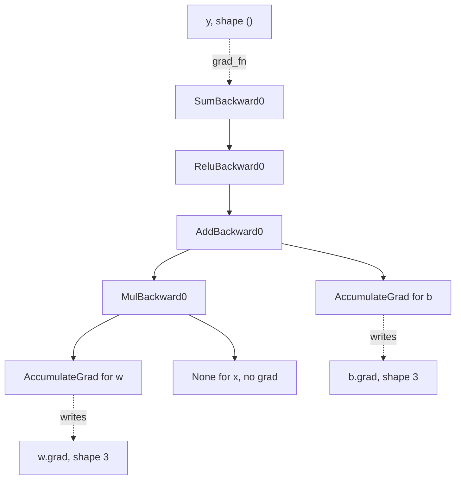

# 07 — The Autograd Graph, Leaves, and backward()

> **Prerequisites:** modules 02–05.
> **You will learn:** how `grad_fn`/`next_functions` form a DAG during the
> forward pass; leaves, `retain_grad()`, and accumulation; `backward(gradient=)`
> as a vector-Jacobian product, `autograd.grad`, `retain_graph`, `create_graph`;
> grad modes and version-counter errors; and a 150-line scalar engine that
> matches PyTorch.

Most confusing PyTorch errors (`Trying to backward through the graph a second
time`, `modified by an inplace operation`, `Inference tensors cannot be saved for
backward`) are autograd saying your model of `loss.backward()` is wrong. The
correct model: a graph of `Node` objects recorded while your Python runs, holding
exactly the tensors each local derivative needs, walked once in reverse, then
freed.

The math is derived in
[the backpropagation notes](../../notes/deep-learning/backpropagation-and-autodiff.md);
[the PyTorch overview note](../../notes/libraries/pytorch.md) is the one-page
summary. This module goes deeper into the PyTorch contract.

---

## 7.1 What autograd is for (and what it is not)

There are three ways to get derivatives out of a program.

| Method | Exact? | Cost for $\nabla_\theta L$, $\theta \in \mathbb{R}^P$ | Memory | Failure mode |
|---|---|---|---|---|
| Symbolic (CAS) | yes | expression swell; unusable for loops | expression size | blows up on control flow |
| Numerical (finite differences) | no, $O(h)$ or $O(h^2)$ truncation plus round-off | $P{+}1$ or $2P$ forward passes | one forward | round-off vs truncation trade-off |
| Reverse-mode AD | yes, to floating point | one forward + one backward, a small constant multiple of the forward | every saved intermediate | memory grows with depth |

Reverse-mode AD records a tape during the forward pass and replays it backwards
applying vector-Jacobian products (VJPs). Each op knows only its local VJP: given $\bar{y} = \partial L/\partial y$, produce
$\bar{x} = \bar{y}^\top \partial y/\partial x$. The one-line cost argument: for a
**scalar** loss, a single reverse sweep produces the gradient with respect to all
$P$ inputs at once, at a cost bounded by a small constant times the forward pass
and independent of $P$ (Baydin et al. 2018, [arXiv:1502.05767](https://arxiv.org/abs/1502.05767)).
So a training step costs about three forward passes (backward ≈ 2× forward
FLOPs is the usual rule of thumb), whatever $P$ is.

Autograd is not symbolic and does not differentiate control-flow decisions: an
`if x > 0` branch only determines which ops get recorded.

## 7.2 The graph is built by running your code

Only `w` and `b` require gradients; `x` is data.

```python
torch.manual_seed(0)
x = torch.randn(3)                      # data
w = torch.randn(3, requires_grad=True)  # leaf
b = torch.randn(3, requires_grad=True)  # leaf
y = (w * x + b).relu().sum()

print(y.grad_fn)                     # <SumBackward0 ...>
print(y.grad_fn.next_functions)      # ((<ReluBackward0 ...>, 0),)
add = y.grad_fn.next_functions[0][0].next_functions[0][0]
print(add.next_functions)            # ((<MulBackward0 ...>, 0), (<AccumulateGrad ...>, 0))
print(add.next_functions[0][0].next_functions)  # ((<AccumulateGrad ...>, 0), (None, 0))
print(add.next_functions[1][0].variable is b)   # True
```

Comments show actual 2.8.0 CPU output. Every
non-leaf tensor carries a `grad_fn`, the backward `Node` of the op that produced
it; `next_functions` holds one `(node, input_nr)` edge per forward input. A leaf
that requires grad appears as an `AccumulateGrad` node whose `.variable` is the
leaf; it adds the incoming gradient into `leaf.grad`. An input that does not
require grad (`x`) gets the edge `(None, 0)` and is never visited.



Edges point the way backward travels. This is **define-by-run** (Paszke et al. 2019,
[arXiv:1912.01703](https://arxiv.org/abs/1912.01703)): no graph exists until
your Python executes, and control flow is just Python, so a loop over a variable
number of tokens records a variable number of nodes. Each forward builds a fresh
graph and `backward()` frees its saved tensors as it goes, so the graph is
single-use unless you pass `retain_graph=True` (7.5); see
[Autograd mechanics](https://docs.pytorch.org/docs/2.8/notes/autograd.html).

The engine that walks the graph is C++
([`engine.cpp` at v2.8.0](https://github.com/pytorch/pytorch/blob/v2.8.0/torch/csrc/autograd/engine.cpp)).
`Engine::compute_dependencies` counts the edges into every reachable node; a node
enters the ready queue only when its count reaches zero, that is, when every
consumer has delivered its gradient.
That is how a tensor used twice (a "diamond") gets the sum of both
contributions before its own backward runs.

## 7.3 Leaves, non-leaves, and where `.grad` lands

"Leaf" is a property of the graph, not of `requires_grad`:

| How the tensor was made | `is_leaf` | `requires_grad` | `.grad` after backward |
|---|---|---|---|
| Created by you with `requires_grad=True` (or `requires_grad_()` later) | True | True | populated, accumulated with `+=` |
| Created by you without grad (data, labels, masks) | True | False | stays `None` |
| Output of an op on something that requires grad | False | True | `None`, plus a `UserWarning`, unless you called `.retain_grad()` |
| Output of an op on tensors that all have `requires_grad=False` | True | False | `None` |
| Result of `.detach()` | True | False | `None` |

Parameters are leaves: `nn.Parameter` wraps a tensor with
`requires_grad=True` that is never the output of a recorded op
([nn.Module internals](./10-nn-module-internals.md)). The optimizer reads
`p.grad` on exactly these tensors.

Non-leaf gradients are computed during backward (they are the messages passed
along the edges) and immediately dropped. Reading `h.grad` on an
intermediate gives `None` and a *"not a leaf Tensor"* `UserWarning`;
`h.retain_grad()` before backward installs a hook that keeps it. The tutorial
[Understanding requires_grad, retain_grad, Leaf, and non-leaf Tensors](https://docs.pytorch.org/tutorials/beginner/understanding_leaf_vs_nonleaf_tutorial.html)
(living page, accessed 2026-10-10) walks the same rules.

### Accumulation is a feature

`AccumulateGrad` does `leaf.grad += incoming` (assigning if `.grad` is `None`),
so two backward passes without zeroing leave the **sum**. Every step therefore
starts with `optimizer.zero_grad()`, which since 2.0 sets grads to `None`.

The same rule powers **gradient accumulation**: run $k$ micro-batches of size
$B/k$, call `backward()` on each mean loss divided by $k$, and the leaf gradients
equal the full-batch mean-loss gradient, because gradients are linear in the
loss. Forget the $1/k$ and the effective learning rate is $k$ times larger
(module 16 builds the loop,
[training loop](./16-training-loop-checkpointing.md)).

## 7.4 Non-scalar outputs: backward is a vector-Jacobian product

The engine computes $\bar{x} = v^\top J$ with $J = \partial y/\partial x$ and $v$
the gradient arriving from above. For a scalar, $v = 1$ is implied; for a vector
`y` there is no canonical $v$, so `y.backward()` raises *"grad can be implicitly
created only for scalar outputs"* until you pass `gradient=v`.

### By hand

Let $f(x) = A\,(x \odot x)$ with

$$A = \begin{pmatrix}1 & 2\\ 3 & -1\end{pmatrix},\quad x = \begin{pmatrix}0.5\\ -1.5\end{pmatrix},\quad v = \begin{pmatrix}1\\ -2\end{pmatrix}.$$

Then $f(x) = A\,(0.25, 2.25)^\top = (4.75, -1.5)^\top$. The Jacobian is
$J_{ij} = A_{ij}\cdot 2x_j$:

$$J = \begin{pmatrix}1\cdot 1 & 2\cdot(-3)\\ 3\cdot 1 & -1\cdot(-3)\end{pmatrix} = \begin{pmatrix}1 & -6\\ 3 & 3\end{pmatrix},\qquad v^\top J = (1 - 6,\; -6 - 6) = (-5, -12).$$

PyTorch never builds $J$. The backward of `A @ u` with incoming $v$ returns
$A^\top v = (-5, 4)$, and the backward of `u = x**2` multiplies elementwise by
$2x = (1, -3)$, giving $(-5, -12)$. With $10^6$ inputs and outputs, $J$ would have
$10^{12}$ entries; the VJP costs what the forward costs. For a full Jacobian,
`torch.autograd.functional.jacobian` stacks one VJP per output row; module 09
vectorizes that with `vmap` ([torch.func](./09-torch-func-transforms.md)).

### `torch.autograd.grad`: return instead of accumulate

`torch.autograd.grad(outputs, inputs, grad_outputs=v)` runs the same engine but
returns gradients for `inputs` without touching any `.grad`. An unreachable input
raises unless you pass `allow_unused=True` (`None` in that slot) or
`materialize_grads=True` (zeros).

| | `y.backward(gradient=v)` | `torch.autograd.grad(y, xs, grad_outputs=v)` |
|---|---|---|
| Result | added into `leaf.grad` for every reachable leaf | returned tuple, one per entry of `xs` |
| Which tensors | all leaves with `requires_grad` | only `xs` (leaves or non-leaves) |
| Side effects | mutates `.grad` (accumulates) | none on `.grad` |
| Unused inputs | silently skipped | error unless `allow_unused` / `materialize_grads` |
| Typical use | training step | gradient penalties, meta-learning, input gradients, tests |

Both are thin wrappers in
[`torch/autograd/__init__.py`](https://github.com/pytorch/pytorch/blob/v2.8.0/torch/autograd/__init__.py)
over the same `_engine_run_backward`; both apply `if retain_graph is None:
retain_graph = create_graph`, which matters in the next section.

## 7.5 retain_graph, create_graph, and second derivatives

Call `backward()` twice on the same graph and the second call fails with
*"Trying to backward through the graph a second time (or directly access saved
tensors after they have already been freed)"*. The first pass released each
saved tensor once its node ran, because saved activations are most of training
memory (7.8). `retain_graph=True` keeps them until the graph is collected.
Most "I need retain_graph" situations are really "I should sum the losses and
call backward once".

`create_graph=True` goes further: the backward pass itself is recorded, so the
gradients it returns have their own `grad_fn` and can be differentiated again.
For $y = x^3$ at $x = 2$: the first derivative $3x^2 = 12$ comes back as a tensor
with `grad_fn=<MulBackward0>`, and differentiating that gives $6x = 12$. The cost
is a graph of the graph: the first backward's intermediates are kept and a
second backward runs over them. Gradient penalties, MAML, and Hessian-vector
products use it. Module 08 makes custom Functions
double-differentiable ([custom autograd](./08-custom-autograd-and-hooks.md));
module 09 replaces hand-rolled nesting with `torch.func.hessian`.

## 7.6 Turning autograd off: no_grad, inference_mode, detach

| Switch | Ops recorded? | Outputs `requires_grad` | Version counters and view tracking | Outputs usable in later autograd? | Use for |
|---|---|---|---|---|---|
| `torch.no_grad()` | no | False | still maintained | yes, as constants | optimizer updates, EMA, metric code inside training |
| `torch.inference_mode()` | no | False | skipped for inference tensors | **no**: cannot be saved for backward | serving, evaluation loops |
| `torch.enable_grad()` | yes | normal | normal | yes | re-enabling inside a `no_grad` region |
| `torch.set_grad_enabled(flag)` | if `flag` | normal or False | normal | yes | one code path for train and eval |
| `t.detach()` | n/a (a new leaf) | False | **shares** storage and version counter with `t` | yes | stop-gradient, logging |
| `t.detach().clone()` | n/a | False | own storage | yes | a safe snapshot |

Query state with `torch.is_grad_enabled()` and
`torch.is_inference_mode_enabled()`. All are context managers or decorators, and
all are **thread-local**: a thread started inside a `no_grad` block still has
grad enabled (checked on CPU in 2.8; see the
[autograd API docs](https://docs.pytorch.org/docs/2.8/autograd.html)).

Why is `inference_mode` faster than `no_grad`? `no_grad` still bumps version
counters and tracks views, because its tensors might later meet autograd.
`inference_mode` drops both for tensors created inside it, which matters for
small-op-heavy inference. The price is a hard wall: an inference tensor used in a later
recorded op raises *"Inference tensors cannot be saved for backward. To work
around you can make a clone to get a normal tensor and use it in autograd."*, and
`requires_grad_()` on one raises *"Setting requires_grad=True on inference
tensor outside InferenceMode is not allowed."*. The classic bug: caching a mask
or positional table during an `inference_mode` evaluation, then reusing it in
the next training step.

`detach()` shares storage and the version counter with the original, so an
in-place write into it can trip the error in 7.7. `model.eval()` is **not** a
grad mode: it flips the `training` flag dropout and batch norm read (module 10)
and records as many ops as before. Evaluation needs both.

## 7.7 In-place operations and the version counter

Module 03 introduced `t._version`, incremented by every in-place op
([storage and views](./03-storage-strides-views-copies.md)). A node that saves a
tensor records its version; backward compares on unpack and raises on mismatch:

```text
RuntimeError: one of the variables needed for gradient computation has been
modified by an inplace operation: [torch.FloatTensor [3]], which is output 0 of
SigmoidBackward0, is at version 1; expected version 0 instead. Hint: enable
anomaly detection to find the operation that failed to compute its gradient,
with torch.autograd.set_detect_anomaly(True).
```

That message came from `s = a.sigmoid(); s.relu_(); s.sum().backward()`.
Sigmoid's derivative is $s(1-s)$, so `SigmoidBackward0` saves its **output**;
`relu_()` overwrote it, and autograd refuses rather than return a wrong
gradient.

- **In-place on a leaf that requires grad is an error**: `w.add_(1)` raises
  *"a leaf Variable that requires grad is being used in an in-place
  operation."* Inside `torch.no_grad()` it is allowed, and that is precisely
  how every optimizer updates parameters: `with torch.no_grad(): p -= lr *
  p.grad`. The version still increments, so a stale graph that saved `p` is
  still caught.
- **`.data` is the legacy escape hatch** and it is dangerous. `t.data` is a
  tensor sharing storage but with a separate version counter, so in-place
  writes through it are invisible to the check. Running
  `s = x.sigmoid(); s.data.mul_(0); s.sum().backward()` produced
  `x.grad == 0` with `s._version` still 0: a wrong gradient, no error. Use
  `torch.no_grad()` or `detach()`; both keep the safety net.

## 7.8 What gets saved for backward, and why memory grows with depth

Each node saves exactly what its VJP formula needs, per [`tools/autograd/derivatives.yaml`](https://github.com/pytorch/pytorch/blob/v2.8.0/tools/autograd/derivatives.yaml).
You can see it through the `_saved_*` attributes on `grad_fn`, an internal
debugging aid (names follow the op's argument names and are not a stable API):

| Forward op | Backward node | Saved (probed in 2.8 via `dir(grad_fn)`) | Why |
|---|---|---|---|
| `a * b`, both require grad | `MulBackward0` | `_saved_self`, `_saved_other` | $\bar a = \bar y\, b$, $\bar b = \bar y\, a$ |
| `a * 3.0` | `MulBackward0` | `_saved_other` only (`_saved_self` is `None`) | the constant needs no gradient, so `a` is not needed |
| `a @ b`, 2-D, both require grad | `MmBackward0` | both matrices plus their sizes and strides | $\bar A = \bar Y B^\top$, $\bar B = A^\top \bar Y$ |
| `relu`, `sigmoid`, `tanh`, `exp` | `ReluBackward0`, ... | `_saved_result` (the output) | derivative is a function of the output |
| `sum` | `SumBackward0` | `_saved_self_sym_sizes` only, e.g. `(3,)` | broadcast $\bar y$ back to the input shape |

```python
a = torch.randn(3, requires_grad=True)
m = a * 3.0
print(m.grad_fn._saved_self, m.grad_fn._saved_other)  # None tensor(3., dtype=torch.float64)
s = a.sigmoid()
print(s.grad_fn._saved_result is s)                    # False: an unpacked copy sharing storage
```

Every tensor some derivative needs is pinned from the forward pass until its
node runs in backward, so the saved set grows linearly in depth $L$ and in
$B \cdot T$; that is why activation memory dominates training at long context.
Activation checkpointing trades it for recomputation
([memory accounting](./22-memory-accounting-and-checkpointing.md)).

## 7.9 Input gradients are just gradients

Put `requires_grad=True` on the **input** and you get $\partial L/\partial x$: a saliency map, or the direction of
the fast gradient sign method (FGSM) attack from the
[FGSM tutorial](https://docs.pytorch.org/tutorials/beginner/fgsm_tutorial.html)
(living page, accessed 2026-10-10).

```python
import torch.nn.functional as F
torch.manual_seed(0)
W = torch.randn(2, 4)                         # frozen 2-class linear classifier
x = torch.randn(1, 4, requires_grad=True)     # the input is the leaf
loss = F.cross_entropy(x @ W.T, torch.tensor([0]))
loss.backward()                               # x.grad: (1, 4)
with torch.no_grad():                         # do not record the attack step
    x_adv = x + 0.1 * x.grad.sign()
```

One local CPU run gave a clean loss of 1.2007 and an adversarial loss of 1.7022
for a perturbation of 0.1 per coordinate. `W` does not require grad, so the only
`AccumulateGrad` in the graph belongs to `x`.

## 7.10 Build micrograd, then delete it

The lab script [`07_micrograd.py`](./code/07_micrograd.py) follows Karpathy's micrograd
([`engine.py` at 7bc720e](https://github.com/karpathy/micrograd/blob/7bc720e951fe422b8f8814aa5aa1b64121d26b4c/micrograd/engine.py)):
a `Value` holds a Python float `data`, a float `grad`, its parents `_prev`, and a
`_backward` closure that pushes `out.grad` into the parents. The core:

```python
class Value:
    def __init__(self, data, _children=(), _op=""):
        self.data, self.grad = float(data), 0.0
        self._prev = tuple(_children)          # ordered: deterministic backward
        self._backward = lambda: None
        self._op = _op

    def __mul__(self, other):
        other = other if isinstance(other, Value) else Value(other)
        out = Value(self.data * other.data, (self, other), "*")
        def _backward():                       # local VJP, closes over inputs
            self.grad += other.data * out.grad
            other.grad += self.data * out.grad
        out._backward = _backward
        return out

    def backward(self):
        topo = topological_order(self)         # children before parents
        for node in topo:                      # non-leaf grads are transient
            if node._prev:
                node.grad = 0.0
        self.grad = 1.0
        for node in reversed(topo):
            node._backward()

def topological_order(root):
    order, seen = [], set()
    def visit(node):
        if id(node) not in seen:
            seen.add(id(node))
            for child in node._prev:
                visit(child)
            order.append(node)
    visit(root)
    return order
```

The `+=` in every closure is 7.3 in miniature: in `y = a * b + a`, `a` gets
one contribution through the product and one through the sum. `tanh` and `exp`
close over `out` (saving the output, like `ReluBackward0`); `log` closes over its
input.

One deliberate deviation from upstream: `backward()` zeroes non-leaf gradients
before propagating. Upstream micrograd leaves intermediate `.grad` values in
place, so a second `backward()` re-propagates the stale intermediates on top of
fresh ones. Running the pinned `engine.py` on `y = a*b + a` with `a=2, b=3`
gave `a.grad == 4` after one call and `11` after two, not `8`. Resetting makes the lab
match PyTorch's contract: leaves accumulate, intermediates are recomputed.

| micrograd | PyTorch |
|---|---|
| `Value` (one Python float) | 0-d (or any) `torch.Tensor` |
| `_prev` tuple of parents | `grad_fn.next_functions` edges |
| `_backward` closure capturing `self`, `other`, `out` | `Node.apply` plus `SavedVariable`s |
| leaf = node with empty `_prev` | leaf = tensor with `grad_fn is None` |
| recursive DFS topological sort | dependency counting in `Engine::compute_dependencies`, then a ready queue |
| graph lives as long as Python references it | saved tensors freed during backward unless `retain_graph=True` |
| no version counter | `_version` check on every saved tensor |

Then delete it: `torch.Tensor` does all of this vectorized, in C++, safely.

Two classic exercises sit on either side of this lab. The official
[Learning PyTorch with Examples](https://docs.pytorch.org/tutorials/beginner/pytorch_with_examples.html)
tutorial (living page, accessed 2026-10-10) fits a polynomial four times: NumPy with
hand-written gradients, tensors with hand-written gradients, tensors with autograd,
then `nn`; the step from the second to the third is exactly the closures above
disappearing. Karpathy's makemore part 4 ("backprop ninja") goes the other way and
writes the tensor-level backward of an MLP by hand (cross-entropy, BatchNorm, tanh,
matmul), checking each against autograd: the same VJP rules, with broadcasting turned
into sums over the broadcast dims. Module 08's lab does that check for a custom
`Function` with `gradcheck`.

## Reconciling the sources

The PyTorch [Autograd mechanics](https://docs.pytorch.org/docs/2.8/notes/autograd.html)
note and the leaf/non-leaf tutorial state the same rules: only leaves accumulate
`.grad`, `retain_grad()` opts a non-leaf in, saved tensors are freed after
backward. The note is organized around the engine; the
tutorial around what a user observes on `.grad` and `grad_fn`. The difference is
emphasis, and every behaviour quoted here was re-run on 2.8.0.

Micrograd differs in kind: it is scalar, keeps the graph as long as Python holds
the output (upstream, a second `backward()` silently over-counts instead of
raising), and has no saved-tensor versioning. The backpropagation notes derive
the math; this module specifies the PyTorch contract on top.

## Worked autograd verification

**Leaves, `retain_grad`, and accumulation.** This proves that only leaves get
`.grad`, that `retain_grad()` makes an intermediate's gradient visible and equal
to the hand-derived value $\partial y/\partial h = \mathbb{1}[h > 0]$, and that two
backward passes on two fresh graphs sum into `w.grad`.

```python pytorch-check
import warnings
import torch

torch.manual_seed(0)
x = torch.randn(4)
w = torch.randn(4, requires_grad=True)
b = torch.randn(4, requires_grad=True)

h = w * x + b
y = h.relu().sum()
assert w.is_leaf and b.is_leaf and x.is_leaf
assert not h.is_leaf and h.grad_fn is not None
y.backward()
with warnings.catch_warnings():
    warnings.simplefilter("ignore", UserWarning)
    assert h.grad is None                       # non-leaf: not retained
single = w.grad.clone()
torch.testing.assert_close(single, x * (h > 0).to(x.dtype), rtol=0, atol=0)

w.grad = None
h = w * x + b
h.retain_grad()
h.relu().sum().backward()
torch.testing.assert_close(h.grad, (h > 0).to(h.dtype), rtol=0, atol=0)

w.grad = None
for _ in range(2):                              # two fresh graphs, no zeroing
    (w * x + b).relu().sum().backward()
torch.testing.assert_close(w.grad, 2 * single, rtol=0, atol=0)
print("leaf/non-leaf and accumulation ok:", w.grad.shape)
```

**A VJP is $v^\top J$.** Using the 2×2 example from 7.4 in `torch.float64`, the
fence checks `autograd.grad` with `grad_outputs=v` against `v @ J` built from the
closed form, and checks `autograd.functional.jacobian` against the same $J$. It
does not prove PyTorch avoids materializing $J$.

```python pytorch-check
import torch

A = torch.tensor([[1.0, 2.0], [3.0, -1.0]], dtype=torch.float64)
x = torch.tensor([0.5, -1.5], dtype=torch.float64, requires_grad=True)
v = torch.tensor([1.0, -2.0], dtype=torch.float64)

def f(x):
    return A @ x**2

J = A * (2 * x.detach())                         # J[i, j] = A[i, j] * 2 x[j]
(vjp,) = torch.autograd.grad(f(x), x, grad_outputs=v)
torch.testing.assert_close(vjp, v @ J, rtol=0, atol=1e-12)
torch.testing.assert_close(vjp, torch.tensor([-5.0, -12.0], dtype=torch.float64), rtol=0, atol=1e-12)
assert x.grad is None                            # autograd.grad does not accumulate
torch.testing.assert_close(torch.autograd.functional.jacobian(f, x), J, rtol=0, atol=1e-12)
print("vjp:", vjp.tolist())
```

**Second derivatives and the freed graph.** With `create_graph=True` the first
derivative of $x^3$ is itself differentiable and the second derivative at 2 is 12.
A second `backward()` without `retain_graph` fails. Memory cost is not
measured.

```python pytorch-check
import torch

x = torch.tensor(2.0, requires_grad=True)
y = x**3
(dy,) = torch.autograd.grad(y, x, create_graph=True)
assert dy.grad_fn is not None                    # the backward was recorded
(d2y,) = torch.autograd.grad(dy, x)
torch.testing.assert_close(dy.detach(), torch.tensor(12.0), rtol=0, atol=1e-6)
torch.testing.assert_close(d2y, torch.tensor(12.0), rtol=0, atol=1e-6)

z = (x * x).exp()                                # exp saves its output
z.backward()
try:
    z.backward()
    raise AssertionError("second backward should fail")
except RuntimeError as err:
    msg = str(err)
    assert "second time" in msg or "freed" in msg, msg
print("second derivative:", d2y.item())
```

**Inference tensors and the version counter.** A tensor created under
`inference_mode` cannot be saved by a later recorded op, and overwriting a
saved output in place is caught at backward time; overwriting the output of a
multiply-by-constant is not an error because `mul` did not save it. It does not
show the speed benefit of `inference_mode`.

```python pytorch-check
import torch

torch.manual_seed(0)
w = torch.randn(3, requires_grad=True)
with torch.inference_mode():
    cached = torch.randn(3)
assert cached.is_inference() and not torch.is_inference_mode_enabled()
try:
    (w * cached).sum()
    raise AssertionError("inference tensor should not be saved for backward")
except RuntimeError as err:
    assert "Inference tensors" in str(err), str(err)
(w * cached.clone()).sum().backward()            # the documented workaround

s = w.sigmoid()                                  # SigmoidBackward0 saves s
v0 = s._version
s.relu_()
assert s._version == v0 + 1
try:
    s.sum().backward()
    raise AssertionError("in-place on a saved tensor should fail")
except RuntimeError as err:
    assert "inplace" in str(err), str(err)

m = w * 3.0                                      # mul by a constant saves only 3.0
m.relu_()
w.grad = None
m.sum().backward()
torch.testing.assert_close(w.grad, 3.0 * (w > 0).to(w.dtype), rtol=0, atol=0)
print("inference_mode and version-counter checks ok")
```

## Lab: build a scalar autograd engine and check it against PyTorch

The script [`code/07_micrograd.py`](./code/07_micrograd.py) implements `Value`
with add, mul, pow (constant exponent), neg, sub, truediv, exp, log, tanh, and
relu, then does three things:

1. **Gradient equivalence.** Five seeded random 12-op expressions over three
   inputs (guards such as `log(u*u + 1)` keep them in-domain), run on `Value`s
   and on 0-d `torch.float64` tensors; max absolute leaf-gradient difference.
2. **Training equivalence.** Builds the 3 → 4 → 4 → 1 tanh MLP (41 parameters)
   from Karpathy's micrograd lecture
   ([notebook at 73c3fcc](https://github.com/karpathy/nn-zero-to-hero/blob/73c3fcc741f0ec104ca850b1fb0df90e7e8d4cde/lectures/micrograd/micrograd_lecture_second_half_roughly.ipynb))
   on its four-point dataset with sum-of-squares loss, copies the same uniform
   $(-1, 1)$ init into a float64 `nn.Sequential`, and runs 60 SGD steps (lr 0.05)
   on both; the torch update is `p -= lr * p.grad` under `no_grad`.
3. **Graph accounting.** Node count and backward order of one step's graph.

```bash
python content/courses/pytorch/code/07_micrograd.py
python site/test_pytorch_07_micrograd.py
```

Tested with Python 3.11 and PyTorch 2.8.0 on CPU.

One local PyTorch 2.8 CPU run (Apple M-series laptop) produced:

| Quantity | Value |
|---|---|
| max leaf-gradient difference over 5 expressions | 4.4e-16 |
| loss at steps 1 / 10 / 30 / 60 | 4.807 / 0.0931 / 0.0228 / 0.0102 |
| max per-step loss difference, micrograd vs torch | 8.9e-16 |
| nodes in one training-step graph | 362 (41 parameters) |
| first ops in backward order | `+`, `**2`, `+`, leaf, `tanh`, `+`, `*`, `tanh` |
| wall time, script / test file | 0.85 s / 0.99 s |

The differences are float64 rounding from summation order and do not grow over
60 steps. 362 nodes for 41 parameters and four examples is the price of scalar
granularity; PyTorch records one `AddmmBackward0` per layer.

The test asserts contracts, not those numbers: gradient and per-step loss
agreement below $10^{-9}$, final loss below 0.3× initial, `a.grad == b + 1` on
the diamond `a*b + a`, children before parents in topological order, and two
`backward()` calls doubling leaf gradients as two retained PyTorch calls do.

Scope, honestly: this is a scalar engine. It has no tensors, no broadcasting, no
saved-tensor freeing, no version counter, and no grad modes. Its equivalence with
PyTorch is shown on 64-bit floats only; in float32 the two would differ by
rounding at the 1e-7 relative level, so the 1e-9 tolerance would be meaningless.

## Key takeaways

- Autograd records a DAG of backward `Node`s as Python runs; `AccumulateGrad`
  nodes write into leaves.
- Only leaves get `.grad`, accumulated with `+=`: zero every step, or exploit it
  with a $1/k$ loss scale for gradient accumulation.
- `backward(gradient=v)` and `autograd.grad` compute $v^\top J$ without forming
  $J$; `autograd.grad` returns instead of accumulating.
- Graphs are single-use unless `retain_graph=True`; `create_graph=True` records
  the backward for higher derivatives.
- `inference_mode` also skips version and view bookkeeping, and its tensors can
  never enter autograd later. `eval()` is not a grad mode.
- Saved tensors carry versions; what each op saves decides in-place safety and
  activation memory. Update parameters under `no_grad`, never via `.data`.

## Self-check

1. You call `loss.backward()` inside a loop over micro-batches without zeroing.
   What does `.grad` hold after 4 iterations, and how must the loss be scaled so
   the update equals one big-batch step?
2. Why does `inference_mode` give speedups that `no_grad` does not, and what
   breaks if a tensor created under `inference_mode` is later fed to a training
   step?
3. An in-place `relu_()` after a `sigmoid` raises a version-counter error but
   after a `mul` by a constant does not. Explain using what each op saves.

---

**Next → [08 — Custom Autograd Functions, Hooks, and Higher-Order Gradients](./08-custom-autograd-and-hooks.md)**
