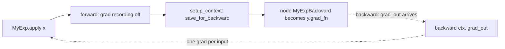
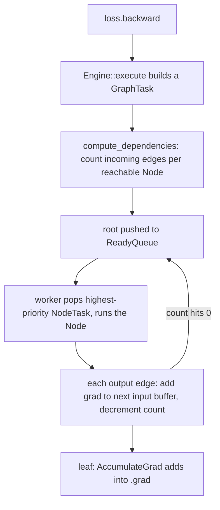

# 08 — Custom Autograd Functions, Hooks, and Higher-Order Gradients

> **Prerequisites:** module 07.
> **You will learn:** how to write a `torch.autograd.Function` the 2.x way (`forward` + `setup_context` + `backward`, optional `vmap`/`jvp`) and the full `ctx` API; how to prove a custom backward right with `gradcheck`/`gradgradcheck`, and why float64; double backward and forward-mode AD with dual numbers; every hook family (tensor, post-accumulate, Node, multi-grad, saved-tensor); anomaly detection and how the autograd engine schedules work.

[Module 07](./07-autograd-graph-and-backward.md) treated autograd as a closed box: ops build a graph, `backward()` walks it, gradients land in `.grad`. This module opens the box from both ends. You write graph nodes with a backward you chose and prove it correct, and you attach code to the backward pass to watch gradients, change them, and decide what memory backward may keep.

These are the levers the rest of the stack pulls: checkpointing is a saved-tensor hook, DDP bucketing runs on gradient hooks, optimizer-in-backward is a post-accumulate hook, and QAT's straight-through estimator is a custom Function. The [PyTorch library note](../../notes/libraries/pytorch.md) gives the overview and [Backpropagation and Automatic Differentiation](../../notes/deep-learning/backpropagation-and-autodiff.md) holds the math; this module goes deeper into the API and the engine.

---

## 8.1 When you need a custom Function

Write a `torch.autograd.Function` only for one of four reasons:

| Reason | Example | What the custom backward buys |
|---|---|---|
| (a) Numerically better gradient | `log1pexp` at `x = 100`, float32 | autograd gives `nan`; `sigmoid(x) * g` gives exactly 1.0 (fence 1) |
| (b) Memory: recompute instead of save | fused Linear+GELU saving only `x, W, b` | no `(B, d_out)` activation kept (lab: 30 % fewer saved bytes) |
| (c) Wrapping non-PyTorch code | a NumPy or C routine with a known derivative | autograd cannot see inside it; you supply the VJP |
| (d) Deliberately "wrong" gradient | straight-through estimator: `round` forward, identity backward | training through a quantizer ([module 29](./29-quantization-and-compression.md)) |

The anti-reason is **speed**. A Python `Function` runs eager Python in both directions. For a fast op that `torch.compile` and `torch.export` treat as an opaque, schema-registered unit, use `torch.library.custom_op` ([module 25](./25-custom-ops-and-kernels.md)); for fusion, let `torch.compile` do it ([module 23](./23-torch-compile-in-practice.md)). A custom Function controls *what* the gradient is and *what memory* it keeps, not how fast it runs.

## 8.2 Anatomy of an autograd.Function

```python
class MyExp(torch.autograd.Function):
    @staticmethod
    def forward(x):                       # no ctx: plain computation
        return x.exp()

    @staticmethod
    def setup_context(ctx, inputs, output):
        ctx.save_for_backward(output)     # exp' = exp: save the output

    @staticmethod
    def backward(ctx, grad_out):          # one grad per forward output in
        (y,) = ctx.saved_tensors
        return grad_out * y               # one grad per forward input out

y = MyExp.apply(x)                        # never call forward() directly
```

`apply` runs `forward` with grad recording off, calls `setup_context`, and makes one node `MyExpBackward`, linked to the inputs' `grad_fn`s, the output's `grad_fn`. Backward receives one gradient per output and returns one per input (`None` where none is needed).



**Why a separate `setup_context`?** The older `forward(ctx, x)` style still works, but the [Extending torch.func](https://docs.pytorch.org/docs/2.8/notes/extending.func.html) note states that only the split form is supported with function transforms: `forward` "should not accept a ctx object". `vmap`, `grad` and `jvp` ([module 09](./09-torch-func-transforms.md)) must run your forward on wrapped tensors without also running your bookkeeping. Two optional static methods complete the class: `jvp(ctx, *tangents)` for forward-mode AD (§8.6), and `vmap(...)` or `generate_vmap_rule = True` for `torch.vmap` (autogeneration requires `forward`, `backward` and `jvp` to use only PyTorch ops).

`ctx.needs_input_grad` is one boolean per input, readable in `setup_context` and `backward`. If `x` is a data batch, `grad_out @ W` for it is a wasted matmul; fence 4 shows the tuple reads `(True, False, False)` when only the first of three inputs requires grad.

## 8.3 The ctx API in detail

| API | Use for | Failure it prevents |
|---|---|---|
| `ctx.save_for_backward(*t)` | inputs/outputs backward needs (tensors only) | saved tensors are version-checked, hookable, freed with the graph |
| `ctx.attr = value` | non-tensor metadata (shapes, floats, flags) | a *tensor* here skips version checks and hooks; an *output* here makes the cycle output → `grad_fn` → `ctx` → output, a leak |
| `ctx.mark_dirty(t)` | an input modified in place and returned | autograd would not know the old value is gone |
| `ctx.mark_non_differentiable(t)` | integer outputs: argmax indices, masks | the output would claim `requires_grad=True` |
| `ctx.set_materialize_grads(False)` | multi-output functions with unused outputs | backward otherwise gets zero-filled tensors to allocate and multiply |
| `@once_differentiable` | backward in non-differentiable code | double backward would use a graph-less gradient |

```python
ctx.save_for_backward(x, weight); ctx.eps = eps     # tensors checked; float on ctx
x.add_(1); return x        # forward  ...  ctx.mark_dirty(x) in setup_context
values, idx = x.max(dim=1) # forward  ...  ctx.mark_non_differentiable(idx)
ctx.set_materialize_grads(False)  # backward: `if g2 is not None: grad += 3 * g2`
```

Save `h`, run `h.add_(1)`, then backward, and the engine raises "one of the variables needed for gradient computation has been modified by an inplace operation ... is at version 1; expected version 0" (run locally on CPU). A tensor stashed on `ctx.cache` gets no protection; backward silently uses the mutated value.

**`once_differentiable` is weaker than its name.** The [v2.8.0 source](https://github.com/pytorch/pytorch/blob/v2.8.0/torch/autograd/function.py) runs your backward under `torch.no_grad()` and attaches the error-raising node *only if an incoming grad tensor requires grad*. With `torch.autograd.grad(loss, x, create_graph=True)` the incoming gradient is a constant 1, so the returned gradient simply has no `grad_fn`. Add it to anything that does require grad, call backward, and the second-order term vanishes without an error. A local probe through `exp` gave `x.grad == 2x` instead of `2x + exp(x)`; `gradgradcheck` flags it as a Jacobian mismatch.

## 8.4 Proving it: gradcheck and gradgradcheck

The [Gradcheck mechanics](https://docs.pytorch.org/docs/2.8/notes/gradcheck.html) note describes both sides of the comparison:

- **Numerical Jacobian, column by column:** perturb input element $i$ and take the central difference $\frac{f(x + \epsilon e_i) - f(x - \epsilon e_i)}{2\epsilon}$, truncation error $O(\epsilon^2)$.
- **Analytical Jacobian, row by row:** call your backward with one-hot `grad_out` vectors; each returns $e_j^\top J$.
- Compare with `atol=1e-5, rtol=1e-3`, default `eps=1e-6` ([signature](https://docs.pytorch.org/docs/2.8/generated/torch.autograd.gradcheck.gradcheck.html), confirmed with `inspect.signature` in 2.8.0).

**Why float64.** The difference quotient subtracts two nearly equal values and divides by $2\times10^{-6}$. Float32 values of order 1 carry rounding error near $1.2\times10^{-7}$, so the quotient is off by roughly 5 %, far outside `rtol=1e-3`. In float64 (epsilon $2.2\times10^{-16}$) the same quotient is good to about $10^{-10}$. Locally, a *correct* `sin` backward checked in float32 produced a warning and a Jacobian mismatch. A float32 failure means nothing; a float64 pass is the evidence.

**Cost.** Slow mode needs about `2·numel(inputs)` forwards and `numel(outputs)` backwards, plus repeats for its extra checks: a counter inside a Function with 6 inputs and 12 outputs recorded 14 forwards and 26 backwards locally. `fast_mode=True` checks one scalar $v^\top J u$ for random $u, v$ (one directional difference, one VJP) and the same probe counted 4 and 4. Use tiny inputs. `check_undefined_grad` (on by default) feeds `None` grad outputs; `check_batched_grad` tests backward under `vmap`; `check_forward_ad` tests your `jvp`.

A pass proves backward agrees with forward at the sampled point, to float64 precision. It does not prove forward is right, float32 is stable, or unsampled kinks are handled. So a float64 pass with float32 divergence points at numerics (overflow, cancellation), not the derivative formula: fence 1's case. `gradgradcheck` does the same one level up and is the only automatic guard against the `once_differentiable` trap. The note's [gradient checking section](../../notes/deep-learning/backpropagation-and-autodiff.md) has the derivation.

## 8.5 Double backward

If `backward` uses differentiable torch ops and is not `once_differentiable`, double backward is free: under `create_graph=True` the engine runs your backward with grad mode on, so its ops record a graph. The [double backward tutorial](https://docs.pytorch.org/tutorials/intermediate/custom_function_double_backward_tutorial.html) (living page, accessed 2026-10-10) states it "depends on whether the backward pass can be tracked by autograd", and gives the rules: save inputs or outputs (both are connected to the graph); never save intermediates computed in `forward` (forward ran without recording, so they have no history), recompute them or return them as extra outputs; and if backward calls code autograd cannot see, wrap it in a *second* `Function` that supplies the second derivative (the tutorial's `CubeBackward`).

Fence 2's `MyTanh` saves `y` and returns `grad_out * (1 - y*y)`, differentiable in both `grad_out` and `y`, so a reverse-over-reverse Hessian-vector product flows through it:

$$
Hv = \nabla_x\big(\nabla_x L(x)^\top v\big) = \texttt{grad}(\texttt{grad}(L, x, \text{create\_graph}{=}\text{True}),\ x,\ v).
$$

Uses: WGAN-GP's penalty $\lambda(\lVert\nabla_x D(x)\rVert - 1)^2$, MAML-style meta-learning, and HVPs for curvature (about two backward passes, never forming $H$).

## 8.6 Forward-mode AD

Reverse mode gives a VJP $u^\top J$ per backward pass. Forward mode gives a JVP $Jv$ per forward pass by carrying a tangent beside every value: dual numbers $x + \epsilon v$ with $\epsilon^2 = 0$, so $f(x + \epsilon v) = f(x) + \epsilon\,Jv$.

```python
import torch.autograd.forward_ad as fwAD
with fwAD.dual_level():
    x = fwAD.make_dual(p, v)            # primal p, tangent v
    jvp = fwAD.unpack_dual(f(x)).tangent  # = J(p) @ v; no graph, nothing saved
```

| For $f: \mathbb{R}^n \to \mathbb{R}^m$ | Reverse mode | Forward mode |
|---|---|---|
| One VJP $u^\top J$ | 1 backward | $n$ forwards |
| One JVP $Jv$ | $m$ backwards | 1 forward |
| Full Jacobian | $m$ backwards | $n$ forwards |
| Memory | graph + saved activations | primal + tangent, nothing kept |

Losses have $m = 1$, so training is reverse mode; forward mode wins when $n \ll m$. A custom Function participates only if it defines `jvp(ctx, *tangents)`, saving what it needs with `ctx.save_for_forward`; without it, forward AD through the Function raises. Fence 3 builds a `(7, 3)` Jacobian from 3 forward passes. `torch.func.jvp`/`jacfwd` (module 09) sit on the same machinery; the [forward-mode AD tutorial](https://docs.pytorch.org/tutorials/intermediate/forward_ad_usage.html) (living page, accessed 2026-10-10) covers the API.

**`torch.autograd.functional`** is the older, non-composable wrapper layer over the
same engine ([docs](https://docs.pytorch.org/docs/2.8/autograd.html#functional-higher-level-api)):
`vjp`, `jvp`, `vhp`, `hvp`, `jacobian` and `hessian`, each taking `(func, inputs, v)`
and returning tensors, never functions. Signatures checked on 2.8.0:

| Function | How 2.8 computes it | Gotcha |
|---|---|---|
| `vjp(f, x, v)` | one backward | none; same as `autograd.grad` |
| `jvp(f, x, v)` | the double-backward trick (two reverse passes), not dual numbers | slower than `fwAD`; per its docstring |
| `vhp(f, x, v)` / `hvp(f, x, v)` | reverse over reverse | docstring: `hvp` is "significantly slower than `vhp`"; for a twice-differentiable scalar $f$ they are equal, so call `vhp` |
| `jacobian(f, x, vectorize=False, strategy="reverse-mode")` | one VJP per output row in a Python loop | `vectorize=True` batches the rows with vmap; `strategy="forward-mode"` (requires `vectorize=True`) uses JVPs |
| `hessian(f, x, vectorize=False, outer_jacobian_strategy="reverse-mode")` | jacobian of the gradient | same knobs |

Locally, `hvp` and `vhp` matched `H @ v` to $2.2\times10^{-16}$ in float64, and the
three `jacobian` strategies agreed exactly. New code should use `torch.func`
([module 09](./09-torch-func-transforms.md)), whose transforms compose and return
functions; `autograd.functional` remains useful for a one-off Jacobian in a test, as
fence 3 does.

## 8.7 Hooks on tensors and nodes

| Hook | Fires when | May modify | Typical use |
|---|---|---|---|
| `t.register_hook(fn(grad))` | grad w.r.t. `t` computed; on a leaf, *before* accumulation | yes: return a new grad | per-tensor clipping, gradient reversal, debugging |
| `p.register_post_accumulate_grad_hook(fn(p))` | after `p.grad` updated (leaves only) | the parameter: step it, free its grad | optimizer-in-backward ([module 22](./22-memory-accounting-and-checkpointing.md)), grad-norm logging |
| `grad_fn.register_prehook(fn(grad_outputs))` | before a Node runs | yes: return new grad_outputs | intercept one op's incoming grad |
| `grad_fn.register_hook(fn(grad_inputs, grad_outputs))` | after a Node runs | yes: return new grad_inputs | per-op inspection; module backward hooks ([module 10](./10-nn-module-internals.md)) |
| `register_multi_grad_hook(tensors, fn, mode="all")` | all (or `"any"`) of a set of grads ready | no | bucketed all-reduce, "layer done" signals |
| `saved_tensors_hooks(pack, unpack)` (§8.8) | at save time and at use time | the stored representation | offload, compress, count bytes |

The [autograd mechanics note](https://docs.pytorch.org/docs/2.8/notes/autograd.html) fixes the order for one tensor: tensor hooks, Node pre-hooks, `retain_grad` updates, the Node, post-accumulate hooks (leaves), Node post-hooks, and later hooks see earlier hooks' modifications. Fence 5 recorded the cross-node order locally: `sin` pre-hook, leaf tensor hook, multi-grad hook, post-accumulate hook.

Every `register_*` returns a `RemovableHandle`; without `.remove()` the hook fires on every later backward (fence 5 checks removal). Hooks bind to the `grad_fn` the tensor had at registration, so register them *after* any in-place op on it.

## 8.8 Saved-tensor hooks: controlling what backward keeps

Every tensor an op saves for backward, built-in or yours via `save_for_backward`, passes through the active `torch.autograd.graph.saved_tensors_hooks(pack, unpack)`. `pack(t)` runs once at save time and may return any object; `unpack(obj)` runs whenever backward needs the tensor and must return the same content. The hooks are thread-local, and PyTorch raises if `pack`'s input is later modified in place. Three uses:

1. **Measure.** Sum `t.untyped_storage().nbytes()` per *unique storage* (`addmm` saves `W.T`, a view of `W`), as the lab does.
2. **Offload.** `save_on_cpu(pin_memory=False, device_type="cuda")` packs to (optionally pinned) CPU memory and copies back on unpack, trading PCIe traffic for GPU memory. GPU behaviour, not executed here.
3. **Compress.** Pack to bfloat16, unpack to float32: half the stored bytes, but a different gradient, so it is a numerics decision.

`disable_saved_tensors_hooks(msg)` forbids such hooks in a region. Non-reentrant activation checkpointing ([module 22](./22-memory-accounting-and-checkpointing.md)) is this mechanism: `pack` keeps only a handle, `unpack` re-runs the forward segment.

## 8.9 Anomaly detection and engine internals

`torch.autograd.set_detect_anomaly(True)` or `with torch.autograd.detect_anomaly(check_nan=True):` records each node's forward stack trace and, in backward, raises at the first node whose output contains NaN, printing that trace. Locally, `sqrt(x) * 0` at `x = 0` raised `Function 'SqrtBackward0' returned nan values in its 0th output` with the forward line number. It costs a traceback per op and a NaN scan per backward output; the [Performance Tuning Guide](https://docs.pytorch.org/tutorials/recipes/recipes/tuning_guide.html) (living page, accessed 2026-10-10) lists it among APIs that "should be disabled for regular training runs".

`backward()` ends in the C++ `Engine::execute` ([engine.cpp at v2.8.0](https://github.com/pytorch/pytorch/blob/v2.8.0/torch/csrc/autograd/engine.cpp)):



1. **Dependency counting.** `compute_dependencies` walks every edge from the root and increments `dependencies[next]`. A node runs once, after every path into it has delivered, so shared-subgraph gradients are summed in its input buffer first.
2. **Ready queue.** A priority heap; at equal reentrant depth `CompareNodeTaskTime` pops the higher `sequence_nr` first, so nodes created later in forward run earlier in backward. That approximately reverse order is what lets DDP start all-reducing the last layer early.
3. **Threads.** The source: the engine operates "by having a single worker thread per work queue". CUDA/XLA queues have long-lived device threads shared across calls (described from source, not executed here); CPU work runs on *the thread that called `backward()`*.
4. **Accumulation.** A leaf's edge points at an `AccumulateGrad` node (visible in `(x * w).grad_fn.next_functions`), which adds into `.grad` and fires post-accumulate hooks.

**Reentrant backward** is `backward()` called inside a backward, as old checkpointing did. The worker must block on the inner task yet is responsible for running it, so the engine runs it recursively on the same thread up to `MAX_DEPTH = 60` (`engine.h`, v2.8.0), then hands off to a pool thread. Per the [checkpoint docs](https://docs.pytorch.org/docs/2.8/checkpoint.html), reentrant checkpointing supports only `backward()` without `inputs=` and errors on detached tensors in the segment, which is why `use_reentrant=False`, built on saved-tensor hooks, is recommended.

## 8.10 Fusing for memory: the conv-bn tutorial idea in one example

The [conv-bn fusion tutorial](https://docs.pytorch.org/tutorials/intermediate/custom_function_conv_bn_tutorial.html) (living page, accessed 2026-10-10) notes that conv and BN each save their input, and BN's input *is* conv's output. A fused Function saves only the conv input and recomputes the conv in backward. Its CUDA numbers are not executed here, and it warns the peak saving depends on the cuDNN algorithm. The lab applies the idea to Linear+GELU (float32, `B=64, d_in=128, d_out=512`, `x` an activation that requires grad):

| Saved for backward | Reference `gelu(linear(x))` | Fused `LinearGELUFunction` |
|---|---|---|
| `x` `(B, d_in)` | 32,768 B (`addmm`, for grad of W) | 32,768 B |
| `W` `(d_out, d_in)` | 262,144 B (`addmm` saves `W.T` view) | 262,144 B |
| `b` `(d_out,)` | none | 2,048 B (to recompute `z`) |
| `z` `(B, d_out)` | 131,072 B (`gelu` input) | none: recomputed |
| **Total, unique storages** | **425,984 B** | **296,960 B** |

The saving grows with `B·d_out`, which dominates in real MLPs. One caveat measured locally: when `x` is a data batch without grad, `addmm` skips saving `W` and the reference keeps only 163,840 B, *less* than the fused version. Recompute pays off only where the input is itself an activation.

## Reconciling the sources

[Extending PyTorch](https://docs.pytorch.org/docs/2.8/notes/extending.html) still documents the supported combined `forward(ctx, ...)` style; [Extending torch.func](https://docs.pytorch.org/docs/2.8/notes/extending.func.html) requires `setup_context` for transforms, so this course uses it everywhere. The double-backward tutorial and the docs' `@once_differentiable` advice agree, but the v2.8.0 source shows the decorator raises only when an incoming gradient requires grad: `gradgradcheck` is the real safeguard. The conv-bn tutorial shows end-of-forward memory falling while peak rose in one run: quote saved-activation reductions unless you measured the peak.

## Worked custom-function verification

**Fence 1** proves the hand-written `log1pexp` backward passes `gradcheck` in float64 and gives finite, exact gradients at `x = ±100` in float32, while the naive expression overflows and the autograd-differentiated `where` returns `nan` (the unselected branch's `exp(100) = inf` meets a zero mask: `0 · inf`). It does not claim a better forward than `F.softplus`.

```python pytorch-check
import torch
from torch.autograd import Function, gradcheck


class Log1pExp(Function):
    @staticmethod
    def forward(x):  # unselected branch may be inf; where() discards the value
        return torch.where(x > 0, x + torch.log1p(torch.exp(-x)), torch.log1p(torch.exp(x)))

    @staticmethod
    def setup_context(ctx, inputs, output):
        ctx.save_for_backward(inputs[0])

    @staticmethod
    def backward(ctx, grad_out):
        (x,) = ctx.saved_tensors
        return grad_out * torch.sigmoid(x)  # bounded in [0, 1]


g = torch.Generator().manual_seed(0)
x64 = (5 * torch.randn(6, dtype=torch.float64, generator=g)).requires_grad_(True)
assert gradcheck(Log1pExp.apply, (x64,), eps=1e-6, atol=1e-5)

x = torch.tensor([100.0, -100.0, 0.0], requires_grad=True)  # float32
y = Log1pExp.apply(x)
y.sum().backward()
assert torch.isfinite(y).all()
torch.testing.assert_close(x.grad, torch.tensor([1.0, 0.0, 0.5]))

naive_x = torch.tensor(100.0, requires_grad=True)
naive = torch.log(1 + torch.exp(naive_x))
naive.backward()
assert torch.isinf(naive) and torch.isnan(naive_x.grad)

w_x = torch.tensor(100.0, requires_grad=True)  # same where(), differentiated by autograd
w = torch.where(w_x > 0, w_x + torch.log1p(torch.exp(-w_x)), torch.log1p(torch.exp(w_x)))
w.backward()
assert torch.isfinite(w) and torch.isnan(w_x.grad)
print(f"grad at 100: custom {x.grad[0].item():.1f}, naive {naive_x.grad.item()}, where {w_x.grad.item()}")
```

**Fence 2** proves a `setup_context`-style `MyTanh` with a differentiable backward passes `gradgradcheck`, and that a reverse-over-reverse HVP through it matches built-in `tanh` to float64 precision. It does not test `vmap` over the Function (module 09).

```python pytorch-check
import torch
from torch.autograd import Function, gradcheck, gradgradcheck


class MyTanh(Function):
    @staticmethod
    def forward(x):
        return torch.tanh(x)

    @staticmethod
    def setup_context(ctx, inputs, output):
        ctx.save_for_backward(output)  # tanh' = 1 - y^2

    @staticmethod
    def backward(ctx, grad_out):
        (y,) = ctx.saved_tensors
        return grad_out * (1 - y * y)  # differentiable ops: recorded under create_graph


g = torch.Generator().manual_seed(0)
x = torch.randn(5, dtype=torch.float64, generator=g, requires_grad=True)
v = torch.randn(5, dtype=torch.float64, generator=g)
assert gradcheck(MyTanh.apply, (x,)) and gradgradcheck(MyTanh.apply, (x,))


def hvp(f):
    (gx,) = torch.autograd.grad((f(x) ** 3).sum(), x, create_graph=True)
    return torch.autograd.grad(gx, x, grad_outputs=v)[0]


hv_custom, hv_builtin = hvp(MyTanh.apply), hvp(torch.tanh)
torch.testing.assert_close(hv_custom, hv_builtin, rtol=1e-10, atol=1e-12)
print(f"HVP custom vs builtin max |diff| = {(hv_custom - hv_builtin).abs().max().item():.1e}")
```

**Fence 3** proves, for $f(x) = \sin(Ax)$ with $A \in \mathbb{R}^{7\times3}$, that the dual-number JVP equals $Jv$ with $J$ from reverse mode, for built-in `sin` and for a custom `MySin` with `jvp`, and that 3 forward passes rebuild the full Jacobian. It says nothing about speed.

```python pytorch-check
import torch
import torch.autograd.forward_ad as fwAD
from torch.autograd import Function
from torch.autograd.functional import jacobian


class MySin(Function):
    @staticmethod
    def forward(x):
        return torch.sin(x)

    @staticmethod
    def setup_context(ctx, inputs, output):
        ctx.save_for_backward(inputs[0])  # reverse mode
        ctx.save_for_forward(inputs[0])   # forward mode

    @staticmethod
    def backward(ctx, grad_out):
        return grad_out * torch.cos(ctx.saved_tensors[0])

    @staticmethod
    def jvp(ctx, x_tangent):
        return x_tangent * torch.cos(ctx.saved_tensors[0])


g = torch.Generator().manual_seed(0)
n, m = 3, 7
A = torch.randn(m, n, dtype=torch.float64, generator=g)
p, v = torch.randn(2, n, dtype=torch.float64, generator=g)
f = lambda x: (A @ x).sin()
J = jacobian(f, p)  # (7, 3) via reverse mode
assert J.shape == (m, n)

with fwAD.dual_level():
    dual = fwAD.make_dual(p, v)
    torch.testing.assert_close(fwAD.unpack_dual(f(dual)).tangent, J @ v)
    torch.testing.assert_close(fwAD.unpack_dual(MySin.apply(A @ dual)).tangent, J @ v)
    cols = [fwAD.unpack_dual(f(fwAD.make_dual(p, e))).tangent
            for e in torch.eye(n, dtype=torch.float64)]
torch.testing.assert_close(torch.stack(cols, dim=1), J)
print(f"JVP == J @ v; Jacobian {tuple(J.shape)} from {n} forward-mode passes")
```

**Fence 4** proves a `(values, indices)` Function returns indices with `requires_grad=False` and a correct scatter gradient, and that `needs_input_grad` is `(True, False, False)` when only `a` of `(a, b, scale)` requires grad, so backward skips one product and returns `None` for the float. `mark_dirty` is not exercised here.

```python pytorch-check
import torch
from torch.autograd import Function


class MaxWithIndex(Function):
    @staticmethod
    def forward(x):
        return tuple(x.max(dim=1))

    @staticmethod
    def setup_context(ctx, inputs, output):
        ctx.mark_non_differentiable(output[1])
        ctx.save_for_backward(output[1])
        ctx.x_shape = inputs[0].shape  # metadata: fine on ctx

    @staticmethod
    def backward(ctx, grad_values, grad_idx):  # one grad per output
        (idx,) = ctx.saved_tensors
        grad_x = torch.zeros(ctx.x_shape, dtype=grad_values.dtype)
        return grad_x.scatter(1, idx.unsqueeze(1), grad_values.unsqueeze(1))


x = torch.tensor([[1.0, 5.0, 2.0], [7.0, 0.0, 3.0]], requires_grad=True)
values, idx = MaxWithIndex.apply(x)
assert values.requires_grad and not idx.requires_grad
values.sum().backward()
torch.testing.assert_close(x.grad, torch.tensor([[0.0, 1.0, 0.0], [1.0, 0.0, 0.0]]))

calls = []


class ScaledMul(Function):
    @staticmethod
    def forward(a, b, scale):
        return a * b * scale

    @staticmethod
    def setup_context(ctx, inputs, output):
        ctx.save_for_backward(inputs[0], inputs[1])
        ctx.scale = inputs[2]

    @staticmethod
    def backward(ctx, grad_out):
        calls.append(ctx.needs_input_grad)
        a, b = ctx.saved_tensors
        ga = grad_out * b * ctx.scale if ctx.needs_input_grad[0] else None
        gb = grad_out * a * ctx.scale if ctx.needs_input_grad[1] else None
        return ga, gb, None


torch.manual_seed(0)
a, b = torch.randn(4, requires_grad=True), torch.randn(4)
ScaledMul.apply(a, b, 0.5).sum().backward()
assert calls == [(True, False, False)], calls
torch.testing.assert_close(a.grad, 0.5 * b)
print(f"idx.requires_grad={idx.requires_grad}; needs_input_grad={calls[0]}")
```

**Fence 5** proves a leaf tensor hook runs before accumulation (returning `2 * g` doubles `.grad`), the post-accumulate hook sees that final `.grad`, a pack counter sees both tensors saved by `(x * w).sin()` (`mul` saves `x` because only `w` needs grad; `sin` saves its input), and removing handles restores plain gradients. The order assertion covers this two-node graph only.

```python pytorch-check
import torch
from torch.autograd.graph import register_multi_grad_hook, saved_tensors_hooks

events, saved = [], []
w = torch.tensor([1.0, 2.0, 3.0], requires_grad=True)
x = torch.tensor([0.5, -1.0, 2.0])
h_tensor = w.register_hook(lambda g: (events.append("tensor"), 2 * g)[1])
h_post = w.register_post_accumulate_grad_hook(lambda p: events.append(("post_acc", p.grad.clone())))

with saved_tensors_hooks(lambda t: (saved.append(t.numel()), t)[1], lambda t: t):
    y = (x * w).sin()
h_node = y.grad_fn.register_prehook(lambda grad_outputs: events.append("sin_prehook"))
h_multi = register_multi_grad_hook((w, y), lambda grads: events.append("multi"))
y.sum().backward()

true_grad = x * torch.cos(x * w)
torch.testing.assert_close(w.grad, 2 * true_grad)
names = [e if isinstance(e, str) else e[0] for e in events]
assert names == ["sin_prehook", "tensor", "multi", "post_acc"], names
torch.testing.assert_close(events[-1][1], 2 * true_grad)
assert len(saved) >= 2, saved

for h in (h_tensor, h_post, h_node, h_multi):
    h.remove()
w.grad = None
(x * w).sin().sum().backward()
torch.testing.assert_close(w.grad, true_grad)
print(f"hook order {names}; tensors saved: {len(saved)}")
```

## Lab: write a memory-saving fused Linear+GELU and measure what backward keeps

[`./code/08_custom_autograd.py`](./code/08_custom_autograd.py) implements `LinearGELUFunction`: forward `gelu(x @ W.T + b)` saving only `x, W, b`; backward recomputes $z = xW^\top + b$ and applies the exact GELU derivative ([Hendrycks & Gimpel 2016](https://arxiv.org/abs/1606.08415)) $\frac{d}{dz}[z\,\Phi(z)] = \Phi(z) + z\,\varphi(z)$, then $\nabla_x = \delta W$, $\nabla_W = \delta^\top x$, $\nabla_b = \sum_B \delta$ with $\delta = g \odot \mathrm{GELU}'(z)$, each gated by `needs_input_grad`. `FusedLinearGELU(nn.Module)` wraps it; `LinearGELUOnce` is the same backward under `@once_differentiable`. The script (1) runs `gradcheck` and `gradgradcheck` on a float64 `(4, 3) → 5` instance, (2) compares outputs and all gradients with `F.gelu(F.linear(...))` in float32 at `(64, 128, 512)`, (3) sums `untyped_storage().nbytes()` over unique saved storages for both, and (4) trains both (plus a `Linear(d_out, 1)` head) for 50 SGD steps on one seeded regression task.

```bash
python content/courses/pytorch/code/08_custom_autograd.py
python site/test_pytorch_08_custom_autograd.py
```

**Tested with Python 3.11 and PyTorch 2.8.0 on CPU.** One local PyTorch 2.8 CPU run on an Apple M-series laptop (4 threads) produced:

| Result | Value |
|---|---|
| `gradcheck` and `gradgradcheck` | `true` |
| `max_out_diff`, `max_grad_diff` (float32) | `0.0`, `0.0` |
| `saved_bytes_reference` / `saved_bytes_fused` | 425,984 / 296,960 (fused equals analytic `4·(B·d_in + d_out·d_in + d_out)`) |
| `saved_ratio` | 0.697 |
| loss step 1 → step 50; `loss_curve_max_diff` | 0.498 → 0.00031; `0.0` |
| wall time including `import torch` | 1.5 s |

The exact zeros are a local observation, not a contract. The test asserts `max_out_diff < 1e-5`, `max_grad_diff < 1e-4`, fused and reference bytes equal to their analytic formulas, ratio ≤ 0.75, curves within `1e-4`, and the `once_differentiable` variant raising "trying to differentiate twice" when the incoming gradient requires grad.

**Honest scope.** This proves gradient equivalence and fewer bytes *saved for backward* on CPU. It does not measure peak memory (module 22) or speed: the fused backward pays one extra `(B, d_in) × (d_in, d_out)` matmul per step, worth it only when activation memory limits your batch.

## Key takeaways

- Write a custom `Function` for a better gradient, a memory trade, opaque code, or a straight-through estimator, never for speed.
- Use split `forward` / `setup_context` / `backward`: required by `torch.func`, free otherwise.
- Tensors go through `save_for_backward` (version checks, hooks, no cycles); only metadata goes on `ctx`. One gradient per input, `None` where unneeded, gated by `needs_input_grad`.
- `gradcheck` means something only in float64; a float64 pass with float32 divergence is a numerics bug.
- Double backward is free when backward uses differentiable ops on saved inputs/outputs. `once_differentiable` raises only if an incoming grad requires grad; run `gradgradcheck`.
- Forward mode gives $Jv$ in one pass and wins when inputs are few; custom Functions need `jvp` and `save_for_forward`.
- Tensor hooks act before accumulation, post-accumulate hooks after; saved-tensor hooks decide what backward keeps. Remove hooks via their handles.
- The engine counts dependencies, pops later-created nodes first, runs CPU work on the calling thread, and recurses up to 60 deep for reentrant backward.

## Self-check

1. Why must `gradcheck` run in float64, and what would you conclude if it passes in float64 but your float32 training diverges?
2. You stored an intermediate tensor on `ctx.cache = t` instead of `save_for_backward`. Name two bugs this can cause.
3. Design a hook-based way to log the gradient norm of every parameter without modifying the training loop, and say when it fires relative to `optimizer.step()`.

---

**Next → [09 — torch.func: vmap, grad, and Functional Models](./09-torch-func-transforms.md)**
