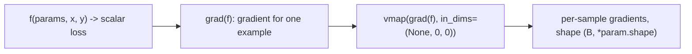

# 09 — torch.func: vmap, grad, and Functional Models

> **Prerequisites:** modules 07–08.
> **You will learn:** the JAX-style transforms in `torch.func` (`grad`,
> `grad_and_value`, `vjp`, `jvp`, `linearize`, `jacrev`, `jacfwd`, `hessian`) and
> how they compose; `vmap` semantics (`in_dims`/`out_dims`, nesting, `chunk_size`,
> `randomness=`) and what a batching rule is; turning an `nn.Module` into a pure
> function with `functional_call` and ensembling with `stack_module_state`;
> per-sample gradients (the DP-SGD building block), neural tangent kernels, and when
> vmap beats a Python loop; `functionalize`, the UX limitations, and migrating from
> `functorch`.

Modules 07 and 08 treated autograd as a tape: tensors record how they were made and
`backward()` walks the record. That is ideal for one model on one batch and awkward
for everything else: a gradient *per example*, a Jacobian, a Hessian-vector product,
ten small models at once. Each becomes a Python loop around `autograd.grad`.

`torch.func` changes the object being differentiated. It transforms *functions*:
`grad(f)` and `vmap(f)` are new Python functions, so the output of one transform can
be fed to another. Per-sample gradients are `vmap(grad(loss))`.

---

## 9.1 Function transforms vs tape-based autograd

`torch.func` began as the out-of-tree `functorch` library and was merged into core in
PyTorch 2.0 ([migration guide](https://docs.pytorch.org/docs/2.8/func.migrating.html)).
The API is deliberately JAX-shaped: pure functions in, pure functions out.

| API | You pass | You get | Composable? |
|---|---|---|---|
| `loss.backward()` | scalar tensor with history | side effect: `.grad` on leaves | no; a statement, not a value |
| `torch.autograd.grad(out, inputs)` | tensors with history | gradient tensors | partly (`create_graph=True`); not vmappable in general |
| `torch.func.grad(f)` | a Python function | a function returning the gradient | yes: `vmap(grad(f))`, `jacfwd(grad(f))` |

Each transform wraps tensor inputs in an internal tensor subclass (a
`GradTrackingTensor` for the AD transforms, a `BatchedTensor` for `vmap`) at a
numbered *level*, runs `f` once, and unwraps the result. Nesting transforms nests
levels, which is why composition works, and also why the restrictions of §9.9 exist:
anything that escapes the function (a global, `.item()`, a NumPy call) escapes the
wrappers.



The reverse- vs forward-mode trade-off is unchanged from
[08 — Custom Autograd Functions, Hooks, and Higher-Order Gradients](./08-custom-autograd-and-hooks.md)
and the [autodiff note](../../notes/deep-learning/backpropagation-and-autodiff.md);
the transforms make it a one-word choice.

## 9.2 grad, grad_and_value, vjp, jvp, linearize

Signatures are from the [torch.func API reference](https://docs.pytorch.org/docs/2.8/func.api.html)
and [`torch/_functorch/apis.py` at v2.8.0](https://github.com/pytorch/pytorch/blob/v2.8.0/torch/_functorch/apis.py),
checked with `inspect.signature` on 2.8.0.

**`grad(func, argnums=0, has_aux=False)`** returns a function computing the gradient
with respect to the argument(s) in `argnums`. `func` must return a scalar; otherwise
2.8 raises "Expected f(*args) to return a scalar Tensor ... Maybe you wanted to use
the vjp or jacrev APIs instead?" (verified). `argnums=(0, 1)` returns a tuple.
Arguments may be pytrees: if argument 0 is a `dict[str, Tensor]` of parameters, the
gradient is a dict with the same keys, which is what makes `grad` usable on modules
(§9.5). `has_aux=True` lets `func` return `(loss, aux)`, the sanctioned replacement
for stashing logits in a global. **`grad_and_value`**
returns `(gradient, value)` from one evaluation.

**`vjp(func, *primals)`** returns `(output, vjp_fn)`; `vjp_fn(v)` computes
$v^\top J$ for any cotangent shaped like the output, as often as you like. `grad` is
`vjp` with $v = 1$. **`jvp(func, primals, tangents)`** returns `(output, J t)` from
one forward-mode pass; note the tuples, `jvp(f, (x,), (t,))`.
**`linearize(func, *primals)`** returns `(output, jvp_fn)` with the linearisation
cached for repeated JVPs. Its 2.8 docstring says it "evaluates func twice" and has
"higher memory requirements than directly applying jvp"; when all tangents are known
up front, `vmap(jvp)` over them is usually better.

| Transform | Mode | One call computes | Memory |
|---|---|---|---|
| `grad`, `vjp` | reverse | $v^\top J$ | stores forward activations |
| `jvp` | forward | $J t$ | no stored activations |
| `linearize` | forward, cached | $J t$ for many `t` | cached linearisation |

## 9.3 Jacobians and Hessians

For $f: \mathbb{R}^n \to \mathbb{R}^m$ the Jacobian is $m \times n$. `jacrev` builds
it row by row: one VJP closure, `vmap`ped over the $m$ basis cotangents, so $m$ VJPs
run as one batched backward. `jacfwd` builds it column by column: `vmap` over $n$
basis tangents of `jvp`, so $n$ JVPs as one batched forward
([`eager_transforms.py` at v2.8.0](https://github.com/pytorch/pytorch/blob/v2.8.0/torch/_functorch/eager_transforms.py)).

| Shape of `f` | Prefer | Batched work | Example |
|---|---|---|---|
| $n \gg m$ | `jacrev` | $m$ VJPs | loss over parameters ($m = 1$) |
| $n \ll m$ | `jacfwd` | $n$ JVPs | large output, 3 input knobs |
| Hessian of scalar $g$ | `hessian = jacfwd(jacrev(g))` | $n$ JVPs of one VJP | curvature of small models |

In 2.8 `hessian` is literally `jacfwd(jacrev(func, argnums), argnums)`. Forward-over-
reverse beats reverse-over-reverse because the outer forward mode stores nothing
extra for the inner backward.

You rarely want $H$ itself ($n^2$ numbers). Newton-CG, influence functions and
sharpness metrics need **Hessian-vector products**, which cost a small constant times
one gradient:

$$
Hv = \frac{\partial}{\partial \epsilon} \nabla g(x + \epsilon v)\Big|_{\epsilon=0}
\quad\Longrightarrow\quad
\texttt{hvp = jvp(grad(g), (x,), (v,))[1]}.
$$

The tutorial ["Jacobians, Hessians, hvp, vhp, and more"](https://docs.pytorch.org/tutorials/intermediate/jacobians_hessians.html)
(living page, accessed 2026-10-10) compares these variants.

## 9.4 vmap: write for one example, run for a batch

`vmap(func, in_dims=0, out_dims=0, randomness="error", *, chunk_size=None)`
([docs](https://docs.pytorch.org/docs/2.8/generated/torch.func.vmap.html)). For a
pure `f`, the documented mental model is a loop:

```python
vmap(f)(x) == torch.stack([f(x_i) for x_i in x.unbind(0)])
```

The implementation is not a loop. Inputs become `BatchedTensor`s that *hide* the
mapped dim (a physical `(B, 4)` reports shape `(4,)` inside `f`), and each operator
dispatches to a **batching rule** that produces the batched result with one ordinary
kernel call: `dot` on hidden `(B, 4)` inputs becomes one multiply-and-sum over the
last dim. An op with no rule falls back to a per-example loop and warns. On 2.8
`torch.histc` is one: under vmap it ran and warned "There is a performance drop
because we have not yet implemented the batching rule for aten::histc" (observed).

| Argument | Meaning |
|---|---|
| `in_dims=(0, None)` | map arg 0 over dim 0; pass arg 1 unbatched (shared weights) |
| `in_dims=({"x": 0, "y": None},)` | pytree-shaped in_dims for dict inputs |
| `out_dims=1` | put the mapped dim at output position 1 |
| `vmap(vmap(f, (None, 0)), (0, None))` | two independent mapped dims: pairwise matrices |
| `chunk_size=k` | process `k` examples at a time to bound peak memory; `1` is a loop |
| `randomness=` | `"error"` (default), `"different"`, `"same"` |

Randomness has an explicit default because inside `vmap`, `torch.rand(())` is
ambiguous: one draw shared by the batch, or one per example? With `"error"` it raises
"vmap: called random operation while in randomness error mode". `"different"` gives
per-example draws (dropout semantics); `"same"` broadcasts one. The flag covers only
PyTorch's RNG, not Python `random` or NumPy, and reproducibility comes from seeding
outside the vmap ([06 — Randomness, Distributions, and Reproducibility](./06-randomness-and-reproducibility.md)).

Constructs that work in eager and break under vmap (each observed on 2.8 CPU):

| Construct | What happens | vmap-friendly rewrite |
|---|---|---|
| `x.item()`, `float(x)` | error: ".item() on a Tensor" | keep it a tensor; `torch.where`, `clamp` |
| `if x.sum() > 0:` on a mapped tensor | error: data-dependent control flow | `torch.where(cond, a, b)` |
| `y.add_(x)`, `y` unbatched, `x` batched | error: cannot write `B` values into `y` | `y + x`, or build `y` with `x.new_zeros(...)` |
| `x.numpy()`, NumPy/SciPy | error: BatchedTensor has no storage | torch ops, or `autograd.Function` with `vmap` |
| `torch.nonzero`, `torch.unique` | error: dynamic output shape | fixed-size masks |

vmap beats a Python loop when per-example work is small enough that interpreter and
launch overhead dominate: per-sample gradients, Jacobians, ensembles of tiny models.
When each example is already a large matmul, or the model already has a batch
dimension, it buys nothing.

## 9.5 Functional models: functional_call

`grad` differentiates arguments, but a module keeps parameters as attributes.
`functional_call(module, parameter_and_buffer_dicts, args, kwargs=None, *,
tie_weights=True, strict=False)` ([docs](https://docs.pytorch.org/docs/2.8/generated/torch.func.functional_call.html))
runs `module.forward` with the given tensors substituted for the named parameters and
buffers, then restores the originals; the module is not mutated (verified).

```python
params = {k: v.detach() for k, v in model.named_parameters()}
def loss_fn(params, x, y):
    return F.cross_entropy(functional_call(model, params, (x,)), y)
grads = torch.func.grad(loss_fn)(params, x, y)    # dict with params' keys
```

The `.detach()` is the documented pattern: transforms track their own gradients, so
`requires_grad` on the dict only costs tape memory outside. Keys are the dotted names
of `named_parameters()` ([10 — nn.Module from the Inside](./10-nn-module-internals.md));
`strict=True` rejects missing or unexpected keys; `tie_weights=True` keeps tied
parameters tied.

Buffers are where vmap and modules collide. A training-mode `BatchNorm` updates
`running_mean` in place; under vmap the input is batched and the buffer is not, so
2.8 raises "Batch norm got a batched tensor as input while the running_mean or
running_var, which will be updated in place, were not batched." Fixes: `eval()`,
batched buffers, or `torch.func.replace_all_batch_norm_modules_(model)`, which sets
the running stats to `None` and `track_running_stats=False` (verified: the module
then vmaps cleanly).

## 9.6 Model ensembling with stack_module_state

`stack_module_state(models)` returns `(params, buffers)`: dicts whose entries stack
the $M$ models' tensors on a new leading dim. For three `nn.Linear(4, 2)`,
`params["weight"]` is `(3, 2, 4)`. A skeleton copy moved to the `meta` device supplies
the code and attribute names without holding weights (the
[ensembling tutorial](https://docs.pytorch.org/tutorials/intermediate/ensembling.html)'s
trick, living page, accessed 2026-10-10), and `vmap(call_one, in_dims=(0, 0, None))`
evaluates all models on a shared batch, giving `(M, B, out)`. `in_dims=(0, 0, 0)`
gives each model its own minibatch, as bagging wants. Fence 4 is the full code.

Uses: deep ensembles of small models, hyperparameter sweeps over tiny networks,
MAML-style inner loops vmapped over tasks. It does not help large models: $M$ copies
of large activations do not fit better because they are batched.

## 9.7 Per-sample gradients

The batch gradient of a mean loss is $\bar g = \frac{1}{B}\sum_i g_i$. Autograd
computes $\bar g$ without ever forming the $g_i$, because a matmul's weight gradient
$\delta^\top A$ sums over the batch inside the kernel. Two families of algorithms need
the $g_i$:

- **DP-SGD** ([Abadi et al. 2016](https://arxiv.org/abs/1607.00133)) clips each $g_i$
  to norm $C$, sums, adds Gaussian noise with standard deviation $\sigma C$, and
  divides by $B$. Clipping the batch gradient would bound the batch's influence, not
  any single example's, and the privacy guarantee is about single examples.
- **Diagnostics**: gradient-noise scale, per-example influence, flagging mislabeled
  examples by gradient norm.

| Method | Work | Notes |
|---|---|---|
| Python loop, batch size 1 | $B$ forward + backward passes | correct, slow; tiny kernels waste the hardware |
| `vmap(grad(loss_one), in_dims=(None, 0, 0))` | one batched forward + backward | general; needs batching rules for every op |
| analytic per Linear: $g_{W,i} = \delta_i a_i^\top$ | one normal pass plus hooks | per-layer-type code; what Opacus does |

```python
def loss_one(params, xi, yi):                    # xi: (20,), yi: ()
    logits = functional_call(model, params, (xi.unsqueeze(0),))
    return F.cross_entropy(logits, yi.unsqueeze(0))

per_sample = vmap(grad(loss_one), in_dims=(None, 0, 0))(params, x, y)
# per_sample["0.weight"]: (B, hidden, 20)
```

`loss_one` is written for one example, adding and stripping a batch dim of 1 for the
module; `in_dims=(None, 0, 0)` shares the parameters and maps over examples (the
[per-sample-gradients tutorial](https://docs.pytorch.org/tutorials/intermediate/per_sample_grads.html)
recipe, living page, accessed 2026-10-10).

Every method pays for the result: $B \times P$ floats.

| Model | $P$ | $B$ | Per-sample grads, float32 |
|---|---|---|---|
| lab MLP (20 → 64 → 5) | 1,669 | 32 | 213,632 B = 208.6 KiB |
| GPT-2 small | 124,439,808 | 32 | 15.93 GB = 14.83 GiB |

The second row is why DP-SGD at scale avoids materialising $g_i$: for a Linear on one
vector, $\|\delta_i a_i^\top\|_F = \|\delta_i\|\,\|a_i\|$, so per-example norms (all
clipping needs) come from activations and output gradients directly.
[Opacus](https://arxiv.org/abs/2109.12298) (Yousefpour et al. 2021) is the production
library: per-layer-type hooks plus a privacy accountant.

## 9.8 Neural tangent kernels (brief)

The empirical NTK of $f_\theta: \mathbb{R}^d \to \mathbb{R}^k$ is
$\Theta(x_1, x_2) = J_\theta(x_1)\,J_\theta(x_2)^\top$ ($k \times k$), with
$J_\theta(x) = \partial f_\theta(x)/\partial\theta$ of shape $k \times P$.
[Jacot et al. 2018](https://arxiv.org/abs/1806.07572) showed that in the
infinite-width limit gradient descent on $f$ is kernel regression with a fixed
$\Theta$; at finite width it is used to study training dynamics and which examples
move together under a step.

```python
def fnet_single(params, x):                      # x: (d,) -> (k,)
    return functional_call(net, params, (x.unsqueeze(0),)).squeeze(0)

j1 = vmap(jacrev(fnet_single), (None, 0))(params, x1)   # dict: (N, k, *param.shape)
j2 = vmap(jacrev(fnet_single), (None, 0))(params, x2)   # dict: (M, k, *param.shape)
ntk = sum(torch.einsum("Naf,Mbf->NMab", a.flatten(2), b.flatten(2))
          for a, b in zip(j1.values(), j2.values()))     # (N, M, k, k)
```

`jacrev` because $P \gg k$. For a `3 → 8 → 2` tanh MLP with $N = 5$, $M = 4$ this
produced a `(5, 4, 2, 2)` kernel locally. The
[NTK tutorial](https://docs.pytorch.org/tutorials/intermediate/neural_tangent_kernels.html)
(living page, accessed 2026-10-10) also shows a JVP/VJP form that never builds $J$.

## 9.9 functionalize and the limitations

`functionalize(func, *, remove="mutations")`
([docs](https://docs.pytorch.org/docs/2.8/generated/torch.func.functionalize.html))
removes mutation while preserving semantics: in-place ops on intermediates become
out-of-place, views of mutated tensors are regenerated from the updated base, and
`remove="mutations_and_views"` turns views into `view_copy`. Mutated inputs get a
final `copy_` back. Tracing `b = a + 1; c = b.view(-1); c.add_(1); return b` through
`make_fx(functionalize(f))` on 2.8 gave `add`, `view`, `add` (no `add_`), then a
`view` back. AOTAutograd runs this pass before compilation, because fusion compilers
want dataflow, not aliasing ([24 — Compiler Internals](./24-compiler-internals-fx-inductor.md)).

Limitations, condensed from the [UX limitations page](https://docs.pytorch.org/docs/2.8/func.ux_limitations.html):

| Limitation | Applies to | Workaround |
|---|---|---|
| assigning tensors to globals | all transforms | return them; `has_aux=True` |
| `autograd.grad` / `.backward()` inside a transform | vmap, AD transforms | `torch.func.grad`/`vjp` |
| `.item()`, data-dependent `if` | vmap, and `jacfwd`/`hessian` (built on vmap) | `torch.where`, masks |
| in-place write into an unbatched tensor | vmap | out-of-place, `new_zeros` |
| side effects (print, list mutation) run once | vmap | none; keep `f` pure |
| custom `autograd.Function` | all | `setup_context` style plus a `vmap` staticmethod or `generate_vmap_rule=True` |

The last row links back to module 08: a `Function` works with transforms only if
`forward` does not take `ctx` and saving happens in `setup_context(ctx, inputs,
output)`; vmap support needs a `vmap` staticmethod, or `generate_vmap_rule = True`
when forward and backward use only PyTorch ops
([extending torch.func](https://docs.pytorch.org/docs/2.8/notes/extending.func.html)).

| functorch | torch.func | Notes |
|---|---|---|
| `vmap`, `grad`, `vjp`, `jvp`, `jacrev`, `jacfwd`, `hessian`, `functionalize` | same names (`torch.vmap` is an alias) | drop-in |
| `make_functional`, `make_functional_with_buffers` | `functional_call` | not drop-in: keep the module, pass dicts |
| `combine_state_for_ensemble` | `stack_module_state` | returns two dicts |
| `torch.autograd.functional.jacobian/hessian` | `jacrev`/`jacfwd`/`hessian` | composable, often faster |

On 2.8 `functorch.make_functional` still runs but warns that it "is deprecated as of
PyTorch 2.0" (observed). If you keep parameters in a dict and update them out of
place, move the module to `meta` so you hold one copy, not two.

## Worked transform verification

Four self-contained CPU fences pin the contracts above. None tests performance, GPU
behaviour, or the no-batching-rule fallback.

**Fence 1** proves `grad` is the same math as tape autograd (identical float64
computation, default tolerances), that its result carries no graph, that
`grad_and_value` returns $f(w)$, and that `argnums=(0, 1)` yields a tuple.

```python pytorch-check
import torch
from torch.func import grad, grad_and_value

torch.manual_seed(0)
x = torch.randn(5, 3, dtype=torch.float64)          # (5, 3) data, fixed
w = torch.randn(3, dtype=torch.float64)             # (3,) weights

def f(w):
    return ((x @ w).tanh() ** 2).sum()               # R^3 -> scalar

g_func = grad(f)(w)                                  # a plain tensor, no graph
w_req = w.clone().requires_grad_(True)
(g_tape,) = torch.autograd.grad(f(w_req), w_req)
torch.testing.assert_close(g_func, g_tape)           # same math, default tol
assert g_func.grad_fn is None and not g_func.requires_grad

g2, value = grad_and_value(f)(w)
torch.testing.assert_close(value, f(w))
torch.testing.assert_close(g2, g_func)

def h(w, b):
    return ((x @ w + b).tanh() ** 2).sum()
gw, gb = grad(h, argnums=(0, 1))(w, torch.tensor(0.5, dtype=torch.float64))
assert gw.shape == (3,) and gb.shape == ()
print("grad == autograd.grad:", [round(v, 4) for v in g_func.tolist()])
```

**Fence 2** proves reverse- and forward-mode Jacobians agree on $\mathbb{R}^3 \to
\mathbb{R}^4$, that `hessian` is symmetric, and that `jvp(grad(g))` equals `H @ v`.
Different algorithms, so explicit tolerances. It does not show the HVP is cheaper.

```python pytorch-check
import torch
from torch.func import jacrev, jacfwd, hessian, grad, jvp

torch.manual_seed(0)
A = torch.randn(4, 3, dtype=torch.float64)
x = torch.randn(3, dtype=torch.float64)
v = torch.randn(3, dtype=torch.float64)

def f(x):                                            # R^3 -> R^4
    return torch.sin(A @ x) * x.sum()

J_rev = jacrev(f)(x)                                 # 4 VJPs, vmapped
J_fwd = jacfwd(f)(x)                                 # 3 JVPs, vmapped
assert J_rev.shape == J_fwd.shape == (4, 3)
torch.testing.assert_close(J_rev, J_fwd, atol=1e-12, rtol=1e-10)

def g(x):                                            # R^3 -> scalar
    return (torch.sin(A @ x) ** 2).sum() + (x ** 4).sum()

H = hessian(g)(x)                                    # jacfwd(jacrev(g))
assert H.shape == (3, 3)
torch.testing.assert_close(H, H.T, atol=1e-12, rtol=0)

_, hvp = jvp(grad(g), (x,), (v,))                    # forward-over-reverse, no H
torch.testing.assert_close(hvp, H @ v, atol=1e-12, rtol=1e-10)
print("jacrev == jacfwd, H symmetric, HVP == H @ v:", round(float(hvp.norm()), 4))
```

**Fence 3** proves batched `dot`, `in_dims=None` broadcasting, a nested-vmap pairwise
matrix equal to a double loop, `chunk_size` invariance, and the three randomness
modes. It does not claim `"different"` draws match any loop's draws.

```python pytorch-check
import torch
from torch.func import vmap

torch.manual_seed(0)
A, B = torch.randn(6, 4), torch.randn(6, 4)
torch.testing.assert_close(vmap(torch.dot)(A, B), (A * B).sum(-1))   # (6,)

w = torch.randn(4)                                   # shared, not batched
torch.testing.assert_close(vmap(torch.dot, in_dims=(0, None))(A, w), A @ w)

X, Y = torch.randn(3, 4), torch.randn(5, 4)
def sqdist(a, b):                                    # (4,), (4,) -> ()
    return ((a - b) ** 2).sum()
D = vmap(vmap(sqdist, in_dims=(None, 0)), in_dims=(0, None))(X, Y)
loop = torch.stack([torch.stack([sqdist(a, b) for b in Y]) for a in X])
assert D.shape == (3, 5)
torch.testing.assert_close(D, loop)

D_chunked = vmap(vmap(sqdist, in_dims=(None, 0)), in_dims=(0, None), chunk_size=2)(X, Y)
torch.testing.assert_close(D_chunked, D)

try:
    vmap(lambda x: torch.rand(()))(torch.zeros(3))
    raise AssertionError("expected randomness='error' to raise")
except RuntimeError as e:
    assert "randomness" in str(e)

torch.manual_seed(0)
diff = vmap(lambda x: x + torch.rand(()), randomness="different")(torch.zeros(3))
same = vmap(lambda x: x + torch.rand(()), randomness="same")(torch.zeros(3))
assert len(set(diff.tolist())) == 3 and len(set(same.tolist())) == 1
print("vmap semantics hold; pairwise D shape", tuple(D.shape))
```

**Fence 4** proves `stack_module_state` + `functional_call` on a `meta` skeleton +
`vmap` reproduces three independent `nn.Linear(4, 2)` forwards, for shared and
per-model batches. It does not cover training-mode buffers (§9.5).

```python pytorch-check
import copy
import torch
import torch.nn as nn
from torch.func import functional_call, stack_module_state, vmap

models = []
for seed in range(3):
    torch.manual_seed(seed)
    models.append(nn.Linear(4, 2))
params, buffers = stack_module_state(models)         # weight: (3, 2, 4), bias: (3, 2)
assert params["weight"].shape == (3, 2, 4) and params["bias"].shape == (3, 2)

base = copy.deepcopy(models[0]).to("meta")           # skeleton only, no storage

def call_one(p, b, x):
    return functional_call(base, (p, b), (x,))

torch.manual_seed(10)
x = torch.randn(8, 4)                                # one shared batch
out = vmap(call_one, in_dims=(0, 0, None))(params, buffers, x)
expected = torch.stack([m(x) for m in models])       # (3, 8, 2)
assert out.shape == (3, 8, 2)
torch.testing.assert_close(out, expected)

xs = torch.randn(3, 8, 4)                            # a different batch per model
out2 = vmap(call_one, in_dims=(0, 0, 0))(params, buffers, xs)
torch.testing.assert_close(out2, torch.stack([m(xi) for m, xi in zip(models, xs)]))
print("ensemble of 3 via vmap matches individual forwards:", tuple(out.shape))
```

## Lab: compute per-sample gradients three ways and take a DP-SGD step

[`code/09_per_sample_grads.py`](./code/09_per_sample_grads.py) builds a seeded
`Linear(20, hidden) → ReLU → Linear(hidden, 5)` and a synthetic batch, then computes
per-sample gradients by (1) a loop of $B$ backward passes on `x[i:i+1]`; (2)
`vmap(grad(loss_one))` over `functional_call`; (3) for the first layer only, the
outer product: a forward hook on `model[0]` saves its input $a$ `(B, 20)` and puts a
tensor hook on its output to capture $\delta$ `(B, hidden)`. With
`reduction="sum"` row $i$ of $\delta$ is exactly example $i$'s output gradient, so
$g_{W,i}$ = `einsum("bh,bi->bhi", delta, a)`. It checks that the mean of per-sample
gradients equals the batch-mean gradient, then takes one DP-SGD step on the `(B, P)`
matrix: clip rows to $C = 1$, sum, add $\mathcal{N}(0, (\sigma C)^2)$ noise
($\sigma = 1$, seeded `torch.Generator`), divide by $B$. Loop vs vmap is timed with
`torch.utils.benchmark.Timer` (informational).

**Tested with Python 3.11 and PyTorch 2.8.0 on CPU.**

```bash
python content/courses/pytorch/code/09_per_sample_grads.py
python site/test_pytorch_09_per_sample_grads.py
```

One local PyTorch 2.8 CPU run (Apple M2 Pro, 4 threads, defaults `--seed 0 --batch 32 --hidden 64`) produced:

| Key | Value | Reading |
|---|---|---|
| `max_diff_loop_vs_vmap` | 2.4e-07 | float32 round-off, different reduction order |
| `max_diff_analytic_first_layer` | 6.0e-08 | the outer product is the gradient, not an approximation |
| `mean_vs_batch_grad_diff` | 1.9e-08 | $\bar g = \frac{1}{B}\sum_i g_i$ holds |
| `clipped_fraction` | 1.0 | per-sample norms ranged 2.10 to 5.88 (median 3.41), all above $C$ |
| `dp_update_norm` | 1.317 | norm of $(\sum_i \mathrm{clip}(g_i) + \text{noise})/B$ |
| `time_loop_ms` / `time_vmap_ms` | 2.01 / 0.43 | about 4.7× here; machine-dependent, not tested |

A clipped fraction of 1.0 means the clipped sum is a sum of unit vectors: DP-SGD
keeps only the average direction. The noise has norm about $\sigma C\sqrt{P}
\approx 41$ against a clipped sum of norm at most $B = 32$, which is why DP-SGD wants
large batches and why $C$ is tuned to the gradient-norm distribution.

The test asserts loop-vs-vmap and analytic diffs below 1e-5 and mean-vs-batch below
1e-6; re-derives clipping from `run(..., return_tensors=True)` (every clipped row has
norm $\le 1 + 10^{-6}$, rows inside the ball are untouched); and checks the noise is
bitwise reproducible for one seed and different for another. It does not assert the
timing ratio. Honest scope: no privacy accounting; turning $(\sigma, C, B,
\text{steps})$ into $(\varepsilon, \delta)$ needs an accountant such as Opacus's.

## Key takeaways

- `torch.func` transforms functions, so transforms compose: `vmap(grad(f))`,
  `jacfwd(jacrev(f))`, `jvp(grad(f))`.
- `grad` needs a scalar output, accepts pytree arguments, and uses `has_aux` instead
  of globals.
- For $f: \mathbb{R}^n \to \mathbb{R}^m$, `jacrev` costs $m$ VJPs and `jacfwd` $n$
  JVPs; `hessian` is forward-over-reverse; HVPs never need $H$.
- `vmap` runs `f` once on BatchedTensors; batching rules vectorise each op, missing
  rules fall back to a loop with a warning; randomness defaults to `"error"`.
- `.item()`, data-dependent `if`, in-place writes into unbatched tensors and NumPy
  calls break vmap.
- `functional_call` turns a module into a pure function of a parameter dict;
  `stack_module_state` + vmap runs an ensemble in one call.
- Per-sample gradients cost $B \times P$ floats; DP-SGD needs them because clipping
  must bound each example's influence.

## Self-check

1. For `f: R^1000 → R^10`, would you use `jacrev` or `jacfwd`, and how many VJPs/JVPs
   does each perform?
2. Why does DP-SGD need per-sample gradients rather than the batch gradient, and what
   is the memory cost for a model with P parameters and batch B?
3. A function works in eager but `vmap` raises on it. Name three constructs that cause
   this and the vmap-friendly rewrite for each.

---

**Next → [10 — nn.Module from the Inside](./10-nn-module-internals.md)**
