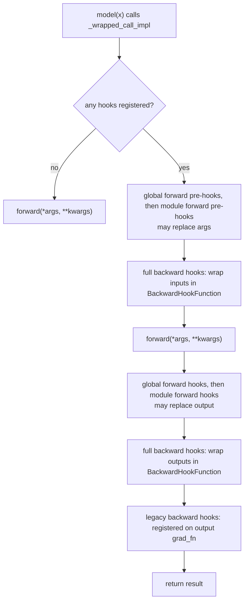
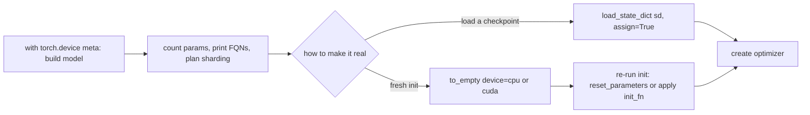

# 10 — nn.Module from the Inside

> **Prerequisites:** module 07.
> **You will learn:** how `nn.Module.__setattr__` registers `Parameter`s, buffers
> (persistent and not) and submodules, and how `named_parameters`/`named_buffers`/
> `named_modules` walk the tree; the containers (`Sequential`, `ModuleList`,
> `ModuleDict`, `ParameterList`, `ParameterDict`) and the "plain Python list" bug;
> `state_dict`/`load_state_dict` precisely (keys, `strict`, `assign=True`,
> `missing/unexpected_keys`, `_version` and `_load_from_state_dict`,
> `get_extra_state`); forward pre/post hooks, full backward hooks, global module
> hooks, and `train()`/`eval()` semantics; and device/dtype movement (`to`,
> `to_empty`, the `meta` device), lazy modules, `parametrize` (weight norm,
> spectral norm, orthogonal), the pruning utility, `deepcopy`, and `extra_repr`.

`nn.Module` is not just a base class that gives you `forward`. It is a
bookkeeping system: a tree of objects, each holding ordered dictionaries of
tensors and children, plus hook tables and a flag. Optimizers, `.to("cuda")`,
checkpoints, DDP, FSDP, LoRA targeting and quantization observers all find your
tensors by walking that tree. A tensor that never entered it does not exist to
the framework, so most "didn't move / didn't save / didn't train" bugs are
registration bugs.

[The PyTorch overview note](../../notes/libraries/pytorch.md) has the one-page
`nn.Module` summary and [the neural-networks notes](../../notes/deep-learning/neural-networks.md)
cover what layers compute. This module goes into the mechanics, citing
[`torch/nn/modules/module.py` at v2.8.0](https://github.com/pytorch/pytorch/blob/v2.8.0/torch/nn/modules/module.py).

---

## 10.1 What a Module really is

After `super().__init__()`, every instance carries:

| Attribute | Holds |
|---|---|
| `_parameters: dict[str, Parameter or None]` | this module's own parameters |
| `_buffers: dict[str, Tensor or None]` + `_non_persistent_buffers_set` | own buffers, and which are excluded from `state_dict` |
| `_modules: dict[str, Module or None]` | direct children |
| `_forward_pre_hooks`, `_forward_hooks`, `_backward_pre_hooks`, `_backward_hooks`, state-dict hook dicts | hooks keyed by handle id |
| `training: bool` | train/eval flag |

Each dict holds direct members only; `parameters()`, `state_dict()`, `.to()` and
`train()` are recursive walks over `_modules`.

`model(x)` does not call `forward` directly. `__call__` is `_wrapped_call_impl`,
which uses the compiled path after `module.compile()` and otherwise calls
`_call_impl`. If no per-module or global hook dict is non-empty, `_call_impl`
returns `self.forward(*args, **kwargs)` immediately; otherwise it runs:



Two consequences. Calling `model.forward(x)` yourself skips every hook, so pruning
masks, observers and probes silently stop working; always call the module. And
full backward hooks insert an identity autograd node around the module's inputs
and outputs, so they see exactly $\partial L/\partial \text{input}$ and
$\partial L/\partial \text{output}$, however many ops `forward` runs; the legacy
hook only sees the output's last `grad_fn` (10.6).

The tutorial [What is torch.nn really?](https://docs.pytorch.org/tutorials/beginner/nn_tutorial.html)
(living page, accessed 2026-10-10) builds up from bare tensors to `nn.Module`; the
[Modules note](https://docs.pytorch.org/docs/2.8/notes/modules.html) is the
reference companion to this module.

## 10.2 Registration via `__setattr__`

`Module.__setattr__` (line 1966 at v2.8.0) switches on the assigned value:

1. `Parameter` → `register_parameter(name, value)`. Without a prior
   `super().__init__()` it raises `AttributeError: cannot assign parameters before
   Module.__init__() call`.
2. Name already a parameter → value must be `Parameter` or `None`; a plain tensor
   raises `TypeError: cannot assign 'torch.FloatTensor' as parameter 'w'
   (torch.nn.Parameter or None expected)`. Overwrite values with
   `with torch.no_grad(): m.weight.copy_(t)` instead.
3. `Module` → stored in `_modules`.
4. `nn.Buffer`, or a tensor whose name is already a buffer → buffer update.
5. Anything else, **including an ordinary tensor** → plain attribute. No error.

Case 5 is the silent bug:

| Assigned as | `parameters()` | `state_dict()` | moved by `.to()` | DDP broadcast |
|---|---|---|---|---|
| `nn.Parameter(t)` | yes | yes | yes | grads all-reduced |
| `register_buffer(n, t)` | no | yes | yes | yes |
| `register_buffer(n, t, persistent=False)` | no | **no** | yes | yes |
| plain `self.t = tensor` | no | no | **no** | no |
| `register_parameter(n, None)` | slot reserved | no | n/a | n/a |
| Module inside a Python `list` | no | no | no | no |

Choose by role. Learned weights are Parameters. State that must survive a restart
(BatchNorm `running_mean`) is a persistent buffer. Constants recomputable from
the config — a causal mask `torch.tril(torch.ones(T, T))`, a RoPE cache — are
**non-persistent** buffers: they follow `.to()` but stay out of checkpoints, so
changing `block_size` does not break loading. The capstone registers its mask
this way ([module 32](./32-capstone-gpt-model.md)).
`register_parameter("bias", None)` reserves an optional slot; `add_module` and
its alias `register_module` register children under computed names.

## 10.3 Containers and traversal

| Container | Indexing | `forward` | Use |
|---|---|---|---|
| `nn.Sequential(*mods)` or `(OrderedDict)` | int, slice (returns `Sequential`), name | chains children | pipelines |
| `nn.ModuleList` | int, slice, `append` | none | stacks you loop over |
| `nn.ModuleDict` | str key without `.` | none | named branches/heads |
| `nn.ParameterList` / `ParameterDict` | int / key | none | variable parameter sets |

`self.blocks = [Block() for _ in range(L)]` is the classic bug: a plain list
(case 5), so the blocks never reach the optimizer, the GPU or the checkpoint. The
model still runs on CPU and the loss may still fall, because the registered
embeddings and head train around frozen random blocks. `nn.ModuleList` fixes it
(fence 1). `ModuleDict` rejects `"a.b"` with a `KeyError` because `.` is the FQN
separator.

| Call | Yields |
|---|---|
| `children()` / `named_children()` | direct submodules |
| `modules()` / `named_modules()` | self and all descendants, pre-order, deduplicated |
| `named_parameters(prefix="", recurse=True, remove_duplicate=True)` | parameters with FQNs; `recurse=False` = own only |
| `named_buffers()` | persistent and non-persistent buffers |
| `get_submodule("blocks.3.attn")`, `get_parameter(...)`, `set_submodule` | one object by dotted path |
| `apply(fn)` | `fn` on every submodule, children first, then self ([module 13](./13-initialization-and-losses.md) init) |

`remove_duplicate=True` matters for weight tying. With `head.weight =
emb.weight`, one Parameter is reachable under two names; `named_parameters()`
yields `['emb.weight']` once, so it is not updated twice and counts are right
(measured on a 10×4 tied pair: 40 elements, not 80), while `state_dict()`
contains **both** keys over the same storage.

The fully-qualified name (`"blocks.3.attn.qkv.weight"`) is the model's real
contract: checkpoint keys, FSDP2 wrapping ([module 27](./27-fsdp2-dtensor-parallelism.md))
and LoRA target matching ([module 36](./36-capstone-lora-finetuning.md)) all use
it. Renaming an attribute breaks checkpoints.

## 10.4 train() and eval()

`train(mode=True)` sets `training` on every module in the tree; `eval()` is
`train(False)`. The flag does nothing unless `forward` reads it: `Dropout`
becomes identity, `BatchNorm` uses and stops updating running stats, attention
layers drop `dropout_p`. `eval()` is **not** a grad mode
([module 07](./07-autograd-graph-and-backward.md)); evaluation also needs
`torch.no_grad()` or `torch.inference_mode()`.

| Bug | Symptom | Fix |
|---|---|---|
| no `eval()` before validation | noisy val loss; BN stats updated with val data | `eval()` + `inference_mode()`, then `train()` |
| `bn.eval()` to freeze, then `model.train()` each epoch | "frozen" stats drift | re-freeze after every `train()` or override `train()` |
| `model.training = False` | only the root changes (measured `[False, True, True]`) | `model.eval()` |
| `model.train = False` | shadows the method; `model.train()` raises `TypeError: 'bool' object is not callable` | never assign it |

Freezing is a third, orthogonal axis: `requires_grad_(False)` stops gradients.
A frozen BatchNorm in train mode still updates its running stats.

## 10.5 state_dict in detail

`state_dict()` returns an `OrderedDict` of FQN → tensor for every parameter and
persistent buffer, with a `_metadata` attribute holding `{"version": ...}` per
module. Values are detached but **share storage** with the model
(`data_ptr` equal): mutating one in place mutates the model, and keeping
`model.state_dict()` in memory as a "snapshot" snapshots nothing. Clone it.

`load_state_dict(sd, strict=True, assign=False)` calls each module's
`_load_from_state_dict`, which does `param.copy_(sd[prefix + name])` under
`no_grad`, and returns `_IncompatibleKeys(missing_keys, unexpected_keys)`. With
`strict=True` any mismatch raises `Missing key(s) in state_dict: "2.bias".
Unexpected key(s) in state_dict: "extra".`; with `strict=False` the lists are
returned for you to check. Shape mismatches (`size mismatch for 0.weight: copying
a param with shape torch.Size([5, 3]) ...`) raise either way.

`strict=False` has one legitimate job, partial loading (backbone into a model
with a new head), followed by asserting `missing_keys` is exactly the head. As a
default it is dangerous: a checkpoint from a DDP wrapper prefixes every key with
`module.` (a compiled model with `_orig_mod.`), so every key is unexpected,
every parameter missing, the call "succeeds", and you evaluate random weights.

**`assign=True`** keeps the loaded tensors' properties instead of the module's:
the checkpoint tensor becomes the parameter (wrapped in `Parameter`, keeping the
module's `requires_grad`). It is the only way to load into a `meta` module;
without it, 2.8 warns that copying into a meta parameter "is a no-op". Parameter
objects are replaced, so create the optimizer afterwards. A quirk measured on
2.8: `assign=True` writes `assign_to_params_buffers=True` into the *caller's*
`sd._metadata`, so a later default load from the same dict also assigns. Two
models loaded that way end up sharing the dict's storage (measured: equal
`data_ptr`), and training one silently trains the other. A plain dict built with
`{k: v.clone() for k, v in sd.items()}` has no `_metadata` and is safe; use a
fresh dict per load.

**Versioning.** A class's `_version` is saved in `_metadata` and passed to
`_load_from_state_dict` as `local_metadata["version"]`; overriding that method
migrates old checkpoints. BatchNorm (`_version = 2`,
[`batchnorm.py` at v2.8.0](https://github.com/pytorch/pytorch/blob/v2.8.0/torch/nn/modules/batchnorm.py))
inserts a zero `num_batches_tracked` when `version is None or version < 2`. A
version-2 checkpoint missing that key still fails strict loading: the migration
forgives only old files.

**Non-tensor state** uses `get_extra_state()`/`set_extra_state()`, which add an
`"_extra_state"` key (measured: `['_extra_state', 'lin.weight', 'lin.bias']`).
Keep it to plain types: `torch.load` defaults to `weights_only=True` since 2.6.
`register_state_dict_pre_hook`, `register_state_dict_post_hook`,
`register_load_state_dict_pre_hook` and
`register_load_state_dict_post_hook(hook(module, incompatible_keys))` transform
the dict at the boundary. Full checkpoints are [module 16](./16-training-loop-checkpointing.md).

## 10.6 Hooks on modules

| Registration | Signature → may return | Fires |
|---|---|---|
| `register_forward_pre_hook(h)` | `h(mod, args)` → new args | before `forward` |
| `...(h, with_kwargs=True)` | `h(mod, args, kwargs)` → `(args, kwargs)` | before `forward` |
| `register_forward_hook(h)` | `h(mod, args, output)` → new output | after `forward` (`always_call=True`: even on exception) |
| `register_full_backward_pre_hook(h)` | `h(mod, grad_output)` → new `grad_output` | output grads ready |
| `register_full_backward_hook(h)` | `h(mod, grad_input, grad_output)` → new `grad_input` | input grads computed |
| `register_backward_hook(h)` (legacy) | same | on the last `grad_fn` only |
| `torch.nn.modules.module.register_module_forward_hook(h)` and siblings | as per-module | every module call in the process |

Each returns a `RemovableHandle`; call `.remove()`. A forgotten global hook keeps
firing in every later test, which is why fence 4 removes its hooks in `finally`.

The legacy backward hook is measurably wrong. On a module computing
`relu(linear(x)) * 2` it attaches to `MulBackward0`, so `grad_input` is w.r.t.
the multiplication's inputs, not `x`; 2.8 warns that it "will be missing some
grad_input". The full hook reports `grad_input` of shape `(5, 3)` for a `(5, 3)`
input, as it should. Full backward hooks do forbid in-place ops on the module's
inputs/outputs, since those now pass through an extra autograd node.

Uses: **activation statistics** (a forward hook on every nonlinearity recording
mean, std and saturation fraction — Karpathy's makemore part 3 diagnostic,
fast.ai's `ActivationStats`) to find dead layers before the loss curve does;
**feature extraction** without editing `forward`; and **observers**, which is how
eager-mode quantization records ranges ([module 29](./29-quantization-and-compression.md)).
To change a computation permanently, prefer a wrapper module or a
parametrization (10.9).

## 10.7 Moving modules: to(), dtypes, and the meta device

`module.to(device, dtype)` is `_apply(fn)` over every parameter and buffer:

1. **Identity is preserved** when tensor types are compatible: `_apply` sets
   `param.data = fn(param)` (measured: `l.weight is p` stays `True` across
   `.to(torch.float64)`), which keeps optimizers valid. The
   [`torch.__future__`](https://docs.pytorch.org/docs/2.8/future_mod.html) flags
   `set_overwrite_module_params_on_conversion` (make new Parameters) and
   `set_swap_module_params_on_conversion` (use `torch.utils.swap_tensors`, which
   keeps identity even for subclasses like DTensor) both default to `False` in 2.8.
2. **Only floating and complex tensors change dtype**: `.to(torch.float16)` on
   BatchNorm leaves `num_batches_tracked` as `torch.int64` (measured).
3. **Create the optimizer after the final move** whenever identity can break
   (meta → real, `assign=True`, overwrite flag) — [module 15](./15-optimizers-and-schedules.md).

The **`meta` device** ([docs](https://docs.pytorch.org/docs/2.8/meta.html))
gives tensors shape, dtype and strides without storage; any module built under
`with torch.device("meta"):` gets meta parameters and init ops become no-ops. One
local CPU run built 16 stacked `nn.Linear(8192, 8192)` — 1,073,872,896
parameters, 4 GiB in `torch.float32` — in about 1 ms with no tensor memory.



`to_empty(device=...)` allocates **uninitialized** storage; values are garbage
until `reset_parameters()` or `apply(init_fn)`. Measured: after `to_empty` the
weight is a new object, so the optimizer must come last. FSDP2 builds 70-B
models this way ([module 27](./27-fsdp2-dtensor-parallelism.md)), and meta
tensors measure memory symbolically ([module 22](./22-memory-accounting-and-checkpointing.md)).

## 10.8 Lazy modules

`nn.LazyLinear(out_features)` infers `in_features` at the first forward. Until
then the weight is an `UninitializedParameter`, `repr` shows `in_features=0`,
and `.numel()` raises `ValueError: Attempted to use an uninitialized parameter`,
so parameter counting crashes. A forward pre-hook from
[`LazyModuleMixin`](https://docs.pytorch.org/docs/2.8/generated/torch.nn.modules.lazy.LazyModuleMixin.html)
materializes the weight and turns the module into a plain `Linear`; loading a
state dict first materializes from the checkpoint shapes instead.

The documented order is: construct, convert, **dry-run** a correctly shaped
input, then create the optimizer and load weights. On 2.8 CPU an SGD or Adam
built before the dry run happened to keep working (materialization mutates the
Parameter in place), but anything reading shapes up front — parameter counts,
FSDP flattening, DDP bucketing — breaks. Lazy modules are for prototyping;
production code should state sizes.

## 10.9 Parametrizations

`parametrize.register_parametrization(module, "weight", P())`
([docs](https://docs.pytorch.org/docs/2.8/generated/torch.nn.utils.parametrize.register_parametrization.html),
[source](https://github.com/pytorch/pytorch/blob/v2.8.0/torch/nn/utils/parametrize.py))
moves the parameter to `module.parametrizations.weight.original`, dynamically
subclasses the module (`Linear` → `ParametrizedLinear`), and makes `weight` a
property returning `P(original)`. The optimizer trains `original`; `forward`
always sees a constrained weight. A symmetric matrix:

```python
class Symmetric(nn.Module):
    def forward(self, X):
        return X.triu() + X.triu(1).mT   # upper triangle mirrored
```

The state-dict key becomes `parametrizations.weight.original` — a format change.
With a `right_inverse`, assigning `module.weight = W` sets `original` so that
`P(original) == W`. Every access recomputes `P`; inside
`with parametrize.cached():` it is computed once (measured: `lin.weight is
lin.weight` is `False` outside, `True` inside).
`remove_parametrizations(m, "weight", leave_parametrized=True)` bakes the value
into a plain Parameter before export. `torch.save(model)` on a parametrized model
raises `Serialization of parametrized modules is only supported through
state_dict()`.

| `torch.nn.utils.parametrizations.` | Constraint | State-dict additions |
|---|---|---|
| `orthogonal(m)` | $W^\top W = I$ (matrix exp / Cayley / Householder) | none |
| `spectral_norm(m)` | $W / \sigma_{\max}(W)$ by power iteration ([Miyato et al. 2018](https://arxiv.org/abs/1802.05957)) | buffers `_u`, `_v` |
| `weight_norm(m)` | $W = g \, v / \lVert v \rVert$ ([Salimans & Kingma 2016](https://arxiv.org/abs/1602.07868)) | `original0` = $g$, `original1` = $v$ |

The hook-based `torch.nn.utils.weight_norm` warns in 2.8 that it "is deprecated
in favor of torch.nn.utils.parametrizations.weight_norm". Spectral norm's power
iteration advances only in training mode; after 20 training forwards on a 4×6
weight the measured spectral norm was 1.0. See the
[parametrizations tutorial](https://docs.pytorch.org/tutorials/intermediate/parametrizations.html)
(living page, accessed 2026-10-10).

## 10.10 Pruning utility mechanics

[`prune`](https://github.com/pytorch/pytorch/blob/v2.8.0/torch/nn/utils/prune.py)
predates parametrize and uses hooks. `prune.l1_unstructured(module, "weight",
amount=0.5)` ([docs](https://docs.pytorch.org/docs/2.8/generated/torch.nn.utils.prune.l1_unstructured.html))
renames the parameter to `weight_orig`, registers a buffer `weight_mask` zeroing
the 50 % smallest $|w|$, sets a plain attribute `weight = weight_orig *
weight_mask`, and adds a forward pre-hook that recomputes it each call. Pruned
entries get zero gradient through the mask. `prune.remove(module, "weight")`
bakes the masked values into an ordinary `weight` and deletes the rest; before
that, the checkpoint stores both `weight_orig` and `weight_mask`, twice the dense
size.

Unstructured pruning is not faster: the weight is still dense and `F.linear`
multiplies the zeros. Speed needs structured sparsity a kernel exploits (2:4) or
removed rows/channels; when pruning pays is [module 29](./29-quantization-and-compression.md),
and the [pruning tutorial](https://docs.pytorch.org/tutorials/intermediate/pruning_tutorial.html)
(living page, accessed 2026-10-10) covers global and iterative variants.

## 10.11 deepcopy, repr, and writing your own Module

`copy.deepcopy(model)` copies the tree, tensors and hook dicts, preserving
sharing: measured, a copy of the tied model still has `head.weight is
emb.weight`, on separate storage from the original. That is how EMA and teacher
models are made (`swa_utils.AveragedModel` deep-copies,
[module 15](./15-optimizers-and-schedules.md)); note that copied hooks are
closures over the *original*. `print(model)` uses each module's `extra_repr()`
(`Linear`: `in_features=3, out_features=4, bias=True`).

```python
class RMSNorm(nn.Module):
    def __init__(self, d_model, eps=1e-6, device=None, dtype=None):
        super().__init__()                                    # first line, always
        self.eps = eps                                        # Python scalar: fine
        self.weight = nn.Parameter(torch.ones(d_model, device=device, dtype=dtype))

    def reset_parameters(self):                               # used after to_empty
        nn.init.ones_(self.weight)

    def forward(self, x):                                     # x: (B, T, d_model)
        rms = x.pow(2).mean(-1, keepdim=True).add(self.eps).rsqrt()
        return x * rms * self.weight

    def extra_repr(self):
        return f"{self.weight.shape[0]}, eps={self.eps}"
```

Checklist: `super().__init__()` first (else `AttributeError: cannot assign
module before Module.__init__() call`); every tensor a Parameter or buffer;
recomputable constants non-persistent; children in attributes or containers,
never plain lists/dicts; `device`/`dtype` factory kwargs so it can be built on
the target device or `meta`; a `reset_parameters()` for `to_empty`.

## Reconciling the sources

The [Modules note](https://docs.pytorch.org/docs/2.8/notes/modules.html) and the
[`nn.Module` reference](https://docs.pytorch.org/docs/2.8/generated/torch.nn.Module.html)
agree with everything above; the note is a user tour, this module follows the
data structures in `module.py`. The docs are terser than the behaviour in two
places: they do not mention that `assign=True` mutates the caller's `_metadata`,
and `LazyModuleMixin` prescribes post-dry-run optimizers although a pre-built one
survived on 2.8 CPU (follow the docs; the guarantee is theirs). The
[`torch.nn` container list](https://docs.pytorch.org/docs/2.8/nn.html) does not
stress that a list of Parameters is the same silent bug as a list of modules.

## Worked nn.Module verification

Five CPU fences; each is self-contained, seeded, and restores global state.

**Registration rules.** Proves which names reach `named_parameters()` and
`state_dict()`, that `.to(torch.float64)` converts registered tensors only, and
that `ModuleList` fixes the list bug. Device movement uses the same `_apply`
walk but is not exercised on CPU.

```python pytorch-check
import torch
import torch.nn as nn

torch.manual_seed(0)

class Leaky(nn.Module):
    def __init__(self, use_modulelist):
        super().__init__()
        self.w = nn.Parameter(torch.randn(3))
        self.register_buffer("running", torch.zeros(3))
        self.register_buffer("mask", torch.ones(3), persistent=False)
        self.plain = torch.ones(3)                       # silent bug
        layers = [nn.Linear(2, 2) for _ in range(2)]
        self.layers = nn.ModuleList(layers) if use_modulelist else layers

bad = Leaky(use_modulelist=False)
assert [n for n, _ in bad.named_parameters()] == ["w"]
assert list(bad.state_dict()) == ["w", "running"]           # mask: non-persistent
assert [n for n, _ in bad.named_buffers()] == ["running", "mask"]
bad.to(torch.float64)
assert bad.w.dtype == bad.running.dtype == bad.mask.dtype == torch.float64
assert bad.plain.dtype == torch.float32                      # not moved
assert bad.layers[0].weight.dtype == torch.float32           # not moved

good = Leaky(use_modulelist=True)
names = [n for n, _ in good.named_parameters()]
assert names == ["w", "layers.0.weight", "layers.0.bias", "layers.1.weight", "layers.1.bias"]
good.to(torch.float64)
assert all(p.dtype == torch.float64 for p in good.parameters())
assert good.plain.dtype == torch.float32                     # still a plain attribute
print("registration ok:", len(names), "params in ModuleList version")
```

**state_dict semantics.** Proves aliasing, the exact `strict=False` key lists,
and that shape mismatches raise regardless of `strict`. Disk serialization is
module 16.

```python pytorch-check
import torch
import torch.nn as nn

torch.manual_seed(0)
net = nn.Sequential(nn.Linear(3, 4), nn.ReLU(), nn.Linear(4, 2))
sd = net.state_dict()
assert list(sd) == ["0.weight", "0.bias", "2.weight", "2.bias"]
assert sd["0.weight"].data_ptr() == net[0].weight.data_ptr()
assert not sd["0.weight"].requires_grad
sd["2.bias"].fill_(7.0)                                       # in-place on the dict...
assert torch.equal(net[2].bias.detach(), torch.full((2,), 7.0))  # ...mutates the model

partial = {k: v.clone() for k, v in sd.items() if k != "2.bias"}
partial["head.weight"] = torch.zeros(1)
res = net.load_state_dict(partial, strict=False)
assert res.missing_keys == ["2.bias"] and res.unexpected_keys == ["head.weight"]
try:
    net.load_state_dict(partial)                              # strict=True raises
    raise AssertionError("strict load should fail")
except RuntimeError as e:
    assert "Missing key(s)" in str(e)

bad = {k: v.clone() for k, v in sd.items()}
bad["0.weight"] = torch.zeros(5, 3)
try:
    net.load_state_dict(bad, strict=False)
    raise AssertionError("shape mismatch should fail")
except RuntimeError as e:
    assert "size mismatch for 0.weight" in str(e)
print("state_dict ok:", res)
```

**Meta device and `assign=True`.** Proves a meta `Linear(4096, 4096)` has
4096·4096 + 4096 = 16,781,312 parameters without storage, and that `assign=True`
makes it real and numerically identical to the reference. Peak memory is
measured in module 22, not here.

```python pytorch-check
import torch
import torch.nn as nn

torch.manual_seed(0)
with torch.device("meta"):
    m = nn.Linear(4096, 4096)
assert m.weight.is_meta and m.bias.is_meta
assert sum(p.numel() for p in m.parameters()) == 16_781_312

ref = nn.Linear(4096, 4096)
sd = {k: v.clone() for k, v in ref.state_dict().items()}       # fresh dict, see 10.5
m.load_state_dict(sd, assign=True)
assert not m.weight.is_meta and m.weight.device.type == "cpu"
assert isinstance(m.weight, nn.Parameter) and m.weight.requires_grad
assert m.weight.data_ptr() == sd["weight"].data_ptr()           # assigned, not copied
x = torch.randn(2, 4096)
torch.testing.assert_close(m(x), ref(x), rtol=0, atol=0)        # identical math
print("meta + assign ok:", tuple(m.weight.shape))
```

**Hooks.** ReLU activations captured via `named_modules`, a full backward hook's
`grad_output` shape, a pre-hook scaling a bias-free net's output by exactly 3, a
global hook counting calls, and baseline restored after `remove()`. Hooks under
`torch.compile` are not tested.

```python pytorch-check
import torch
import torch.nn as nn
from torch.nn.modules.module import register_module_forward_hook

torch.manual_seed(0)
net = nn.Sequential(nn.Linear(4, 8, bias=False), nn.ReLU(),
                    nn.Linear(8, 8, bias=False), nn.ReLU(),
                    nn.Linear(8, 2, bias=False))
x = torch.randn(5, 4)
baseline = net(x).detach()

acts, grads, calls, handles = {}, [], [0], []
try:
    for name, mod in net.named_modules():
        if isinstance(mod, nn.ReLU):
            handles.append(mod.register_forward_hook(
                lambda m, a, out, name=name: acts.__setitem__(name, out.detach())))
    handles.append(net[4].register_full_backward_hook(
        lambda m, gin, gout: grads.append(gout[0].shape)))
    handles.append(net.register_forward_pre_hook(lambda m, args: (args[0] * 3,)))
    handles.append(register_module_forward_hook(
        lambda m, a, out: calls.__setitem__(0, calls[0] + 1)))   # global

    out = net(x)
    out.sum().backward()
    assert sorted(acts) == ["1", "3"] and acts["1"].shape == (5, 8)
    assert grads == [torch.Size([5, 2])]
    torch.testing.assert_close(out.detach(), 3 * baseline, rtol=1e-5, atol=1e-6)
    assert calls[0] == 6                                        # Sequential + 5 children
finally:
    for h in handles:
        h.remove()
torch.testing.assert_close(net(x).detach(), baseline, rtol=0, atol=0)
print("hooks ok:", sorted(acts), grads[0])
```

**Parametrize and pruning.** Proves `weight` stays symmetric after an SGD step,
that `original` is what trains, and that `l1_unstructured(amount=0.5)` zeros
exactly half the entries via `weight_mask`. It says nothing about training
quality or speed.

```python pytorch-check
import torch
import torch.nn as nn
import torch.nn.utils.parametrize as parametrize
from torch.nn.utils import prune

torch.manual_seed(0)

class Symmetric(nn.Module):
    def forward(self, X):
        return X.triu() + X.triu(1).mT

lin = nn.Linear(4, 4)
parametrize.register_parametrization(lin, "weight", Symmetric())
original = lin.parametrizations.weight.original
assert [n for n, _ in lin.named_parameters()] == ["bias", "parametrizations.weight.original"]
opt = torch.optim.SGD(lin.parameters(), lr=0.1)
before = original.detach().clone()
lin(torch.randn(8, 4)).pow(2).sum().backward()
opt.step()
assert not torch.equal(before, original.detach())               # original trained
torch.testing.assert_close(lin.weight, lin.weight.mT, rtol=0, atol=0)

lin2 = nn.Linear(4, 4)
prune.l1_unstructured(lin2, "weight", amount=0.5)
assert [n for n, _ in lin2.named_buffers()] == ["weight_mask"]
assert "weight_orig" in dict(lin2.named_parameters())
assert int((lin2.weight == 0).sum()) == 8 and int(lin2.weight_mask.sum()) == 8
prune.remove(lin2, "weight")
assert [n for n, _ in lin2.named_buffers()] == [] and int((lin2.weight == 0).sum()) == 8
print("parametrize + prune ok:", type(lin).__name__)
```

## Key takeaways

- A Module is three dicts (`_parameters`, `_buffers`, `_modules`), hook tables
  and a flag; plain tensor attributes and Python lists of modules are invisible.
- Parameters are learned, persistent buffers are checkpointed state,
  non-persistent buffers are recomputable constants that still follow `.to()`.
- FQNs are the contract for checkpoints, FSDP and LoRA; tied weights appear once
  in `named_parameters()`, twice in `state_dict()`.
- `state_dict` aliases the model; after `strict=False`, always check the key
  lists; `assign=True` is required for meta loading and needs a fresh optimizer.
- `eval()` is a flag, not `no_grad`; `requires_grad_(False)` is a third switch.
- Use full backward hooks, call the module (not `.forward`), remove handles.
- Big models: build on `meta`, then `assign=True` or `to_empty` +
  `reset_parameters()`, then the optimizer.
- Parametrize and prune rename state-dict keys; bake them in before export.

## Self-check

1. A colleague stores a causal mask as `self.mask = torch.tril(...)` in
   `__init__`. List what goes wrong on `.to("cuda")`, in `state_dict`, and under
   DDP, and give the one-line fix (and whether it should be persistent).
2. Explain how you would instantiate a 70-B-parameter model definition on a
   laptop to count its parameters and inspect FQNs, then load a sharded
   checkpoint without ever materialising random weights.
3. `load_state_dict(sd, strict=False)` silently succeeded but the model performs
   at chance. What are the first two things you inspect, and why is
   `strict=False` dangerous as a default?

---

**Next → [11 — Linear, Embedding, Convolution, and Recurrent Layers](./11-linear-embedding-conv-recurrent-layers.md)**
