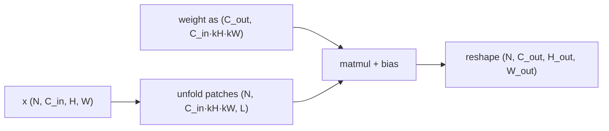
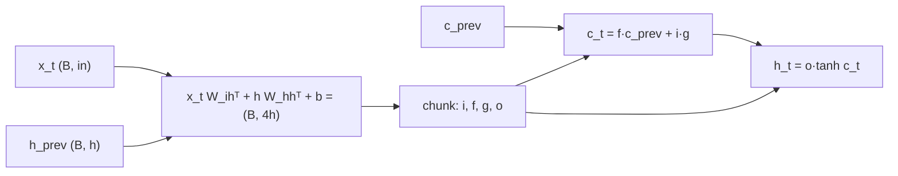

# 11 — Linear, Embedding, Convolution, and Recurrent Layers

> **Prerequisites:** modules 03–05 and 10.
> **You will learn:** what `nn.Linear`, `nn.Bilinear` and `nn.Identity` compute,
> their `(out, in)` weight layout and parameter counts; `nn.Embedding` and
> `nn.EmbeddingBag` as differentiable row lookups (`padding_idx`, `max_norm`,
> `sparse=True`, the one-hot-matmul equivalence); 1-D/2-D/3-D and transposed
> convolution, the output-shape formula with padding, stride, dilation and groups,
> and its reduction to `unfold` + matmul; pooling, `Fold`/`Unfold`, `Upsample`,
> `PixelShuffle`; `nn.RNN`/`LSTM`/`GRU` and their cells, gate equations, weight
> shapes, bidirectional/multi-layer outputs and packed sequences; and why a conv
> followed by BatchNorm should drop its bias.

A linear layer is one matmul, an embedding one indexing op, a convolution a
matmul over sliding patches, and a recurrent layer a loop of matmuls with
pointwise gates. Know each one's shape, parameter count and FLOPs and you can size
a model and read a stack trace. Four `pytorch-check` fences test every formula here
against the real modules. Normalization, dropout and attention layers are in
[module 12](./12-normalization-dropout-attention-layers.md); initialization is in
[module 13](./13-initialization-and-losses.md).

---

## 11.1 A layer is a Module with parameters and a functional twin

Each `nn.X` registers `Parameter`s ([module 10](./10-nn-module-internals.md)) and
its `forward` calls a stateless `torch.nn.functional` op with them: Module for
state, function for math. That split lets `functional_call`
([module 09](./09-torch-func-transforms.md)) swap parameters in from outside.

| Module | Functional twin | Learnable state |
|---|---|---|
| `nn.Linear(in, out)` | `F.linear(x, W, b)` | `weight (out, in)`, `bias (out,)` |
| `nn.Bilinear(in1, in2, out)` | `F.bilinear` | `weight (out, in1, in2)`, `bias (out,)` |
| `nn.Embedding(V, d)` | `F.embedding(ids, W)` | `weight (V, d)` |
| `nn.EmbeddingBag(V, d)` | `F.embedding_bag` | `weight (V, d)` |
| `nn.Conv{1,2,3}d` | `F.conv{1,2,3}d` | `weight (C_out, C_in/groups, *k)`, `bias (C_out,)` |
| `nn.ConvTranspose2d` | `F.conv_transpose2d` | `weight (C_in, C_out/groups, kH, kW)` |
| `nn.MaxPool2d`, `nn.AvgPool2d` | `F.max_pool2d`, `F.avg_pool2d` | none |
| `nn.Unfold`, `nn.Fold`, `nn.PixelShuffle` | `F.unfold`, `F.fold`, `F.pixel_shuffle` | none |
| `nn.RNN`, `nn.LSTM`, `nn.GRU` | none public (`torch._VF.lstm` inside) | per layer and direction: two weights, two biases |

The [PyTorch notes](../../notes/libraries/pytorch.md) and
[neural networks note](../../notes/deep-learning/neural-networks.md) give the
overview; this module goes deeper. API index:
[`torch.nn`](https://docs.pytorch.org/docs/2.8/nn.html) and
[`torch.nn.functional`](https://docs.pytorch.org/docs/2.8/nn.functional.html).

## 11.2 Linear, Bilinear, Identity

`nn.Linear(in_features, out_features)` computes $y = xW^\top + b$ with
$W \in \mathbb{R}^{\text{out}\times\text{in}}$. The weight is stored `(out, in)`
because row `j` is output unit `j`'s weight vector. It is also the operand layout
`F.linear` passes to BLAS `gemm`, so `.T` is a stride swap
([module 03](./03-storage-strides-views-copies.md)), not a copy. Input is any
`(*, in)`, output `(*, out)`: on `(B, T, d_model)` the layer acts on each token
independently, with no mixing across `T`. Parameters are `in·out + out`, so
GPT-2's `Linear(768, 3072)` has 2,362,368. Forward cost is `2·in·out` FLOPs per
row ([module 05](./05-tensor-math-linear-algebra-numerics.md)). The
[v2.8.0 source](https://github.com/pytorch/pytorch/blob/v2.8.0/torch/nn/modules/linear.py)
initializes with `kaiming_uniform_(weight, a=√5)`, which works out to
`U(−1/√in, 1/√in)`, and draws the bias from the same range. Module 13 explains why
LLM code replaces it.

`nn.Bilinear(in1, in2, out)` computes $y_k = x_1^\top A_k x_2 + b_k$ with `weight`
`(out, in1, in2)`. That is `out·in1·in2 + out` parameters, cubic in width, so you
see it only in small pair-scoring heads
([docs](https://docs.pytorch.org/docs/2.8/generated/torch.nn.Bilinear.html)).
`nn.Identity()` returns its input and accepts any constructor arguments. You use
it to remove a submodule without editing the parent: `model.fc = nn.Identity()`
turns a classifier into a feature extractor, as in
[module 19](./19-classic-models-end-to-end.md).

## 11.3 Embedding is indexing with a gradient

`nn.Embedding(V, d)(ids)` returns `weight[ids]`: `(B, T)` ids give `(B, T, d)`.
Mathematically this is $\text{one\_hot}(\text{ids}, V)\,W$, but the matmul costs
`O(T·V·d)` FLOPs and a `(T, V)` buffer, while the lookup is `O(T·d)` reads and no
FLOPs. The equivalence still matters because it gives the gradient:
$\text{one\_hot}^\top \cdot \text{grad\_out}$. Only looked-up rows get a non-zero
gradient, and each one receives the sum of the output gradients at every position
where its id appeared. Four options change this
([docs](https://docs.pytorch.org/docs/2.8/generated/torch.nn.Embedding.html)):

- **`padding_idx`**: the source draws `normal_(weight)` (so `N(0, 1)`), then zeroes
  this row, and backward always gives it zero gradient. If you load pretrained
  weights later, the row is no longer zero, but it still never updates.
- **`sparse=True`**: `weight.grad` becomes a `sparse_coo` tensor with one value row
  per occurrence, and duplicates are summed by `coalesce()`. For a `(10⁶, 64)`
  table and a batch touching 4,000 rows, that is about 1 MiB instead of a 244 MiB
  dense gradient. The docs list `SGD` and `SparseAdam` (CPU and CUDA) and
  `Adagrad` (CPU) as accepting it. On CPU in 2.8, `AdamW` raises `Adam does not
  support sparse gradients, please consider SparseAdam instead`. This is a
  semantic limit, not missing code: AdamW's moment decay and weight decay touch
  every row on every step. `SparseAdam` changes the semantics by updating moments
  only for the rows that are present.
- **`max_norm`**: at lookup time, any looked-up row whose norm exceeds `max_norm` is
  renormalized **in place**. On CPU, one lookup bumped `weight._version` from 1 to
  2 and changed only that row. If you use `weight` in a differentiable op *before*
  the lookup, backward hits the version-counter error from
  [module 07](./07-autograd-graph-and-backward.md). The docs' fix is to clone it.
- **`scale_grad_by_freq`**: divides by each id's batch frequency.

`nn.EmbeddingBag` fuses lookup and reduction. You pass a flat `input` of ids plus
`offsets` marking where each bag starts, and get `(num_bags, d)` back via
`mode="sum" | "mean" | "max"` (default `"mean"`). That is the fastText sentence
vector or a recommender's multi-hot feature, without the padded
`(num_bags, max_len, d)` intermediate. `per_sample_weights` works only with
`"sum"`; any other mode raises an error in 2.8
([docs](https://docs.pytorch.org/docs/2.8/generated/torch.nn.EmbeddingBag.html)).
For token and position embeddings and weight tying in LMs, see
[transformers module 02](../transformers/02-tokenization-and-embeddings.md).

## 11.4 Convolution: the shape formula and what a kernel really is

In CNN sections, `H` and `W` are image height and width, not heads. `Conv2d`
slides each of `C_out` kernels of shape `(C_in, kH, kW)` over an
`(N, C_in, H, W)` input and takes a dot product at every position. PyTorch
computes **cross-correlation**: the kernel is not flipped. Since the kernel is
learned, flipping would only relabel weights.

**Output size.** On one axis, padding gives length `L_in + 2p`. A dilated kernel
spans `d(k−1)+1` positions, so the last valid window start is
`L_in + 2p − d(k−1) − 1`. Counting starts at stride `s`:

$$L_\text{out} = \left\lfloor \frac{L_\text{in} + 2p - d\,(k-1) - 1}{s} \right\rfloor + 1,$$

applied to each spatial dim
([Conv2d docs](https://docs.pytorch.org/docs/2.8/generated/torch.nn.Conv2d.html);
pictures in [Dumoulin & Visin](https://arxiv.org/abs/1603.07285)).

| `L_in` | `k` | `s` | `p` | `d` | `L_out` | Rule of thumb |
|---|---|---|---|---|---|---|
| 32 | 3 | 1 | 1 | 1 | 32 | 3×3 pad 1 keeps size |
| 32 | 3 | 2 | 1 | 1 | 16 | stride 2 halves |
| 32 | 3 | 1 | 2 | 2 | 32 | dilation 2: receptive field 5 |
| 32 | 5 | 1 | 0 | 1 | 28 | "valid" loses `k−1` |
| 224 | 7 | 2 | 3 | 1 | 112 | ResNet stem |

`padding="same"` computes the padding for you, but only at stride 1. With
`stride=2`, 2.8 raises `padding='same' is not supported for strided
convolutions`, and with an even kernel it warns that a zero-padded copy may be
needed. `padding_mode` can be `"zeros"` (default), `"reflect"`, `"replicate"` or
`"circular"`.

**Weights and groups.** The weight is `(C_out, C_in/groups, kH, kW)`, so
$P = C_\text{out}\cdot (C_\text{in}/g)\cdot k_Hk_W + C_\text{out}$. `groups=g`
splits channels into `g` independent blocks, and both channel counts must be
divisible by `g`. With `groups=C_in` you get a **depthwise** conv, where each
channel is filtered alone. Depthwise followed by a `1×1` pointwise conv is the
MobileNet **depthwise-separable** block:

| `C_in = C_out = 128`, `k = 3`, no bias | Parameters |
|---|---|
| Standard `Conv2d(128, 128, 3)` | 147,456 |
| Depthwise `groups=128` | 1,152 |
| Pointwise `1×1` | 16,384 |
| Separable total | 17,536 (8.4× fewer) |

FLOPs fall by the same ratio; wall-clock time less, since depthwise convs are
memory-bound. Receptive fields: [CNN note](../../notes/deep-learning/cnns.md).

## 11.5 Convolution as unfold + matmul (im2col)

`F.unfold` ([docs](https://docs.pytorch.org/docs/2.8/generated/torch.nn.Unfold.html))
copies every `(C_in, kH, kW)` patch into a column, giving `(N, C_in·kH·kW, L)`
with `L = H_out·W_out`. One matmul with the flattened weight then produces all
outputs at once:



```python
def conv2d_via_unfold(x, w, b, stride=1, padding=0, dilation=1):
    N, _, H, W = x.shape
    C_out, _, kH, kW = w.shape
    cols = F.unfold(x, (kH, kW), dilation=dilation, padding=padding, stride=stride)
    out = w.view(C_out, -1) @ cols + b[:, None]                    # (N, C_out, L)
    H_out = (H + 2 * padding - dilation * (kH - 1) - 1) // stride + 1
    return out.view(N, C_out, H_out, -1)
```

Production kernels do not do this. oneDNN and cuDNN choose direct,
implicit-GEMM, Winograd or FFT algorithms, because the patch matrix is about
`kH·kW` times the size of the input. The matmul view is still the right way to
count cost. Each output is a dot product of length `C_in·kH·kW/g`, so

$$\text{FLOPs} = 2\, N\, C_\text{out}\, H_\text{out} W_\text{out}\, \frac{C_\text{in}}{g}\, k_H k_W .$$

`nn.Fold` scatters columns back into an image and **sums** overlapping patches.
So `fold(unfold(x))` is `x` times each pixel's patch count, not `x` itself. That
sum-over-overlaps is the adjoint, which comes back in 11.6.

`Conv1d` on `(N, C, L)` and `Conv3d` on `(N, C, D, H, W)` use the same formula.
`channels_last` (NHWC strides, [module 03](./03-storage-strides-views-copies.md))
is the layout oneDNN and cuDNN tensor-core kernels prefer; convert model and input
with `.to(memory_format=torch.channels_last)` (speedup hardware-dependent, not
measured here).

## 11.6 Transposed convolution, upsampling and PixelShuffle

A strided conv is a linear map $C$. `ConvTranspose2d` with the same weight is
$C^\top$, the function autograd uses for the conv's input gradient. It is an
adjoint, not an inverse, so "deconvolution" is a misnomer. Its size formula
([docs](https://docs.pytorch.org/docs/2.8/generated/torch.nn.ConvTranspose2d.html)):

$$L_\text{out} = (L_\text{in} - 1)\,s - 2p + d\,(k-1) + \text{output\_padding} + 1 .$$

A stride-2 conv maps both 15 and 16 to 8. `output_padding` (smaller than the
stride or the dilation) picks which size the transpose produces. When `k` is not
divisible by `s`, neighbouring outputs receive different numbers of taps, which
causes **checkerboard artifacts**. The common alternatives:

| Upsampler (×2) | Learnable | Overlap artifacts |
|---|---|---|
| `ConvTranspose2d(k=4, s=2, p=1)` | yes | possible, worst when `k mod s ≠ 0` |
| `Upsample(scale_factor=2)` + `Conv2d(3×3)` | conv only | none; resize is fixed (nearest/bilinear) |
| `Conv2d(C, C·r², 3)` + `PixelShuffle(r)` | yes | none; conv runs at low resolution |

`PixelShuffle(r)` reshapes `(N, C·r², H, W)` to `(N, C, rH, rW)` with no parameters
and no FLOPs. This is Shi et al.'s [sub-pixel convolution](https://arxiv.org/abs/1609.05158).
`PixelUnshuffle` inverts it.

`nn.Upsample` is a parameter-free wrapper over `F.interpolate` with `mode` in
`"nearest"` (default), `"bilinear"`, `"bicubic"`, `"trilinear"` and the
`"linear"` 1-D case. For the linear modes, `align_corners` decides whether the
corner pixels of input and output are aligned. Upsampling the row `[0, 1]` by 2
gives `[0, 0.25, 0.75, 1]` with the default `align_corners=False` and
`[0, 1/3, 2/3, 1]` with `True` (both checked on CPU). A model trained with one
setting and served with the other shifts every feature map by a fraction of a
pixel; ports between frameworks hit this often
([docs](https://docs.pytorch.org/docs/2.8/generated/torch.nn.Upsample.html)).

## 11.7 Pooling and adaptive pooling

Pooling uses the conv size formula, with `stride` defaulting to `kernel_size`, and
`ceil_mode=True` keeps a partial edge window. **`MaxPool2d`** sends the whole
gradient to the argmax and zero to the rest of the window. `return_indices=True`
exposes the argmax positions for `MaxUnpool2d`. **`AvgPool2d`** has
`count_include_pad=True` by default, which divides by the full window even where
it overlaps zero padding and so pulls border outputs toward zero.
**`AdaptiveAvgPool2d(1)`** is global average pooling: `(N, C, H, W)` becomes
`(N, C, 1, 1)` for any `H, W`, which is why a ResNet head accepts any input size.
**`LPPool2d`** computes $(\sum x^p)^{1/p}$, where `p=1` is sum pooling and large
`p` approaches max.

## 11.8 Recurrent layers: equations, weights, outputs

Equations follow the pinned [LSTM](https://docs.pytorch.org/docs/2.8/generated/torch.nn.LSTM.html)
and [GRU](https://docs.pytorch.org/docs/2.8/generated/torch.nn.GRU.html) docs. An
`nn.RNN` computes $h_t = \tanh(W_{ih}x_t + b_{ih} + W_{hh}h_{t-1} + b_{hh})$. The
LSTM stacks four gates, in the order i, f, g, o:

$$
\begin{aligned}
[i_t, f_t, g_t, o_t] &= [\sigma, \sigma, \tanh, \sigma]\big(W_{ih}x_t + b_{ih} + W_{hh}h_{t-1} + b_{hh}\big) \\
c_t &= f_t \odot c_{t-1} + i_t \odot g_t, \qquad h_t = o_t \odot \tanh(c_t)
\end{aligned}
$$

The GRU uses three, in the order r, z, n:

$$
\begin{aligned}
r_t &= \sigma(W_{ir}x_t + b_{ir} + W_{hr}h_{t-1} + b_{hr}), \quad
z_t = \sigma(W_{iz}x_t + b_{iz} + W_{hz}h_{t-1} + b_{hz}) \\
n_t &= \tanh\big(W_{in}x_t + b_{in} + r_t \odot (W_{hn}h_{t-1} + b_{hn})\big), \quad
h_t = (1 - z_t)\odot n_t + z_t \odot h_{t-1}
\end{aligned}
$$

[Cho et al.](https://arxiv.org/abs/1406.1078) reset *before* the matmul,
$W_{hn}(r_t \odot h_{t-1})$. PyTorch and cuDNN reset *after*, so all three
hidden matmuls fuse into one `(3h, h)` product per step. These are different
functions, so ported weights do not transfer unchanged. LSTM variants are surveyed
in [Greff et al.](https://arxiv.org/abs/1503.04069), which traces back to
Hochreiter and Schmidhuber.

**Two biases** (`bias_ih`, `bias_hh`) mirror cuDNN's parameter layout, so weights
move between cuDNN and native kernels unchanged. In the RNN and LSTM they only
appear summed and one is redundant. In the GRU, `b_hn` sits inside
$r_t \odot (\cdot)$ and is not.

| Parameter (`D=2` if bidirectional) | LSTM | GRU | RNN |
|---|---|---|---|
| `weight_ih_l0` | `(4h, input)` | `(3h, input)` | `(h, input)` |
| `weight_ih_l{k≥1}` | `(4h, D·h)` | `(3h, D·h)` | `(h, D·h)` |
| `weight_hh_l{k}` | `(4h, h)` | `(3h, h)` | `(h, h)` |
| `bias_ih_l{k}`, `bias_hh_l{k}` | `(4h,)` | `(3h,)` | `(h,)` |

The reverse direction repeats these with a `_reverse` suffix. With `G` gates, each
layer and direction has $Gh(\text{in}+h) + 2Gh$ parameters. For
`LSTM(32, 64, num_layers=2, bidirectional=True)`:

| Layer | Input width | Per direction | × 2 directions |
|---|---|---|---|
| 0 | 32 | 256·32 + 256·64 + 512 = 25,088 | 50,176 |
| 1 | 128 | 256·128 + 256·64 + 512 = 49,664 | 99,328 |
| Total | | | **149,504** |

The same GRU has 112,128 (measured on CPU).

**Outputs.** With `batch_first=True`, input `(B, T, input)` returns
`output, (h_n, c_n)`. `output` is `(B, T, D·h)`: the **last layer's** state at
every step, forward and backward halves concatenated. `h_n` and `c_n` are
`(D·num_layers, B, h)`, the **final** state of every layer and direction. Their
batch dim is always 1; `batch_first` does not apply to them. Use
`h_n.view(num_layers, D, B, h)[-1]` to get the last layer, or `h_n[-2]` (forward)
and `h_n[-1]` (backward). A classic bug is taking `output[:, -1]` as the summary.
Its backward half is the reverse direction after only **one** step. The reverse
final state is `output[:, 0, h:]`.

`proj_size > 0` (LSTMP) adds `weight_hr_l{k}` `(proj_size, h)`; `h_n`, `output`
and `weight_hh`'s second dim use `proj_size`, while `c_n` stays `h`.
`nn.LSTMCell`/`nn.GRUCell` take one step on `(B, input)` for custom loops
(attention over encoder states, scheduled sampling).



Vanishing gradients and BPTT are covered in the
[RNN note](../../notes/deep-learning/rnns-and-sequence-models.md), not re-derived
here.

## 11.9 Variable-length sequences: pad, pack, unpack

[`pad_sequence`](https://docs.pytorch.org/docs/2.8/generated/torch.nn.utils.rnn.pad_sequence.html)
turns sentences of lengths 4, 2 and 1 into a zero-padded `(3, 4, input)` batch.
Fed to an LSTM as is, the length-1 sentence's `h_n` is the state after **four**
updates, three of them on zeros, and biases move the state even on zero input. Its
backward direction *starts* on padding.

[`pack_padded_sequence(x, lengths, batch_first=True, enforce_sorted=False)`](https://docs.pytorch.org/docs/2.8/generated/torch.nn.utils.rnn.pack_padded_sequence.html)
sorts by length, recording `sorted_indices` and `unsorted_indices`, and stores
only real tokens, time-major:

| Step `t` | Active (sorted) | `batch_sizes[t]` | Rows appended to `data` |
|---|---|---|---|
| 0 | s₀ (len 4), s₁ (len 2), s₂ (len 1) | 3 | s₀[0], s₁[0], s₂[0] |
| 1 | s₀, s₁ | 2 | s₀[1], s₁[1] |
| 2, 3 | s₀ | 1, 1 | s₀[2], then s₀[3] |

`data` is `(7, input)` and `batch_sizes` is `[3, 2, 1, 1]` (checked on CPU). Each
step updates only the first `batch_sizes[t]` states. Finished sequences freeze at
their true final state, and the reverse direction starts at each real last token.
`pad_packed_sequence` restores `(B, T_max, D·h)` with zeros at dead positions.

On CUDA, a moved or replicated RNN can warn its weights "are not part of single
contiguous chunk of memory"; `flatten_parameters()` re-packs them for cuDNN (not
executed here). Transformer layers use padding masks or nested tensors instead
([module 12](./12-normalization-dropout-attention-layers.md)).

## 11.10 Choosing and counting: a parameter and FLOP cheat sheet

FLOPs count a multiply-add as 2.

| Layer | Parameters | Forward FLOPs per example | Good for |
|---|---|---|---|
| `Linear(in, out)` on `T` rows | `in·out + out` | `2·T·in·out` | projections, MLPs, heads |
| `Embedding(V, d)`, `T` ids | `V·d` | 0 (`T·d` reads) | ids to vectors |
| `EmbeddingBag`, bag of `n` | `V·d` | `≈ n·d` adds | bag-of-ids features |
| `Conv2d(C_in, C_out, k, groups=g)` | `C_out·C_in·k²/g + C_out` | `2·C_out·H_out·W_out·C_in·k²/g` | local, translation-equivariant features |
| `ConvTranspose2d` | same as conv | `2·C_in·H_in·W_in·C_out·k²/g` | learnable upsampling |
| Max/Avg pool | 0 | `≈ C·H_out·W_out·k²` | downsampling |
| `LSTM(in, h)` per layer and direction | `4h(in+h) + 8h` | `≈ 8·T·h·(in+h)` | streaming state |
| `GRU(in, h)` | `3h(in+h) + 6h` | `≈ 6·T·h·(in+h)` | same, 25 % cheaper |

The RNN rows hide the real bottleneck: `T` **sequential** hidden matmuls at batch
`B`, where a Transformer parallelizes over `T`.

**Drop the conv bias before BatchNorm.** The
[Performance Tuning Guide](https://docs.pytorch.org/tutorials/recipes/recipes/tuning_guide.html)
(living page, accessed 2026-10-10) recommends `Conv2d(..., bias=False)` when BN
follows directly. BN subtracts the per-channel mean, which cancels any constant
bias, and its `β` supplies the shift. The same applies to `Linear` before
`BatchNorm1d`.

**Shape gotchas.** `Linear` on `(B, T, d_model)` never mixes tokens. `Conv1d`
wants `(B, C, T)`: `x.transpose(1, 2)` in and out. `nn.Flatten()` starts at dim 1,
keeping batch; `AdaptiveAvgPool2d(1)` before it makes the head
resolution-independent.

## Reconciling the sources

d2l ch. 7, *Deep Learning with PyTorch* ch. 8 and the Conv2d docs all compute
cross-correlation and call it convolution. The GRU reset placement is the real
disagreement (11.8). Karpathy's makemore part 5 WaveNet uses
`FlattenConsecutive(n)` + `Linear`, which is a `Conv1d(kernel_size=n, stride=n)`;
stacking those gives the tree-shaped receptive field of WaveNet's dilated
convolutions.

## Worked layer verification

Four fences, about 0.2 s total on the first run locally. **Tested with Python 3.11
and PyTorch 2.8.0 on CPU.**

**Fence 1: Linear and Embedding identities.** Proves `Linear` is `x @ W.T + b` with
an `(out, in)` weight, `Embedding(padding_idx=0)` equals the one-hot matmul, and
after backward the padding row and unused rows have zero gradient while a
repeated id accumulates. It does not test `sparse=True` or `max_norm`.

```python pytorch-check
import torch
import torch.nn as nn
import torch.nn.functional as F

torch.manual_seed(0)
lin = nn.Linear(4, 3)
assert lin.weight.shape == (3, 4) and sum(p.numel() for p in lin.parameters()) == 15
x = torch.randn(2, 5, 4)                                          # any (*, in)
torch.testing.assert_close(lin(x), x @ lin.weight.T + lin.bias, rtol=1e-6, atol=1e-6)

emb = nn.Embedding(10, 4, padding_idx=0)
assert torch.all(emb.weight[0] == 0)
ids = torch.tensor([[0, 3, 3, 7], [5, 0, 2, 3]])                  # id 3 appears 3 times
out = emb(ids)
torch.testing.assert_close(out, F.one_hot(ids, 10).float() @ emb.weight, rtol=0, atol=0)

out.sum().backward()
g = emb.weight.grad
unused = [i for i in range(10) if i not in ids.unique().tolist()]
assert torch.all(g[0] == 0) and torch.all(g[unused] == 0)
torch.testing.assert_close(g[3], torch.full((4,), 3.0))           # one per occurrence
print("linear/embedding ok; rows with grad:", sorted(set(ids.flatten().tolist()) - {0}))
```

**Fence 2: conv shape formula and unfold equivalence.** Over 32 configurations
(kernel, stride, padding, dilation, `groups ∈ {1, C_in}`) checks shapes against
11.4's formula, values against unfold + matmul for `groups=1`, and the separable
block's parameter count. It says nothing about oneDNN's algorithm choice.

```python pytorch-check
import itertools
import torch
import torch.nn as nn
import torch.nn.functional as F

def out_len(L, k, s, p, d):
    return (L + 2 * p - d * (k - 1) - 1) // s + 1

def conv2d_via_unfold(x, w, b, s, p, d):
    N, _, H, W = x.shape
    C_out, _, kH, kW = w.shape
    cols = F.unfold(x, (kH, kW), dilation=d, padding=p, stride=s)   # (N, C_in*kH*kW, L)
    out = w.view(C_out, -1) @ cols + b[:, None]
    return out.view(N, C_out, out_len(H, kH, s, p, d), out_len(W, kW, s, p, d))

torch.manual_seed(0)
N, C_in, H, W, C_out = 2, 4, 11, 9, 8
x = torch.randn(N, C_in, H, W)
for k, s, p, d, g in itertools.product([1, 3], [1, 2], [0, 1], [1, 2], [1, C_in]):
    conv = nn.Conv2d(C_in, C_out, k, stride=s, padding=p, dilation=d, groups=g)
    y = conv(x)
    assert y.shape == (N, C_out, out_len(H, k, s, p, d), out_len(W, k, s, p, d))
    assert conv.weight.shape == (C_out, C_in // g, k, k)
    if g == 1:
        torch.testing.assert_close(y, conv2d_via_unfold(x, conv.weight, conv.bias, s, p, d),
                                   rtol=1e-5, atol=1e-5)

C = 128
dw = nn.Conv2d(C, C, 3, padding=1, groups=C, bias=False)
pw = nn.Conv2d(C, C, 1, bias=False)
sep = sum(p.numel() for m in (dw, pw) for p in m.parameters())
assert sep == C * 9 + C * C == 17_536
print(f"conv ok: 32 configs; separable block {sep} params vs {C * C * 9} standard")
```

**Fence 3: ConvTranspose is the adjoint of conv.** In `torch.float64`, with a
shared stride-2 weight, it checks $\langle Cx, y\rangle = \langle x, C^\top
y\rangle$ to `1e-10`, that `output_padding` selects 15 or 16 from the same
8-wide output, and that autograd's input gradient *is* `conv_transpose2d`. It
does not address checkerboard artifacts.

```python pytorch-check
import torch
import torch.nn.functional as F

def tconv_len(L, k, s, p, d=1, op=0):
    return (L - 1) * s - 2 * p + d * (k - 1) + op + 1

g = torch.Generator().manual_seed(0)
C_in, C_out, k, s, p = 3, 5, 3, 2, 1
w = torch.randn(C_out, C_in, k, k, generator=g, dtype=torch.float64)
for H in (15, 16):                                                # both map to 8
    x = torch.randn(2, C_in, H, H, generator=g, dtype=torch.float64, requires_grad=True)
    cx = F.conv2d(x, w, stride=s, padding=p)
    assert cx.shape[-1] == 8
    y = torch.randn_like(cx)
    op = H - tconv_len(8, k, s, p)                                # 0 or 1
    ty = F.conv_transpose2d(y, w, stride=s, padding=p, output_padding=op)
    assert ty.shape == x.shape and ty.shape[-1] == tconv_len(8, k, s, p, op=op)
    lhs, rhs = (cx * y).sum(), (x * ty).sum()
    assert abs(lhs - rhs).item() < 1e-10
    (gx,) = torch.autograd.grad(cx, x, grad_outputs=y)            # VJP w.r.t. input
    torch.testing.assert_close(gx, ty, rtol=0, atol=1e-12)
print(f"adjoint ok: <Cx,y> = <x,C^T y> = {lhs.item():.6f}")
```

**Fence 4: LSTM parameter count and packing.** Checks the 149,504 total; that
packed `h_n` for the length-2 sequence equals running it alone (all four layer and
direction slots); that unpacked padding is zero; where final states sit in
`output`; and that naive padding differs. It does not exercise cuDNN.

```python pytorch-check
import torch
import torch.nn as nn
from torch.nn.utils.rnn import pad_sequence, pack_padded_sequence, pad_packed_sequence

torch.manual_seed(0)
h = 64
per_dir = lambda i: 4 * h * i + 4 * h * h + 2 * 4 * h
count = sum(p.numel() for p in nn.LSTM(32, h, num_layers=2, bidirectional=True).parameters())
assert count == 2 * (per_dir(32) + per_dir(2 * h)) == 149_504

lstm = nn.LSTM(3, 4, num_layers=2, bidirectional=True, batch_first=True).eval()
lengths = torch.tensor([5, 2, 4])
seqs = [torch.randn(int(L), 3) for L in lengths]
padded = pad_sequence(seqs, batch_first=True)                     # (B, T_max, 3)
with torch.no_grad():
    packed = pack_padded_sequence(padded, lengths, batch_first=True, enforce_sorted=False)
    assert packed.batch_sizes.tolist() == [3, 3, 2, 2, 1]
    out_p, (h_n, _) = lstm(packed)
    out, _ = pad_packed_sequence(out_p, batch_first=True)         # (B, T_max, D*h)
    _, (h_alone, _) = lstm(seqs[1][None])
    _, (h_naive, _) = lstm(padded)                                # padding treated as data

assert h_n.shape == (4, 3, 4) and out.shape == (3, 5, 8)
torch.testing.assert_close(h_n[:, 1], h_alone[:, 0], rtol=0, atol=1e-6)
for b, L in enumerate(lengths.tolist()):
    assert torch.all(out[b, L:] == 0)
    torch.testing.assert_close(out[b, L - 1, :4], h_n[-2, b])     # last layer, forward
    torch.testing.assert_close(out[b, 0, 4:], h_n[-1, b])         # last layer, backward
gap = (h_naive[:, 1] - h_alone[:, 0]).abs().max().item()
assert gap > 1e-3
print(f"lstm ok: {count} params; packed h_n matches alone; naive padding off by {gap:.3f}")
```

## Key takeaways

- `Linear` stores `(out, in)`, acts on the last dim, costs `2·in·out` per row.
- Embedding gradients reach only looked-up rows; `sparse=True` needs
  SGD/SparseAdam/Adagrad; `max_norm` writes into `weight` during forward.
- Conv: $\lfloor (L + 2p − d(k−1) − 1)/s\rfloor + 1$, weight `(C_out, C_in/g, kH, kW)`,
  FLOPs from the unfold + matmul view.
- Transposed conv is conv's adjoint, not its inverse.
- RNN weights stack gates (`4h`, `3h`); PyTorch's GRU resets after the matmul.
- `h_n` is `(D·num_layers, B, h)` regardless of `batch_first`; pack variable lengths.
- Drop the conv bias before BatchNorm.

## Self-check

1. A `Conv2d(64, 128, kernel_size=3, stride=2, padding=1, groups=64)` sees a
   `(8, 64, 56, 56)` input. Give the output shape, the parameter count, and the
   forward FLOPs; how do these change with `groups=1`?
2. You pad a batch of variable-length sentences and feed it to an LSTM without
   packing, then take `h_n`. What is wrong with that state for short sequences,
   and give two ways to fix it?
3. Why can `nn.Embedding(..., sparse=True)` not be used with `AdamW`, and what
   does its gradient look like compared to the dense case?

---

**Next → [12 — Normalization, Dropout, Activations, and Attention Layers](./12-normalization-dropout-attention-layers.md)**
