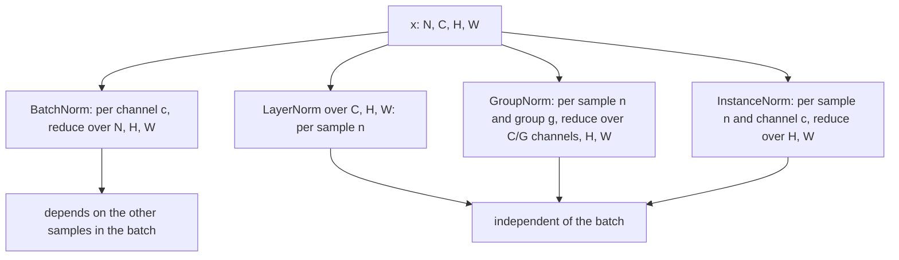
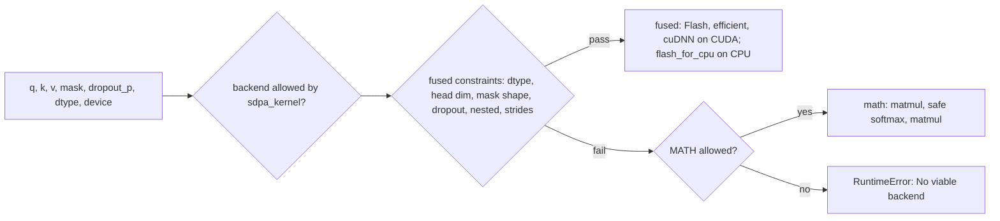

# 12 — Normalization, Dropout, Activations, and Attention Layers

> **Prerequisites:** modules 10–11.
> **You will learn:** which axes each normalization layer reduces over; BatchNorm's
> train/eval split, `momentum` and small-batch failures; dropout semantics and the
> activation zoo including GELU's tanh form; `F.scaled_dot_product_attention` mask
> polarity, `is_causal`, and backend selection with `sdpa_kernel`;
> `nn.MultiheadAttention` and `nn.Transformer*`; FlexAttention and nested tensors.

[Module 11](./11-linear-embedding-conv-recurrent-layers.md) covered the layers that
hold most of a network's parameters. This module covers layers that hold almost none
but decide whether training works. Each has a contract that is easy to get subtly
wrong: which axes a norm reduces over, which mode a dropout call is in, and whether
`True` in a mask means "attend" or "ignore" (PyTorch uses both). Claims that can run
on CPU are checked by a fence or the lab.

---

## 12.1 Normalization is "subtract mean, divide by std, then affine" over chosen axes

Every layer here computes
$y = \frac{x - \mu}{\sqrt{\sigma^2 + \epsilon}} \cdot \gamma + \beta$, differing only
in **which elements share one $(\mu, \sigma^2)$** and whether statistics are stored.
Why it helps:
[the regularization and normalization note](../../notes/deep-learning/regularization-and-normalization.md).
Here `(N, C, H, W)` is an image batch and `H` is height, not heads.

| Layer | Input | One $\mu,\sigma^2$ per ... (reduced axes) | Learnable | State | Typical use |
|---|---|---|---|---|---|
| `BatchNorm2d(C)` | `(N, C, H, W)` | channel, over `(N, H, W)` | $\gamma,\beta$ `(C,)` | running mean/var, `num_batches_tracked` | CNNs, decent batches |
| `LayerNorm(shape)` | `(B, T, d_model)` | sample/token, over trailing `shape` | $\gamma,\beta$ `shape` | none | classic Transformers |
| `RMSNorm(shape)` | `(B, T, d_model)` | token, trailing dims, **no centering** | $\gamma$ `shape` | none | modern LLMs |
| `GroupNorm(G, C)` | `(N, C, H, W)` | sample and group, over `(C/G, H, W)` | $\gamma,\beta$ `(C,)` | none | detection, small batches |
| `InstanceNorm2d(C)` | `(N, C, H, W)` | sample and channel, over `(H, W)` | none (`affine=False` default) | none by default | style transfer |
| `LocalResponseNorm(n)` | `(N, C, H, W)` | divides by neighbouring-channel energy, no mean | none | none | AlexNet-era legacy |



Only BatchNorm couples samples, which explains its failure modes and why Transformers
use LayerNorm or RMSNorm
([transformers/06](../transformers/06-transformer-block-anatomy.md) gives the padding
argument).

## 12.2 BatchNorm in detail

**Training mode** normalizes each channel with the batch mean and the **biased**
variance ($\frac{1}{n}$, $n = N \cdot H \cdot W$), then updates running estimates with
the **unbiased** variance ($\frac{1}{n-1}$), as the
[BatchNorm2d docs](https://docs.pytorch.org/docs/2.8/generated/torch.nn.BatchNorm2d.html)
state and fence 1 verifies. The update is
$\hat{x}_{\text{new}} = (1 - m)\,\hat{x} + m\,x_t$, so PyTorch's `momentum=0.1` weights
the **new** batch. Optimizer momentum and Keras' `momentum=0.99` weight the *old* value;
copy 0.99 into PyTorch and the running statistics become 99 % the newest batch.

**Eval mode** uses `running_mean`/`running_var`, so a sample's output stops depending on
its batch-mates. `momentum=None` switches to a cumulative average ($m_t = 1/t$ via
`num_batches_tracked`), handy for re-estimating statistics after training.
`track_running_stats=False` stores no buffers and uses batch statistics **even in eval
mode** (verified on CPU), so inference depends on batch composition.
`num_batches_tracked` is a buffer, hence in the `state_dict`; older checkpoints lacking it
load via a version-aware fix-up
([batchnorm.py at v2.8.0](https://github.com/pytorch/pytorch/blob/v2.8.0/torch/nn/modules/batchnorm.py)).

| Situation | What goes wrong | Fix |
|---|---|---|
| One value per channel in training, e.g. `(1, C)` | error "Expected more than 1 value per channel when training" (observed) | bigger batch, GroupNorm/LayerNorm |
| 2 to 8 samples per device | noisy batch stats; train/eval mismatch | GroupNorm, SyncBatchNorm, frozen BN |
| Non-iid batches (sorted by class or domain) | running stats describe a mixture no batch resembles | shuffle; per-domain stats |
| Data parallel | each rank normalizes with its shard only | `nn.SyncBatchNorm` ([module 26](./26-distributed-collectives-and-ddp.md)) |
| Fine-tuning on little data | running stats drift to tiny new batches | keep BN in eval, freeze $\gamma,\beta$ ([module 19](./19-classic-models-end-to-end.md)) |

The mirror bug, evaluating in train mode, makes outputs depend on the test batch.

## 12.3 LayerNorm, RMSNorm, GroupNorm

**LayerNorm** ([docs](https://docs.pytorch.org/docs/2.8/generated/torch.nn.LayerNorm.html);
[arXiv:1607.06450](https://arxiv.org/abs/1607.06450))
normalizes over the trailing `normalized_shape`: `LayerNorm(d_model)` on
`(B, T, d_model)` is per token. `elementwise_affine=False` drops $\gamma$ and $\beta$;
`bias=False` (2.1+) drops only $\beta$. It has no state, so train and eval agree.

**RMSNorm** (`nn.RMSNorm`, 2.4+; [docs](https://docs.pytorch.org/docs/2.8/generated/torch.nn.RMSNorm.html))
computes $x / \sqrt{\epsilon + \frac{1}{d}\sum_i x_i^2} \cdot \gamma$: no mean, no
$\beta$, one reduction fewer, and no measurable loss per Zhang & Sennrich
([arXiv:1910.07467](https://arxiv.org/abs/1910.07467)). Its default `eps=None` means
`torch.finfo(x.dtype).eps` (about 1.19e-7 in float32), not the `1e-5`/`1e-6` of
Llama-style code. Whether $\epsilon$ sits inside the root, on the variance or on the
std, and its size, change outputs at the 1e-6 level and far more for near-zero
activations. When porting weights, set `eps` explicitly and compare one layer before
comparing logits. Pre-LN vs post-LN and RMSNorm in LLMs:
[transformers/06](../transformers/06-transformer-block-anatomy.md).

**GroupNorm** ([docs](https://docs.pytorch.org/docs/2.8/generated/torch.nn.GroupNorm.html);
[arXiv:1803.08494](https://arxiv.org/abs/1803.08494)) splits `C` into `num_groups`
(which must divide `C`) and normalizes each group per sample. Its affine is per channel.
The two limits, both checked in fence 1: `GroupNorm(1, C)` equals LayerNorm over
`(C, H, W)`, and `GroupNorm(C, C)` equals InstanceNorm plus a per-channel affine.

## 12.4 Dropout and its relatives

PyTorch uses **inverted dropout**: training keeps each element with probability $1-p$
and scales it by $1/(1-p)$, so $\mathbb{E}[y] = x$; eval is the identity. Fence 2
measured $p = 0.25$ on 200,000 elements: every output was 0 or $x/(1-p)$, the keep rate
0.7507, the mean off by 0.06 %.

| Module | Drops | Use |
|---|---|---|
| `nn.Dropout(p)` | elements | MLPs, attention weights, residual stream |
| `nn.Dropout1d/2d/3d(p)` | whole channels of `(N, C, L)` / `(N, C, H, W)` / `(N, C, D, H, W)` | conv features, where neighbouring pixels are correlated |
| `nn.AlphaDropout(p)` / `FeatureAlphaDropout` | elements / channels, set to SELU's saturation and re-affined | SELU networks only |

Three footguns. `F.dropout(x, p)` defaults to `training=True` and knows nothing about the
enclosing module, so write `training=self.training`. `F.scaled_dot_product_attention(...,
dropout_p=p)` **always** applies dropout (the
[SDPA docs](https://docs.pytorch.org/docs/2.8/generated/torch.nn.functional.scaled_dot_product_attention.html)
warn about it), so pass `self.p if self.training else 0.0`. And dropout draws from the
global RNG, so adding one shifts every later random number
([module 06](./06-randomness-and-reproducibility.md)). LLM pretraining usually uses
dropout 0.

## 12.5 The activation zoo

Theory (dead units, saturation, interaction with init) is in
[the activations note](../../notes/deep-learning/activations-and-initialization.md);
GLU/SwiGLU are in [transformers/07](../transformers/07-ffn-and-activations.md).

| Module | Formula | Options | Note |
|---|---|---|---|
| `ReLU` | $\max(0,x)$ | `inplace` | CNN default |
| `LeakyReLU` | $x$ or $\alpha x$ | `negative_slope=0.01` | no dead units |
| `PReLU` | $x$ or $a x$ | learnable `a` (init 0.25), 1 or `C` params | keep `a` out of weight decay |
| `ELU` / `SELU` | $\alpha(e^x-1)$ for $x<0$ | SELU fixes $\lambda \approx 1.0507$, $\alpha \approx 1.6733$ | SELU pairs with AlphaDropout |
| `GELU` | $x\Phi(x)$ | `approximate="none"` or `"tanh"` | BERT, GPT-2 |
| `SiLU` | $x\sigma(x)$ | `inplace` | Swish; inside SwiGLU |
| `Mish`, `Hardswish` | $x\tanh(\text{softplus}\,x)$, $x\,\text{ReLU6}(x+3)/6$ | `inplace` | YOLO; mobile |
| `Softplus` | $\frac{1}{\beta}\log(1+e^{\beta x})$ | `beta=1`, `threshold=20` | linear above threshold |
| `Tanh`, `Sigmoid` | | | RNN gates |
| `Softmax(dim)`, `LogSoftmax(dim)` | | always pass `dim` | `F.softmax(x)` without `dim` warns "Implicit dimension choice ... deprecated" (observed) |

**GELU's tanh form** $0.5x(1+\tanh[\sqrt{2/\pi}(x + 0.044715x^3)])$
([arXiv:1606.08415](https://arxiv.org/abs/1606.08415)) is what GPT-2 used. Fence 4
measured its gap to the erf form on $[-6, 6]$: at most 4.73e-04, near $|x| \approx 2.7$.
Match `approximate` when porting weights: that gap fails a 1e-5 parity check
([GELU docs](https://docs.pytorch.org/docs/2.8/generated/torch.nn.GELU.html)).

**`inplace=True`** saves one buffer but can overwrite a tensor autograd saved, which
module 07's version counter reports as "modified by an inplace operation".

## 12.6 Scaled dot-product attention as a PyTorch primitive

The math is in [transformers/03](../transformers/03-self-attention-from-scratch.md),
heads in [transformers/04](../transformers/04-multi-head-attention.md), and the
overview in [the attention note](../../notes/deep-learning/attention-and-transformers.md).
The [SDPA tutorial](https://docs.pytorch.org/tutorials/intermediate/scaled_dot_product_attention_tutorial.html)
(living page, accessed 2026-10-10) benchmarks it on CUDA. The contract of
`F.scaled_dot_product_attention(query, key, value, attn_mask=None, dropout_p=0.0,
is_causal=False, scale=None, enable_gqa=False)`:

- **Shapes:** `query (B, H, T_q, d_head)`, `key`/`value (B, H_kv, T_k, d_head)`, output
  `(B, H, T_q, d_head)`. Heads come before time.
- **`attn_mask`** broadcasts to `(B, H, T_q, T_k)`. **Boolean: `True` = this pair takes
  part.** Float: added to the scores ($-\infty$ blocks; finite values are a bias such as
  ALiBi). The docs' reference code turns bool into float with
  `masked_fill_(attn_mask.logical_not(), -inf)`.
- **`is_causal=True`** builds `ones(T_q, T_k).tril(diagonal=0)`, a **top-left** aligned
  triangle ([CausalBias](https://docs.pytorch.org/docs/2.8/generated/torch.nn.attention.bias.CausalBias.html)).
  Right for square self-attention; wrong for 4 new queries against 64 cached keys, where
  query 0 should see keys 0 to 60 but sees only key 0. The lab measured a max output
  error of 3.34 there. Pass `ones(T_q, T_k).tril(diagonal=T_k - T_q)` instead
  ([module 32](./32-capstone-gpt-model.md), [module 35](./35-capstone-generation-kv-cache.md)).
  Never pass both `attn_mask` and `is_causal=True`. The docs and the math backend
  reject it ("Explicit attn_mask should not be set when is_causal=True"), but on this
  CPU build the default dispatch accepted the pair and silently ignored the mask
  (output equal to `is_causal` alone).
- **`scale`** (keyword-only) replaces $1/\sqrt{d_{\text{head}}}$; **`enable_gqa=True`**
  (2.5+) lets `H_kv` divide `H` ([transformers/09](../transformers/09-mqa-gqa-mla.md));
  the docs call it experimental.

### Backends, and why you do not always get a fast kernel

`SDPBackend` lists `MATH`, `FLASH_ATTENTION`, `EFFICIENT_ATTENTION`, `CUDNN_ATTENTION`,
`OVERRIDEABLE`, `ERROR` ([nn.attention docs](https://docs.pytorch.org/docs/2.8/nn.attention.html)).
The dispatcher tries fused kernels in priority order and falls back to math when
constraints fail. On CUDA (docs only, not executed here) Flash needs fp16/bf16 and
bounded head dims; the efficient kernel takes float32 and arbitrary masks.

On CPU the order is `{flash_attention, math}`
([sdp_utils_cpp.cpp at v2.8.0](https://github.com/pytorch/pytorch/blob/v2.8.0/aten/src/ATen/native/transformers/sdp_utils_cpp.cpp)).
With `torch.profiler` on this build, float32 inputs with no mask, `is_causal`, a bool
mask, a float mask, or `requires_grad` all ran
`aten::_scaled_dot_product_flash_attention_for_cpu`. **`dropout_p > 0` fell back to
`aten::_scaled_dot_product_attention_math`**, because the CPU flash gate includes
`check_for_dropout`. A feature you switch on can silently move you to the slow kernel.



`with sdpa_kernel([SDPBackend.FLASH_ATTENTION]):` disables everything else, so a silent
fallback becomes a `RuntimeError` whose warnings name each failed constraint: the way to
*prove* you are on a kernel. `sdpa_kernel([SDPBackend.MATH])` gives a reference answer
and accepts float64. Backends are not bitwise identical: in the lab the CPU flash kernel
differed from the manual reference by up to 6e-7, forced math by exactly 0. How fused
kernels avoid the `(T_q, T_k)` matrix is in
[transformers/11](../transformers/11-hardware-aware-attention.md).

Do not rely on fully masked rows: on CPU, an all-`False` SDPA row returned zeros, and
MHA with every key padded returned zeros with `need_weights=False` (the SDPA path) but
NaN with the default `need_weights=True`. Mask the loss instead.

## 12.7 nn.MultiheadAttention and the Transformer layers

`nn.MultiheadAttention(embed_dim, num_heads, dropout=0.0, bias=True, ...,
batch_first=False)` ([docs](https://docs.pytorch.org/docs/2.8/generated/torch.nn.MultiheadAttention.html))
holds a fused `in_proj_weight (3·embed_dim, embed_dim)` (rows Q, K, V), `in_proj_bias`
and `out_proj = Linear(embed_dim, embed_dim)`. **`batch_first=False` is
the default**, so inputs are `(T, B, d_model)` unless you say otherwise. Forward takes
`key_padding_mask (B, T_k)` (**True = ignore**), `attn_mask (T_q, T_k)` or
`(B·H, T_q, T_k)` (**True = not allowed**), and `need_weights=True` by default, which
returns head-averaged weights (`average_attn_weights`) and keeps you off the fused SDPA
path; set it to `False`. Its `is_causal` is only a hint about `attn_mask`.

**Mask polarity.** A wrong polarity raises nothing; it inverts the attention pattern.
The SDPA docs say "True indicates that the element should take part in attention"; the
MHA docs say "a True value indicates that the corresponding key value will be ignored".

| API | Bool `True` means | Float mask | From SDPA's `keep` |
|---|---|---|---|
| `F.scaled_dot_product_attention(attn_mask=)` | **attend** | added | (reference) |
| `nn.MultiheadAttention(key_padding_mask=, attn_mask=)` | **ignore** | added | `~keep` |
| `nn.Transformer*` `src_mask`, `tgt_mask`, `*_key_padding_mask` | **ignore** | added | `~keep` |
| `nn.Transformer.generate_square_subsequent_mask(T)` | (float) | 0 on/below diagonal, $-\infty$ above | already additive |
| FlexAttention `mask_mod` return | **attend** | n/a (`score_mod`) | `keep` |

The four Transformer mask arguments:
[transformers/08](../transformers/08-encoder-decoder-masking.md).

`nn.TransformerEncoderLayer(d_model, nhead, dim_feedforward=2048, dropout=0.1,
activation=relu, layer_norm_eps=1e-5, batch_first=False, norm_first=False)` is post-LN
by default; `norm_first=True` makes it pre-LN. The decoder layer adds cross-attention.
MHA and the [encoder layer](https://docs.pytorch.org/docs/2.8/generated/torch.nn.TransformerEncoderLayer.html)
have an **inference fast path** (fused native kernel, nested-tensor padding). Both need
grad disabled or no input requiring grad, `.eval()`, and batched `batch_first=True`
input. The encoder layer also needs `relu`/`gelu`, at most one of
`src_mask`/`src_key_padding_mask`, and equal LayerNorm eps; MHA also needs one tensor
for q, k and v, no `add_bias_kv`/`add_zero_attn`, and autocast off.
Both pages call these layers reference implementations of the 2017 design (no RoPE,
RMSNorm, GQA or KV cache), which is why the capstone builds its block on SDPA.

## 12.8 FlexAttention: masks and score modifications as Python functions

Instead of a dense `(T, T)` mask or a custom kernel per attention variant, FlexAttention
([docs](https://docs.pytorch.org/docs/2.8/nn.attention.flex_attention.html), prototype
since 2.5; [arXiv:2412.05496](https://arxiv.org/abs/2412.05496)) takes two small
functions:

```python
from torch.nn.attention.flex_attention import flex_attention, create_block_mask

doc_id = torch.tensor([0] * 40 + [1] * 24)          # two packed documents
def document(b, h, q_idx, kv_idx):                   # mask_mod: True = attend
    return (q_idx >= kv_idx) & (doc_id[q_idx] == doc_id[kv_idx])

def alibi(score, b, h, q_idx, kv_idx):               # score_mod: returns a new score
    return score - (h + 1) * 0.1 * (q_idx - kv_idx)

block_mask = create_block_mask(document, None, None, 64, 64, device="cpu")
out = flex_attention(q, k, v, score_mod=alibi, block_mask=block_mask)
```

`create_block_mask` evaluates `mask_mod` on a block grid (`BLOCK_SIZE=128`) and records
empty, partial and full blocks, so a kernel can **skip** empty blocks: that is where
sliding-window and document masks get their speed. Its default `device` is `"cuda"`;
pass `device="cpu"` on a CPU machine. `score_mod` edits each score before the softmax
(ALiBi, relative bias, softcapping) without a dense bias tensor.

Be honest about speed. Eager `flex_attention` traces the call with Dynamo and runs it
with `backend="eager"` (implementation-reviewed, `torch/nn/attention/flex_attention.py`
in 2.8.0): no Inductor, no fused kernel. In the lab it took about 850 µs versus 56 µs for
SDPA's CPU kernel, and the first call paid about 0.3 s of tracing plus about 0.7 s to
import Dynamo. Speed comes from `torch.compile(flex_attention)`, which generates a
Triton kernel on GPU ([module 23](./23-torch-compile-in-practice.md)); not executed in
this course's CI. Tracing also requires importable `mask_mod` globals: the lab loaded via
`importlib` without a `sys.modules` entry made Dynamo raise `ModuleNotFoundError`.

## 12.9 Variable-length batches without padding: nested tensors

| Approach | Memory | Wasted FLOPs | Kernel support (2.8) | Leakage risk |
|---|---|---|---|---|
| Pad to `T_max` + key-padding mask | $B \cdot T_{\max}$ | all padded rows/columns | every SDPA backend, MHA fast path | none if the mask is right |
| Jagged nested tensor (NJT) | $\sum_i T_i$ | none | SDPA (CPU path observed; CUDA fused per tutorial); **no `is_causal` on CPU** | none by construction |
| Pack into one row + document mask | $\sum_i T_i$ | masked blocks, skipped with a FlexAttention block mask | dense mask: any backend taking masks; block mask: FlexAttention | high if the mask is wrong |

An NJT stores one `values` buffer plus `offsets` and prints a symbolic ragged dim:

```python
nt = torch.nested.nested_tensor([doc_a, doc_b], layout=torch.jagged)  # each (T_i, H, d_head)
nt = nt.transpose(1, 2)                                               # (B, H, j1, d_head)
out = F.scaled_dot_product_attention(nt, nt, nt)                      # nested output
```

The [nested docs](https://docs.pytorch.org/docs/2.8/nested.html) call the API prototype
and recommend the jagged layout. The lab checks that jagged SDPA over two documents
(40 + 24) equals bidirectional attention over the packed row with a block-diagonal mask,
and that jagged `is_causal=True` fails on CPU ("No viable backend"; the logger says
nested query/key are "not supported when is_causal=True"). For causal packing on this
build, use a document mask. The
[transformer building blocks tutorial](https://docs.pytorch.org/tutorials/intermediate/transformer_building_blocks.html)
(living page, accessed 2026-10-10) shows NJTs with fused CUDA kernels; its speedups are
vendor-reported and not reproduced here.

## Reconciling the sources

- **BatchNorm momentum.** Ioffe & Szegedy ([arXiv:1502.03167](https://arxiv.org/abs/1502.03167))
  use moving averages without fixing a convention; Keras weights the old value (0.99),
  PyTorch the new (0.1): $m_{\text{PT}} = 1 - m_{\text{Keras}}$.
- **Mask polarity.** SDPA bool `True` = take part; MHA and `nn.Transformer*` bool `True`
  = ignore (both docs cited in 12.7). Fence 3 checks `sdpa_keep = ~key_padding_mask`.
- **Manual attention.** [nanoGPT](https://github.com/karpathy/nanoGPT/blob/3adf61e154c3fe3fca428ad6bc3818b27a3b8291/model.py)
  writes `att.masked_fill(self.bias[:,:,:T,:T] == 0, float('-inf'))` and
  [Raschka ch03](https://github.com/rasbt/LLMs-from-scratch/blob/cdbd33e6d57a71e20ea31434841095fac50cecd8/ch03/01_main-chapter-code/ch03.ipynb)
  `masked_fill_(mask_bool, -torch.inf)` with `True` above the diagonal (ignore polarity).
  Both are SDPA's float-mask semantics; fence 3 asserts the equivalence.
- **SDPA on CPU.** The SDPA page says non-CUDA devices use "the PyTorch implementation";
  the 2.8 source and profiler show a fused CPU flash kernel first. Trust the profiler.

## Worked normalization and attention verification

Four fences, each well under a second on CPU. None tests GPU kernels, mixed precision
or speed.

**Fence 1** proves training-mode BatchNorm2d uses the biased per-channel variance,
`running_var` takes the unbiased variance at weight 0.1 on the new value, and the
GroupNorm limits and RMSNorm formula (`eps = finfo.eps`) hold. It does not test eval
behaviour after many batches.

```python pytorch-check
import torch
import torch.nn as nn

torch.manual_seed(0)
x = torch.randn(4, 6, 5, 5) * 3 + 1                  # (N, C, H_img, W_img)

# BatchNorm2d in train mode: statistics per channel over (N, H_img, W_img).
bn = nn.BatchNorm2d(6, momentum=0.1).train()
y = bn(x)
mean = x.mean(dim=(0, 2, 3), keepdim=True)
var_biased = x.var(dim=(0, 2, 3), unbiased=False, keepdim=True)
manual = (x - mean) / torch.sqrt(var_biased + bn.eps)  # weight=1, bias=0 at init
torch.testing.assert_close(y, manual, atol=1e-5, rtol=1e-5)

# Running stats: new = (1 - momentum) * old + momentum * batch, with UNBIASED variance.
var_unbiased = x.var(dim=(0, 2, 3), unbiased=True)
torch.testing.assert_close(bn.running_mean, 0.9 * 0.0 + 0.1 * mean.flatten())
torch.testing.assert_close(bn.running_var, 0.9 * 1.0 + 0.1 * var_unbiased)
assert int(bn.num_batches_tracked) == 1
n = 4 * 5 * 5
torch.testing.assert_close(var_unbiased, var_biased.flatten() * n / (n - 1))

# GroupNorm with one group == LayerNorm over (C, H_img, W_img), both without affine.
gn = nn.GroupNorm(1, 6, affine=False)
ln = nn.LayerNorm((6, 5, 5), elementwise_affine=False)
torch.testing.assert_close(gn(x), ln(x), atol=1e-5, rtol=1e-5)

# GroupNorm with C groups == InstanceNorm2d (per sample, per channel over H_img, W_img).
torch.testing.assert_close(nn.GroupNorm(6, 6, affine=False)(x), nn.InstanceNorm2d(6)(x), atol=1e-5, rtol=1e-5)

# RMSNorm: no centering; eps=None means torch.finfo(dtype).eps.
d = 8
h = torch.randn(3, 7, d)                              # (B, T, d_model)
rms = nn.RMSNorm(d)
with torch.no_grad():
    rms.weight.copy_(torch.linspace(0.5, 1.5, d))
eps = torch.finfo(h.dtype).eps
manual_rms = h / torch.sqrt(h.pow(2).mean(-1, keepdim=True) + eps) * rms.weight
torch.testing.assert_close(rms(h), manual_rms, atol=1e-6, rtol=1e-5)
print("norm statistics match:", tuple(bn.running_var.shape), "max running_var", round(bn.running_var.max().item(), 3))
```

**Fence 2** proves inverted dropout (outputs are 0 or $x/(1-p)$; keep rate within 1 %,
mean within 2 %), exact identity in eval, and that `F.dropout` follows only its
`training` argument. It does not test channel dropout.

```python pytorch-check
import torch
import torch.nn as nn
import torch.nn.functional as F

torch.manual_seed(0)
p = 0.25
x = torch.rand(200_000) + 0.5                         # strictly positive, mean ~1.0
drop = nn.Dropout(p)

drop.train()
y = drop(x)
zero = y == 0
scaled = torch.isclose(y, x / (1 - p))
assert bool((zero | scaled).all())                    # every entry is 0 or x / (1 - p)
keep_rate = 1 - zero.float().mean().item()
assert abs(keep_rate - (1 - p)) < 0.01
rel_err = abs(y.mean().item() - x.mean().item()) / x.mean().item()
assert rel_err < 0.02                                 # expectation preserved

drop.eval()
assert torch.equal(drop(x), x)                        # eval: exact identity

# The functional form does not know any module's mode; training defaults to True.
assert torch.equal(F.dropout(x, p, training=False), x)
assert not torch.equal(F.dropout(x, p), x)            # training=True by default
print(f"keep rate {keep_rate:.4f}, relative mean error {rel_err:.4f}")
```

**Fence 3** proves the bool causal mask, `is_causal=True`, the float mask and manual
`softmax(QKᵀ/√d + mask)V` agree to 1e-5, and that MHA with `key_padding_mask` True on
the last key equals SDPA with the *negated* mask, using MHA's split `in_proj_weight`. It
does not show which backend ran or cover the non-square case (the lab does).

```python pytorch-check
import math
import torch
import torch.nn as nn
import torch.nn.functional as F

torch.manual_seed(0)
B, H, T, d_head = 2, 4, 6, 8
d_model = H * d_head
q, k, v = (torch.randn(B, H, T, d_head) for _ in range(3))

# Three spellings of causal attention.
keep = torch.ones(T, T, dtype=torch.bool).tril()      # True = take part (SDPA polarity)
additive = torch.zeros(T, T).masked_fill(~keep, float("-inf"))
manual = torch.softmax(q @ k.transpose(-2, -1) / math.sqrt(d_head) + additive, dim=-1) @ v
out_bool = F.scaled_dot_product_attention(q, k, v, attn_mask=keep)
out_causal = F.scaled_dot_product_attention(q, k, v, is_causal=True)
out_float = F.scaled_dot_product_attention(q, k, v, attn_mask=additive)
for out in (out_bool, out_causal, out_float):
    torch.testing.assert_close(out, manual, atol=1e-5, rtol=1e-5)

# nn.MultiheadAttention: key_padding_mask True = IGNORE (opposite polarity).
mha = nn.MultiheadAttention(d_model, H, batch_first=True).eval()
x = torch.randn(B, T, d_model)
pad = torch.zeros(B, T, dtype=torch.bool)
pad[:, -1] = True                                     # last key is padding
with torch.no_grad():
    out_mha, _ = mha(x, x, x, key_padding_mask=pad, need_weights=False)
    # Same computation with SDPA, using MHA's own fused projections.
    w_q, w_k, w_v = mha.in_proj_weight.chunk(3)       # in_proj_weight: (3 d_model, d_model)
    b_q, b_k, b_v = mha.in_proj_bias.chunk(3)
    split = lambda t: t.view(B, T, H, d_head).transpose(1, 2)
    qh, kh, vh = split(F.linear(x, w_q, b_q)), split(F.linear(x, w_k, b_k)), split(F.linear(x, w_v, b_v))
    sdpa_keep = ~pad[:, None, None, :]                # (B, 1, 1, T), True = attend
    o = F.scaled_dot_product_attention(qh, kh, vh, attn_mask=sdpa_keep)
    out_ref = mha.out_proj(o.transpose(1, 2).reshape(B, T, d_model))
torch.testing.assert_close(out_mha, out_ref, atol=1e-5, rtol=1e-5)
assert tuple(mha.in_proj_weight.shape) == (3 * d_model, d_model)
print("SDPA bool == is_causal == float == manual; MHA key_padding_mask == SDPA ~mask:", tuple(out_mha.shape))
```

**Fence 4** proves tanh GELU differs from erf GELU, by less than 1e-3 on $[-6, 6]$. It
says nothing outside that range.

```python pytorch-check
import torch
import torch.nn as nn

x = torch.linspace(-6, 6, 10_001)
exact = nn.GELU()(x)                                  # x * Phi(x), erf form
tanh = nn.GELU(approximate="tanh")(x)
gap = (exact - tanh).abs().max().item()
assert 0 < gap < 1e-3
where = x[(exact - tanh).abs().argmax()].item()
print(f"max |GELU exact - GELU tanh| = {gap:.2e} at x = {where:.2f}")
```

## Lab: compare attention implementations and masks

[`code/12_attention_backends.py`](./code/12_attention_backends.py) projects a seeded
`x (B, T, d_model)` (`B=2, H=4, T=64, d_head=16`) into `Q, K, V (B, H, T, d_head)` and
compares five implementations: a manual
`masked_fill(-inf)` reference, SDPA with default dispatch, SDPA under
`sdpa_kernel([SDPBackend.MATH])`, `nn.MultiheadAttention` with the same weights copied
in (masks negated for its polarity), and eager `flex_attention` with a CPU `BlockMask`.
Masks: causal, sliding window ($w = 8$), document (40 + 24 tokens, causal inside each),
key padding (item 1 keeps 48 keys). It also checks document 2 against running it alone, the offset-chunk trap (last 4 queries vs 64 keys, `is_causal=True` vs
`tril(diagonal=60)`), a jagged nested tensor against the packed bidirectional mask,
gradients of manual vs SDPA, and times each variant with `torch.utils.benchmark.Timer`.

**Tested with Python 3.11 and PyTorch 2.8.0 on CPU.**

```bash
python content/courses/pytorch/code/12_attention_backends.py
python site/test_pytorch_12_attention_backends.py
```

One local PyTorch 2.8 CPU run (Apple M2 Pro, 4 threads, defaults) produced:

| Key | Value | Reading |
|---|---|---|
| `sdpa_*` (4 masks) | 4.8e-07 to 6.0e-07 | CPU flash kernel sums in a different order |
| `sdpa_math_*`, `flex_*` | 0.0 | same decomposition as the reference |
| `mha_*` | 6.0e-07 to 8.3e-07 | polarity flipped and fused weights split correctly |
| `document2_alone_vs_packed` | 4.8e-07 | no leakage between packed documents |
| `nested_jagged_vs_packed_bidirectional` | 0.0 | NJT equals the block-diagonal mask |
| `grad_max_abs_diff` | 1.1e-06 | backward agrees |
| `offset_chunk_is_causal_diff` | **3.34** | top-left alignment is wrong for a cache |
| `nested_causal_supported` | `false` | no CPU backend for jagged + `is_causal` |
| `timings_us` | manual 137, SDPA `is_causal` 56, SDPA bool 68, forced math 204, MHA 171, flex eager 853 | this CPU only |

Eager FlexAttention is an order of magnitude slower than the fused CPU kernel because it
is a traced reference. The test asserts every
`max_abs_diff` below 1e-5, gradients below 1e-4, the trap above 1e-3, document isolation
(re-derived), zero weight outside the window and on padding keys, that MHA-polarity masks
change SDPA's output, and a JSON-serialisable result; never timings. **Scope:** CPU
float32 equivalence only. GPU backend selection (Flash, cuDNN, efficient) is described
from docs, not executed, and CPU timings say nothing about GPU kernels.

## Key takeaways

- Normalizers differ only in reduction axes. Only BatchNorm couples samples, so only it
  has train/eval failures; its `momentum` weights the **new** value.
- `GroupNorm(1, C)` is LayerNorm over `(C, H, W)`; `GroupNorm(C, C)` is InstanceNorm.
  RMSNorm's default `eps` is `finfo.eps`; set it explicitly when porting.
- Dropout is inverted. `F.dropout` and SDPA's `dropout_p` ignore `module.training`.
- SDPA bool masks mean **attend**; MHA and `nn.Transformer*` bool masks mean **ignore**.
- `is_causal=True` is top-left aligned; a KV-cache chunk needs `tril(diagonal=T_k - T_q)`.
- A fast kernel is not guaranteed: dtype, mask, dropout and layout decide. Prove it with
  `sdpa_kernel` and the profiler.
- FlexAttention is fast only under `torch.compile`.

## Self-check

1. A model with BatchNorm scores well in training mode but badly after `model.eval()`
   when evaluated with batch size 1. List two causes and how you would confirm each.
2. You pass a boolean mask with True at padding positions to
   `F.scaled_dot_product_attention` after copying the code from an
   `nn.MultiheadAttention` example. What happens, and why?
3. Why is `is_causal=True` incorrect when decoding a chunk of 4 new tokens against a KV
   cache of 60 tokens, and what mask do you pass instead?

---

**Next → [13 — Initialization, Loss Functions, and Stable Outputs](./13-initialization-and-losses.md)**
