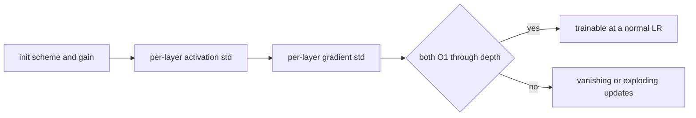

# 13 — Initialization, Loss Functions, and Stable Outputs

> **Prerequisites:** modules 05, 10–12.
> **You will learn:** what `torch.nn.init` offers (uniform/normal, xavier,
> kaiming, trunc_normal, orthogonal, sparse, eye/dirac, zeros/ones, constant) and
> what each layer's default init is; fan-in vs fan-out, gain values, and how to
> verify activation variance stays O(1) through depth; residual-branch scaling
> (GPT-2's `0.02/sqrt(2L)`) and zero-init tricks; the loss zoo and its options
> (CrossEntropyLoss with class indices or probabilities, `ignore_index`,
> `label_smoothing`, `weight`; NLLLoss, BCEWithLogitsLoss and `pos_weight`,
> MSE/L1/Huber/SmoothL1, KLDivLoss and `log_target`, CTC, margin/ranking/cosine/triplet,
> PoissonNLL, GaussianNLL); and why you pass logits, not probabilities, and how
> `reduction` interacts with masking and gradient accumulation.

Initialization decides whether signal and gradient survive depth; the loss
decides which number backward starts from. Both fail silently: a wrong
reduction or a stray softmax raises no error.

The one-line APIs hide defaults: `nn.Linear` is not He-initialized,
`nn.Embedding` is `N(0, 1)`, `F.kl_div`'s default reduction is not KL, and
`cross_entropy` returns `nan` when every label is `-100`. The
[PyTorch overview note](../../notes/libraries/pytorch.md) gives the summary;
this module goes into the contracts.

---

## 13.1 Why initialization still matters

For a linear layer $y = Wx$ with i.i.d. zero-mean weights of variance
$\sigma_w^2$ and inputs of variance $\sigma_x^2$, each output has variance
$\text{fan\_in}\cdot\sigma_w^2\sigma_x^2$. Stack $L$ such layers and the
activation variance is multiplied by $(\text{fan\_in}\,\sigma_w^2 \cdot c)^L$,
where $c$ is the nonlinearity's effect on the second moment. Above 1 explodes,
below 1 vanishes, and backward repeats the product with fan-out. The derivation
is in [the activations and initialization notes](../../notes/deep-learning/activations-and-initialization.md);
here we cover the API, the defaults, and measurement.

Karpathy's makemore part 3 sets the habit: before training, inspect per-layer
activation and gradient statistics, and check that the step-0 loss is $\ln V$
for a $V$-way classifier. The hooks are from [module 10](./10-nn-module-internals.md);
[module 18](./18-debugging-and-testing.md) turns them into a debugging routine.
Residuals and normalization reduce init sensitivity; 13.3 shows they do not
remove it.

## 13.2 The torch.nn.init toolbox

Every function in [`torch.nn.init`](https://docs.pytorch.org/docs/2.8/nn.init.html)
is in-place, runs under `no_grad`, and returns its tensor. In 2.8 the random
ones accept `generator=` (checked against
[`torch/nn/init.py` at v2.8.0](https://github.com/pytorch/pytorch/blob/v2.8.0/torch/nn/init.py)),
so you can init from a private RNG without touching the global seed.

| Function | Distribution | Key parameters | Typical use |
|---|---|---|---|
| `uniform_(t, a, b)` | $U(a, b)$ | bounds | PyTorch's own layer defaults |
| `normal_(t, mean, std)` | $N(\mu, \sigma^2)$ | `std` | GPT-style `std=0.02` |
| `trunc_normal_(t, mean, std, a, b)` | normal, resampled into $[a, b]$ | `a=-2, b=2` are **absolute** values | ViT, timm |
| `xavier_uniform_` / `xavier_normal_` | $\text{Var} = \text{gain}^2 \cdot \frac{2}{\text{fan\_in}+\text{fan\_out}}$ | `gain` | tanh/sigmoid nets, attention projections |
| `kaiming_uniform_` / `kaiming_normal_` | $\text{Var} = \text{gain}^2/\text{fan\_mode}$ | `a`, `mode`, `nonlinearity` | ReLU-family nets |
| `orthogonal_` | (semi-)orthogonal via QR | `gain` | RNN recurrent weights |
| `sparse_` | per column, `sparsity` fraction zeroed, rest normal | `sparsity`, `std=0.01` | 2-D only, rare |
| `eye_`, `dirac_` | identity matrix / conv | `groups` (dirac) | identity inits |
| `zeros_`, `ones_`, `constant_` | constant | `val` | biases, norm gains, zero-init branches |

Trap: `trunc_normal_`'s `a=-2, b=2` are values, not multiples of `std`, so
`trunc_normal_(w, std=0.02)` truncates at $\pm 100\sigma$, i.e. never (largest
of 10,000 draws measured: 0.077). For $\pm 2\sigma$ pass `a=-2*std, b=2*std`.

**Gain** cancels the nonlinearity's effect on the second moment; `calculate_gain(nonlinearity, param=None)`:

| Nonlinearity | Gain | Why |
|---|---|---|
| `linear`, `conv*d`, `sigmoid` | 1 | identity (sigmoid: convention) |
| `tanh` | 5/3 | empirical, keeps tanh nets near unit variance |
| `relu` | $\sqrt{2}$ | ReLU zeroes half the mass: $E[\text{relu}(z)^2] = \sigma^2/2$ |
| `leaky_relu` | $\sqrt{2/(1+a^2)}$ | `param` = slope, default 0.01 |
| `selu` | 3/4 | pairs with SELU self-normalization |

**Fan** follows layout: `_calculate_fan_in_and_fan_out` reads dim 1 as inputs,
dim 0 as outputs, times the receptive field. A `Conv2d` weight `(64, 3, 7, 7)`
gives `fan_in = 3·49 = 147`, `fan_out = 64·49 = 3136`; `nn.Linear`'s `(out, in)`
gives `fan_in = in_features`. A weight stored `(in, out)` (Hugging Face GPT-2
`Conv1D`) has its fans swapped. `mode="fan_in"` preserves forward variance,
`"fan_out"` backward; He et al. ([arXiv:1502.01852](https://arxiv.org/abs/1502.01852))
show either suffices for a plain ReLU net.

## 13.3 What PyTorch does by default, and why it surprises people

`nn.Linear.reset_parameters` in
[`torch/nn/modules/linear.py`](https://github.com/pytorch/pytorch/blob/v2.8.0/torch/nn/modules/linear.py)
calls `init.kaiming_uniform_(self.weight, a=math.sqrt(5))` and then draws the
bias from $U(-1/\sqrt{\text{fan\_in}}, 1/\sqrt{\text{fan\_in}})$. Work through the
algebra. With leaky-ReLU slope $a=\sqrt5$, the gain is $\sqrt{2/(1+5)} = 1/\sqrt3$.
`kaiming_uniform_` uses the bound $\text{gain}\cdot\sqrt{3/\text{fan\_in}}$, so

$$
\text{bound} = \frac{1}{\sqrt3}\sqrt{\frac{3}{\text{fan\_in}}} = \frac{1}{\sqrt{\text{fan\_in}}},
\qquad \text{Var}(W) = \frac{\text{bound}^2}{3} = \frac{1}{3\,\text{fan\_in}}.
$$

That is the legacy Torch7 `U(±1/√fan_in)` rule in Kaiming's clothing (the
source comment cites issue [#57109](https://github.com/pytorch/pytorch/issues/57109)):
one third of the variance-preserving linear value, one sixth of what ReLU needs.
`Conv*d` does the same with $\text{fan\_in} = C_{in}\prod k$.

| Layer | Default weight init | Default bias / other |
|---|---|---|
| `Linear`, `Conv1d/2d/3d`, `ConvTranspose*` | $U(\pm 1/\sqrt{\text{fan\_in}})$ via `kaiming_uniform_(a=√5)` | $U(\pm 1/\sqrt{\text{fan\_in}})$ |
| `Embedding` | $N(0, 1)$ | `padding_idx` row zeroed |
| `LayerNorm`, `BatchNorm*`, `GroupNorm` | weight 1 | bias 0; BN running mean 0, var 1 |
| `RNN`, `LSTM`, `GRU` | every parameter $U(\pm 1/\sqrt{\text{hidden\_size}})$ | same, biases included |
| `MultiheadAttention` | `xavier_uniform_` on `in_proj_weight` | in-proj and out-proj biases 0 |

The dangerous row is `Embedding` at $N(0,1)$ under weight tying
(`lm_head.weight = wte.weight`, logit $j$ is $h\cdot e_j$). At init the final
LayerNorm output $h$ is roughly the input token's own embedding $e_x$, so that
token's logit is $\lVert e_x\rVert^2 \approx d_{model}$ while the others are
$N(0, d_{model})$: the model confidently predicts "next token = this token". A
minimal CPU probe (embedding, LayerNorm, tied head; $V=512$, $d_{model}=128$,
random targets) measured an initial loss of **128.3** against $\ln 512 = 6.24$;
with `normal_(std=0.02)` it gave 6.26. The capstone model shows the same effect
through its blocks ([module 32](./32-capstone-gpt-model.md)), which is why GPT-2
and nanoGPT use `N(0, 0.02)`.

Every parametrized module defines `reset_parameters()`, called by its
constructor. To re-init a model, `model.apply(fn)` visits every submodule
([module 10](./10-nn-module-internals.md)):

```python
def init_weights(m):
    if isinstance(m, nn.Linear):
        nn.init.normal_(m.weight, std=0.02)
        if m.bias is not None:
            nn.init.zeros_(m.bias)
    elif isinstance(m, nn.Embedding):
        nn.init.normal_(m.weight, std=0.02)

model.apply(init_weights)
```

`apply` overwrites everything it matches, so per-name special cases go after it.

## 13.4 Depth: measuring activation statistics

A 20-layer, width-256 MLP with a forward hook recording each activation's std
and retaining its grad; backward uses a unit-variance random upstream gradient:

```python
def probe(scheme, act=nn.Tanh, depth=20, width=256):
    torch.manual_seed(0)
    layers = []
    for _ in range(depth):
        lin = nn.Linear(width, width)
        if scheme is not None:          # e.g. lambda w: nn.init.xavier_uniform_(w)
            scheme(lin.weight); nn.init.zeros_(lin.bias)
        layers += [lin, act()]
    net, stds, acts = nn.Sequential(*layers), [], []
    def hook(mod, inp, out):
        stds.append(out.std().item()); out.retain_grad(); acts.append(out)
    for m in net:
        if isinstance(m, act):
            m.register_forward_hook(hook)   # returns None: output unchanged
    torch.manual_seed(1); out = net(torch.randn(512, width))
    out.backward(torch.randn_like(out))
    return stds, [a.grad.std().item() for a in acts]
```

One local PyTorch 2.8 CPU run on an Apple M-series laptop produced:

| Net | Init | act std L1 | L10 | L20 | grad std at L1 |
|---|---|---|---|---|---|
| tanh | PyTorch default | 0.460 | 0.043 | 0.045 | 2.5e-5 |
| tanh | `xavier_uniform_` (gain 1) | 0.628 | 0.226 | 0.160 | 0.28 |
| tanh | `kaiming_normal_(nonlinearity="tanh")` | 0.761 | 0.649 | 0.648 | 5.8 |
| tanh | `normal_(std=1)` | 0.974 | 0.974 | 0.974 | 1.2e9 |
| ReLU | PyTorch default | 0.337 | 0.023 | 0.022 | 4.3e-8 |
| ReLU | `xavier_uniform_` | 0.584 | 0.025 | 0.001 | 1.4e-3 |
| ReLU | `kaiming_normal_(nonlinearity="relu")` | 0.832 | 0.644 | 0.514 | 0.94 |

The default collapses activations to ~0.04 (held up only by the
$U(\pm 1/16)$ biases) and shrinks gradients by $10^4$ (tanh) to $10^7$ (ReLU).
Xavier with gain 1 is too small for tanh and far too small for ReLU. Matching the
gain keeps both statistics within an order of magnitude over 20 layers. `std=1`
saturates tanh: forward std looks perfect at 0.97 while backward explodes, so
forward statistics alone do not prove trainability.



Residuals and pre-LN make transformers far more forgiving; what remains is
residual-stream variance growing with depth (13.5).

## 13.5 Residual scaling and zero-init tricks

Each pre-LN block adds two branch outputs (attention, MLP) to the residual
stream, so with branch variance $\sigma^2$ the stream reaches $1 + 2L\sigma^2$.
GPT-2 scales residual output projections by $1/\sqrt{N}$, $N$ the number of
residual layers; nanoGPT sets `std = 0.02 / sqrt(2 * n_layer)` on every
`c_proj.weight` after `self.apply(self._init_weights)`
([nanoGPT model.py](https://github.com/karpathy/nanoGPT/blob/3adf61e154c3fe3fca428ad6bc3818b27a3b8291/model.py)),
as does [`./code/llm/model.py`](./code/llm/model.py).

Zero-init goes further: a branch whose last layer is zero is the identity at
step 0. Goyal et al. ([arXiv:1706.02677](https://arxiv.org/abs/1706.02677)) zero
the last BatchNorm $\gamma$ in each ResNet block (torchvision's
`zero_init_residual=True`, not executed here). LoRA zeroes $B$ so the adapted
layer starts equal to the pretrained one ([module 36](./36-capstone-lora-finetuning.md)).
A gradient path must survive: $A$ is random so $\partial L/\partial B \neq 0$;
zero both and neither ever moves. For recurrences, `orthogonal_` sets every
singular value of $W_{hh}$ to 1 (Saxe et al., [arXiv:1312.6120](https://arxiv.org/abs/1312.6120)).

| Family | Common convention | Notes |
|---|---|---|
| MLP / CNN with ReLU | `kaiming_normal_(mode="fan_out", nonlinearity="relu")` for conv, biases 0 | BN gains 1, last-BN-in-block 0 optional |
| tanh / sigmoid nets | `xavier_uniform_(gain=calculate_gain("tanh"))` | Glorot & Bengio ([AISTATS 2010](https://proceedings.mlr.press/v9/glorot10a.html)) |
| GPT-2 / nanoGPT | Linear and Embedding $N(0, 0.02)$, `c_proj` $N(0, 0.02/\sqrt{2L})$, biases 0 | tied head inherits the embedding init |
| ViT / timm | `trunc_normal_(std=0.02)` | truncation effectively inactive (13.2) |
| RNN / LSTM | `orthogonal_` on $W_{hh}$, `xavier_uniform_` on $W_{ih}$ | some set the LSTM forget-gate bias to 1 |
| LoRA | $A$ random, $B=0$ | adapter is a no-op at step 0 |

## 13.6 Logits, log-probabilities, and why softmax is never applied before the loss

`nn.CrossEntropyLoss` is `LogSoftmax` followed by `NLLLoss` in one numerically
fused op. For logits $z$ and target class $y$,

$$
\ell = -z_y + \log\sum_k e^{z_k}, \qquad
\frac{\partial \ell}{\partial z_j} = \text{softmax}(z)_j - \mathbb{1}[j=y].
$$

Log-sum-exp subtracts $\max_k z_k$ first ([module 05](./05-tensor-math-linear-algebra-numerics.md)),
and the gradient $p - y$ is bounded in $[-1, 1]$
([backpropagation notes](../../notes/deep-learning/backpropagation-and-autodiff.md)).
Two recurring mistakes: **softmax then `CrossEntropyLoss`** applies a second
softmax to values in $[0,1]$, so no class can beat another by more than
$e^1 : e^0$, the loss cannot approach 0, and training silently plateaus; and
**`torch.log(torch.softmax(z))` then `NLLLoss`** is correct algebra that hits
`-inf` once a probability underflows. Use `F.log_softmax`.

Binary is worse. `nn.BCELoss` clamps each log at $-100$; at logit 100 with
target 0, `sigmoid(100)` is exactly 1.0 in float32, the loss is the clamp value
100, and the gradient to the logit is exactly **zero**: maximally wrong, no signal.
`nn.BCEWithLogitsLoss` computes $\max(z,0) - zy + \log(1+e^{-|z|})$ with gradient
$\sigma(z) - y = 1$ ([docs](https://docs.pytorch.org/docs/2.8/generated/torch.nn.BCEWithLogitsLoss.html); fence 4).

## 13.7 CrossEntropyLoss in full

[`nn.CrossEntropyLoss`](https://docs.pytorch.org/docs/2.8/generated/torch.nn.CrossEntropyLoss.html)
always treats **dim 1** as the class dim. Input is `(N, C)` or
`(N, C, d1, d2, ...)`, and index targets are `(N)` or `(N, d1, ...)`. LM logits
are `(B, T, V)` with classes last, so you either flatten or transpose:

```python
loss = F.cross_entropy(logits.reshape(-1, V), labels.reshape(-1))   # (B*T, V) vs (B*T,)
loss = F.cross_entropy(logits.transpose(1, 2), labels)              # (B, V, T) vs (B, T)
```

Passing `(B, T, V)` directly treats $T$ as classes: a shape error, or silent
garbage if $T = V$.

| Option | Formula / behaviour | Gotcha |
|---|---|---|
| index targets | `int64` `(N, ...)`, $\ell_i = -\log p_{i,y_i}$ | `int32` raises "expected scalar type Long" |
| probability targets | float, same shape as input, $\ell_i = -\sum_c q_{ic}\log p_{ic}$ | `ignore_index` not supported ("not supported for floating point target") |
| `ignore_index=-100` | positions with that label contribute 0 and are excluded from the mean | an all-ignored batch returns `nan` (0/0) |
| `weight` (C,) | $\ell_i \leftarrow w_{y_i}\ell_i$; mean $= \sum_i w_{y_i}\ell_i / \sum_{i\,\text{valid}} w_{y_i}$ | mean divides by the summed weights, not by $N$ |
| `label_smoothing=ε` | target $(1-\varepsilon)\,\text{onehot} + \varepsilon/C$, so $\ell = (1-\varepsilon)(-\log p_y) + \varepsilon\cdot\frac1C\sum_c(-\log p_c)$ | also applies to probability targets |
| `reduction="none"` | per-element losses with the target's shape | build custom masks and weights from here |

Label smoothing (Szegedy et al., [arXiv:1512.00567](https://arxiv.org/abs/1512.00567))
stops logits growing without bound; its minimum is no longer 0, so do not
compare smoothed and unsmoothed curves. The `weight` and smoothing formulas
(with ignored positions excluded) matched hand computations to ~1e-7 on CPU.

## 13.8 Reductions, masking, and accumulation

For LMs you want mean NLL per **valid token**:

$$
\mathcal{L} = \frac{\sum_{b,t} m_{bt}\,\ell_{bt}}{\sum_{b,t} m_{bt}}.
$$

`ignore_index` with `reduction="mean"` computes exactly this; a mean of
per-sequence means weights a 3-token sequence like a 300-token one (the
distinction in the [masking module's lab](../transformers/08-encoder-decoder-masking.md)).

Accumulation has the same bias one level up. With $K$ micro-batches of
token-loss sums $S_k$ and valid counts $n_k$, the full-batch loss is
$\sum_k S_k / \sum_k n_k$, but backward on each micro-batch mean divided by $K$ gives the gradient of

$$
\frac{1}{K}\sum_k \frac{S_k}{n_k} \;\neq\; \frac{\sum_k S_k}{\sum_k n_k}
\quad\text{unless all } n_k \text{ are equal.}
$$

Each token in micro-batch $k$ is weighted $1/(K n_k)$ instead of $1/\sum_j n_j$,
over-weighting short micro-batches. Fix: count valid labels across all $K$
first, then backward each micro-batch's **sum** over that global count:

```python
n_total = sum((mb["labels"] != -100).sum() for mb in micro_batches)  # count first
for mb in micro_batches:
    logits = model(mb["input_ids"])
    s = F.cross_entropy(logits.transpose(1, 2), mb["labels"], reduction="sum")
    (s / n_total).backward()                                         # grads now sum to the full-batch gradient
```

Under data parallelism, also all-reduce `n_total` across ranks.
[Module 16](./16-training-loop-checkpointing.md) builds this into the loop;
[module 33](./33-capstone-pretraining.md) uses it.

## 13.9 The rest of the loss zoo

All take `reduction` (ignore the deprecated `size_average`/`reduce`). CE and KL
are defined in [the information theory notes](../../notes/math/information-theory.md);
the full list is in the [nn docs](https://docs.pytorch.org/docs/2.8/nn.html).

| Loss | Input / target | Per-element formula | Use |
|---|---|---|---|
| `NLLLoss` | log-probs `(N, C, ...)`, int64 | $-w_y \hat\ell_y$ | after your own `log_softmax` |
| `BCEWithLogitsLoss` | logits, float targets same shape | $-[p_c\, y\log\sigma(z) + (1-y)\log(1-\sigma(z))]$, $p_c$ = `pos_weight` | multi-label; `pos_weight = neg/pos` per class for imbalance |
| `BCELoss` | probabilities | as above without $p_c$, logs clamped at $-100$ | avoid; use the logits version |
| `MSELoss` | any, same shape | $(x-y)^2$ | regression, Gaussian likelihood up to scale |
| `L1Loss` | any | $\lvert x-y\rvert$ | robust regression, median estimate |
| `HuberLoss(delta)` | any | $\tfrac12 d^2$ if $\lvert d\rvert<\delta$ else $\delta(\lvert d\rvert - \tfrac12\delta)$ | robust regression, DQN |
| `SmoothL1Loss(beta)` | any | $\tfrac12 d^2/\beta$ if $\lvert d\rvert<\beta$ else $\lvert d\rvert - \tfrac12\beta$ | detection box regression |
| `KLDivLoss(log_target)` | **log-probs** input, probs (or log-probs) target | $y(\log y - x)$ | distillation, VAEs |
| `CTCLoss(blank=0)` | log-probs `(T, N, C)`, targets plus `input_lengths`, `target_lengths` | $-\log\sum_{\text{alignments}}$ | speech, OCR without alignment |
| `MarginRankingLoss` | $x_1, x_2$, $y\in\{\pm1\}$ | $\max(0, -y(x_1-x_2)+m)$ | pairwise ranking |
| `HingeEmbeddingLoss` | distances, $y\in\{\pm1\}$ | $x$ if $y=1$, $\max(0, m-x)$ if $y=-1$ | similarity learning |
| `CosineEmbeddingLoss` | $x_1, x_2$ vectors, $y\in\{\pm1\}$ | $1-\cos$ or $\max(0,\cos-m)$ | embedding pairs |
| `TripletMarginLoss` | anchor, positive, negative | $\max(0, d(a,p)-d(a,n)+m)$ | metric learning |
| `MultiLabelSoftMarginLoss` | logits, $\{0,1\}$ targets | BCE-with-logits averaged over classes | multi-label |
| `PoissonNLLLoss(log_input=True)` | log-rate, counts | $e^{x} - yx$ | count data |
| `GaussianNLLLoss` | mean, target, **variance** | $\tfrac12(\log\sigma^2 + (x-y)^2/\sigma^2)$ | heteroscedastic regression |

**Huber vs SmoothL1:** `huber_loss(x, y, delta=d) == d * smooth_l1_loss(x, y, beta=d)`
(checked for $d \in \{0.5, 1, 2\}$; identical at 1); Huber's linear-region
gradient is $\delta$, SmoothL1's is 1. **KLDivLoss** reverses the math notation:
*input* is the model's log-probs, *target* the reference, result
$\mathrm{KL}(\text{target}\,\|\,\text{model})$. Default `"mean"` divides by
$B\cdot C$ and warns in 2.8 ("'batchmean' divides only by the batch size, and
aligns with the KL div math definition"); use `"batchmean"`, plus
`log_target=True` for teacher log-probs to avoid `log(0)`
([docs](https://docs.pytorch.org/docs/2.8/generated/torch.nn.KLDivLoss.html)).
**CTCLoss** wants time-major `(T, N, C)` log-probs; infeasible alignments give
`inf` unless `zero_infinity=True` ([docs](https://docs.pytorch.org/docs/2.8/generated/torch.nn.CTCLoss.html)).
**GaussianNLLLoss** takes variance, not std, clamped at `eps=1e-6`.

## 13.10 Writing your own loss

A loss is any function returning a scalar from differentiable ops; make it an
`nn.Module` only for state such as class-weight buffers that must follow `.to()`.
Work in log space and `gather` the target column. Focal loss (Lin et al.,
[arXiv:1708.02002](https://arxiv.org/abs/1708.02002)) down-weights easy examples
by $(1-p_y)^\gamma$:

```python
def focal_loss(logits, target, gamma=2.0, ignore_index=-100):
    # logits (N, C), target (N,) int64
    valid = target != ignore_index
    logp = F.log_softmax(logits[valid], dim=-1)                       # (n, C), stable
    logp_y = logp.gather(1, target[valid].unsqueeze(1)).squeeze(1)    # (n,)
    p_y = logp_y.exp()
    return (-(1 - p_y) ** gamma * logp_y).sum() / valid.sum().clamp(min=1)
```

At `gamma=0` it must equal `F.cross_entropy`, ignored targets included (checked
locally); always test custom losses against such a coinciding reference.
`clamp(min=1)` returns 0, not `nan`, for an all-padding batch.

## Reconciling the sources

d2l and *Deep Learning with PyTorch* pass logits to `nn.CrossEntropyLoss`
(correct); tutorials feeding `torch.log(F.softmax(x))` to `NLLLoss` hit `-inf` on underflow. PyTorch's default calls `kaiming_uniform_`, but
`a=√5` makes it the legacy $U(\pm 1/\sqrt{\text{fan\_in}})$ rule, as the
`linear.py` comment at v2.8.0 and issue #57109 say; 13.4 shows what that costs in
deep plain nets. GPT-2's paper states the $1/\sqrt{N}$ residual scaling in prose;
nanoGPT's `0.02/sqrt(2·n_layer)` is the concrete reading this course adopts.

## Worked init and loss verification

**Fence 1** proves the API matches 13.2–13.3 (default bound, gains,
`kaiming_normal_` std, conv fans) on this build, not that any init suits your model.

```python pytorch-check
import math
import torch
import torch.nn as nn

torch.manual_seed(0)
lin = nn.Linear(256, 64)
bound = 1 / math.sqrt(256)
assert lin.weight.abs().max().item() <= bound + 1e-7
assert lin.bias.abs().max().item() <= bound + 1e-7
assert math.isclose(nn.init.calculate_gain("relu"), math.sqrt(2))
assert math.isclose(nn.init.calculate_gain("tanh"), 5 / 3)

g = torch.Generator().manual_seed(1)
w = torch.empty(512, 1024)
nn.init.kaiming_normal_(w, mode="fan_in", nonlinearity="relu", generator=g)
target = math.sqrt(2 / 1024)
rel = abs(w.std().item() - target) / target
assert rel < 0.03, rel
fan_in, fan_out = nn.init._calculate_fan_in_and_fan_out(torch.empty(64, 3, 7, 7))
assert (fan_in, fan_out) == (147, 3136)
print(f"default bound {bound:.4f}, kaiming std rel err {rel:.4f}")
```

**Fence 2** proves CE = log-softmax + NLL, gradient $(p - \text{onehot})/N$,
one-hot probability targets = index targets, and the smoothing formula, for
`(N, C)` inputs only.

```python pytorch-check
import torch
import torch.nn.functional as F

torch.manual_seed(0)
N, C = 8, 5
logits = torch.randn(N, C, requires_grad=True)
t = torch.randint(0, C, (N,))

ce = F.cross_entropy(logits, t)
manual = -F.log_softmax(logits, dim=1).gather(1, t[:, None]).squeeze(1).mean()
torch.testing.assert_close(ce, manual, atol=1e-6, rtol=1e-6)

ce.backward()
expected = (torch.softmax(logits.detach(), 1) - F.one_hot(t, C).float()) / N
torch.testing.assert_close(logits.grad, expected, atol=1e-6, rtol=1e-5)

onehot = F.one_hot(t, C).float()
torch.testing.assert_close(F.cross_entropy(logits.detach(), onehot),
                           ce.detach(), atol=1e-6, rtol=1e-6)

eps = 0.1
lp = F.log_softmax(logits.detach(), dim=1)
hand = ((1 - eps) * -lp.gather(1, t[:, None]).squeeze(1) + eps * -lp.mean(1)).mean()
torch.testing.assert_close(F.cross_entropy(logits.detach(), t, label_smoothing=eps),
                           hand, atol=1e-6, rtol=1e-6)
print(f"CE {ce.item():.4f} == logsoftmax+NLL; grad == (p - y)/N")
```

**Fence 3** proves that on `(B, T, V)` logits with `-100` padding the loss is
the valid-token mean and ignored positions affect neither loss nor gradient. It
does not test the 13.8 accumulation fix (module 16 does).

```python pytorch-check
import torch
import torch.nn.functional as F

torch.manual_seed(0)
B, T, V = 3, 6, 11
logits = torch.randn(B, T, V, requires_grad=True)
labels = torch.randint(0, V, (B, T))
labels[0, 4:] = -100
labels[2, 1:] = -100
valid = labels != -100

loss = F.cross_entropy(logits.transpose(1, 2), labels)
lp = F.log_softmax(logits, dim=-1)
tok = -lp.gather(-1, labels.clamp(min=0).unsqueeze(-1)).squeeze(-1)   # (B, T)
manual = (tok * valid).sum() / valid.sum()
torch.testing.assert_close(loss, manual, atol=1e-6, rtol=1e-6)

perturbed = logits.detach().clone()
perturbed[~valid] += 50.0 * torch.randn(int((~valid).sum()), V)
torch.testing.assert_close(F.cross_entropy(perturbed.transpose(1, 2), labels),
                           loss.detach())
loss.backward()
assert logits.grad[~valid].abs().max().item() == 0.0
print(f"masked CE {loss.item():.4f} over {int(valid.sum())} valid tokens")
```

**Fence 4** proves the BCE logit-100 behaviour of 13.6 and that `batchmean` KL
equals the hand KL while `"mean"` is $C$ times smaller and warns, for these 2.8
CPU kernels, not every backend.

```python pytorch-check
import warnings
import torch
import torch.nn as nn
import torch.nn.functional as F

z1 = torch.tensor([100.0], requires_grad=True)
y = torch.tensor([0.0])
l1 = nn.BCEWithLogitsLoss()(z1, y)
l1.backward()
assert torch.isfinite(l1) and abs(z1.grad.item() - 1.0) < 1e-6

z2 = torch.tensor([100.0], requires_grad=True)
l2 = nn.BCELoss()(torch.sigmoid(z2), y)       # sigmoid(100) == 1.0 in float32
l2.backward()
assert z2.grad.item() == 0.0                   # clamped log: no learning signal

torch.manual_seed(0)
Bk, C = 4, 7
student_logp = F.log_softmax(torch.randn(Bk, C), dim=-1)
teacher_logp = F.log_softmax(torch.randn(Bk, C), dim=-1)
p = teacher_logp.exp()
hand = (p * (teacher_logp - student_logp)).sum() / Bk
kl = nn.KLDivLoss(reduction="batchmean", log_target=True)(student_logp, teacher_logp)
torch.testing.assert_close(kl, hand, atol=1e-6, rtol=1e-5)
with warnings.catch_warnings(record=True) as caught:
    warnings.simplefilter("always")
    kl_mean = nn.KLDivLoss(reduction="mean", log_target=True)(student_logp, teacher_logp)
assert any("batchmean" in str(w.message) for w in caught)
torch.testing.assert_close(kl_mean * C, kl, atol=1e-6, rtol=1e-5)
print(f"BCE grads logits={z1.grad.item():.1f} probs={z2.grad.item():.1f}; KL {kl.item():.4f}")
```

## Key takeaways

- `nn.init` is in-place, gradient-free, and takes `generator=` in 2.8. Match gain
  to the nonlinearity; `trunc_normal_` bounds are absolute.
- `Linear`/`Conv` default to $U(\pm 1/\sqrt{\text{fan\_in}})$ (variance
  $1/(3\,\text{fan\_in})$), not He init; `Embedding` is $N(0,1)$, which with a
  tied head puts step-0 loss near $d_{model}$ instead of $\ln V$.
- Measure at init: per-layer activation and gradient std, and step-0 loss vs $\ln V$.
- Scale residual output projections by $1/\sqrt{2L}$, or zero-init them while
  keeping a gradient path (LoRA: $B=0$, random $A$).
- Feed logits, never probabilities; the CE gradient is $p - y$.
- CE: class dim 1, int64 targets, `ignore_index` leaves the mean (all-ignored is
  `nan`), `weight` changes the denominator.
- Accumulation: sum-reduce, divide by the global valid-token count.
- `KLDivLoss`: log-prob input, `reduction="batchmean"`, `log_target=True` for
  teacher log-probs.

## Self-check

1. Your LM's first-step loss is 40 with V = 512. What value did you expect, and
   which two initialization mistakes are the likeliest causes?
2. With gradient accumulation over 4 micro-batches whose valid-token counts are
   100, 20, 300, 80, you average each micro-batch's mean CE and divide by 4.
   Why is that not the full-batch gradient, and how do you fix it?
3. When is `KLDivLoss(reduction="mean")` wrong, and what should the inputs and
   reduction be for distillation from teacher logits?

---

**Next → [14 — Data Pipelines: Dataset, DataLoader, Samplers, and Collation](./14-data-pipelines.md)**
