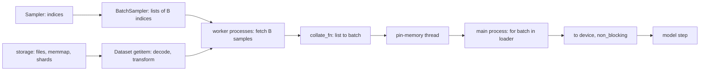

# 14 — Data Pipelines: Dataset, DataLoader, Samplers, and Collation

> **Prerequisites:** modules 02–04, 06 and 10.
> **You will learn:** map-style vs iterable datasets and the built-ins; how `DataLoader` turns sampler indices into batches (`Sampler` → `BatchSampler` → fetch → `collate_fn`); every sampler including `DistributedSampler` and length bucketing; collation and padding; workers, sharding, seeding and start methods; `pin_memory` with `non_blocking=True`; memory-mapped token data; and how to tell whether the loader is your bottleneck.

Duplicated samples, identical "random" augmentations, leaking splits and idle GPUs all start in the data pipeline, and none of them raises an exception. `torch.utils.data` is small: two dataset protocols, a few samplers, one collate function, and a `DataLoader` that wires them together, optionally in worker processes. The [PyTorch library notes](../../notes/libraries/pytorch.md) cover the usage. This module goes deeper: which process runs which stage, how seeds reach workers, and what each knob actually changes. Claims are checked against the [2.8 data docs](https://docs.pytorch.org/docs/2.8/data.html) and [`dataloader.py` at v2.8.0](https://github.com/pytorch/pytorch/blob/v2.8.0/torch/utils/data/dataloader.py).

---

## 14.1 The data path, end to end



The **sampler and batch sampler run in the main process**, which sends index lists to workers through per-worker queues. Each **worker** calls `dataset[i]` for its indices and then `collate_fn`, and returns the batch through a shared result queue, with tensors passed in shared memory. With `pin_memory=True`, a **main-process thread** (`_pin_memory_loop` in [`_utils/pin_memory.py`](https://github.com/pytorch/pytorch/blob/v2.8.0/torch/utils/data/_utils/pin_memory.py)) copies each batch into page-locked memory. The host-to-device copy is yours: `batch.to(device, non_blocking=True)`.

With `num_workers=0` everything runs inline, which is the setting for debugging: breakpoints in `__getitem__` work.

## 14.2 Map-style and iterable datasets

A **map-style** dataset implements `__getitem__(i)` and `__len__()`, so it supports random access. An **iterable** dataset implements `__iter__()`: a stream with no index and maybe no length.

```python
class Pairs(Dataset):                       # map-style
    def __init__(self, x, y):               # x: (n, d) float32, y: (n,) int64
        self.x, self.y = x, y
    def __len__(self):
        return len(self.x)
    def __getitem__(self, i):
        return self.x[i], self.y[i]         # ((d,), ())

class Lines(IterableDataset):               # iterable
    def __init__(self, path):
        self.path = path
    def __iter__(self):
        with open(self.path) as f:
            yield from f                    # one line at a time
```

Prefer map-style whenever indexing is cheap: samplers, and with them shuffling, weighting, distributed partitioning and exact resume, require it. Use an iterable dataset when random access is impossible: network streams, compressed shards read sequentially, generated data. You then own shuffling (shard order plus a shuffle buffer) and sharding (14.5). The "turn raw data into tensors" step (*Deep Learning with PyTorch* ch. 4) belongs in `__getitem__` or in a preprocessing pass that writes arrays to disk. Return tensors or NumPy arrays, not Python lists of numbers.

| Built-in | What it does |
|---|---|
| `TensorDataset(*tensors)` | sample `i` is `tuple(t[i] for t in tensors)` |
| `Subset(ds, indices)` | re-indexes `ds`; how splits are represented |
| `random_split(ds, lengths, generator=g)` | disjoint covering `Subset`s; `lengths` may be fractions (floors, remainder distributed round-robin) |
| `ConcatDataset([a, b])` | map-style concatenation (bisect over cumulative sizes) |
| `ChainDataset([s1, s2])` | iterable concatenation |
| `StackDataset(a, b)` / `StackDataset(x=a, y=b)` | zips equal-length datasets into tuples or dicts |

Always give `random_split` a generator. Otherwise the split depends on how many global random numbers were drawn before it.

`torch.utils.data.datapipes` and torchdata's `DataLoader2` are a dead end. The [torchdata README at v0.11.0](https://github.com/meta-pytorch/data/blob/v0.11.0/README.md) announced their removal and points to `torchdata.nodes`, a library of composable iterators, as the successor. `Dataset`/`DataLoader` are not deprecated.

## 14.3 Samplers decide the order

`DataLoader(ds, shuffle=True, generator=g)` is sugar for `sampler=RandomSampler(ds, generator=g)` wrapped in `BatchSampler(sampler, batch_size, drop_last)`. You can see both on `loader.sampler` and `loader.batch_sampler`. `batch_sampler=` excludes `batch_size`, `shuffle`, `sampler` and `drop_last`.

| Sampler | Yields | Guarantee |
|---|---|---|
| `SequentialSampler` | `0..n-1` | default when `shuffle=False` |
| `RandomSampler(replacement=False)` | a permutation per epoch | each index once per epoch |
| `RandomSampler(replacement=True, num_samples=k)` | `k` uniform draws | any epoch length; duplicates |
| `SubsetRandomSampler(indices)` | a permutation of `indices` | a split without `Subset` |
| `WeightedRandomSampler(w, k, replacement=True)` | `k` draws, `P(i) ∝ w[i]` | rebalances in expectation |
| `BatchSampler(sampler, B, drop_last)` | lists of `B` indices | groups any sampler |
| `DistributedSampler(ds, num_replicas, rank, shuffle, seed, drop_last)` | this rank's share | disjoint up to padding, equal length per rank |

**The generator.** With `generator=None`, `RandomSampler` seeds itself from the global RNG each epoch. With an explicit generator, the order is a deterministic function of the generator's state, and the generator advances, so epoch 1 differs from epoch 0. Exact resume therefore means checkpointing that generator's state ([module 16](./16-training-loop-checkpointing.md); generators are covered in [module 06](./06-randomness-and-reproducibility.md)). The same generator seeds the workers (14.5).

**Class imbalance.** On a 90/10 split, inverse-frequency weights `1 / count[label_i]` give about 50/50 batches; fence 4 measures 0.507. The price: each minority example is seen about 9× as often, inviting overfitting. The alternative, a class-weighted loss `F.cross_entropy(logits, y, weight=class_w)` ([module 13](./13-initialization-and-losses.md)), sees every example once per epoch but is noisy when batches lack the minority class, which is why *Deep Learning with PyTorch*'s LUNA project samples instead. Evaluate on the natural distribution either way.

**DistributedSampler.** It shuffles with `manual_seed(seed + epoch)`, pads the permutation by repeating its head to a multiple of `world`, and gives rank `r` every `world`-th index starting at `r`, which is `ceil(n / world)` each ([`distributed.py`](https://github.com/pytorch/pytorch/blob/v2.8.0/torch/utils/data/distributed.py)). It does not track the epoch itself: call `sampler.set_epoch(epoch)` before every epoch, or every epoch replays epoch 0 (fence 3). Padding repeats a few samples; `drop_last=True` trims to `floor(n / world)` instead. Equal lengths matter because a rank that finishes early leaves the others hanging in DDP's all-reduce ([module 26](./26-distributed-collectives-and-ddp.md)). Correctness also needs the same `seed`, `len(dataset)` and dataset order on every rank. Otherwise the ranks take shares of *different* permutations, which overlap.

**Length bucketing.** Random batches pad every row to the batch's longest. A bucketing batch sampler shuffles, cuts the order into pools of about 50 batches, sorts each pool by length, slices it into batches, and shuffles the batch order. The [Performance Tuning Guide](https://docs.pytorch.org/tutorials/recipes/recipes/tuning_guide.html) (living page, accessed 2026-10-10) recommends "bucketing samples with similar sequence length" to balance work across distributed ranks. On lengths uniform in [4, 64], the lab's `BucketBatchSampler` cuts the padded fraction from 45 % to 2.7 % (measured locally on CPU).

## 14.4 Collation: from a list of samples to a batch

With automatic batching, the loader calls `collate_fn([dataset[i] for i in batch_indices])`. `default_collate` ([`_utils/collate.py`](https://github.com/pytorch/pytorch/blob/v2.8.0/torch/utils/data/_utils/collate.py)) recurses on the first element's type:

| Element | Result |
|---|---|
| `Tensor` of shape `S` | `torch.stack` → `(B, *S)`; in a worker, directly into shared memory |
| NumPy array | converted, then stacked |
| Python `int` / `float` / `bool` | `(B,)` tensor of `int64` / **`float64`** / `bool` |
| `str` / `bytes` | kept as a list |
| `dict`, tuple, list, namedtuple | same container, collated per key or position |
| anything else, e.g. a dataclass | `TypeError: default_collate: batch must contain tensors, numpy arrays, numbers, dicts or lists` |

Two rows bite. A target returned as `float(y)` silently produces a `float64` batch, so return `torch.float32` tensors. And ragged tensors fail with `RuntimeError: stack expects each tensor to be equal size`. For variable-length text, write `pad_collate` (fence 1): right-pad `input_ids` to the batch maximum `T`, build `attention_mask = arange(T) < length`, and set `labels` to `-100` at padding. `-100` is `F.cross_entropy`'s default `ignore_index` ([module 13](./13-initialization-and-losses.md)), so padding contributes neither loss nor gradient. Return a dict, as Hugging Face models expect (a dataclass works if your collate builds it), and define collate functions at module level so spawn can pickle them.

`batch_size=None` disables auto-batching. Each item goes through `default_convert`, which turns arrays into tensors but adds no batch dimension. Use it when the dataset already yields whole batches, for example one contiguous `(B, T)` read instead of `B` small reads.

`drop_last=True` discards the final short batch. Training BatchNorm fails on a batch of one ("Expected more than 1 value per channel when training", measured), and a ragged final batch changes gradient-noise scale. Never use it for evaluation, where it silently skips up to `B-1` examples.

## 14.5 Workers, sharding, and seeding

`iter(loader)` with `num_workers=k` starts `k` processes. Each gets a pickled copy of the dataset, the `collate_fn` and the `worker_init_fn`. That copy explains three classic bugs.

**Copy-on-access memory growth.** Forked workers share the parent's pages copy-on-write, but CPython refcounting writes to every object it reads, so iterating a million-element list of dicts gradually gives each worker a private copy. The data docs warn that workers can reach "the same amount of CPU memory as the parent process" (issue #13246). Store data in a few large buffers instead: NumPy arrays, tensors, Arrow tables, memmaps.

**Start methods.** The default is `fork` on Linux (Python ≤ 3.13) and `spawn` on macOS and Windows. The reference Mac reported `spawn`. Spawned workers start a fresh interpreter, re-import your main module and unpickle everything. So loader creation must sit under `if __name__ == "__main__":`. Datasets, collate functions and `worker_init_fn` must be importable at module level; a lambda fails with `PicklingError: Can't pickle <function <lambda>>` (measured). Each worker also pays an `import torch`. `multiprocessing_context="forkserver"` keeps spawn's pickling rules but forks from a server. With `multiprocessing.set_forkserver_preload(["torch", "numpy"])`, later worker pools started in about 0.15 s instead of about 1 s (measured). CUDA cannot be re-initialized in a forked child, so CUDA work in subprocesses needs spawn or forkserver, and the docs advise against returning CUDA tensors from workers ([multiprocessing notes](https://docs.pytorch.org/docs/2.8/notes/multiprocessing.html)).

**IterableDataset duplication.** Every worker iterates its own full copy, so `k` workers yield the stream `k` times; the lab counts exactly 2,000 duplicates for 2,000 items on 2 workers. Shard inside `__iter__`:

```python
def __iter__(self):
    info = get_worker_info()                 # None in the main process
    if info is None:
        return iter(range(self.n))
    return iter(range(info.id, self.n, info.num_workers))
```

For file shards use `files[info.id::info.num_workers]`; under DDP the global shard is `rank * num_workers + worker_id` of `world * num_workers`. `len(loader)` on an iterable is only an estimate.

**Seeding.** At each `iter(loader)`, the main process draws `base_seed` from `loader.generator`, or from the global RNG if none was given. Worker `w` then calls `torch.manual_seed(base_seed + w)` and `random.seed(base_seed + w)`, and seeds NumPy's legacy global RNG with `_generate_state(base_seed, w)` ([`_utils/worker.py`](https://github.com/pytorch/pytorch/blob/v2.8.0/torch/utils/data/_utils/worker.py)). Before PyTorch 1.9 NumPy was not seeded, so forked workers inherited identical NumPy state and made identical "random" crops. Two gaps remain in 2.8. An RNG *object* created in `__init__` (`np.random.default_rng(0)`, `random.Random`) is pickled into every worker in the same state, so all workers draw the same stream. Third-party libraries are not seeded at all. The [randomness notes](https://docs.pytorch.org/docs/2.8/notes/randomness.html) recipe, extended to RNG objects:

```python
def seed_worker(worker_id):
    seed = torch.initial_seed() % 2**32      # base_seed + worker_id
    np.random.seed(seed)
    random.seed(seed)
    get_worker_info().dataset.rng = np.random.default_rng(seed)  # this worker's copy

DataLoader(ds, batch_size=32, num_workers=4, worker_init_fn=seed_worker,
           generator=torch.Generator().manual_seed(0))
```

`worker_init_fn` runs after PyTorch's seeding and before the first fetch. A fixed generator seed fixes `base_seed`, so reruns give identical batches, including the NumPy augmentation (verified by the lab). A fresh `base_seed` is drawn each epoch, so augmentations still vary across epochs.

| Argument | Default | Effect |
|---|---|---|
| `prefetch_factor` | `2` if `num_workers > 0`, else must be `None` | batches in flight *per worker* (`2 * num_workers` total) |
| `persistent_workers` | `False` | keep workers, their dataset copies and RNG streams across epochs; requires workers |
| `timeout` | `0` | seconds to wait per batch before raising; `0` = forever |
| `in_order` | `True` | `False` (2.6+) yields whichever batch is ready first; the docs warn it "can harm reproducibility" and can skew the class mix |
| `multiprocessing_context` | OS default | `"fork"`, `"spawn"`, `"forkserver"` |

Persistent workers are seeded once and continue their RNG streams across epochs, so a resume reproduces them only from an epoch boundary with fresh workers.

## 14.6 Pinned memory and non_blocking copies

The OS may move or swap pageable host memory, so the driver must stage it through a page-locked buffer before DMA; pinned memory is resident and read directly. The [non_blocking and pin_memory tutorial](https://docs.pytorch.org/tutorials/intermediate/pinmem_nonblock.html) (living page, accessed 2026-10-10) gives the rules, summarized qualitatively here:

| Copy | `non_blocking=False` | `non_blocking=True` |
|---|---|---|
| pageable CPU → GPU | copy, then host sync | safe, but staging blocks the host: little overlap |
| pinned CPU → GPU | copy, then host sync | truly async: the host keeps queueing kernels |
| GPU → CPU | blocking, safe | returns early; **reading the CPU tensor before a sync or event wait can read garbage** |

`pin_memory=True` does the pinning on the loader's pin thread, off the critical path. Pinning by hand with `tensor.pin_memory()` on the main thread right before the copy "should not bring any significant speed-up", per the tutorial, because pinning is itself a copy. In the loop, call `x.to("cuda", non_blocking=True)` on loader output.

Pinned memory is non-swappable, and pinning gigabytes starves the host. With no accelerator, `pin_memory=True` is ignored with the warning "no accelerator is found" ([`dataloader.py`](https://github.com/pytorch/pytorch/blob/v2.8.0/torch/utils/data/dataloader.py)). On MPS it is disabled with its own warning, and on the reference Mac batches came back with `is_pinned() == False`. Nothing here ran on a GPU. Streams and the pinned-memory allocator are covered in [module 20](./20-execution-model-dispatch-devices.md).

## 14.7 Token data: memory-mapped arrays

LM pretraining data is one long sequence of token ids. Store it flat on disk in the narrowest dtype that holds `V`. `uint16` covers `V ≤ 65,535` at 2 bytes per token, a quarter of `int64`, and is the format of nanoGPT's `train.bin`. Open it with `np.memmap` ([NumPy notes](../../notes/libraries/numpy.md)): the OS pages in only the windows you touch, and all workers share one page cache.

```python
class TokenWindows(Dataset):
    def __init__(self, path, block_size):
        self.path, self.block_size, self._tokens = path, block_size, None
    def tokens(self):                       # opened lazily, inside each worker
        if self._tokens is None:
            self._tokens = np.memmap(self.path, dtype=np.uint16, mode="r")
        return self._tokens
    def __len__(self):
        return len(self.tokens()) - self.block_size
    def __getitem__(self, i):
        chunk = torch.from_numpy(self.tokens()[i : i + self.block_size + 1].astype(np.int64))
        return chunk[:-1], chunk[1:]        # x, y: (T,), y[t] = x[t+1]
```

A window holds `T + 1` tokens, and `(x, y)` is that window shifted by one, so one read yields `T` next-token targets. The widening to `int64`, which `nn.Embedding` and `cross_entropy` require, happens per window and never for the whole corpus. And the memmap opens lazily, because pickling an open `np.memmap` serializes its *contents*: a 100,000-token memmap pickled to 200,161 bytes (measured). An eagerly opened corpus would be copied into every spawned worker; a lazy one sends only its path.

A uniform random start per example (`RandomSampler(replacement=True, num_samples=k)`) is the nanoGPT and capstone pattern ([module 31](./31-capstone-data-pipeline.md)). Raschka's [ch. 2 `GPTDatasetV1`](https://github.com/rasbt/LLMs-from-scratch/tree/cdbd33e6d57a71e20ea31434841095fac50cecd8/ch02) instead enumerates windows with a `stride`. With `stride = T` the windows do not overlap, which is the right shape for evaluation.

## 14.8 Is the loader the bottleneck?

Time three loops over the same steps: the loader alone (`for batch in loader: pass`), the step alone on one cached batch, and the real loop. Real ≈ step alone means the loader is hidden; real ≈ loader alone means the model starves. On GPU, the symptoms are utilization sawtoothing between 0 and 100 % and profiler gaps where the main thread waits in `_next_data` ([module 21](./21-profiling-and-benchmarking.md)). Synchronize before reading clocks.

| Knob | Expected effect | Caveat |
|---|---|---|
| `num_workers` 0 → k | overlaps decode/augment with compute | start-up, RAM per worker; useless for trivial `__getitem__` |
| `persistent_workers=True` | no per-epoch start-up | memory held between epochs |
| `prefetch_factor` | absorbs jitter | cannot exceed the workers' rate |
| `pin_memory` + `non_blocking` | async H2D | GPU only; pinned RAM |
| batched reads, `batch_size=None` | fewer Python calls per sample | dataset owns batching |
| augmentation on GPU | frees CPU | needs batched transforms |
| length bucketing | fewer padded FLOPs | slightly less random batches |
| pre-tokenized / pre-resized storage | removes decode from hot path | preprocessing, disk |

Transforms and augmentation in `__getitem__` (the d2l and fast.ai style, [module 19](./19-classic-models-end-to-end.md)) are what workers parallelize. The lab shows the counterexample: when `__getitem__` only slices a memmap, local runs on an Apple M2 Pro measured about 100,000 samples/s with 0 workers and 87,000–95,000 with 2 (three runs): inter-process transfer costs more than microsecond fetches. Workers pay off when per-sample work is real, and you find out by measuring.

## Reconciling the sources

The [Datasets & DataLoaders tutorial](https://docs.pytorch.org/tutorials/beginner/basics/data_tutorial.html) (living page, accessed 2026-10-10) uses downloaded torchvision data; this module stays synthetic and offline. The tuning guide and the pin_memory tutorial agree on workers plus `pin_memory=True`. The data docs warn that other libraries' seeds "may be duplicated", but the 2.8 worker source seeds `random` and NumPy's global RNG; the real remaining risk is the RNG-object gap (14.5). Raschka's strided windows and nanoGPT's random offsets are enumerated versus sampled windows over one token array.

## Worked data pipeline verification

All fences use `num_workers=0` and start no processes. Worker behaviour is tested by the lab in its own process.

**Fence 1: collation and padding.** Proves `default_collate`'s stacking and dtype rules, the ragged-stack error, and that `pad_collate` produces right-padded ids, mask row sums equal to the lengths, and `-100` exactly at padding. It does not prove that the loss ignores those positions; that is `ignore_index`'s contract (module 13).

```python pytorch-check
import torch
from torch.utils.data import DataLoader, default_collate

torch.manual_seed(0)
samples = [(torch.randn(3), i % 2) for i in range(4)]
xb, yb = default_collate(samples)
assert xb.shape == (4, 3) and yb.shape == (4,) and yb.dtype == torch.int64
assert default_collate([0.5, 1.5]).dtype == torch.float64  # Python floats -> float64

def pad_collate(seqs, pad_id=0):
    lengths = torch.tensor([len(s) for s in seqs])
    T = int(lengths.max())
    input_ids = torch.full((len(seqs), T), pad_id, dtype=torch.long)
    for row, s in enumerate(seqs):
        input_ids[row, : len(s)] = s
    attention_mask = (torch.arange(T)[None, :] < lengths[:, None]).long()
    labels = input_ids.masked_fill(attention_mask == 0, -100)
    return {"input_ids": input_ids, "attention_mask": attention_mask, "labels": labels}

seqs = [torch.randint(1, 50, (n,)) for n in (5, 2, 7, 3)]
try:
    default_collate(seqs)
    raise AssertionError("ragged stack should fail")
except RuntimeError as e:
    assert "equal size" in str(e)
batch = next(iter(DataLoader(seqs, batch_size=4, collate_fn=pad_collate)))
assert batch["input_ids"].shape == (4, 7)
assert batch["attention_mask"].sum(1).tolist() == [5, 2, 7, 3]
assert (batch["labels"][batch["attention_mask"] == 0] == -100).all()
assert torch.equal(batch["input_ids"][1, :2], seqs[1])
print("collation ok:", tuple(batch["input_ids"].shape), batch["attention_mask"].sum().item(), "real tokens")
```

**Fence 2: seeded shuffling and `random_split`.** Proves that the order is a function of the generator seed, that the generator advances across epochs, and that a seeded fractional split is reproducible, disjoint and covering. It does not prove stability across PyTorch versions.

```python pytorch-check
import torch
from torch.utils.data import DataLoader, random_split

data = list(range(12))

def order(seed):
    g = torch.Generator().manual_seed(seed)
    return [i for b in DataLoader(data, batch_size=4, shuffle=True, generator=g) for i in b.tolist()]

a, b, c = order(7), order(7), order(8)
assert a == b and a != c and sorted(a) == data

g = torch.Generator().manual_seed(7)
loader = DataLoader(data, batch_size=4, shuffle=True, generator=g)
epoch0 = [i for b in loader for i in b.tolist()]
epoch1 = [i for b in loader for i in b.tolist()]
assert epoch0 == a and epoch1 != epoch0  # the generator advances between epochs

def split(seed):
    parts = random_split(range(10), [0.5, 0.3, 0.2], generator=torch.Generator().manual_seed(seed))
    return [list(p.indices) for p in parts]

s1, s2 = split(0), split(0)
assert s1 == s2 and [len(p) for p in s1] == [5, 3, 2]
flat = [i for p in s1 for i in p]
assert sorted(flat) == list(range(10)) and len(set(flat)) == 10
print("seeded order ok:", a[:6], "| split sizes", [len(p) for p in s1])
```

**Fence 3: DistributedSampler partitions and `set_epoch`.** Three ranks simulated in one process. Proves `ceil(10/3) = 4` per rank, padding by repetition, coverage, reshuffling under `set_epoch`, and the frozen order without it. It says nothing about DDP's collectives (module 26).

```python pytorch-check
import torch
from torch.utils.data import DistributedSampler

data = list(range(10))
def ranks(epoch=None, seed=0):
    out = []
    for r in range(3):
        s = DistributedSampler(data, num_replicas=3, rank=r, shuffle=True, seed=seed)
        if epoch is not None:
            s.set_epoch(epoch)
        out.append(list(s))
    return out

e0, e1, no_call = ranks(0), ranks(1), ranks(None)
assert all(len(p) == 4 for p in e0)               # ceil(10 / 3) = 4 per rank
flat = [i for p in e0 for i in p]
assert len(flat) == 12 and set(flat) == set(data)  # 2 indices repeated as padding
assert e0 != e1                                    # set_epoch reshuffles
assert no_call == e0 and ranks(None) == no_call    # never calling it = epoch 0 forever
dl = [list(DistributedSampler(data, num_replicas=3, rank=r, shuffle=False, drop_last=True)) for r in range(3)]
assert [len(p) for p in dl] == [3, 3, 3] and len({i for p in dl for i in p}) == 9
print("distributed ok: epoch0", e0, "| drop_last", dl)
```

**Fence 4: WeightedRandomSampler balances classes.** 900 negatives and 100 positives with inverse-frequency weights. The 0.45–0.55 window is ±14 standard deviations, so the check is robust to the seed. It also shows the cost: each of the 100 positives is drawn about 100 times.

```python pytorch-check
import torch
from torch.utils.data import WeightedRandomSampler

labels = torch.tensor([0] * 900 + [1] * 100)           # 90/10 imbalance
counts = torch.bincount(labels).double()               # [900, 100]
weights = (1.0 / counts)[labels]                       # per-sample weight
g = torch.Generator().manual_seed(0)
sampler = WeightedRandomSampler(weights, num_samples=20_000, replacement=True, generator=g)
idx = torch.tensor(list(sampler))
frac = labels[idx].float().mean().item()
assert 0.45 <= frac <= 0.55, frac
unique_minority = idx[labels[idx] == 1].unique().numel()
assert unique_minority == 100                          # every minority sample repeats ~100x
print(f"minority fraction {frac:.3f} over 20000 draws; distinct minority items {unique_minority}")
```

## Lab: build and stress a DataLoader

[`code/14_dataloader.py`](./code/14_dataloader.py) runs four experiments in a temp dir:

- (a) a 2,000-integer `IterableDataset` on 2 workers, unsharded and then sharded with `get_worker_info()`;
- (b) a 50,000-token `uint16` memmap through `TokenWindows` with NumPy masking augmentation (per-worker `Generator` from `worker_init_fn`), run twice with one loader seed;
- (c) random vs bucketed batching of 2,000 variable-length sequences;
- (d) samples/s for 0 and 2 workers.

All classes are module-level, so they pickle under spawn, forkserver and fork. Workers default to `forkserver` with torch preloaded where available, falling back to the OS default (`--mp-context` overrides this). On the reference Mac, `spawn` workers of the iterable dataset stalled about 10 s at shutdown, two 5 s worker-join timeouts; this was measured, not root-caused. `--mp-context spawn` still gives correct results.

**Tested with Python 3.11 and PyTorch 2.8.0 on CPU.**

```bash
python content/courses/pytorch/code/14_dataloader.py
python site/test_pytorch_14_dataloader.py
```

Local PyTorch 2.8 CPU runs (Apple M2 Pro, `--seed 0`) produced (only throughput and wall time varied between runs):

| Metric | Value |
|---|---|
| unsharded duplicates / sharded unique / sharded total | 2,000 / 2,000 / 2,000 |
| identical batches across two seeded runs | `true` |
| padding fraction, random / bucketed | 0.4512 / 0.0270 |
| samples/s, 0 / 2 workers | ≈ 100,000 / 87,000–95,000 over three runs |
| script wall time | ≈ 2.0–2.3 s |

The test runs the script in a subprocess, with stderr sent to a file because the forkserver inherits a stderr pipe and reading it to EOF cost about 2 s. It asserts duplicates, exactly-once sharding, reproducibility and less padding with bucketing. In process, with 0 workers, it checks that memmap windows satisfy `y[:, :-1] == x[:, 1:]`, match the raw file, and are `int64`. Throughput is never asserted. Scope: CPU only, `pin_memory` measured nowhere, throughput machine-specific.

## Key takeaways

- Samplers run in the main process; `__getitem__` and `collate_fn` run in workers; pinning runs on a main-process thread. Debug with `num_workers=0`.
- Prefer map-style datasets, and pass a `torch.Generator` to `DataLoader` and `random_split`: it fixes the order and every worker's `base_seed`.
- `DistributedSampler` needs `set_epoch` every epoch, plus the same seed, length and order on every rank.
- `default_collate` turns Python floats into `float64` and rejects ragged tensors. Pad text yourself, with `-100` labels.
- Each worker copies the dataset. Shard iterables with `get_worker_info()`, store data in arrays rather than Python object lists, and build RNG objects in `worker_init_fn`.
- Store tokens as lazily opened `uint16` memmaps and widen windows to `int64`.
- Measure loader alone vs step alone; workers lose on trivial `__getitem__`.

## Self-check

1. Your `IterableDataset` training run with `num_workers=4` shows each sample 4× per epoch. Why, and write the two lines that fix it.
2. Every epoch of a DDP job sees the exact same order of data on every rank. What did you forget, and what else must be equal across ranks for the sampler to be correct?
3. Data augmentation using `np.random` gives identical "random" crops across workers in some setups. Explain the mechanism and the `worker_init_fn` fix.

---

**Next → [15 — Optimizers and Learning-Rate Schedules](./15-optimizers-and-schedules.md)**
