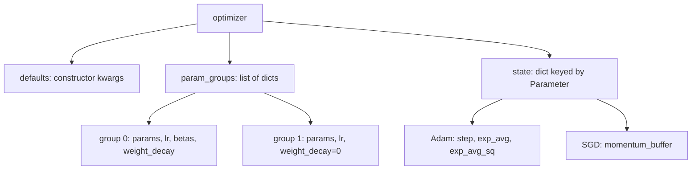

# 15 — Optimizers and Learning-Rate Schedules

> **Prerequisites:** modules 07, 10 and 13.
> **You will learn:** the `torch.optim.Optimizer` contract (`param_groups`,
> per-parameter `state`, `zero_grad(set_to_none=True)`, `step(closure)`,
> `state_dict()`/`load_state_dict()`, `add_param_group`, hooks); SGD momentum,
> dampening and Nesterov exactly as PyTorch writes them; Adam vs AdamW (coupled
> vs decoupled decay); Adagrad, RMSprop, NAdam, RAdam, Adamax, Adafactor,
> SparseAdam and LBFGS; for-loop vs `foreach` vs `fused`, `capturable`,
> `differentiable`, `maximize` and tensor learning rates; decay/no-decay groups
> and per-group learning rates; the built-in schedulers and the correct step
> order; SWA and EMA; and how to write your own `Optimizer`.

An optimizer is a small stateful object: parameter groups, per-parameter
buffers, and a `step()` that reads `p.grad` and rewrites `p` in place. Most
optimizer bugs (a resumed run whose loss spikes, decay hitting LayerNorm gains,
a schedule off by one step) come from a wrong model of what it stores.

Theory (why momentum and adaptivity help) lives in
[the optimization notes](../../notes/deep-learning/optimization-and-training.md)
and [the math of optimization](../../notes/math/optimization.md);
[the PyTorch overview note](../../notes/libraries/pytorch.md) is the one-page
summary. This module covers the API and the exact update rules, and checks
them against `torch.optim` 2.8 on CPU.

---

## 15.1 What an optimizer object holds



Each group dict overrides `defaults`. `state` is keyed by the `Parameter`
object and filled lazily on the first `step()`. For `Linear(3, 4) →
Linear(4, 2)` after one AdamW step, `optimizer.state_dict()` printed (locally):

```text
param_groups[0] = {'lr': 0.001, 'betas': (0.9, 0.999), 'eps': 1e-08, 'weight_decay': 0.01,
  'amsgrad': False, 'maximize': False, 'foreach': None, 'capturable': False,
  'differentiable': False, 'fused': None, 'decoupled_weight_decay': True, 'params': [0, 1, 2, 3]}
state = {0: {step: (), exp_avg: (4, 3), exp_avg_sq: (4, 3)}, 1: {... (4,)}, 2: {... (2, 4)}, 3: {... (2,)}}
```

Tensors become **integer ids in iteration order**, so `load_state_dict` matches
state to parameters purely by position. Rebuild the optimizer from the same
parameters in the same order and grouping, or Adam moments land on the wrong
tensors, silently when shapes happen to match. Never pass a `set`. Passing
`named_parameters()` stores `param_names`, but loading is still positional
([optim docs](https://docs.pytorch.org/docs/2.8/optim.html)). Note
`decoupled_weight_decay: True`: in 2.8 `AdamW` is literally
`Adam(..., decoupled_weight_decay=True)`
([adamw.py at v2.8.0](https://github.com/pytorch/pytorch/blob/v2.8.0/torch/optim/adamw.py)).

## 15.2 The step contract

`step()` reads `p.grad` for every parameter, skips those whose grad is `None`,
and updates `p` in place under `torch.no_grad()`, so the parameter stays a leaf
([module 07](./07-autograd-graph-and-backward.md)).
`zero_grad(set_to_none=True)` is the default since 2.0: it skips a memset and the
next backward *assigns* instead of accumulating, as the
[Performance Tuning Guide](https://docs.pytorch.org/tutorials/recipes/recipes/tuning_guide.html)
(living page, accessed 2026-10-10) recommends. The semantic difference: a `None`
grad is skipped, a zero grad is stepped, so with `set_to_none=False` a parameter
unused this step is still decayed and still coasts on momentum.

Line-search methods need the loss several times per step, so `step(closure)`
accepts a function that zeroes grads, recomputes the loss, calls `backward()` and
returns it. `LBFGS(lr=1, max_iter=20, history_size=100, line_search_fn=None)`
([docs](https://docs.pytorch.org/docs/2.8/generated/torch.optim.LBFGS.html)) is
for full-batch deterministic problems; locally, on a 2-D float64 quadratic with
`line_search_fn="strong_wolfe"`, one `step` called the closure 6 times and
matched the solution of $Ap = c$ to printed precision.

Hooks: `register_step_pre_hook(hook(opt, args, kwargs))` and
`register_step_post_hook` wrap every `step()` (log update norms);
`register_state_dict_pre_hook`, `register_load_state_dict_post_hook` and their
twins rewrite checkpoints, e.g. remapping state by `param_names` after a model
change, as the optim docs show.

## 15.3 SGD and momentum, exactly as PyTorch writes them

With lr $\eta$, momentum $\mu$, dampening $\tau$ and weight decay $\lambda$,
`torch.optim.SGD` computes
([sgd.py at v2.8.0](https://github.com/pytorch/pytorch/blob/v2.8.0/torch/optim/sgd.py)):

$$
g_t \leftarrow \nabla f(\theta_{t-1}) + \lambda\theta_{t-1},\quad
b_t \leftarrow \begin{cases} g_t & t = 1\\ \mu b_{t-1} + (1-\tau)\, g_t & t > 1\end{cases},\quad
\theta_t \leftarrow \theta_{t-1} - \eta\,(g_t + \mu b_t \text{ if Nesterov else } b_t).
$$

| | Sutskever et al. (2013) | PyTorch |
|---|---|---|
| buffer | $v \leftarrow \mu v - \eta g$ | $b \leftarrow \mu b + g$ |
| update | $\theta \leftarrow \theta + v$ | $\theta \leftarrow \theta - \eta b$ |
| first step | $v_1 = -\eta g_1$ | $b_1 = g_1$, dampening skipped |
| Nesterov | gradient at the look-ahead point | $\theta \leftarrow \theta - \eta(g + \mu b)$ |
| lr change | past steps keep their old $\eta$ inside $v$ | the new $\eta$ rescales the whole buffer |
| weight decay | not part of the method | L2 added to $g$, so it enters $b$ |

With constant $\eta$ the forms are identical ($v = -\eta b$). Under a schedule
they are not: PyTorch reacts to an lr drop at once, while
[Sutskever's form](https://proceedings.mlr.press/v28/sutskever13.html) coasts on
velocity built at the old rate. Fence 1 shows both. Nesterov requires
`momentum > 0` and `dampening == 0`.

## 15.4 Adam and AdamW

Adam ([Kingma & Ba](https://arxiv.org/abs/1412.6980)) keeps two moving averages
and corrects their zero-initialization bias:

$$
m_t = \beta_1 m_{t-1} + (1-\beta_1)g_t,\quad
v_t = \beta_2 v_{t-1} + (1-\beta_2)g_t^2,\quad
\theta_t = \theta_{t-1} - \eta\,\frac{m_t/(1-\beta_1^t)}{\sqrt{v_t/(1-\beta_2^t)} + \epsilon}.
$$

The two decays differ in **where** $\lambda\theta$ enters. `Adam(weight_decay=λ)`
is L2: $g_t \leftarrow g_t + \lambda\theta_{t-1}$ before the moments, so the decay
is divided by $\sqrt{\hat v_t}$ like everything else. `AdamW` is decoupled
([Loshchilov & Hutter](https://arxiv.org/abs/1711.05101)): $\theta \leftarrow
\theta(1-\eta\lambda)$ before the Adam step, and $m$, $v$ never see it
([AdamW docs](https://docs.pytorch.org/docs/2.8/generated/torch.optim.AdamW.html)).

Under L2 the effective decay of coordinate $i$ is about
$\eta\lambda\theta_i/\sqrt{\hat v_i}$: parameters with small gradient variance are
decayed far harder than requested, noisy ones barely. At zero gradient,
$g = \lambda\theta$, $m/\sqrt{v} \to 1$, and Adam+L2 shrinks the weight by $\eta$
per step **whatever $\lambda$ is**: fence 2 measures 0.04995 over 5 steps at
$\eta = 10^{-2}$ for both $\lambda = 0.1$ and $0.01$, against 0.00499 for AdamW.
Decoupled decay shrinks every weight by the same $1-\eta\lambda$. PyTorch
multiplies by the *scheduled* $\eta$, so `weight_decay=0.1` at lr 3e-3 shrinks
weights by $3\times10^{-4}$ per step, and the paper's $\lambda$ equals
$\eta_{\text{peak}}\lambda_{\text{torch}}$.

| Setting | `Adam` | `AdamW` | LLM practice |
|---|---|---|---|
| `lr` | 1e-3 | 1e-3 | scale-dependent (capstone 3e-3) |
| `betas` | (0.9, 0.999) | (0.9, 0.999) | (0.9, 0.95): $v$ forgets in ~20 steps, so spikes recover faster |
| `eps` | 1e-8 | 1e-8 | 1e-8 |
| `weight_decay` | 0 | **0.01** | 0.1 on 2-D weights only |

`amsgrad=True` divides by the running maximum of $v_t$. State memory:
`exp_avg` and `exp_avg_sq` each match the parameter, so fp32 Adam holds **8
bytes per parameter** of state (12 with amsgrad; SGD momentum 4). The state
stays fp32 under autocast [mixed precision](./17-mixed-precision.md), because
the parameters do. Add 4-byte weights and 4-byte grads and you reach the 16
bytes/parameter of [module 22](./22-memory-accounting-and-checkpointing.md).

## 15.5 The rest of the family

| Optimizer (2.8 default lr) | State per parameter | When |
|---|---|---|
| `Adagrad` (1e-2) | sum of $g^2$ | sparse convex problems; lr decays forever |
| `RMSprop` (1e-2; `centered`, `momentum`) | $v$, optional mean and buffer | RNN/RL baselines; Adam without $m$ |
| `Adadelta` (1.0) | $v$, $\Delta^2$ | historical |
| `Adamax` (2e-3) | $m$, $\infty$-norm $u$ | rarely the right default |
| `NAdam` (2e-3; `decoupled_weight_decay`) | $m$, $v$ | Adam with Nesterov look-ahead |
| `RAdam` (1e-3; `decoupled_weight_decay`) | $m$, $v$ | rectifies early variance instead of warmup |
| `Adafactor` (1e-2) | row and column $v$ for matrices | memory-bound training of large matrices |
| `SparseAdam` (1e-3) | $m$, $v$; updates touched rows | `nn.Embedding(sparse=True)` ([module 11](./11-linear-embedding-conv-recurrent-layers.md)) |
| `LBFGS` (1) | curvature pairs | full-batch, small, needs a closure |
| `Rprop`, `ASGD` (1e-2) | step sizes / iterate average | full-batch; convex averaging |

Adafactor ([Shazeer & Stern](https://arxiv.org/abs/1804.04235); in `torch.optim`
since 2.5, [docs](https://docs.pytorch.org/docs/2.8/generated/torch.optim.Adafactor.html))
factors the second moment of a matrix: locally a 4096×1024 weight got
`row_var (4096, 1)` and `col_var (1, 1024)`, 5,121 state numbers against AdamW's
8,388,609, $O(m+n)$ instead of $O(mn)$, and no first moment. Dense optimizers
reject sparse gradients. Muon, Shampoo, SOAP and Lion are not in
`torch.optim` 2.8; see the optimization notes.

## 15.6 foreach, fused, and other implementation flags

| Implementation | What runs | Default |
|---|---|---|
| for-loop | per parameter, one kernel per op | CPU (foreach kernels target CUDA, XPU, privateuse1) |
| `foreach=True` | `torch._foreach_*` ops over the whole tensor list ("horizontal" fusion) | CUDA, when no implementation flag is set |
| `fused=True` | one kernel doing the entire update ("vertical" fusion) | never |

Per the [optim docs](https://docs.pytorch.org/docs/2.8/optim.html), only Adam,
AdamW, SGD and Adagrad have fused kernels (Adam/AdamW stable on CUDA, beta on CPU
and MPS; Adagrad CPU-only). Locally `fused=True` ran on CPU for
those four and raised `TypeError` for RMSprop, NAdam and Adafactor.
Implementations agree within float tolerance, not guaranteed bitwise:
summation order and fused multiply-adds differ.

`capturable=True` keeps `step` and lr on device for CUDA-graph capture (not
executed here); `differentiable=True` keeps the update in the autograd graph for
meta-learning; `maximize=True` ascends. `lr` may be a tensor: in a local probe
with a counting `torch.compile` backend, changing a float lr between steps
compiled the step twice, changing a tensor lr's value compiled it once.

## 15.7 Parameter groups: decay, no-decay, and layer-wise lr

Decay says matrices that multiply activations should be small. It makes little
sense for biases (a shift) or LayerNorm gains (a scale initialized at 1, see
[module 13](./13-initialization-and-losses.md), that decay drags toward 0). nanoGPT's
`configure_optimizers`
([model.py at 3adf61e](https://github.com/karpathy/nanoGPT/blob/3adf61e154c3fe3fca428ad6bc3818b27a3b8291/model.py))
groups by rank, which the lab copies:

```python
def build_param_groups(model, weight_decay):
    decay, no_decay, seen = [], [], set()
    for _, p in model.named_parameters():      # tied tensors appear once
        if not p.requires_grad or id(p) in seen:
            continue
        seen.add(id(p))
        (decay if p.ndim >= 2 else no_decay).append(p)
    return [{"params": decay, "weight_decay": weight_decay},
            {"params": no_decay, "weight_decay": 0.0}]
```

`ndim >= 2` catches every `Linear` and `Embedding` weight. Decaying embeddings
is a choice: nanoGPT does (they are 2-D and tied to the head); many recipes
exclude them. `named_parameters()` deduplicates tied weights; the id set guards
hand-built lists. A tensor in two groups raises `ValueError: some parameters
appear in more than one parameter group`; a duplicate inside one group only
warns in 2.8, and its update is then applied twice (measured).

Groups also carry learning rates: a smaller lr for a pretrained backbone, or
layer-wise decay $\eta_\ell = \eta\,\gamma^{L-\ell}$
([module 19](./19-classic-models-end-to-end.md),
[module 36](./36-capstone-lora-finetuning.md)). Schedulers scale each group's
own `initial_lr`, so ratios survive. `opt.add_param_group({"params":
backbone.parameters(), "lr": 1e-5})` unfreezes later, with empty state.

## 15.8 Learning-rate schedules

A scheduler keeps `last_epoch` (a step counter, despite the name) and rewrites
`group["lr"]` on each `scheduler.step()`. The constructor itself performs step
0, so with `LambdaLR(opt, f)` the first optimizer step already uses
$\eta_0 f(0)$, not the bare `lr` you passed to the optimizer (measured).

| Scheduler | lr at step $t$ (base $\eta_0$) |
|---|---|
| `LambdaLR(f)` | $\eta_0 f(t)$ |
| `StepLR(s, gamma)` / `MultiStepLR(milestones)` | $\eta_0\gamma^{\lfloor t/s\rfloor}$ / $\eta_0\gamma^{\#\{m \le t\}}$ |
| `ExponentialLR(gamma)` | $\eta_0\gamma^t$ |
| `CosineAnnealingLR(T_max, eta_min)` | $\eta_{\min} + (\eta_0-\eta_{\min})\tfrac{1+\cos(\pi t/T_{\max})}{2}$ |
| `CosineAnnealingWarmRestarts(T_0, T_mult)` | cosine restarted after $T_0, T_0T_{\text{mult}}, \dots$ ([SGDR](https://arxiv.org/abs/1608.03983)) |
| `LinearLR(s, e, T)` / `ConstantLR(f, T)` | $\eta_0[s + (e-s)\min(t,T)/T]$ / $\eta_0 f$ until $T$ |
| `OneCycleLR(max_lr, total_steps)` | max_lr/25 up to max_lr over 30 %, then down to max_lr/(25·10⁴); per batch |
| `SequentialLR` / `ChainedScheduler` | hand over at milestones / product of children |
| `ReduceLROnPlateau(factor, patience)` | × factor after `patience` bad `step(metric)` calls |

`OneCycleLR` ([Smith](https://arxiv.org/abs/1708.07120),
[docs](https://docs.pytorch.org/docs/2.8/generated/torch.optim.lr_scheduler.OneCycleLR.html))
also cycles momentum: on AdamW, `betas[0]` fell from 0.95 to 0.85 as lr rose
(measured), and stepping past `total_steps` raises `ValueError`.

**Order:** `optimizer.step()` then `scheduler.step()`. Reversed, PyTorch warns
("Detected call of `lr_scheduler.step()` before `optimizer.step()`") and the
first schedule value is skipped. `LambdaLR` cannot tell iterations from epochs:
give the lambda total *steps* and step it every iteration.

The capstone ([module 33](./33-capstone-pretraining.md)) warms up linearly to
3e-3 over $W=40$ steps, then cosine-decays to a $\rho = 10\,\%$ floor at $T=800$:

$$
\eta_t = \eta_{\text{peak}}\cdot\begin{cases}\dfrac{t+1}{W} & t < W\\[4pt]
\rho + (1-\rho)\,\dfrac{1+\cos\!\big(\pi\,\frac{t-W}{T-W}\big)}{2} & t \ge W\end{cases}
$$

| step | 0 | 39 | 40 | 200 | 400 | 800 |
|---|---|---|---|---|---|---|
| lr | 7.5e-5 | 3.0e-3 | 3.0e-3 | 2.715e-3 | 1.761e-3 | 3.0e-4 |

As `LambdaLR` this is one function
([docs](https://docs.pytorch.org/docs/2.8/generated/torch.optim.lr_scheduler.LambdaLR.html)).
The built-in composition is `SequentialLR([LinearLR(start_factor=1/40,
total_iters=39), CosineAnnealingLR(T_max=760, eta_min=3e-4)], milestones=[40])`.
`total_iters=39`, not 40: `LinearLR` reaches `end_factor` at `t = total_iters`,
and the peak belongs at step 39 (fence 4). Prefer the lambda: nothing to misalign.

Schedulers are stateful: checkpoint `scheduler.state_dict()` (`last_epoch`,
`base_lrs`, `_last_lr`, ...). Rebuilding it on resume restarts warmup (fence 3,
[module 16](./16-training-loop-checkpointing.md)).

## 15.9 Weight averaging: SWA and EMA

`AveragedModel(model, multi_avg_fn=get_ema_multi_avg_fn(0.999))` from
`torch.optim.swa_utils` holds a deep copy of the model; call
`ema.update_parameters(model)` after each `optimizer.step()`. The update is
$W^{\text{EMA}} \leftarrow \alpha W^{\text{EMA}} + (1-\alpha)W$ via
`torch._foreach_lerp_`, and the first call copies the weights outright. The
horizon is about $1/(1-\alpha)$ steps (1,000 for 0.999), so the lab's 200-step
run uses 0.95. Without `multi_avg_fn` it computes the equal-weight SWA average
([Izmailov et al.](https://arxiv.org/abs/1803.05407)), usually with
`SWALR(optimizer, swa_lr=...)`, which anneals to a constant lr.

Buffers are not averaged unless `use_buffers=True`, so BatchNorm models need
`update_bn(loader, swa_model)` to recompute running statistics. Use EMA weights
for evaluation and generation; training continues on the raw weights. The copy
costs another full set of parameters (4 bytes/parameter in fp32).

## 15.10 Writing your own Optimizer

Put hyperparameters in `defaults`, iterate `self.param_groups`, decorate `step`
with `@torch.no_grad()`, create `self.state[p]` lazily, support a closure. Keep
everything in `self.state` and the group dicts and `state_dict()` round-trips
for free. The core of the lab's Lion-like `SignMomentum`:

```python
@torch.no_grad()
def step(self, closure=None):
    loss = None
    if closure is not None:
        with torch.enable_grad():
            loss = closure()
    for group in self.param_groups:
        lr, (b1, b2), wd = group["lr"], group["betas"], group["weight_decay"]
        for p in group["params"]:
            if p.grad is None:
                continue
            state = self.state[p]
            if "exp_avg" not in state:                            # lazy state
                state["exp_avg"] = torch.zeros_like(p)
            m = state["exp_avg"]
            p.mul_(1 - lr * wd)                                   # decoupled decay
            p.add_(torch.sign(m.mul(b1).add(p.grad, alpha=1 - b1)), alpha=-lr)
            m.mul_(b2).add_(p.grad, alpha=1 - b2)
    return loss
```

Every coordinate moves by exactly $\pm\eta$, so its lr must be several times
smaller than AdamW's; it stores one state tensor.

## Reconciling the sources

Karpathy's makemore part 2
([notebook at 73c3fcc](https://github.com/karpathy/nn-zero-to-hero/blob/73c3fcc741f0ec104ca850b1fb0df90e7e8d4cde/lectures/makemore/makemore_part2_mlp.ipynb))
picks lr 0.1 from an exponential sweep (`10**torch.linspace(-3, 0, 1000)`) and
drops it to 0.01 halfway by hand: a one-milestone `MultiStepLR`. Raschka's
Appendix D
([at cdbd33e](https://github.com/rasbt/LLMs-from-scratch/tree/cdbd33e6d57a71e20ea31434841095fac50cecd8/appendix-D))
writes warmup and cosine by assigning `param_group["lr"]` each step; that is
`LambdaLR` without the state object (his warmup starts at `initial_lr` and his
AdamW decays every parameter). nanoGPT warms up with $(t+1)/(W+1)$ rather than
$(t+1)/W$, groups by `dim() >= 2`, and asks for `fused=True` only when the
device is CUDA.

## Worked optimizer verification

**1. SGD momentum and Nesterov by hand.** Proves that PyTorch's buffer is
$b \leftarrow \mu b + g$ with $b_1 = g_1$, that Nesterov steps along
$g + \mu b$, and that Sutskever's velocity form agrees under a constant lr but
diverges after an lr drop. It does not test weight decay (the lab does, at
1e-4) or dampening.

```python pytorch-check
import torch

A = torch.tensor([[3.0, 0.5], [0.5, 1.0]], dtype=torch.float64)
c = torch.tensor([1.0, -2.0], dtype=torch.float64)
grad = lambda p: A @ p - c                     # f(p) = 0.5 p^T A p - c^T p
lr, mu = 0.1, 0.9

for nesterov in (False, True):
    p = torch.nn.Parameter(torch.ones(2, dtype=torch.float64))
    opt = torch.optim.SGD([p], lr=lr, momentum=mu, nesterov=nesterov)
    q, b = torch.ones(2, dtype=torch.float64), None
    for _ in range(5):
        opt.zero_grad()
        (0.5 * p @ A @ p - c @ p).backward()
        opt.step()
        g = grad(q)
        b = g.clone() if b is None else mu * b + g    # step 1: b = g
        q = q - lr * (g + mu * b if nesterov else b)
        torch.testing.assert_close(p.detach(), q, rtol=0, atol=1e-14)

def pytorch_form(lrs):                         # b = mu b + g ; p -= lr_t b
    p, b = torch.ones(2, dtype=torch.float64), None
    for lr_t in lrs:
        b = grad(p) if b is None else mu * b + grad(p)
        p = p - lr_t * b
    return p

def sutskever_form(lrs):                       # v = mu v - lr_t g ; p += v
    p, v = torch.ones(2, dtype=torch.float64), 0.0
    for lr_t in lrs:
        v = mu * v - lr_t * grad(p)
        p = p + v
    return p

const, drop = [0.1] * 6, [0.1] * 3 + [0.01] * 3
torch.testing.assert_close(pytorch_form(const), sutskever_form(const), rtol=0, atol=1e-14)
gap = (pytorch_form(drop) - sutskever_form(drop)).abs().max().item()
assert gap > 1e-2
print(f"SGD momentum/Nesterov match by hand; after an lr drop the two forms differ by {gap:.3f}")
```

**2. Adam vs AdamW differ only through decay.** Proves equality at
`weight_decay=0`, that `AdamW` is `Adam(decoupled_weight_decay=True)`, that
AdamW matches the hand-written decoupled update to 1e-12 in float64, and the
zero-gradient pathology of L2 inside Adam. Gradients are a fixed sequence, so
it checks the update rule, not training dynamics.

```python pytorch-check
import torch

torch.manual_seed(0)
w0 = torch.randn(4, 3, dtype=torch.float64)
grads = [torch.randn(4, 3, dtype=torch.float64) for _ in range(5)]
lr, wd, (b1, b2), eps = 1e-2, 0.1, (0.9, 0.999), 1e-8
Adam, AdamW = torch.optim.Adam, torch.optim.AdamW

def run(cls, w, gs, **kw):
    p = torch.nn.Parameter(w.clone())
    opt = cls([p], lr=lr, **kw)
    for g in gs:
        p.grad = g.clone()
        opt.step()
    return p.detach()

adamw = run(AdamW, w0, grads, weight_decay=wd)
assert torch.equal(run(Adam, w0, grads), run(AdamW, w0, grads, weight_decay=0.0))
assert torch.equal(run(Adam, w0, grads, weight_decay=wd, decoupled_weight_decay=True), adamw)
assert not torch.allclose(run(Adam, w0, grads, weight_decay=wd), adamw)

p, m, v = w0.clone(), torch.zeros_like(w0), torch.zeros_like(w0)
for t, g in enumerate(grads, start=1):        # AdamW by hand
    p = p * (1 - lr * wd)                      # decoupled decay first
    m = b1 * m + (1 - b1) * g
    v = b2 * v + (1 - b2) * g * g
    p = p - lr * (m / (1 - b1 ** t)) / ((v / (1 - b2 ** t)).sqrt() + eps)
torch.testing.assert_close(adamw, p, rtol=0, atol=1e-12)

one, zero = torch.ones(1, dtype=torch.float64), [torch.zeros(1, dtype=torch.float64)] * 5
shrink = lambda cls, d: 1 - run(cls, one, zero, weight_decay=d).item()
assert abs(shrink(AdamW, wd) - (1 - (1 - lr * wd) ** 5)) < 1e-12
assert abs(shrink(Adam, wd) - 5 * lr) < 1e-3 and abs(shrink(Adam, wd / 10) - 5 * lr) < 1e-3
print(f"zero-grad shrink over 5 steps: AdamW {shrink(AdamW, wd):.5f}, "
      f"Adam+L2 {shrink(Adam, wd):.5f} (wd/10: {shrink(Adam, wd / 10):.5f})")
```

**3. state_dict round trip.** Proves that optimizer plus scheduler state
restores a bit-identical continuation through `torch.save` and
`torch.load(weights_only=True)`, that state is keyed by integer ids, and that a
freshly built scheduler resets the lr to the warmup start. RNG and data-loader
state are not covered ([module 16](./16-training-loop-checkpointing.md)).

```python pytorch-check
import io
import torch
from torch import nn
from torch.optim.lr_scheduler import LambdaLR

torch.manual_seed(0)
x, y = torch.randn(16, 3), torch.randn(16, 1)
lam = lambda step: min(1.0, (step + 1) / 4)        # 4-step warmup

def build():
    model = nn.Sequential(nn.Linear(3, 4), nn.Tanh(), nn.Linear(4, 1))
    opt = torch.optim.AdamW(model.parameters(), lr=1e-2, betas=(0.9, 0.95))
    return model, opt, LambdaLR(opt, lam)

def train_step(model, opt, sched):
    opt.zero_grad(set_to_none=True)
    nn.functional.mse_loss(model(x), y).backward()
    opt.step()
    sched.step()

model, opt, sched = build()
for _ in range(3):
    train_step(model, opt, sched)
buf = io.BytesIO()
torch.save({"model": model.state_dict(), "opt": opt.state_dict(), "sched": sched.state_dict()}, buf)
buf.seek(0)
ck = torch.load(buf, weights_only=True)
assert ck["opt"]["param_groups"][0]["params"] == [0, 1, 2, 3]        # ids, not tensors
assert sorted(ck["opt"]["state"][0]) == ["exp_avg", "exp_avg_sq", "step"]

model2, opt2, sched2 = build()
model2.load_state_dict(ck["model"])
opt2.load_state_dict(ck["opt"])
sched2.load_state_dict(ck["sched"])
_, opt3, _ = build()                                # the resume bug: fresh scheduler
opt3.load_state_dict(ck["opt"])
LambdaLR(opt3, lam)
assert abs(opt2.param_groups[0]["lr"] - 1e-2) < 1e-15 and abs(opt3.param_groups[0]["lr"] - 2.5e-3) < 1e-15

for _ in range(2):
    train_step(model, opt, sched)
    train_step(model2, opt2, sched2)
assert all(torch.equal(a, b) for a, b in zip(model.parameters(), model2.parameters()))
print("optimizer+scheduler round trip is bit-exact; a rebuilt scheduler restarts warmup at 2.5e-3")
```

**4. Warmup-cosine values.** Proves the capstone `LambdaLR` hits the closed
form at steps 0, 39, 40, 420 and 800, that `SequentialLR(LinearLR,
CosineAnnealingLR)` reproduces it within 1e-9 with `total_iters=W-1`, and that
the natural-looking `total_iters=W` never reaches the peak.

```python pytorch-check
import math
import warnings
import torch
from torch.optim.lr_scheduler import CosineAnnealingLR, LambdaLR, LinearLR, SequentialLR

peak, W, T, floor = 3e-3, 40, 800, 0.1

def mult(t):                                       # capstone schedule (module 33)
    if t < W:
        return (t + 1) / W
    return floor + (1 - floor) * 0.5 * (1 + math.cos(math.pi * min(1.0, (t - W) / (T - W))))

def trace(make_sched):
    opt = torch.optim.SGD([torch.nn.Parameter(torch.zeros(1))], lr=peak)
    sched, lrs = make_sched(opt), []
    for _ in range(T + 1):
        lrs.append(opt.param_groups[0]["lr"])      # lr used by this step
        opt.step()
        sched.step()
    return lrs

def sequential(linear_iters):
    return lambda opt: SequentialLR(opt, [
        LinearLR(opt, start_factor=1 / W, end_factor=1.0, total_iters=linear_iters),
        CosineAnnealingLR(opt, T_max=T - W, eta_min=floor * peak)], milestones=[W])

lam = trace(lambda opt: LambdaLR(opt, mult))
mid = (W + T) // 2
assert abs(lam[0] - peak / W) < 1e-15 and abs(lam[W - 1] - peak) < 1e-15 and abs(lam[W] - peak) < 1e-15
assert abs(lam[mid] - (floor + (1 - floor) / 2) * peak) < 1e-15
assert abs(lam[T] - floor * peak) < 1e-15

with warnings.catch_warnings():                    # SequentialLR passes an epoch at milestones
    warnings.simplefilter("ignore", UserWarning)
    seq, seq_naive = trace(sequential(W - 1)), trace(sequential(W))
assert max(abs(a - b) for a, b in zip(seq, lam)) < 1e-9
assert abs(seq_naive[W - 1] - peak) > 1e-6         # total_iters=W misses the peak
print(f"warmup-cosine lr[0]={lam[0]:.2e} lr[39]={lam[39]:.2e} lr[{mid}]={lam[mid]:.3e} lr[800]={lam[800]:.2e}")
```

## Lab: implement SGD, AdamW and a schedule from scratch and match torch.optim

[`code/15_optimizers_from_scratch.py`](./code/15_optimizers_from_scratch.py)
implements `ScratchSGD`, `ScratchAdamW` and `SignMomentum` as `Optimizer`
subclasses plus `warmup_cosine(step)`, and trains a seeded 8 → 32 → LayerNorm →
tanh → 1 MLP (385 parameters) on synthetic regression (256 train, 256 held-out
rows): (a) scratch vs `torch.optim` SGD (momentum 0.9, with and without
Nesterov, wd 1e-4) and AdamW (betas (0.9, 0.95), wd 0.1 on 2-D weights), float64,
in lockstep under one `LambdaLR`, tracking the worst parameter gap at every
step; (b) AdamW for-loop vs `foreach=True` vs `fused=True` in float32; (c) decay
groups vs decay-all; (d) an EMA (decay 0.95) of the grouped run on held-out rows.

```bash
python content/courses/pytorch/code/15_optimizers_from_scratch.py
python site/test_pytorch_15_optimizers.py
```

Tested with Python 3.11 and PyTorch 2.8.0 on CPU.

One local PyTorch 2.8 CPU run (Apple M-series laptop, 200 steps, seed 0)
produced:

| Quantity | Value |
|---|---|
| max param gap, ScratchSGD vs SGD | 2.8e-16 |
| max param gap, ScratchAdamW vs AdamW | 0.0 (bitwise) |
| for-loop vs foreach / fused, float32 | 0.0 / 0.0 |
| train loss: initial → SGD / AdamW groups / AdamW decay-all | 0.790 → 0.0360 / 0.0144 / 0.0156 |
| norm of biases and LayerNorm gains: groups / decay-all | 8.19 / 7.65 |
| held-out loss: raw weights / EMA | 0.1053 / 0.1037 |

The bitwise AdamW match comes from mirroring PyTorch's op order (`lerp_` for
$m$, bias correction folded into the `addcdiv_` step size). A variant writing
$m$ as `mul_` then `add_` drifted to 1.6e-15 after 200 steps: same math,
different rounding. foreach on CPU falls back to per-tensor kernels, so it
was bitwise equal here; on CUDA expect float32-epsilon differences, hence the
test's `< 1e-5`. Decay-all shrank biases and gains and cost a little training
loss. The EMA's edge is one seed, not evidence. The test asserts contracts:
gaps below 1e-12, foreach and fused gaps below 1e-5, loss at least halved,
scratch `state_dict` round trips, biases and gains untouched by a zero-gradient
AdamW step while matrices shrink by exactly $1-\eta\lambda$, tied weights listed
once, and the lr trace equal to the closed form.

Scope, honestly: this shows equivalence of update rules on a toy problem. It
says nothing about which optimizer generalizes better, and the `fused` CUDA
kernels and `capturable` paths were not executed.

## Key takeaways

- An optimizer is `param_groups` plus lazily created per-parameter `state`; its
  `state_dict` is positional, so rebuild with identical order and grouping.
- PyTorch momentum is $b \leftarrow \mu b + g$, $\theta \leftarrow \theta -
  \eta b$: the current lr scales the whole buffer.
- `Adam(weight_decay)` is L2 divided by $\sqrt{\hat v}$; `AdamW` shrinks
  $\theta$ by $1-\eta\lambda$ outside the moments (default 0.01, Adam's 0).
- fp32 Adam state is 8 bytes/parameter; Adafactor's is $O(m+n)$ per matrix.
- foreach and fused change speed, not math, up to rounding.
- Decay matrices, not biases or norm gains; list tied weights once.
- `optimizer.step()` then `scheduler.step()`; checkpoint the scheduler.
- EMA weights are a second model copy for evaluation and generation.

## Self-check

1. Write AdamW's update for one parameter and point to the exact term that makes it different from Adam with `weight_decay`. Why does the difference matter more for parameters with small gradient variance?
2. You resume training and the loss spikes. You restored the model and the optimizer but rebuilt the scheduler from scratch. What happened to the learning rate, and what else should a checkpoint include?
3. Why do many LLM recipes exclude biases and LayerNorm weights from weight decay, and how do you build the param groups so that a tied embedding/head is not listed twice?

---

**Next → [16 — The Training Loop: Evaluation, Checkpointing, and Exact Resume](./16-training-loop-checkpointing.md)**
