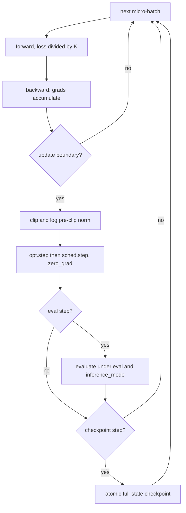
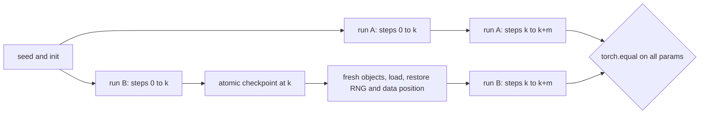

# 16 — The Training Loop: Evaluation, Checkpointing, and Exact Resume

> **Prerequisites:** modules 06, 07, 10, 13–15.
> **You will learn:** the canonical loop and the four mode switches people confuse
> (`model.train()/eval()`, `no_grad`, `inference_mode`, `requires_grad_(False)`);
> gradient accumulation with correct loss scaling, clipping (`clip_grad_norm_`,
> `clip_grad_value_`, `get_total_norm`/`clip_grads_with_norm_`) and what to log;
> validation, early stopping and a minimal callback Trainer, and what frameworks
> hide; serialization semantics (`weights_only=True`, `add_safe_globals`,
> `map_location`, `mmap=True`, shared storage, safetensors); full-state checkpoints,
> atomic writes, and bit-exact resume and how to prove it.

Every part of the loop has appeared already (modules 07, 10, 13–15). Most
production failures are wiring bugs between them: a model left in `eval()`, a loss
4× too large because accumulation forgot to divide, a "resume" that restarts warmup,
a checkpoint half-written when the spot instance died.

The standard here is **exact resume**: a run interrupted at step $k$ and resumed
must end with bitwise the same parameters as one that never stopped. Meeting it
forces you to list every piece of state the loop owns. The lab proves it with
dropout, a shuffled loader, AdamW, warmup-cosine and accumulation, plus a negative
control showing one forgotten RNG state breaks equality.

---

## 16.1 The loop in nine lines

The [PyTorch overview note](../../notes/libraries/pytorch.md) annotates an AMP loop
and the [optimization note](../../notes/deep-learning/optimization-and-training.md)
says "Name the clocks before writing the loop"; this module goes into exact
semantics and resume. One update with accumulation factor $K$:

```python
for micro, (xb, yb) in enumerate(loader, start=1):        # micro-batch clock
    loss = loss_fn(model(xb), yb) / K                     # scaled loss
    loss.backward()                                       # grads ADD into .grad
    if micro % K:
        continue
    gnorm = torch.nn.utils.clip_grad_norm_(model.parameters(), 1.0)  # pre-clip norm
    opt.step()
    sched.step()                                          # schedule follows updates
    opt.zero_grad(set_to_none=True)                       # the default since 2.0
    step += 1; log(step, loss.item() * K, gnorm.item())   # update clock
```

Three clocks run at once: **micro-batches**, **updates** (`opt.step()` calls,
which drive scheduler, eval and checkpoint cadence) and **data** (examples or
tokens). A scheduler stepped per micro-batch ends its cosine $K$ times early.
Compare runs with different batch sizes in tokens, not steps.

`set_to_none=True` drops `.grad` instead of zero-filling it. Besides saving a
memset, it changes semantics: optimizers skip parameters whose `.grad is None`,
while a zero gradient still receives weight decay and momentum.



## 16.2 Four switches that are not the same thing

| Switch | What it changes | Graph recorded? | Typical use |
|---|---|---|---|
| `model.train()` / `eval()` | `module.training` recursively; only Dropout, BatchNorm and similar read it | unchanged | validation, inference |
| `torch.no_grad()` | grad mode off; no `grad_fn` | no | eval, EMA updates, in-place init |
| `torch.inference_mode()` | no graph, no version counters or view tracking; outputs are *inference tensors* | no | eval and serving |
| `p.requires_grad_(False)` | this leaf is not differentiated | yes, for the rest | freezing a backbone |

The first switch is about **module behaviour**, the others about **autograd**. They
are orthogonal and every combination is legal, so the bugs are silent:

- **`eval()` without `no_grad`**: deterministic outputs, but each batch builds a
  graph and holds activations. The "OOM only during eval" bug.
- **`no_grad` without `eval()`**: dropout is on and BatchNorm uses batch statistics
  *and updates its running stats*. Validation changes every run and evaluation
  mutates the model.
- **No `model.train()` afterwards**: training continues without dropout, silently.

`inference_mode` is stricter than `no_grad`: its tensors can never enter autograd.
On 2.8, using one in a graph raises "Inference tensors cannot be saved for
backward", and an in-place update outside the mode is refused
([`inference_mode`](https://docs.pytorch.org/docs/2.8/generated/torch.autograd.grad_mode.inference_mode.html),
[grad modes](https://docs.pytorch.org/docs/2.8/autograd.html)). Use it when outputs
only feed metrics, `no_grad` when they are reused in training. Fence 4 checks each
row.

## 16.3 Gradient accumulation and clipping

### Accumulation is a loss-scaling problem

`backward()` adds into `.grad`. For a mean loss over $B$ examples split into $K$
equal micro-batches, each micro-batch mean must be divided by $K$:

$$
\nabla \tfrac{1}{B}\textstyle\sum_{i=1}^{B}\ell_i = \sum_{k=1}^{K} \nabla\Big(\tfrac{1}{K}\cdot\tfrac{K}{B}\sum_{i\in k}\ell_i\Big).
$$

Forget the $1/K$ and the gradient is $K\times$ too large. Adam mostly hides it
(nearly scale-invariant), but clipping thresholds and logged norms are wrong, and
under SGD the learning rate is effectively $K\times$. With unequal micro-batches (a short tail, variable
padding) divide summed losses by the total example or valid-token count of the
window, as in [13 — Initialization, Loss Functions, and Stable Outputs](./13-initialization-and-losses.md).
Accumulation is exact only for losses that decompose over examples; BatchNorm
statistics are per micro-batch. In DDP, wrap the first $K-1$ backward passes in
`no_sync()` ([26 — Distributed Training: Process Groups, Collectives, and DDP](./26-distributed-collectives-and-ddp.md)).

### Clipping semantics

[`clip_grad_norm_(parameters, max_norm, norm_type=2.0, error_if_nonfinite=False, foreach=None)`](https://docs.pytorch.org/docs/2.8/generated/torch.nn.utils.clip_grad_norm_.html)
treats all gradients as one vector. In
[`clip_grad.py` at v2.8.0](https://github.com/pytorch/pytorch/blob/v2.8.0/torch/nn/utils/clip_grad.py)
it multiplies every gradient in place by `clamp(max_norm / (total_norm + 1e-6), max=1.0)`:

1. It **returns the pre-clip total norm**. Log it every step; spikes precede loss
   spikes.
2. Direction is preserved. After clipping the norm is `max_norm` up to the `1e-6`
   guard.
3. Clip **after** accumulation and **before** `opt.step()`. With fp16 AMP call
   `scaler.unscale_(opt)` first, or you clip scaled gradients
   ([17 — Mixed Precision and Numerical Formats](./17-mixed-precision.md)).
4. With the default `error_if_nonfinite=False`, a non-finite norm is not an error.
   On 2.8 CPU, one `inf` entry returned `tensor(inf)` and turned every gradient into
   zeros or NaN. Pass `True` if you would rather crash.

`foreach=None` uses multi-tensor kernels for CUDA and native CPU tensors. Since 2.6
the halves are public: [`get_total_norm`](https://docs.pytorch.org/docs/2.8/generated/torch.nn.utils.get_total_norm.html)
and [`clip_grads_with_norm_`](https://docs.pytorch.org/docs/2.8/generated/torch.nn.utils.clip_grads_with_norm_.html).
Sharded training needs the split: partial norms are all-reduced, then every rank
clips with the global value. `clip_grad_value_` clamps
elements independently and changes the direction.

Log per update: loss, pre-clip norm, `sched.get_last_lr()`, tokens seen, step time.

## 16.4 Evaluation done right

```python
def evaluate(model, loader):                       # loader: shuffle=False, drop_last=False
    was_training = model.training
    model.eval()
    loss_sum, correct, count = 0.0, 0, 0
    with torch.inference_mode():
        for xb, yb in loader:
            logits = model(xb)
            loss_sum += F.cross_entropy(logits, yb, reduction="sum").item()
            correct += (logits.argmax(-1) == yb).sum().item()
            count += yb.numel()
    model.train(was_training)                      # restore, don't assume
    return loss_sum / count, correct / count
```

Accumulate **sums and counts**; a mean of batch means overweights a short tail
batch. No shuffle, no `drop_last`. Early stopping watches the validation split, counts
evaluations without improvement against a patience, and keeps the best checkpoint
separate from the latest resumable one. The test split is used once, by the model
validation selected ([model evaluation note](../../notes/ml/model-evaluation.md)).
Each `.item()` syncs a GPU; acceptable in eval, but in the training loop keep device
tensors and sync only at log points ([21 — Profiling and Benchmarking](./21-profiling-and-benchmarking.md)).

## 16.5 A tiny callback Trainer, and what frameworks hide

The fast.ai Part 2 `Learner` is a bare loop plus callbacks fired at named events
([course.fast.ai Part 2](https://course.fast.ai/Lessons/part2.html), living page,
accessed 2026-10-10). As a teaching fragment:

```python
class Trainer:
    def __init__(self, model, opt, sched, train_loader, val_loader, callbacks,
                 accum=1, max_norm=1.0, eval_every=100):
        self.__dict__.update({k: v for k, v in locals().items() if k != "self"})
        self.step, self.micro, self.stop = 0, 0, False

    def emit(self, event, *args):
        for cb in self.callbacks:
            getattr(cb, event, lambda *a: None)(self, *args)

    def fit(self, max_steps):
        self.model.train()
        while self.step < max_steps and not self.stop:
            for xb, yb in self.train_loader:
                loss = F.cross_entropy(self.model(xb), yb) / self.accum
                loss.backward()
                self.micro += 1
                if self.micro % self.accum:
                    continue
                self.gnorm = torch.nn.utils.clip_grad_norm_(self.model.parameters(), self.max_norm)
                self.opt.step(); self.sched.step(); self.opt.zero_grad(set_to_none=True)
                self.step, self.loss = self.step + 1, loss.detach() * self.accum
                self.emit("on_step_end")
                if self.step % self.eval_every == 0:
                    self.emit("on_eval_end", evaluate(self.model, self.val_loader))
                if self.stop or self.step >= max_steps:
                    break

class EarlyStopping:
    def __init__(self, patience): self.best, self.bad, self.patience = -1.0, 0, patience
    def on_eval_end(self, tr, metrics):
        _, acc = metrics
        self.best, self.bad = (acc, 0) if acc > self.best else (self.best, self.bad + 1)
        tr.stop = self.bad >= self.patience

class Checkpoint:
    def __init__(self, path, every): self.path, self.every = path, every
    def on_step_end(self, tr):
        if tr.step % self.every == 0:
            save_checkpoint(self.path, tr)          # full state, atomic (16.7, 16.8)
```

The loop owns the order of operations; callbacks own policy. Callbacks carry state
too: `EarlyStopping.best` and `.bad` belong in the checkpoint, or a resumed run
restarts its patience. Frameworks are this pattern plus years of edge cases
([Hugging Face note](../../notes/libraries/huggingface.md),
[MLOps note](../../notes/libraries/mlops-and-serving.md)):

| Concern | Hand loop | PyTorch Lightning | HF `Trainer` | Accelerate |
|---|---|---|---|---|
| Precision | `autocast` + `GradScaler` (17) | `precision="bf16-mixed"` | `bf16=True` | `mixed_precision="bf16"` |
| Accumulation | `/K`, step every K, `no_sync` | `accumulate_grad_batches` | `gradient_accumulation_steps` | `accelerator.accumulate(model)` |
| Clipping | `clip_grad_norm_` after unscale | `gradient_clip_val` (norm by default) | `max_grad_norm` (default 1.0) | `accelerator.clip_grad_norm_` |
| Distributed | DDP/FSDP (26, 27) | `strategy=` | launched by `accelerate`/`torchrun` | `accelerator.prepare` |
| Checkpointing | full-state dict, atomic | `ModelCheckpoint`, `fit(ckpt_path=)` | `save_steps`, `train(resume_from_checkpoint=)` | `save_state`/`load_state` |

Names verified against source at release tags: Lightning
[`trainer.py` at 2.5.5](https://github.com/Lightning-AI/pytorch-lightning/blob/2.5.5/src/lightning/pytorch/trainer/trainer.py),
HF [`training_args.py` at v4.57.1](https://github.com/huggingface/transformers/blob/v4.57.1/src/transformers/training_args.py)
(the version installed here), and Accelerate
[`accelerator.py` at v1.10.1](https://github.com/huggingface/accelerate/blob/v1.10.1/src/accelerate/accelerator.py).
Lightning and Accelerate were read, not run. They hide this module's material: the unscale/clip/step/schedule order, which
clock the scheduler counts, which RNG states are saved, how data position is
restored. Hyperparameter search (Ray Tune, Optuna, Ax) sits above the loop and is
out of scope.

## 16.6 Serialization semantics

The reference is the [serialization notes](https://docs.pytorch.org/docs/2.8/notes/serialization.html);
everything below was run on 2.8.0 CPU.

**Format.** [`torch.save`](https://docs.pytorch.org/docs/2.8/generated/torch.save.html)
writes an uncompressed ZIP64 archive: `data.pkl` (the pickled object with storages
replaced by references), `byteorder`, one `data/N` entry per storage (64-byte
aligned), and `version`.

**Storage sharing.** Storages are saved, not tensors, so a tensor and its view load
back sharing one storage, and writing into one changes the other. The flip side:
saving `big[:2]` of a 100,000-element float32 tensor writes the whole storage
(401,492 bytes in fence 3) versus 1,563 bytes for `big[:2].clone()`. Saving an
embedding slice or one head of a fused QKV weight is the production version; clone
small views before saving.

**`weights_only=True`.** Since 2.6, [`torch.load`](https://docs.pytorch.org/docs/2.8/generated/torch.load.html)
defaults to a restricted unpickler that builds only tensors, `Parameter`,
`OrderedDict`, primitives and containers, plus allowlisted globals, and never
imports during unpickling. The flip happened because pickle runs code by design: a
`__reduce__` can return `(os.system, ("...",))`, so `weights_only=False` on a
downloaded file is arbitrary code execution. An old checkpoint holding an
`argparse.Namespace` now fails with "Unsupported global: GLOBAL argparse.Namespace".
Allowlist exactly that class, scoped:

```python
with torch.serialization.safe_globals([argparse.Namespace]):
    ckpt = torch.load(path, weights_only=True)
```

`add_safe_globals([...])` does it process-wide; `get_unsafe_globals_in_checkpoint(path)`
lists what a file needs without loading it. Better: store configs as plain dicts.
Python's `random.getstate()` passes the restricted unpickler; NumPy's `get_state()`
holds an `ndarray` and fails, so the lab stores that key array as a tensor.

**`map_location` and `mmap`.** Storages are deserialized on CPU, then moved to the
device recorded at save time unless `map_location` overrides it; pass
`map_location="cpu"` whenever the saving GPU may be absent. `mmap=True` maps the
file so storages page in lazily. With a meta-device model and
`load_state_dict(sd, assign=True)` ([10 — nn.Module from the Inside](./10-nn-module-internals.md),
[22 — Memory Accounting, Activation Checkpointing, and Offload](./22-memory-accounting-and-checkpointing.md))
a large model loads without two copies of the weights. A 2.8 quirk, verified here:
`assign=True` writes `assign_to_params_buffers=True` into `sd._metadata`, so a later
default `load_state_dict(sd)` from the same dict also assigns and the two modules
share storage; load each module from a fresh or cloned dict.

**safetensors** ([docs](https://huggingface.co/docs/safetensors/index), living page,
accessed 2026-10-10; 0.8.0 is installed with transformers here) is a JSON header plus
raw bytes: no code execution, zero-copy and lazy loading, but only a flat
`dict[str, Tensor]`. It has no place for optimizer, scheduler or RNG state, so it is
for weights, not resumable training state. HDF5 via `h5py`, which *Deep Learning
with PyTorch* ch. 3 uses to store arrays, belongs on the dataset side with
memmaps ([module 14](./14-data-pipelines.md)): it holds NumPy arrays, not module
or optimizer state.

| Format | Executes code on load | Holds | Lazy | Sharded | Use for |
|---|---|---|---|---|---|
| `torch.save`, `weights_only=True` | no | nested dicts of tensors and primitives | `mmap=True` | by hand | single-process checkpoints |
| `torch.save`, `weights_only=False` | **yes** | anything picklable | `mmap=True` | by hand | only files you created |
| safetensors | no | flat `str → Tensor` | yes | multi-file convention | publishing weights |
| DCP | no | sharded state dicts, reshard on load | yes | yes | FSDP/TP ([27](./27-fsdp2-dtensor-parallelism.md)) |

## 16.7 What a complete checkpoint contains

| Item | How to capture | Why exact resume needs it |
|---|---|---|
| Model weights and buffers | `model.state_dict()` | includes BatchNorm running stats |
| Optimizer state | `opt.state_dict()` | AdamW moments and per-parameter `step` |
| Scheduler state | `sched.state_dict()` | otherwise warmup restarts |
| GradScaler state | `scaler.state_dict()` | loss scale and growth tracker ([17](./17-mixed-precision.md)) |
| Counters | step, micro-batch, epoch, tokens | where each clock is |
| RNG states | `torch.get_rng_state()`, `torch.cuda.get_rng_state_all()`, `random.getstate()`, `numpy.random.get_state()`, explicit `Generator.get_state()` | dropout, augmentation, sampling |
| Data position | sampler seed and epoch, batch index | no replayed or skipped batches |
| Callback state | best metric, patience, EMA weights | early stopping continues correctly |
| Metadata | config, torch version, git SHA, thread count | says whether bitwise equality is possible |

The most-forgotten item is RNG state, then data position; both fail silently. The
[transformers course lab](../transformers/08-encoder-decoder-masking.md) adds the NLP
items: a manifest and the exact vocabulary ordering.

Data order and dropout are entangled by default. Verified on 2.8: creating an
iterator over a `DataLoader` without its own `generator` draws from the global torch
RNG, the same stream dropout uses. The lab avoids this with a sampler whose
permutation is a pure function of `(seed, epoch)` ([14 — Data Pipelines: Dataset, DataLoader, Samplers, and Collation](./14-data-pipelines.md)).

## 16.8 Atomic writes and checkpoint hygiene

A preempted process can die mid-`torch.save`; if it was overwriting `last.pt`, you
have no checkpoint. Write, then rename:

```python
def atomic_save(obj, path):
    tmp = path.with_name(path.name + ".tmp")
    try:
        with open(tmp, "wb") as f:
            torch.save(obj, f)
            f.flush(); os.fsync(f.fileno())        # bytes durable before the rename
        os.replace(tmp, path)                       # atomic on POSIX, same filesystem
    finally:
        if tmp.exists(): tmp.unlink()
```

Readers see the old file or the new one. A durable rename also needs a directory
`fsync`; object stores need a new key plus a pointer file. Hygiene: keep
the last $N$ plus the best; write a manifest with byte size and SHA-256 and check it
before loading; reload every new checkpoint once, since an unloaded checkpoint is a
hope; never keep only EMA weights or only the model; on preemptible capacity,
checkpoint on a time budget and on `SIGTERM`.

## 16.9 Exact resume: the test that proves it

**Definition.** Training to step $k$, checkpointing, building fresh objects, loading
and training $m$ more steps gives parameters bitwise equal to an uninterrupted
$k+m$-step run, on the same machine, thread count and device, with deterministic
kernels.

Every input to update $k+1$ must therefore match. State dicts cover parameters,
moments and schedule. The data must be the same examples, so the sampler resumes at
micro-batch $Kk$ of the right epoch; slicing a step-indexed permutation beats
replaying $Kk$ batches, which costs I/O and re-consumes RNG. The dropout masks must
match, so RNG is restored *after* building fresh objects (init consumes RNG) and
before the first forward. Checkpointing at an update boundary makes the accumulation
phase zero on both sides.



Scope: a different thread count changes CPU reduction order and different hardware
changes kernels, so across those expect tolerance-level agreement only
([06 — Randomness, Distributions, and Reproducibility](./06-randomness-and-reproducibility.md),
[randomness notes](https://docs.pytorch.org/docs/2.8/notes/randomness.html)). GPUs
add `torch.cuda.get_rng_state_all()` and deterministic algorithms (not executed
here); multi-worker loaders need per-worker seeds derived from a checkpointed base
seed; distributed resume is DCP's job ([27](./27-fsdp2-dtensor-parallelism.md)). The
capstone's pretraining uses this recipe ([33 — Pretraining the GPT on CPU](./33-capstone-pretraining.md)).

## Reconciling the sources

The [Saving and loading models tutorial](https://docs.pytorch.org/tutorials/beginner/saving_loading_models.html)
(living page, accessed 2026-10-10) and the overview note save model, optimizer and
epoch: a warm restart, not an exact resume. We agree with the tutorial's
`state_dict` advice; it predates 2.6, and its whole-module examples now need
`weights_only=False`. [`serialization.py` at v2.8.0](https://github.com/pytorch/pytorch/blob/v2.8.0/torch/serialization.py)
is the ground truth for the allowlist. The transformers lab showed one-step
equivalence on a deterministic model; this lab adds dropout, a shuffled loader, a
scheduler and accumulation. [What is torch.nn really?](https://docs.pytorch.org/tutorials/beginner/nn_tutorial.html)
(living page, accessed 2026-10-10) builds the loop incrementally.

## Worked loop verification

**Fence 1: accumulation equals the large batch.** Four micro-batches of 8 with
`loss / 4` give the 32-example gradient to round-off; forgetting `/4` gives exactly
4×; with chunks of 12, 12, 8, dividing means by $K$ is wrong while dividing sums by
32 is right. It says nothing about BatchNorm.

```python pytorch-check
import torch
import torch.nn as nn
import torch.nn.functional as F

torch.manual_seed(0)
model = nn.Sequential(nn.Linear(10, 32), nn.Tanh(), nn.Linear(32, 3))
x, y = torch.randn(32, 10), torch.randint(0, 3, (32,))


def grads_of(chunks, scale):
    model.zero_grad(set_to_none=True)
    for xb, yb in chunks:
        scale(F.cross_entropy(model(xb), yb, reduction="sum"), len(yb)).backward()
    return [p.grad.clone() for p in model.parameters()]


full = grads_of([(x, y)], lambda s, n: s / n)
equal = list(zip(x.split(8), y.split(8)))
K = len(equal)
accum = grads_of(equal, lambda s, n: (s / n) / K)
forgot = grads_of(equal, lambda s, n: s / n)
uneven = list(zip(x.split([12, 12, 8]), y.split([12, 12, 8])))
mean_over_k = grads_of(uneven, lambda s, n: (s / n) / 3)
sum_over_total = grads_of(uneven, lambda s, n: s / 32)

for g_full, g_acc, g_bad, g_sum in zip(full, accum, forgot, sum_over_total):
    torch.testing.assert_close(g_acc, g_full, atol=1e-6, rtol=0)
    torch.testing.assert_close(g_bad, K * g_full, atol=1e-5, rtol=1e-5)
    torch.testing.assert_close(g_sum, g_full, atol=1e-6, rtol=0)
worst_uneven = max((a - b).abs().max().item() for a, b in zip(mean_over_k, full))
assert worst_uneven > 1e-4, worst_uneven
print(f"accum==full; forgot /K gives {K}x; uneven mean/K error {worst_uneven:.2e}")
```

**Fence 2: `clip_grad_norm_` semantics.** The return value is the manual global L2
norm before clipping; afterwards the norm is `max_norm` within 1e-6 and every
gradient is scaled by one coefficient; a large threshold changes nothing; the
two-step API matches bitwise; `clip_grad_value_` changes direction. Non-finite
gradients are not tested here.

```python pytorch-check
import torch
import torch.nn as nn
from torch.nn.utils import clip_grad_norm_, clip_grad_value_, clip_grads_with_norm_, get_total_norm


def fresh_grads():
    torch.manual_seed(0)
    model = nn.Sequential(nn.Linear(20, 16), nn.ReLU(), nn.Linear(16, 5))
    model(torch.randn(16, 20)).pow(2).sum().backward()
    return model


model = fresh_grads()
before = [p.grad.clone() for p in model.parameters()]
manual = torch.sqrt(sum(g.pow(2).sum() for g in before))
assert manual > 1.0
returned = clip_grad_norm_(model.parameters(), max_norm=1.0)
torch.testing.assert_close(returned, manual, atol=1e-5, rtol=1e-6)
after = torch.sqrt(sum(p.grad.pow(2).sum() for p in model.parameters()))
torch.testing.assert_close(after, torch.tensor(1.0), atol=1e-6, rtol=0)
for g0, p in zip(before, model.parameters()):
    torch.testing.assert_close(p.grad, g0 / (manual + 1e-6), atol=1e-7, rtol=1e-5)

untouched = fresh_grads()
clip_grad_norm_(untouched.parameters(), max_norm=1e6)
assert all(torch.equal(p.grad, g) for p, g in zip(untouched.parameters(), before))

two_step = fresh_grads()
total = get_total_norm([p.grad for p in two_step.parameters()])
clip_grads_with_norm_(two_step.parameters(), 1.0, total)
assert all(torch.equal(p.grad, q.grad) for p, q in zip(two_step.parameters(), model.parameters()))

by_value = fresh_grads()
clip_grad_value_(by_value.parameters(), 0.1)
v = torch.cat([p.grad.flatten() for p in by_value.parameters()])
cos = torch.dot(v, torch.cat([g.flatten() for g in before])) / (v.norm() * manual)
assert cos < 0.999
print(f"pre-clip norm {returned.item():.3f} -> {after.item():.6f}; value-clip cosine {cos.item():.3f}")
```

**Fence 3: storage sharing and `weights_only`.** A saved tensor and its view load
back sharing storage; `big[:2]` writes about the whole storage while its clone is
tiny (a size ratio, not exact bytes); a pickled `argparse.Namespace` is refused by
the default load and accepted inside scoped `safe_globals`. It shows the allowlist,
not an exploit.

```python pytorch-check
import argparse
import os
import pickle
import tempfile

import torch

with tempfile.TemporaryDirectory() as d:
    t = torch.arange(10.0)
    torch.save({"t": t, "v": t[2:5]}, os.path.join(d, "shared.pt"))
    back = torch.load(os.path.join(d, "shared.pt"))
    assert back["v"].untyped_storage().data_ptr() == back["t"].untyped_storage().data_ptr()
    back["t"][3] = -1.0
    assert back["v"].storage_offset() == 2 and back["v"][1].item() == -1.0

    big = torch.zeros(100_000)
    torch.save(big[:2], os.path.join(d, "view.pt"))
    torch.save(big[:2].clone(), os.path.join(d, "clone.pt"))
    view_bytes = os.path.getsize(os.path.join(d, "view.pt"))
    clone_bytes = os.path.getsize(os.path.join(d, "clone.pt"))
    assert view_bytes > 0.9 * big.numel() * 4 and view_bytes > 50 * clone_bytes

    path = os.path.join(d, "args.pt")
    torch.save({"w": torch.ones(2), "args": argparse.Namespace(lr=3e-4)}, path)
    try:
        torch.load(path)                         # weights_only=True is the default
        raise AssertionError("restricted unpickler accepted a custom class")
    except pickle.UnpicklingError as err:
        assert "argparse.Namespace" in str(err)
    assert torch.serialization.get_unsafe_globals_in_checkpoint(path) == ["argparse.Namespace"]
    with torch.serialization.safe_globals([argparse.Namespace]):
        ok = torch.load(path, weights_only=True)
    assert ok["args"].lr == 3e-4
assert argparse.Namespace not in torch.serialization.get_safe_globals()   # scope restored
print(f"view file {view_bytes} B vs clone {clone_bytes} B; Namespace needs safe_globals")
```

**Fence 4: the switches are independent.** `eval()` without `no_grad` is
deterministic but builds a graph; `train()` under `no_grad` differs per call and
records nothing; `inference_mode` outputs are refused by autograd; a frozen layer
gets no `.grad`. Memory is not measured.

```python pytorch-check
import torch
import torch.nn as nn

torch.manual_seed(0)
model = nn.Sequential(nn.Linear(8, 16), nn.ReLU(), nn.Dropout(0.5), nn.Linear(16, 2))
x = torch.randn(4, 8)

model.eval()
o1, o2 = model(x), model(x)
assert torch.equal(o1, o2) and o1.grad_fn is not None

model.train()
with torch.no_grad():
    t1, t2 = model(x), model(x)
assert not torch.equal(t1, t2) and t1.grad_fn is None

model.eval()
with torch.inference_mode():
    inf = model(x)
assert inf.is_inference()
try:
    (inf * torch.ones(2, requires_grad=True)).sum().backward()
    raise AssertionError("inference tensor entered autograd")
except RuntimeError as err:
    assert "Inference tensors cannot be saved for backward" in str(err)

model.train()
model[0].requires_grad_(False)
model(x).sum().backward()
assert model[0].weight.grad is None and model[3].weight.grad is not None
assert torch.is_grad_enabled()
print("eval!=no_grad; inference tensors rejected; frozen layer has no grad")
```

## Lab: train, kill, resume, and prove the runs are identical

[`code/16_train_resume.py`](./code/16_train_resume.py) trains a `16 → 64 → 64 → 4`
MLP (5,508 parameters, dropout 0.1) on four overlapping Gaussian blobs (1,600 train,
400 validation points) with a `StepIndexedSampler` (shuffle order a pure function
of `(seed, epoch)`, startable at any batch), `num_workers=0`, micro-batches of 32,
AdamW, 10 % warmup then cosine `LambdaLR`, accumulation `--accum`, clipping at 1.0,
and evaluation every 20 updates with early-stopping bookkeeping. **Run A** trains
uninterrupted. **Run B** stops at `--kill-at`, writes `last.pt` with `atomic_save`
plus a `last.json` manifest (bytes, SHA-256), deletes every training object,
rebuilds them with a *different* init seed as a new process would, checks the hash,
loads with `weights_only=True`, restores torch, Python and NumPy RNG and the data
position, and continues. **Run C** is B without the RNG restore.

**Tested with Python 3.11 and PyTorch 2.8.0 on CPU.**

```bash
python content/courses/pytorch/code/16_train_resume.py
python content/courses/pytorch/code/16_train_resume.py --output-dir /tmp/pt-resume
python site/test_pytorch_16_train_resume.py
```

One local PyTorch 2.8 CPU run (Apple M2 Pro, 4 threads, defaults `--seed 0 --steps
120 --kill-at 50 --accum 2`) produced:

| Key | Value | Reading |
|---|---|---|
| `bitwise_equal_params` | `True` | `torch.equal` on all 5,508 parameters |
| `max_param_diff_resume` | 0.0 | zero, not small |
| `max_param_diff_no_rng` | 0.0269 | different dropout masks for 70 steps |
| loss curves A vs B | identical | all 120 per-update losses |
| loss at steps 1 / 50 / 120 | 1.449 / 0.301 / 0.253 | trained; dropout keeps it noisy |
| `best_val_acc` | 0.935 | same in A and resumed B |
| `checkpoint_bytes` | 88,341 | accounted below |

The 88,341 bytes: 5,508 float32 parameters (22,032 B), AdamW's two moments
(44,064 B), the torch generator state (5,056 B `uint8`), the NumPy key as int64
(4,992 B), and about 12 KB of Python RNG state, counters and ZIP headers. Adam state is twice the model at any scale.

The first version of this lab failed its own test: the resumed run rebuilt objects
with `seed + 1`, and the sampler took its shuffle seed from that argument. Everything
else was exact; losses diverged at step 51 because data order changed. Data order is
state; derive it only from checkpointed values.

The test asserts all of the brief's contracts (bitwise equality, the negative
control, identical curves, a `weights_only=True` load, no `.tmp`, accuracy above
0.8), plus that a save failing mid-pickle leaves the old checkpoint byte-identical
and that a corrupted file is rejected by checksum. It restores threads, dtype,
deterministic mode and all three RNGs.
Its 8 tests took 0.7–1.7 s of work locally. Scope: bitwise
equality within one machine and thread count; no GPU RNG, AMP scaler (the slot is
`None`), worker processes or distributed resume.

## Key takeaways

- One update is $K$ micro-batches; scheduler, eval and checkpoints run on the update
  clock. Divide losses by $K$ for equal chunks, by the window's total count otherwise.
- `train()/eval()` changes layer behaviour; `no_grad`, `inference_mode` and
  `requires_grad_(False)` change autograd. Evaluation needs both and must restore
  the previous mode.
- `clip_grad_norm_` returns the pre-clip norm (log it), runs after accumulation and
  unscaling, and does not raise on non-finite norms unless asked.
- `torch.save` saves storages: views stay shared, small views save big storages.
  `weights_only=True` is the default since 2.6; allowlist with `safe_globals`.
- A resumable checkpoint is model, optimizer, scheduler, scaler, counters, RNG
  states, data position, callback state and metadata, written atomically with a
  checksum. safetensors holds weights, not training state.
- Prove exact resume with `torch.equal` against an uninterrupted run, plus a
  negative control that shows the test can fail.

## Self-check

1. List everything a checkpoint must contain so that resuming at step 5,000 of a
   run with dropout, a shuffled loader, AdamW, a cosine schedule and AMP is
   bitwise identical on the same machine. Which item do people forget most?
2. Why did PyTorch flip `torch.load`'s `weights_only` default, and how do you load
   a checkpoint containing a custom dataclass safely?
3. Your validation loss is lower than training loss and changes every time you
   run evaluation on the same data. Name the two likely bugs.

---

**Next → [17 — Mixed Precision and Numerical Formats](./17-mixed-precision.md)**
