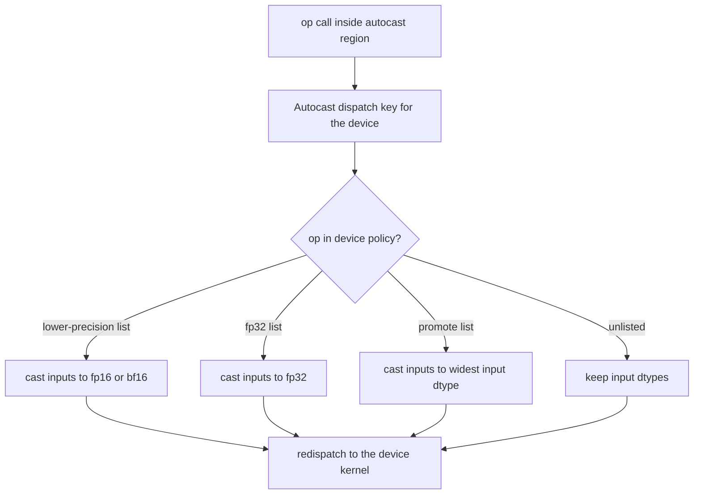
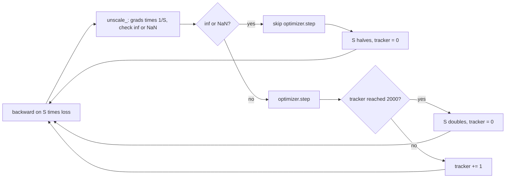

# 17 — Mixed Precision and Numerical Formats

> **Prerequisites:** modules 02, 05 and 16.
> **You will learn:** the bit layouts and ranges of fp32, tf32, fp16, bf16 and fp8; what `torch.autocast` does (per-device casting lists, nesting, disabling, the cast cache); how `torch.amp.GradScaler` scales, skips steps and adjusts its scale, and why `unscale_` precedes clipping; why bf16 needs no scaler but still needs fp32 master weights; the matmul precision knobs; fp8 training with torchao; and where precision bugs come from.

On tensor-core hardware a 16-bit matmul runs several times faster than fp32 and moves half the bytes. The price is numerical: a 16-bit float has either a small range (fp16) or few significant bits (bf16). The standard answer, from [Micikevicius et al. (2017)](https://arxiv.org/abs/1710.03740), is to keep the arithmetic that needs range or precision in fp32 and run everything else in 16 bits. In PyTorch, `torch.autocast` picks a dtype per op and `torch.amp.GradScaler` keeps fp16 gradients inside fp16's range.

Floating-point background is in [module 05](./05-tensor-math-linear-algebra-numerics.md), the [numerical methods note](../../notes/math/numerical-methods.md) and the [numerics lesson](/courses/inference/00-foundations/00-05-numerics.html). The [PyTorch note](../../notes/libraries/pytorch.md) and [optimization note](../../notes/deep-learning/optimization-and-training.md) give the overview.

---

## 17.1 Formats as bit budgets

A float spends one bit on sign, $e$ bits on exponent (the **range**: the max is about $2^{2^{e-1}}$) and $m$ bits on mantissa (the **precision**: spacing above 1.0 is $\varepsilon = 2^{-m}$). Values below are from `torch.finfo` ([module 02](./02-tensor-creation-dtypes-devices.md), [type_info](https://docs.pytorch.org/docs/2.8/type_info.html)) on PyTorch 2.8, and fence 1 asserts them:

| dtype | sign/exp/mant | max | smallest normal | eps | bytes |
|---|---|---|---|---|---|
| `torch.float32` | 1/8/23 | 3.40e38 | 1.18e-38 | $2^{-23}$ = 1.19e-7 | 4 |
| TF32 (matmul mode) | 1/8/10 | ≈ fp32 | ≈ fp32 | $2^{-10}$ | in fp32 registers |
| `torch.float16` | 1/5/10 | 65,504 | 6.10e-5 | $2^{-10}$ = 9.77e-4 | 2 |
| `torch.bfloat16` | 1/8/7 | 3.39e38 | 1.18e-38 | $2^{-7}$ = 7.81e-3 | 2 |
| `torch.float8_e4m3fn` | 1/4/3 | 448 | 1.56e-2 | 0.125 | 1 |
| `torch.float8_e5m2` | 1/5/2 | 57,344 | 6.10e-5 | 0.25 | 1 |

**bf16 is fp32's range with 8 significant bits.** It is the top half of an fp32 word, so the smallest normal is identical. **fp16 has three more mantissa bits but a tiny range.** It overflows above 65,504, goes subnormal below 6.1e-5, and is zero below $2^{-24} \approx 5.96\times10^{-8}$. [Kalamkar et al. (2019)](https://arxiv.org/abs/1905.12322) showed bf16 matches fp32 training without loss scaling or retuning: range matters more than precision.

**TF32 is not a dtype.** Ampere+ tensor cores round fp32 inputs to a 10-bit mantissa and accumulate in fp32, if a flag allows it (§17.6). The fp8 pair splits a byte two ways ([Micikevicius et al., 2022](https://arxiv.org/abs/2209.05433)). e4m3fn ("finite": no inf, the top code is NaN) has more precision, and e5m2 has fp16's range. On this CPU build, casting 500.0 to e4m3fn yields NaN rather than saturating at 448, so fp8 code must scale or clamp first.

## 17.2 Where low precision breaks

Fence 1 shows each class with a scalar; [module 05](./05-tensor-math-linear-algebra-numerics.md) derives the summation case.

**Overflow.** Above the max a value becomes inf, then NaN at the next `inf - inf`. Large activations, unscaled attention logits and sums of squares are typical. `7e4` is inf in fp16, finite in bf16.

**Underflow.** Below the smallest subnormal a value becomes 0. Gradients are the victims: Micikevicius et al. found a large share of activation gradients below fp16's range. A gradient of $10^{-8}$ in fp16 is not small. It is exactly 0.

**Swamping.** $a + b = a$ when $|b| < \tfrac12\,\mathrm{ulp}(a)$. The bf16 ulp of 1.0 is $2^{-7}$, so `1.0 + 1e-3` is 1.0, even a thousand times over. This breaks **optimizer updates and accumulations**: a bf16 weight of 1.0 updated by $\eta g = 10^{-4}$ never moves, and a bf16 running sum stops growing at about 256 times its addends. Hence fp32 accumulators, reductions and optimizer state.

Autocast's fp32 list or bf16 handles overflow, loss scaling handles underflow, and fp32 master weights handle swamping.

## 17.3 Autocast: an op-level casting policy

`torch.autocast(device_type, dtype=None, enabled=True, cache_enabled=None)` changes **which dtype each op runs in**, not the tensors you hold. Inside the region each op hits an Autocast dispatcher key ([module 20](./20-execution-model-dispatch-devices.md)) whose kernel looks the op up in the device's policy, casts inputs, and redispatches.



**The lists are per device, and CPU's are not CUDA's.** Per the [Autocast Op Reference](https://docs.pytorch.org/docs/2.8/amp.html), CUDA runs the matmul/conv family in 16 bits and has a long fp32 list: `softmax`, `log_softmax`, `layer_norm`, `group_norm`, `exp`, `log`, `sum`, `norm` and most losses. CPU's lower-precision list is the matmul/conv family plus `scaled_dot_product_attention`, its fp32 list is mostly losses, linear algebra and FFTs, and "float16 shares the lists of bfloat16". Measured on PyTorch 2.8 CPU with bf16 and fp16:

| Op inside `autocast("cpu", ...)` | Output measured | Reason |
|---|---|---|
| `x @ w`, `F.linear`, `bmm`, `conv1d` | 16-bit | lower-precision list |
| `F.mse_loss`, `F.cross_entropy` | `torch.float32` | fp32 list |
| `torch.cat([bf16, fp32])` | `torch.float32` | promote list |
| `softmax`, `LayerNorm`, `sum`, `exp` on 16-bit input | 16-bit | unlisted on CPU |
| `bf16 + fp32` | `torch.float32` | ordinary type promotion |

"LayerNorm runs in fp32 under autocast" is true on CUDA and false on CPU. Read the device's list before reasoning about precision.

**Scope rules.**

1. *Forward only.* Exit the region before `backward()`: "Backward ops run in the same type that autocast used for corresponding forward ops." A cast is a graph op whose backward casts the gradient back, so fp32 parameters get fp32 gradients (fence 2).
2. *Keep the model fp32.* The docs say not to call `half()` or `bfloat16()` on the model. That discards the fp32 copy the optimizer needs.
3. *Eligibility.* In-place ops, `out=` calls, explicit `dtype=` arguments and float64 ops are not autocast.
4. *Islands.* Nest `torch.autocast(device_type, enabled=False)` and cast inputs with `.float()` yourself.
5. *Thread-local.* The region does not extend to other threads.

**Cast cache.** The low-precision cast of an fp32 leaf that requires grad (a parameter) is computed once per region. The condition in [`autocast_mode.cpp`](https://github.com/pytorch/pytorch/blob/v2.8.0/aten/src/ATen/autocast_mode.cpp) is `kFloat && requires_grad() && is_leaf() && !is_view() && cache_enabled`, and the cache is cleared when the outermost region exits ([`autocast_mode.py`](https://github.com/pytorch/pytorch/blob/v2.8.0/torch/amp/autocast_mode.py)).

**Custom Functions** ([module 08](./08-custom-autograd-and-hooks.md)) take `@torch.amp.custom_fwd(device_type=..., cast_inputs=torch.float32)` on `forward` (cast inputs, disable autocast inside) and `@torch.amp.custom_bwd(device_type=...)` on `backward` (reuse forward's autocast state) ([AMP examples](https://docs.pytorch.org/docs/2.8/notes/amp_examples.html)).

## 17.4 Loss scaling and GradScaler

Backprop is linear in the upstream gradient, so $\nabla_\theta(S\cdot L) = S\,\nabla_\theta L$. Pick $S$ so fp16 gradients land in range, backprop $S\cdot L$, and divide by $S$ **in fp32** before the step. At $S = 2^{16}$ a gradient of $10^{-8}$ becomes $6.6\times10^{-4}$, a normal fp16 number with relative error at most $2^{-11}$. Fence 3 checks this. Powers of two only shift the exponent, so scaling adds no rounding of its own.

A fixed $S$ underflows if too small and overflows if too large, so [`grad_scaler.py`](https://github.com/pytorch/pytorch/blob/v2.8.0/torch/amp/grad_scaler.py) (v2.8.0) searches online. Defaults: `init_scale=2**16`, `growth_factor=2.0`, `backoff_factor=0.5` and `growth_interval=2000`.

- `scale(loss)` returns `loss * scale`.
- `unscale_(opt)` multiplies grads by `1/scale` with `_amp_foreach_non_finite_check_and_unscale_`, which also records whether any grad is inf/NaN. A second call before `update()` raises `RuntimeError`.
- `step(opt)` unscales if you did not, then calls `opt.step()` **only if no inf/NaN was found**.
- `update()` halves the scale and resets the growth tracker on overflow. Otherwise it increments the tracker and doubles the scale when the tracker reaches `growth_interval`.



**`unscale_` before anything that reads gradients** (`GradScaler("cpu")` lets fence 4 and the lab run this on CPU). After `scaler.scale(loss).backward()` the grads are $S$ times too large. Clipping them to norm 1.0 clips to $1/S$ in true units, which shrinks every step by up to $S$ and makes the threshold meaningless.

```python
scaler = torch.amp.GradScaler("cuda")
for x, y in loader:
    opt.zero_grad(set_to_none=True)
    with torch.autocast("cuda", dtype=torch.float16):
        loss = loss_fn(model(x), y)
    scaler.scale(loss).backward()
    scaler.unscale_(opt)                                   # true units from here
    torch.nn.utils.clip_grad_norm_(model.parameters(), 1.0)
    scaler.step(opt)                                       # skipped on inf/NaN
    scaler.update()
```

**Accumulation.** With $k$ micro-batches, call `scaler.scale(loss / k).backward()` on each, and call `unscale_`, `step` and `update` once, after the last. The scale must stay fixed while gradients accumulate, because scaled and unscaled gradients cannot be separated once summed (AMP examples).

**Checkpoints.** `scaler.state_dict()` holds `scale`, the three hyperparameters and `_growth_tracker`. Save it after `update()`. Otherwise a resumed run restarts at $2^{16}$, replays the calibration skips, and breaks [module 16](./16-training-loop-checkpointing.md)'s exact-resume contract.

## 17.5 bf16 in practice

bf16 has fp32's exponent, so the standard recipe has no scaler. [build-nanogpt](https://github.com/karpathy/build-nanogpt/blob/6104ab1b53920f6e2159749676073ff7d815c1fa/train_gpt2.py) wraps forward and loss in `torch.autocast(device_type=device_type, dtype=torch.bfloat16)`, keeps fp32 parameters and AdamW, sets `torch.set_float32_matmul_precision('high')`, and calls plain `loss.backward()`.

What bf16 does not fix is precision. Rounding to 8 significant bits costs up to $2^{-8} \approx 0.4\,\%$ relative. Three failure modes remain. **Updates below the weight's ulp**: with bf16 weights ("pure bf16"), any $|\eta g| < 2^{-8}|w|$ is swamped, so training stalls as the learning rate decays. Fix it with fp32 master weights, Kahan-compensated updates or stochastic rounding. **Reductions**: losses, softmax and norms must accumulate in fp32, which CPU autocast does not force for softmax or norms. **Comparisons**: values within 0.4 % compare equal, changing `==` masks and argmax ties.

**Mixed precision does not shrink parameter memory.** It saves activations, bandwidth and matmul time. Persistent bytes per parameter with Adam ([module 22](./22-memory-accounting-and-checkpointing.md) does the full accounting):

| Recipe | Weights | Grads | Adam | Bytes/param | Main risk |
|---|---|---|---|---|---|
| fp32 | 4 | 4 | 8 | 16 | slow without TF32 |
| AMP fp16 + scaler | 4 (+ transient casts) | 4 | 8 | 16 | overflow, underflow, scale collapse |
| AMP bf16 | 4 (+ transient casts) | 4 | 8 | 16 | low precision inside 16-bit ops |
| bf16 weights + fp32 master and state | 2 + 4 | 2 | 8 | 16 | bookkeeping |
| pure bf16, no master | 2 | 2 | 4–8 | 8–12 | swamped updates |
| fp8 compute (torchao) | as master | as master | as master | unchanged | scaling, outliers; fp8-capable GPU |

## 17.6 Matmul precision knobs

These global switches change how matmuls compute internally, never their output dtype ([CUDA semantics note](https://docs.pytorch.org/docs/2.8/notes/cuda.html)). Defaults were read locally; effects were not executed here, since they act on GPU kernels.

| Knob | Default | Effect on CUDA |
|---|---|---|
| `torch.set_float32_matmul_precision(...)` | `"highest"` | `"high"`: TF32 or two-bf16 split; `"medium"`: bf16 internally |
| `torch.backends.cuda.matmul.allow_tf32` | `False` | TF32 for fp32 matmuls (same as `"high"`) |
| `torch.backends.cudnn.allow_tf32` | `True` | TF32 for convolutions |
| `...matmul.allow_fp16_reduced_precision_reduction` | `True` | partial sums of fp16 GEMMs may be reduced in fp16 |
| `...matmul.allow_bf16_reduced_precision_reduction` | `True` | same for bf16 |
| `...matmul.allow_fp16_accumulation` | `False` | full fp16 accumulation, Volta+ |

The [`set_float32_matmul_precision`](https://docs.pytorch.org/docs/2.8/generated/torch.set_float32_matmul_precision.html) page says the flag "currently only affects one native device type: CUDA" and does not touch convolutions. The CUDA note's A100 example (vendor-reported) shows TF32 about 7× faster on a 10240² matmul, with relative error against fp64 rising from 3.9e-5 to 2.2e-3. So an "fp32" CNN on Ampere+ already runs TF32 convolutions, and a GPU-vs-CPU test at `rtol=1e-6` breaks once anyone sets `"high"`. On CPU, oneDNN may compute in bf16 on some hardware. That is hardware dependent, and this course does not rely on it.

## 17.7 fp8 and beyond

fp8 needs a **scale** per tensor: multiply by $s = \text{fp8max}/\text{amax}(x)$ before casting and divide the matmul output by the product of scales. The choices are format per role (e4m3 for weights and activations, e5m2 for gradients, per the FP8 paper), granularity (per-tensor is fast, but one outlier crushes the rest; rowwise is more robust), and timing (current amax, or delayed amax from history).

PyTorch core provides the dtypes and the private `torch._scaled_mm`, which needs an fp8-capable GPU such as H100. Training recipes live in [torchao](https://github.com/pytorch/ao/tree/v0.13.0/torchao/float8). At v0.13.0 its `ScalingType` has only `DYNAMIC` and `DISABLED`, so delayed scaling is not offered. The recipes are `"tensorwise"` (default: e4m3 input and weight, e5m2 `grad_output`), `"rowwise"` (e4m3 throughout, power-of-two scales) and `"rowwise_with_gw_hp"` (weight-gradient matmul in high precision). Not executed here (GPU only):

```python
from torchao.float8 import convert_to_float8_training, Float8LinearConfig

config = Float8LinearConfig.from_recipe_name("rowwise")
convert_to_float8_training(model, config=config,
                           module_filter_fn=lambda mod, fqn: fqn != "lm_head")
model = torch.compile(model)            # needed for competitive speed
```

Master weights stay bf16 or fp32: fp8 is a compute format. MX formats give each block of 32 elements a shared power-of-two scale. Inference formats are in [module 29](./29-quantization-and-compression.md).

## 17.8 Debugging precision problems

1. **Compare against fp32 on a fixed batch** with `enabled=False`. If fp32 also fails, the bug is not precision.
2. **Find the first non-finite op** with forward hooks asserting `torch.isfinite(out).all()`, or `torch.autograd.detect_anomaly()` for backward.
3. **Log `scaler.get_scale()`.** A scale that keeps halving means a forward value exceeds fp16's range, which no scale fixes. Use an fp32 island or bf16. The `update()` docstring warns that "bf16-pretrained models are often incompatible with AMP/fp16".
4. **Keep losses in fp32**, from `logits.float()` if the device's list does not cover your loss.
5. **Print the `torch.backends` flags** from §17.6. Libraries set them at import.
6. **Check parameter dtypes.** A `.half()` model has no fp32 master copy.

[Module 18](./18-debugging-and-testing.md) turns these into tests. Precision at LLM scale is covered in [transformers module 13](../transformers/13-training-considerations.md).

## Reconciling the sources

Micikevicius et al. (2017) prescribe fp32 master weights, loss scaling, and fp32 accumulation of fp16 products. PyTorch AMP needs no separate master copy because parameters stay fp32 and autocast makes transient 16-bit casts. build-nanogpt drops loss scaling, valid only because bf16's exponent removes the underflow it exists for. The AMP docs and the [AMP recipe](https://docs.pytorch.org/tutorials/recipes/recipes/amp_recipe.html) (living page, accessed 2026-10-10) are CUDA-first. Their "softmax runs in fp32" is a CUDA list entry, so §17.3 records what CPU did instead. The [numerical accuracy note](https://docs.pytorch.org/docs/2.8/notes/numerical_accuracy.html) covers TF32 and reduced-precision GEMM reductions from the accuracy side.

## Worked precision verification

**Fence 1** asserts the format table and shows overflow, underflow, swamping and the e4m3fn NaN cast. It proves format facts, not that a model will hit them.

```python pytorch-check
import torch

f16, bf16, f32 = (torch.finfo(t) for t in (torch.float16, torch.bfloat16, torch.float32))
e4m3, e5m2 = torch.finfo(torch.float8_e4m3fn), torch.finfo(torch.float8_e5m2)
assert f16.max == 65504.0 and e4m3.max == 448.0 and e5m2.max == 57344.0
assert 3.38e38 < bf16.max < 3.40e38 < f32.max
assert bf16.smallest_normal == f32.smallest_normal         # same 8-bit exponent
assert (f32.eps, f16.eps, bf16.eps) == (2.0**-23, 2.0**-10, 2.0**-7)
# e4m3fn has no inf: an out-of-range cast gives NaN here, not 448.
assert torch.isnan(torch.tensor(500.0).to(torch.float8_e4m3fn).float())

assert torch.isinf(torch.tensor(7e4, dtype=torch.float16))       # overflow
assert torch.isfinite(torch.tensor(7e4, dtype=torch.bfloat16))
assert torch.tensor(1e-8, dtype=torch.float16).item() == 0.0     # underflow
assert torch.tensor(1e-8, dtype=torch.bfloat16).item() > 0.0
one = torch.tensor(1.0, dtype=torch.bfloat16)                    # swamping
assert (one + 1e-3).item() == 1.0 and (torch.tensor(1.0) + 1e-3).item() > 1.0
acc = one.clone()
for _ in range(1000):
    acc += 1e-3
assert acc.item() == 1.0                                         # 1000 updates lost
print(f"fp16 max {f16.max:.0f}, bf16 max {bf16.max:.3e}, bf16 1+1e-3 -> {(one + 1e-3).item()}")
```

**Fence 2** runs bf16 autocast on CPU: `x @ w` is bf16, `mse_loss` fp32, `cat` promotes, the island is fp32, and the parameter, the outside matmul and the gradient stay fp32. The result is within `rtol=2e-2` of fp32. It proves nothing about CUDA's lists.

```python pytorch-check
import torch
import torch.nn.functional as F

torch.manual_seed(0)
x = torch.randn(8, 32)
w = torch.randn(32, 16, requires_grad=True)      # fp32 leaf, like a parameter
with torch.autocast("cpu", dtype=torch.bfloat16):
    y = x @ w                                    # lower-precision list
    loss = F.mse_loss(y, torch.zeros(8, 16))     # fp32 list
    mixed = torch.cat([y, x[:, :16]])            # promote list
    with torch.autocast("cpu", enabled=False):
        island = y.float() @ w.T                 # explicit fp32 island
assert y.dtype == torch.bfloat16
assert loss.dtype == mixed.dtype == island.dtype == torch.float32
assert w.dtype == torch.float32 and (x @ w).dtype == torch.float32
loss.backward()                                  # outside the region
assert w.grad.dtype == torch.float32
ref = x @ w.detach()
torch.testing.assert_close(y.float(), ref, rtol=2e-2, atol=2e-2 * ref.abs().max().item())
print(f"y {y.dtype}, loss {loss.dtype}, w.grad {w.grad.dtype}")
```

**Fence 3** isolates loss scaling. A true gradient of $10^{-8}$ passing through an fp16 cast becomes exactly zero. Scaled by $2^{16}$ and unscaled in fp32, it comes back within $10^{-3}$ relative. It proves the mechanism, not how small real gradients are.

```python pytorch-check
import torch

w = torch.ones(4, requires_grad=True)            # fp32 master weight
true_grad = 1e-8

def grad_through_fp16(scale):
    w.grad = None
    h = w.to(torch.float16)                      # fp16 compute
    loss = (h.float() * true_grad).sum()         # fp32 loss
    (loss * scale).backward()                    # grad reaches h in fp16
    return w.grad / scale                        # unscale in fp32

assert torch.all(grad_through_fp16(1.0) == 0)    # underflowed
scaled = grad_through_fp16(2.0**16)
rel = ((scaled - true_grad).abs() / true_grad).max().item()
assert rel < 1e-3
print(f"scale 1: grad 0; scale 2**16: grad {scaled[0].item():.4e} (rel err {rel:.1e})")
```

**Fence 4** drives `GradScaler("cpu", init_scale=2**16)` with `unscale_` before clipping. An injected inf makes `step` skip (parameters bit-identical) and `update` halve the scale to $2^{15}$. A clean step then updates parameters without growth, since growth needs 2,000 clean steps. The lab exercises growth.

```python pytorch-check
import torch
import torch.nn.functional as F

torch.manual_seed(0)
model = torch.nn.Linear(4, 1)
opt = torch.optim.SGD(model.parameters(), lr=0.1)
scaler = torch.amp.GradScaler("cpu", init_scale=2.0**16)
x, y = torch.randn(16, 4), torch.randn(16, 1)

def step(inject_inf):
    opt.zero_grad(set_to_none=True)
    with torch.autocast("cpu", dtype=torch.float16):
        loss = F.mse_loss(model(x), y)
    scaler.scale(loss).backward()
    if inject_inf:
        model.weight.grad[0, 0] = float("inf")
    scaler.unscale_(opt)
    torch.nn.utils.clip_grad_norm_(model.parameters(), 1.0)
    before = [p.detach().clone() for p in model.parameters()]
    scaler.step(opt)
    scaler.update()
    return any(not torch.equal(p, b) for p, b in zip(model.parameters(), before))

assert not step(inject_inf=True) and scaler.get_scale() == 2.0**15   # skipped, halved
assert step(inject_inf=False) and scaler.get_scale() == 2.0**15      # applied, no growth
assert scaler.state_dict()["_growth_tracker"] == 1
print(f"inf step skipped; scale now {scaler.get_scale():.0f}; clean step applied")
```

## Lab: train with fp32, bf16 autocast, and fp16 + GradScaler on CPU

[`./code/17_mixed_precision.py`](./code/17_mixed_precision.py) trains one `16 → 64 → 64 → 1` tanh MLP for 150 SGD steps (lr 0.05, momentum 0.9, clip 1.0) on fresh `(64, 16)` batches from a noisy teacher network, then scores 512 held-out points. Four variants share initial weights and batches: `fp32`; `bf16` (`autocast("cpu", torch.bfloat16)`); `fp16_scaler` (fp16 autocast + `GradScaler("cpu", init_scale=2**40, growth_interval=50)`, `unscale_` then clip); and `fp16_naive` (fp16 autocast, no scaler). To make underflow visible on a small net, **every** variant multiplies its loss by `1e-6` and divides the gradients by `1e-6` in fp32 after backward, so in exact arithmetic all four compute the same update. The absurd initial scale forces real overflow and backoff.

```bash
python content/courses/pytorch/code/17_mixed_precision.py
python site/test_pytorch_17_mixed_precision.py
```

**Tested with Python 3.11 and PyTorch 2.8.0 on CPU.** One local PyTorch 2.8 CPU run on an Apple M-series laptop (4 threads, seed 0) produced:

| Result | fp32 | bf16 | fp16 + scaler | fp16 naive |
|---|---|---|---|---|
| held-out MSE after 150 steps (3.084 at init) | 0.2199 | 0.2207 | 0.2162 | 0.5456 |
| zero gradient entries | 0.0 | 0.0 | 0.0 | 0.889 |
| parameter dtype | fp32 | fp32 | fp32 | fp32 |

The scale fell from $2^{40}$ to $2^{36}$ over steps 1–4 (all skipped), overflowed again at step 17, doubled after clean runs ending at steps 67 and 117, and overflowed back to $2^{36}$ at step 128: six skips, each leaving parameters bit-identical. Wall time was 1.8 s including `import torch`.

bf16 matches fp32 to 0.4 % with no scaler, because its exponent holds the tiny gradients. Naive fp16 loses 89 % of gradient entries in its fp16 backward matmuls and ends 2.5× worse. The scaler recovers every entry and lands within 2 % of fp32. The test asserts contracts, not these values: bf16 and fp16 + scaler within 10 % of fp32 and below half the initial loss; `zero_grad_frac_naive > 0.5`, `zero_grad_frac_scaled < 0.05`; a power-of-two trace whose drops are exactly ×0.5, one per skip; fp32 parameters; and an unchanged forced-inf step.

**Honest scope.** CPU autocast emulates the numerics, not the GPU speedups; TF32 and fp8 are not exercised. The `1e-6` multiplier stands in for tiny real gradients. Across seeds 0–3 the fp16 + scaler gap stayed under 2.1 % and the bf16 gap under 1 %, so the 10 % bar leaves platform headroom.

## Key takeaways

- Exponent bits buy range, mantissa bits buy precision. TF32 is a matmul mode, not a dtype.
- Overflow, underflow and swamping are fixed by fp32 ops or bf16, loss scaling, and fp32 master weights respectively.
- Autocast is a per-op, per-device policy at a dispatcher key. CPU's lists are not CUDA's, and on CPU `softmax` and `layer_norm` stay 16-bit.
- Autocast only forward and loss, keep the model fp32, and cast explicitly in `enabled=False` islands.
- GradScaler skips inf/NaN steps, halves on overflow, and doubles after 2,000 clean steps. `unscale_` before clipping, unscale once per accumulated step, and checkpoint its state.
- bf16 needs no scaler but still needs fp32 master weights and reductions. Mixed precision saves activations and bandwidth, not parameter bytes.
- Matmul knobs are global and silent; tolerances must follow them.

## Self-check

1. Why does fp16 training need a loss scaler while bf16 usually does not? Answer in terms of exponent bits and give one bf16 failure mode that remains.
2. You clip gradients to norm 1.0 in an AMP fp16 loop but forgot `scaler.unscale_(optimizer)`. What is actually being clipped, and what is the effect on training?
3. Inside `torch.autocast(dtype=torch.float16)` a model's LayerNorm output is fp32 but the following Linear's output is fp16. Explain the policy that produced this, and what dtype the Linear's weight gradient has.

---

**Next → [18 — Debugging and Testing PyTorch Code](./18-debugging-and-testing.md)**
