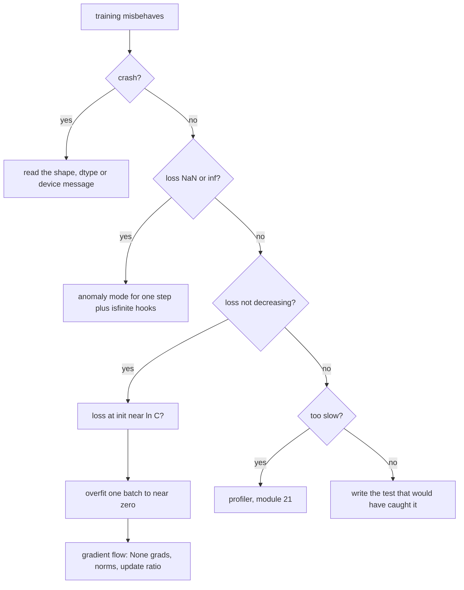

# 18 — Debugging and Testing PyTorch Code

> **Prerequisites:** modules 07–08, 10, 13 and 16.
> **You will learn:** a triage order for broken training; anomaly mode, NaN hooks, gradient-flow statistics, `gradcheck` and `assert_close` tolerances; how to unit-test models and training code; `TORCH_LOGS`, `TORCH_SHOW_CPP_STACKTRACES` and TensorBoard; the twenty most common PyTorch bugs; and why debugging APIs must be off in real runs.

Most broken training runs do not crash. They produce a plausible loss curve and a model that is quietly worse than it should be. The costly bugs raise no error: a broadcast that turns `(B,)` into `(B, B)`, a softmax before `cross_entropy`, gradients never zeroed, a layer cut out of the graph by `.detach()`. You find them with a fixed order of cheap checks and with tests that encode what the model must do.

The [optimization and training note](../../notes/deep-learning/optimization-and-training.md) has the general debugging playbook and the [PyTorch library note](../../notes/libraries/pytorch.md) a short checklist. This module goes deeper: the PyTorch tooling behind each step, the tests that make each check permanent, and a lab where automated detectors hunt five planted bugs.

---

## 18.1 A triage order

Run checks cheapest first, and fix the bug classes that hide others first: a gradient plot means nothing if the loss at init is off by 10×.



Before trusting any curve, decode one batch and look at it. Every fixed bug should leave a test behind.

## 18.2 Shape, dtype and device errors

Crashes are the easy case: the message names the problem. The common ones, reproduced on CPU with 2.8:

| Message (abridged) | Typical cause | Fix |
|---|---|---|
| `mat1 and mat2 shapes cannot be multiplied (2x5 and 4x3)` | `nn.Linear(4, 3)` fed 5 features; wrong flatten size after a conv | derive `in_features` from a dummy forward |
| `Expected all tensors to be on the same device` | `torch.zeros(...)` created inside `forward`; model moved after inputs | `device=x.device`; register buffers |
| `expected scalar type Long but found Float` | class-index CE targets stored as float | `y.long()`; float `(B, C)` targets mean probabilities |
| `view size is not compatible with input tensor's size and stride` | `.view` after `.t()`/`.permute` | `.reshape` ([module 03](./03-storage-strides-views-copies.md)) |

Write the shape on every line that changes it (`# (B, T, d_model)`) and assert it at module boundaries: `assert x.shape == (B, T, self.d_model), x.shape`. `torch.Size` is a tuple subclass, so it compares equal to a plain tuple.

The dangerous shape bugs do not crash. Broadcasting ([module 04](./04-indexing-broadcasting-shapes.md)) aligns trailing dimensions, so `pred (B,)` minus `target (B, 1)` is `(B, B)`: every prediction minus every target. `.mean()` makes it a scalar and training proceeds. In fence 2 a model with error about 0.1 reports MSE 2.78 instead of 0.0052. `F.mse_loss` emits a UserWarning for mismatched sizes; a hand-written loss is silent, so the assert must be yours.

## 18.3 The loss at initialization and overfitting one batch

**Loss at init.** With a small final layer the logits are nearly equal, the softmax nearly uniform, and cross-entropy is $-\ln(1/C) = \ln C$: 2.303 for 10 classes, 6.238 for a 512-token vocabulary. Karpathy's ["A Recipe for Training Neural Networks"](https://karpathy.github.io/2019/04/25/recipe/) (living page, accessed 2026-10-10) calls this "verify loss @ init". A loss far above $\ln C$ means confident random logits, usually a default-initialized head ([module 13](./13-initialization-and-losses.md)); exactly $\ln C$ forever suggests the output ignores the input.

The check is not sufficient. The lab's `softmax_before_ce` bug passes it: softmax of near-uniform logits is near-uniform, and so is its softmax, giving init loss 2.0793 against $\ln 8 = 2.0794$. What betrays it is gradient scale. For mean CE, $\partial L/\partial z = (\mathrm{softmax}(z) - \mathrm{onehot}(y))/B$; the extra softmax multiplies that by its Jacobian, near uniform $\frac{1}{C}(I - \frac{1}{C}\mathbf{1}\mathbf{1}^\top)$, shrinking it by about $1/C$. The lab measured a ratio of 0.131 for $C = 8$.

**Overfit one batch.** Train on 2–32 examples alone. A model with enough capacity must drive the loss near zero; if it cannot, the bug is in the model, loss or optimizer wiring, and more data will not help. In the lab the clean MLP reaches CE 0.0009 in 60 Adam steps; without `zero_grad` it stalls at 1.06; with softmax before CE the true CE ends at 2.70, worse than at init, because the model drives logits to extremes to sharpen a softmax of a softmax.

## 18.4 NaNs and infs

A NaN loss is the end of a chain. You want its first link.

**Anomaly mode.** `torch.autograd.set_detect_anomaly(True)` or `with torch.autograd.detect_anomaly(check_nan=True):` records every op's forward traceback and, in backward, raises at the first backward function whose output contains NaN, printing where it was created ([autograd docs](https://docs.pytorch.org/docs/2.8/autograd.html)). In fence 1 a masked distance `sqrt(x - x) * mask` is fine forward, but backward computes $g/(2\sqrt{0})$ with $g = 0$ for the masked row: $0/0$. Without anomaly mode `x.grad` silently fills with NaN; with it the error names `SqrtBackward0`. The docs warn that the mode "should be enabled only for debugging as the different tests will slow down your program execution". [Module 08](./08-custom-autograd-and-hooks.md) shows the engine side.

Anomaly mode sees only backward. For forward blow-ups, a forward hook on every module names the first one with a non-finite output:

```python
def install_finite_checks(model):
    handles = []
    for name, mod in model.named_modules():
        def hook(m, inp, out, name=name):
            for t in (out if isinstance(out, tuple) else (out,)):
                if torch.is_tensor(t) and not torch.isfinite(t).all():
                    raise RuntimeError(f"non-finite output in {name}")
        handles.append(mod.register_forward_hook(hook))
    return handles  # remove with h.remove()
```

Hooks fire in forward order, so the first raise names the culprit; on GPU each check forces a host sync.

| Source | Mechanism | Fix |
|---|---|---|
| `log(0)` | `-inf`, then `inf·0` | `log_softmax`, `F.cross_entropy`, `clamp_min(eps)` |
| `sqrt` at 0 | infinite derivative | `sqrt(x + eps)` or a safe custom backward |
| zero-norm division | `x / x.norm()` at `x = 0` | `F.normalize(x, eps=...)` |
| fp16 overflow | max 65504 ([module 17](./17-mixed-precision.md)) | bf16, `GradScaler`, fp32 reductions |
| lr too high | overshoot until logits overflow | lower lr, warmup, clipping |
| bad data | NaN or extreme records | assert `isfinite` in the pipeline |

`torch.nan_to_num` hides the symptom and keeps the bug: a model trained through replaced NaNs learned from garbage.

## 18.5 Gradient flow and activation statistics

When the loss is finite but slow, measure each layer with hooks, without touching the loop:

| Statistic | How | Healthy (heuristic) |
|---|---|---|
| activation mean/std | forward hook per block | std of order 1, stable with depth |
| saturation | tanh: share with $\lvert x \rvert > 0.97$; ReLU: units zero on every example | a few percent |
| gradient norm | `p.grad.norm()` per parameter | similar order across layers |
| update-to-data ratio | `(lr * p.grad).std() / p.data.std()` | about $10^{-3}$ for SGD |

The 0.97 threshold and the $10^{-3}$ line are from Karpathy's [makemore part 3 notebook](https://github.com/karpathy/nn-zero-to-hero/blob/73c3fcc741f0ec104ca850b1fb0df90e7e8d4cde/lectures/makemore/makemore_part3_bn.ipynb), which plots `log10` of the ratio per weight matrix against a line at −3: far below, the layer barely learns; far above, updates are unstable. That calibration is for SGD. Adam's update is roughly `lr · sign(grad)` per element, so measure $\lvert \Delta p \rvert/\lvert p \rvert$ directly, as the lab does (median $10^{-2.43}$ at lr $10^{-2}$, one local run).

The most useful single check is **`grad is None` after backward**. Every trainable parameter that contributed to the loss gets a `.grad`; one left at `None` is disconnected. Causes: a layer never called; `.detach()`, `.item()`, `.numpy()` or `torch.tensor(x)` on an activation; a `torch.no_grad()` block inside forward; a `.data` write. Fence 4's `find_unused_params` detects it, and DDP's `find_unused_parameters=True` exists for the same reason ([module 26](./26-distributed-collectives-and-ddp.md)). The [Visualizing Gradients tutorial](https://docs.pytorch.org/tutorials/intermediate/visualizing_gradients_tutorial.html) (living page, accessed 2026-10-10) plots per-layer gradient norms in a deep sigmoid stack with and without BatchNorm.

## 18.6 Numerical correctness tests

Two correct implementations rarely agree bit for bit, so the tolerance must follow from the format. `torch.testing.assert_close` ([testing docs](https://docs.pytorch.org/docs/2.8/testing.html)) passes when $\lvert a - e \rvert \le \text{atol} + \text{rtol}\cdot\lvert e \rvert$ elementwise, with dtype-based defaults:

| dtype | `rtol` | `atol` |
|---|---|---|
| `torch.float16` | 1e-3 | 1e-5 |
| `torch.bfloat16` | 1.6e-2 | 1e-5 |
| `torch.float32` | 1.3e-6 | 1e-5 |
| `torch.float64` | 1e-7 | 1e-7 |

NumPy's `allclose` uses rtol 1e-5, atol 1e-8 for every dtype: too loose for float64, far too strict for bf16. `assert_close` also checks shape, device and dtype (`check_dtype=False` relaxes it), treats NaN as unequal unless `equal_nan=True`, and takes `msg=`.

Comparing two implementations: feed both the same seeded inputs; compute the reference in float64 so the error belongs to the code under test; justify the tolerance. Fence 3's bf16 matmul over $K = 64$ deviates from the oracle by up to 0.087: bf16 rounds each input by about $2^{-9}$ relative, and outputs have std near $\sqrt{64} = 8$, so `atol=0.25` leaves headroom. For custom backwards, `gradcheck` against finite differences is meaningful only in float64 ([gradcheck notes](https://docs.pytorch.org/docs/2.8/notes/gradcheck.html); module 08).

## 18.7 Unit-testing models and training code

A model test asserts a property any correct implementation must satisfy, usually with one forward on a tiny input:

| Test | Property | Catches |
|---|---|---|
| shape contract | `model(x).shape == (B, T, V)` | flatten/transpose slips |
| batch invariance | `model(x)[i] ≈ model(x[i:i+1])[0]` in `eval()` | BatchNorm in train mode, padding leaks, wrong reduction dim |
| causality | changing tokens after $t$ leaves outputs $\le t$ unchanged | missing or off-by-one mask ([transformers module 08](../transformers/08-encoder-decoder-masking.md)) |
| equivariance | permuting set elements permutes outputs | position leaks in set models |
| determinism | same seed, same loss after N steps | unseeded RNG ([module 06](./06-randomness-and-reproducibility.md)) |
| learns | loss halves in 50 steps on 32 examples | wiring bugs from 18.3 |
| state_dict round trip | reload into a fresh model, equal outputs | unregistered buffers, plain-list submodules |
| eval determinism | two `eval()` forwards equal | dropout ignoring `self.training` |

Shape correctness is the weakest test: a model that mixes batch rows still has the right shape. In the repository's `unittest` style:

```python
class TinyGPTContract(unittest.TestCase):
    def setUp(self):
        torch.manual_seed(0)
        self.model = TinyGPT(vocab=32, d_model=16, n_layer=2).eval()
        self.x = torch.randint(0, 32, (3, 8))                    # (B, T)

    def test_causal(self):
        x2 = self.x.clone(); x2[:, 5:] = (x2[:, 5:] + 1) % 32
        torch.testing.assert_close(self.model(x2)[:, :5], self.model(self.x)[:, :5])

    def test_batch_invariant(self):
        y = self.model(self.x)                                   # (B, T, V)
        torch.testing.assert_close(self.model(self.x[1:2])[0], y[1], rtol=1e-5, atol=1e-5)
```

Batch invariance gets an explicit tolerance because batched and single-row matmuls may reduce in different orders. `torch.testing._internal` (OpInfo, device-generic `TestCase`) is private and changes without notice: read it, do not import it.

## 18.8 Logging and observability

| Tool | What it shows |
|---|---|
| `TORCH_LOGS="+dynamo,graph_breaks"` / `torch._logging.set_logs(...)` | per-component logs and artifacts, mostly the compiler ([logging docs](https://docs.pytorch.org/docs/2.8/logging.html); [module 23](./23-torch-compile-in-practice.md)) |
| `TORCH_SHOW_CPP_STACKTRACES=1` | a C++ stack trace when PyTorch detects a C++ error |
| `CUDA_LAUNCH_BLOCKING=1` | synchronous CUDA calls, so async kernel errors surface at the guilty op (not executed here; [module 20](./20-execution-model-dispatch-devices.md)) |
| `warnings.simplefilter("error")` in tests | warnings become failures |

All are listed in the [environment variables index](https://docs.pytorch.org/docs/2.8/torch_environment_variables.html). For curves, `SummaryWriter` ([docs](https://docs.pytorch.org/docs/2.8/tensorboard.html); [recipe](https://docs.pytorch.org/tutorials/recipes/recipes/tensorboard_with_pytorch.html), living page, accessed 2026-10-10) writes event files; TensorBoard is not a CI dependency, so this is a fragment:

```python
writer = torch.utils.tensorboard.SummaryWriter("runs/exp1")
writer.add_scalar("loss/train", loss.item(), step)
for name, p in model.named_parameters():
    writer.add_histogram(f"grad/{name}", p.grad, step)
writer.add_graph(model, x)
```

W&B and MLflow log the same quantities plus experiment tracking ([MLOps note](../../notes/libraries/mlops-and-serving.md)). Log `loss.item()`, never `loss`: the [FAQ](https://docs.pytorch.org/docs/2.8/notes/faq.html) warns that accumulating grad-requiring tensors across the loop keeps every iteration's graph alive.

## 18.9 The common-bug table

| # | Symptom | Cause | Fix |
|---|---|---|---|
| 1 | loss oscillates; grads double each step | no `zero_grad()` | zero every step ([module 16](./16-training-loop-checkpointing.md)) |
| 2 | init loss ≈ ln C, training crawls | softmax before `cross_entropy` | raw logits |
| 3 | `Expected target size` error | CE given `(B, T, V)`, wants `(B, V, T)` | `logits.view(-1, V)`, `y.view(-1)` |
| 4 | noisy eval; OOM at eval | missing `eval()` or `no_grad()` | both: one changes layers, one autograd |
| 5 | `Expected more than 1 value per channel` | BatchNorm, train mode, batch 1 | `eval()`, bigger batch, LayerNorm |
| 6 | `view size is not compatible` | `view` on non-contiguous | `reshape` |
| 7 | `modified by an inplace operation` | in-place on a saved tensor | out-of-place ([module 07](./07-autograd-graph-and-backward.md)) |
| 8 | `eval()` outputs vary | `F.dropout` without `training=self.training` | pass the flag or `nn.Dropout` |
| 9 | some weights never change | `.data` or NumPy round trip in forward | stay in torch; check `grad is None` |
| 10 | layers missing from `state_dict` | submodules in a Python list | `nn.ModuleList` ([module 10](./10-nn-module-internals.md)) |
| 11 | nothing trains after a parameter swap | optimizer holds old parameters | build optimizer after `.to()`/replacement |
| 12 | lr schedule far too slow or fast | per-step scheduler stepped per epoch | match units ([module 15](./15-optimizers-and-schedules.md)) |
| 13 | validation too good | leakage across splits | split by source, deduplicate first |
| 14 | LM copies its input | targets not shifted | `x = s[:-1]`, `y = s[1:]` |
| 15 | loss depends on padding | mean over pad positions | `ignore_index` or masked mean |
| 16 | periodic train loss | unshuffled train loader | `shuffle=True` |
| 17 | identical augmentations per worker | NumPy RNG copied into workers | `worker_init_fn` ([module 14](./14-data-pipelines.md)) |
| 18 | slow, dtype errors deep inside | float64 inputs from NumPy | `.float()` at the boundary |
| 19 | accuracy exactly 0 | `correct // total` floors integer tensors | `correct / total` |
| 20 | instances share state | mutable default arg `dims=[]` | default `None` |

Rows 2, 8, 9, 14 and 15 raise nothing, so they cost the most. The lab automates rows 1, 2, 8, the 18.2 broadcast and the 18.5 detach.

## 18.10 Turn the debuggers off

The [Performance Tuning Guide](https://docs.pytorch.org/tutorials/recipes/recipes/tuning_guide.html) (living page, accessed 2026-10-10): "Many PyTorch APIs are intended for debugging and should be disabled for regular training runs", naming anomaly detection, profiler APIs (`emit_nvtx`, `profiler.profile`) and `gradcheck`/`gradgradcheck`. Each adds per-op work, and `isfinite` hooks add a GPU sync per module. Gate them all behind one `--debug` flag that defaults to off, and use `emit_nvtx` only inside a profiling run ([module 21](./21-profiling-and-benchmarking.md)). Tests are the exception: tiny shapes, run once, checks on.

## Reconciling the sources

Karpathy's recipe (init loss, overfit one batch) and the docs' warning that anomaly mode is slow apply at different stages: cheap property checks on every change, expensive instrumentation on one reproducing step. On tolerances, NumPy's single rule predates low-precision training; `assert_close` ties tolerance to the format, but comparisons between *different* algorithms still need a stated, justified tolerance.

## Worked debugging verification

**Fence 1** proves anomaly mode turns a silent NaN gradient into an error naming `SqrtBackward0`, and restores the global flag. The forward traceback goes to a warning, silenced here.

```python pytorch-check
import warnings
import torch

x = torch.tensor([1.0, 2.0, 3.0], requires_grad=True)
mask = torch.tensor([0.0, 1.0, 1.0])  # row 0 is masked out of the loss

(torch.sqrt(x - x) * mask).sum().backward()  # no anomaly mode: silent NaN
assert torch.isnan(x.grad).all()

x.grad = None
was_enabled = torch.is_anomaly_enabled()
caught = None
try:
    with warnings.catch_warnings():
        warnings.simplefilter("ignore")
        with torch.autograd.detect_anomaly(check_nan=True):
            d = torch.sqrt(x - x)        # forward 0; derivative 1/(2 sqrt z) = inf
            (d * mask).sum().backward()  # grad 0 arrives: 0 / (2 * 0) = nan
except RuntimeError as err:
    caught = str(err)
finally:
    torch.autograd.set_detect_anomaly(was_enabled)

assert caught is not None and "SqrtBackward0" in caught, caught
assert torch.is_anomaly_enabled() == was_enabled
print("anomaly mode:", caught.split(".")[0])
```

**Fence 2** proves `(B,) - (B, 1)` silently becomes `(B, B)`, that the resulting MSE is wrong by orders of magnitude, and that a shape assertion catches it. Not every broadcast is a bug: contrastive losses want `(B, B)`.

```python pytorch-check
import torch

torch.manual_seed(0)
B = 8
target = torch.randn(B, 1)                         # a column read from a CSV
pred = target.squeeze(1) + 0.1 * torch.randn(B)    # a good model: error ~0.1

diff = pred - target                               # (B,) - (B, 1) -> (B, B)
assert diff.shape == (B, B)
silent = (diff ** 2).mean()
correct = ((pred - target.squeeze(1)) ** 2).mean()
assert silent > 10 * correct                       # off-diagonal pairs dominate

def mse_checked(pred, target):
    assert pred.shape == target.shape, f"shape contract: {tuple(pred.shape)} vs {tuple(target.shape)}"
    return ((pred - target) ** 2).mean()

message = None
try:
    mse_checked(pred, target)
except AssertionError as err:
    message = str(err)
assert message is not None
torch.testing.assert_close(mse_checked(pred, target.squeeze(1)), correct)
print(f"silent {silent.item():.3f} vs correct {correct.item():.4f}; {message}")
```

**Fence 3** proves the dtype-dependent defaults (0.1 % fails in float32, passes in bf16, where even a one-ulp 0.78 % gap passes), `check_dtype` and `equal_nan`, and that a bf16-vs-float64 comparison needs an explicit tolerance. The 0.25 bound is specific to this shape: it scales with $\sqrt{K}$ and input magnitude.

```python pytorch-check
import torch
from torch.testing import assert_close

def fails(a, b, **kw):
    try:
        assert_close(a, b, **kw)
        return False
    except AssertionError:
        return True

a32 = torch.tensor([1.0, 2.0, 3.0])
b32 = a32 * (1 + 1e-3)                      # 0.1 % relative error
assert fails(a32, b32)                      # float32: rtol 1.3e-6, atol 1e-5
assert not fails(a32.bfloat16(), b32.bfloat16())  # bfloat16: rtol 1.6e-2
one_ulp = torch.tensor([1.0, 1.0078125], dtype=torch.bfloat16)
assert not fails(one_ulp[:1], one_ulp[1:])  # adjacent bf16 values are "close"

f32, f64 = torch.tensor([1.0]), torch.tensor([1.0], dtype=torch.float64)
assert fails(f32, f64) and not fails(f32, f64, check_dtype=False)

n = torch.tensor([1.0, float("nan")])
assert fails(n, n.clone()) and not fails(n, n.clone(), equal_nan=True)

torch.manual_seed(0)
x, w = torch.randn(16, 64), torch.randn(64, 32)
oracle = (x.double() @ w.double()).float()  # float64 reference
fast = (x.bfloat16() @ w.bfloat16()).float()
assert fails(fast, oracle)                  # float32 defaults far too strict
assert_close(fast, oracle, rtol=2e-2, atol=0.25)
print("max |bf16 - oracle| =", round((fast - oracle).abs().max().item(), 4))
```

**Fence 4** proves `find_unused_params` names exactly the detached layer, although its forward works and the loss depends on it numerically, and that the helper is meaningful only right after `backward` (`zero_grad(set_to_none=True)` resets every `.grad`). It cannot find parameters whose gradient is exactly zero.

```python pytorch-check
import torch
import torch.nn as nn

def find_unused_params(model: nn.Module) -> list[str]:
    """Trainable parameters whose .grad is still None after backward."""
    return [n for n, p in model.named_parameters() if p.requires_grad and p.grad is None]

class Leaky(nn.Module):
    def __init__(self):
        super().__init__()
        self.embed = nn.Linear(4, 8)
        self.block = nn.Linear(8, 8)
        self.head = nn.Linear(8, 2)

    def forward(self, x):                # (B, 4) -> (B, 2)
        h = self.embed(x)
        h = h + self.block(h).detach()   # bug: block's output leaves the graph
        return self.head(torch.relu(h))

torch.manual_seed(0)
model = Leaky()
model(torch.randn(5, 4)).pow(2).mean().backward()
unused = find_unused_params(model)
assert unused == ["block.weight", "block.bias"], unused
model.zero_grad(set_to_none=True)
assert len(find_unused_params(model)) == 6          # meaningful only after backward
print("unused after backward:", unused)
```

## Lab: hunt five seeded bugs with automated detectors

[`./code/18_bug_hunt.py`](./code/18_bug_hunt.py) trains an MLP classifier `(B, 16) → (B, 8)`, `B = 32`, on one fixed batch with per-example weights averaging 1. `--bug` plants `no_zero_grad`, `softmax_before_ce`, `eval_dropout`, `broadcast_loss` (weights shaped `(B, 1)` against a `(B,)` loss) or `detached_layer` (`fc1(x).detach()`). Seven detectors run blind: `init_loss` (within 25 % of $\ln C$), `logit_grad_scale` ($\lVert \partial L/\partial z \rVert$ within 4× of $\lVert \mathrm{softmax}(z) - \mathrm{onehot}(y) \rVert/B$), `shape_contract` (per-example loss is `(B,)`), `eval_determinism`, `unused_params`, `grad_accumulation` (two `lr=0` steps with a fixed dropout seed must not double the gradient) and `overfit_one_batch` (60 Adam steps, lr $10^{-2}$, eval CE < 0.05). It also reports the update-to-data ratio.

```bash
python content/courses/pytorch/code/18_bug_hunt.py --bug all
python site/test_pytorch_18_bug_hunt.py
```

**Tested with Python 3.11 and PyTorch 2.8.0 on CPU.** One local PyTorch 2.8 CPU run on an Apple M-series laptop (4 threads, seed 0) produced:

| Bug | Detectors fired | CE after 60 steps | Evidence |
|---|---|---|---|
| none | none | 0.0009 | init loss 2.0786 vs ln 8 = 2.0794 |
| `no_zero_grad` | `grad_accumulation`, `overfit_one_batch` | 1.0566 | grad ratio 2.000 |
| `softmax_before_ce` | `logit_grad_scale`, `overfit_one_batch` | 2.7043 | grad ratio 0.131; init check passes |
| `eval_dropout` | `eval_determinism` | 0.0014 | trains fine |
| `broadcast_loss` | `shape_contract` | 0.0033 | shape `[32, 32]`; trains fine |
| `detached_layer` | `unused_params` | 0.0047 | `fc1.weight`, `fc1.bias` |

The matrix took 0.83 s of work; the test 3.3 s wall including `import torch`. Seeds 1–3 gave the same matrix. Three bugs still overfit the batch and the init check caught none: each detector targets one property. The test asserts contracts, not these numbers: the clean run fires nothing and overfits below 0.05, each bug fires a designated detector, evidence names the right parameters and shapes, and the result is JSON-serialisable.

**Honest scope.** The detectors catch these planted bugs on this task; they are heuristics, not proofs of correctness. Thresholds were set for this model (label smoothing or a confident init would need others), and a bug outside the list may pass all seven.

## Key takeaways

- Triage in order: crash message, data, init loss, overfit one batch, gradient flow, numerics, performance.
- The expensive bugs are silent: broadcast shapes, softmax before CE, eval dropout, unshifted targets.
- Anomaly mode names the first NaN-producing backward op; use it for one step. `isfinite` hooks cover forward.
- `grad is None` after backward means disconnected: `.detach()`, `.item()`, NumPy, `no_grad`, or an unused layer.
- `assert_close` tolerances follow the dtype; cross-algorithm comparisons need a float64 oracle and a justified tolerance.
- Test properties, not just shapes: batch invariance, causality, determinism, round trips, "learns on tiny data".
- Debugging APIs cost per op: gate them behind a flag that defaults off.

## Self-check

1. A new model's loss starts at 2.3 for a 10-class task and stays flat. Walk through the first three checks you run and what each would rule out.
2. Gradients of an embedding layer are `None` after backward even though the loss depends on its output numerically. Give two code patterns that cause this.
3. What does `detect_anomaly` report, what does it cost, and why should a test suite assert a module's batch invariance in addition to shape correctness?

---

**Next → [19 — Classic Models End to End: MLP, CNN, RNN, and Transfer Learning](./19-classic-models-end-to-end.md)**
