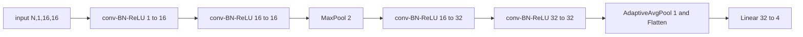
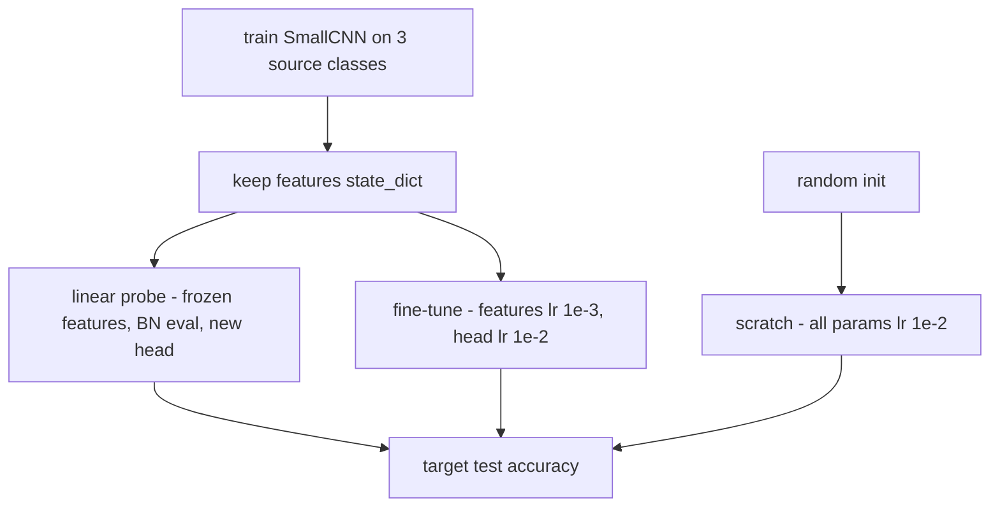

# 19 — Classic Models End to End: MLP, CNN, RNN, and Transfer Learning

> **Prerequisites:** modules 11–18.
> **You will learn:** how earlier pieces compose into three tested training
> programs (MLP, small CNN on generated images, character-level GRU); augmentation
> as tensor ops; CNN design moves with parameter and FLOP accounting; transfer
> learning mechanics (freezing, new heads, discriminative learning rates, gradual
> unfreezing, BN in eval); and honest reporting of toy results.

Modules 11 to 18 taught parts. Interviews and production ask whether you can
assemble them into a program that trains, evaluates and reports a number you can
defend. This module does it three times before the LLM capstone does it once at
scale. Everything runs on CPU in seconds on generated data, with no downloads.
The price is realism: these are sanity benchmarks that prove wiring. The
[PyTorch overview note](../../notes/libraries/pytorch.md) and [`torch.nn`](https://docs.pytorch.org/docs/2.8/nn.html) cover the APIs.

---

## 19.1 Why build three small models

| Model | Data | Modules exercised | What the test checks |
|---|---|---|---|
| MLP 2→64→64→3, 4,547 params | 1,200 spiral points, 3 classes | [11](./11-linear-embedding-conv-recurrent-layers.md), [15](./15-optimizers-and-schedules.md) warmup-cosine AdamW | val acc > 0.9 |
| SmallCNN, 16,596 params | 16×16 shapes, 4 classes | 11, [12](./12-normalization-dropout-attention-layers.md) BatchNorm, [14](./14-data-pipelines.md) augmentation | val acc > 0.85; params equal closed form |
| CharGRU, 47,365 params | 30,000 generated characters | 11 Embedding and GRU, clipping | val loss < unigram − 0.3 |
| SmallCNN transfer | 3-class source, 100-image 4-class target | 15 param groups, freezing | probe trains only the head; transfer beats scratch |

All use cross-entropy on logits ([module 13](./13-initialization-and-losses.md))
and the [module 16](./16-training-loop-checkpointing.md) loop minus checkpointing;
overfitting one batch is the first check to run on each ([module 18](./18-debugging-and-testing.md)).
d2l chapters 3–10 ([d2l.ai](https://d2l.ai/), living, accessed 2026-10-10) and
*Deep Learning with PyTorch* chapters 5–8 build the same models on real data; the
[neural networks note](../../notes/deep-learning/neural-networks.md) has the theory.

## 19.2 An MLP on synthetic data, the reference loop

Three interleaved spirals defeat a linear model but not a two-hidden-layer MLP.
The generator draws $t\in[0,1]$, sets radius
$r = 0.15 + 0.85t$ and angle $\theta = 2\pi k/3 + 3t$ for class $k$, adds noise
with standard deviation 0.08, and is driven by one `torch.Generator`.

The split comes first and is never revisited: 720 train, 240 validation, 240
test from one seeded permutation. Validation chooses steps, learning rate and
architecture; test is read once at the end. Karpathy's makemore series states
this train/dev/test discipline plainly: every decision made by looking at a split
leaks information from it. The MLP trains for 300 AdamW steps at batch 128,
learning rate $10^{-2}$, 10 % linear warmup then cosine via `LambdaLR`.

The lab's `accuracy` helper runs under `@torch.inference_mode()`, saves
`was_training = model.training`, calls `model.eval()`, and ends with
`model.train(was_training)` rather than `model.train()`. That matters in 19.7: a
helper that assumes "after eval comes train" would silently switch back on the
BatchNorm layers a fine-tuning loop deliberately put in eval mode.

## 19.3 A procedurally generated image dataset

Four shape classes on a 16×16 canvas (filled square, hollow square, disk, plus)
are learnable in a second, yet a broken model fails. Each image draws a centre in $[5, 11]$, a half-size $r\in[2.5, 4.5]$, an
intensity in $[0.6, 1.0]$ and pixel noise with standard deviation 0.15. Masks
come from one `meshgrid` and broadcasting ([module 04](./04-indexing-broadcasting-shapes.md)),
so a whole batch is built without a Python loop:

```python
ys, xs = torch.meshgrid(torch.arange(16.), torch.arange(16.), indexing="ij")
dy, dx = (ys - cy.view(n, 1, 1)).abs(), (xs - cx.view(n, 1, 1)).abs()   # (n, 16, 16)
rr = r.view(n, 1, 1)
cheb = torch.maximum(dx, dy)                  # Chebyshev distance gives squares
masks = torch.stack([
    cheb <= rr,                                               # filled square
    (cheb <= rr) & (cheb >= rr - 1.0),                        # hollow square
    dx**2 + dy**2 <= rr**2,                                   # disk
    ((dx <= 0.5) & (dy <= rr)) | ((dy <= 0.5) & (dx <= rr)),  # plus
], dim=1)                                     # (n, 4, 16, 16)
mask = masks[torch.arange(n), shape].float()  # each image's own class
img = level.view(n, 1, 1) * mask + noise * torch.randn(n, 16, 16, generator=gen)
```

Splits use separate generator seeds (train $100s+1$, validation $100s+2$, test
$100s+3$). With continuous noise in every image, a cross-split duplicate needs an
exact float collision; the test hashes every image to assert disjoint splits and
regenerates a batch to assert bitwise determinism. Seed 0 drew training class
counts of 500, 471, 525 and 504 (uniform labels, not balanced).

This is a sanity benchmark: no clutter, no occlusion, i.i.d. noise. Scoring 97 %
proves the data path, loss, eval mode and augmentation work, nothing more.

## 19.4 A small CNN, accounted

Here $H$, $W$ in `(N, C, H, W)` are image height and width
([CNN note](../../notes/deep-learning/cnns.md)).



Every convolution is [`nn.Conv2d`](https://docs.pytorch.org/docs/2.8/generated/torch.nn.Conv2d.html)`(c_in, c_out, 3, padding=1, bias=False)`,
which preserves $H$ and $W$. BatchNorm subtracts the per-channel batch mean right
afterwards, cancelling any per-channel constant, so a conv bias would have no
effect on the output; BN's $\beta$ supplies the shift.

| Layer | Output shape (N=32) | Params: conv + BN | MACs per image |
|---|---|---|---|
| conv-BN-ReLU 1→16 | (32, 16, 16, 16) | $1\cdot16\cdot9 + 2\cdot16 = 176$ | 36,864 |
| conv-BN-ReLU 16→16 | (32, 16, 16, 16) | 2,304 + 32 | 589,824 |
| MaxPool 2 | (32, 16, 8, 8) | 0 | |
| conv-BN-ReLU 16→32 | (32, 32, 8, 8) | 4,608 + 64 | 294,912 |
| conv-BN-ReLU 32→32 | (32, 32, 8, 8) | 9,216 + 64 | 589,824 |
| AdaptiveAvgPool(1), Flatten | (32, 32) | 0 | |
| Linear 32→4 | (32, 4) | $32\cdot4+4 = 132$ | 128 |
| **Total** | | **16,596** | **1,511,552** |

Conv MACs per image are $C_\text{in}C_\text{out}k^2H_\text{out}W_\text{out}$
([module 11](./11-linear-embedding-conv-recurrent-layers.md)), about 3.0 MFLOP
forward in total. The 16→16 conv at full resolution costs exactly as much as the
32→32 conv at half resolution: pooling divides the spatial term by 4, doubling
both channel counts multiplies by 4. Pool, then widen. BN also owns $2C+1$
buffers (`running_mean`, `running_var`, `num_batches_tracked`), in `state_dict()`
but not `parameters()`. `AdaptiveAvgPool2d(1)` averages each map to one number
whatever its size, so the same weights accept 24×24 input; each final unit's
receptive field is already 14×14.

For depth you would add residual blocks ([He et al.](https://arxiv.org/abs/1512.03385)):
`relu(x + body(x))` with `body` two conv-BN pairs, $2\cdot9c^2 + 4c = 18{,}560$
parameters at $c=32$, and the last BN's $\gamma$ zero-initialised so each block
starts as the identity (module 13's residual-scaling idea). Four convs do not
need it. On GPUs `channels_last` ([module 03](./03-storage-strides-views-copies.md),
[module 20](./20-execution-model-dispatch-devices.md)) usually speeds up conv-BN
stacks; on this CPU it did nothing (21.4 versus 20.6 ms per step at batch 64).

Profiling found what did matter. On an Apple M2 Pro, `aten::convolution_backward`
took 68 % of step time via NNPACK. The `torch.backends.nnpack.flags(enabled=False)`
context manager ([source at v2.8.0](https://github.com/pytorch/pytorch/blob/v2.8.0/torch/backends/nnpack/__init__.py))
cut a step to 8.3 ms, so the lab wraps its CNN parts in it (the flag is restored
on exit). That is one build on one shared CPU, not a rule; see
[module 21](./21-profiling-and-benchmarking.md).

## 19.5 Data augmentation as tensor operations

Augmentation encodes an invariance the label has; flips, two-pixel shifts, mild
noise and small occlusions do not change these shapes' classes. Each is a batched
tensor function with an explicit generator: `random_hflip` is `torch.where`
between `x` and `x.flip(-1)`; `random_shift` zero-pads by 2 and crops back at a
per-image offset with two `gather` calls (both in fence 4); random erasing applies
`masked_fill` with a 4×4 box mask to a quarter of images. That is cutout
([DeVries and Taylor](https://arxiv.org/abs/1708.04552)); [Zhong et al.](https://arxiv.org/abs/1708.04896)
also randomise area and aspect ratio.

Where it runs is a throughput choice. In `Dataset.__getitem__` the work spreads
across DataLoader workers, which need distinct seeds ([module 14](./14-data-pipelines.md));
on the collated batch, as here, it is a few vectorised ops that can run on the
accelerator, reproducible from one generator. Either way it touches training batches only. Test-time
augmentation (averaging predictions over flipped or shifted copies) is a separate
inference method: report it and apply it to every model you compare.

## 19.6 A character-level GRU language model

The corpus comes from a template grammar inside the script, keeping this module
independent of the [capstone corpus](./30-capstone-corpus-and-tokenizer.md). Each line, such as `ada stone, 64, perth.`,
picks one of 10 first names, 6 surnames, an age in 18–77 and one of 5 cities.
A line is an invertible function of those four choices, so its entropy is
$\ln 10 + \ln 6 + \ln 60 + \ln 5 = 9.80$ nats over a mean 22.13 characters: no
model can beat $9.80/22.13 = 0.443$ nats per character. Knowing the floor turns
"loss went down" into "loss is 0.02 nats from the best achievable".

The model is `Embedding(37, 32) → GRU(32, 64, num_layers=2, batch_first=True) →
Linear(64, 37)`. The [GRU docs](https://docs.pytorch.org/docs/2.8/generated/torch.nn.GRU.html)
imply $3(d_h d_\text{in} + d_h^2 + 2d_h)$ parameters per layer (three gates, input
and hidden weights, two biases): 18,816 and 24,960, for 47,365 in total.

Training uses truncated backpropagation through time: 27,000 training
characters become 64 contiguous streams, `(64, 421)`, each step reads the next 16
characters of every stream, and `h` of shape `(2, 64, 64)` carries context:

```python
for _ in range(steps):
    if t + chunk + 1 > data.shape[1]:
        h, t = None, 0                        # wrapped: restart from zero state
    x, y = data[:, t:t + chunk], data[:, t + 1:t + chunk + 1]
    if h is not None:
        h = h.detach()                        # keep the value, cut the graph
    logits, h = model(x, h)                   # (64, 16, 37), (2, 64, 64)
    loss = F.cross_entropy(logits.reshape(-1, V), y.reshape(-1))
    opt.zero_grad(set_to_none=True)
    loss.backward()
    torch.nn.utils.clip_grad_norm_(model.parameters(), 1.0)
    opt.step(); sched.step(); t += chunk
```

Why `.detach()`? Chunk $k$'s `h` is the output of a graph whose saved tensors
`loss.backward()` has freed. Starting chunk $k+1$ from it makes the next backward
walk into that graph: "Trying to backward through the graph a second time".
`retain_graph=True` would silence this by backpropagating through the whole
history every step, with unbounded cost and memory. Detaching keeps the value and
drops the history. What is lost is gradient across the boundary: no update learns
a dependency longer than 16 characters, though forward carries information
further. Clipping matters because backward multiplies by the recurrent Jacobian
once per step, and such products can explode.

One local run with seed 0 reached validation loss 0.465 nats per character after
100 steps, against 3.197 for an add-one unigram baseline and the 0.443 floor.
A seeded sample at temperature 0.8 from the prompt `ada `:

```text
ada stone, 64, perth.
hana fairley, 63, quito.
dov brook, 73, lima.
fen brook, 10, kyoto.
jun marsh, 26,
```

Grammar and vocabulary are learned, but age 10 is impossible: the model still
puts some mass on a 0 after a leading 1, and temperature 0.8 samples it ([text generation note](../../notes/nlp/text-generation-and-decoding.md)).
The [char-RNN tutorial](https://docs.pytorch.org/tutorials/intermediate/char_rnn_generation_tutorial.html)
(living page, accessed 2026-10-10) instead hand-writes an RNN cell and samples
greedily with `topk(1)`.

The capstone Transformer ([module 32](./32-capstone-gpt-model.md)) has no state
to detach: every position gets gradient from every earlier one in its window and
training parallelises over time, at the cost of a context limit and quadratic
attention ([RNN note](../../notes/deep-learning/rnns-and-sequence-models.md)).

## 19.7 Transfer learning mechanics

Source task: three classes (no plus) at noise 0.15, 80 steps on 2,000 images.
Target: all four classes, noise 0.25, permuted labels, only 100 labelled images,
40 steps at batch 32 per strategy, scored on the same 400 test images.



**Replacing the head.** Rebuild with a fresh `Linear(32, 4)` and load the source
weights into `model.features`; `model.head = nn.Identity()`
([module 11](./11-linear-embedding-conv-recurrent-layers.md)) yields a feature
extractor. The
[transfer-learning tutorial](https://docs.pytorch.org/tutorials/beginner/transfer_learning_tutorial.html)
(living page, accessed 2026-10-10) does the same with `model.fc = nn.Linear(num_ftrs, 2)`.

**(a) Linear probe.** `probe.features.requires_grad_(False)` freezes the
backbone. Since the image does not require grad either, autograd never enters
the backbone, so a probe step costs little more than a forward. An optimizer
built over all parameters still leaves frozen ones alone: `torch.optim` skips any
parameter whose `.grad` is `None`, weight decay included. After `model.train()`
the probe puts every BatchNorm module back in eval mode (19.8).

**(b) Full fine-tune with discriminative learning rates.** All parameters train,
in two param groups ([module 15](./15-optimizers-and-schedules.md)):

```python
groups = [{"params": ft.features.parameters(), "lr": base_lr / 10},   # 1e-3
          {"params": ft.head.parameters(), "lr": base_lr}]            # 1e-2
opt = torch.optim.AdamW(groups, lr=base_lr, weight_decay=1e-4)
sched = warmup_cosine(opt, steps)   # LambdaLR scales each group's own lr
```

Early layers learn general features ([Yosinski et al.](https://arxiv.org/abs/1411.1792)),
and a random head's large early gradients would overwrite them at full learning
rate. ULMFiT ([Howard and Ruder](https://arxiv.org/abs/1801.06146)) divides by
2.6 per layer group. [Module 36](./36-capstone-lora-finetuning.md) trains low-rank
adapters instead.

**(c) Gradual unfreezing.** ULMFiT also unfreezes top-down: head alone, then the
last block, then the next. In PyTorch that is `block.requires_grad_(True)` plus
`opt.add_param_group(...)`, or one optimizer over everything relying on the
"`None` grad means skip" rule; AdamW creates state lazily on a parameter's first
step with a gradient.

| Strategy | Trainable params | Backbone lr | Head lr | BN during training |
|---|---|---|---|---|
| Linear probe | 132 | frozen | $3\cdot10^{-2}$ | eval (stats frozen) |
| Full fine-tune | 16,596 | $10^{-3}$ | $10^{-2}$ | train |
| Scratch | 16,596 | $10^{-2}$ | $10^{-2}$ | train |

## 19.8 BatchNorm traps in transfer learning

`requires_grad_(False)` freezes parameters, but BatchNorm's `running_mean` and
`running_var` are buffers updated by the forward pass. In `train()` mode BN
normalizes with batch statistics and updates its estimates with momentum 0.1
([BatchNorm2d docs](https://docs.pytorch.org/docs/2.8/generated/torch.nn.BatchNorm2d.html)):
$\hat\mu \leftarrow 0.9\,\hat\mu + 0.1\,\mu_\text{batch}$. A "frozen" backbone in
train mode drifts toward the statistics of small, noisy target batches, and eval
mode then uses the drifted values, so validation accuracy moves while every
weight is unchanged. The tutorial's feature-extractor variant freezes ResNet
parameters yet trains under `model.train()` with batches of 4, so its BN
statistics move.

The fix is `set_bn_eval` (fence 2) after every `model.train()`. Alternatives:
`track_running_stats=False` (batch statistics even in eval, rarely what inference
wants), or torchvision's `FrozenBatchNorm2d`, which stores all four tensors as
buffers. For whole-network fine-tuning on batches of 2 to 8, batch statistics are
too noisy; GroupNorm has no running state ([module 12](./12-normalization-dropout-attention-layers.md)).
See the [normalization note](../../notes/deep-learning/regularization-and-normalization.md)
and the [transfer learning note](../../notes/deep-learning/transfer-learning-and-finetuning.md).

## 19.9 Reporting results honestly

A result needs its protocol: splits, seeds, which split chose hyperparameters,
runs and spread. One local PyTorch 2.8 CPU run on an Apple M2 Pro, six seeds:

| Quantity | Seed 0 | Mean ± std, seeds 0–5 | Range |
|---|---|---|---|
| MLP val acc | 0.988 | 0.994 ± 0.004 | 0.988–1.000 |
| CNN val / test acc | 0.948 / 0.968 | 0.967 ± 0.013 / 0.969 ± 0.004 | 0.948–0.985 / 0.965–0.975 |
| GRU val loss (nats/char) | 0.465 | 0.466 ± 0.005 | 0.460–0.474 |
| Unigram baseline | 3.197 | 3.198 ± 0.007 | 3.189–3.207 |
| Source acc (3-class) | 0.940 | 0.950 ± 0.015 | 0.930–0.975 |
| Target: linear probe | 0.805 | 0.773 ± 0.037 | 0.723–0.810 |
| Target: full fine-tune | 0.773 | 0.782 ± 0.029 | 0.735–0.815 |
| Target: scratch | 0.750 | 0.709 ± 0.050 | 0.650–0.770 |

This supports: all three programs work; the GRU is within about 0.03 nats of
the entropy floor on every seed; with 100 labels and 40 steps both transfer
strategies beat scratch on average, and the better one beat it on every seed by
at least 0.045. It does not support ranking probe against fine-tune (means within
one standard deviation, winner flips by seed), claims about natural images, or
longer training, where scratch often catches up on an easy task.

Hyperparameters were tuned on these seeds, so the table is biased. The test
asserts directions and generous bars, never these numbers.

## Reconciling the sources

The PyTorch tutorial fine-tunes an ImageNet ResNet-18 on about 240 ants-and-bees
images with SGD and `StepLR`; its mechanics match ours. Our procedural source
removes the download and also the reason transfer is so strong in practice: a
backbone that has seen a million diverse images. *Deep Learning with PyTorch* (chapters 7–8) trains a
birds-versus-airplanes CIFAR subset from scratch, and d2l's
[fine-tuning chapter](https://d2l.ai/chapter_computer-vision/fine-tuning.html)
(living, accessed 2026-10-10) gives the new output layer a ten times larger
learning rate, the same idea as 19.7.

## Worked classic-model verification

**Fence 1: CNN accounting.** Checks `parameters()` against the closed form, BN
buffers separately, `(N, 4)` output for 16×16 and 24×24 input, and that
`FlopCounterMode` reports exactly twice the table's MACs. It proves the
accounting, not that the network trains.

```python pytorch-check
import torch
import torch.nn as nn
from torch.utils.flop_counter import FlopCounterMode

torch.manual_seed(0)

def cbr(ci, co):
    return [nn.Conv2d(ci, co, 3, padding=1, bias=False), nn.BatchNorm2d(co), nn.ReLU()]

features = nn.Sequential(*cbr(1, 16), *cbr(16, 16), nn.MaxPool2d(2),
                         *cbr(16, 32), *cbr(32, 32), nn.AdaptiveAvgPool2d(1), nn.Flatten())
model = nn.Sequential(features, nn.Linear(32, 4)).eval()

convs = [(1, 16), (16, 16), (16, 32), (32, 32)]
closed = sum(ci * co * 9 for ci, co in convs) + sum(2 * co for _, co in convs) + 32 * 4 + 4
n_params = sum(p.numel() for p in model.parameters())
assert n_params == closed == 16_596, n_params
n_buffers = sum(b.numel() for b in model.buffers())
assert n_buffers == sum(2 * co + 1 for _, co in convs)       # mean, var, num_batches_tracked

with torch.no_grad():
    for side in (16, 24):
        assert model(torch.randn(5, 1, side, side)).shape == (5, 4)

macs = 9 * (1 * 16 * 256 + 16 * 16 * 256 + 16 * 32 * 64 + 32 * 32 * 64) + 32 * 4
with FlopCounterMode(display=False) as counter, torch.no_grad():
    model(torch.randn(1, 1, 16, 16))
assert counter.get_total_flops() == 2 * macs == 3_023_104
print(f"params {n_params}, buffers {n_buffers}, forward FLOPs per image {2 * macs}")
```

**Fence 2: freezing freezes weights, not BN statistics.** After one AdamW step
with decay over *all* parameters, the frozen conv is bitwise unchanged, the head
moved, and `running_mean` moved anyway. After `set_bn_eval`, statistics stay put
and outputs stop depending on batch composition. It proves the mechanism, not the
accuracy effect.

```python pytorch-check
import torch
import torch.nn as nn
import torch.nn.functional as F

torch.manual_seed(0)
backbone = nn.Sequential(nn.Conv2d(1, 8, 3, padding=1, bias=False), nn.BatchNorm2d(8),
                         nn.ReLU(), nn.AdaptiveAvgPool2d(1), nn.Flatten())
head = nn.Linear(8, 3)
model = nn.Sequential(backbone, head)
backbone.requires_grad_(False)
opt = torch.optim.AdamW(model.parameters(), lr=0.1, weight_decay=0.1)   # all params on purpose

conv, bn = backbone[0], backbone[1]
w0, h0, rm0 = conv.weight.clone(), head.weight.clone(), bn.running_mean.clone()
x, y = torch.randn(16, 1, 8, 8) + 2.0, torch.randint(0, 3, (16,))

model.train()
loss = F.cross_entropy(model(x), y)
opt.zero_grad(set_to_none=True)
loss.backward()
opt.step()
assert conv.weight.grad is None and torch.equal(conv.weight, w0)   # skipped, decay included
assert not torch.equal(head.weight, h0)
drift = (bn.running_mean - rm0).abs().max().item()
assert drift > 1e-3                                                # stats moved anyway

def set_bn_eval(module):
    for m in module.modules():
        if isinstance(m, nn.modules.batchnorm._BatchNorm):
            m.eval()

model.train()
set_bn_eval(model)
rm1, nbt = bn.running_mean.clone(), bn.num_batches_tracked.clone()
with torch.no_grad():
    full, part = model(x), model(x[:4])
assert torch.equal(bn.running_mean, rm1) and torch.equal(bn.num_batches_tracked, nbt)
torch.testing.assert_close(part, full[:4], atol=1e-6, rtol=1e-5)   # no batch dependence
assert head.training and not bn.training
print(f"frozen conv unchanged; running_mean drift in train mode {drift:.3f}, none after set_bn_eval")
```

**Fence 3: truncated BPTT needs `detach`.** Carrying the raw state into chunk
2's backward raises the "second time" error. With `h.detach()`, gradients equal
those of chunk 2 run from a fresh constant state, so they hold only chunk 2's
contribution; full BPTT differs. It does not measure how much that loss matters.

```python pytorch-check
import torch
import torch.nn as nn

torch.manual_seed(0)
gru = nn.GRU(4, 8, num_layers=2, batch_first=True)
x = torch.randn(2, 10, 4)
a, b = x[:, :5], x[:, 5:]

def chunk2_grads(h0):
    gru.zero_grad(set_to_none=True)
    gru(b, h0)[0].pow(2).mean().backward()
    return [p.grad.clone() for p in gru.parameters()]

out, h = gru(a)
out.pow(2).mean().backward()                          # frees chunk 1's graph
try:
    chunk2_grads(h)                                   # h still points into it
    raised = False
except RuntimeError as err:
    raised = "second time" in str(err)
assert raised

g_tbptt = chunk2_grads(h.detach())
h_const = torch.tensor(h.detach().tolist())           # new leaf, same values, no history
for g, ref in zip(g_tbptt, chunk2_grads(h_const)):
    torch.testing.assert_close(g, ref, atol=0, rtol=0)

out, h = gru(a)                                       # fresh graph for chunk 1
g_full = chunk2_grads(h)                              # full BPTT through both chunks
gap = max((f - t).abs().max().item() for f, t in zip(g_full, g_tbptt))
assert gap > 1e-4
print(f"no-detach raised; detach equals chunk-2-only grads; full-BPTT gap {gap:.4f}")
```

**Fence 4: augmentation contracts.** Flip, shift and noise preserve shape and
dtype and are seed-deterministic; double flip and zero-pad shift are identities;
shifting content that stays on the canvas conserves intensity. It does not prove
label preservation on other data.

```python pytorch-check
import torch
import torch.nn.functional as F

def random_hflip(x, gen, p=0.5):
    flip = torch.rand(x.shape[0], generator=gen) < p
    return torch.where(flip.view(-1, 1, 1, 1), x.flip(-1), x)

def random_shift(x, gen, pad=2):
    n, _, h, w = x.shape
    padded = F.pad(x, (pad, pad, pad, pad))
    oy = torch.randint(0, 2 * pad + 1, (n,), generator=gen)
    ox = torch.randint(0, 2 * pad + 1, (n,), generator=gen)
    rows = (oy.view(n, 1) + torch.arange(h)).view(n, 1, h, 1).expand(n, x.shape[1], h, w + 2 * pad)
    cols = (ox.view(n, 1) + torch.arange(w)).view(n, 1, 1, w).expand(n, x.shape[1], h, w)
    return padded.gather(2, rows).gather(3, cols)

def pipeline(x, seed):
    gen = torch.Generator().manual_seed(seed)
    x = random_shift(random_hflip(x, gen), gen)
    return x + 0.05 * torch.randn(x.shape, generator=gen)

torch.manual_seed(0)
x = torch.zeros(8, 1, 16, 16)
x[:, :, 5:11, 4:12] = torch.rand(8, 1, 6, 8)           # content 4+ pixels from every edge
out = pipeline(x, seed=3)
assert out.shape == x.shape and out.dtype == x.dtype
assert torch.equal(out, pipeline(x, seed=3)) and not torch.equal(out, pipeline(x, seed=4))
g = torch.Generator().manual_seed(0)
assert torch.equal(random_hflip(random_hflip(x, g, p=1.0), g, p=1.0), x)
assert torch.equal(random_shift(x, torch.Generator().manual_seed(0), pad=0), x)
shifted = random_shift(x, torch.Generator().manual_seed(1), pad=2)
torch.testing.assert_close(shifted.sum(dim=(1, 2, 3)), x.sum(dim=(1, 2, 3)), atol=1e-5, rtol=0)
assert not torch.equal(shifted, x)
print("augmentations keep shape/dtype, are seed-deterministic; double flip and pad-0 shift are identity")
```

## Lab: train an MLP, a CNN and a GRU, then transfer the CNN

The script is [`code/19_classic_models.py`](./code/19_classic_models.py); each
part is a function returning a dictionary, and `--which` picks one or all.

```bash
python content/courses/pytorch/code/19_classic_models.py --which all
python site/test_pytorch_19_classic_models.py
```

**Tested with Python 3.11 and PyTorch 2.8.0 on CPU.**

The test runs `--which all` once (seed 0) and asserts the bars in 19.1, plus:
probe trainable parameters equal the head's 132 with the backbone bitwise
unchanged; probe and fine-tune exceed 0.6; seed determinism; hash-disjoint splits;
augmentation contracts. Its work took 2.7 to 3.6 s on a shared M2 Pro.

Scope: synthetic data; accuracies say the wiring works, not anything about
real-world vision or language performance.

## Key takeaways

- Split once, choose on validation, read test last, evaluate in `eval()` under
  `inference_mode`, and restore the previous mode rather than assume it.
- Conv before BatchNorm takes `bias=False`; a conv has $C_\text{in}C_\text{out}k^2$
  parameters, BN $2C$ plus $2C+1$ buffers. Pool, then widen; global average
  pooling frees the head from input size.
- Augmentation is a seeded batched tensor function, on training batches only.
- Truncated BPTT detaches the carried state: forward keeps the value, backward
  loses cross-chunk gradient. Clip RNN gradients.
- Freezing is `requires_grad_(False)`, and optimizers skip `None` grads, decay
  included. BN running statistics are buffers that `train()` updates anyway, so
  frozen backbones need BN in eval.
- Report seeds, splits, spread and what a result does not show.

## Self-check

1. You freeze a pretrained CNN backbone and train only the new head, but
   validation accuracy drifts down over epochs even though backbone weights are
   unchanged. What is changing, and how do you stop it?
2. Why must an RNN's hidden state be detached between truncated-BPTT chunks, and
   what is lost by doing so?
3. Give the shape trace and parameter count for one `Conv(16→32, 3×3, bias=False)
   → BN → ReLU` block on a `(64, 16, 8, 8)` input, and explain why the conv has no
   bias.

---

**Next → [20 — How PyTorch Executes: Dispatcher, Tensor Subclasses, and Devices](./20-execution-model-dispatch-devices.md)**
