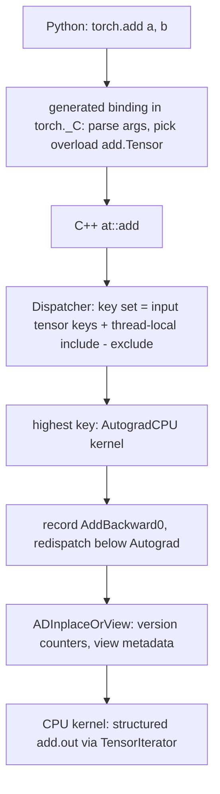
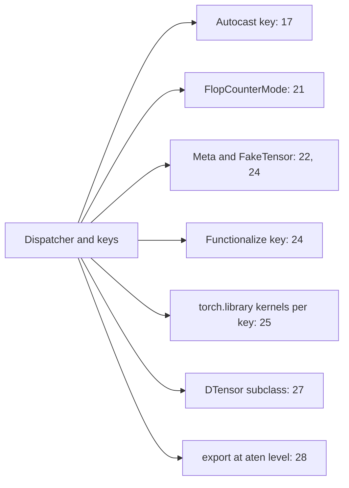

# 20 — How PyTorch Executes: Dispatcher, Tensor Subclasses, and Devices

> **Prerequisites:** modules 02–03, 07–08, 10.
> **You will learn:** the path of one `torch.add` call through the dispatcher's keys to an ATen kernel; how `native_functions.yaml` defines the aten ops that compilers, export and custom ops share; `__torch_function__` vs `__torch_dispatch__`, their modes, and wrapper tensor subclasses; CUDA async launches, streams, sync points, the caching allocator, pinned memory and CUDA graphs; the other backends and `torch.accelerator`; CPU threading.

Modules 01–19 used PyTorch as a black box. The efficiency track needs it open, because most performance and tooling questions reduce to two: which layer of the stack does this feature live in, and when does the host actually wait for the device?

The first half follows one call through the dispatcher and intercepts it at two heights; the second covers devices. GPU behaviour is described from pinned docs and labelled as not executed, since this course's CI is CPU-only. The [PyTorch library note](../../notes/libraries/pytorch.md) has the overview; this module goes below it.

---

## 20.1 One call, many layers

Trace `torch.add(a, b)` where `a` requires grad and both live on the CPU:



Four facts carry this module.

1. **Every tensor carries a dispatch key set.** A CPU float tensor in 2.8 reports `DispatchKeySet(CPU, ADInplaceOrView, AutogradCPU, AutocastCPU)` (private `torch._C._dispatch_keys`, run locally). It is the same with or without `requires_grad`: the Autograd kernel always runs and decides at runtime whether to record anything.
2. **Thread-local state adds and removes keys.** `no_grad`, `autocast`, Python modes and functorch transforms edit a thread-local include/exclude set; they never touch tensors.
3. **The highest-priority key's kernel runs and may redispatch.** Autograd records its node, then calls the operator again with Autograd keys masked, and the chain ends at a backend kernel.
4. **Each layer costs host time per op.** Measured locally with `torch.utils.benchmark` (Apple M-series, PyTorch 2.8, 4 threads): `torch.add` on two 4-element tensors 0.56 µs; with one input requiring grad 0.99 µs; under an empty Python dispatch mode 2.1 µs; a 1M-element add 92 µs. For small tensors the framework *is* the workload: small ops are overhead-bound, which [module 21](./21-profiling-and-benchmarking.md) measures and [module 23](./23-torch-compile-in-practice.md) attacks with fusion and CUDA graphs.

## 20.2 Dispatch keys and the operator registry

Keys are an enum in [`c10/core/DispatchKey.h`](https://github.com/pytorch/pytorch/blob/v2.8.0/c10/core/DispatchKey.h); a later value means higher priority. The ones a practitioner meets, highest first:

| Key (v2.8.0 order, high → low) | What its kernel does | Activated by |
|---|---|---|
| `PythonTLSSnapshot` | save thread-local state for the later `Python` key | Python mode or subclass present |
| `FuncTorchBatched`, `FuncTorchGradWrapper` | `vmap` / `grad` levels ([module 09](./09-torch-func-transforms.md)) | torch.func transforms |
| `AutocastCPU`, `AutocastCUDA`, ... | cast inputs per op policy ([module 17](./17-mixed-precision.md)) | `torch.autocast` |
| `AutogradCPU`, `AutogradCUDA`, ... | record backward node, redispatch | every dense tensor |
| `ADInplaceOrView` | version counters, view metadata ([module 03](./03-storage-strides-views-copies.md)) | every dense tensor |
| `Functionalize` | rewrite mutations and views as functional ops | AOTAutograd, export |
| `Python` | call `__torch_dispatch__` | subclass or `TorchDispatchMode` |
| `BackendSelect` | pick a backend for factories with no tensor input | `torch.empty(..., device=...)` |
| `CPU`, `CUDA`, `Meta`, `MPS`, `XPU`, `PrivateUse1`, ... | compute values (`Meta`: metadata only) | the tensor's device |

The order has consequences. `Python` sits **below** Autograd, so a dispatch mode sees ops after autograd recorded them, including backward kernels (fences 1–2). `Functionalize` is also below Autograd: compilers differentiate first, then remove mutation. Only `PythonTLSSnapshot` is near the top, and it only saves state.

### Operator schemas

Every aten operator is declared in [`native_functions.yaml`](https://github.com/pytorch/pytorch/blob/v2.8.0/aten/src/ATen/native/native_functions.yaml) (2,650 `- func:` entries at v2.8.0), from which codegen builds the C++ API, bindings and registrations. Addition:

```text
- func: add.Tensor(Tensor self, Tensor other, *, Scalar alpha=1) -> Tensor
  structured_delegate: add.out
  tags: [core, pointwise]
- func: add_.Tensor(Tensor(a!) self, Tensor other, *, Scalar alpha=1) -> Tensor(a!)
  structured_delegate: add.out
- func: add.out(Tensor self, Tensor other, *, Scalar alpha=1, Tensor(a!) out) -> Tensor(a!)
  structured: True
```

**Overload names** (`Tensor`, `Scalar`, `out`) separate signatures sharing a Python name; `torch.add(x, 2.0)` resolves to `add.Scalar`. **`Tensor(a!)`** declares that the argument is mutated and the return aliases it; functionalization, export and `opcheck` trust these annotations. The **`out=` variant** is the one implemented: `structured_delegate: add.out` makes the functional and in-place forms reuse its shape function and loop, so ATen writes each kernel once ([module 03](./03-storage-strides-views-copies.md) has the user-facing `out=` rules). The `core` tag marks Core ATen IR, the opset export targets ([module 28](./28-export-and-deployment.md)).

In Python, `torch.ops.aten.add` is an **overload packet** and `torch.ops.aten.add.Tensor` an **OpOverload**: a callable handle to one schema that skips overload resolution but still dispatches (0.96 µs locally vs 0.56 µs for `torch.add`). Modes, FX graphs, decomposition tables and `torch.library` all name operators this way: the "aten op" is the shared unit of modules [24](./24-compiler-internals-fx-inductor.md) and [25](./25-custom-ops-and-kernels.md).

## 20.3 `__torch_function__`: interposing at the Python API

The first hook runs **before** C++. Every `torch.*` function, `Tensor` method and `torch.nn.functional` function checks whether an argument or an active `TorchFunctionMode` overrides `__torch_function__` ([`torch.overrides`](https://docs.pytorch.org/docs/2.8/torch.overrides.html), [Extending PyTorch](https://docs.pytorch.org/docs/2.8/notes/extending.html)); if so it calls `__torch_function__(func, types, args, kwargs)` and returns its result. Logging `nn.Linear(4, 3)` records `["linear"]` (fence 1).

So a function mode sees the **public API as written**: `F.linear`, `Tensor.__add__`, `F.scaled_dot_product_attention`. It runs before autograd, autocast and C++ decompositions, so it never sees `addmm` and never sees backward. That is the right layer for duck-typed tensors, for API rewriting (swap every SDPA call for your kernel), and for compiler front ends: Dynamo respects function modes, as the [function-modes recipe](https://github.com/pytorch/tutorials/blob/ca960b6a7cd299ba00a644aa918bbcffdeb70152/recipes_source/torch_compile_torch_function_modes.py) shows. Helpers: `has_torch_function(args)` (the fast check the bindings run), `handle_torch_function`, `get_overridable_functions()`. A classmethod `__torch_function__` on a subclass differs from a mode only in scope: it fires when an argument is that subclass, a mode fires for every call inside its `with` block.

## 20.4 `__torch_dispatch__`: interposing below autograd

The second hook is the `Python` key. A `TorchDispatchMode` ([`_python_dispatch.py`](https://github.com/pytorch/pytorch/blob/v2.8.0/torch/utils/_python_dispatch.py)) receives an `OpOverload` and plain tensors. The same `Linear(4, 3)` forward plus `.sum().backward()`, logged at this level (fence 1, run locally): forward `aten.t.default, aten.addmm.default`; then `sum`, `ones_like` (gradient seed), `expand` (`SumBackward0`), one `mm` for `grad_W` (the input needs no grad, so no second `mm`), `sum.dim_IntList` for `grad_b`, and `t`, `view` and `detach` bookkeeping. `F.linear` became `t` + `addmm` through a composite decomposition you cannot see from the function level.

| | `TorchFunctionMode` | `TorchDispatchMode` |
|---|---|---|
| Position | Python API, before C++ | `Python` key, below Autograd and Autocast |
| Sees | `linear`, `__add__`, `sdpa` | `aten.addmm.default`, `aten.mm.default` |
| Autograd already ran | no: can change what is differentiated | yes |
| Sees backward and C++-internal calls | no | yes |
| Typical users | duck tensors, API swaps, Dynamo | `FlopCounterMode`, `FakeTensorMode`, `FunctionalTensor`, DTensor, memory trackers |

Counting FLOPs including backward, or swapping every kernel for a shape-only one (FakeTensor), needs dispatch level; changing what an API call means before autograd needs function level. Inside either handler the mode is popped, so calling `func(...)` does not recurse; return `NotImplemented` to defer to the next handler. The [`DebugMode` recipe](https://github.com/pytorch/tutorials/blob/ca960b6a7cd299ba00a644aa918bbcffdeb70152/recipes_source/debug_mode_tutorial.py) is a ready-made dispatch mode that logs ops with tensor hashes for diffing runs, but it requires **PyTorch 2.10+**; `torch.utils._debug_mode` does not exist in 2.8 (checked locally), so write fence 1's mode instead.

## 20.5 Tensor subclasses: wrapper tensors done right

A mode intercepts a scope; a **subclass** intercepts its own instances and carries state. DTensor (local shard plus placements), FakeTensor (metadata plus fake device) and torchao's quantized tensors (packed ints plus scales) are all **wrapper subclasses**: the outer tensor has size, stride, dtype and device but no storage, and holds real inner tensors.

```python
class ScaledInt8Tensor(torch.Tensor):
    @staticmethod
    def __new__(cls, qdata, scale, orig_dtype):
        r = torch.Tensor._make_wrapper_subclass(cls, qdata.shape, dtype=orig_dtype,
                                                device=qdata.device)
        r.qdata, r.scale = qdata, scale                  # int8 payload, fp32 scale
        return r
    def __tensor_flatten__(self):
        return ["qdata", "scale"], self.dtype            # inner tensor attrs, static context
    @staticmethod
    def __tensor_unflatten__(inner, orig_dtype, outer_size, outer_stride):
        return ScaledInt8Tensor(inner["qdata"], inner["scale"], orig_dtype)
    @classmethod
    def __torch_dispatch__(cls, func, types, args=(), kwargs=None):
        if func is torch.ops.aten.mm.default:
            a, w = args
            return a @ (w.qdata.to(a.dtype) * w.scale)   # dequantize, then matmul
        return NotImplemented
```

`_make_wrapper_subclass` creates the outer tensor without storage, so the reported dtype (bf16) can differ from the payload (int8). `torch.Tensor.as_subclass` instead reuses an existing tensor's storage: fine for adding methods, useless when the logical tensor is not one dense buffer. `__tensor_flatten__` / `__tensor_unflatten__` tell Dynamo, AOTAutograd and export how to split the subclass into plain tensors and rebuild it; without them `torch.compile` graph-breaks and `torch.export` fails ([module 24](./24-compiler-internals-fx-inductor.md)). Autograd runs **above** the subclass, so gradients flow with no extra work and come back as the subclass, which the lab's `LoggingTensor` demonstrates.

## 20.6 The CUDA execution model

Sections 20.6–20.8 are not executed in this course's CI (CPU only); they follow [CUDA semantics](https://docs.pytorch.org/docs/2.8/notes/cuda.html). Hardware: [GPU architecture](/courses/inference/00-foundations/00-03-gpu-architecture.html).

**Asynchronous launch.** The CUDA backend kernel enqueues work on the current **stream** (an in-order device queue) and returns; the host dispatches the next op while the GPU computes. Errors surface at a later sync (hence `CUDA_LAUNCH_BLOCKING=1`), and timing without a sync measures enqueue time.

| Synchronizing call | Why the host waits |
|---|---|
| `.item()`, `.tolist()`, `print(t)`, `if t > 0:` | Python needs the value |
| `.cpu()`, `.numpy()`, blocking `.to("cpu")` | D2H copy must finish |
| `torch.cuda.synchronize()`, `event.synchronize()` | explicit |
| `nonzero`, `x[mask]`, `unique` | output shape depends on data |
| `x.to("cuda")` from pageable memory | staged through a bounce buffer, even with `non_blocking=True` |
| `GradScaler.step` | reads the inf flag on the host |

`torch.cuda.set_sync_debug_mode("warn")` ([docs](https://docs.pytorch.org/docs/2.8/generated/torch.cuda.set_sync_debug_mode.html)) warns at every synchronizing call; `"error"` turns it into a test failure.

The usual offender is `loss.item()` every step: the host blocks until the GPU drains its queue, so the next step's kernels are not enqueued while the GPU finishes, and the device idles in the gap. Two fixes keep the logging: accumulate on device (`running += loss.detach()`) and call `.item()` every N steps, or copy the loss into a pinned host buffer with `non_blocking=True`, record an event, and read the value one step later after `event.synchronize()`.

**Streams and events.** One stream is ordered; across streams, order explicitly:

```python
# not executed in this course's CI (CPU only)
side = torch.cuda.Stream()
side.wait_stream(torch.cuda.current_stream())   # side starts after queued default work
with torch.cuda.stream(side):
    y = part(x)                                 # overlaps default-stream work
torch.cuda.current_stream().wait_stream(side)   # rejoin before using y
x.record_stream(side)                           # x allocated on default, used on side
start, end = (torch.cuda.Event(enable_timing=True) for _ in range(2))
start.record(); model(x); end.record(); end.synchronize()
ms = start.elapsed_time(end)                    # device time between events
```

`record_stream` exists because the allocator tracks blocks per stream: without it, `x`'s memory can be reused while `side` still reads it. **Backward streams:** each backward op runs on its forward op's stream, and `backward()` relates to surrounding code like any other op. Per the docs' "BC note: using grads on the default stream", 1.9 and earlier synced the default stream with all backward ops; now, if `backward()` runs under `torch.cuda.stream(s)` and grads are used outside, you must `wait_stream(s)` first, even on the default stream.

## 20.7 Memory on the device: caching allocator, pinned memory, `non_blocking`

`cudaMalloc`/`cudaFree` are slow and can synchronize, so the [caching allocator](https://github.com/pytorch/pytorch/blob/v2.8.0/c10/cuda/CUDACachingAllocator.cpp) keeps freed blocks for reuse on the same stream. Hence two counters: `memory_allocated()` (live tensors) and `memory_reserved()` (held from the driver; what `nvidia-smi` shows). `empty_cache()` returns *unused* cached blocks to the driver; it frees no live tensor and gives this process no extra memory, so calling it every step only adds `cudaMalloc` cost.

| Knob | Effect |
|---|---|
| `PYTORCH_CUDA_ALLOC_CONF=expandable_segments:True` | segments grow in place via virtual memory, less fragmentation with varying shapes (experimental in 2.8) |
| `max_split_size_mb:N` | never split blocks above N MiB (native backend only) |
| `garbage_collection_threshold:0.8` | reclaim cached blocks above 80 % usage before an OOM retry (native only) |
| `backend:cudaMallocAsync` | CUDA's stream-ordered allocator; ignores the knobs above |
| `torch.cuda.memory.CUDAPluggableAllocator` | custom allocator from a `.so`, set before first allocation |
| `CUBLAS_WORKSPACE_CONFIG=:4096:8` | fixed cuBLAS workspaces, needed for determinism ([module 06](./06-randomness-and-reproducibility.md)) |
| `torch.backends.cuda.cufft_plan_cache.max_size` | per-device cuFFT plan LRU size |
| `PYTORCH_KERNEL_CACHE_PATH`, `USE_PYTORCH_KERNEL_CACHE=0` | where JIT-compiled CUDA kernels (e.g. `torch.special.zeta`) are cached; default `~/.cache/torch/kernels`, so the seconds-long first compile happens once per machine, not per process |

Byte accounting and snapshots: [module 22](./22-memory-accounting-and-checkpointing.md), [CUDA memory usage](https://docs.pytorch.org/docs/2.8/torch_cuda_memory.html).

**Pinned memory.** Pageable host memory can be moved by the OS, so the GPU's DMA engine cannot read it directly. An H2D copy from it is staged: the driver copies into a page-locked buffer, then DMAs, while the host waits ([pin-memory tutorial](https://github.com/pytorch/tutorials/blob/ca960b6a7cd299ba00a644aa918bbcffdeb70152/intermediate_source/pinmem_nonblock.py)). A pinned tensor is DMA'd directly, so `x_pinned.to("cuda", non_blocking=True)` returns immediately and overlaps compute; `DataLoader(pin_memory=True)` pins in a background thread ([module 14](./14-data-pipelines.md)). Pinning is itself a copy and takes RAM from the OS, so don't pin everything.

**The D2H hazard.** `y.to("cpu", non_blocking=True)` returns a CPU tensor *before the copy finishes*; reading it immediately can see stale data with no error. Record an event after the copy and synchronize on it first. H2D is safe because later kernels on the stream are ordered after the copy; the host is not on the stream.

On CPU-only builds none of this runs: `torch.randn(2).is_pinned()` is `False`, and on this module's Apple machine (MPS accelerator) `pin_memory()` raised a `RuntimeError`. Device-agnostic code should pin only when `device.type == "cuda"`.

## 20.8 CUDA graphs in one page

Not executed in this course's CI. In batch-1 decode each kernel may run for microseconds while the host needs microseconds to dispatch it (20.1), so the GPU idles between kernels. A **CUDA graph** records a launch sequence once and replays it with one launch ([CUDA semantics](https://docs.pytorch.org/docs/2.8/notes/cuda.html), [CUDA graphs for inference](/courses/inference/08-compilation-and-runtime/08-01-cuda-graphs.html)).

```python
# not executed in this course's CI (CPU only)
static_x = torch.zeros(B, d_model, device="cuda")
s = torch.cuda.Stream(); s.wait_stream(torch.cuda.current_stream())
with torch.cuda.stream(s):                      # warm up on a side stream
    for _ in range(3): model(static_x)
torch.cuda.current_stream().wait_stream(s)
g = torch.cuda.CUDAGraph()
with torch.cuda.graph(g):                       # capture: recorded, not run
    static_y = model(static_x)
for batch in batches:
    static_x.copy_(batch)                       # write into the captured address
    g.replay()
    use(static_y)                               # output at the captured address
```

| Constraint | Consequence |
|---|---|
| no CPU-GPU sync in capture | `.item()`, `nonzero`, `GradScaler.step` prohibited |
| static shapes | one graph per shape; pad or bucket |
| no data-dependent CPU control flow | the captured branch is frozen |
| fixed addresses | static input/output buffers; copy in, read out |
| private memory pool | share between graphs via `torch.cuda.graph_pool_handle()` |

`torch.cuda.make_graphed_callables(module, sample_args)` graphs a callable's forward and backward and leaves the rest eager (partial capture). With AMP, capture forward, loss and backward but run `scaler.step`/`update` eagerly. Side streams in capture must branch from and rejoin the capturing stream. Whole-network capture with DDP needs NCCL ≥ 2.9.6; older NCCL cannot capture collectives. `torch.compile(mode="reduce-overhead")` automates this as CUDA graph trees ([module 23](./23-torch-compile-in-practice.md)).

## 20.9 Device-agnostic code and the other backends

[`torch.accelerator`](https://docs.pytorch.org/docs/2.8/accelerator.html) is the backend-neutral front door in 2.8; on this module's Apple laptop `current_accelerator()` returned `device(type='mps')`.

```python
device = (torch.accelerator.current_accelerator()
          if torch.accelerator.is_available() else torch.device("cpu"))
x = torch.randn(B, T, d_model, device=device)   # create on the target, not .to() afterwards
```

Creating tensors on the target device skips a host allocation and copy (a [Performance Tuning Guide](https://docs.pytorch.org/tutorials/recipes/recipes/tuning_guide.html) item; living page, accessed 2026-10-10).

| Backend | Device / namespace | What to know |
|---|---|---|
| CUDA | `cuda`, `torch.cuda` | everything in 20.6–20.8 |
| ROCm/HIP | still `cuda`, `torch.cuda` | detect with `torch.version.hip` ([HIP](https://docs.pytorch.org/docs/2.8/notes/hip.html)) |
| MPS (Apple) | `mps`, `torch.mps` | op gaps; `PYTORCH_ENABLE_MPS_FALLBACK=1` runs missing ops on CPU ([MPS](https://docs.pytorch.org/docs/2.8/notes/mps.html)) |
| XPU (Intel GPU) | `xpu`, `torch.xpu` | in-tree, CUDA-like API ([XPU](https://docs.pytorch.org/docs/2.8/notes/get_start_xpu.html)) |
| XLA/TPU | `xla`, separate `torch_xla` | lazy tensors: graph built, compiled at a sync point |
| MTIA | `mtia` | Meta's accelerator |
| Meta | `meta` | shape and dtype only ([meta](https://docs.pytorch.org/docs/2.8/meta.html)); fence 3 |
| PrivateUse1 | renamable, e.g. `npu` | reserved key for out-of-tree backends ([tutorial](https://github.com/pytorch/tutorials/blob/ca960b6a7cd299ba00a644aa918bbcffdeb70152/advanced_source/privateuseone.rst)) |

A meta kernel runs only shape logic (for structured ops, the real kernel's own meta function) and allocates nothing; [module 10](./10-nn-module-internals.md) builds models on `meta` this way. An out-of-tree backend, per the [dispatcher](https://github.com/pytorch/tutorials/blob/ca960b6a7cd299ba00a644aa918bbcffdeb70152/advanced_source/dispatcher.rst) and [extend-dispatcher](https://github.com/pytorch/tutorials/blob/ca960b6a7cd299ba00a644aa918bbcffdeb70152/advanced_source/extend_dispatcher.rst) tutorials, registers kernels for `PrivateUse1` and `AutogradPrivateUse1` and renames it with `torch.utils.rename_privateuse1_backend`, with no core changes.

Two cuDNN knobs ([backends](https://docs.pytorch.org/docs/2.8/backends.html)): `cudnn.benchmark = True` autotunes convolution algorithms per shape (good for fixed shapes, bad when they change every step); `cudnn.deterministic = True` restricts to deterministic algorithms. Convolutions on cuDNN tensor cores and on oneDNN prefer NHWC, so `model.to(memory_format=torch.channels_last)` plus channels-last inputs avoids layout transposes inside each conv ([module 03](./03-storage-strides-views-copies.md) derives the strides; the speedup is hardware-dependent and not measured here). TF32 flags are in [module 17](./17-mixed-precision.md).

## 20.10 CPU execution: threads, NUMA, allocators

CPU kernels parallelize at two levels ([CPU threading](https://docs.pytorch.org/docs/2.8/notes/cpu_threading_torchscript_inference.html)). **Intra-op** splits one op across a pool (OpenMP on standard builds) sized by `torch.set_num_threads` or `OMP_NUM_THREADS`. **Inter-op** runs independent ops concurrently (TorchScript `fork`) on a pool sized by `set_num_interop_threads`, settable once, before inter-op work starts. `torch.__config__.parallel_info()` here reported OpenMP with 4 intra-op and 2 inter-op threads on 10 hardware threads. `torch.backends.cpu.get_cpu_capability()` names the vector ISA kernels dispatch to: `"AVX2"`/`"AVX512"` on x86, `"NO AVX"` on this arm64 Mac. oneDNN (`torch.backends.mkldnn`) supplies optimized x86 conv/matmul kernels; it reported unavailable on this arm64 build.

The tuning guide's CPU items are system configuration:

| Item | Why |
|---|---|
| `numactl --cpunodebind=0 --membind=0` | keep threads and memory on one socket |
| `OMP_NUM_THREADS` = physical cores per process | avoid hyperthread contention |
| `OMP_PROC_BIND=CLOSE`, `OMP_PLACES=cores`; Intel: `KMP_AFFINITY=granularity=fine,compact,1,0` | pin threads so caches stay warm |
| `LD_PRELOAD` Intel `libiomp5.so` | often beats GNU `libgomp` on Intel CPUs |
| `LD_PRELOAD` jemalloc or TCMalloc | faster, less fragmenting `malloc` for eager code |
| oneCCL (`ccl` backend) for multi-socket DDP | one process per socket, [module 26](./26-distributed-collectives-and-ddp.md)'s pattern on CPUs |

The common failure is oversubscription: several workers each defaulting to all cores. Every lab here calls `torch.set_num_threads(min(4, os.cpu_count()))`: stable CI timing on 4-vCPU runners, no oversubscription when tests share a process, comparable local numbers. Tests and fence 4 restore it.

## 20.11 What the dispatcher explains later in the course



| Feature | Dispatcher view |
|---|---|
| autocast ([17](./17-mixed-precision.md)) | `Autocast*` key casts inputs, redispatches |
| `FlopCounterMode` ([21](./21-profiling-and-benchmarking.md)) | dispatch mode mapping `mm`/`addmm`/conv to FLOPs, backward included |
| FakeTensor, meta ([22](./22-memory-accounting-and-checkpointing.md), [24](./24-compiler-internals-fx-inductor.md)) | mode plus subclass with shape-only kernels |
| functionalization ([24](./24-compiler-internals-fx-inductor.md)) | `Functionalize` key turns `add_` into `add` plus copy-back |
| `torch.library` ([25](./25-custom-ops-and-kernels.md)) | schema plus kernels per key: CPU, CUDA, Meta (`register_fake`), Autograd |
| DTensor ([27](./27-fsdp2-dtensor-parallelism.md)) | wrapper subclass inserting collectives from placements |
| `torch.export` ([28](./28-export-and-deployment.md)) | traces aten overloads, decomposes to Core ATen |

## Reconciling the sources

CUDA semantics, Extending PyTorch, `torch.overrides` and the dispatcher tutorial each describe one layer. (1) Tutorials describe keys conceptually; v2.8.0 `DispatchKey.h` is the authority on order, and it puts `Python` and `Functionalize` below Autograd. (2) Older advice to subclass `Tensor` to intercept every op, as in Edward Yang's 2019 "PyTorch internals" talk (unpinned background), predates modes: use a mode to observe a scope, a subclass to carry state. (3) The `DebugMode` recipe sits beside 2.8-era tutorials but targets 2.10+; on 2.8 write a `TorchDispatchMode`.

## Worked dispatch verification

**Fence 1** proves a dispatch mode sees aten overloads in forward *and* backward while a function mode sees only `linear`. It does not prove the full op list is version-stable; only `addmm` (forward) and `mm` (backward) are asserted.

```python pytorch-check
import torch
import torch.nn as nn
from torch.overrides import TorchFunctionMode
from torch.utils._python_dispatch import TorchDispatchMode

class DispatchLog(TorchDispatchMode):
    def __init__(self):
        super().__init__()
        self.ops = []
    def __torch_dispatch__(self, func, types, args=(), kwargs=None):
        self.ops.append(str(func))
        return func(*args, **(kwargs or {}))

class FunctionLog(TorchFunctionMode):
    def __init__(self):
        super().__init__()
        self.ops = []
    def __torch_function__(self, func, types, args=(), kwargs=None):
        self.ops.append(getattr(func, "__name__", str(func)))
        return func(*args, **(kwargs or {}))

torch.manual_seed(0)
layer = nn.Linear(4, 3)
x = torch.randn(2, 4)

with DispatchLog() as dlog:
    y = layer(x)
    n_forward = len(dlog.ops)
    y.sum().backward()
forward_ops, after_ops = dlog.ops[:n_forward], dlog.ops[n_forward:]
assert "aten.addmm.default" in forward_ops, forward_ops
assert "aten.mm.default" in after_ops, after_ops          # grad_W in backward
assert "aten.mm.default" not in forward_ops

with FunctionLog() as flog:
    layer(x)
assert "linear" in flog.ops and not any("addmm" in op for op in flog.ops), flog.ops
print(f"dispatch forward {forward_ops}; {len(after_ops)} ops after; function level {flog.ops}")
```

**Fence 2** proves autograd is a dispatch layer: under `no_grad` the forward dispatches the same aten ops but records no graph, so no backward can follow. It also proves `torch.ops.aten.add.Tensor` is a callable handle to one schema with `alpha` semantics. It does not inspect key sets (private API).

```python pytorch-check
import torch
import torch.nn as nn
from torch.utils._python_dispatch import TorchDispatchMode

class DispatchLog(TorchDispatchMode):
    def __init__(self):
        super().__init__()
        self.ops = []
    def __torch_dispatch__(self, func, types, args=(), kwargs=None):
        self.ops.append(str(func))
        return func(*args, **(kwargs or {}))

torch.manual_seed(0)
layer = nn.Linear(4, 3)
x = torch.randn(2, 4)
with torch.no_grad(), DispatchLog() as log:
    y = layer(x)
assert y.grad_fn is None and not y.requires_grad
assert "aten.addmm.default" in log.ops
assert "aten.mm.default" not in log.ops

a, b = torch.randn(5), torch.randn(5)
out = torch.ops.aten.add.Tensor(a, b, alpha=2)
torch.testing.assert_close(out, a + 2 * b)
assert "Tensor" in torch.ops.aten.add.overloads()
schema = str(torch.ops.aten.add.Tensor._schema)
assert schema.startswith("aten::add.Tensor(Tensor self, Tensor other, *, Scalar alpha=1)"), schema
print(f"no_grad ops {log.ops}; schema {schema}")
```

**Fence 3** proves `meta` runs shape logic only: a (1000, 1000) @ (1000, 10) matmul yields a correctly shaped meta tensor without allocating the 3.8 MiB input, and reading data raises. It does not prove every op has a meta kernel ([module 25](./25-custom-ops-and-kernels.md) covers `register_fake`).

```python pytorch-check
import torch

a = torch.empty(1000, 1000, device="meta")
b = torch.empty(1000, 10, device="meta")
c = a @ b
assert c.shape == (1000, 10) and c.device.type == "meta"
assert c.dtype == torch.float32
try:
    c.tolist()
    raised = None
except (RuntimeError, NotImplementedError) as exc:
    raised = type(exc).__name__
assert raised is not None, "meta tensors must not expose data"
print(f"meta matmul shape {tuple(c.shape)} on {c.device}; data access raised {raised}")
```

**Fence 4** proves the intra-op thread count round-trips and is restored, and that the capability query returns a string. It asserts no specific ISA, since x86 CI and arm64 differ.

```python pytorch-check
import torch

saved = torch.get_num_threads()
try:
    torch.set_num_threads(1)
    assert torch.get_num_threads() == 1
    a = torch.randn(64, 64, generator=torch.Generator().manual_seed(0))
    single = a @ a
finally:
    torch.set_num_threads(saved)
assert torch.get_num_threads() == saved
torch.testing.assert_close(a @ a, single, rtol=1e-5, atol=1e-5)
cap = torch.backends.cpu.get_cpu_capability()
assert isinstance(cap, str) and len(cap) > 0
print(f"threads restored to {saved}; cpu capability {cap!r}")
```

## Lab: trace every aten op of a training step with a dispatch mode and a wrapper subclass

[`./code/20_dispatch_tracer.py`](./code/20_dispatch_tracer.py): (a) `OpCounter(TorchDispatchMode)` counts aten overloads per phase (a flag set before `.backward()` and `opt.step()`) for one SGD step of a 16 → 32 → 4 ReLU MLP with cross-entropy, batch 8; (b) `LoggingTensor`, a wrapper subclass (`_make_wrapper_subclass`, `__tensor_flatten__`/`__tensor_unflatten__`, and a `__torch_dispatch__` that unwraps, runs, logs and rewraps), runs the same step on wrapped parameters; (c) both are compared with a plain step.

```bash
python content/courses/pytorch/code/20_dispatch_tracer.py
python site/test_pytorch_20_dispatch_tracer.py
```

**Tested with Python 3.11 and PyTorch 2.8.0 on CPU.** One local PyTorch 2.8 CPU run on an Apple M-series laptop (4 threads) produced:

| Phase | Ops (count) |
|---|---|
| forward | `addmm` 2, `t` 2, `relu` 1, `_log_softmax` 1, `nll_loss_forward` 1, `detach` 2 |
| backward | `mm` 3, `t` 7, `sum.dim_IntList` 2, `view` 2, `threshold_backward`, `_log_softmax_backward_data`, `nll_loss_backward`, `ones_like` 1 each, `detach` 10 |
| optimizer | `add_.Tensor` 4, plus 2 `profiler._record_function_*` ops from `opt.step` |
| totals | 43 ops; `mm_like_forward` 2, `mm_like_backward` 3 |
| subclass | 39 ops logged (13 distinct); output and grads match the plain run; grads are `LoggingTensor` |

One `addmm` per Linear forward; three backward `mm` (`grad_W2`, `grad_h`, `grad_W1`) and none for the input, which needs no grad. SGD took its per-parameter loop (`add_` × 4) rather than `_foreach_add_`, because 2.8 defaults to foreach only on CUDA-class devices. Cross-entropy is `_log_softmax` + `nll_loss_forward`, invisible from the function level.

**Scope.** Names and counts are PyTorch 2.8 CPU kernels; other versions and backends decompose differently (3-D `linear` becomes `mm` + `add` via views). The test asserts structure only: two forward `addmm`, ≥ 3 backward matmul-like ops, an add-family optimizer op, subclass outputs and grads equal to the plain run, JSON-serialisable output, threads restored. The script took 1.9 s wall including `import torch`; the test's work took 0.4–0.7 s locally.

## Key takeaways

- In v2.8.0, Autocast and Autograd sit above `ADInplaceOrView`, `Functionalize` and `Python`, above backends; hence dispatch modes see backward and compilers differentiate before functionalizing.
- `native_functions.yaml` is the registry: overloads, `Tensor(a!)` mutation annotations, `structured_delegate` to `out=` kernels; `torch.ops.aten.add.Tensor` is the shared handle.
- `__torch_function__` sees the public API before autograd; `__torch_dispatch__` sees aten ops below it, backward included. Modes observe scopes; wrapper subclasses carry state and need `__tensor_flatten__` for compile/export.
- CUDA is asynchronous; `.item()`, `.cpu()`, printing, data-dependent shapes and pageable H2D copies synchronize, and `set_sync_debug_mode("warn")` finds them. D2H `non_blocking` needs a sync before reading.
- `memory_reserved` ≥ `memory_allocated`; `empty_cache` does not help your own process. CUDA graphs remove launch overhead given static shapes and addresses.
- Use `torch.accelerator` for device-agnostic code; set CPU threads deliberately.

## Self-check

1. A training loop logs `loss.item()` every step and GPU utilisation drops from 95 % to 60 %. Explain the mechanism, and give two fixes that keep the logging.
2. You want to count FLOPs of every matmul including those in the backward pass. Should you use `__torch_function__` or `__torch_dispatch__`, and why does the other one miss work?
3. Why can `x.to("cuda", non_blocking=True)` from a pageable tensor still block, and why is `y.to("cpu", non_blocking=True)` followed immediately by `y_cpu.numpy()` a correctness bug?

---

**Next → [21 — Profiling and Benchmarking](./21-profiling-and-benchmarking.md)**
