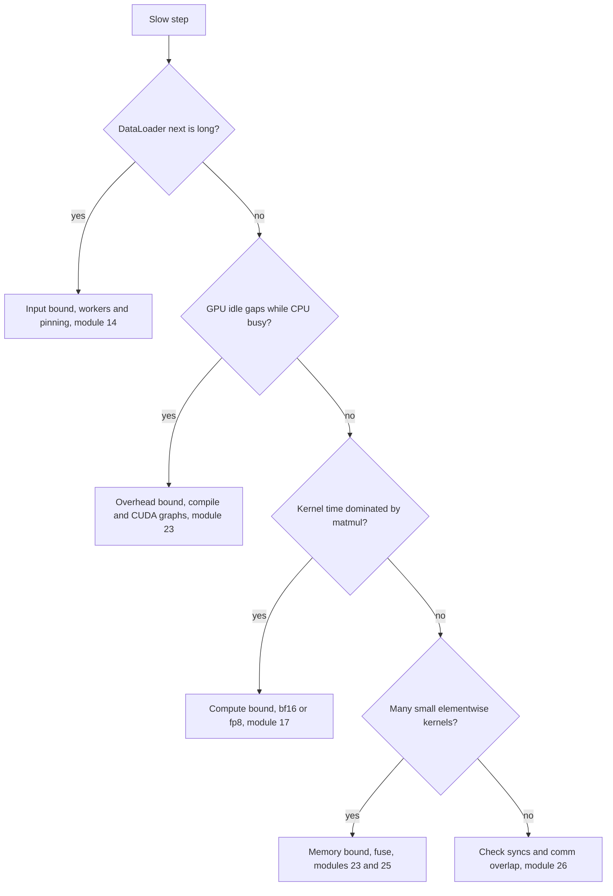
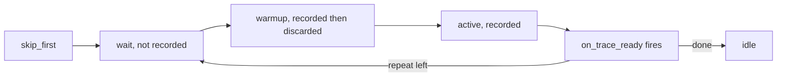

# 21 — Profiling and Benchmarking

> **Prerequisites:** modules 16 and 20.
> **You will learn:** how to time PyTorch code correctly (warm-up, synchronization, `torch.utils.benchmark.Timer`, `blocked_autorange`, `Compare`) and why `time.time()` around GPU code lies; how to drive `torch.profiler` (activities, `schedule`, `record_function`, `key_averages`, Chrome/Perfetto traces, `profile_memory`, stacks, `on_trace_ready`); how to count FLOPs with `FlopCounterMode`, derive the `6·P·tokens` training rule, and turn FLOPs and time into MFU against a roofline; where Holistic Trace Analysis, memory snapshots and Mosaic, `torch.utils.module_tracker` and the FX profiler fit, and why `torch.utils.bottleneck` is obsolete.

Module 20 showed that eager PyTorch enqueues kernels: on a GPU the host runs ahead, and anything that needs a value back (`.item()`, `print`, a boolean mask) makes it wait. That model predicts every classic measurement mistake. A stopwatch around a launch times the launch, the first call times the allocator, and a per-step `loss.item()` hides the real bottleneck behind a sync.

This module covers three instruments: a statistically careful timer for statements, a tracing profiler for a whole step, and a FLOP counter that turns step time into utilization. The lab profiles a CPU training step, finds that the CPU-default optimizer dominates it, and computes MFU against a measured matmul ceiling. The [PyTorch overview note](../../notes/libraries/pytorch.md) has the one-paragraph version.

---

## 21.1 Measure before you optimize

A slow step is **compute-bound** (big matmuls near peak; only fewer FLOPs or lower precision help), **memory-bound** (elementwise ops, norms and softmaxes streaming bytes; fusion helps) or **overhead-bound** (the device waits on Python, launches, host syncs or input). Classify before optimizing.

| Question | Tool | Answers |
|---|---|---|
| Is op A faster than op B at this shape? | `torch.utils.benchmark.Timer` | median and IQR, threads fixed |
| Where does one step spend its time? | `torch.profiler` + Perfetto | self/total time per op, gaps, syncs |
| How close to the hardware is this? | `FlopCounterMode` + step time | achieved FLOP/s, MFU |
| Why did I OOM? | CUDA memory snapshot, Mosaic ([module 22](./22-memory-accounting-and-checkpointing.md)) | live tensors over time, with stacks |
| Why is rank 3 slow? | Holistic Trace Analysis | idle time and comm overlap per rank |



## 21.2 Timing correctly with `torch.utils.benchmark`

A naive `t0 = time.time(); f(); time.time() - t0` fails four ways. **First calls** pay for lazy init, allocator growth, oneDNN or cuBLAS primitive creation, optimizer state and compilation. **Async devices**: on CUDA `f()` returns once kernels are queued, so you time the launch and the next sync pays for the rest ([module 20](./20-execution-model-dispatch-devices.md)). **Threads**: a benchmark at 1 thread and production at 8 measure different things. **Noise**: frequency scaling and neighbours move single runs by tens of percent; the lab's matmul ceiling varied 1.8× between runs on a loaded laptop.

[`torch.utils.benchmark.Timer`](https://docs.pytorch.org/docs/2.8/benchmark_utils.html) handles the first three. In 2.8 its signature is `Timer(stmt, setup, global_setup, timer, globals, label, sub_label, description, env, num_threads=1, language)`. It warms up, synchronizes CUDA and XPU around timed regions ([`timer.py` at v2.8.0](https://github.com/pytorch/pytorch/blob/v2.8.0/torch/utils/benchmark/utils/timer.py)) and pins the thread count. The default is **one** thread, not `torch.get_num_threads()`, so pass `num_threads=` explicitly.

| Method | Behaviour | Use for |
|---|---|---|
| `timeit(n)` | one block of `n` runs | quick sanity; no spread |
| `blocked_autorange(min_run_time=0.2)` | sizes blocks to be timeable, runs blocks until `min_run_time` | default; median and IQR over blocks |
| `adaptive_autorange(threshold=0.1, ...)` | samples until IQR/median < `threshold` | noisy statements |
| `collect_callgrind()` | Valgrind instruction counts | deterministic CPU-overhead regressions |

A `Measurement` exposes `median`, `mean`, `iqr`, `times` and `number_per_run`. `benchmark.Compare([...]).print()` aligns many measurements by `label`, `sub_label` and `description`, as the [benchmark recipe](https://github.com/pytorch/tutorials/blob/ca960b6a7cd299ba00a644aa918bbcffdeb70152/recipes_source/recipes/benchmark.py) does when sweeping shapes and threads. Report median and IQR at a fixed thread count.

Hand-rolled GPU timing uses CUDA events on the device clock. Not executed here:

```python
start, end = torch.cuda.Event(enable_timing=True), torch.cuda.Event(enable_timing=True)
for _ in range(10):                  # warm-up: allocator, cuBLAS handles, autotuning
    f(x)
torch.cuda.synchronize()
times = []
for _ in range(50):
    start.record(); f(x); end.record()
    end.synchronize()                # wait for this event only
    times.append(start.elapsed_time(end))   # milliseconds
times.sort(); print(times[len(times) // 2])
```

## 21.3 The profiler: anatomy of a trace

`torch.profiler` ([docs](https://docs.pytorch.org/docs/2.8/profiler.html)) wraps Kineto, which records CPU operator events and, through CUPTI or roctracer, device kernels and memcpys.

| Argument | Effect | Cost |
|---|---|---|
| `activities=[ProfilerActivity.CPU, ProfilerActivity.CUDA]` | event sources | CUDA adds CUPTI tracing |
| `schedule=schedule(wait, warmup, active, repeat, skip_first)` | which `prof.step()` indices record | bounds trace size |
| `on_trace_ready=fn` | called when an active window ends | your handler |
| `record_shapes=True` | input shapes; enables `group_by_input_shape` | small |
| `profile_memory=True` | allocation/free events, memory columns | moderate |
| `with_stack=True` | Python and C++ stacks per op | large traces |
| `with_flops=True` | formula FLOPs for matmul and conv | small |

The schedule is a state machine over step indices ([`schedule` in `profiler.py` at v2.8.0](https://github.com/pytorch/pytorch/blob/v2.8.0/torch/profiler/profiler.py)). `wait` records nothing; `warmup` records and discards, so the profiler's start-up cost is not charged to your ops; `active` records, then `on_trace_ready` fires. `repeat=0` cycles until the loop ends. Forget `prof.step()` and the profiler never leaves `wait`.



`record_function("name")` opens a range that becomes a row in `key_averages()` and a span in the trace; wrap `forward`, `backward`, `optimizer` and data loading. In `prof.key_averages(group_by_input_shape=True).table(sort_by="self_cpu_time_total")`, **self** time excludes children and **total** includes them: `aten::linear` has a large total and tiny self because `aten::addmm` does the work. Sort by self time to find the op that burns cycles, by total time to find the expensive subtree. With CUDA activity, kernel rows (`ampere_sgemm_...`) and `Self CUDA` columns appear, and a CPU op's CPU time is just its launch cost.

`prof.export_chrome_trace("trace.json")` writes JSON for [ui.perfetto.dev](https://ui.perfetto.dev) or `chrome://tracing`: CPU threads on top, device streams below, flow arrows from launch to kernel. `on_trace_ready=torch.profiler.tensorboard_trace_handler("./log")` writes one file per window for TensorBoard's plugin (not installed in this course's CI).

## 21.4 Reading a trace like an engineer

The patterns worth memorizing (GPU rows from the docs and tutorials, not executed here):

| What you see | Meaning | Fix |
|---|---|---|
| GPU stream gaps while the CPU runs short ops | launch- or Python-bound | bigger batch, `torch.compile`, CUDA graphs ([module 23](./23-torch-compile-in-practice.md)) |
| `cudaStreamSynchronize` / DtoH `cudaMemcpyAsync` under `aten::item`, `aten::nonzero`, `aten::index` | host sync mid-step | keep values on device; `masked_fill`/`where` over `x[mask]` |
| hundreds of tiny elementwise kernels | memory-bound, unfused | compile, fused optimizers |
| long `enumerate(DataLoader)#_SingleProcessDataLoaderIter.__next__` | input-bound | workers, prefetch ([module 14](./14-data-pipelines.md)) |
| `Memcpy HtoD (Pageable)` | unpinned host tensor, staged synchronous copy | `pin_memory=True` + `non_blocking=True` |
| `nccl:all_reduce` after backward, not under it | no comm/compute overlap | DDP buckets ([module 26](./26-distributed-collectives-and-ddp.md)) |

Boolean-mask indexing `x[mask]` has a data-dependent output shape: `aten::index` calls `aten::nonzero` to count selected elements before allocating. On CUDA the [`nonzero` docs](https://docs.pytorch.org/docs/2.8/generated/torch.nonzero.html) say this "causes host-device synchronization". Fence 3 shows the `aten::index` → `aten::nonzero` pair in a CPU profile; on a GPU trace the same pair sits above a DtoH copy and a stream synchronize, followed by an idle gap. [Module 04](./04-indexing-broadcasting-shapes.md) lists which indexing ops have data-dependent shapes; the profiler finds the ones that matter. `torch.cuda.set_sync_debug_mode("warn")` ([CUDA docs](https://docs.pytorch.org/docs/2.8/cuda.html); not executed here) turns each such sync into a warning.

**The lab's worked trace.** The lab profiles three steps of a 4-Linear MLP (B = 64, width 256, vocabulary 512) and ranks `aten::` ops by median self time per step. One local PyTorch 2.8 CPU run on an Apple M2 Pro, 4 threads, on a loaded machine, with AdamW's CPU-default implementation (`--adamw forloop`):

| Op | Self CPU µs/step | Calls/step |
|---|---|---|
| `aten::mul_` | 369.7 | 18 |
| `aten::addcdiv_` | 252.9 | 9 |
| `aten::addcmul_` | 202.7 | 9 |
| `aten::div` | 198.3 | 9 |
| `aten::sqrt` | 180.2 | 9 |

No matmul: all five are the optimizer, 9 parameter tensors × about ten small ops. The phase ranges agreed: optimizer 1.93 ms, forward 0.41 ms, backward 0.72 ms. [`_default_to_fused_or_foreach` at v2.8.0](https://github.com/pytorch/pytorch/blob/v2.8.0/torch/optim/optimizer.py) picks `foreach` only when every parameter is on `cuda`, `xpu` or the privateuse1 device, so CPU gets the per-tensor loop. With `fused=True` (the lab default):

| Op | Self CPU µs/step | Calls/step |
|---|---|---|
| `aten::_fused_adamw_` | 234.0 | 1 |
| `aten::gelu_backward` | 171.0 | 3 |
| `aten::gelu` | 139.2 | 3 |
| `aten::mm` | 121.3 | 8 |
| `aten::addmm` | 101.2 | 4 |

The optimizer phase fell to 0.39 ms and the Timer median from 2.36 to 1.22 ms in these two runs, one pair on one machine. 4 `addmm` are the forward; 8 `mm` the grad-weight and grad-input matmuls. GELU rivals a 64×256×256 matmul here because this build's BLAS is Apple Accelerate (`BLAS_INFO=accelerate` in `torch.__config__.show()`); an x86 runner may rank differently.

## 21.5 Counting FLOPs and the 6·P·D rule

[`FlopCounterMode`](https://github.com/pytorch/pytorch/blob/v2.8.0/torch/utils/flop_counter.py) is a `TorchDispatchMode` (module 20) with formulas for `mm`, `addmm`, `bmm`, `baddbmm`, convolutions and the CUDA SDPA kernels. Use `with FlopCounterMode(display=False) as fc:`, then `fc.get_total_flops()` and `fc.get_flop_counts()` (module name → op → FLOPs). Elementwise ops, norms and softmax count **zero**, the matmul-only convention MFU uses. The CPU SDPA kernel has no formula in 2.8, so attention FLOPs vanish on CPU ([module 32](./32-capstone-gpt-model.md) measured this).

**Derivation.** A Linear with input `(B, in)` and weight `(out, in)` does `B·in·out` multiply-adds: **2·B·in·out** FLOPs forward. Backward does grad-input `dY @ W`, `(B, out) @ (out, in)`, and grad-weight `dYᵀ @ X`, `(out, B) @ (B, in)`, each 2·B·in·out. So backward ≈ 2× forward and a training step costs **6·B·in·out**. Summing `in·out` over weight matrices gives P, and with D tokens:

$$C_{\text{train}} \approx 6 \cdot P \cdot D,$$

Kaplan et al.'s rule ([arXiv:2001.08361](https://arxiv.org/abs/2001.08361), section 2.1). Attention adds parameter-free matmuls: `q kᵀ` and `att @ v` each cost `2·T·d_model` per token per layer forward, so **12·L·T·d_model** per token for training ([module 37](./37-capstone-scaling-the-recipe.md) applies it).

| Piece (one Linear, `B` rows) | FLOPs |
|---|---|
| forward `X Wᵀ` | 2·B·in·out |
| grad-input `dY W` | 2·B·in·out, skipped if the input needs no grad |
| grad-weight `dYᵀ X` | 2·B·in·out |
| bias, activations, norms | 0 by convention |
| training step | 6·B·in·out |

A counter therefore differs from the rule in two places: the first layer of a model whose input needs no grad costs 4·B·in·out, and biases and norm weights are in P but in no matmul. The lab puts an embedding in front so every Linear's input requires grad, as in a language model, and the count matches `6·B·Σ in·out` exactly.

## 21.6 MFU, roofline, and arithmetic intensity

$$\text{MFU} = \frac{\text{model FLOPs per step} / \text{step time}}{\text{peak FLOP/s}}.$$

PaLM ([arXiv:2204.02311](https://arxiv.org/abs/2204.02311), section 4.1 and appendix B) introduced it to replace hardware FLOPs utilization (HFU). HFU counts executed FLOPs, including activation recomputation, so it rises when you checkpoint more. MFU counts only what the model needs and is comparable across implementations. This course uses MFU; check which one a quoted number is. PaLM 540B reported 46.2 % MFU on TPU v4.

Whether a kernel can reach peak depends on its **arithmetic intensity** I = FLOPs / bytes moved. The roofline model (Williams, Waterman and Patterson, [CACM 2009](https://doi.org/10.1145/1498765.1498785)) caps throughput at min(peak, I × bandwidth); the ridge point peak / bandwidth is where the two meet.

| A100 SXM quantity | Value | Evidence |
|---|---|---|
| dense bf16 peak | 312 TFLOP/s | vendor-reported |
| HBM2e bandwidth (80 GB) | ≈ 2.0 TB/s | vendor-reported |
| ridge point | ≈ 156 FLOP/byte | derived |
| `(4096×4096) @ (4096×4096)` bf16 | 2·4096³ / (3·4096²·2 B) ≈ 1,365 FLOP/byte | compute-bound |
| `a + b` bf16 | 1 FLOP / (3 elements × 2 B) = 1/6 FLOP/byte | memory-bound |

The matmul can approach 312 TFLOP/s; the add tops out near 2.0 TB/s × 1/6 ≈ 0.33 TFLOP/s whatever you do. That is why MFU ignores elementwise FLOPs and why the fix for them is fusion, fewer HBM round trips, not faster arithmetic. The [roofline lesson](/courses/inference/00-foundations/00-04-roofline-and-arithmetic-intensity.html) has the full treatment.

## 21.7 Memory profiling: what the profiler and snapshots show

`profile_memory=True` adds `CPU Mem` and `Self CPU Mem` columns (and CUDA equivalents): bytes allocated minus freed, inclusive and exclusive of children. Fence 3's table shows `aten::mm` with 16 KB, one 64×64 fp32 output. `prof.export_memory_timeline("mem.html", device="cuda:0")` plots memory over time by category (parameters, gradients, optimizer state, activations); `.json` and `.raw.json.gz` suffixes give data instead. A local CPU run with `device="cpu"` wrote the JSON, but the tutorials target CUDA and CI does not exercise it.

For OOMs use the **CUDA memory snapshot** ([Understanding CUDA Memory Usage](https://docs.pytorch.org/docs/2.8/torch_cuda_memory.html)). Not executed here:

```python
torch.cuda.memory._record_memory_history(max_entries=100_000)   # stacks per alloc/free
try:
    for _ in range(3):
        train_step()
finally:
    torch.cuda.memory._dump_snapshot("snap.pickle")
    torch.cuda.memory._record_memory_history(enabled=None)          # stop recording
```

Drop `snap.pickle` on [pytorch.org/memory_viz](https://pytorch.org/memory_viz), which runs locally and uploads nothing. The Active Memory Timeline shows every live tensor with its allocating stack; the Allocator State History shows how `cudaMalloc` segments are split, which separates a true peak from fragmentation. Only memory from PyTorch's caching allocator is visible (NCCL buffers are not). [Mosaic](https://github.com/pytorch/tutorials/blob/ca960b6a7cd299ba00a644aa918bbcffdeb70152/beginner_source/mosaic_memory_profiling_tutorial.py) post-processes the same snapshots at scale: peak attribution, checkpointing comparisons, imbalance across ranks. [Module 22](./22-memory-accounting-and-checkpointing.md) does the byte accounting that predicts what a snapshot should show.

## 21.8 Module-level attribution

Operator tables answer "which op"; you usually need "which layer". [`ModuleTracker`](https://docs.pytorch.org/docs/2.8/module_tracker.html) maintains `parents`, the fully qualified names of modules currently executing (always including `"Global"`), and `is_bw`. The docs warn `is_bw` is approximate: it stays set until another module executes. `FlopCounterMode` uses it for its per-module table, and a dispatch mode like module 20's op counter can use it to attribute every aten op. Run locally, not a CI fence:

```python
from collections import Counter
import torch, torch.nn as nn
from torch.utils._python_dispatch import TorchDispatchMode
from torch.utils.flop_counter import FlopCounterMode
from torch.utils.module_tracker import ModuleTracker

class OpsByModule(TorchDispatchMode):
    def __init__(self, tracker):
        super().__init__(); self.tracker, self.counts = tracker, Counter()
    def __torch_dispatch__(self, func, types, args=(), kwargs=None):
        where = max(self.tracker.parents, key=len)          # innermost fqn
        self.counts[(where, self.tracker.is_bw, str(func))] += 1
        return func(*args, **(kwargs or {}))

model = nn.Sequential(nn.Linear(16, 32), nn.GELU(), nn.Linear(32, 4))
x = torch.randn(8, 16)
with ModuleTracker() as tracker, OpsByModule(tracker) as ops:
    model(x).sum().backward()
with FlopCounterMode(display=False) as fc:
    model(x).sum().backward()
print({k: sum(v.values()) for k, v in fc.get_flop_counts().items()})
# {'Sequential.0': 16384, 'Sequential': 22528, 'Global': 22528, 'Sequential.2': 6144}
```

`Sequential.2` is 6·8·32·4 = 6,144; `Sequential.0` is 4·8·16·32 = 16,384 because `x` needs no gradient, and the op log shows one backward `mm` there against two in `Sequential.2`. Graph-level attribution is the [FX profiling tutorial](https://github.com/pytorch/tutorials/blob/ca960b6a7cd299ba00a644aa918bbcffdeb70152/intermediate_source/fx_profiling_tutorial.py): subclass `torch.fx.Interpreter` and time `run_node` per node ([module 24](./24-compiler-internals-fx-inductor.md)).

## 21.9 Multi-rank and production profiling

One rank's trace cannot explain eight ranks waiting on each other. **Holistic Trace Analysis** (`pip install HolisticTraceAnalysis`; [intro tutorial](https://github.com/pytorch/tutorials/blob/ca960b6a7cd299ba00a644aa918bbcffdeb70152/beginner_source/hta_intro_tutorial.rst)) loads one Kineto trace per rank and reports a temporal breakdown (compute, communication, memory, idle), idle time split into host wait (CPU not enqueueing fast enough), kernel wait (launch gaps that CUDA graphs remove) and other, kernel breakdowns, and communication/computation overlap. `TraceDiff` ([tutorial](https://github.com/pytorch/tutorials/blob/ca960b6a7cd299ba00a644aa918bbcffdeb70152/beginner_source/hta_trace_diff_tutorial.rst)) compares control and test traces by op counts and durations.

- **`torch.compile`** regions appear as `CompiledFunction` / `CompiledFunctionBackward`; profile after a warm-up and read graph breaks as gaps between them ([profiling `torch.compile`](https://docs.pytorch.org/docs/2.8/torch.compiler_profiling_torch_compile.html)).
- **Intel VTune**: `torch.autograd.profiler.emit_itt()` emits ITT ranges, as `emit_nvtx()` does for Nsight Systems.
- **CUDA graph kernel annotations** ([tutorial](https://github.com/pytorch/tutorials/blob/ca960b6a7cd299ba00a644aa918bbcffdeb70152/advanced_source/cuda_graph_annotations_tutorial.py)) label kernels inside captured graphs; the tutorial requires a build newer than 2.8.
- **`torch.utils.bottleneck`** ([docs](https://docs.pytorch.org/docs/2.8/bottleneck.html), last updated 2022) wraps cProfile and the legacy autograd profiler; its own warning says CPU-mode timings of CUDA code show launch cost. `torch.profiler` supersedes it.

## Reconciling the sources

The tutorials index lists both [Profiling your PyTorch module](https://github.com/pytorch/tutorials/blob/ca960b6a7cd299ba00a644aa918bbcffdeb70152/beginner_source/profiler.py) and the [profiler recipe](https://github.com/pytorch/tutorials/blob/ca960b6a7cd299ba00a644aa918bbcffdeb70152/recipes_source/recipes/profiler_recipe.py). The recipe uses `torch.profiler`; older posts use `torch.autograd.profiler.profile(use_cuda=True)`, the same Kineto engine behind a compatibility API without `schedule` or `on_trace_ready`. PaLM's MFU counts model FLOPs without recomputation; some vendor reports count hardware FLOPs. This course follows PaLM.

## Worked profiling verification

Four CPU checks; none asserts a speed.

**Fence 1** proves `FlopCounterMode` implements the 2/4/6 derivation for a Linear whose input requires grad, and that elementwise ops count zero.

```python pytorch-check
import torch
import torch.nn as nn
from torch.utils.flop_counter import FlopCounterMode

torch.manual_seed(0)
B, d_in, d_out = 4, 16, 8
lin = nn.Linear(d_in, d_out)
x = torch.randn(B, d_in, requires_grad=True)

with FlopCounterMode(display=False) as fwd:
    y = lin(x)
assert fwd.get_total_flops() == 2 * B * d_in * d_out                  # 1,024

with FlopCounterMode(display=False) as step:
    lin(x).sum().backward()
total = step.get_total_flops()
assert total == 3 * 2 * B * d_in * d_out == 3_072                     # fwd + grad-input + grad-weight
per_op = {str(k): v for k, v in step.get_flop_counts()["Global"].items()}
assert per_op == {"aten.addmm": 1_024, "aten.mm": 2_048}

with FlopCounterMode(display=False) as elementwise:
    (x * x).relu().sum()
assert elementwise.get_total_flops() == 0
print(f"forward {fwd.get_total_flops():,}; train step {total:,} = 6*B*in*out; elementwise counts 0")
```

**Fence 2** proves `Timer` returns a `Measurement` with the fields you report and defaults to one thread. It says nothing about how fast a matmul is.

```python pytorch-check
import torch
import torch.utils.benchmark as benchmark

torch.manual_seed(0)
a, b = torch.randn(64, 64), torch.randn(64, 64)
m = benchmark.Timer("a @ b", globals={"a": a, "b": b}, num_threads=1,
                    label="matmul", sub_label="64x64", description="fp32").timeit(20)
assert m.median > 0 and m.number_per_run >= 1 and len(m.times) > 0
blocked = benchmark.Timer("a @ b", globals={"a": a, "b": b}).blocked_autorange(min_run_time=0.05)
assert blocked.task_spec.num_threads == 1          # the default is ONE thread
assert len(blocked.times) >= 1 and blocked.median > 0
print(f"timeit: 1 block of {m.number_per_run}; "
      f"blocked_autorange: {len(blocked.times)} blocks of {blocked.number_per_run}")
```

`timeit(20)` is a single block, so its IQR is zero; locally `blocked_autorange` gave about 30 blocks, which makes median and IQR meaningful.

**Fence 3** proves ranges and aten ops reach `key_averages()` and that `x[mask]` dispatches to `aten::index` → `aten::nonzero`, the op that syncs on CUDA. The sync itself needs a GPU.

```python pytorch-check
import torch
from torch.profiler import ProfilerActivity, profile, record_function

torch.manual_seed(0)
x = torch.randn(64, 64)
mask = x[:, 0] > 0
with profile(activities=[ProfilerActivity.CPU], record_shapes=True, profile_memory=True) as prof:
    with record_function("my_block"):
        y = x @ x
    with record_function("masked_select"):
        z = x[mask]                          # data-dependent output shape
events = {e.key: e for e in prof.key_averages()}
assert "my_block" in events and events["my_block"].count >= 1
assert "aten::mm" in events or "aten::matmul" in events
assert "aten::index" in events and "aten::nonzero" in events
assert z.shape == (int(mask.sum()), 64)
table = prof.key_averages().table(sort_by="self_cpu_time_total", row_limit=5)
assert "Self CPU" in table
print(f"ranges and ops recorded; x[mask] -> aten::index -> aten::nonzero, rows={z.shape[0]}")
```

**Fence 4** proves the schedule: `wait=1, warmup=1, active=2, repeat=1` over six steps fires `on_trace_ready` once, holding only the two active steps.

```python pytorch-check
import torch
from torch.profiler import ProfilerActivity, profile, record_function, schedule

torch.manual_seed(0)
a = torch.randn(8, 8)
ready = []
with profile(activities=[ProfilerActivity.CPU],
             schedule=schedule(wait=1, warmup=1, active=2, repeat=1),
             on_trace_ready=lambda p: ready.append(
                 {e.key: e.count for e in p.key_averages()})) as prof:
    for _ in range(6):
        with record_function("step_body"):
            a @ a
        prof.step()
assert len(ready) == 1
assert ready[0]["step_body"] == 2 and ready[0]["aten::mm"] == 2   # active steps only
print(f"on_trace_ready fired {len(ready)} time; recorded step_body x{ready[0]['step_body']}")
```

## Lab: profile one training step and compute its MFU on CPU

**Tested with Python 3.11 and PyTorch 2.8.0 on CPU.**

[`code/21_profile_step.py`](./code/21_profile_step.py) trains `Embedding(512, 256)` → 3 × (`Linear(256, 256)` + GELU) → `Linear(256, 512)` with AdamW on random tokens. It counts one step's FLOPs and compares them with `6·B·Σ in·out`. It profiles six steps under `schedule(wait=1, warmup=1, active=3, repeat=1)` with phase ranges, ranking ops by **median** per-step self time so one preempted step cannot reorder the table. It times the step with `blocked_autorange(min_run_time=0.3)` at 4 threads, and reports MFU against a 1024×1024 fp32 matmul timed the same way (or `--peak-gflops`). `--adamw forloop` reproduces 21.4's first table; `--trace-dir` writes a Perfetto trace. Scope: CPU only; GPU kernels, the CUDA memory timeline and HTA are documented, not run; "CPU MFU" is relative to an empirical matmul ceiling, not a datasheet peak.

```bash
python content/courses/pytorch/code/21_profile_step.py --trace-dir /tmp/pt-trace
python site/test_pytorch_21_profile_step.py
```

One local PyTorch 2.8 CPU run on an Apple M2 Pro (4 threads, other jobs running) produced:

| Result key | Value |
|---|---|
| `flops_per_step` = `analytic_flops_per_step` | 125,829,120 = 6 · 64 · (3·256² + 256·512) |
| `median_step_s` (IQR) | 1.22 ms (0.11 ms) |
| `achieved_gflops` / `matmul_peak_gflops` | 102.9 / 2,394 |
| `mfu` | 0.043 |
| `phase_ms` forward / backward / optimizer (profiled) | 0.39 / 0.70 / 0.39 |

4 % says a 64-row batch cannot feed a BLAS that sustains 2.4 TFLOP/s on a 1024² matmul: each `mm` here is 8 MFLOP, so per-op overhead and zero-FLOP GELU and optimizer work dominate. The profiled phases sum to 1.48 ms against the Timer's 1.22 ms, about 20 % instrumentation overhead: rank with the profiler, time with the Timer. The ceiling ranged from 1,390 to 2,600 GFLOP/s across runs on the busy machine, so the test asserts only `0 < mfu ≤ 1.5`, exact FLOP equality, a matmul among the top five ops, three positive phases, and a trace with `traceEvents`.

## Key takeaways

- Classify first: compute-, memory- or overhead-bound.
- `Timer` warms up and syncs CUDA, but `num_threads` defaults to 1. Report median and IQR from `blocked_autorange`.
- Profile with a `schedule`, `prof.step()` every iteration and `record_function` phases. Self time finds the op; total time finds the subtree.
- `x[mask]`, `.item()` and `nonzero` are GPU host syncs; in a trace they sit above a DtoH copy and a stream synchronize.
- Training costs 6·B·in·out per Linear, 6·P·D overall, plus 12·L·T·d_model per token for attention. `FlopCounterMode` counts matmuls only.
- MFU = model FLOP/s ÷ peak; intensity versus the ridge point says which kernels can ever reach peak.
- Memory snapshots for OOMs, HTA for multi-rank traces; `torch.utils.bottleneck` is legacy.

## Self-check

1. A colleague reports "my new attention is 10× faster" from `t0=time.time(); out=attn(x); print(time.time()-t0)` on a GPU. List three reasons the number is wrong and write the correct measurement.
2. A 1.3 B-parameter dense model trains at 40 k tokens/s on 8 GPUs with 312 TFLOP/s peak each. Estimate the MFU, ignoring attention FLOPs, and say what including them would change.
3. The profiler table shows `aten::copy_` and `Memcpy HtoD (Pageable)` near the top. What is happening and what two changes in the data pipeline remove it?

---

**Next → [22 — Memory Accounting, Activation Checkpointing, and Offload](./22-memory-accounting-and-checkpointing.md)**
