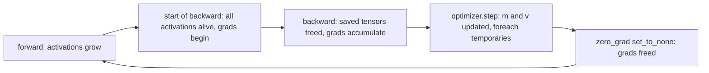
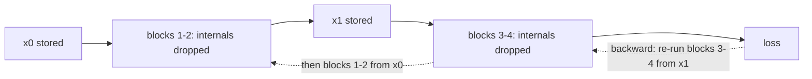

# 22 — Memory Accounting, Activation Checkpointing, and Offload

> **Prerequisites:** modules 07–08, 15, 17, 20–21.
> **You will learn:** the four memory buckets of training (parameters, gradients, optimizer state, activations) plus temporaries and allocator overhead, with exact byte formulas for fp32 and mixed-precision AdamW; how to measure memory without allocating it, using the meta device and `FakeTensorMode`, and how to measure saved activations exactly with `saved_tensors_hooks`; activation checkpointing: non-reentrant `torch.utils.checkpoint`, why reentrant is legacy, `checkpoint_sequential`, selective activation checkpointing policies, and the compute/memory trade; offloading saved tensors to CPU (`save_on_cpu`), fusing the optimizer step into backward, `set_to_none`, in-place ops, gradient accumulation vs batch size; how the CUDA caching allocator fragments, what `expandable_segments` fixes, and preallocating for variable-length inputs.

An out-of-memory error is not one number to shrink. It comes from several buckets with different drivers, lifetimes and fixes. Parameters, gradients and optimizer state scale with $P$ and ignore batch size. Activations scale with $L \cdot B \cdot T$ and dominate at long context. Shrinking the batch only helps the second kind.

This module derives each bucket, measures it on CPU, and uses the tools that trade memory for compute or bandwidth. Sharding the static buckets is [module 27](./27-fsdp2-dtensor-parallelism.md), and the capstone applies these tools in [module 37](./37-capstone-scaling-the-recipe.md); the scale view is [Training Considerations](../transformers/13-training-considerations.md); optimizer math is in [Optimization and Training](../../notes/deep-learning/optimization-and-training.md).

---

## 22.1 The four buckets

| Bucket | Size driver | Alive when |
|---|---|---|
| Parameters | $P$ × element bytes | always |
| Gradients | $P$ × grad bytes | first accumulation in backward → `zero_grad` |
| Optimizer state | $P$ × state bytes (AdamW: $m$, $v$) | from the first `step()` on |
| Activations (saved tensors) | $L \cdot B \cdot T \cdot d_\text{model}$ × a constant | forward → the backward node that uses them |
| Temporaries + allocator | unsaved intermediates, workspaces, rounding, fragmentation | transient, but often sets the true peak |

The first three are static once model and optimizer exist. Activations grow block by block in forward and are freed node by node in backward ([module 07](./07-autograd-graph-and-backward.md)) while gradients grow.



The peak is usually at the start of backward, when every activation is alive and gradients start to appear on top of the static buckets. With tiny activations it moves to the optimizer step. The [optimizer-in-backward tutorial](https://github.com/pytorch/tutorials/blob/ca960b6a7cd299ba00a644aa918bbcffdeb70152/intermediate_source/optimizer_step_in_backward_tutorial.py) profiles ViT-L/16 at one image per step: about 1.2 GB params, 1.2 GB grads, 2.4 GB Adam state, and 1.2 GB of step intermediates, peaking in the step.

Temporaries are the fifth bucket. Eager attention's `(B, H, T, T)` scores before softmax, GEMM workspaces, and `foreach` scratch are never saved, but they must fit. On GPU the allocator also rounds requests (512 B minimum, large ones to 2 MiB) and can strand free space (§22.10).

## 22.2 Bytes per parameter: the accounting table

| Recipe | param | grad | master | optimizer state | B/param |
|---|---|---|---|---|---|
| fp32 + AdamW | 4 | 4 | 0 | 8 | **16** |
| mixed precision, fp32 master (ZeRO "2+2+12") | 2 | 2 | 4 | 8 | **16** |
| same, plus a persistent fp32 grad | 2 | 2 + 4 | 4 | 8 | 20 |
| bf16 params/grads, fp32 $m, v$, no master | 2 | 2 | 0 | 8 | 12 |
| fp32 + SGD with momentum | 4 | 4 | 0 | 4 | 12 |
| fp32 + Adafactor (factored $v$, no momentum) | 4 | 4 | 0 | $4(r + c)$ B per $r \times c$ matrix | ≈ 8 |

Mixed precision saves no static memory over fp32 AdamW. It moves 4 bytes from param and grad into the master copy, which is why [ZeRO](https://arxiv.org/abs/1910.02054) writes $2\Psi + 2\Psi + 12\Psi = 16\Psi$ and shards the 12 first. The 12-byte "pure bf16" row updates bf16 weights directly, so small updates can round away ([module 17](./17-mixed-precision.md)). In 2.8, `torch.optim.Adafactor` keeps `row_var` `(r, 1)` and `col_var` `(1, c)` per weight (probed locally; [Shazeer & Stern 2018](https://arxiv.org/abs/1804.04235)).

**Worked example.** GPT-2 small has $P = 124{,}439{,}808$, so 16 B/param is 1,991,036,928 bytes (1.85 GiB) before any activation. A 7 B model needs 112 GB (104.3 GiB) for the static buckets, more than an 80 GB GPU. Optimizer state is half of it, so it is the first target: shard it (module 27), store it in 8 bits (bitsandbytes, external), or train fewer parameters with LoRA ([module 36](./36-capstone-lora-finetuning.md)).

## 22.3 Activation memory of a Transformer block

Each op saves what its backward needs ([module 07](./07-autograd-graph-and-backward.md)). Linear saves its input, for $\nabla W = \delta^\top x$. GELU saves its input. LayerNorm saves its input plus per-token mean and rstd. Eager attention saves $Q$, $K$, $V$, the softmax output and its dropout mask. Korthikanti et al. ([2022](https://arxiv.org/abs/2205.05198)) total this for a GPT block in fp16 with dropout:

$$s b h \left(34 + \frac{5 a s}{h}\right) \;=\; T \cdot B \cdot d_\text{model} \left(34 + \frac{5 H T}{d_\text{model}}\right) \text{ bytes per layer}$$

with $s, b, h, a \to T, B, d_\text{model}, H$. The 34 is attention 11 (QKV input 2, $Q, K$ 4, $V$ 2, projection input 2, mask 1), MLP 19 (input 2, GELU input 8, GELU output 8, mask 1), and the two LayerNorm inputs 4. The $5HT/d_\text{model}$ term is the $(B, H, T, T)$ matrix: softmax output 2, mask 1, dropped probabilities 2.

That term is quadratic in $T$, and fused attention removes it. Flash-style `scaled_dot_product_attention` saves the output and a per-row log-sum-exp and recomputes scores in backward ([Hardware-Aware Attention](../transformers/11-hardware-aware-attention.md)). On CPU, 2.8 dispatches to `aten._scaled_dot_product_flash_attention_for_cpu` (local dispatch trace). For this course's block (fp32, dropout 0, SDPA) the constant becomes 16 elements, $64\,TBd_\text{model}$ bytes: drop the two 1-byte masks (32 bytes = 16 fp16 elements), drop the attention term, and use 4-byte elements. The lab confirms 16.

| Setting | Formula | Per layer | All layers |
|---|---|---|---|
| Capstone GPT ($B{=}32, T{=}128, d{=}128, H{=}4, L{=}4$), fp16 + dropout | $TBd(34 + 5HT/d)$ | 27.0 MiB | 108 MiB |
| same, with SDPA | $34\,TBd$ | 17.0 MiB | 68 MiB |
| capstone as it runs: fp32, no dropout, SDPA | $64\,TBd$ | 32.0 MiB | 128 MiB (+ 8 MiB logits) |
| GPT-2 small ($B{=}8, T{=}1024, d{=}768, H{=}12, L{=}12$), fp16 + dropout | $TBd(34 + 80)$ | 684 MiB | 8.02 GiB |
| same, with SDPA | $34\,TBd$ | 204 MiB | 2.39 GiB |

The capstone's 875,264 parameters cost 13.4 MiB at 16 B/param, a tenth of its activations. At GPT-2 scale the attention term is $80/34$ of everything else.

## 22.4 Measuring without allocating: meta device and FakeTensor

Under `with torch.device("meta"):` every factory call inside `__init__` makes a [meta tensor](https://docs.pytorch.org/docs/2.8/meta.html): shape, dtype and strides, no data. A 70 B model "builds" in milliseconds, `sum(p.numel() * p.element_size() ...)` is the exact parameter byte count, and meta kernels propagate shapes through forward. To materialize, `model.to_empty(device=...)` allocates uninitialized storage and you re-run init ([module 10](./10-nn-module-internals.md)). [`FakeTensorMode`](https://docs.pytorch.org/docs/2.8/torch.compiler_fake_tensor.html) does the same while pretending to be on a real device, which is how `torch.compile` traces ([module 24](./24-compiler-internals-fx-inductor.md)).

The same pair fixes **checkpoint loading**. The naive path, build a real model then `torch.load` the weights, holds two full copies at peak. Instead build on `meta`, open the file with `torch.load(path, mmap=True, weights_only=True)` so tensors are views of the page-cached file rather than heap copies, and call `model.load_state_dict(sd, assign=True)` so the parameters *become* those tensors. Peak host memory is about one model, paged in on demand. A local run with a `Linear(1000, 1000)` confirmed the loaded weight is a non-meta `Parameter` sharing the mmap'd tensor's data pointer; [module 10](./10-nn-module-internals.md) covers `assign=True`'s side effects and [module 16](./16-training-loop-checkpointing.md) the checkpoint format.

Neither measures the activation peak. They give every tensor's size, not which ones autograd keeps alive or when memory is freed. That needs saved-tensor hooks (any device) or a real allocator: `torch.cuda.max_memory_allocated` and the snapshot from [module 21](./21-profiling-and-benchmarking.md).

## 22.5 Measuring saved activations exactly with saved-tensor hooks

[`torch.autograd.graph.saved_tensors_hooks(pack, unpack)`](https://docs.pytorch.org/docs/2.8/autograd.html) sees every tensor autograd saves ([module 08](./08-custom-autograd-and-hooks.md)). A counting `pack` with an identity `unpack` makes an exact activation meter if you handle two details:

1. **Deduplicate by storage.** In the lab, `q`, `k`, `v` are views of one `qkv` buffer and each reports the full storage. Key by `t.untyped_storage().data_ptr()`, sum `nbytes()` once.
2. **Exclude parameters by storage, not type.** `addmm` saves `W.T`, a view, which is a plain `Tensor`. Fence 3 shows an `isinstance(t, nn.Parameter)` filter excludes nothing.

The meter misses tensors held outside autograd (your caches, the selective-checkpoint cache of §22.7), temporaries and allocator overhead. It measures what backward will need, not the peak.

## 22.6 Activation checkpointing

Checkpointing a region keeps only its inputs. In backward, autograd re-runs the region's forward to regenerate what it needs, then continues. The 2.8 non-reentrant implementation uses the §22.5 mechanism ([`torch/utils/checkpoint.py` at v2.8.0](https://github.com/pytorch/pytorch/blob/v2.8.0/torch/utils/checkpoint.py)). A `_NoopSaveInputs` Function saves the inputs, which is why an outer meter sees the input plus a 0-element tensor. An inner hook replaces each internal saved tensor with a handle whose unpack triggers recompute.



Pass `use_reentrant=False`, which the [checkpoint docs](https://docs.pytorch.org/docs/2.8/checkpoint.html) recommend. Non-reentrant records the graph in forward, stops recomputing once the needed tensors exist, supports `torch.autograd.grad` and `backward(inputs=...)`, works when no input requires grad, and handles nested structures. Reentrant runs the region under `no_grad` and replays it inside a nested backward, without those features. In 2.8, omitting the argument warns and **falls back to `use_reentrant=True`**. That is in the v2.8.0 source, and a local run printed the reentrant-only warning "None of the inputs have requires_grad=True".

`preserve_rng_state=True` (default) stashes and restores RNG state so recomputed dropout masks match. `checkpoint_sequential(functions, segments, input, use_reentrant=False)` checkpoints all but the last of `segments` chunks of an `nn.Sequential`.

**Cost.** A step is about three forwards of FLOPs (backward ≈ 2×), and full checkpointing adds one, so about +33 %. Chen et al. ([2016](https://arxiv.org/abs/1604.06174)) report about 30 % more time while a 1,000-layer ResNet fell from 48 GB to 7 GB. **The $\sqrt{L}$ rule:** storing every $k$-th boundary costs $L/k$ boundaries plus one $k$-block segment during recompute, minimized at $k = \sqrt{L}$.

## 22.7 Selective activation checkpointing

Full checkpointing recomputes the matmuls, the expensive ops. Selective activation checkpointing (SAC) decides per op. `create_selective_checkpoint_contexts(policy_fn)` builds the `context_fn` that `checkpoint` takes. `policy_fn(ctx, op, *args, **kwargs)` returns `MUST_SAVE`/`PREFER_SAVE` to cache an output or `MUST_RECOMPUTE`/`PREFER_RECOMPUTE` to regenerate it (`MUST_` cannot be overridden by `torch.compile`). `ctx.is_recompute` says which pass is asking.

Megatron's selective recomputation (Korthikanti et al.) makes the opposite choice for the same reason. It recomputes only the attention core, the $5HT/d_\text{model}$ term with few FLOPs per byte, and reports 5× less activation memory with over 90 % of recompute overhead removed. Flash-style SDPA already does that inside the kernel. `torch.compile`'s min-cut partitioner makes these save-or-recompute choices automatically ([module 24](./24-compiler-internals-fx-inductor.md)).

| One lab block | Saved (units of $TBd$ elements) | Recomputed in backward |
|---|---|---|
| none | 16 (+ LN stats, LSE) | nothing |
| full | 1 (input) | 4 matmuls, SDPA, LayerNorms, GELU |
| selective, save matmuls | 1 + 9 (qkv 3, proj 1, fc1 4, fc2 1) | LayerNorms, SDPA, GELU |

## 22.8 Offloading saved tensors and parameters

`torch.autograd.graph.save_on_cpu(pin_memory=False, device_type="cuda")` is a hooks subclass. `pack` copies each saved tensor to host memory, pinned if requested, and `unpack` copies it back with `non_blocking=pin_memory`. On a CPU-only machine it is a CPU-to-CPU copy and saves nothing.

```python
with torch.autograd.graph.save_on_cpu(pin_memory=True):
    loss = model(batch).loss          # saved activations go to pinned host RAM
loss.backward()                       # copied back as each node needs them
```

Every saved byte crosses PCIe twice. PCIe 4.0 x16 is about 31.5 GB/s per direction by specification, and achieved rates are lower. GPT-2 small's 204 MiB per layer (§22.3, SDPA) takes about 7 ms each way at that rate, which pays only if it overlaps compute that takes longer. Recompute usually wins for activations. Offload suits state touched once per step: FSDP2's `CPUOffloadPolicy` keeps sharded parameters, gradients and optimizer state on the host ([module 27](./27-fsdp2-dtensor-parallelism.md)). Not executed here.

## 22.9 Gradient and optimizer memory tricks

`Optimizer.zero_grad(set_to_none=True)`, the default since 2.0 (verified in 2.8), frees the gradient bucket instead of zero-filling it. **Gradient accumulation** over $k$ micro-batches gives batch $B$'s gradient with about $1/k$ of the activations, for $k\times$ latency ([module 16](./16-training-loop-checkpointing.md)).

**Optimizer step in backward.** `Tensor.register_post_accumulate_grad_hook(hook)` fires after `.grad` is accumulated. With one optimizer per parameter, `{p: AdamW([p], foreach=False)}`, the hook calls `opts[p].step()` and `opts[p].zero_grad()`. Each gradient is applied and freed while backward continues, so the gradient bucket never exists whole and `foreach` intermediates disappear. The tutorial's ViT-L peak drops from about 6 GB to about 4 GB. Two things break. **Gradient accumulation** breaks because every backward steps. **Global-norm clipping** breaks because $\lVert g \rVert$ needs all gradients before any parameter moves, and early parameters have stepped before late gradients exist. Schedulers must drive $P$-many optimizers.

**In-place activations.** `nn.ReLU(inplace=True)` saves one activation. It is safe only if nothing else saved its input. After `sigmoid` or `tanh`, which save their outputs, the version counter raises "modified by an inplace operation" ([module 07](./07-autograd-graph-and-backward.md)). Paged and 8-bit optimizers (bitsandbytes) cut the 8-byte state to about 2 bytes. They are external and not used here.

## 22.10 The caching allocator: fragmentation and fixes

This section is GPU-only and not executed here. It is drawn from the [CUDA semantics note](https://docs.pytorch.org/docs/2.8/notes/cuda.html) and [`CUDACachingAllocator.cpp` at v2.8.0](https://github.com/pytorch/pytorch/blob/v2.8.0/c10/cuda/CUDACachingAllocator.cpp). `cudaMalloc` is slow and synchronizing, so freed blocks are cached and reused. Sizes round to 512 B. Requests up to 1 MiB come from 2 MiB small segments, 1–10 MiB requests split 20 MiB segments, and larger ones round to 2 MiB and split the smallest cached block that fits. Splits strand free slivers between live blocks. `memory_reserved()` counts segments, `memory_allocated()` counts live tensors, and the difference can be large yet unusable for the next big request.

```python
print(torch.cuda.memory_summary())                     # allocated / reserved / inactive split per pool
stranded = torch.cuda.memory_stats()["inactive_split_bytes.all.current"]
# set before the first CUDA allocation:
#   PYTORCH_CUDA_ALLOC_CONF=expandable_segments:True   (segments grow in place)
#   PYTORCH_CUDA_ALLOC_CONF=max_split_size_mb:512      (last resort: never split big blocks)
```

`expandable_segments` (experimental, default off) targets sizes that change every iteration, like variable sequence lengths. Instead of one segment per allocation, a segment grows, so new requests tile into it. The [tuning guide](https://github.com/pytorch/tutorials/blob/ca960b6a7cd299ba00a644aa918bbcffdeb70152/recipes_source/recipes/tuning_guide.py) adds a non-allocator fix: run forward and backward on a max-length batch first, so the largest blocks are cached for every shorter batch. `torch.cuda.empty_cache()` returns *unused* segments to the driver for other processes. It frees nothing you hold. Swapping the whole allocator (`CUDAPluggableAllocator`, `backend:cudaMallocAsync`; [module 20](./20-execution-model-dispatch-devices.md)) loses caching for everything. To **mix allocators**, the CUDA note's answer is `torch.cuda.MemPool`: allocations inside `with torch.cuda.use_mem_pool(pool):` come from that pool's allocator (for example `ncclMemAlloc` all-reduce buffers, which enable NVLink Switch Reductions) and keep caching, while the rest of the program stays on the default pool. For a timeline, record a snapshot (`torch.cuda.memory._record_memory_history`, `_dump_snapshot`; [docs](https://docs.pytorch.org/docs/2.8/torch_cuda_memory.html), module 21).

## Reconciling the sources

ZeRO's 16 B/param assumes no persistent fp32 gradient. Blog figures of 18 or 20 B add one, or a bf16 communication buffer, and §22.2 names each assumption. Korthikanti's 34 assumes fp16 activations and dropout masks. The capstone runs fp32 with dropout 0.0, so the lab predicts 16 four-byte elements, and the measurement agrees within 1.4 %. The 2.8 checkpoint docs give both "2.4" and "2.5" as the version that would reject a missing `use_reentrant`. The 2.8.0 binary still only warns and defaults to reentrant.

## Worked memory verification

**Fence 1** proves fp32 AdamW state is exactly `2 · 4 · P` bytes (`exp_avg`, `exp_avg_sq`), created at the first `step()`, plus a 0-d `step` per parameter. It does not count `foreach` temporaries.

```python pytorch-check
import torch
import torch.nn as nn

torch.manual_seed(0)
model = nn.Linear(64, 64)
P = sum(p.numel() for p in model.parameters())
opt = torch.optim.AdamW(model.parameters(), lr=1e-3)
assert len(opt.state) == 0  # created lazily by the first step

model(torch.randn(8, 64)).pow(2).mean().backward()
opt.step()

state_bytes, step_bytes = 0, 0
for st in opt.state.values():
    for name, t in st.items():
        nbytes = t.numel() * t.element_size()
        if name in ("exp_avg", "exp_avg_sq"):
            state_bytes += nbytes
        else:
            assert name == "step" and t.ndim == 0
            step_bytes += nbytes
grad_bytes = sum(p.grad.numel() * p.grad.element_size() for p in model.parameters())
assert P == 64 * 64 + 64
assert state_bytes == 2 * 4 * P and grad_bytes == 4 * P
print(f"P={P}: params {4*P} B, grads {grad_bytes} B, m+v {state_bytes} B, step {step_bytes} B")
```

**Fence 2** proves a meta `Linear(1000, 1000)` plans 4,004,000 bytes with no data pointer, propagates shapes, and becomes real after `to_empty` + `reset_parameters`; `FakeTensorMode` runs a 134 M-parameter forward without allocating 512 MiB. Nothing here measures activations.

```python pytorch-check
import torch
import torch.nn as nn
from torch._subclasses.fake_tensor import FakeTensorMode

with torch.device("meta"):
    lin = nn.Linear(1000, 1000)
n_bytes = sum(p.numel() * p.element_size() for p in lin.parameters())
assert n_bytes == 4_004_000 and lin.weight.is_meta
assert lin.weight.untyped_storage().data_ptr() == 0  # shapes, no memory

y = lin(torch.empty(7, 1000, device="meta"))
assert y.shape == (7, 1000) and y.is_meta

torch.manual_seed(0)
lin.to_empty(device="cpu")  # real, uninitialised storage
lin.reset_parameters()
assert torch.isfinite(lin.weight).all() and not lin.weight.is_meta

with FakeTensorMode():
    mlp = nn.Sequential(nn.Linear(4096, 16384), nn.GELU(), nn.Linear(16384, 4096))
    out = mlp(torch.empty(8, 2048, 4096))
fake_param_bytes = sum(p.numel() * p.element_size() for p in mlp.parameters())
assert out.shape == (8, 2048, 4096) and fake_param_bytes == 4 * 134_238_208
print(f"meta Linear: {n_bytes:,} B planned; fake MLP: {fake_param_bytes / 2**20:.0f} MiB params, out {tuple(out.shape)}")
```

**Fence 3** proves the storage-deduplicating meter matches the analytic count for a `32 → 256 → 32` MLP, that a `Parameter` filter misses `W.T`, and that non-reentrant checkpointing keeps only the region input, with identical gradients.

```python pytorch-check
import torch
import torch.nn as nn
from torch.utils.checkpoint import checkpoint

torch.manual_seed(0)
mlp = nn.Sequential(nn.Linear(32, 256), nn.GELU(), nn.Linear(256, 32))
x = torch.randn(16, 32, requires_grad=True)
param_ptrs = {p.untyped_storage().data_ptr() for p in mlp.parameters()}


def saved_bytes(fn):
    seen, naive_param_skips = {}, 0
    def pack(t):
        nonlocal naive_param_skips
        naive_param_skips += isinstance(t, nn.Parameter)
        s = t.untyped_storage()
        if s.data_ptr() not in param_ptrs:
            seen[s.data_ptr()] = s.nbytes()
        return t
    with torch.autograd.graph.saved_tensors_hooks(pack, lambda t: t):
        loss = fn()
    return loss, sum(seen.values()), naive_param_skips


loss, plain, skips = saved_bytes(lambda: mlp(x).pow(2).sum())
loss.backward()
ref = [t.grad.clone() for t in (x, *mlp.parameters())]
x.grad = None
mlp.zero_grad()

loss, ckpt, _ = saved_bytes(lambda: checkpoint(mlp, x, use_reentrant=False).pow(2).sum())
loss.backward()
got = [t.grad for t in (x, *mlp.parameters())]

assert skips == 0  # an isinstance filter would exclude nothing
# x, Linear1 out, GELU out, MLP out (pow input); fp32
assert plain == 4 * (16 * 32 + 2 * 16 * 256 + 16 * 32)
assert ckpt == 4 * (16 * 32 + 16 * 32)  # checkpoint input + pow input
assert ckpt < plain
for a, b in zip(ref, got):
    torch.testing.assert_close(a, b)
print(f"saved bytes: plain {plain:,}, checkpointed {ckpt:,}; gradients identical")
```

**Fence 4** proves a policy that `MUST_SAVE`s `aten.mm.default` (bias-free Linears call `mm`) reproduces the reference gradients, and that the policy is consulted again during recompute, where GELU is re-run. No speed claim.

```python pytorch-check
import functools
import torch
import torch.nn as nn
from torch.utils.checkpoint import (
    CheckpointPolicy, checkpoint, create_selective_checkpoint_contexts,
)

torch.manual_seed(0)
mlp = nn.Sequential(nn.Linear(32, 128, bias=False), nn.GELU(), nn.Linear(128, 32, bias=False))
x = torch.randn(16, 32, requires_grad=True)
log = []


def policy(ctx, op, *args, **kwargs):
    log.append((ctx.is_recompute, str(op)))
    if op == torch.ops.aten.mm.default:
        return CheckpointPolicy.MUST_SAVE
    return CheckpointPolicy.PREFER_RECOMPUTE


mlp(x).pow(2).sum().backward()
ref = [t.grad.clone() for t in (x, *mlp.parameters())]
x.grad = None
mlp.zero_grad()

ctx_fn = functools.partial(create_selective_checkpoint_contexts, policy)
checkpoint(mlp, x, use_reentrant=False, context_fn=ctx_fn).pow(2).sum().backward()
got = [x.grad] + [p.grad for p in mlp.parameters()]
for a, b in zip(ref, got):
    torch.testing.assert_close(a, b)

fwd_ops = [op for rec, op in log if not rec]
re_ops = [op for rec, op in log if rec]
assert fwd_ops.count("aten.mm.default") == 2 and "aten.gelu.default" in re_ops
print(f"selective AC: {len(fwd_ops)} policy calls in forward, {len(re_ops)} in recompute; grads match")
```

**Fence 5** proves the post-accumulate hook pattern: after `.backward()` alone, parameters equal `p - lr · grad` and every `.grad` is `None`. Peak reduction needs a GPU allocator and is not shown.

```python pytorch-check
import torch
import torch.nn as nn

torch.manual_seed(0)
lr = 0.1
model = nn.Linear(8, 4)
ref = nn.Linear(8, 4)
ref.load_state_dict(model.state_dict())
x, y = torch.randn(5, 8), torch.randn(5, 4)

opts = {p: torch.optim.SGD([p], lr=lr) for p in model.parameters()}
fired = []


def step_in_backward(p):  # after p.grad is accumulated
    fired.append(tuple(p.shape))
    opts[p].step()
    opts[p].zero_grad(set_to_none=True)  # free it now


handles = [p.register_post_accumulate_grad_hook(step_in_backward) for p in model.parameters()]
try:
    nn.functional.mse_loss(model(x), y).backward()  # no optimizer.step() call
finally:
    for h in handles:
        h.remove()

nn.functional.mse_loss(ref(x), y).backward()  # reference: plain backward
for p, q in zip(model.parameters(), ref.parameters()):
    assert p.grad is None
    torch.testing.assert_close(p.detach(), (q - lr * q.grad).detach())
assert sorted(fired) == [(4,), (4, 8)]
print(f"optimizer-in-backward: hook fired for {fired}; all .grad freed")
```

## Lab: measure activation memory with and without checkpointing

[`./code/22_memory_accounting.py`](./code/22_memory_accounting.py) stacks six pre-LN blocks (LayerNorm → QKV → causal SDPA → projection; LayerNorm → `Linear(d, 4d)` → GELU → `Linear(4d, d)`; residuals, no dropout; $d_\text{model} = 128$, $H = 4$) on a fixed `(16, 64, 128)` input with loss `out.pow(2).mean()`. It checks static buckets against $L(12d^2 + 13d)$ parameters, meters saved bytes (§22.5) for four variants, compares gradients with the plain run, times one step each with `torch.utils.benchmark`, and predicts $64\,TBd$ bytes per layer. The outer hook cannot see selective checkpointing's cache, so the policy function adds the matmul output bytes from the shapes it receives.

```bash
python content/courses/pytorch/code/22_memory_accounting.py
python site/test_pytorch_22_memory_accounting.py
```

**Tested with Python 3.11 and PyTorch 2.8.0 on CPU.** One local PyTorch 2.8 CPU run on an Apple M-series laptop (4 threads) produced:

| Variant | Saved bytes | MiB | vs none | One timed step |
|---|---|---|---|---|
| none | 51,052,544 | 48.69 | 1.000 | 0.047 s |
| full (every block) | 3,670,016 | 3.50 | 0.072 | 0.067 s |
| every_2 (blocks 0, 2, 4) | 27,361,280 | 26.09 | 0.536 | 0.056 s |
| selective (save matmuls) | 31,981,568 | 30.50 | 0.626 | 0.070 s |

Parameters and gradients are 4,758,528 B each (1,189,632 × 4), and AdamW state is exactly twice that. The prediction is 50,331,648 B, and measured/predicted is 1.014. In units of one `(16, 64, 128)` fp32 tensor (512 KiB): none = 6 × 16 + 1 (loss input) + LayerNorm stats and log-sum-exp; full = 6 + 1; every_2 = 3 + 3 × 16 + 1; selective = 6 × 10 + 1. `max_grad_diff` was 0.0, because recompute repeats the same kernels on the same inputs. The timings are single noisy samples. They say checkpointing adds forward work and do not give a ratio.

The test runs `--skip-timing` and asserts AdamW state = 2 × parameter bytes, `full < every_2 < none`, `selective ≤ none`, `full` = $(L + 1)$ unit tensors, `max_grad_diff < 1e-5`, and `none` within 35 % of the prediction. It makes no wall-time assertions.

**Honest scope.** This measures what autograd keeps between forward and backward on CPU. It does not measure allocator peak, temporaries (including recomputed activations during backward), or GPU fragmentation.

## Key takeaways

- Training memory = params + grads + optimizer state ($16P$ B for AdamW, fp32 or mixed with master) + activations ($\propto LBTd_\text{model}$) + temporaries and allocator overhead.
- Mixed precision does not shrink static buckets. Sharding, 8-bit state or LoRA do, starting with optimizer state.
- $TBd(34 + 5HT/d)$ budgets activations, and fused SDPA deletes the quadratic term.
- Plan with meta or fake tensors. Meter saved activations with storage-deduplicated hooks that exclude parameter storages.
- `checkpoint(..., use_reentrant=False)` costs about +33 % FLOPs and keeps only inputs. Selective policies keep matmul outputs.
- `save_on_cpu` spends PCIe bandwidth instead of HBM. Optimizer-in-backward frees grads early but forbids accumulation and global-norm clipping.
- Reserved minus allocated is cache plus fragmentation. Fix it with `expandable_segments` and max-length preallocation. `empty_cache` frees nothing you hold.

## Self-check

1. Estimate the GPU memory to fine-tune a 7 B model with full AdamW in bf16 mixed precision, before activations. Which bucket dominates, and what are two ways to cut it without changing the model?
2. Full activation checkpointing of every block makes a step ~30 % slower. Why roughly 30 %, and when would selective checkpointing of only the attention core be the better choice?
3. `torch.cuda.memory_reserved()` is 70 GB but `memory_allocated()` is 45 GB and the next allocation OOMs. Explain the gap and two fixes.

---

**Next → [23 — torch.compile in Practice](./23-torch-compile-in-practice.md)**
