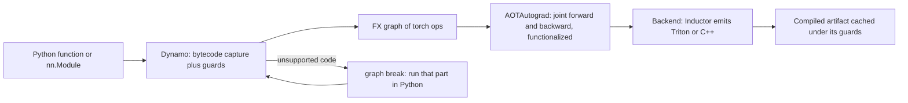

# 23 — torch.compile in Practice

> **Prerequisites:** modules 16, 20–21.
> **You will learn:** what `torch.compile` does at a high level (capture → graph → backend) and every argument: `backend`, `mode`, `fullgraph`, `dynamic`, `options`, `disable`; how to find and remove graph breaks with `torch._dynamo.explain` and `TORCH_LOGS`, and how guards and recompilation work (recompile limit, `mark_dynamic`, automatic dynamic shapes); the operational toolkit: regional compilation, `torch.compiler.disable`/`allow_in_graph`/`set_stance`, compile caches, `mode="reduce-overhead"` (CUDA graph trees), `max-autotune`, compiled autograd; how compile interacts with optimizers, DDP (DDPOptimizer graph splitting) and FSDP2, and when compile does not help.

`torch.compile` is a just-in-time compiler attached to ordinary eager code. The first call is intercepted, its bytecode traced into a graph, a backend turns the graph into faster code, and later calls reuse it while a set of *guards* holds. Most production problems are not about kernels. They are about how much code was captured (graph breaks), how often it is recaptured (recompiles), and how long capture takes (cold start).

This is the operator's manual, every behaviour measured on CPU. [Module 24](./24-compiler-internals-fx-inductor.md) opens the internals; [module 21](./21-profiling-and-benchmarking.md) is how you prove a speedup. The [PyTorch library note](../../notes/libraries/pytorch.md) has the overview.

---

## 23.1 What compile buys and costs

Four sources of speed. **Fusion**: eager `gelu(x @ W + b) * mask` writes every intermediate to memory and reads it back; Inductor fuses elementwise and reduction chains into one kernel, so memory-bound code moves fewer bytes (the "fuse operations" item of the [performance tuning guide](https://docs.pytorch.org/tutorials/recipes/recipes/tuning_guide.html), living page, accessed 2026-10-10, done automatically). **Less overhead**: one graph replaces many Python op calls and dispatcher round trips ([module 20](./20-execution-model-dispatch-devices.md)). **CUDA graphs**: `mode="reduce-overhead"` replays recorded launches with one CPU call (23.8). **Autotuned templates**: `max-autotune` benchmarks matmul/conv variants.

The costs: compile latency from seconds to many minutes, paid again on every recompile; stack traces through generated code; CUDA-graph memory pools. The pipeline, as in the [PyTorch 2 paper (Ansel et al., ASPLOS 2024)](https://doi.org/10.1145/3620665.3640366):



**This course's CI rule.** Inductor never runs in tests or fences. It needs a C++ (or Triton) toolchain, and on the reference Mac `torch.compile(lambda x: (x.sin()*2).sum())(torch.randn(8))` raised `InductorError: CppCompileError` from `clang++ .../header.hpp` (2.8.0, measured). Examples use `backend="eager"` (Dynamo only), `"aot_eager"` (plus AOTAutograd) or a counting backend, which exercise exactly capture, guards and recompilation.

## 23.2 The API, argument by argument

The signature in 2.8, read from `inspect.signature(torch.compile)`:

```python
torch.compile(model=None, *, fullgraph=False, dynamic=None,
              backend="inductor", mode=None, options=None, disable=False)
```

| Argument | Values | What it does |
|---|---|---|
| `backend` | `"inductor"` (default), `"aot_eager"`, `"eager"`, `"cudagraphs"`, or any callable `(gm, example_inputs) -> callable` | Turns the FX graph into code. `torch._dynamo.list_backends()` gave `['cudagraphs', 'inductor', 'onnxrt', 'openxla', 'tvm']`; debug backends (`eager`, `aot_eager`) need `list_backends(exclude_tags=())`. |
| `mode` | `None`/`"default"`, `"reduce-overhead"`, `"max-autotune"`, `"max-autotune-no-cudagraphs"` | Inductor presets; `torch._inductor.list_mode_options()`: `reduce-overhead` → `triton.cudagraphs`; `max-autotune` → `max_autotune`, `triton.cudagraphs`, `coordinate_descent_tuning`; `-no-cudagraphs` drops CUDA graphs. |
| `fullgraph` | `False` (default) / `True` | `True` turns any graph break into an exception. |
| `dynamic` | `None` (default), `True`, `False` | `None`: specialize first, go symbolic on the dimension that changed. `False`: always specialize. `True`: try symbolic sizes from the start (23.5). |
| `options` | dict of Inductor config | e.g. `{"triton.cudagraphs": True}`, `{"trace.enabled": True}`; `torch._inductor.list_options()` lists all. Mutually exclusive with `mode`. |
| `disable` | `False` / `True` | Makes `torch.compile` a no-op. |

**Module vs function.** `torch.compile(model)` returns an `OptimizedModule` wrapper whose `state_dict()` keys gain an `_orig_mod.` prefix (measured: `['_orig_mod.weight', '_orig_mod.bias']` for a `Linear`), so loading into an uncompiled model fails with missing keys. `model.compile()` compiles in place: still a `Linear`, keys `['weight', 'bias']`. Prefer it, or save `model._orig_mod.state_dict()` ([module 16](./16-training-loop-checkpointing.md)). Module inlining is described on the [nn.Module support page](https://docs.pytorch.org/docs/2.8/torch.compiler_nn_module.html).

**What to compile.** Start with `forward`: it holds the FLOPs, and backward follows through AOTAutograd. Wrapping the whole step also captures `loss.backward()` and `optimizer.step()`, each with its own rules (23.9). The canonical shape:

```python
model = GPT(cfg).to("cuda")
model.compile()                                   # in place; backend="inductor"
opt = torch.optim.AdamW(model.parameters(), lr=torch.tensor(3e-4), fused=True)

for x, y in loader:
    with torch.autocast("cuda", dtype=torch.bfloat16):
        loss = F.cross_entropy(model(x).flatten(0, 1), y.flatten())
    loss.backward()
    opt.step(); opt.zero_grad(set_to_none=True)
```

## 23.3 Graph breaks: what they are and how to find them

Dynamo executes your bytecode symbolically. When it meets something it cannot put in a graph, it compiles the graph so far, runs the offending instruction in plain Python, and resumes tracing in a new frame. The result is still correct, just split into several graphs with Python between them: fusion stops at every break.

| Cause | Example | Measured reason text (2.8) | Fix |
|---|---|---|---|
| Control flow on a tensor value | `if x.sum() > 0:` | `generic_jump TensorVariable()` | `torch.where`, or `torch.cond` ([module 28](./28-export-and-deployment.md)) |
| Scalar extraction | `x.sum().item()`, `.tolist()` | `Unsupported Tensor.item() call with capture_scalar_outputs=False` | keep a tensor; or `capture_scalar_outputs = True` |
| Data-dependent output shape | `x[x > 0]`, `nonzero`, `unique` | `Dynamic shape operator` (`aten.nonzero`) | `torch.where`/`masked_fill`; or `capture_dynamic_output_shape_ops = True` |
| Printing / logging | `print(...)` | `Failed to trace builtin operator` | log outside the compiled region |
| Explicitly skipped code | a `torch.compiler.disable`d call | ``Skip calling `torch.compiler.disable()`d function`` | inline it or accept the break |
| Calling backward inside the region | `loss.backward()` | `Unsupported Tensor.backward() call` | backward outside, or compiled autograd (23.9) |
| Unsupported Python or C extensions | some generators, C functions | varies | rewrite, `allow_in_graph`, or a custom op ([module 25](./25-custom-ops-and-kernels.md)) |

Measured: the `if` gave 2 graphs, 1 break; `torch.where` and `torch.cond(x.sum() > 0, lambda x: x*2, lambda x: x-1, (x,))` each gave 1 graph, 0 breaks.

**Data-dependent indexing knobs** ([module 04](./04-indexing-broadcasting-shapes.md) sends you here). Boolean indexing lowers to `aten.nonzero`, whose output length depends on data, so `lambda x: (x[x > 0] * 2).sum()` gave 2 graphs, 1 break. Two ways out. The shape-static rewrite `(torch.where(x > 0, x, 0) * 2).sum()` keeps the full shape, which GPUs and CUDA graphs want anyway. Or let Dynamo trace with an *unbacked* symbolic size: under `torch._dynamo.config.patch(capture_dynamic_output_shape_ops=True)` the lambda gave 1 graph, 0 breaks (fence 2). `.item()` has the twin flag `capture_scalar_outputs=True`. A Python branch on an unbacked value needs a fact the compiler cannot infer; `torch._check` supplies it: with `capture_scalar_outputs=True`, `k = n.item(); torch._check(k >= 0); torch._check(k <= x.shape[0]); x[:k].sum()` traced as 1 graph, 0 breaks. The [dynamic shapes doc](https://docs.pytorch.org/docs/2.8/torch.compiler_dynamic_shapes.html): unbacked integers "arise when a size variable emerges from a data-dependent operation like .nonzero() or .item(). It is illegal to perform control flow on these symbolic integers." `mark_dynamic` (23.5) is for sizes that come from *inputs*, not data.

**Finding breaks**, cheapest first: `torch._dynamo.explain(fn)(*args)` returns `graph_count`, `graph_break_count`, `break_reasons` and `ops_per_graph` (fence 2, lab). `TORCH_LOGS="graph_breaks"` prints each break with reason and user traceback; the [logging page](https://docs.pytorch.org/docs/2.8/logging.html) lists other artifacts (`recompiles`, `guards`, `dynamic`, `output_code`). `fullgraph=True` turns the first break into an exception, a CI-able test (fence 4). `tlparse` renders a `TORCH_TRACE=/tmp/trace` log as HTML, the [troubleshooting guide's](https://docs.pytorch.org/docs/2.8/torch.compiler_troubleshooting.html) tool for large jobs.

A break outside the hot loop costs nothing; one per Transformer block splits the forward into `2L` graphs. Fix those.

## 23.4 Guards and recompilation

A graph is valid only for inputs like those it was traced with. Dynamo records the assumptions as **guards**, checked before every call: tensor dtype, device, sizes and strides (unless symbolic), `requires_grad`; values of Python scalars, globals and module attributes read; object identities; grad mode ([`guards.py`](https://github.com/pytorch/pytorch/blob/v2.8.0/torch/_dynamo/guards.py)). If a cached entry's guards all pass, its code runs; otherwise Dynamo **recompiles** and adds an entry.

Measured with `torch._dynamo.testing.CompileCounter`: changing dtype, then `requires_grad`, compiled 3 frames; a `Dropout` model in train, eval, train compiled 2.

**The recompile limit.** `torch._dynamo.config.recompile_limit` is 8 in 2.8 (`cache_size_limit` is an alias). Past it, Dynamo stops compiling that code object and runs it eagerly with a warning. With the limit at 2, five sizes under `dynamic=False` produced:

```text
torch._dynamo hit config.recompile_limit (2)
   function: '<lambda>' (probe.py:6)
   last reason: 0/1: tensor 'x' size mismatch at index 0. expected 2, actual 3
To log all recompilation reasons, use TORCH_LOGS="recompiles".
```

and the frame count stayed at 2: the model is now silently eager.

**Reading `TORCH_LOGS="recompiles"`.** Each recompile lists the failed guard of every cached entry, tagged `[frame_id/compile_id]`. For a forward that multiplies by a Python float attribute `self.scale`:

```text
[0/1] [__recompiles] Recompiling function forward in ...
[0/1] [__recompiles]     triggered by the following guard failure(s):
[0/1] [__recompiles]     - 0/0: s.scale == 0.5
```

`TORCH_LOGS="guards"` dumps every guard. Common traps:

| Trap | Guard that fails | Fix |
|---|---|---|
| Python float read in forward (scale, temperature, LR) | `self.scale == 0.5` | make it a buffer or tensor argument |
| Varying batch or sequence length | `size mismatch at index 1` | automatic dynamic, `mark_dynamic`, or bucketing (23.5) |
| `model.train()` / `model.eval()` toggling | `training` attribute | expected: two entries |
| Inputs that sometimes require grad | `requires_grad mismatch` | consistent inputs; it doubles entries |

Floats have a twist in 2.8: with default `dynamic=None`, four `scale` values compiled 2 frames (after one mismatch the float became symbolic, as sizes do); with `dynamic=False`, 4. The buffer version compiled once (lab), because Dynamo guards tensor metadata, never contents.

## 23.5 Dynamic shapes

By default PT2 "assumes everything is static", and "if we recompile because a size changed, we will instead attempt to recompile that size as being dynamic" ([dynamic shapes doc](https://docs.pytorch.org/docs/2.8/torch.compiler_dynamic_shapes.html)). Measured: sizes 3, 4, 5, 6 compiled 2 frames by default (static 3, then symbolic), 1 with `dynamic=True`. Symbolic sizes appear in graphs as `SymInt`s ([module 24](./24-compiler-internals-fx-inductor.md)).

Controls, coarse to fine:

- `dynamic=True` up front. The doc warns that on a big model it "will (1) probably crash PT2 and (2) run slow for no good reason". It is also only a request: a 6-length sweep of a `LayerNorm` block under `aot_eager` in `no_grad` still compiled 2 frames (the `eager` backend: 1), and `TORCH_LOGS="dynamic"` showed guards added inside `native_layer_norm`. Count; do not assume.
- `torch._dynamo.mark_dynamic(t, dim, min=2, max=64)` before the first call skips the wasted static compile (measured: lengths 8, 16, 24 → 1 frame) and errors if the code forces the dim static. `maybe_mark_dynamic` is the soft version; `mark_static` pins a dim.
- `TORCH_COMPILE_DYNAMIC_SOURCES="L['x']"` marks inputs by source name, surviving graph breaks.

**0/1 specialization.** Sizes 0 and 1 are always specialized, since a size-1 dim broadcasts. Measured: `dynamic=True` on sizes 1, 3, 4 compiled 2 frames. A last batch of 1 costs a compile.

| Strategy | Compiles for 6 distinct `T` | Kernel quality | Notes |
|---|---|---|---|
| `dynamic=False` | 6 (lab) | best: every size constant-folded | hits the limit at 9 sizes |
| default (`None`) | 2 (lab: 1 static + 1 symbolic) | symbolic kernel after the first | best default |
| `dynamic=True` / `mark_dynamic` | 1 (lab) | symbolic everywhere; some ops specialize anyway | skip the wasted static compile |
| pad/bucket to {64, 128, 256, 512} | ≤ 4 | static kernels, CUDA-graph friendly | wastes padded FLOPs; the pragmatic serving choice ([module 14](./14-data-pipelines.md)) |

## 23.6 Operational controls

- **`torch.compiler.disable`** skips a function and everything it calls, at the price of one break at the call (fence 5). Use it for logging, metrics, C-extension calls.
- **`torch.compiler.allow_in_graph(fn)`** puts `fn` into the graph as an opaque node without tracing inside, so it must work on fake tensors. Prefer `torch.library.custom_op` ([module 25](./25-custom-ops-and-kernels.md)).
- **`torch.compiler.set_stance(...)`** (2.6+): a global switch, also usable as context manager or decorator. Measured: `"force_eager"` compiled 0 frames; `"eager_on_recompile"` ran a new size eagerly and kept 1 frame; `"fail_on_recompile"` raised `RuntimeError: Detected recompile when torch.compile stance is 'fail_on_recompile'`, the assertion for a serving warmup test. `"eager_then_compile"` infers dynamism from two calls. See the [set_stance recipe](https://github.com/pytorch/tutorials/blob/ca960b6a7cd299ba00a644aa918bbcffdeb70152/recipes_source/torch_compiler_set_stance_tutorial.py).
- **`torch.compiler.reset()`** (= `torch._dynamo.reset()`) clears caches; tests call it so compiles do not leak between tests. **`torch.compiler.is_compiling()`** is `True` only during tracing.

**Regional compilation.** Whole-model compile inlines all `L` blocks into one graph, so compile time grows with depth. Compiling the repeated block lets Dynamo reuse one graph for every instance, because inlined modules' parameters are graph inputs, not constants. The [regional compilation recipe](https://github.com/pytorch/tutorials/blob/ca960b6a7cd299ba00a644aa918bbcffdeb70152/recipes_source/regional_compilation.py) does this for 64 layers:

```python
for block in model.blocks:
    block.compile()          # in place; state_dict keys unchanged
```

The lab's 6-block stack: whole-model 1 frame of 30 ops; per-block 2 frames of 5 ops. The second frame is a guard at work: block 0's input does not require grad, blocks 1–5's inputs do.

## 23.7 Caches and cold start

Compile output is cached at several levels ([caching recipe](https://github.com/pytorch/tutorials/blob/ca960b6a7cd299ba00a644aa918bbcffdeb70152/recipes_source/torch_compile_caching_tutorial.rst)): `FXGraphCache` (Inductor output), `AOTAutogradCache` (joint graphs), Triton and autotuning caches, and a PGO cache of dynamic-shape decisions. `torch._inductor.config.fx_graph_cache` and `torch._functorch.config.enable_autograd_cache` are both `True` in 2.8. Everything lives under `TORCHINDUCTOR_CACHE_DIR`, default `tempfile.gettempdir()/torchinductor_<user>` ([`cache_dir_utils.py`](https://github.com/pytorch/pytorch/blob/v2.8.0/torch/_inductor/runtime/cache_dir_utils.py)), e.g. `/tmp/torchinductor_alice`. On a cluster, use a persistent directory or the Redis remote caches (`TORCHINDUCTOR_FX_GRAPH_REMOTE_CACHE=1`, [configuration recipe](https://github.com/pytorch/tutorials/blob/ca960b6a7cd299ba00a644aa918bbcffdeb70152/recipes_source/torch_compile_caching_configuration_tutorial.rst)); `TORCHINDUCTOR_FORCE_DISABLE_CACHES=1` rules them out when debugging.

**Mega-cache** ships a warm cache as bytes:

```python
compiled(example)                                       # compile + run once
artifact_bytes, cache_info = torch.compiler.save_cache_artifacts()
# ... store, ship to another machine with the same torch/Triton/GPU ...
torch.compiler.load_cache_artifacts(artifact_bytes)     # before the first call
```

Caches are validated against PyTorch and Triton versions and the GPU. Dynamo's bytecode tracing still runs at every process start; that latency, plus running without Python, is why serving uses ahead-of-time `torch.export` + AOTInductor ([module 28](./28-export-and-deployment.md)).

## 23.8 Modes that need a GPU: reduce-overhead and max-autotune

Not executed here; described from the [CUDA graph trees doc](https://docs.pytorch.org/docs/2.8/torch.compiler_cudagraph_trees.html) and the `torch.compile` docstring.

**`mode="reduce-overhead"`** wraps the graph in CUDA graphs managed by *CUDA graph trees*: launches are recorded once and replayed with one CPU call. It pays off when the GPU waits on the CPU (small batches, decode steps, many small kernels; [inference course: CUDA graphs](/courses/inference/08-compilation-and-runtime/08-01-cuda-graphs.html)). The price is fixed addresses:

- Eager inputs are copied into static buffers before replay; parameters and buffers must keep their address.
- Outputs live in a private pool and are **overwritten by the next replay**: holding `y1 = f(x)` across a second call raises `RuntimeError: Error: accessing tensor output of CUDAGraphs that has been overwritten by a subsequent run.` Clone what you keep, or call `torch.compiler.cudagraph_mark_step_begin()` per iteration when the heuristics misjudge iteration boundaries.
- It skips CUDA graphs (logged under `TORCH_LOGS="perf_hints"`) for CPU ops, multi-device ops, mutated eager inputs or unbacked symbols, and re-records per distinct shape.

```python
step = torch.compile(model, mode="reduce-overhead")
for x in batches:                                 # same shapes every step
    torch.compiler.cudagraph_mark_step_begin()
    logits = step(x)
    keep.append(logits.argmax(-1).clone())        # clone before the next replay
```

**`mode="max-autotune"`** benchmarks Triton (and configured CUTLASS) templates for every matmul and convolution on your shapes, adds coordinate-descent tuning and CUDA graphs. Compile time grows to minutes; the autotuning cache makes reruns cheap. `max-autotune-no-cudagraphs` drops the CUDA-graph semantics. See the [inference course's torch.compile page](/courses/inference/08-compilation-and-runtime/08-02-torch-compile.html).

## 23.9 Compiling training: optimizer, backward, DDP, FSDP

**Backward.** AOTAutograd traces the joint forward-backward graph at compile time and partitions it; `loss.backward()` runs the compiled backward. Lab experiment 5 compiles forward + loss with `aot_eager`, calls `.backward()` outside and steps SGD eagerly: after 5 steps parameters differed from an eager twin by `0.0`. `loss.backward()` *inside* a compiled function graph-breaks (`Unsupported Tensor.backward() call`).

**Compiled autograd** (`torch._dynamo.config.compiled_autograd = True`, 2.4+) captures the whole backward at runtime from the autograd engine, including backward hooks AOTAutograd cannot see, unsplit by forward breaks. Costs per the [tutorial](https://github.com/pytorch/tutorials/blob/ca960b6a7cd299ba00a644aa918bbcffdeb70152/intermediate_source/compiled_autograd_tutorial.rst): a cache lookup at every backward start, and more recompiles and breaks.

**The optimizer.** Wrap the step in a compiled function:

```python
opt = torch.optim.AdamW(model.parameters(), lr=torch.tensor(3e-4))
@torch.compile(fullgraph=False)
def opt_step():
    opt.step()
```

Inductor fuses the per-parameter `foreach` updates into a few kernels ([module 15](./15-optimizers-and-schedules.md)). Make the LR a **tensor**: a float LR changed by a scheduler is a guarded constant. With a counting backend, 4 `StepLR` steps compiled 1 frame with a tensor LR and 2 with a float LR.

**DDP.** Wrap with DDP first, then compile. DDP overlaps gradient all-reduce with backward, but one compiled backward graph would fire DDP's hooks only at its end. **DDPOptimizer** therefore splits the forward graph at bucket boundaries and compiles each piece, so all-reduce starts between backward pieces ([DDP notes](https://docs.pytorch.org/docs/2.8/notes/ddp.html), [`backends/distributed.py`](https://github.com/pytorch/pytorch/blob/v2.8.0/torch/_dynamo/backends/distributed.py)). `torch._dynamo.config.optimize_ddp` is `True` in 2.8; `TORCH_LOGS="ddp_graphs"` shows the splits ([module 26](./26-distributed-collectives-and-ddp.md)).

**FSDP2.** The usual recipe applies `fully_shard` and `compile` per Transformer block: regional compilation and per-block sharding in one loop. Details in [module 27](./27-fsdp2-dtensor-parallelism.md); not executed here.

| Pitfall | Symptom | Fix |
|---|---|---|
| `print(loss.item())` in the compiled step | break, plus a host sync every step | log outside, every N steps |
| float LR / scheduler | recompiles each LR change | `lr=torch.tensor(...)` |
| compile before DDP wrap | no DDPOptimizer splitting, poor overlap | DDP first, then compile |
| eval loop with ragged last batch | recompile on the last batch | `drop_last`, padding, or `mark_dynamic` |

## 23.10 When compile does not help

Compile shortens GPU time and Python overhead, nothing else:

- **Input-bound jobs.** If the [profiler](./21-profiling-and-benchmarking.md) shows the GPU waiting on the DataLoader, fix workers and pinning first ([module 14](./14-data-pipelines.md)).
- **Matmul-dominated models.** A big GEMM already runs near peak in cuBLAS; fusion only helps the memory-bound ops around it.
- **Highly dynamic Python** that branches on data every step breaks and recompiles constantly.
- **Short jobs.** A 30-second job with a 40-second compile is a loss.
- **Custom C++/CUDA ops without fake kernels** break graphs until registered with `torch.library` and `register_fake` ([module 25](./25-custom-ops-and-kernels.md)).

Checklist: (1) profile eager and confirm memory-bound or overhead-bound GPU time exists; (2) `explain` the hot function and fix breaks in the repeated region; (3) run a few hundred steps with `TORCH_LOGS="recompiles"`, expecting none after warmup; (4) measure end to end with compile time amortized over the real job; (5) only then try `reduce-overhead` or `max-autotune`. Tutorial speedups ([torch_compile_tutorial](https://github.com/pytorch/tutorials/blob/ca960b6a7cd299ba00a644aa918bbcffdeb70152/intermediate_source/torch_compile_tutorial.py), [full example](https://github.com/pytorch/tutorials/blob/ca960b6a7cd299ba00a644aa918bbcffdeb70152/intermediate_source/torch_compile_full_example.py)) are vendor-reported on specific GPUs. [Module 37](./37-capstone-scaling-the-recipe.md) applies this checklist to the capstone.

## Reconciling the sources

The PyTorch 2 paper describes the 2.0-era design, all still present. The 2.8 docs ([torch.compiler](https://docs.pytorch.org/docs/2.8/torch.compiler.html), [API list](https://docs.pytorch.org/docs/2.8/torch.compiler_api.html), [getting started](https://docs.pytorch.org/docs/2.8/torch.compiler_get_started.html), [FAQ](https://docs.pytorch.org/docs/2.8/torch.compiler_faq.html), [environment variables](https://docs.pytorch.org/docs/2.8/torch_environment_variables.html)) added `set_stance`, mega-cache, the public `torch.compiler` namespace, and renamed `cache_size_limit` to `recompile_limit` (alias kept). Blog posts calling `torch._dynamo.optimize("inductor")(fn)` use the deprecated spelling of `torch.compile(fn)` (both in [`eval_frame.py`](https://github.com/pytorch/pytorch/blob/v2.8.0/torch/_dynamo/eval_frame.py)). The dynamic shapes doc describes "the default dynamic behavior in PyTorch 2.1"; 2.8 behaved as it says. Tutorial and paper speedups are vendor-reported; this module reports capture counts, never speed.

## Worked compile verification

Each fence resets Dynamo at start and in `finally` and never uses Inductor.

**Fence 1: `aot_eager` runs the same program.** Proves capture plus AOTAutograd's joint graph give eager's forward and gradients, and shows the `_orig_mod.` prefix. Says nothing about Inductor numerics, which may reorder reductions.

```python pytorch-check
import torch
import torch._dynamo
import torch.nn as nn

torch._dynamo.reset()
try:
    torch.manual_seed(0)
    model = nn.Sequential(nn.Linear(8, 16), nn.GELU(), nn.Linear(16, 4))
    x = torch.randn(5, 8)                                  # (B, d_in)
    ref = model(x).pow(2).mean()
    ref.backward()
    ref_grads = [p.grad.clone() for p in model.parameters()]
    model.zero_grad(set_to_none=True)

    compiled = torch.compile(model, backend="aot_eager")
    out = compiled(x).pow(2).mean()
    out.backward()                                         # runs the AOTAutograd backward graph
    torch.testing.assert_close(out, ref)                   # identical math: default tolerances
    for p, g in zip(model.parameters(), ref_grads):
        torch.testing.assert_close(p.grad, g)
    keys = list(compiled.state_dict())
    assert keys[0].startswith("_orig_mod."), keys
finally:
    torch._dynamo.reset()
print("aot_eager matches eager; wrapper keys like", keys[0])
```

**Fence 2: graph breaks are countable.** A value-dependent `if` gives 1 break, 2 graphs; `torch.where` removes it. Boolean indexing breaks on `aten.nonzero` unless `capture_dynamic_output_shape_ops` is on (`config.patch` restores it). Proves these 2.8 counts, not that Inductor compiles the unbacked path.

```python pytorch-check
import torch
import torch._dynamo

def branchy(x):
    if x.sum() > 0:
        return x * 2
    return x - 1

def where_version(x):
    return torch.where(x.sum() > 0, x * 2, x - 1)

def masked(x):
    return (x[x > 0] * 2).sum()

torch._dynamo.reset()
try:
    torch.manual_seed(0)
    x = torch.randn(8)
    e1 = torch._dynamo.explain(branchy)(x)
    assert (e1.graph_count, e1.graph_break_count) == (2, 1), (e1.graph_count, e1.graph_break_count)
    e2 = torch._dynamo.explain(where_version)(x)
    assert e2.graph_break_count == 0 and e2.graph_count == 1
    torch._dynamo.reset()
    e3 = torch._dynamo.explain(masked)(x)
    assert e3.graph_break_count == 1
    assert "nonzero" in str(e3.break_reasons[0].reason)
    torch._dynamo.reset()
    with torch._dynamo.config.patch(capture_dynamic_output_shape_ops=True):
        e4 = torch._dynamo.explain(masked)(x)
    assert e4.graph_break_count == 0
    assert torch._dynamo.config.capture_dynamic_output_shape_ops is False
finally:
    torch._dynamo.reset()
print("breaks: if", e1.graph_break_count, "where", e2.graph_break_count,
      "nonzero", e3.graph_break_count, "nonzero captured", e4.graph_break_count)
```

**Fence 3: guards and recompilation.** Under `dynamic=False` a new size is a new frame, a repeat is a cache hit; automatic dynamic needs at most one static and one symbolic compile for sizes 3–6. `<= 2` tolerates versions that go dynamic sooner.

```python pytorch-check
import torch
import torch._dynamo
from torch._dynamo.testing import CompileCounter

def f(x):
    return x.sin() + 1

torch._dynamo.reset()
try:
    static_cnt = CompileCounter()
    static_f = torch.compile(f, backend=static_cnt, dynamic=False)
    for n in (3, 3, 4):
        static_f(torch.ones(n))
    assert static_cnt.frame_count == 2, static_cnt.frame_count

    torch._dynamo.reset()
    auto_cnt = CompileCounter()
    auto_f = torch.compile(f, backend=auto_cnt)            # dynamic=None
    for n in (3, 4, 5, 6):
        out = auto_f(torch.ones(n))
    torch.testing.assert_close(out, torch.ones(6).sin() + 1)
    assert 1 <= auto_cnt.frame_count <= 2, auto_cnt.frame_count
    assert torch._dynamo.config.recompile_limit >= 4
finally:
    torch._dynamo.reset()
print("frames: static", static_cnt.frame_count, "automatic dynamic", auto_cnt.frame_count)
```

**Fence 4: `fullgraph=True` turns a break into an error.** The `.item()` that would silently split the graph now raises `torch._dynamo.exc.Unsupported`. A usable CI gate, blind to code paths the example input does not take.

```python pytorch-check
import torch
import torch._dynamo

def chatty(x):
    s = x.sum().item()
    print("sum is", s)
    return x * s

torch._dynamo.reset()
try:
    raised = None
    try:
        torch.compile(chatty, backend="eager", fullgraph=True)(torch.ones(3))
    except Exception as exc:                               # torch._dynamo.exc.Unsupported in 2.8
        raised = exc
    assert raised is not None
    assert "Unsupported" in type(raised).__name__ or "graph break" in str(raised).lower()
finally:
    torch._dynamo.reset()
print("fullgraph raised", type(raised).__name__)
```

**Fence 5: `disable` and `set_stance`.** A disabled helper costs one break; `set_stance("force_eager")` compiles nothing until the context exits. Proves behaviour, not cost.

```python pytorch-check
import torch
import torch._dynamo
from torch._dynamo.testing import CompileCounter

@torch.compiler.disable
def helper(x):
    return x + 1

def uses_helper(x):
    return helper(x * 2) * 3

torch._dynamo.reset()
try:
    x = torch.ones(4)
    e = torch._dynamo.explain(uses_helper)(x)
    assert e.graph_break_count >= 1
    torch._dynamo.reset()
    cnt = CompileCounter()
    fn = torch.compile(lambda t: t.cos() * 2, backend=cnt)
    with torch.compiler.set_stance("force_eager"):
        y = fn(x)
    assert cnt.frame_count == 0
    torch.testing.assert_close(y, x.cos() * 2)
    fn(x)                                                  # default stance again: compiles
    assert cnt.frame_count == 1
finally:
    torch._dynamo.reset()
print("disable breaks", e.graph_break_count, "force_eager frames 0, then", cnt.frame_count)
```

## Lab: explore graph breaks, guards, and dynamic shapes with a counting backend

[`./code/23_compile_explorer.py`](./code/23_compile_explorer.py) runs five experiments, resetting Dynamo between them and counting frames with `CompileCounterWithBackend` around the backend (default `aot_eager`): (1) a messy model with a `print`, an `.item()` branch and a disabled helper vs a clean rewrite; (2) `T` in 8, 16, …, 48 for `dynamic=False`/`None`/`True`; (3) a float attribute vs a buffer, four values each; (4) a 6-block stack compiled whole vs per block; (5) compiled forward + loss with eager SGD vs an eager twin, 5 steps.

```bash
python content/courses/pytorch/code/23_compile_explorer.py
python site/test_pytorch_23_compile_explorer.py
# optional, local only, needs a working C++ toolchain:
python content/courses/pytorch/code/23_compile_explorer.py --backend inductor
```

**Tested with Python 3.11 and PyTorch 2.8.0 on CPU.** One local PyTorch 2.8 CPU run on an Apple M-series laptop (4 threads) produced:

| Result | Value |
|---|---|
| messy: graphs / breaks | 4 / 3 (print, `.item()`, disabled helper) |
| clean: graphs / breaks; outputs match | 1 / 0; `true` |
| frames for `dynamic=False` / `None` / `True` | 6 / 2 / 1 |
| `attr_recompiles` / `buffer_recompiles` | 1 / 0 |
| regional: frames (ops) whole vs per-block | 1 (30) vs 2 (5 each) |
| regional: first-call time whole vs per-block | 0.41 s vs 0.15 s (not asserted) |
| `train_max_param_diff` | `0.0` |
| unittest time, loaded machine | 1.8–2.2 s |

The test asserts the contracts (breaks `>= 3` vs `0`, frames `6`/`<= 3`/`1`, recompiles `>= 1` vs `0`, parameter diff `< 1e-6`), never timings. The sweep block hand-writes an RMS norm because `nn.LayerNorm` caused the extra `dynamic=True` compile of 23.5.

**Honest scope.** This shows capture behaviour (what becomes a graph, which guards fail, how many compiles each policy costs), not speed. The regional timings are one noisy CPU run; speed claims need Inductor on the target GPU, measured as in [module 21](./21-profiling-and-benchmarking.md).

## Key takeaways

- Most compile problems are capture problems (breaks, recompiles, cold start), not kernel problems.
- Find breaks with `explain`, `TORCH_LOGS="graph_breaks"`, `fullgraph=True`; fix with `torch.where`/`torch.cond`, logging outside, or `capture_scalar_outputs`/`capture_dynamic_output_shape_ops` + `torch._check`.
- Python floats in `forward`, train/eval toggles and varying sizes cause recompiles; `TORCH_LOGS="recompiles"` names the guard; past `recompile_limit` (8) code silently runs eager.
- Automatic dynamic costs one static plus one symbolic compile; `mark_dynamic` skips the first; `dynamic=True` is a request; sizes 0/1 always specialize.
- Use `model.compile()`, per-block compile, `set_stance("fail_on_recompile")` in warmup tests, warm caches.
- `reduce-overhead` needs static shapes and unmutated eager inputs, and overwrites outputs on replay. Keep the LR a tensor; DDP before compile.

## Self-check

1. Your compiled model recompiles every step and eventually prints a recompile-limit warning. List three likely guard failures and how `TORCH_LOGS="recompiles"` tells you which.
2. When does `mode="reduce-overhead"` give a large speedup, and what two properties of your inputs/outputs must hold for it to be safe?
3. A teammate wraps the whole training step, including `optimizer.step()` and a `print(loss.item())`, in `torch.compile(fullgraph=True)`. What happens, and how would you restructure it?

---

**Next → [24 — Compiler Internals: Dynamo, FX, AOTAutograd, and Inductor](./24-compiler-internals-fx-inductor.md)**
