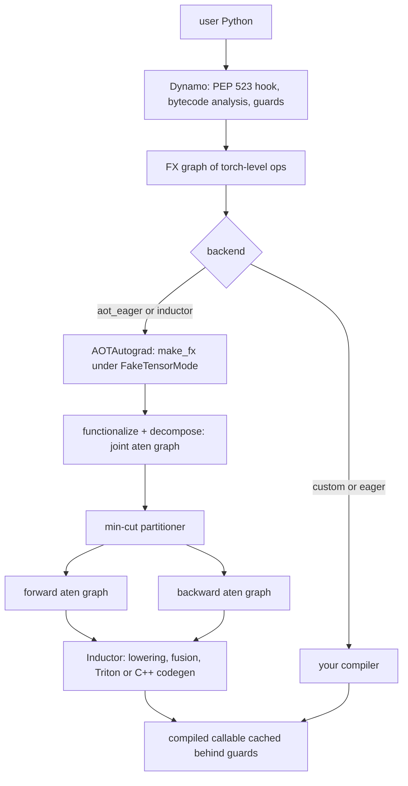

# 24 — Compiler Internals: Dynamo, FX, AOTAutograd, and Inductor

> **Prerequisites:** modules 07–09, 20, 23.
> **You will learn:** the FX IR (nodes, `GraphModule`, `symbolic_trace`, `Interpreter`, `Transformer`, rewriter, `ShapeProp`); how Dynamo captures bytecode via PEP 523, guards, and feeds custom backends; AOTAutograd's joint graph, functionalization, decompositions and min-cut partitioner; FakeTensor and symbolic shapes; and how Inductor lowers, fuses and generates Triton or C++, and how to read its output.

[Module 23](./23-torch-compile-in-practice.md) treated `torch.compile` as a tool with knobs. This module opens it. When a compiled model is slow, wrong or recompiling, the fix depends on which of four layers owns the problem, and each layer hands the next a printable artefact you can inspect.

CI never runs Inductor (course rule; on the reference Mac its C++ compile also fails for lack of system headers). Everything above Inductor runs in executed fences. Inductor's output is shown as C++ generated locally but never compiled or executed, and labelled so.

---

## 24.1 The stack in one diagram



Code locations: `torch/_dynamo` (`eval_frame.py` hook, `symbolic_convert.py` bytecode interpreter, `guards.py`); `torch/_functorch/aot_autograd.py` and `partitioners.py`; `torch/_inductor` (`lowering.py`, `ir.py`, `scheduler.py`, `codegen/triton.py`, `codegen/cpp.py`). The FX IR in `torch/fx` is the currency between them ([fx docs](https://docs.pytorch.org/docs/2.8/fx.html)).

## 24.2 FX: a graph you can read and edit

FX represents a program as a `Graph`, a linked list of `Node`s in topological order, owned by a `GraphModule` whose `forward` is Python generated from the graph. Reed et al. ([torch.fx, MLSys 2022](https://arxiv.org/abs/2112.08429)) chose a small, Python-shaped IR: six opcodes, Python callables as targets, readable codegen. Tracing `y = self.lin(x); return y * torch.sigmoid(y) + self.lin.bias.sum()` with `torch.fx.symbolic_trace` printed this locally:

```text
graph():
    %x : [num_users=1] = placeholder[target=x]
    %lin : [num_users=2] = call_module[target=lin](args = (%x,), kwargs = {})
    %sigmoid : [num_users=1] = call_function[target=torch.sigmoid](args = (%lin,), kwargs = {})
    %mul : [num_users=1] = call_function[target=operator.mul](args = (%lin, %sigmoid), kwargs = {})
    %lin_bias : [num_users=1] = get_attr[target=lin.bias]
    %sum_1 : [num_users=1] = call_method[target=sum](args = (%lin_bias,), kwargs = {})
    %add : [num_users=1] = call_function[target=operator.add](args = (%mul, %sum_1), kwargs = {})
    return add
```

| `node.op` | `target` | Example |
|---|---|---|
| `placeholder` | argument name | `x` |
| `get_attr` | attribute path | `lin.bias` |
| `call_function` | a Python callable | `torch.sigmoid`, `operator.mul`; the only call op in aten graphs |
| `call_method` | method name | `sum` |
| `call_module` | submodule path | `lin` (leaf modules, `symbolic_trace` only) |
| `output` | `output` | `return add` |

`symbolic_trace` calls `forward` with `Proxy` objects; every operation on a Proxy (via `__torch_function__` or a magic method) records a node. Hence its limits. `if x.sum() > 0:` asks a Proxy for a `bool` and raises `TraceError`. Loops unroll. `concrete_args` pins an argument to specialise a branch, but nothing later checks that the constant still holds. Non-torch code (NumPy, I/O) runs at trace time and is baked in as a constant.

Editing follows one discipline: `graph.inserting_after(node)` sets the insertion point, `graph.call_function(F.silu, (y,))` creates the node, `node.replace_all_uses_with(new)` rewires consumers, `graph.erase_node(old)` removes the now-unused node, `graph.lint()` checks order and dangling references, and `gm.recompile()` regenerates `forward`. Forget the last step and the module silently runs the old code. Fence 1 does exactly this.

Why did Dynamo replace `symbolic_trace` for capture while FX survived as the IR? A Proxy tracer cannot see Python control flow, fall back or guard; that is the hard problem. FX graphs, meanwhile, are easy to print, pattern-match and turn back into Python, so the PyTorch 2 paper ([Ansel et al. 2024](https://doi.org/10.1145/3620665.3640366)) kept them.

## 24.3 Running and transforming graphs

Three tools turn a graph into an analysis or a pass.

**`torch.fx.Interpreter`** executes a graph node by node ([source](https://github.com/pytorch/pytorch/blob/v2.8.0/torch/fx/interpreter.py)); override `run_node` or `call_function` and you have instrumented execution: per-node timing (the [FX profiling tutorial](https://github.com/pytorch/tutorials/blob/ca960b6a7cd299ba00a644aa918bbcffdeb70152/intermediate_source/fx_profiling_tutorial.py)), NaN checks, shape logging. **`ShapeProp`** (`torch.fx.passes.shape_prop`) is an Interpreter that stores shape, dtype and stride in `node.meta["tensor_meta"]`, so a pass can check that a conv output is 4-D before rewriting it. **`torch.fx.Transformer`** re-emits each node into a new graph instead of computing values, so overriding `call_function` is a one-method pass. For pattern rewrites, `torch.fx.subgraph_rewriter.replace_pattern` traces both functions and splices the replacement into every match:

```python
def pattern(x):
    return x * torch.sigmoid(x)

def replacement(x):
    return torch.nn.functional.silu(x)

matches = torch.fx.subgraph_rewriter.replace_pattern(gm, pattern, replacement)
```

The matcher is structural: `torch.sigmoid(x) * x` is a different graph and does not match, which is why the lab's hand-written pass checks both argument orders.

The classic FX pass is Conv-BN folding. In eval mode BatchNorm is an affine map per output channel, $\mathrm{BN}(z) = \gamma\,(z-\mu)/\sigma + \beta$ with $\sigma = \sqrt{\mathrm{var} + \epsilon}$. A convolution is linear in its weights: $z = W * x + b$. Substitute and collect terms:

$$\mathrm{BN}(W * x + b) = \underbrace{\left(W\cdot\tfrac{\gamma}{\sigma}\right)}_{W'} * x + \underbrace{(b-\mu)\tfrac{\gamma}{\sigma} + \beta}_{b'}$$

$\gamma/\sigma$ has shape `(C_out,)` and scales each output filter: `W' = W * (γ/σ).reshape(-1, 1, 1, 1)`. One kernel and one activation pass disappear. The identity needs frozen running statistics, so it is false in training mode. The [conv-bn fuser tutorial](https://github.com/pytorch/tutorials/blob/ca960b6a7cd299ba00a644aa918bbcffdeb70152/intermediate_source/torch_compile_conv_bn_fuser.py) registers it as an Inductor post-grad pattern whose replacement computes `W'` and `b'` *inside* the graph from parameter inputs, so nothing stale is baked in; the lab does the same on the Dynamo graph.

## 24.4 Dynamo: capturing bytecode

[PEP 523](https://peps.python.org/pep-0523/) lets a C extension replace CPython's frame evaluation function, and Dynamo installs one. Its `InstructionTranslator` (`symbolic_convert.py`) *symbolically executes* the bytecode on a stack of `VariableTracker`s: `TensorVariable` (an FX proxy plus a FakeTensor), `ConstantVariable`, and trackers for containers, modules and inlined user functions. Torch operations become FX nodes; Python computation on constants folds away ([deep dive](https://docs.pytorch.org/docs/2.8/torch.compiler_dynamo_deepdive.html), [overview](https://docs.pytorch.org/docs/2.8/torch.compiler_dynamo_overview.html)).

Dynamo then emits *new bytecode* that calls the compiled graph and replays Python side effects the graph cannot express. When it hits something it cannot model, such as a data-dependent branch, it **graph-breaks**: compile the graph so far, run the offending instruction in normal Python, and continue in a generated **resume function**, a new frame Dynamo captures in turn. For

```python
def g(x, n):
    if x.sum() > 0:        # data-dependent branch
        return x * n
    return x - n
```

`torch._dynamo.explain` reported (locally) 2 graphs and 1 break, reason `generic_jump TensorVariable()`; `CompileCounter` counted 2 frames and 3 ops; the guard log named the second frame `torch_dynamo_resume_in_g_at_3`.

**Guards** record what translation assumed. `TORCH_LOGS="guards"` on `torch.compile(lambda x, n: (x * n).relu(), backend="eager")` printed (trimmed):

```text
TREE_GUARD_MANAGER:
+- RootGuardManager
| | +- EQUALS_MATCH: L['n'] == 2
| | +- TENSOR_MATCH: check_tensor(L['x'], Tensor, DispatchKeySet(CPU, BackendSelect, ADInplaceOrView, AutogradCPU), torch.float32, device=None, requires_grad=False, size=[3], stride=[1])
```

The int argument was specialised (`n = 3` recompiles). The tensor is checked for dtype, device, dispatch keys ([module 20](./20-execution-model-dispatch-devices.md)), `requires_grad`, size and stride, and global state (grad mode, autocast) is checked too. Guards run in C++ on every call; the first passing guard set selects the cached graph.

This is why Dynamo is *sound* where `torch.jit.trace` was not. `jit.trace` recorded one path, and a different input silently followed it. Dynamo guards on the facts that made a path valid or graph-breaks and lets Python decide; the price is breaks and recompiles ([module 23](./23-torch-compile-in-practice.md)).

## 24.5 Custom backends

A Dynamo backend is any callable `backend(gm: torch.fx.GraphModule, example_inputs) -> Callable` ([custom backends](https://docs.pytorch.org/docs/2.8/torch.compiler_custom_backends.html)); returning `gm.forward` is the identity compiler. Two 2.8 facts surprise people. The top-level backend receives *real* example tensors, while AOTAutograd's inner compilers receive `FakeTensor`s (checked locally). And with `inline_inbuilt_nn_modules = True` (the 2.8 default) Dynamo inlines `nn.Conv2d.forward`, so the graph holds `torch.conv2d(l_x_, l_..._conv1_parameters_weight_, ...)` with parameters as placeholders and **no `call_module` nodes**. A pass written against `symbolic_trace` output finds nothing.

```python
import torch
from torch._dynamo import register_backend
from torch._dynamo.testing import CompileCounter

@register_backend                        # backend="print_graph"
def print_graph(gm, example_inputs):
    gm.graph.print_tabular()
    return gm.forward

cnt = CompileCounter()                    # counts frames and ops
torch.compile(model, backend=cnt)(x)
```

For aten-level forward and backward graphs, wrap compilers with `aot_autograd` from `torch._dynamo.backends.common`. In fence 3, for `Sequential(Linear(4, 4), GELU())`, the forward compiler saw 3 `call_function` nodes (`t`, `addmm`, `gelu`) and the backward 7 (`gelu_backward`, `t`, `mm`, `t`, `sum.dim_IntList`, `view`, `t`), measured locally. Inner compilers should return a boxed callable (`functorch.compile.make_boxed_func`, which takes a list of inputs it may free early); 2.8 warns otherwise. And the helper's default `partition_fn` is `default_partition`, while the registered `aot_eager` passes `min_cut_rematerialization_partition` ([debugging.py](https://github.com/pytorch/pytorch/blob/v2.8.0/torch/_dynamo/backends/debugging.py)), so two "AOT" backends can save different tensors.

| Backend (2.8 registry) | What runs |
|---|---|
| `eager` | Dynamo graph, run eagerly |
| `aot_eager` | + AOTAutograd (min-cut), run eagerly |
| `aot_eager_decomp_partition` | + Inductor's decompositions and partitioner settings |
| `inductor` | + lowering, fusion, codegen (default) |
| `cudagraphs` | AOTAutograd + CUDA graph replay |
| `tvm`, `openxla`, `onnxrt` | registered wrappers; compilers live out of tree |

## 24.6 AOTAutograd: joint graphs, functionalization, partitioning

Dynamo's graph is a torch-level forward; compilers want forward and backward in a small, pure op set. AOTAutograd ([source](https://github.com/pytorch/pytorch/blob/v2.8.0/torch/_functorch/aot_autograd.py); `functorch.compile` in older talks) does four things.

**1. Trace the joint graph.** It builds `joint(primals, tangents)`, which runs the forward and then `torch.autograd.grad`, and traces it with `make_fx` under `FakeTensorMode`. `make_fx` is a `__torch_dispatch__` tracer ([module 20](./20-execution-model-dispatch-devices.md)), so it records aten overloads below autograd, backward kernels included. `make_fx(lambda x: F.gelu(x).sum())(x)` records exactly `aten.gelu.default` and `aten.sum.default`.

**2. Functionalize.** In-place ops and views make meaning depend on aliasing, which every pass would otherwise have to reason about. Functionalization ([`torch.func.functionalize`](./09-torch-func-transforms.md)) rewrites `y.add_(1)` into `add(y, 1)` and views into view-replay. Mutations of *graph inputs* become extra outputs that a runtime epilogue copies back. In the lab's train-mode forward graph, `num_batches_tracked += 1` became `aten.add.Tensor(primals_4, 1)` and BN became `_native_batch_norm_legit_functional` returning new running stats; those tensors lead the output tuple. The flip side: functionalization trusts schemas. An opaque custom op that mutates its input without declaring it is treated as pure, so later passes may reorder or deduplicate reads around it ([module 25](./25-custom-ops-and-kernels.md) shows a measured case). Fence 4 proves the core claim.

**3. Decompose.** A decomposition table maps ops to simpler ones; `core_aten_decompositions()` held about 1,000 entries locally. Passing it to `aot_autograd` turned `gelu_backward` into `mul`/`erf`/`exp`/`add` chains, while forward `gelu`, itself a Core ATen op, stayed intact. Inductor decomposes more aggressively than export.

**4. Partition.** The joint graph is cut in two, and every value crossing the cut is saved activation memory ([module 22](./22-memory-accounting-and-checkpointing.md)). `default_partition` saves whatever the backward reads. `min_cut_rematerialization_partition` ([partitioners.py](https://github.com/pytorch/pytorch/blob/v2.8.0/torch/_functorch/partitioners.py)) builds a flow network where each node's capacity is its output size in bytes, gives infinite capacity to nodes banned from recomputation (matmuls, convolutions, random ops, anything the backward must materialise anyway), and takes the minimum cut: the cheapest set of tensors to save. Everything past the cut is recomputed, on the bet that a fusing compiler recomputes pointwise ops almost free inside a kernel it launches anyway.

Fence 3 measures it on `f(x, w) = (gelu(x) * w).sum()`: the default partitioner saved `[x, w, gelu]`, min-cut saved `[x, w]` and recomputed `gelu`, whose backward consumers are pointwise. In `Linear → GELU → Linear` the weight gradient reads the GELU output through `mm`, which cannot fuse, so the `ban_recompute_materialized_backward` heuristic forbids recomputation and min-cut saves it too (measured locally). Module 22's selective checkpointing exposes the same decision, with `CheckpointPolicy.MUST_SAVE`/`MUST_RECOMPUTE` overriding the solver.

## 24.7 IRs: Torch IR, Core ATen, prims

| Level | Produced by | Size in 2.8 | Properties |
|---|---|---|---|
| Torch IR | Dynamo | open-ended | `torch.*`, `F.*`, `operator.*`; may mutate |
| ATen IR | `make_fx` | 3,173 `aten::` overloads registered locally | mutation, views, `out=` |
| Core ATen IR | core decompositions + functionalization | 191 overloads on the IR page | functional; the backend contract |
| Prims IR | prims decompositions | 123 ops on the same page | explicit type promotion and broadcasting |

Counts come from the [IR page](https://docs.pytorch.org/docs/2.8/torch.compiler_ir.html) tables and `torch._C._dispatch_get_all_op_names()` locally. Core ATen is the contract: a backend implementing those ~190 ops runs any model that decomposes to them, and [module 28](./28-export-and-deployment.md)'s `run_decompositions()` lowers exported programs to this set.

## 24.8 FakeTensor and symbolic shapes

Every layer above traces without real kernels. A **FakeTensor** ([docs](https://docs.pytorch.org/docs/2.8/torch.compiler_fake_tensor.html)) is a tensor subclass with real metadata and no storage; under `FakeTensorMode` each aten op runs its *meta* kernel, which computes output metadata only (modules [20](./20-execution-model-dispatch-devices.md) and [22](./22-memory-accounting-and-checkpointing.md)). An op without a fake implementation therefore cannot be compiled or exported, which is why [module 25](./25-custom-ops-and-kernels.md) makes `register_fake` mandatory.

With `dynamic=True` or after a shape-change recompile, sizes become `SymInt`s in a `ShapeEnv` ([dynamic shapes](https://docs.pytorch.org/docs/2.8/torch.compiler_dynamic_shapes.html)), and each Python decision on a SymInt becomes a guard. For `if x.shape[0] > 2: return x.view(-1, 2).sum(1)` under `dynamic=True`, the local guard log held `x.size()[0] > 2`, `x.size()[0] % 2 == 0` (from the `view`) and `2 <= x.size()[0]`, and the backend graph took `s77: torch.SymInt` as an input. The last guard is **0/1 specialisation**: sizes 0 and 1 are always specialised because broadcasting and contiguity treat them differently. `make_fx(..., tracing_mode="symbolic")` shows the same machinery:

```python
def forward(self, x_1):
    sin = torch.ops.aten.sin.default(x_1)
    sym_size_int = torch.ops.aten.sym_size.int(x_1, 0);  x_1 = None
    mul = torch.ops.aten.mul.Tensor(sin, sym_size_int);  sin = sym_size_int = None
    sum_1 = torch.ops.aten.sum.dim_IntList(mul, [0]);  mul = None
    return sum_1
```

A size that comes from *data* (`nonzero()`, `.item()`) is an **unbacked SymInt** (`u0`) with no example value; branching on it raises a data-dependent error, and `torch._check(u0 >= 0)` supplies facts the compiler may assume. By default 2.8 Dynamo graph-breaks on such ops (`capture_scalar_outputs` and `capture_dynamic_output_shape_ops` are `False`).

## 24.9 Inductor: lowering, fusion, codegen (not executed in CI)

Inductor does four jobs on the partitioned aten graphs ([scheduler.py](https://github.com/pytorch/pytorch/blob/v2.8.0/torch/_inductor/scheduler.py), [codegen/triton.py](https://github.com/pytorch/pytorch/blob/v2.8.0/torch/_inductor/codegen/triton.py)).

1. **Lowering** (`lowering.py`) turns each aten op into loop-level IR (`ir.py`): `Pointwise` (a `body(index)` of `ops.load`/`ops.mul`/`ops.store`), `Reduction`, `ExternKernel` calls into cuBLAS/oneDNN/aten for matmul and conv, or `TemplateBuffer`s from Triton or C++ GEMM templates. Ops without a lowering fall back to aten (`make_fallback`).
2. **Fusion.** The scheduler wraps buffers in `SchedulerNode`s with read/write `MemoryDep`s and fuses greedily, scored by heuristics such as `speedup_by_fusion`. *Vertical* fusion merges producer into consumer so the intermediate never reaches memory; *horizontal* fusion merges siblings reading the same input (`can_fuse_vertical`/`can_fuse_horizontal`).
3. **Memory planning.** `compute_last_usage` frees or reuses buffers after their last reader.
4. **Codegen.** On GPU, `TritonKernel` emits `@triton.jit` kernels. On CPU, `CppScheduling` emits C++ with OpenMP loops, and `CppVecKernel` emits `at::vec::Vectorized` SIMD loops when it detects a vector ISA (CPU Triton is experimental). `mode="max-autotune"` benchmarks GEMM templates against extern kernels.

For `f = lambda x: (x * 2).relu() + 1` on a 1,024-element CPU tensor, `TORCH_COMPILE_DEBUG=1` wrote, locally, `torch_compile_debug/run_<time>-pid_<pid>/` containing `torchdynamo/debug.log` and `torchinductor/model__0_inference_0.0/` with `fx_graph_readable.py` (the aten graph `mul → relu → add`, annotated `f32[1024]`), `fx_graph_runnable.py` (a standalone repro), `fx_graph_transformed.py`, `ir_pre_fusion.txt`, `ir_post_fusion.txt`, and `output_code.py` (written only when compilation succeeds). `ir_pre_fusion.txt` already showed a single `op0` loop body (load, `mul`, `relu`, `add`, store): lowering inlined the pointwise chain before the scheduler ran.

`TORCH_LOGS="output_code"` printed the C++ below (loop body shown). **It was generated locally, but its compile failed (missing `<algorithm>` header on the reference Mac), so it was never executed.** The loop is scalar because Inductor could not probe the vector ISA on that toolchain.

```cpp
for(int64_t x0=static_cast<int64_t>(0LL); x0<static_cast<int64_t>(1024LL); x0+=static_cast<int64_t>(1LL))
{
    auto tmp0 = in_ptr0[static_cast<int64_t>(x0)];
    auto tmp1 = static_cast<float>(2.0);
    auto tmp2 = float(tmp0 * tmp1);
    auto tmp3 = std::max(tmp2, decltype(tmp2)(0));
    auto tmp4 = static_cast<float>(1.0);
    auto tmp5 = float(tmp3 + tmp4);
    out_ptr0[static_cast<int64_t>(x0)] = tmp5;
}
```

The wrapper asserts the input's size and stride, allocates one `buf0`, and calls `cpp_fused_add_mul_relu_0(arg0_1, buf0)`: one kernel, one read and one write per element, where eager makes three passes and two temporaries. On CUDA the analogue is one `triton_poi_fused_add_mul_relu_0` kernel (not executed here). See the [CPU debugging tutorial](https://github.com/pytorch/tutorials/blob/ca960b6a7cd299ba00a644aa918bbcffdeb70152/intermediate_source/inductor_debug_cpu.py) and the [profiling guide](https://docs.pytorch.org/docs/2.8/torch.compiler_inductor_profiling.html). The PyTorch 2 paper reports geometric-mean speedups of 2.27× inference and 1.41× training over 180+ models (vendor-reported, A100). GPU side: the inference course's [torch.compile](/courses/inference/08-compilation-and-runtime/08-02-torch-compile.html) and [Triton](/courses/inference/08-compilation-and-runtime/08-03-triton-and-cutlass.html) pages.

## 24.10 Debugging the compiler

The most useful skill here is **bisecting backends**: enable successively more of the stack and note the first that breaks ([troubleshooting](https://docs.pytorch.org/docs/2.8/torch.compiler_troubleshooting.html)).

| Works with | Fails with | Responsible layer | Next move |
|---|---|---|---|
| eager PyTorch | `"eager"` | Dynamo capture: side effects, guards | `TORCH_LOGS="graph_breaks,guards"`, `explain` |
| `"eager"` | `"aot_eager"` | AOTAutograd: mutation/aliasing, a custom op's fake kernel | check input mutation; `opcheck` the op |
| `"aot_eager"` | `"aot_eager_decomp_partition"` | a decomposition or recompute (RNG, numerics) | drop decompositions one by one |
| `"aot_eager_decomp_partition"` | `"inductor"` | Inductor lowering, fusion, codegen | `TORCH_COMPILE_DEBUG=1`, minify |

Each row rules out the layers the working backend shares. For crashes, `TORCHDYNAMO_REPRO_AFTER="dynamo"` (or `"aot"`) writes a minified repro; for accuracy, `TORCHDYNAMO_REPRO_LEVEL=4` searches for the smallest diverging subgraph; AOTInductor has its own [minifier](https://docs.pytorch.org/docs/2.8/torch.compiler_aot_inductor_minifier.html). For large models, `TORCH_TRACE=/tmp/trace python train.py` then `tlparse /tmp/trace` gives an HTML report of every frame, graph, break, guard and recompile.

## Reconciling the sources

The FX paper (2021) presents `symbolic_trace` as *the* capture mechanism; the PyTorch 2 paper and 2.8 docs move capture to Dynamo, so FX-paper passes matching `call_module` fail on Dynamo graphs. Older talks' `functorch.compile` now lives in `torch/_functorch`. Triton-only tutorials describe GPUs; on CPU Inductor emits C++/OpenMP. Older "~2,000 aten ops, ~250 prims" figures predate the 2.8 page's 191 Core ATen overloads and 123 prims.

## Worked compiler verification

**Fence 1** proves the edit discipline yields a graph targeting `F.silu` with no `sigmoid` or `mul`, matching the original numerically. It does not prove a speedup; nothing is timed.

```python pytorch-check
import operator
import torch
import torch.nn as nn
import torch.nn.functional as F
from torch.fx import symbolic_trace

class Swish(nn.Module):
    def __init__(self):
        super().__init__()
        self.lin = nn.Linear(4, 4)
    def forward(self, x):
        y = self.lin(x)
        return y * torch.sigmoid(y)

torch.manual_seed(0)
model = Swish()
gm = symbolic_trace(model)
assert [n.op for n in gm.graph.nodes] == ["placeholder", "call_module", "call_function", "call_function", "output"]

for node in list(gm.graph.nodes):
    if node.op == "call_function" and node.target is operator.mul:
        y, sig = node.args
        if getattr(sig, "target", None) is torch.sigmoid and sig.args[0] is y:
            with gm.graph.inserting_after(node):
                silu = gm.graph.call_function(F.silu, (y,))
            node.replace_all_uses_with(silu)
            gm.graph.erase_node(node)
            gm.graph.erase_node(sig)
gm.graph.lint()
gm.recompile()

targets = [n.target for n in gm.graph.nodes if n.op == "call_function"]
assert F.silu in targets and torch.sigmoid not in targets and operator.mul not in targets
x = torch.randn(3, 4)
torch.testing.assert_close(gm(x), model(x), atol=1e-6, rtol=1e-6)
print("rewritten forward:", " | ".join(l.strip() for l in gm.code.strip().splitlines()[1:]))
```

**Fence 2** proves an `Interpreter` subclass sees every executed call node (counts equal the static graph's) without changing the output. It does not time nodes.

```python pytorch-check
from collections import Counter
import torch
import torch.nn as nn
from torch.fx import Interpreter, symbolic_trace

class CountingInterpreter(Interpreter):
    def __init__(self, gm):
        super().__init__(gm)
        self.calls = Counter()
    def run_node(self, n):
        if n.op in ("call_function", "call_module"):
            self.calls[n.op] += 1
        return super().run_node(n)

class MLP(nn.Module):
    def __init__(self):
        super().__init__()
        self.l1, self.l2 = nn.Linear(6, 8), nn.Linear(8, 2)
    def forward(self, x):
        return self.l2(torch.relu(self.l1(x))) + 1.0

torch.manual_seed(0)
model = MLP()
gm = symbolic_trace(model)
x = torch.randn(5, 6)
interp = CountingInterpreter(gm)
out = interp.run(x)

static = Counter(n.op for n in gm.graph.nodes if n.op in ("call_function", "call_module"))
assert interp.calls == static, (interp.calls, static)
assert static == Counter({"call_module": 2, "call_function": 2})
torch.testing.assert_close(out, model(x))
print(f"executed {dict(interp.calls)} == graph {dict(static)}")
```

**Fence 3** proves an `aot_autograd`-wrapped backend receives forward and backward graphs of aten `OpOverload`s with eager-equal gradients, and that the default partitioner saves the GELU output where min-cut recomputes it. It does not prove min-cut is faster; that needs a fusing backend.

```python pytorch-check
import torch
import torch.nn as nn
import torch.nn.functional as F
from torch._dynamo.backends.common import aot_autograd
from functorch.compile import make_boxed_func, default_partition, min_cut_rematerialization_partition

def backend(store, **kw):
    def rec(tag):
        def compiler(gm, example_inputs):
            store[tag] = gm
            return make_boxed_func(gm.forward)
        return compiler
    return aot_autograd(fw_compiler=rec("fw"), bw_compiler=rec("bw"), **kw)

torch._dynamo.reset()
try:
    torch.manual_seed(0)
    model, x, seen = nn.Sequential(nn.Linear(4, 4), nn.GELU()), torch.randn(3, 4), {}
    torch.compile(model, backend=backend(seen))(x).sum().backward()
    got = [p.grad.clone() for p in model.parameters()]
    model.zero_grad()
    model(x).sum().backward()
    for g, p in zip(got, model.parameters()):
        torch.testing.assert_close(g, p.grad, atol=1e-6, rtol=1e-6)
    counts = {}
    for tag, gm in seen.items():
        calls = [n for n in gm.graph.nodes if n.op == "call_function"]
        assert all(isinstance(n.target, torch._ops.OpOverload) for n in calls)
        counts[tag] = len(calls)
    assert set(counts) == {"fw", "bw"}

    saved = {}
    for name, pf in (("default", default_partition), ("min_cut", min_cut_rematerialization_partition)):
        torch._dynamo.reset()
        g = {}
        f = torch.compile(lambda a, w: (F.gelu(a) * w).sum(), backend=backend(g, partition_fn=pf))
        f(torch.randn(16, 16, requires_grad=True), torch.randn(16, 16, requires_grad=True)).backward()
        saved[name] = [n.name for n in g["bw"].graph.nodes if n.op == "placeholder" and not n.name.startswith("tangents")]
    assert "gelu" in saved["default"] and "gelu" not in saved["min_cut"], saved
finally:
    torch._dynamo.reset()
print(f"fw/bw call_function nodes {counts}; saved for backward {saved}")
```

**Fence 4** proves functionalization removes the in-place `add_` while preserving the result. It does not exercise input mutation or views.

```python pytorch-check
import torch
from torch.fx.experimental.proxy_tensor import make_fx

def f(x):
    y = x.clone()
    y.add_(1)
    return y

x = torch.randn(4)
plain = make_fx(f)(x)
pure = make_fx(torch.func.functionalize(f))(x)

def names(gm):
    return [n.target._schema.name.split("::")[1] for n in gm.graph.nodes if n.op == "call_function"]

assert "add_" in names(plain)
assert not any(name.endswith("_") for name in names(pure)), names(pure)
torch.testing.assert_close(pure(x), x + 1)
print(f"make_fx: {names(plain)} -> functionalized: {names(pure)}")
```

**Fence 5** proves the Conv-BN folding algebra with non-trivial running statistics. It does not cover training mode, where the identity is false.

```python pytorch-check
import torch
import torch.nn as nn

gen = torch.Generator().manual_seed(0)
torch.manual_seed(0)
conv, bn = nn.Conv2d(3, 4, 3), nn.BatchNorm2d(4)
with torch.no_grad():
    bn.running_mean.copy_(torch.randn(4, generator=gen))
    bn.running_var.copy_(torch.rand(4, generator=gen) + 0.5)
    bn.weight.copy_(torch.rand(4, generator=gen) + 0.5)
    bn.bias.copy_(torch.randn(4, generator=gen))
conv.eval(); bn.eval()

scale = bn.weight / torch.sqrt(bn.running_var + bn.eps)            # gamma / sigma, shape (C_out,)
fused = nn.Conv2d(3, 4, 3).eval()
with torch.no_grad():
    fused.weight.copy_(conv.weight * scale.reshape(-1, 1, 1, 1))      # W' = W * gamma / sigma
    fused.bias.copy_((conv.bias - bn.running_mean) * scale + bn.bias)  # b' = (b - mu) * gamma / sigma + beta

x = torch.randn(2, 3, 8, 8, generator=gen)
with torch.no_grad():
    ref, got = bn(conv(x)), fused(x)
torch.testing.assert_close(got, ref, atol=1e-5, rtol=1e-5)
print(f"folded conv matches conv+bn: max abs diff {(got - ref).abs().max().item():.2e}, shape {tuple(got.shape)}")
```

## Lab: write an FX optimization pass and a custom compile backend

[`./code/24_fx_backend.py`](./code/24_fx_backend.py) implements `FusionBackend` for a small CNN, `(Conv2d 3→8, BN, x*sigmoid(x)) → (Conv2d 8→8, BN, x*sigmoid(x)) → global average pool → Linear(8, 10)`, on input `(4, 3, 8, 8)`. It records the incoming graph's op histogram, runs `ShapeProp` on the real example inputs, and applies two passes: `x * sigmoid(x) → F.silu(x)` (both argument orders) and folding `torch.conv2d → F.batch_norm(training=False)` into one `conv2d` with `W'` and `b'` computed in the graph from the parameter placeholders. Both match `call_function` nodes, because Dynamo inlines modules. A train-mode run wraps recording compilers in `aot_autograd` and reports forward/backward node counts and the tensors the default partitioner saves.

```bash
python content/courses/pytorch/code/24_fx_backend.py
python site/test_pytorch_24_fx_backend.py
```

**Tested with Python 3.11 and PyTorch 2.8.0 on CPU.** One local PyTorch 2.8 CPU run on an Apple M-series laptop (4 threads) produced:

| Quantity | Value |
|---|---|
| Dynamo graphs | 1 (no breaks) |
| Dynamo op histogram | `conv2d` 2, `batch_norm` 2, `sigmoid` 2, `mul` 2, pool, flatten, `linear` 1 each |
| rewrites | `silu` 2, `conv_bn` 2; final code has no `batch_norm` or `sigmoid` |
| max abs diff vs eager | 4.5e-08 |
| aot forward / backward `call_function` nodes | 24 / 42 |
| saved for backward | 22 (5 parameters, conv outputs, BN statistics, `sigmoid`, `mul`, ...) |
| in-place ops in aot forward | none (BN train mode became `_native_batch_norm_legit_functional`) |
| aot outputs and gradients vs eager | match |
| wall time | 0.70 s in `main`; 3.5 s script and 2.2 s test, both including `import torch` |

The default partitioner saves `sigmoid` and `mul` (the SiLU pieces) because the backward reads them; min-cut would let a fusing backend recompute them from the BN output.

**Scope.** Graph-level rewrites validated numerically on CPU; no kernel generation and no speed claims, since real fusion is Inductor's job. The test asserts exactly two of each rewrite, one graph, outputs within `1e-5` of eager on two inputs, the conv-bn pass leaving train mode alone, non-empty forward and backward graphs with at least one saved tensor, no in-place ops in the aot forward graph, and `torch._dynamo.reset()` after each test.

## Key takeaways

- Dynamo (bytecode → FX graph + guards) → AOTAutograd (joint, functionalized, decomposed, partitioned aten graphs) → Inductor (lowering → fusion → Triton/C++). Every boundary is printable.
- FX: six node ops plus codegen; edit, `lint`, `recompile`. `symbolic_trace` cannot see data-dependent control flow, so Dynamo owns capture.
- Dynamo guards on what it assumed and graph-breaks into resume functions instead of baking a path, as `jit.trace` did.
- 2.8 Dynamo graphs inline modules (no `call_module`); the top-level backend gets real tensors, inner AOT compilers FakeTensors.
- Functionalization turns mutation into outputs; min-cut saves the cheapest set and recomputes pointwise work unless the backward must materialise it.
- FakeTensors make tracing data-free; SymInts turn shape decisions into guards; unbacked SymInts need `torch._check`.
- Bisect `eager` → `aot_eager` → `aot_eager_decomp_partition` → `inductor` to find the owning layer.

## Self-check

1. A model gives correct results with `backend="aot_eager"` but wrong results with `backend="inductor"`. Which layers have you ruled out, what is the next backend to try, and what does each outcome tell you?
2. Why does AOTAutograd functionalize the graph before handing it to Inductor, and what does that imply for a custom op that mutates its input?
3. Explain what the min-cut partitioner optimizes and why it may choose to recompute a GELU in backward instead of saving its output.

---

**Next → [25 — Custom Operators and Kernels: torch.library, C++ Extensions, and Triton](./25-custom-ops-and-kernels.md)**
