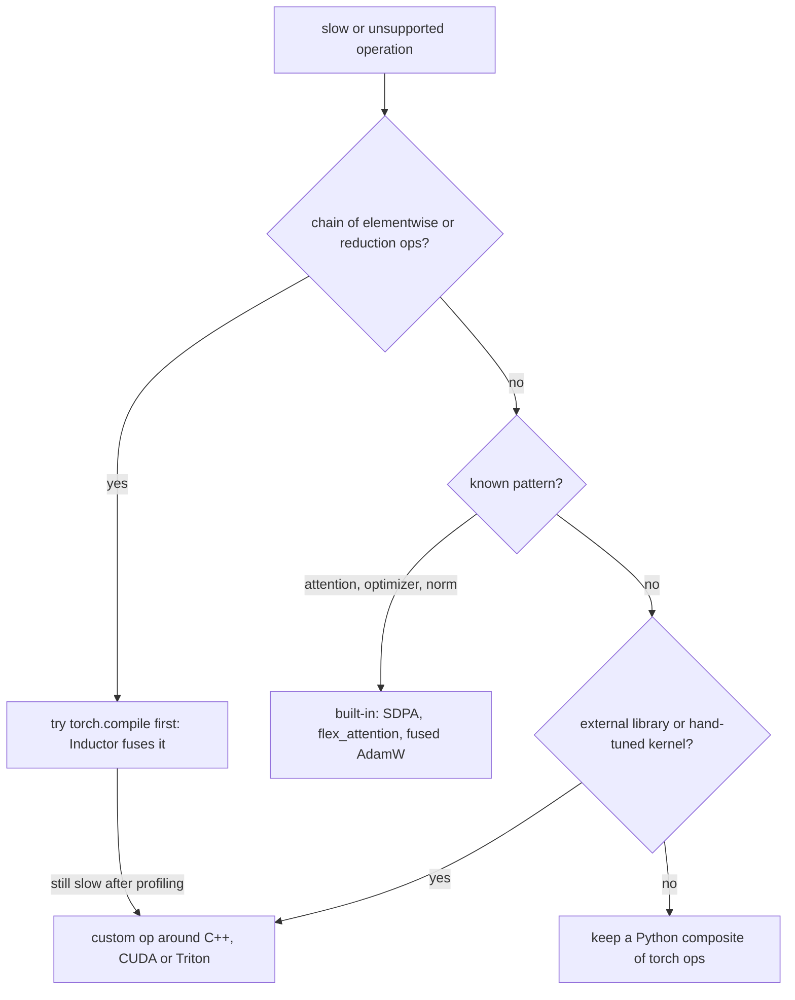
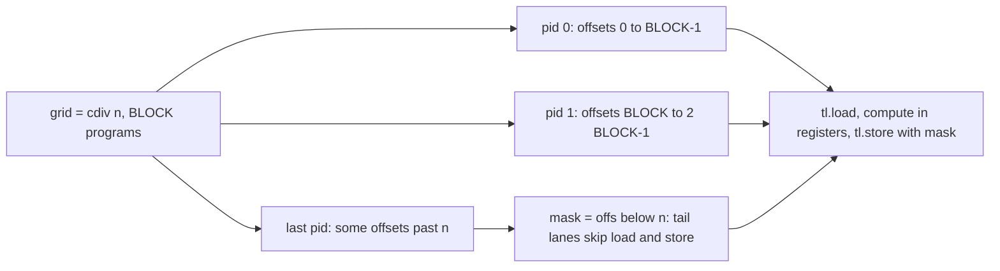

# 25 — Custom Operators and Kernels: torch.library, C++ Extensions, and Triton

> **Prerequisites:** modules 08, 20–21, 23–24.
> **You will learn:** when a custom operator is justified and when `torch.compile` or a Python composite is enough; the Python custom-op API (`custom_op`, `register_fake`, `register_autograd`, `register_kernel`, mutation annotations) and `torch.library.opcheck`; how C++/CUDA operators are registered (`TORCH_LIBRARY`, `load_inline`, `CppExtension`/`CUDAExtension`, the LibTorch stable ABI); the Triton programming model through the official tutorials, and `triton_op`/`wrap_triton`; and the online-softmax tiling behind fused softmax and FlashAttention, executed on CPU.

A custom operator is a contract with the rest of PyTorch, not a speed trick. Once a function is registered as `mylib::op`, the dispatcher routes it per device ([module 20](./20-execution-model-dispatch-devices.md)), autograd knows its derivative, FakeTensor knows its output shape, and Dynamo, AOTAutograd and `torch.export` treat it as one node ([module 24](./24-compiler-internals-fx-inductor.md)). The kernel inside can be NumPy, C++, CUDA or Triton; the registration is the same.

The registration API is executed here on CPU. Kernel languages need a toolchain or GPU, so they appear as pinned fragments labelled "not executed here"; online softmax over tiles is executed on CPU in plain PyTorch.

---

## 25.1 Do you need a custom op?

Start from the roofline in [module 21](./21-profiling-and-benchmarking.md). An elementwise op on $n$ float32 values moves about $8n$ bytes for $O(n)$ FLOPs, far left of any GPU's ridge point. A chain of $k$ such ops run eagerly writes and re-reads every intermediate, about $8kn$ bytes; one fused kernel moves about $8n$. Fusing $k$ memory-bound ops cuts traffic, and so time, by roughly $k\times$. That is most "custom kernel" speedups, and Inductor already does it ([module 23](./23-torch-compile-in-practice.md)).



A custom op is justified when code calls something PyTorch cannot see into (a C++ or vendor library, NumPy), or needs a kernel the compiler will not generate (FlashAttention-style tiling, an unusual quantized GEMM). Wrapping code in a custom op does not make it faster; it makes it *opaque*, so the compiler keeps one graph around a black box with a known schema, fake kernel and derivative (fence 2). Wrapping a chain of torch ops would only hide it from Inductor and block fusion.

## 25.2 Python custom ops with torch.library

The 2.4+ API turns a type-annotated function into a dispatcher operator ([`torch.library` docs](https://docs.pytorch.org/docs/2.8/library.html); [`torch/_library/custom_ops.py`](https://github.com/pytorch/pytorch/blob/v2.8.0/torch/_library/custom_ops.py)):

```python
@torch.library.custom_op("demo::mysin", mutates_args=())
def mysin(x: torch.Tensor) -> torch.Tensor:
    return torch.from_numpy(np.sin(x.numpy(force=True)))   # any code: the default kernel

@mysin.register_fake                                       # metadata only, no data
def _(x):
    return torch.empty_like(x)

def setup_context(ctx, inputs, output):
    ctx.save_for_backward(inputs[0])

def backward(ctx, grad):                                   # must be traceable torch ops
    (x,) = ctx.saved_tensors
    return grad * torch.cos(x)

mysin.register_autograd(backward, setup_context=setup_context)
y = torch.ops.demo.mysin(torch.randn(3))
```

The schema is inferred from annotations. Locally, `torch.library.infer_schema` on `(x: Tensor, n: int, alpha: float = 1.0, out: Tensor = None) -> None` with `mutates_args={"out"}` gives `(Tensor x, SymInt n, float alpha=1.0, Tensor(a3!) out=None) -> ()`: `int` becomes `SymInt` for dynamic shapes, and the mutated argument gets module 20's `Tensor(a!)` annotation.

`register_kernel(device)` adds a per-device kernel. `register_fake` returns outputs with correct shape, dtype, device and strides but no data; Dynamo, AOTAutograd and export propagate metadata through it. `register_autograd` splits work like `autograd.Function` ([module 08](./08-custom-autograd-and-hooks.md)), and its backward must be traceable torch ops. `mutates_args` tells functionalization to emit a functional op plus a copy-back. Each missing piece fails differently (all run locally on 2.8):

| Missing piece | Eager | Compile / export | Symptom |
|---|---|---|---|
| no op (raw Python calling NumPy) | works | graph break per call | fence 2: 4 graphs, 3 breaks |
| `register_fake` | works | `TorchRuntimeError` | "There was no fake impl registered" (fence 3) |
| `register_autograd` | output still `requires_grad=True` | compiled forward runs | `backward()` raises "no autograd formula was registered" |
| `mutates_args` on a mutating op | appears to work | functionalization assumes the input unchanged | `opcheck` `test_schema`: "Argument x is not defined as mutable but was mutated" |

In 2.8, redefining a `custom_op` with an existing name replaces it (`get_library_allowing_overwrite` destroys the old fragment), while a second `Library("ns", "DEF")` raises "Only a single TORCH_LIBRARY can be used to register the namespace". Each fence and lab here still uses its own namespace (`pytc_m25_fK`, `pytc_lab25`) so none silently replaces another's op.

## 25.3 Testing ops: opcheck

`torch.library.opcheck(op, args, kwargs=None, *, test_utils=..., raise_exception=True)` runs four sub-tests and returns a status dict (`raise_exception=False` returns failures instead of raising `OpCheckError`). Use float64 inputs that require grad.

| Sub-test | What it does | Catches |
|---|---|---|
| `test_schema` | compares inputs before/after and output aliasing against the schema | undeclared mutation; returning an input or a view of it |
| `test_autograd_registration` | checks grad-requiring outputs came from an Autograd-key kernel | autograd logic registered at the CPU/CUDA key |
| `test_faketensor` | runs the fake kernel and compares metadata with the real output | missing fake kernel; wrong shape, dtype or strides |
| `test_aot_dispatch_dynamic` | AOTAutograd-traces forward and backward with dynamic shapes, compares to eager | untraceable backward; fake kernel that specialises on sizes |

`opcheck` tests registrations, not math. Pair it with float64 `torch.autograd.gradcheck` ([module 08](./08-custom-autograd-and-hooks.md)); fence 1 does both. Locally, a low-level `Library` op with only a CPU kernel failed `test_autograd_registration` and both fake tests.

## 25.4 Lower-level registration: torch.library.Library and the dispatcher

`custom_op` is built on a layer that mirrors C++ one to one ([`torch/library.py`](https://github.com/pytorch/pytorch/blob/v2.8.0/torch/library.py); [dispatcher tutorial](https://github.com/pytorch/tutorials/blob/ca960b6a7cd299ba00a644aa918bbcffdeb70152/advanced_source/dispatcher.rst)):

```python
lib = torch.library.Library("mylib", "DEF")                 # "FRAGMENT" adds to a namespace
lib.define("muladd(Tensor a, Tensor b, float c) -> Tensor")
lib.impl("muladd", lambda a, b, c: a * b + c, "CPU")        # one dispatch-table cell
torch.library.register_fake("mylib::muladd", lambda a, b, c: torch.empty_like(a))
torch.library.register_vmap("mylib::muladd", vmap_rule)     # batching rule for torch.func
aten_lib = torch.library.Library("aten", "IMPL")             # kernel for an op you do not own
aten_lib.impl("gelu", my_backend_gelu, "PrivateUse1")
```

Each call writes one cell of module 20's dispatch table: `impl(..., "CPU")` the CPU key, `register_fake` Meta, `register_autograd` the Autograd key, `register_vmap` the batching rule `torch.func.vmap` uses ([module 09](./09-torch-func-transforms.md)), `register_torch_dispatch` a rule for one subclass or mode. Use `Library` directly for ops you do not own, such as an aten override for an out-of-tree backend under `PrivateUse1` ([tutorial](https://github.com/pytorch/tutorials/blob/ca960b6a7cd299ba00a644aa918bbcffdeb70152/advanced_source/privateuseone.rst)); for new ops, `custom_op` is shorter and safer.

## 25.5 C++ and CUDA extensions (non-executed fragments)

C++ follows the same two steps, define then implement per key ([C++ custom ops tutorial](https://github.com/pytorch/tutorials/blob/ca960b6a7cd299ba00a644aa918bbcffdeb70152/advanced_source/cpp_custom_ops.rst); [`cpp_extension` docs](https://docs.pytorch.org/docs/2.8/cpp_extension.html)). Not executed here:

```cpp
at::Tensor muladd_cpu(const at::Tensor& a, const at::Tensor& b, double c) {
  TORCH_CHECK(a.sizes() == b.sizes() && a.dtype() == at::kFloat);
  return a.contiguous() * b.contiguous() + c;   // a real kernel loops over data_ptr<float>()
}
TORCH_LIBRARY(mylib, m) {                        // exactly one per namespace: schemas
  m.def("muladd(Tensor a, Tensor b, float c) -> Tensor");
}
TORCH_LIBRARY_IMPL(mylib, CPU, m) {              // one per (namespace, key); CUDA in a .cu file
  m.impl("muladd", &muladd_cpu);
}
```

Fake and autograd registrations are added from Python with `torch.library.register_fake("mylib::muladd")` after the library loads (wrong import order is an error). Ahead-of-time builds use `setup(ext_modules=[cpp_extension.CppExtension("mylib._C", ["muladd.cpp"], py_limited_api=True)], cmdclass={"build_ext": cpp_extension.BuildExtension})`, with `CUDAExtension` for `.cu` sources and `-DPy_LIMITED_API=0x03090000` for one wheel across Python versions. For experiments, `load_inline(name, cpp_sources, ..., functions=None, is_python_module=True)` compiles a string; `functions=[...]` generates old-style pybind11 bindings, while with `TORCH_LIBRARY` in the source and `is_python_module=False`, the op appears as `torch.ops.mylib.muladd` and works with compile and export. The optional local command, given a C++ compiler:

```bash
python -c "import torch, torch.utils.cpp_extension as ce; ce.load_inline('mylib', open('muladd.cpp').read(), is_python_module=False, verbose=True); print(torch.ops.mylib.muladd(torch.ones(3), torch.ones(3), 2.0))"
```

CI never compiles C++: builds need a matching toolchain, take tens of seconds and leave a shared cache; the reference Mac lacks headers even for Inductor's C++ codegen. The dispatcher semantics match the Python ops below.

**LibTorch stable ABI.** A normal extension built for 2.8 can break on 2.9. The [stable ABI note](https://docs.pytorch.org/docs/2.8/notes/libtorch_stable_abi.html) and [`torch/csrc/stable`](https://github.com/pytorch/pytorch/tree/v2.8.0/torch/csrc/stable) (2.8 ships `library.h` and `tensor.h`) offer a narrow C interface: `STABLE_TORCH_LIBRARY`/`_IMPL` register boxed kernels over `StableIValue` stacks and `torch::stable::Tensor` wraps an opaque handle. The 2.8 note specifies few types, and the newer tutorial's `TORCH_BOX` is absent from 2.8 headers (checked locally).

Custom C++ classes ([tutorial](https://github.com/pytorch/tutorials/blob/ca960b6a7cd299ba00a644aa918bbcffdeb70152/advanced_source/custom_classes.rst)) pass stateful objects through ops; custom process-group backends add a `torch.distributed` backend ([tutorial](https://github.com/pytorch/tutorials/blob/ca960b6a7cd299ba00a644aa918bbcffdeb70152/intermediate_source/process_group_cpp_extension_tutorial.rst); [module 26](./26-distributed-collectives-and-ddp.md)).

## 25.6 The Triton programming model (non-executed; GPU only)

Triton requires an NVIDIA/AMD GPU (or the experimental CPU backend); not executed in this course's CI. Triton ([Tillet, Kung and Cox 2019](https://doi.org/10.1145/3315508.3329973)) is SPMD over *blocks*: you write one program, the grid says how many run, and the compiler maps each program's blocks onto threads, registers and shared memory. CUDA programs threads; Triton programs tiles.



Tutorial 01 ([v3.4.0](https://github.com/triton-lang/triton/blob/v3.4.0/python/tutorials/01-vector-add.py)), abridged; not executed here:

```python
@triton.jit
def add_kernel(x_ptr, y_ptr, out_ptr, n_elements, BLOCK_SIZE: tl.constexpr):
    pid = tl.program_id(axis=0)                              # which program (1-D grid)
    offsets = pid * BLOCK_SIZE + tl.arange(0, BLOCK_SIZE)    # this program's block
    mask = offsets < n_elements                              # guard the ragged tail
    x = tl.load(x_ptr + offsets, mask=mask)
    y = tl.load(y_ptr + offsets, mask=mask)
    tl.store(out_ptr + offsets, x + y, mask=mask)

def add(x, y):
    out = torch.empty_like(x)
    n = out.numel()
    grid = lambda meta: (triton.cdiv(n, meta["BLOCK_SIZE"]),)
    add_kernel[grid](x, y, out, n, BLOCK_SIZE=1024)          # asynchronous launch
    return out
```

`tl.arange` needs a compile-time power of two, hence `tl.constexpr`; each value compiles a specialised kernel. Tensors arrive as pointers, so non-contiguous inputs need explicit strides. Masked lanes neither load nor store. The grid lambda lets `@triton.autotune(configs=[triton.Config({...}, num_warps=4, num_stages=3), ...], key=["n_elements"])` change `BLOCK_SIZE`; it benchmarks each config per new key and caches the winner. `num_warps` is warps per program; `num_stages` is the pipelining depth of streaming loops.

## 25.7 The Triton tutorials as a curriculum

The [v3.4.0 tutorials](https://github.com/triton-lang/triton/tree/v3.4.0/python/tutorials) (the Triton PyTorch 2.8 pins) are a graded course in GPU performance. None is executed here.

### 02 Fused softmax

[Source](https://github.com/triton-lang/triton/blob/v3.4.0/python/tutorials/02-fused-softmax.py). Eager softmax on $M\times N$ reads $5MN + 2M$ elements and writes $3MN + 2M$; the fused kernel reads and writes $MN$ each, about 4× less traffic. A program loads a row with `BLOCK_SIZE = triton.next_power_of_2(n_cols)`, reduces in registers, stores once. In v3.4.0 it is persistent: `NUM_SM × occupancy` programs loop over rows with stride `tl.num_programs(0)`. A row must fit in one block; long rows spill, which online softmax (25.8) fixes.

### 03 Matrix multiplication

[Source](https://github.com/triton-lang/triton/blob/v3.4.0/python/tutorials/03-matrix-multiplication.py). Each program owns a `BLOCK_SIZE_M × BLOCK_SIZE_N` output tile and loops over K, accumulating `tl.dot` (tensor-core MMA) into float32. **Grouped ordering** remaps program ids so `GROUP_SIZE_M` programs walk down a column of tiles before moving right, so tiles sharing A rows and B columns run together and hit in L2. **Autotuning** sweeps tile shapes and `num_stages`. The tutorial reports cuBLAS parity for FP16 (vendor-reported).

### 04 Low-memory dropout

[Source](https://github.com/triton-lang/triton/blob/v3.4.0/python/tutorials/04-low-memory-dropout.py). The state is "a single int32 seed": Philox `tl.rand(seed, offsets)` regenerates the mask in backward instead of storing it, activation checkpointing ([module 22](./22-memory-accounting-and-checkpointing.md)) at kernel scale.

### 05 Layer norm

[Source](https://github.com/triton-lang/triton/blob/v3.4.0/python/tutorials/05-layer-norm.py). The lesson is the backward: $\nabla w$ and $\nabla b$ reduce across rows, i.e. across programs, so partial sums go into `GROUP_SIZE_M` buffers guarded by a spin lock (`tl.atomic_cas`) and a second kernel reduces them. Such reductions are where hand kernels turn wrong or nondeterministic.

### 06 Fused attention

[Source](https://github.com/triton-lang/triton/blob/v3.4.0/python/tutorials/06-fused-attention.py). FlashAttention-2 ([Dao 2023](https://arxiv.org/abs/2307.08691)): each program owns a query block and streams K/V blocks through online softmax (25.8); backward recomputes scores from the saved log-sum-exp.

| Tutorial | Bound | Key technique |
|---|---|---|
| 01 vector add | memory | program/block/mask, grid lambda |
| 02 fused softmax | memory | one DRAM read per row, persistent programs |
| 03 matmul | compute | `tl.dot` tiles, grouped L2 ordering, autotune |
| 04 low-memory dropout | memory | Philox seed instead of stored mask |
| 05 layer norm | memory | fused backward, locked cross-program reduction |
| 06 fused attention | compute/memory | online softmax, backward recompute |
| 07 extern functions | n/a | `tl.extra.libdevice` calls (e.g. `asin`), dtype-dispatched |
| 08 grouped GEMM | compute | fixed CTAs walk a list of GEMMs, on-device scheduling |
| 09 persistent matmul | compute | persistent tiles, TMA descriptors, FP8 on capability ≥ 9.0 |
| 10 block-scaled matmul | compute | mxfp4/mxfp8/nvfp4 on capability 10 tensor cores |
| 11 programmatic dependent launch | latency | overlap a kernel's prologue with its predecessor's tail |

## 25.8 Online softmax and tiling, executed on CPU

The full derivation is in [transformers module 11](../transformers/11-hardware-aware-attention.md) and the inference course's [online softmax](/courses/inference/03-attention-kernels/03-01-naive-attention-and-online-softmax.html) and [FlashAttention](/courses/inference/03-attention-kernels/03-02-flashattention.html) pages; here is the recurrence ([Milakov and Gimelshein 2018](https://arxiv.org/abs/1805.02867)).

Safe softmax needs $m = \max_i x_i$ before $\sum_i e^{x_i - m}$: two passes. Online softmax keeps $(m, \ell)$ with the invariant $\ell = \sum_{i \in \text{seen}} e^{x_i - m}$, $m = \max_{\text{seen}} x_i$. On block $b$:

$$m_{\text{new}} = \max\!\big(m,\ \max_{i\in b} x_i\big), \qquad \ell_{\text{new}} = \ell\, e^{m - m_{\text{new}}} + \sum_{i\in b} e^{x_i - m_{\text{new}}}.$$

*Proof sketch.* $\ell\,e^{m-m_{\text{new}}} = \sum_{\text{seen}} e^{x_i - m_{\text{new}}}$; adding the block's terms restores the invariant. Start at $m=-\infty$, $\ell=0$; at the end $\text{softmax}(x)_i = e^{x_i - m}/\ell$. Every exponent is $\le 0$, so nothing overflows, for any block size. Attention needs $\sum_j \text{softmax}(s)_j v_j$, so the same rescaling applies to an accumulator $a$ per query:

$$a_{\text{new}} = a\, e^{m - m_{\text{new}}} + \sum_{j\in b} e^{s_j - m_{\text{new}}}\, v_j, \qquad o = a / \ell .$$

That is FlashAttention's forward ([Dao et al. 2022](https://arxiv.org/abs/2205.14135)): each step holds one $(b_q, b_k)$ score tile and $(b_q, d_{\text{head}})$ accumulators, never the $(T, T)$ matrix. The recurrence makes it possible; keeping tiles in SRAM makes it fast. Fence 5 checks the scalar recurrence and the lab checks the attention form against SDPA, proving exactness and the absence of any $T\times T$ tensor, but nothing about speed: a Python tile loop is far slower than one `bmm`.

## 25.9 Plugging kernels into torch.compile

How a Triton kernel is called decides what the compiler sees ([recipe](https://github.com/pytorch/tutorials/blob/ca960b6a7cd299ba00a644aa918bbcffdeb70152/recipes_source/torch_compile_user_defined_triton_kernel_tutorial.py)). Not executed here:

```python
from torch.library import triton_op, wrap_triton

@triton_op("mylib::mysin", mutates_args={})            # 2.6+: compile traces into it
def mysin(x: torch.Tensor) -> torch.Tensor:
    out = torch.empty_like(x)
    n = x.numel()
    wrap_triton(sin_kernel)[(triton.cdiv(n, 256),)](x, out, n, BLOCK_SIZE=256)
    return out

@mysin.register_kernel("cpu")                           # Triton has no CPU path
def _(x):
    return torch.sin(x)
```

| | raw `@triton.jit` call | `triton_op` + `wrap_triton` | `custom_op` around the launch |
|---|---|---|---|
| compile traces into it | yes | yes | no (opaque) |
| `fullgraph=True` | majority of cases | majority of cases | all cases |
| AOTInductor | yes | yes | no |
| FlopCounterMode, CPU fallback, subclasses | no | yes | yes |

With `triton_op` (table from the recipe), Inductor sees the Triton call in its graph, schedules it with generated kernels and can ship it in an AOTInductor artifact ([module 28](./28-export-and-deployment.md)). In v2.8.0 `torch/_library/triton.py` registers the wrapper itself as the fake kernel, so the wrapper must only allocate and launch. Compile supports only `configs`, `key`, `restore_value` and `reset_to_zero` of `triton.autotune`.

## 25.10 CUTLASS, CuTe, and the vendor libraries

Most aten kernels call vendor libraries: cuBLAS/cuBLASLt for GEMMs, cuDNN for convolutions, oneDNN on x86 CPUs. CUTLASS is NVIDIA's open C++ template library for GEMMs built from tile-level pieces, and CuTe its layout algebra mapping tensors onto threads; they serve fused epilogues and quantized formats cuBLAS lacks, and underlie FlashAttention-3. Inductor's `max-autotune` benchmarks CUTLASS templates alongside Triton and aten when `CUTLASS` is added to `torch._inductor.config.max_autotune_gemm_backends` (default `"ATEN,TRITON,CPP"` in 2.8). See [Triton and CUTLASS](/courses/inference/08-compilation-and-runtime/08-03-triton-and-cutlass.html); none of this runs on CPU.

## Reconciling the sources

The older "Custom C++ and CUDA Extensions" tutorial bound functions with `PYBIND11_MODULE`, invisible to the dispatcher, so they graph-break and cannot be exported. The 2.4+ guidance ([landing page](https://github.com/pytorch/tutorials/blob/ca960b6a7cd299ba00a644aa918bbcffdeb70152/advanced_source/custom_ops_landing_page.rst); [custom operators manual](https://docs.pytorch.org/docs/2.8/notes/custom_operators.html); [Python custom ops tutorial](https://github.com/pytorch/tutorials/blob/ca960b6a7cd299ba00a644aa918bbcffdeb70152/advanced_source/python_custom_ops.rst)) is to register through `TORCH_LIBRARY` or `torch.library`. Older examples subclass `autograd.Function`: fine for eager code, but one calling opaque code breaks the graph and export until wrapped in a custom op.

## Worked custom-op verification

Fences share one process with every other module's, so each uses its own namespace `pytc_m25_fK` and resets Dynamo around compiles; running the set twice in one process re-registers without collisions.

**Fence 1** proves a `custom_op` with fake and autograd registrations passes all four `opcheck` sub-tests and yields the analytic gradient $\alpha(1-\tanh^2 x)$, confirmed by `gradcheck`. It tests CPU only.

```python pytorch-check
import torch

@torch.library.custom_op("pytc_m25_f1::scaled_tanh", mutates_args=())
def scaled_tanh(x: torch.Tensor, alpha: float) -> torch.Tensor:
    return torch.tanh(x) * alpha          # the kernel: any eager code, opaque to compile

@scaled_tanh.register_fake
def _(x, alpha):
    return torch.empty_like(x)            # shape, dtype, device only; no data

def setup_context(ctx, inputs, output):
    x, alpha = inputs
    ctx.save_for_backward(output)         # alpha * tanh(x) is enough for the derivative
    ctx.alpha = alpha

def backward(ctx, grad):
    (y,) = ctx.saved_tensors
    t = y / ctx.alpha
    return grad * ctx.alpha * (1 - t * t), None   # one grad per input; None for the float

scaled_tanh.register_autograd(backward, setup_context=setup_context)

g = torch.Generator().manual_seed(0)
x = torch.randn(4, 3, dtype=torch.float64, generator=g, requires_grad=True)
report = torch.library.opcheck(scaled_tanh, (x, 0.5))
assert set(report) == {"test_schema", "test_autograd_registration",
                       "test_faketensor", "test_aot_dispatch_dynamic"}, report
assert all(v == "SUCCESS" for v in report.values()), report

y = torch.ops.pytc_m25_f1.scaled_tanh(x, 0.5)   # same op through the dispatcher handle
y.sum().backward()
torch.testing.assert_close(x.grad, 0.5 * (1 - torch.tanh(x.detach()) ** 2), atol=1e-12, rtol=0)
assert torch.autograd.gradcheck(lambda t: scaled_tanh(t, 0.5), (x.detach().requires_grad_(),))
print(torch.ops.pytc_m25_f1.scaled_tanh.default._schema, report)
```

**Fence 2** proves the opacity argument: a kernel calling `np.frompyfunc(math.erf)` (any library Dynamo cannot see into) yields 4 graphs and 3 breaks raw, and 1 graph with 0 breaks as a custom op; `aot_eager` matches eager exactly. It shows no speedup, only one graph.

```python pytorch-check
import math
import numpy as np
import torch

def ext_erf_impl(x):                        # stand-in for a C library Dynamo cannot see into
    return torch.from_numpy(np.frompyfunc(math.erf, 1, 1)(x.numpy()).astype(np.float32))

torch._dynamo.reset()
try:
    ext_erf = torch.library.custom_op("pytc_m25_f2::ext_erf", ext_erf_impl, mutates_args=(),
                                      schema="(Tensor x) -> Tensor")

    @ext_erf.register_fake
    def _(x):
        return torch.empty_like(x)

    def body(op):
        def f(x):
            h = op(torch.relu(x) + 1) * 2 - 3   # torch ops, the op, torch ops, the op again
            return op(h).sum(-1)
        return f

    x = torch.randn(3, 5, generator=torch.Generator().manual_seed(0))
    raw = torch._dynamo.explain(body(ext_erf_impl))(x)
    torch._dynamo.reset()
    wrapped = torch._dynamo.explain(body(ext_erf))(x)
    assert raw.graph_break_count >= 2                       # each opaque call splits the graph
    assert wrapped.graph_count == 1 and wrapped.graph_break_count == 0
    torch._dynamo.reset()
    compiled = torch.compile(body(ext_erf), backend="aot_eager", fullgraph=True)
    torch.testing.assert_close(compiled(x), body(ext_erf_impl)(x), atol=0, rtol=0)
    print(f"raw: graphs={raw.graph_count} breaks={raw.graph_break_count} | "
          f"custom op: graphs={wrapped.graph_count} breaks={wrapped.graph_break_count}")
finally:
    torch._dynamo.reset()
```

**Fence 3** proves `register_fake` is not optional: an op mapping `(6, 4)` to `(3, 4)` runs eagerly, but `opcheck` raises `OpCheckError` and `torch.compile(..., fullgraph=True)` raises `TorchRuntimeError` ("There was no fake impl registered").

```python pytorch-check
import torch

@torch.library.custom_op("pytc_m25_f3::no_fake", mutates_args=())
def no_fake(x: torch.Tensor) -> torch.Tensor:
    return x[: x.shape[0] // 2] * 3          # output shape differs from input: nothing to guess

x = torch.randn(6, 4, generator=torch.Generator().manual_seed(0))
assert no_fake(x).shape == (3, 4)            # eager is fine: the CPU kernel runs

try:
    torch.library.opcheck(no_fake, (x,))
    raise AssertionError("opcheck should have failed")
except Exception as e:
    opcheck_err = type(e).__name__
assert "OpCheck" in opcheck_err, opcheck_err

torch._dynamo.reset()
try:
    torch.compile(lambda t: no_fake(t) + 1, backend="eager", fullgraph=True)(x)
    raise AssertionError("compile should have failed")
except Exception as e:
    compile_err = type(e).__name__
    assert "fake" in str(e).lower(), str(e)[:200]
finally:
    torch._dynamo.reset()
print(f"opcheck -> {opcheck_err}; compile -> {compile_err}")
```

**Fence 4** proves the mutation contract: `mutates_args={"out"}` yields `(Tensor x, Tensor(a1!) out) -> ()`, the write bumps `out`'s version counter ([module 07](./07-autograd-graph-and-backward.md)), `opcheck` passes, and an `aot_eager` compile keeps the write through functionalization. The failure case (declaring `mutates_args=()`) was probed separately; it fails `test_schema`.

```python pytorch-check
import torch

@torch.library.custom_op("pytc_m25_f4::double_into", mutates_args={"out"})
def double_into(x: torch.Tensor, out: torch.Tensor) -> None:
    out.copy_(x * 2)                         # writes into a caller-owned buffer, returns nothing

g = torch.Generator().manual_seed(0)
x, out = torch.randn(5, generator=g), torch.zeros(5)
v0 = out._version
torch.ops.pytc_m25_f4.double_into(x, out)
torch.testing.assert_close(out, x * 2, atol=0, rtol=0)
assert out._version > v0                     # autograd's version counter saw the write

report = torch.library.opcheck(double_into, (x, torch.zeros(5)))
assert all(v == "SUCCESS" for v in report.values()), report

def f(x):
    buf = torch.zeros_like(x)
    double_into(x, buf)                      # functionalization must keep this write
    return buf + 1

torch._dynamo.reset()
try:
    got = torch.compile(f, backend="aot_eager", fullgraph=True)(x)
finally:
    torch._dynamo.reset()
torch.testing.assert_close(got, x * 2 + 1, atol=0, rtol=0)
print(torch.ops.pytc_m25_f4.double_into.default._schema, report["test_schema"])
```

**Fence 5** proves the online-softmax recurrence: a length-37 row in blocks of 8, 8, 8, 8, 5 matches `torch.softmax` within `1e-6` (locally about `3.5e-18` in float64), and a +1000 shift, where naive $e^x$ overflows, gives the same result.

```python pytorch-check
import math
import torch

def online_softmax(row, block):
    m, l = -math.inf, 0.0                    # running max and running sum of e^(x - m)
    for s in range(0, row.numel(), block):
        xb = row[s:s + block]
        m_new = max(m, xb.max().item())
        l = l * math.exp(m - m_new) + torch.exp(xb - m_new).sum().item()
        m = m_new
    return torch.exp(row - m) / l            # second pass only to write the output

g = torch.Generator().manual_seed(0)
row = torch.randn(37, generator=g, dtype=torch.float64) * 4
out = online_softmax(row, block=8)          # blocks of 8, 8, 8, 8, 5
torch.testing.assert_close(out, torch.softmax(row, 0), atol=1e-6, rtol=0)
assert abs(out.sum().item() - 1.0) < 1e-12
big = online_softmax(row + 1000.0, block=8) # e^1000 overflows; the recurrence never forms it
torch.testing.assert_close(big, out, atol=1e-6, rtol=0)
print(f"blocks={math.ceil(37 / 8)} max_abs_err={(out - torch.softmax(row, 0)).abs().max().item():.1e}")
```

## Lab: build, test, and compile custom ops, then a tiled attention kernel on CPU

[`./code/25_custom_ops.py`](./code/25_custom_ops.py) has three parts. (a) `pytc_lab25::fused_bias_gelu(x, bias)` computes exact GELU of `x + bias`; its backward saves only `x` and `bias` and *recomputes* $u$, returning $\nabla u = g\,(\Phi(u) + u\,\phi(u))$ and $\nabla b = \sum \nabla u$. The script runs `opcheck` and float64 `gradcheck` and counts saved bytes with `saved_tensors_hooks` on a `(64, 256)` input. (b) A `Linear → fused_bias_gelu → Linear` MLP is compiled through a counting backend wrapping `aot_eager` and compared with eager. (c) `tiled_attention(q, k, v, block, causal)` implements 25.8 (query blocks outside, K/V blocks inside, tiles above the diagonal skipped) under a `TorchDispatchMode` that records the largest tensor produced, and is compared with SDPA at a length that is not a block multiple.

```bash
python content/courses/pytorch/code/25_custom_ops.py
python site/test_pytorch_25_custom_ops.py
```

**Tested with Python 3.11 and PyTorch 2.8.0 on CPU.** One local PyTorch 2.8 CPU run on an Apple M-series laptop (4 threads) produced:

| Quantity | Value |
|---|---|
| `opcheck` (4 sub-tests) / `gradcheck` | all `SUCCESS` / `True` |
| saved bytes: custom op (`x`, `bias`) | 66,560 = 64·256·4 + 256·4 |
| saved bytes: composite `0.5·u·(1+erf(u/√2))` | 196,608 = 3 × 64·256·4 |
| saved bytes: `F.gelu(x + bias)` | 65,536 = 64·256·4 |
| compiled graphs / op node in graph / max diff | 1 / yes / 0.0 |
| tiled vs SDPA, T = 97, block 16, float32 | causal 2.4e-7, full 3.6e-7 |
| tiles computed | causal 28, full 49 |
| largest tensor in `tiled_attention` vs full scores | 6,208 vs 37,636 elements |
| wall time | script 2.2 s with `import torch`; test work 1.1 s |

The memory rows are the honest version of "fused kernels save memory". Against the composite the op keeps a third of the bytes, since autograd would save `erf`'s input and both product factors; against aten's `F.gelu`, already fused and saving only its input, it keeps one bias vector *more*. Recomputation pays only when what you replace stored more than its inputs. Causal attention computes $1+\dots+7 = 28$ of $7^2$ tiles, and the largest tensor in the tiled run is the `(2, 2, 97, 16)` output, not a score matrix.

**Scope.** Python kernels on CPU prove registration, autograd, compile visibility and the tiling algorithm; they are not fast. Triton and C++ versions are fragments with optional local commands. The test asserts contracts only: `opcheck` and `gradcheck` pass, fused saved bytes are below the composite's, one compiled graph contains the op, tiled diffs are < 1e-5 at a ragged length and for block sizes 1 to 64, no intermediate reaches $B\cdot H\cdot T^2$ elements, and a re-import replaces the registration without error.

## Key takeaways

- A custom op is a registration contract (schema, kernels, fake, autograd, mutation). Under compile it buys a clean opaque node, not speed; let Inductor fuse chains of torch ops.
- `register_fake` is mandatory for compile and export; `register_autograd` for training. `opcheck` tests the registrations, float64 `gradcheck` the math.
- `Library`/`impl` and C++'s `TORCH_LIBRARY`/`TORCH_LIBRARY_IMPL` write one dispatch-table cell per call.
- Triton programs blocks: `program_id`, offsets, masks, `constexpr` sizes, autotuned configs. `triton_op` + `wrap_triton` keep kernels visible to Inductor; `custom_op` keeps them opaque.
- Online softmax rescales $(m, \ell)$ and the output accumulator by $e^{m - m_{\text{new}}}$: FlashAttention's forward, exact for any block size, never forming $T\times T$ scores.

## Self-check

1. You wrap a CUDA kernel in an `autograd.Function` and the model now graph-breaks under `torch.compile` and fails `torch.export`. What registrations fix each problem, and why is `register_fake` mandatory?
2. In Triton's fused softmax, each program handles one row. What limits the row length, and how does the online-softmax recurrence remove that limit?
3. Your op mutates an input but is declared with `mutates_args=()`. Describe a concrete wrong result this can cause after functionalization, and how `opcheck` would catch it.

---

**Next → [26 — Distributed Training: Process Groups, Collectives, and DDP](./26-distributed-collectives-and-ddp.md)**
