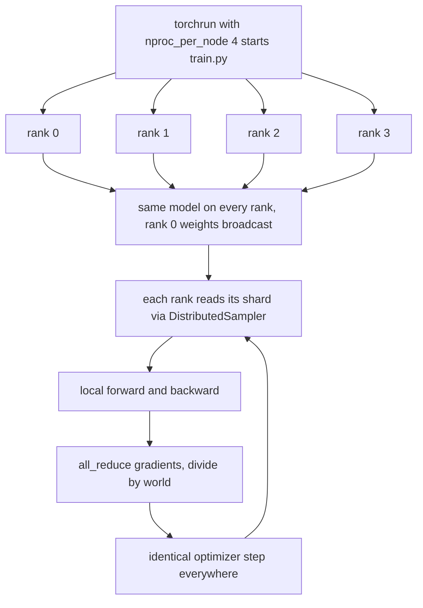
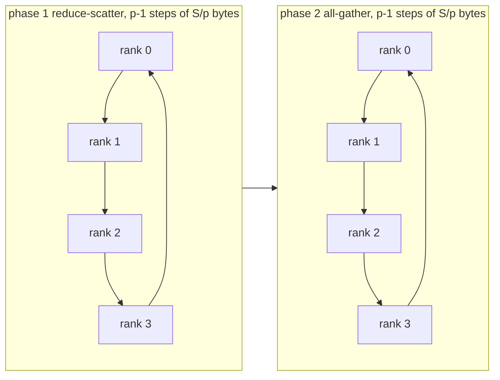

# 26 — Distributed Training: Process Groups, Collectives, and DDP

> **Prerequisites:** modules 14–16 and 20.
> **You will learn:** the SPMD model, process groups and rendezvous (`env://`, `file://`, TCPStore), `torchrun` and elasticity; the semantics and ring cost of every collective; how DDP's buckets, overlap, `no_sync`, comm hooks and `Join` work; `DistributedSampler` and `set_epoch`; why `DataParallel` is obsolete; how to debug hangs.

Data parallelism is the first scaling tool. Each worker holds a full model copy, processes a different slice of the batch, and all workers agree on one averaged gradient before each step. Agreeing exactly makes the job one large-batch run; one rank skipping a collective makes it hang, and that is where most distributed bugs live.

The module goes bottom up: groups, collectives, naive data parallelism, then what `DistributedDataParallel` (DDP) adds. The lab launches two real CPU processes with gloo and shows that naive all-reduce, DDP, and DDP with `no_sync` accumulation all reproduce single-process full-batch training to 1.1e-16 in float64. NCCL behaviour (async on CUDA streams, [module 20](./20-execution-model-dispatch-devices.md)) comes from pinned docs and source, marked "not executed here"; [module 37](./37-capstone-scaling-the-recipe.md) reruns this on the capstone GPT.

---

## 26.1 The SPMD picture

PyTorch distributed is **SPMD** (single program, multiple data): one script launched N times, each copy asking "who am I?" and picking its shard. The launcher only sets environment variables and starts processes.



`torchrun` exports `RANK`, `WORLD_SIZE`, `LOCAL_RANK`, `MASTER_ADDR` and `MASTER_PORT` ([elastic/run](https://docs.pytorch.org/docs/2.8/elastic/run.html)); the [PyTorch notes](../../notes/libraries/pytorch.md) give the overview this module deepens.

| Term | Meaning | Source |
|---|---|---|
| `rank` | process index `0 … world−1` | `RANK`, `dist.get_rank()` |
| `world` | process count | `WORLD_SIZE`, `dist.get_world_size()` |
| `local_rank` | index on this node; picks the GPU | `LOCAL_RANK` |
| process group | ranks that run collectives together | `init_process_group`, `new_group` |
| backend | library that moves bytes | `nccl`, `gloo`, `mpi`, `xccl` |
| store | key-value service for rendezvous only | TCPStore, FileStore, HashStore |

DDP is one point on PyTorch's map ([dist_overview](https://github.com/pytorch/tutorials/blob/ca960b6a7cd299ba00a644aa918bbcffdeb70152/beginner_source/dist_overview.rst)). It replicates everything, so it works only while parameters, gradients and optimizer state fit on one device. FSDP2, tensor, pipeline and context parallelism shard or split them ([module 27](./27-fsdp2-dtensor-parallelism.md)).

## 26.2 Initialising a process group

```python
dist.init_process_group(backend="nccl", init_method="env://",   # env:// is the default
                        timeout=datetime.timedelta(minutes=10),
                        device_id=torch.device("cuda", local_rank))  # optional, binds NCCL eagerly
```

Rendezvous: each process connects to a **store**, publishes its address, and blocks until `world_size` have arrived; then the backend builds communicators. **TCPStore** runs a server on rank 0 at `MASTER_ADDR:MASTER_PORT`. Since 2.4 its server uses libuv by default, which scales to far larger jobs ([TCPStore_libuv_backend](https://github.com/pytorch/tutorials/blob/ca960b6a7cd299ba00a644aa918bbcffdeb70152/intermediate_source/TCPStore_libuv_backend.rst)); `USE_LIBUV=0` restores the old server. **FileStore** (`file:///path`) uses one shared file; the lab uses it in a temp dir, so no port is needed. **HashStore** is in-memory, single-process; the fences use it.

`dist.new_group(ranks=[0, 1])` makes a subgroup; *every* rank must call it, because group creation is collective. `dist.new_subgroups(group_size=8)` cuts the world into equal consecutive groups (one per 8-GPU node, say) and returns `(this rank's group, all groups)`; pass `group=` to any collective to scope it. `dist.destroy_process_group()` belongs in a `finally` at exit.

| Backend | Devices | Notes ([distributed](https://docs.pytorch.org/docs/2.8/distributed.html)) |
|---|---|---|
| `nccl` | NVIDIA GPUs (RCCL on ROCm) | the GPU default; no CPU tensors |
| `gloo` | CPU; some collectives on CUDA | in every build; the docs table lists no CUDA `reduce_scatter` or `barrier` |
| `mpi` | per MPI build | source builds only |
| `xccl` | Intel XPU | `dist.Backend.XCCL` exists in 2.8 (checked locally) |

The default `timeout` is 10 minutes for NCCL and 30 minutes for other backends (locally `dist.constants.default_pg_timeout` printed `0:30:00`). It is how long a rank waits at a collective before it concludes that a peer is gone.

## 26.3 torchrun and elasticity

```bash
torchrun --standalone --nproc_per_node=8 train.py                       # one node
torchrun --nnodes=2 --nproc_per_node=8 --rdzv_backend=c10d \
         --rdzv_endpoint=node0:29400 --rdzv_id=job42 --max_restarts=3 train.py
```

`torchrun` runs one elastic agent per node ([elastic](https://docs.pytorch.org/docs/2.8/distributed.elastic.html)) that starts workers, does c10d rendezvous, and on any failure restarts the whole group, up to `--max_restarts` times. With `--nnodes=MIN:MAX` membership can change between restarts. A restart re-runs your script from the top, so an elastic-ready script loads its latest checkpoint at startup, saves atomically and often ([module 16](./16-training-loop-checkpointing.md)), and recomputes everything that depends on `WORLD_SIZE`. `mp.spawn(fn, args, nprocs)` is the in-script alternative ([multiprocessing notes](https://docs.pytorch.org/docs/2.8/notes/multiprocessing.html)) that Raschka's appendix and this lab use. torchft adds per-step fault tolerance: replica groups drop and rejoin without a restart. Ray Train wraps the same calls in a scheduler.

## 26.4 Collectives: semantics and cost

Every rank must call each collective, in the same order, with compatible shapes. Let $p$ be `world` and $S$ the tensor size in bytes. In the table, $x_r$ is rank $r$'s input and $c_{rj}$ is chunk $j$ of it.

| Collective (2.8 API) | Before | After | Ring bytes sent per rank |
|---|---|---|---|
| `all_reduce(t, op)` | $x_r$ | all: $\sum_r x_r$ | $2\frac{p-1}{p}S$ |
| `reduce_scatter_tensor(out, inp)` | $[c_{r0},…,c_{r,p-1}]$ | rank $j$: $\sum_r c_{rj}$ | $\frac{p-1}{p}S$ |
| `all_gather_into_tensor(out, inp)` | $c_r$ | all: $[c_0,…,c_{p-1}]$ | $\frac{p-1}{p}S$ (output size) |
| `broadcast(t, src)` / `reduce(t, dst)` | $x_{src}$ / $x_r$ | all: $x_{src}$ / dst: $\sum_r x_r$ | ≈ $S$ (pipelined) |
| `all_to_all_single(out, inp)` | $[c_{r0},…]$ | rank $j$: $[c_{0j},…,c_{p-1,j}]$ | $\frac{p-1}{p}S$ |
| `scatter` / `gather` | list at root / chunks | chunks / list at root | $\frac{p-1}{p}S$ at root |
| `send`/`recv`, `isend`/`irecv` | point to point | point to point | $S$ |
| `barrier()` | — | — | latency only |

The ring algorithm splits the tensor into $p$ chunks. In the reduce-scatter phase each rank sends one chunk right and adds the chunk arriving from the left, $p-1$ times, until rank $j$ owns the full sum of chunk $j$. In the all-gather phase the finished chunks circulate $p-1$ more times.



The total, $2(p-1)S/p$, approaches $2S$ but never exceeds it, however many ranks you add. That bound is why data parallelism scales. The identity **all_reduce = reduce_scatter + all_gather** is what FSDP exploits ([module 27](./27-fsdp2-dtensor-parallelism.md)): it keeps only its reduce-scattered gradient shard and all-gathers parameters just in time. NCCL also has tree and NVLS algorithms chosen per size and topology ([collectives and topology](/courses/inference/05-parallelism/05-04-collectives-and-topology.html)); not executed here.

API points that come up in reviews:

- `all_reduce` is in place and `op` is a `dist.ReduceOp`. The 2.8 docs list `AVG` as NCCL-only. On gloo, `all_reduce(op=AVG)` did average in the lab, but `reduce_scatter_tensor(op=AVG)` silently **sums**: with two ranks holding 1 and 2 it returned 3.0, not 1.5 (rechecked locally). [Module 27](./27-fsdp2-dtensor-parallelism.md) traces this to the gloo source and shows it doubling FSDP2 gradients. Portable code uses `SUM` and divides.
- Prefer the `_into_tensor`/`_tensor` forms (one `(world·n, …)` buffer) over list forms, which copy. `all_to_all_single` with split sizes is MoE token dispatch ([MoE](../transformers/12-mixture-of-experts.md)).
- `async_op=True` returns a `Work`. `wait()` blocks (on GPU it orders the current stream), and `get_future()` gives a [`torch.futures`](https://docs.pytorch.org/docs/2.8/futures.html) future you can chain with `.then()`. DDP comm hooks are built on it.
- `broadcast_object_list`/`all_gather_object` pickle objects: fine for startup config, too slow for the step loop.
- `barrier()` papers over races and turns divergence into a hang. `monitored_barrier` (gloo) at least names the missing rank.

## 26.5 Data parallelism from first principles

Split a global batch of $B$ into $p$ equal shards of $b = B/p$. With mean losses,

$$\nabla_\theta \frac{1}{B}\sum_{i=1}^{B}\ell_i \;=\; \frac{1}{p}\sum_{r=0}^{p-1}\nabla_\theta\Big(\frac{1}{b}\sum_{i\in\text{shard}_r}\ell_i\Big).$$

Each rank's `backward()` computes one inner term; `all_reduce(SUM)` / $p$ averages them. Identical starts plus identical updates keep replicas identical, with no parameter traffic after step 0. Two conditions carry the proof: equal shard sizes, and per-rank *mean* losses. With `reduction="sum"` the divisor is $B$, not $p$. Token losses with varying valid-token counts per rank need an all-reduced global token count. Naive DDP is the lab's baseline:

```python
for p in model.parameters():
    dist.broadcast(p.data, src=0)                     # identical start
for x, y in loader:                                   # DistributedSampler shard
    opt.zero_grad(set_to_none=True)
    loss_fn(model(x), y).backward()                   # local gradient
    for p in model.parameters():
        dist.all_reduce(p.grad); p.grad.div_(world)   # average
    opt.step()                                        # identical update
```

It is correct and slow: the network idles during backward, compute idles during communication, and per-tensor collectives pay latency hundreds of times.

## 26.6 How DDP really works

`DistributedDataParallel(module)` does the following ([DDP notes](https://docs.pytorch.org/docs/2.8/notes/ddp.html); [Li et al. 2020](https://arxiv.org/abs/2006.15704)):

1. **Construction.** It broadcasts rank 0's parameters and buffers (the lab seeds each rank differently to prove this) and builds a C++ `Reducer` ([reducer.cpp](https://github.com/pytorch/pytorch/blob/v2.8.0/torch/csrc/distributed/c10d/reducer.cpp)).
2. **Buckets.** Gradients are packed into buckets of at most `bucket_cap_mb` (25 MB) in roughly **reverse** `model.parameters()` order. Backward produces gradients in reverse forward order, and registration usually follows forward order, so the last layers' bucket fills first. [distributed.py](https://github.com/pytorch/pytorch/blob/v2.8.0/torch/nn/parallel/distributed.py) caps the first bucket at `dist._DEFAULT_FIRST_BUCKET_BYTES` (1,048,576, printed locally) so communication starts early, and rebuilds buckets after iteration 1 from the order actually observed.
3. **Overlap.** A per-parameter hook copies each ready gradient into its bucket; a full bucket launches an async all-reduce while backward continues. Before `backward()` returns, the Reducer waits on all handles and writes averages into `param.grad`.

| Argument | Default | Effect | Cost or risk |
|---|---|---|---|
| `bucket_cap_mb` | 25 | bigger: fewer messages; smaller: earlier overlap | tune per network |
| `gradient_as_bucket_view` | `False` | `.grad` is a view into the bucket, saving a copy and memory | never reassign `.grad` |
| `find_unused_parameters` | `False` | after forward, walk the autograd graph and mark unused params ready | a graph traversal every step |
| `static_graph` | `False` | used-parameter set and order fixed, recorded once | must really be static |
| `broadcast_buffers` | `True` | rank 0's buffers broadcast each forward | overwrites BN stats |

If a parameter gets no gradient and `find_unused_parameters=False`, its bucket never completes and the next iteration raises "Expected to have finished reduction in the prior iteration". The [tuning guide](https://docs.pytorch.org/tutorials/recipes/recipes/tuning_guide.html) (living page, accessed 2026-10-10) advises defining layers in execution order.

BatchNorm breaks 26.5's equivalence: each rank normalises with its own shard's statistics. `nn.SyncBatchNorm.convert_sync_batchnorm(model)` all-reduces them (one collective per BN layer per forward). LayerNorm and RMSNorm are per-example and safe. On GPU, pass `device_ids=[local_rank]`, and wrap with DDP *before* `torch.compile` so DDPOptimizer can split graphs at bucket boundaries ([module 23](./23-torch-compile-in-practice.md)); not executed here.

## 26.7 Gradient accumulation, no_sync, and Join

Plain DDP all-reduces on every backward, so accumulating $k$ micro-batches costs $k$ all-reduces per update. Wrap the first $k-1$ backwards in `with ddp.no_sync():` and only the last one communicates, which takes per-update bytes from $k\cdot 2\frac{p-1}{p}S$ to $2\frac{p-1}{p}S$, 8× less for $k=8$. The gradient is the same, because summation commutes with averaging. Fence 5 shows the hook is not called under `no_sync`, and the lab shows the parameters still match the reference.

**Uneven inputs** hang. If rank 3 has one batch fewer, ranks 0–2 enter an all-reduce that rank 3 never joins. `Join` ([docs](https://docs.pytorch.org/docs/2.8/distributed.algorithms.join.html), [tutorial](https://github.com/pytorch/tutorials/blob/ca960b6a7cd299ba00a644aa918bbcffdeb70152/advanced_source/generic_join.rst)) lets finished ranks shadow DDP's collectives with zeros:

```python
with Join([ddp_model]):          # torch.distributed.algorithms.join
    for x, y in loader:          # loaders may differ in length per rank
        loss_fn(ddp_model(x), y).backward(); opt.step(); opt.zero_grad()
```

Your own extra collectives are not shadowed and still hang; equal work per rank is the better fix.

**DistributedSampler** ([data](https://docs.pytorch.org/docs/2.8/data.html), [source](https://github.com/pytorch/pytorch/blob/v2.8.0/torch/utils/data/distributed.py)) slices one seeded permutation into `num_replicas` disjoint parts (`rank`, `shuffle=True`, `seed=0`, `drop_last=False`). When the length is not divisible, it pads by repeating the first indices, so evaluation through it double-counts a few samples. The permutation is seeded with `seed + epoch`, and `epoch` changes only through `sampler.set_epoch(epoch)`. Forget the call and every epoch replays one order, silently. Equal sample counts are not equal work for variable-length text: bucket by length ([module 14](./14-data-pipelines.md)) or batch by token budget, because the slowest rank sets the pace of every all-reduce.

## 26.8 Communication hooks and compression

`ddp.register_comm_hook(state, hook)` replaces the per-bucket all-reduce ([ddp_comm_hooks](https://docs.pytorch.org/docs/2.8/ddp_comm_hooks.html)). The hook receives a `GradBucket` (`bucket.buffer()` is the flat gradient) and returns a `Future` holding the reduced tensor. Fence 5 registers one built from `all_reduce(..., async_op=True).get_future().then(...)`.

| Hook | Bytes per gradient element | Accuracy risk |
|---|---|---|
| default `allreduce_hook` | 4 (fp32) | none |
| `default_hooks.fp16_compress_hook` | 2 | fp16 overflow/underflow |
| `default_hooks.bf16_compress_hook` | 2 | 8-bit mantissa rounding of the sum |
| `powerSGD_hook`, rank $r$ | $r(m+n)$ per $m\times n$ matrix instead of $mn$ | low-rank bias, offset by error feedback |

PowerSGD ([Vogels et al. 2019](https://arxiv.org/abs/1905.13727)) approximates each gradient matrix as $PQ^\top$ with thin $P\in\mathbb{R}^{m\times r}$ and $Q\in\mathbb{R}^{n\times r}$, all-reduces only the factors, and adds the residual $M-PQ^\top$ into the next step (error feedback). 2.8 `PowerSGDState` defaults (inspected locally): `matrix_approximation_rank=1`, `start_powerSGD_iter=1000` (plain all-reduce before that), `use_error_feedback=True` and `warm_start=True`. Compression pays on slow cross-node links, rarely on NVLink (a judgement, not a measurement).

## 26.9 DataParallel and the RPC framework

`nn.DataParallel` is one process with one thread per GPU. Every step it scatters inputs from GPU 0, re-replicates the model, runs GIL-bound threads, and gathers outputs and gradients on GPU 0: a hotspot that cannot span nodes. The [CUDA notes](https://docs.pytorch.org/docs/2.8/notes/cuda.html) recommend DDP "even if there is only a single node". [`torch.distributed.rpc`](https://docs.pytorch.org/docs/2.8/rpc.html) (remote calls, `RRef`, distributed autograd) served parameter servers and early model-parallel work. Modern LLM training is collective-based SPMD and does not use it.

## 26.10 Debugging distributed jobs

Almost every distributed failure breaks one rule: all ranks issue the same collectives in the same order with matching shapes.

| Symptom | Likely cause | First check |
|---|---|---|
| hang at init or first collective | rendezvous: address, port, firewall, a rank never started, name resolution | does every rank log before init? |
| hang mid-training, no error | divergence: collective under `if rank == 0`, uneven data, one rank `break`s | `TORCH_DISTRIBUTED_DEBUG=DETAIL`, Flight Recorder |
| NCCL watchdog timeout | the same, detected after `timeout` | Flight Recorder sequence ids |
| worse loss on 8 ranks than 1 | no `set_epoch`, unsynced BN, LR not rescaled | 26.7, 26.11 |
| gradients scaled by `world` | divided twice, or sum loss divided by `world` | fence 2 |
| replicas drift | a parameter outside DDP, per-rank nondeterminism in the update | all-gather a checksum, as the lab does |

Row one happened while writing this module: on the reference Mac, `torchrun --standalone` stalled in rendezvous with repeated c10d warnings that an IPv6 reverse-lookup address "cannot be retrieved". With `--master_addr=127.0.0.1` the same script ran correctly.

Tools: `TORCH_DISTRIBUTED_DEBUG=DETAIL` ([distributed](https://docs.pytorch.org/docs/2.8/distributed.html)) checks collective types and shapes across ranks before running them, turning a silent hang into an error (slow; debugging only). `NCCL_DEBUG=INFO` prints NCCL's topology and transports. `TORCH_NCCL_ASYNC_ERROR_HANDLING` (default 3, [NCCL env vars](https://docs.pytorch.org/docs/2.8/torch_nccl_environment_variables.html)) tears down a process whose collective timed out, so `torchrun` can restart. **Flight Recorder** keeps a ring buffer of recent collectives per rank: set `TORCH_NCCL_TRACE_BUFFER_SIZE=2000` and `TORCH_NCCL_DUMP_ON_TIMEOUT=1`, then analyse the dumps with `torchfrtrace` (installed with 2.8). The rank whose last sequence id lags the others skipped a collective ([tutorial](https://github.com/pytorch/tutorials/blob/ca960b6a7cd299ba00a644aa918bbcffdeb70152/unstable_source/flight_recorder_tutorial.rst); TorchComms variant in [debug_hangs_with_flight_recorder](https://github.com/pytorch/tutorials/blob/ca960b6a7cd299ba00a644aa918bbcffdeb70152/intermediate_source/debug_hangs_with_flight_recorder.rst)). NCCL tools: not executed here. `CommDebugMode` from `torch.distributed.tensor.debug` counts collectives inside a context ([recipe](https://github.com/pytorch/tutorials/blob/ca960b6a7cd299ba00a644aa918bbcffdeb70152/recipes_source/distributed_comm_debug_mode.rst)).

Log and checkpoint on rank 0, but never put a collective inside `if rank == 0:`. Save-then-load needs one `barrier()`, and a save slower than `timeout` kills the waiting ranks.

## 26.11 Scaling arithmetic

DP scales while the all-reduce hides under backward. In this example the inputs are **assumptions**: $P = 10^9$, bf16 gradients ($S = 2\times10^9$ B = 1.86 GiB), $p = 8$, a bus bandwidth of 200 GB/s, and 400 TFLOP/s achieved per GPU.

| Quantity | Formula | Value |
|---|---|---|
| bytes sent per rank | $2\frac{p-1}{p}S$ | $3.5\times10^9$ B (fence 3) |
| all-reduce time | bytes / bandwidth | 17.5 ms |
| compute, 16,384 tokens per GPU | $6P\cdot$tokens / FLOP/s | 246 ms |
| compute, 1,024 tokens per GPU | same | 15 ms |

At 16 K tokens per GPU, communication is 7 % of compute and overlappable. Shrink each GPU's share to 1 K tokens and the all-reduce outlasts backward, so more GPUs buy nothing. The other wall is memory: every rank stores about 16 bytes per parameter for weights, gradients and Adam state, which is why module 27 shards them.

Bigger batches also change optimization ([notes](../../notes/deep-learning/optimization-and-training.md)). [Goyal et al. 2017](https://arxiv.org/abs/1706.02677) used the **linear scaling rule** for SGD (LR × $k$ for batch × $k$) plus warmup. For Adam a **square-root** rule is the usual heuristic ([Malladi et al. 2022](https://arxiv.org/abs/2205.10287)). Both break beyond a critical batch size. Re-tune when the batch grows severalfold.

## Reconciling the sources

Raschka's appendix A ([DDP-script.py](https://github.com/rasbt/LLMs-from-scratch/blob/cdbd33e6d57a71e20ea31434841095fac50cecd8/appendix-A/01_main-chapter-code/DDP-script.py)) uses `mp.spawn` plus `DistributedSampler`, with a [torchrun variant](https://github.com/rasbt/LLMs-from-scratch/blob/cdbd33e6d57a71e20ea31434841095fac50cecd8/appendix-A/01_main-chapter-code/DDP-script-torchrun.py). The [DDP tutorial](https://github.com/pytorch/tutorials/blob/ca960b6a7cd299ba00a644aa918bbcffdeb70152/intermediate_source/ddp_tutorial.rst) and [DDP series](https://github.com/pytorch/tutorials/blob/ca960b6a7cd299ba00a644aa918bbcffdeb70152/beginner_source/ddp_series_theory.rst) now recommend `torchrun`. Both run the same DDP, and the lab supports both. Older material, including [dist_tuto](https://github.com/pytorch/tutorials/blob/ca960b6a7cd299ba00a644aa918bbcffdeb70152/intermediate_source/dist_tuto.rst), uses `dist.reduce_op` and list `all_gather`; 2.8 prefers `ReduceOp` and the `_into_tensor` variants. The DDP paper's 25 MB bucket is still the default. The docs call `ReduceOp.AVG` NCCL-only; gloo honoured it for `all_reduce` here but not for `reduce_scatter_tensor`, so code to the docs.

## Worked distributed verification

Fence 1 runs real collectives in a one-process gloo group over a `HashStore`: each is the identity at `world = 1`, and an async handle completes. It proves 2.8 signatures and buffer shapes, not cross-rank semantics (the lab does).

```python pytorch-check
import torch
import torch.distributed as dist

dist.init_process_group("gloo", store=dist.HashStore(), rank=0, world_size=1)
try:
    assert (dist.get_rank(), dist.get_world_size(), dist.get_backend()) == (0, 1, "gloo")
    x = torch.arange(6.0).reshape(2, 3)
    y = x.clone()
    dist.all_reduce(y, op=dist.ReduceOp.SUM)  # in place
    torch.testing.assert_close(y, x)
    out = torch.empty(2, 3)
    dist.all_gather_into_tensor(out, x)  # output is (world*2, 3)
    torch.testing.assert_close(out, x)
    rs = torch.empty(2, 3)
    dist.reduce_scatter_tensor(rs, x)  # input is (world*2, 3)
    torch.testing.assert_close(rs, x)
    b = x.clone()
    dist.broadcast(b, src=0)
    torch.testing.assert_close(b, x)
    work = dist.all_reduce(y, async_op=True)
    assert work.wait() is True and work.is_completed()
    fut = dist.all_reduce(y, async_op=True).get_future()
    assert isinstance(fut, torch._C.Future)
    torch.testing.assert_close(fut.wait()[0], x)
finally:
    dist.destroy_process_group()
assert not dist.is_initialized()
print("world=1 collectives are identities; Work.wait() -> True; future resolves")
```

Fence 2 is the 26.5 algebra with four simulated ranks on a 32-example batch, plus the sum-loss divisor rule. It fails if you divide a sum loss by `world`.

```python pytorch-check
import torch
import torch.nn as nn
import torch.nn.functional as F

torch.manual_seed(0)
model = nn.Linear(5, 1).double()
x = torch.randn(32, 5, dtype=torch.float64)
y = torch.randn(32, 1, dtype=torch.float64)
world = 4

def grads(loss):
    model.zero_grad(set_to_none=True)
    loss.backward()
    return [p.grad.clone() for p in model.parameters()]

full = grads(F.mse_loss(model(x), y))  # mean over 32
shards = [grads(F.mse_loss(model(xs), ys)) for xs, ys in zip(x.chunk(world), y.chunk(world))]
avg = [sum(g[i] for g in shards) / world for i in range(2)]  # all_reduce(SUM) / world
for a, f in zip(avg, full):
    torch.testing.assert_close(a, f, rtol=1e-12, atol=1e-12)

# sum losses: divide by the global batch (32), not by world (4)
sum_shards = [grads(F.mse_loss(model(xs), ys, reduction="sum")) for xs, ys in zip(x.chunk(world), y.chunk(world))]
summed = [sum(g[i] for g in sum_shards) for i in range(2)]
for s, f in zip(summed, full):
    torch.testing.assert_close(s / 32, f, rtol=1e-12, atol=1e-12)
    assert not torch.allclose(s / world, f)  # 8x too big
print("mean of 4 shard gradients == full-batch gradient; sum-loss needs / global batch")
```

Fence 3 checks the ring cost model in exact rational arithmetic for $p \in \{2,4,8\}$. It is a bandwidth model, not a network measurement.

```python pytorch-check
from fractions import Fraction

def ring_bytes(op, p, S):
    chunk = Fraction(S, p)
    steps = {"reduce_scatter": p - 1, "all_gather": p - 1, "all_reduce": 2 * (p - 1)}[op]
    return steps * chunk

S = 2 * 10**9  # 1 B params of bf16 gradients
rows = []
for p in (2, 4, 8):
    ar = ring_bytes("all_reduce", p, S)
    assert ar == ring_bytes("reduce_scatter", p, S) + ring_bytes("all_gather", p, S)
    assert ar == Fraction(2 * (p - 1), p) * S
    assert ar.denominator == 1
    rows.append((p, int(ar)))
assert rows[-1] == (8, 3_500_000_000)  # 1.75 x S, always < 2 x S
print("bytes/rank for all_reduce of 2e9 B:", rows)
```

Fence 4 (no process group) shows `DistributedSampler` padding (10 samples, 3 ranks, 12 slots), the replay without `set_epoch`, and the reshuffle after it.

```python pytorch-check
import torch
from torch.utils.data import DistributedSampler

data = list(range(10))
samplers = [DistributedSampler(data, num_replicas=3, rank=r, shuffle=True, seed=0, drop_last=False)
            for r in range(3)]
epoch0 = [list(s) for s in samplers]
assert [len(ix) for ix in epoch0] == [4, 4, 4]  # ceil(10/3)
flat = [i for ix in epoch0 for i in ix]
assert set(flat) == set(data) and len(flat) == 12  # 2 padded repeats
stale = [list(s) for s in samplers]  # no set_epoch: same order
assert stale == epoch0
for s in samplers:
    s.set_epoch(1)
epoch1 = [list(s) for s in samplers]
assert epoch1 != epoch0 and set(i for ix in epoch1 for i in ix) == set(data)
print("rank shards:", epoch0, "-> after set_epoch(1):", epoch1[0])
```

Fence 5 checks that DDP at `world = 1` gives the plain module's gradients, then counts calls of a custom comm hook across a `no_sync` accumulation window: none for the first micro-batch, one 4-element bucket for the second. It proves the mechanism, not a time saving.

```python pytorch-check
import copy
import torch
import torch.distributed as dist
import torch.nn as nn
from torch.nn.parallel import DistributedDataParallel as DDP

dist.init_process_group("gloo", store=dist.HashStore(), rank=0, world_size=1)
try:
    torch.manual_seed(0)
    plain = nn.Linear(3, 1)
    ddp = DDP(copy.deepcopy(plain))
    x = torch.randn(4, 3)
    plain(x).pow(2).mean().backward()
    ddp(x).pow(2).mean().backward()
    for a, b in zip(plain.parameters(), ddp.module.parameters()):
        torch.testing.assert_close(a.grad, b.grad)

    calls = []
    def counting_hook(state, bucket):
        calls.append(bucket.buffer().numel())
        t = bucket.buffer().div_(dist.get_world_size())
        return dist.all_reduce(t, async_op=True).get_future().then(lambda f: f.value()[0])
    ddp.register_comm_hook(None, counting_hook)
    ddp.zero_grad()
    with ddp.no_sync():  # micro-batch 1: no communication
        ddp(x[:2]).pow(2).mean().backward()
    assert calls == []
    ddp(x[2:]).pow(2).mean().backward()  # micro-batch 2 syncs
    assert calls == [4]  # one bucket: 3 weights + 1 bias
    plain.zero_grad()
    plain(x[:2]).pow(2).mean().backward(); plain(x[2:]).pow(2).mean().backward()
    for a, b in zip(plain.parameters(), ddp.module.parameters()):
        torch.testing.assert_close(a.grad, b.grad)
finally:
    dist.destroy_process_group()
print("DDP grads == plain grads; no_sync skipped the hook; one 4-element bucket")
```

## Lab: prove DDP equals large-batch training with two CPU processes

**Tested with Python 3.11 and PyTorch 2.8.0 on CPU.**

[`code/26_ddp_gloo.py`](./code/26_ddp_gloo.py) spawns `--world-size` processes with `mp.spawn` and joins them through a `file://` store in a temp dir (gloo, 60 s timeout). Each rank:

1. checks eight collectives (`all_reduce` SUM/AVG/MAX, `all_gather_into_tensor`, `reduce_scatter_tensor`, `broadcast`, `all_to_all_single`, an `isend`/`irecv` ring) against closed forms, AND-ing flags across ranks with a MIN all-reduce;
2. trains a float64 `Linear(8,16)–Tanh–Linear(16,1)` (SGD, momentum) for `--steps` steps on `DistributedSampler` shards of 8, three ways: naive DDP, `DistributedDataParallel`, and DDP with `no_sync` over 2 micro-batches. Ranks start from different seeds, so only the broadcast makes replicas agree;
3. all-gathers parameters to test bit-identical replicas and times a 4 MiB all-reduce (median of 5).

Rank 0 also trains a full-batch single-process reference and a no-communication negative control on its own shard. Float64 keeps the check about algebra (float32 summation order alone leaves about 1e-7). Scope: gloo on CPU proves the algorithm and API; NCCL speed, overlap and topology are not measured.

```bash
python content/courses/pytorch/code/26_ddp_gloo.py --world-size 2
python site/test_pytorch_26_ddp_gloo.py
# the same script under torchrun (optional):
torchrun --standalone --nproc_per_node=2 content/courses/pytorch/code/26_ddp_gloo.py --torchrun
# if --standalone stalls in rendezvous (it did on the reference Mac):
torchrun --nnodes=1 --nproc_per_node=2 --master_addr=127.0.0.1 --master_port=29533 \
         content/courses/pytorch/code/26_ddp_gloo.py --torchrun
```

One local PyTorch 2.8 CPU run on an Apple M2 Pro (2 processes, 1 thread each, 5 steps) produced:

| Result key | Value |
|---|---|
| `collectives_ok` | 8 of 8 true |
| `max_diff_naive_vs_ref` / `max_diff_ddp_vs_ref` | 1.1e-16 / 1.1e-16 |
| `max_diff_nosync_vs_ref` | 5.6e-17 |
| `max_diff_local_only_vs_ref` (negative control) | 0.111 |
| `params_identical_across_ranks` | true |
| `bucket_count` | 1 (161 parameters, far under the 1 MiB first bucket) |
| `allreduce_4mb_ms` | 2.2–2.4 (outliers 2.6, 5.2) |

All three variants match full-batch training to float64 rounding while the control is off by 0.11, so the comparison has teeth. 4 MiB in about 2.4 ms is roughly 1.7 GB/s over loopback TCP, far below NVLink, so it is reported, never asserted. Wall time: 2.6–2.7 s, mostly torch imports. The test runs the script in a subprocess (120 s timeout) and asserts the flags, diffs below 1e-6, the control above 1e-3, identical replicas and at least one bucket.

## Key takeaways

- SPMD: one script, N processes; every rank issues the same collectives in the same order.
- Ring all-reduce sends $2\frac{p-1}{p}S$ per rank (always under $2S$) and equals reduce-scatter plus all-gather, the identity FSDP builds on.
- Equal shards and mean losses make gradient averaging exactly full-batch training. Sum losses, BatchNorm and a missing `set_epoch` quietly break it.
- DDP is a broadcast at construction, reverse-order buckets (25 MB, 1 MiB first), and async all-reduce overlapped with backward. `no_sync` leaves one all-reduce per accumulation window.
- Uneven inputs hang (use `Join`). `DataParallel` is obsolete.
- Debug hangs with `TORCH_DISTRIBUTED_DEBUG=DETAIL`, Flight Recorder and explicit timeouts. DP stops scaling when the all-reduce outlasts backward.

## Self-check

1. Prove that DDP with mean loss per rank and gradient averaging equals single-device training on the concatenated batch. Which two common practices silently break this equivalence?
2. Your 8-rank job hangs after 3 hours with no error. List the first three things you check and the environment variables or tools you would enable.
3. Why does DDP bucket gradients in roughly reverse registration order, and what does `find_unused_parameters=True` cost you?

---

**Next → [27 — Sharded Training: FSDP2, DTensor, Tensor and Pipeline Parallelism](./27-fsdp2-dtensor-parallelism.md)**
