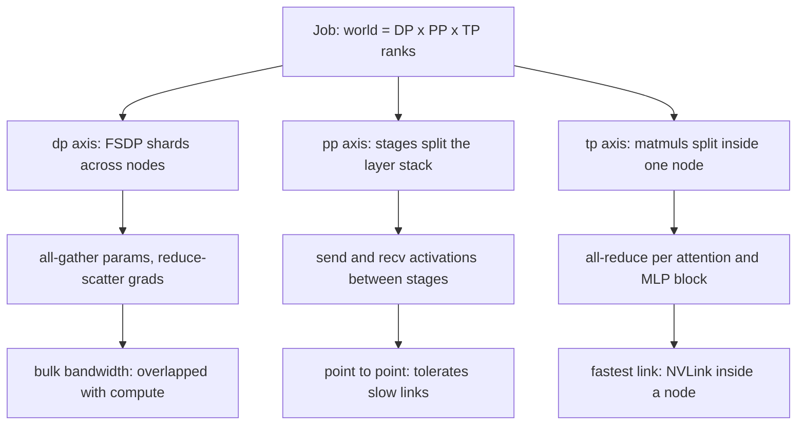
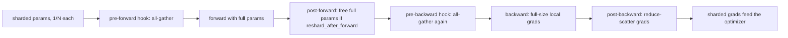
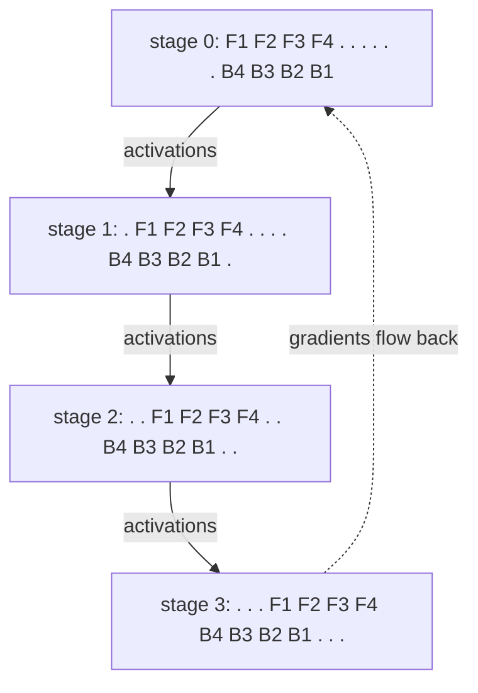

# 27 — Sharded Training: FSDP2, DTensor, Tensor and Pipeline Parallelism

> **Prerequisites:** modules 16, 22, and 26.
> **You will learn:** ZeRO stages as memory arithmetic and `ZeroRedundancyOptimizer`; FSDP2 `fully_shard` (dim-0 DTensor sharding, its all-gather/reduce-scatter schedule, `reshard_after_forward`, mixed precision, offload, prefetch, gradient-sync control, FSDP1 differences); DeviceMesh and DTensor placements and `redistribute`; tensor and sequence parallelism, FSDP×TP and HSDP meshes; pipeline schedules and bubbles; context and expert parallelism in overview; Distributed Checkpoint with resharding and async save.

DDP ([module 26](./26-distributed-collectives-and-ddp.md)) keeps a full copy of the model, its gradients and its optimizer state on every rank, and pays one all-reduce per step. Once that copy no longer fits on one device, the training state must be cut: along the data axis (ZeRO, FSDP), inside each matmul (tensor), between layers (pipeline), along the sequence (context) or across experts. Each cut buys memory with a specific collective on a specific link.

PyTorch 2.8 builds all of these on a `DeviceMesh` of ranks and a `DTensor` that records how a logical tensor is laid out on it. This module derives each cut's cost, then its API. The lab runs FSDP2, tensor parallelism, a GPipe pipeline and a distributed checkpoint on two CPU processes and checks each one against a single process. Along the way it found a gloo bug that Adam had been hiding. Anything that needs a GPU (NCCL, streams, prefetch overlap, real memory savings) is described from pinned sources and labelled "not executed here".

---

## 27.1 Why replicas stop fitting

Module 22 counted 16 bytes per parameter for mixed-precision AdamW: 2 for bf16 weights, 2 for bf16 gradients, and 12 for the fp32 master weights plus Adam's two moments. A 7 B model therefore needs 112 GB (104.3 GiB) before it stores a single activation, and DDP puts all of it on *every* rank. More GPUs add throughput but never shrink the per-rank footprint (activations come on top; see [training considerations](../transformers/13-training-considerations.md)).

| Strategy | What is split | Main collective | Typical link |
|---|---|---|---|
| Data parallel (DDP) | the batch only | all-reduce of grads | any |
| Sharded data parallel (ZeRO, FSDP) | batch + params, grads, optimizer state | all-gather params, reduce-scatter grads | inter-node, overlapped |
| Tensor parallel | each weight matrix (intra-layer) | all-reduce (or RS + AG) per block, fwd and bwd | NVLink, intra-node |
| Pipeline parallel | the layer stack (inter-layer) | point-to-point activations and grads | any |
| Sequence / context parallel | activations along `T` | K/V ring or all-gather per attention | fast links |
| Expert parallel (MoE) | the experts | all-to-all of tokens | high bisection bandwidth |

These strategies compose. A large run puts each one on its own mesh axis and maps each axis to the link its collective can tolerate:



## 27.2 ZeRO as arithmetic

ZeRO ([Rajbhandari et al., 2020](https://arxiv.org/abs/1910.02054)) starts from one observation: DDP stores $N$ identical copies of state, and each rank only needs part of it. Using the paper's 2 + 2 + 12 accounting with world size $N$:

| Stage | Sharded | Per-rank bytes | 7 B, $N=8$ | 7 B, $N=64$ |
|---|---|---|---|---|
| DDP (ZeRO-0) | nothing | $16P$ | 104.3 GiB | 104.3 GiB |
| ZeRO-1 | optimizer state | $4P + 12P/N$ | 35.9 GiB | 27.3 GiB |
| ZeRO-2 | + gradients | $2P + 14P/N$ | 24.4 GiB | 14.5 GiB |
| ZeRO-3 (FSDP) | + parameters | $16P/N$ | 13.0 GiB | 1.6 GiB |

ZeRO-1/2 floor at $4P$ and $2P$ because every rank still holds full bf16 weights; only ZeRO-3 keeps shrinking.

The stages also differ in communication. A ring all-reduce is a reduce-scatter followed by an all-gather (module 26), and each half moves about $P$ elements per rank. ZeRO-1 and ZeRO-2 split DDP's all-reduce into those two halves. They reduce-scatter the gradients, update the shard each rank owns, and all-gather the updated parameters. That is $2P$, the same volume as DDP. ZeRO-3 frees the parameters between uses, so it all-gathers them before the forward, all-gathers them again before the backward, and reduce-scatters the gradients. That is $3P$, **1.5× DDP**,, which FSDP hides by overlapping each all-gather with the previous layer's compute.

PyTorch's ZeRO-1 is `ZeroRedundancyOptimizer` ([docs](https://docs.pytorch.org/docs/2.8/distributed.optim.html), [recipe](https://github.com/pytorch/tutorials/blob/ca960b6a7cd299ba00a644aa918bbcffdeb70152/recipes_source/zero_redundancy_optimizer.rst)), used next to DDP:

```python
from torch.distributed.optim import ZeroRedundancyOptimizer
model = DDP(model)                      # gradients still all-reduced in full
opt = ZeroRedundancyOptimizer(model.parameters(), optimizer_class=torch.optim.AdamW, lr=3e-4)
# each rank steps the params it owns, then broadcasts them; before saving:
# opt.consolidate_state_dict(to=0)
```

It partitions *whole parameters*, not elements. A local probe on two gloo ranks with `Linear(16, 32)` → `Linear(32, 4)` gave rank 0 the 512-element weight, which is 1,024 Adam state elements. Rank 1 got the other three tensors, 328 state elements. FSDP2 avoids that imbalance by sharding every parameter along dim 0.

## 27.3 FSDP2: the mechanism

FSDP2 is `torch.distributed.fsdp.fully_shard` ([docs](https://docs.pytorch.org/docs/2.8/distributed.fsdp.fully_shard.html), [source](https://github.com/pytorch/pytorch/blob/v2.8.0/torch/distributed/fsdp/_fully_shard/_fully_shard.py), [tutorial](https://github.com/pytorch/tutorials/blob/ca960b6a7cd299ba00a644aa918bbcffdeb70152/intermediate_source/FSDP_tutorial.rst)):

```python
fully_shard(module, *, mesh=None, reshard_after_forward=None, shard_placement_fn=None,
            mp_policy=MixedPrecisionPolicy(), offload_policy=OffloadPolicy(), ignored_params=None)
```

It modifies the module in place. Every parameter becomes a `DTensor` with placement `Shard(0)`: rank $r$ keeps chunk $r$ of `torch.chunk(param, world, dim=0)`, padded internally when the rows do not divide evenly. Parameter names (FQNs) do not change. The module's class becomes a generated subclass named `FSDP<Name>` that also inherits `FSDPModule`. Each call creates one **parameter group**, and each group is one unit of communication:



Two rules follow from this design. **Apply `fully_shard` bottom-up.** A call claims every parameter of the module that no earlier call has claimed. So you shard each Transformer block first, then the root, and the root's group gets whatever is left over: embeddings, the final norm, the LM head. Sharding only the root makes the whole model one group: one huge all-gather, no overlap, unsharded peak memory. **Build the optimizer after sharding.** It then sees DTensor shards, and its state is sharded with no extra work.

`reshard_after_forward` controls whether each group's full parameters survive past the forward:

| Value | After forward | Backward cost | Memory |
|---|---|---|---|
| `True` (non-root default) | free full params | one extra all-gather | lowest (ZeRO-3) |
| `False` (root default) | keep full params | none | group stays unsharded until backward (ZeRO-2-like) |
| `int` $k$ | reshard to $k$-rank groups | all-gather over $k$ ranks (e.g. intra-node) | in between |

The root defaults to `False` because its parameters are the first ones the backward needs. Freeing them and re-gathering them right away would be wasted work.

## 27.4 FSDP2 policies and controls

**Mixed precision.** `MixedPrecisionPolicy(param_dtype=torch.bfloat16, reduce_dtype=torch.float32, output_dtype=None, cast_forward_inputs=True)` keeps the sharded parameters, and therefore the optimizer, in fp32. It all-gathers bf16 copies, which halves all-gather bytes, and reduces gradients in fp32. In the lab the shards stayed `torch.float32`, the output came back bf16 (cast it, or set `output_dtype`), and three steps drifted 0.021 from the fp32 reference versus 1e-7 for fp32 FSDP.

**Offload.** `CPUOffloadPolicy(pin_memory=True)` keeps parameter shards, gradients and optimizer state in pinned host memory, and runs the optimizer step on the CPU. Capacity for step time, as in module 22 (not executed here).

**Prefetching.** By default FSDP2 overlaps the next group's all-gather with the current group's compute. `set_modules_to_forward_prefetch([...])` and `set_modules_to_backward_prefetch([...])` override the order. Longer lists overlap more and reserve more memory (GPU-only effect, not executed here).

**Other controls.** `set_requires_gradient_sync(False)` replaces FSDP1's `no_sync()` (accumulate unsharded gradients, skip the reduce-scatter). `set_reshard_after_backward(False)` keeps parameters gathered across microbatches. `register_fsdp_forward_method(model, "generate")` hooks a non-`forward` method. `ignored_params` opts parameters out; `shard_placement_fn` picks another (evenly divisible) shard dim. `set_force_sum_reduction_for_comms(True)` replaces `ReduceOp.AVG` with SUM plus FSDP's own division; the lab needs it. Compose per block: activation checkpointing, per-block `torch.compile` ([module 23](./23-torch-compile-in-practice.md)), `fully_shard`, then the root (not executed here).

The FSDP paper ([Zhao et al., 2023](https://arxiv.org/abs/2304.11277)) describes FSDP1's `FlatParameter`. The FSDP2 tutorial's migration guide and the [FSDP notes](https://docs.pytorch.org/docs/2.8/notes/fsdp.html) give the differences:

| | FSDP1 `FullyShardedDataParallel` | FSDP2 `fully_shard` |
|---|---|---|
| Parameters | one flat 1-D `FlatParameter` per unit | each param a `Shard(0)` DTensor; original params always |
| Strategy | `FULL_SHARD` / `SHARD_GRAD_OP` / `HYBRID_SHARD` | `reshard_after_forward=True/False`, 2-D mesh for hybrid |
| Memory | `recordStream`, `limit_all_gathers` | neither; no CPU synchronization |
| State dict | `state_dict_type` config, communication | sharded DTensor state dict, communication-free |
| Meta init | `param_init_fn`, `sync_module_states` | `to_empty` + `reset_parameters`; `set_model_state_dict(broadcast_from_rank0=True)` |

## 27.5 DeviceMesh and DTensor

A `DeviceMesh` is an n-D array of ranks with named axes, and it has one process group per axis slice ([DTensor docs](https://docs.pytorch.org/docs/2.8/distributed.tensor.html), [source](https://github.com/pytorch/pytorch/blob/v2.8.0/torch/distributed/tensor/_api.py)):

```python
mesh = init_device_mesh("cuda", (dp, tp), mesh_dim_names=("dp", "tp"))
tp_mesh, dp_mesh = mesh["tp"], mesh["dp"]
```

A `DTensor` is a local `torch.Tensor` plus `(mesh, placements)`, with one placement per mesh dimension. The logical tensor is the one you would have on a single device. Here is a `(4, 2)` tensor on a 2-rank mesh:

| Placement | Rank 0 holds | Rank 1 holds | Logical value |
|---|---|---|---|
| `Shard(0)` | rows 0–1, `(2, 2)` | rows 2–3, `(2, 2)` | concatenation on dim 0 |
| `Shard(1)` | column 0, `(4, 1)` | column 1, `(4, 1)` | concatenation on dim 1 |
| `Replicate()` | full `(4, 2)` | full `(4, 2)` | either copy |
| `Partial("sum")` | an addend `(4, 2)` | an addend `(4, 2)` | elementwise sum |

`Partial` is what a matmul produces when its contraction dimension is sharded: each rank holds a full-shape partial sum. The sharding-propagation rules encode this (`Shard(1) @ Shard(0)` → `Partial()`, fence 3). Ops run locally until a placement change forces communication. That change is `redistribute`, and each transition is one collective:

| Transition | Collective | Lab check |
|---|---|---|
| `Shard(d)` → `Replicate()` | all-gather | `shard0_to_replicate` |
| `Partial()` → `Replicate()` | all-reduce | `partial_to_replicate` |
| `Partial()` → `Shard(d)` | reduce-scatter | `partial_to_shard0` |
| `Replicate()` → `Shard(d)` | none, local chunk | via `distribute_tensor` |
| `Shard(0)` → `Shard(1)` | all-to-all | `shard0_to_shard1` |

On CPU, gloo warned that it "does not support alltoall yet, falling back with allgather + chunk": correct, but not bandwidth-optimal. `distribute_tensor(t, mesh, placements, src_data_rank=0)` scatters rank 0's copy, and with `src_data_rank=None` each rank keeps its own data. `DTensor.from_local` wraps existing shards without communication. `full_tensor()` gathers the whole tensor and `to_local()` returns this rank's piece. `distribute_module(module, mesh, partition_fn, input_fn, output_fn)` shards a module with your function. Experimental `local_map` runs a plain-tensor function on local shards. Mixing a DTensor and a plain tensor in one op raises "got mixed torch.Tensor and DTensor".

## 27.6 Tensor parallelism

Megatron-LM ([Shoeybi et al., 2019](https://arxiv.org/abs/1909.08053)) splits the MLP $Y = \mathrm{GELU}(XA)\,B$, where $X$ is `(B, T, d_model)`, $A$ is `(d_model, d_ff)` and $B$ is `(d_ff, d_model)`. Split $A$ by **columns**, $A = [A_1, A_2]$. GELU is elementwise, so $\mathrm{GELU}(XA) = [\mathrm{GELU}(XA_1), \mathrm{GELU}(XA_2)]$, and each rank computes its half of the hidden layer without communicating. Split $B$ by **rows**, $B = [B_1; B_2]$:

$$Y = \mathrm{GELU}(XA_1)B_1 + \mathrm{GELU}(XA_2)B_2.$$

Each rank now holds a full-shape `Partial`, and one **all-reduce** completes the forward. Splitting $A$ by rows would put the sum inside the nonlinearity, $\mathrm{GELU}(X_1A_1 + X_2A_2) \neq \mathrm{GELU}(X_1A_1) + \mathrm{GELU}(X_2A_2)$. Fence 2 measures that error at 0.2. In backward the input gradient sums over column shards, so one all-reduce runs at the MLP input: Megatron's $f$ (identity forward, all-reduce backward) and $g$ (the reverse). Attention is the same: Q, K, V column-parallel (each rank owns $H/\text{tp}$ whole heads), output projection row-parallel. That is **two all-reduces per layer in forward and two in backward**, on the critical path, which is why TP stays inside a node.

PyTorch names each submodule's role ([docs](https://docs.pytorch.org/docs/2.8/distributed.tensor.parallel.html), [source](https://github.com/pytorch/pytorch/blob/v2.8.0/torch/distributed/tensor/parallel/style.py), [tutorial](https://github.com/pytorch/tutorials/blob/ca960b6a7cd299ba00a644aa918bbcffdeb70152/intermediate_source/TP_tutorial.rst)):

```python
parallelize_module(mlp, tp_mesh, {"w1": ColwiseParallel(), "w2": RowwiseParallel()})
```

`nn.Linear` stores `(out_features, in_features)` and computes $XW^\top$. So "column-parallel" shards **dim 0** of the stored weight, the *output* features. The lab asserts local weight shapes `(4·d/2, d)` for `w1` and `(d, 4·d/2)` for `w2`. By default `ColwiseParallel` maps `Replicate()` input to `Shard(-1)` output, and `RowwiseParallel` maps `Shard(-1)` input to `Replicate()` via the all-reduce. On two gloo ranks, outputs and weight gradients matched the unsharded MLP to 6e-8 and 2.4e-7.

**Sequence parallelism** ([Korthikanti et al., 2022](https://arxiv.org/abs/2205.05198)) covers the regions TP leaves replicated. LayerNorm, dropout and the residual adds store full `(B, T, d_model)` activations on every TP rank. `SequenceParallel()` shards those regions along `T` and replaces each all-reduce with a reduce-scatter plus an all-gather. The bytes moved are the same, and the activation memory in those regions shrinks by the TP degree. `PrepareModuleInput` and `PrepareModuleOutput` declare layout conversions at module boundaries. `loss_parallel()` computes cross-entropy on vocab-sharded logits (`ColwiseParallel(output_layouts=Shard(-1), use_local_output=False)` on the LM head) without materialising `(B, T, V)` on any rank. For serving, see the [inference course's TP chapter](/courses/inference/05-parallelism/05-01-tensor-parallelism.html).

## 27.7 2-D and 3-D parallelism

FSDP × TP uses a 2-D mesh `(dp, tp)`. First apply TP with `mesh["tp"]`, then `fully_shard(..., mesh=mesh["dp"])`. A colwise weight then carries two placements, `(Shard(0), Shard(0))`. **HSDP** passes a 2-D mesh to `fully_shard` itself. Parameters become `(Replicate(), Shard(0))`: sharded within a group (usually a node) and replicated across groups, so all-gathers stay on fast links and only a gradient all-reduce crosses nodes. [torchtitan](https://github.com/pytorch/torchtitan/blob/49c4cff1f9286692094682dcb8300724ba89ed13/README.md) is the reference implementation of FSDP2 + TP (including async TP) + PP + CP. with meta init, activation checkpointing, compile, DCP and low-precision training (implementation-reviewed from its README; not executed here).

| Mesh axis | Collective | Volume | Link |
|---|---|---|---|
| `tp` | all-reduce or RS + AG, per layer, fwd and bwd | `B·T·d_model` per layer | NVLink, intra-node |
| `cp` | K/V ring or all-gather per attention | local K/V chunk | fast links |
| `dp_shard` (FSDP) | all-gather params, reduce-scatter grads | $\approx 3P/\text{tp}$ per step | inter-node, overlapped |
| `dp_replicate` (HSDP) | all-reduce grads | $2P/(\text{tp}\cdot\text{shard})$ | slowest links |
| `pp` | send/recv at stage edges | `B·T·d_model` per microbatch | any |

The bandwidth numbers behind this ordering are in the [collectives and topology chapter](/courses/inference/05-parallelism/05-04-collectives-and-topology.html).

## 27.8 Pipeline parallelism

Pipeline parallelism cuts the layer stack into $p$ **stages**, one per rank; in the naive single-machine model-parallel baseline only one stage is busy at a time. GPipe ([Huang et al., 2019](https://arxiv.org/abs/1811.06965)) splits the batch into $m$ **microbatches**. Let one microbatch's forward through one stage take one time slot. The last stage starts after $p-1$ slots and finishes at slot $m+p-1$, so each stage computes for $m$ of those $m+p-1$ slots. The backward mirrors this, so the idle fraction, the **bubble**, is

$$\text{bubble} = \frac{p-1}{m+p-1}.$$

With $p = m = 4$ the bubble is 3/7 ≈ 43 %, and with $m = 32$ it is 8.6 % (fence 5).



Each row has $2(m+p-1) = 14$ slots, and every stage sits idle for $2(p-1) = 6$ of them.

| Schedule | Order | Activations held per stage | Bubble |
|---|---|---|---|
| GPipe (`ScheduleGPipe`) | all forwards, then all backwards | $m$ microbatches | $(p-1)/(m+p-1)$ |
| 1F1B (`Schedule1F1B`) | warm-up, then alternate one forward, one backward | $\le p$ | same as GPipe |
| Interleaved 1F1B (`ScheduleInterleaved1F1B`) | $v$ virtual stages per rank | $\le p$, $v$× more sends | divided by $v$ |
| Zero-bubble (`ScheduleInterleavedZeroBubble`, `ScheduleZBVZeroBubble`) | split backward into input-grad and weight-grad, fill bubbles with weight-grads | about 1F1B | near zero |

1F1B does not shrink the bubble; it caps activation memory so you can raise $m$, which does. Interleaving ([Narayanan et al., 2021](https://arxiv.org/abs/2104.04473)) gives each rank $v$ non-adjacent chunks of layers.

The API ([docs](https://docs.pytorch.org/docs/2.8/distributed.pipelining.html), [source](https://github.com/pytorch/pytorch/blob/v2.8.0/torch/distributed/pipelining/schedules.py), [tutorial](https://github.com/pytorch/tutorials/blob/ca960b6a7cd299ba00a644aa918bbcffdeb70152/intermediate_source/pipelining_tutorial.rst)) offers a tracing front end, `pipeline(module, mb_args=(x_mb,), split_spec={"layers.2": SplitPoint.BEGINNING})`, which cuts an exported graph. The manual front end, used in the lab, wraps a submodule you slice yourself:

```python
stage = PipelineStage(layers[rank*k:(rank+1)*k], stage_index=rank, num_stages=world, device=dev)
sched = ScheduleGPipe(stage, n_microbatches=4, loss_fn=F.mse_loss)
if rank == 0:            sched.step(x)                      # first stage feeds input
elif rank == world - 1:  sched.step(target=y, losses=out)   # last stage computes loss
else:                    sched.step()
```

The schedule splits `x` into microbatches, runs the backward, and with the default `scale_grads=True` divides gradients by `n_microbatches`. In the lab, the last stage's four losses matched the single-process microbatch losses exactly (difference 0.0). Serving-side pipelining: [inference course](/courses/inference/05-parallelism/05-02-pipeline-parallelism.html).

## 27.9 Context and expert parallelism (overview)

**Context parallelism** shards `T` for every activation. Attention, the only op that mixes positions, needs every rank's K and V. Ring Attention ([Liu et al., 2023](https://arxiv.org/abs/2310.01889)) passes K/V shards around a ring and merges the partial results with the online-softmax rescaling from [hardware-aware attention](../transformers/11-hardware-aware-attention.md). In 2.8, `torch.distributed.tensor.experimental.context_parallel(mesh, buffers=..., buffer_seq_dims=...)` swaps `scaled_dot_product_attention` for ring attention. The [tutorial](https://github.com/pytorch/tutorials/blob/ca960b6a7cd299ba00a644aa918bbcffdeb70152/unstable_source/context_parallel.rst) warns that every sequence-indexed buffer must be listed; omitting RoPE's `freq_cis` breaks rotary embeddings. Experimental, not executed here.

**Expert parallelism** places the experts of an MoE layer ([mixture of experts](../transformers/12-mixture-of-experts.md)) on different ranks. The router's choices drive one `all_to_all` that *dispatches* tokens to the ranks holding their experts and a second that *combines* the outputs. **Monarch** ([tutorial](https://github.com/pytorch/tutorials/blob/ca960b6a7cd299ba00a644aa918bbcffdeb70152/intermediate_source/monarch_distributed_tutorial.rst)) is a prototype single-controller actor framework that drives a whole process mesh from one script instead of SPMD.

## 27.10 Distributed checkpointing

`torch.save(model.state_dict())` on an FSDP2 model saves this rank's DTensor shards: from rank 0 alone it loses the rest, from every rank it is tied to one world size and layout. Distributed Checkpoint ([docs](https://docs.pytorch.org/docs/2.8/distributed.checkpoint.html), [recipe](https://github.com/pytorch/tutorials/blob/ca960b6a7cd299ba00a644aa918bbcffdeb70152/recipes_source/distributed_checkpoint_recipe.rst)) fixes both:

```python
model_sd, optim_sd = get_state_dict(model, opt)      # FQN-keyed DTensor state
dcp.save({"model": model_sd, "optim": optim_sd}, checkpoint_id=ckpt_dir)
state = dict(zip(("model", "optim"), get_state_dict(model, opt)))  # target layout, any world size
dcp.load(state, checkpoint_id=ckpt_dir)              # in place
set_state_dict(model, opt, model_state_dict=state["model"], optim_state_dict=state["optim"])
```

Each rank writes its own shard files, and a coordinator writes `.metadata`, which maps every FQN's global shape and chunks to file offsets. On load, each rank reads only the chunks that overlap *its* target placement. Resharding (2 ranks to 1, FSDP to FSDP+TP) is planning, not conversion. `get_state_dict` keys model and optimizer state by normalised FQN, so checkpoints survive rewrapping. `dcp.async_save` stages the state in CPU memory and writes it from a background thread, returning a `Future` ([async recipe](https://github.com/pytorch/tutorials/blob/ca960b6a7cd299ba00a644aa918bbcffdeb70152/recipes_source/distributed_async_checkpoint_recipe.rst)). `format_utils.dcp_to_torch_save(dir, file)` consolidates a checkpoint into one `torch.save` file for export. Single-process checkpoints: [module 16](./16-training-loop-checkpointing.md); capstone use: [module 37](./37-capstone-scaling-the-recipe.md).

## Reconciling the sources

The FSDP paper and FSDP1 tutorial describe flat parameters; the 2.8 docs and FSDP2 tutorial, per-parameter DTensors. The communication schedule is identical. Megatron writes $Y = XA$ with $A$ stored as `(in, out)`, while `nn.Linear` stores `(out, in)`. So Megatron's "column split" is a dim-0 split of `Linear.weight`, and `ColwiseParallel` follows Megatron's naming, not the storage layout. For bubbles, GPipe states $(p-1)/(m+p-1)$ of total time, while Narayanan et al. state $(p-1)/m$ relative to ideal compute. Same idle slots, different denominators.

## Worked sharding verification

Fence 1 recomputes the ZeRO table and the 1.5× ratio. It proves the arithmetic, not that any framework achieves it.

```python pytorch-check
P = 7e9  # bytes per param: 2 bf16 weights + 2 bf16 grads + 12 fp32 master/m/v

def per_rank_bytes(stage, n):
    params, grads, optim = 2 * P, 2 * P, 12 * P
    optim /= n if stage >= 1 else 1
    grads /= n if stage >= 2 else 1
    params /= n if stage >= 3 else 1
    return params + grads + optim

for n in (1, 8, 64):
    row = [per_rank_bytes(s, n) for s in range(4)]
    assert all(a >= b for a, b in zip(row, row[1:])), row
    assert row[1] == 4 * P + 12 * P / n and row[2] == 2 * P + 14 * P / n
assert per_rank_bytes(3, 8) == 16 * P / 8 and per_rank_bytes(0, 64) == 112e9
ddp, zero12, zero3 = 2 * P, P + P, 3 * P  # AR = RS + AG; ZeRO-3 adds a 2nd all-gather
assert zero12 == ddp and zero3 / ddp == 1.5
print({n: [round(per_rank_bytes(s, n) / 2**30, 1) for s in range(4)] for n in (1, 8, 64)})
```

Fence 2 simulates two TP ranks in one process. It proves the algebra of the column/row split and shows that the row-first split fails. It does not exercise `parallelize_module` or any collective; the lab does.

```python pytorch-check
import torch
import torch.nn.functional as F

torch.manual_seed(0)
d, ranks = 8, 2
up = torch.nn.Linear(d, 4 * d, bias=False)    # weight (4d, d) = (out, in)
down = torch.nn.Linear(4 * d, d, bias=False)  # weight (d, 4d)
X = torch.randn(3, 5, d)                      # (B, T, d_model)
ref = down(F.gelu(up(X)))

A_shards = up.weight.chunk(ranks, dim=0)      # column-parallel: OUT features, (2d, d)
B_shards = down.weight.chunk(ranks, dim=1)    # row-parallel: IN features, (d, 2d)
partials = [F.gelu(X @ A.T) @ B.T for A, B in zip(A_shards, B_shards)]
assert partials[0].shape == ref.shape         # each rank: a full-shape addend
torch.testing.assert_close(sum(partials), ref, atol=1e-5, rtol=1e-5)  # = the all-reduce

A_rows = up.weight.chunk(ranks, dim=1)        # wrong: split IN features first
wrong = sum(F.gelu(x @ A.T) for x, A in zip(X.chunk(ranks, -1), A_rows)) @ down.weight.T
assert not torch.allclose(wrong, ref, atol=1e-3)
print("colwise->rowwise exact; rowwise-first error", round((wrong - ref).abs().max().item(), 3))
```

Fence 3 uses a one-rank mesh, so every collective is trivial. It proves the API contract (placements, `redistribute`, `full_tensor`, the mixed-operand error, `Shard(1) @ Shard(0)` → `Partial`), not data movement.

```python pytorch-check
import torch
import torch.distributed as dist
from torch.distributed.device_mesh import init_device_mesh
from torch.distributed.tensor import DTensor, Partial, Replicate, Shard, distribute_tensor

dist.init_process_group("gloo", store=dist.HashStore(), rank=0, world_size=1)
try:
    torch.manual_seed(0)
    mesh = init_device_mesh("cpu", (1,), mesh_dim_names=("dp",))
    t = torch.arange(8.0).reshape(4, 2)
    dt = distribute_tensor(t, mesh, [Shard(0)])
    assert isinstance(dt, DTensor) and dt.placements == (Shard(dim=0),)
    rep = dt.redistribute(mesh, [Replicate()])
    assert torch.equal(rep.to_local(), t) and torch.equal(dt.full_tensor(), t)
    try:
        dt @ torch.ones(2, 3)
        raise AssertionError("mixing Tensor and DTensor should fail")
    except RuntimeError as err:
        assert "mixed torch.Tensor and DTensor" in str(err)
    out = dt @ distribute_tensor(torch.ones(2, 3), mesh, [Replicate()])
    assert out.placements == (Shard(dim=0),)
    a = distribute_tensor(torch.randn(4, 6), mesh, [Shard(1)])
    b = distribute_tensor(torch.randn(6, 3), mesh, [Shard(0)])
    assert (a @ b).placements == (Partial(),)  # sharded contraction -> partial sums
    print(dt.placements, rep.placements, out.placements, (a @ b).placements)
finally:
    dist.destroy_process_group()
```

Fence 4 applies `fully_shard` at world size 1. It proves the API contract (DTensor parameters, unchanged FQNs, the `FSDP<Name>` class, sharded optimizer state, identical AdamW math) but cannot catch a gradient-scaling bug, which is what the two-rank lab found.

```python pytorch-check
import copy
import torch
import torch.distributed as dist
import torch.nn as nn
from torch.distributed.device_mesh import init_device_mesh
from torch.distributed.fsdp import FSDPModule, fully_shard
from torch.distributed.tensor import DTensor

dist.init_process_group("gloo", store=dist.HashStore(), rank=0, world_size=1)
try:
    torch.manual_seed(0)
    plain = nn.Sequential(nn.Linear(8, 16), nn.GELU(), nn.Linear(16, 4))
    sharded = copy.deepcopy(plain)
    names = [n for n, _ in plain.named_parameters()]
    mesh = init_device_mesh("cpu", (1,))
    for layer in (sharded[0], sharded[2]):    # bottom-up: leaves, then root
        fully_shard(layer, mesh=mesh)
    fully_shard(sharded, mesh=mesh)
    assert isinstance(sharded, FSDPModule) and type(sharded).__name__ == "FSDPSequential"
    assert [n for n, _ in sharded.named_parameters()] == names
    assert all(isinstance(p, DTensor) for p in sharded.parameters())
    opts = [torch.optim.AdamW(m.parameters(), lr=1e-2) for m in (plain, sharded)]
    x, y = torch.randn(6, 8), torch.randn(6, 4)
    for model, opt in zip((plain, sharded), opts):
        nn.functional.mse_loss(model(x), y).backward()
        opt.step()
    assert isinstance(opts[1].state[next(sharded.parameters())]["exp_avg"], DTensor)
    for p, q in zip(plain.parameters(), sharded.parameters()):
        torch.testing.assert_close(q.full_tensor(), p.detach(), atol=1e-6, rtol=0)
    print(type(sharded).__name__, "params after one AdamW step match")
finally:
    dist.destroy_process_group()
```

Fence 5 checks the bubble formula with exact fractions. It proves the arithmetic of the derivation, not any schedule's real timing.

```python pytorch-check
from fractions import Fraction

def bubble(p, m):  # idle p-1 of m+p-1 slots, in forward and again in backward
    return Fraction(p - 1, m + p - 1)

assert bubble(4, 4) == Fraction(3, 7)
fracs = [bubble(4, m) for m in range(1, 33)]
assert all(a > b for a, b in zip(fracs, fracs[1:]))  # more microbatches, smaller bubble
assert bubble(4, 1) == Fraction(3, 4) and bubble(4, 32) < Fraction(1, 10)
print({m: round(float(bubble(4, m)), 3) for m in (1, 4, 8, 16, 32)})
```

## Lab: shard a model three ways on two CPU processes and check against one process

[`./code/27_fsdp_tp_gloo.py`](./code/27_fsdp_tp_gloo.py) spawns two gloo processes (`file://` rendezvous in a temporary directory). Each experiment is compared with a single-process reference built from the same seed. **Tested with Python 3.11 and PyTorch 2.8.0 on CPU.**

```bash
python content/courses/pytorch/code/27_fsdp_tp_gloo.py --world-size 2
python site/test_pytorch_27_fsdp_tp_gloo.py
```

- **FSDP2.** Four MLP-residual blocks (`d_model = 32`) plus a head, sharded per block then root; three AdamW steps, each rank on half of an 8-row batch; plus a bf16 `MixedPrecisionPolicy` run.
- **TP.** `ColwiseParallel`/`RowwiseParallel` on an MLP. Outputs and weight gradients are compared.
- **Redistribute tour.** Six placement transitions on a `(4, 2)` tensor.
- **PP.** One `PipelineStage` per rank under `ScheduleGPipe(n_microbatches=4)`.
- **DCP.** Save model + optimizer; reload into a differently initialised sharded model; after teardown, load into a plain model (2 shards → 1) and via `dcp_to_torch_save`.

One local PyTorch 2.8 CPU run on an Apple-silicon laptop produced:

| Result key | Value |
|---|---|
| `fsdp_max_diff` (fp32, 3 AdamW steps) | 1.04e-7 |
| `fsdp_bf16_max_diff` | 0.021 |
| `local_numel_ratio` (rank 0) | 0.50098 |
| `gloo_avg_grad_ratio` (without the workaround) | 2.0000 |
| `tp_out_diff` / `tp_grad_diff` | 6.0e-8 / 2.4e-7 |
| `redistribute_ok` | all 6 True |
| `pp_loss_diff` | 0.0 (4 losses) |
| `dcp_roundtrip_diff` / `dcp_reshard_diff` | 0.0 / 0.0 |
| `elapsed_s` (incl. spawn) | 2.4 |

The ratio exceeds 0.5 because the head's `(1, 32)` weight and `(1,)` bias cannot split across two ranks: rank 1 holds an empty `(0, 32)` shard (33 of 16,801 parameters).

**The bug Adam hid.** The first version of this lab reported `fsdp_max_diff = 1.6e-4`, plausible as reduction-order noise, yet the gradients were exactly **2×** the reference. FSDP2 reduce-scatters fp32 gradients with `ReduceOp.AVG`. In 2.8, gloo's `reduce_scatter_tensor_coalesced` builds `AllreduceOptions` with that op and then calls `allreduce(inp)` without them, so AVG becomes SUM ([ProcessGroupGloo.cpp, v2.8.0](https://github.com/pytorch/pytorch/blob/v2.8.0/torch/csrc/distributed/c10d/ProcessGroupGloo.cpp)). A direct probe confirmed it: `reduce_scatter_tensor(op=AVG)` summed while `all_reduce(op=AVG)` averaged. Adam is scale-invariant except through `eps` and weight decay, so doubled gradients moved the parameters by only 1.6e-4. The lab calls `set_force_sum_reduction_for_comms(True)` on every FSDP module so FSDP divides by the world size itself. `gloo_avg_grad_ratio` keeps the bug visible, and the test accepts 2.0 or a fixed 1.0. NCCL supports AVG natively (not executed here). The lesson: compare a sharded run's *gradients* against a reference, not just its parameters after an adaptive optimizer.

Scope: these runs check the correctness of sharding semantics on gloo/CPU. They measure no memory savings, overlap, prefetching, HSDP or NCCL. On gloo, `reduce_scatter_tensor` is a full all-reduce plus a chunk, so even the communication volume is not FSDP's. The test runs the script via `subprocess` (120 s timeout) and asserts FSDP < 1e-5, bf16 < 5e-2, ratio in [0.45, 0.55], TP and PP < 1e-5, all redistribute checks, and DCP < 1e-7.

## Key takeaways

- Per-rank bytes: DDP $16P$, ZeRO-1 $4P + 12P/N$, ZeRO-2 $2P + 14P/N$, ZeRO-3/FSDP $16P/N$. ZeRO-1/2 communicate as much as DDP; ZeRO-3 communicates 1.5× as much.
- FSDP2 makes parameters `Shard(0)` DTensors in place. Shard blocks, then the root, then build the optimizer.
- DTensor = local shard + `(mesh, placements)`; each `redistribute` is one collective; sharded contractions yield `Partial`.
- Megatron TP shards `Linear.weight` dim 0 (column-parallel), then dim 1 (row-parallel): one all-reduce per block in forward and one in backward, kept inside a node.
- The GPipe bubble is $(p-1)/(m+p-1)$. 1F1B caps memory so $m$ can grow; interleaving divides the bubble by $v$.
- Checkpoint sharded models with DCP, which reshards at load time. Check gradients, not just Adam-trained parameters.

## Self-check

1. For a 13 B model on 16 GPUs with 80 GB each, which of DDP, ZeRO-2 and FSDP2 (ZeRO-3) fit the parameter/gradient/optimizer memory, and what extra communication does each pay?
2. In a Megatron MLP, why is the first projection split by output features and the second by input features? What collective runs, where, in the forward and the backward?
3. A pipeline with 8 stages and 8 microbatches under GPipe is slow. Compute the bubble fraction and give two changes that reduce it, with their memory cost.

---

**Next → [28 — Export and Deployment: torch.export, AOTInductor, ONNX, and ExecuTorch](./28-export-and-deployment.md)**
