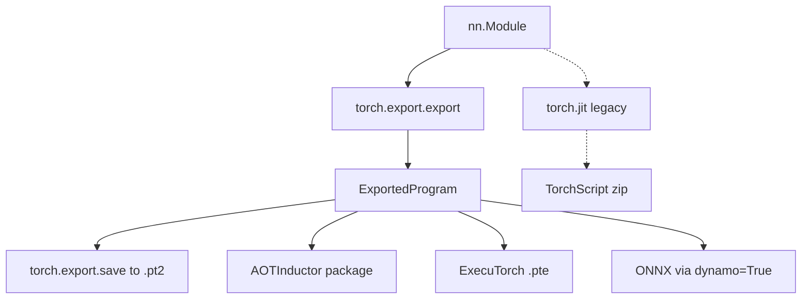

# 28 — Export and Deployment: torch.export, AOTInductor, ONNX, and ExecuTorch

> **Prerequisites:** modules 10, 16, 23–25.
> **You will learn:** why "deploy a PyTorch model" means choosing an artifact: a
> `state_dict` + Python code, a TorchScript program (legacy), an `ExportedProgram`
> (`.pt2`), an AOTInductor package, an ONNX graph, or an ExecuTorch `.pte`;
> `torch.export` in depth: non-strict (the 2.8 default) vs strict tracing, the
> `ExportedProgram` (graph, graph signature, state dict, range constraints),
> training vs inference IR and `run_decompositions`, `save`/`load`, `unflatten`,
> `draft_export`; expressing dynamism with `Dim` (named, bounded, derived),
> `Dim.AUTO/DYNAMIC/STATIC` and 0/1 specialization, plus control flow with
> `torch.cond` and data-dependent values with `torch._check`; and the downstream
> paths: AOTInductor, the ONNX dynamo exporter, ExecuTorch with XNNPACK, libtorch,
> and serving options (TorchServe archived, Triton Inference Server, vLLM, a plain
> HTTP service).

Training code is Python, mutable and full of forgotten branches. A deployment
artifact needs a frozen description of the computation that another runtime can
load without your repository, with a written contract for which inputs it
accepts. Compiling, quantizing, mobile and serving all consume that contract.

The tool is `torch.export`. It captures a model as an `ExportedProgram`, an ATen
graph plus weights plus the shape ranges it is valid for. It either captures all
behaviour under explicit constraints or refuses; TorchScript's tracer did
neither. Every 2.8 behaviour below was probed on CPU with PyTorch 2.8.0.
AOTInductor, ONNX and ExecuTorch appear as fragments, not executed here, because
their toolchains or packages are absent from this course's CI.

---

## 28.1 Five artifacts, one decision

| Artifact | Contains | Python at runtime? | Runtimes | Status in 2.8 |
|---|---|---|---|---|
| `state_dict` + model code | tensors; architecture lives in your `.py` files | yes | eager PyTorch | safest, most debuggable ([16](./16-training-loop-checkpointing.md)) |
| TorchScript (`torch.jit.script/trace`) | TorchScript IR + weights | no (libtorch) | libtorch C++, PyTorch Mobile | deprecated in favour of `torch.export` |
| `ExportedProgram` (`.pt2` via `torch.export.save`) | ATen graph, signature, weights, range constraints | yes (`torch.export.load`) | Python; input to AOTI, ExecuTorch, ONNX | the hub of the current stack |
| AOTInductor package (`.pt2`) | compiled C++/Triton kernels + weights | no | C++ `AOTIModelPackageLoader` or Python loader | beta |
| ONNX (`.onnx`) | ONNX graph at an opset | no | ONNX Runtime, TensorRT | dynamo exporter opt-in (`dynamo=True`) |
| ExecuTorch `.pte` | memory-planned program + delegate blobs | no | ExecuTorch runtime on Android/iOS/embedded | 0.7.0 pairs with torch 2.8.0 |

If the server runs Python and your code, `state_dict` (basics in the
[PyTorch note](../../notes/libraries/pytorch.md)) is a fine answer; every other
row buys independence from Python, your source tree, or your hardware.



## 28.2 Why TorchScript lost

`torch.jit.trace` runs the model once and records the tensor ops that happened.
Python values (shapes, `.item()` results, branch conditions) are evaluated during
that run and frozen:

```python
class Branchy(torch.nn.Module):
    def forward(self, x):
        return x * 2 if x.shape[0] > 2 else x * 3
```

Traced at size 4, the `else` arm vanishes and a size-1 input returns `2·x`, not
`3·x` (fence 3); the only signal is a `TracerWarning`. `torch.jit.script`
compiles source instead, but only a statically typed Python subset. The
pinned `cpp_export.rst` tutorial now opens with "TorchScript is deprecated,
please use torch.export instead."

`torch.export` keeps tracing's coverage (it runs your real Python) but records
each assumption as a **guard**. If a guard narrows a dimension you declared
dynamic, export fails with a suggested fix. The
[export docs](https://docs.pytorch.org/docs/2.8/export.html) call it sound, in
contrast to `torch.jit.trace`.

Of the TorchScript era, [`torch.package`](https://docs.pytorch.org/docs/2.8/package.html)
bundles code and weights into a hermetic archive, at the cost of pickle (its docs
warn of arbitrary code execution), and
[`optimize_for_mobile`](https://docs.pytorch.org/docs/2.8/mobile_optimizer.html)
targeted PyTorch Mobile, which "is no longer actively supported". The Flask +
TorchScript + libtorch workflow of *Deep Learning with PyTorch* chapter 15 is the
historical shape this replaces.

## 28.3 torch.export: the ExportedProgram

The probed 2.8 signature:

```python
torch.export.export(mod, args, kwargs=None, *, dynamic_shapes=None,
                    strict=False, preserve_module_call_signature=())
```

`strict=False` is **non-strict** tracing: your `forward` runs as ordinary Python
on proxy tensors that record each ATen call. Any Python is allowed; only tensor
ops land in the graph. `strict=True` captures bytecode with TorchDynamo
([23](./23-torch-compile-in-practice.md)), which reasons about more Python state
but rejects Python it cannot model. The v2.8.0 docstring says the choice does not
change the IR or the serialization.

Measured on `Linear(4,8) → ReLU → Linear(8,2)` with a buffer incremented in
`forward`:

| Field | Holds | In the probe |
|---|---|---|
| `ep.graph` / `ep.graph_module` | flat FX graph of ATen ops, no Python | `add_`, `linear`, `relu`, `linear` |
| `ep.graph_signature` | role of each graph input/output | 4 × `PARAMETER`, 1 × `BUFFER`, 1 × `USER_INPUT` |
| `ep.state_dict` | lifted parameters and persistent buffers | `l1.weight`, …, `count` |
| `ep.range_constraints` | symbolic size → value range | `{s77: VR[1, 64]}` for a dynamic batch |
| `ep.module()` | runnable `GraphModule` with input checks | rejects batch 65 with `RuntimeError` |

The key move is **lifting**: parameters and buffers become explicit graph inputs
(`p_l1_weight`, `b_count`), so the graph is a pure function of
`(params, buffers, user_inputs)`, and mutations become outputs. After
decomposition the in-place `add_` became a functional `add` whose result is
tagged `BUFFER_MUTATION target='count'` for the runtime to write back. No hidden
side effects is what lets AOTInductor and ExecuTorch plan memory ahead of time.
The [IR spec](https://docs.pytorch.org/docs/2.8/export.ir_spec.html) adds: only
ATen and higher-order ops, and `val`/`stack_trace` metadata on every node.

`ep.module()` checks rank, static sizes and dynamic ranges before any kernel runs.
It does **not** check dtype: float token ids reached the embedding kernel and
failed there ("Expected tensor for argument #1 'indices' to have one of the
following scalar types: Long, Int"). Validate dtypes at your service boundary.

## 28.4 Training IR, inference IR, decompositions

In 2.8, `export()` returns the **training IR**: ATen at roughly the level you wrote
it, including composites such as `aten.linear` and in-place ops. Backends want a
smaller vocabulary, so you lower explicitly:

```python
core = ep.run_decompositions()                       # default table -> Core ATen
table = torch.export.default_decompositions()        # dict-like CustomDecompTable
del table[torch.ops.aten.linear.default]             # keep linear for a fused kernel
custom = ep.run_decompositions(table)
```

On the MLP, `aten.linear.default` became `aten.permute.default` +
`aten.addmm.default` and `add_` became `add`. Counting `torch.ops.aten` overloads
in 2.8.0, 188 of 2,144 carry `torch.Tag.core` (see the IR table in
[24](./24-compiler-internals-fx-inductor.md)): a backend that consumes Core ATen,
as ExecuTorch and ONNX do, implements about 190 ops, not 2,000.
`export_for_training` is the older spelling of the training IR; its v2.8.0
docstring says it "will soon be the default IR of torch.export.export", which in
2.8 it already is. Custom ops from [25](./25-custom-ops-and-kernels.md) stay single
opaque nodes unless you register a decomposition.

## 28.5 Expressing dynamism

By default export **specializes every dimension** to the example. Export at batch
8 and the program accepts only batch 8. You opt in per dimension:

```python
from torch.export import Dim
batch = Dim("batch", min=1, max=1024)
ep = torch.export.export(model, (x,), dynamic_shapes={"x": {0: batch}})
# or positionally: dynamic_shapes=({0: batch},)
```

`dynamic_shapes` mirrors the inputs: a dict keyed by argument name or a tuple in
order, each tensor mapping dimension index to a `Dim` (`None` means static).
Reusing one `Dim` declares sizes equal. **Derived** dims express arithmetic: with
`b = Dim("b", min=2, max=8)` and `{"x": {0: b}, "y": {0: 2 * b}}` for
`cat([x, x]) + y`, the probe produced `{s77: VR[2, 8], 2*s77: VR[4, 16]}`.
`ShapesCollection` keys dims by tensor object instead.

| Spec | Meaning | When a guard narrows it |
|---|---|---|
| `Dim("n", min=a, max=b)` | named, bounded, dynamic over `[a, b]` | `UserError: Constraints violated` + suggested fix |
| `Dim.DYNAMIC` | must stay dynamic, bounds inferred | refines range; errors if specialized to a constant |
| `Dim.AUTO` | dynamic if possible | refines or specializes silently |
| `Dim.STATIC` / `None` | fixed to the example | n/a |

The canonical failure: `Branchy` exported from a size-4 example with
`Dim("n", min=1, max=10)`. The `> 2` arm installs guard `n > 2`, contradicting
`min=1`. Export raised `torch._dynamo.exc.UserError` in 0.09 s:

```text
Constraints violated (n)! ...
  - Not all values of n = L['x'].size()[0] in the specified range n <= 10 satisfy
    the generated guard L['x'].size()[0] > 2.
Suggested fixes:
  n = Dim('n', min=3, max=10)
```

Either accept the narrower contract (`min=3`; size 2 is then rejected at call
time) or remove the branch with `torch.where` or `torch.cond`.
`torch.export.dynamic_shapes.refine_dynamic_shapes_from_suggested_fixes` applies
suggestions to your spec programmatically.

One probe argues for named dims: `Branchy` exported with
`Dim.AUTO` (or `Dim.DYNAMIC`) at size 4 gave `VR[2, int_oo]` and a graph holding
only `mul(x, 2)`; sizes 1 and 2 were accepted and returned `2·x`, the wrong arm.
With guard `> 5` and an example of 8, both hints refined correctly to
`VR[6, int_oo]`. A guard on the 0/1 boundary appears to be lost in 2.8.0; named
dims raised the error in every case we tried.

**0/1 specialization.** Sizes 0 and 1 are special because broadcasting differs at
1, so a size-1 example on a dynamic dimension fails:
`Dim("b", min=1, max=8)` with a `(1, 3)` example raised "You marked b as dynamic
but your code specialized it to be a constant (1)". The same spec with a `(2, 3)`
example exported as `VR[1, 8]` and then ran batch 1 correctly. Trace with examples
≥ 2 on dynamic dimensions, and use `min=2` where size 1 could broadcast
differently. The capstone ([38](./38-capstone-export-quantize-serve.md)) exports
the GPT with `Dim("T", min=2, max=128)` for this reason.

## 28.6 Control flow and data-dependent values

Shape branches can be guarded; **value** branches cannot, because `x.sum() > 0`
has no value at trace time. `torch.cond(pred, true_fn, false_fn, operands)` puts
the branch in the graph: both functions become subgraphs and one
`torch.ops.higher_order.cond` node chooses at runtime. The
[cond docs](https://docs.pytorch.org/docs/2.8/cond.html) and
[`cond.py`](https://github.com/pytorch/pytorch/blob/v2.8.0/torch/_higher_order_ops/cond.py)
require both branches to take the same operands and return matching shapes,
dtypes and structure, and forbid mutating inputs or globals. `map` and
`while_loop` in `torch._higher_order_ops` extend this to loops. In the lab, `cond`
survives `run_decompositions()`; ONNX maps it to an `If` node.

`n = y.item()` creates an **unbacked** symbol `u0` with no example value to
assume. Then `x[:n]` failed with
`GuardOnDataDependentSymNode: Could not guard on data-dependent expression u0 < 0`,
because slicing asks whether `n` is negative. Supply facts:

```python
n = y.item()
torch._check(n >= 0)              # or torch._check_is_size(n)
torch._check(n <= x.shape[0])
return x[:n]
```

This exported, sliced correctly for `n = 2`, and raised "Runtime assertion failed
for expression u0 <= 5" for `n = 7`: facts become `_assert_scalar` nodes,
enforced rather than trusted. Some ops already cope; `torch.zeros(n)` exported
without checks.

When export fails deep in a large model,
[`draft_export`](https://docs.pytorch.org/docs/2.8/draft_export.html) uses the
example's real values wherever export would error and reports what it assumed. On
an `if n > 2` branch over `.item()`, `export` raised; `draft_export` returned a
program with one `DATA_DEPENDENT_ERROR` failure and `_assert_scalar` nodes pinning
`u0 >= 3`. That program is valid only for inputs taking the same branch: a
diagnostic, not a deployment artifact.

## 28.7 Saving, loading, and unflattening

`torch.export.save(ep, "m.pt2")` writes a zip; `torch.export.load` returns an
`ExportedProgram`. For the lab's 1,443-parameter classifier it was 39,759 bytes:

| Member | Bytes | Content |
|---|---|---|
| `models/model.json` | 26,722 | serialized graph, signature, ranges (versioned schema) |
| `data/weights/model.pt` | 8,217 | 1,443 float32 parameters (5,772 B) + framing |
| `data/sample_inputs/model.pt` | 1,833 | the example inputs |
| `data/constants/model.pt` | 1,261 | lifted constants |
| version, byteorder, ids | 52 | format metadata |

At this size the graph outweighs the weights; at LLM scale the reverse.

`ep.module()` is flat. Parameters keep dotted names (`head.0.weight`), but there is
no callable `head`, because the forward is one graph. `torch.export.unflatten(ep)`
rebuilds the tree as an `UnflattenedModule` whose children are
`InterpreterModule`s (fence 5). To *replace* a child, export with
`preserve_module_call_signature=("head",)` so the boundary's calling convention is
recorded; the lab swaps a new head this way. `torch.export.passes.move_to_device_pass`
retargets tensors, and `register_dataclass` lets export flatten your own input
types. Loading `.pt2` deserializes a schema and tensors, not arbitrary pickled
objects as `torch.load(weights_only=False)` can ([16](./16-training-loop-checkpointing.md)).
Still treat artifacts as trusted inputs and verify a manifest hash first.

## 28.8 AOTInductor (not executed here: needs a C++ toolchain)

AOTInductor runs Inductor ([24](./24-compiler-internals-fx-inductor.md)) ahead of
time, packaging generated C++ (CPU) or Triton (GPU) kernels with the weights:

```python
import torch._inductor
path = torch._inductor.aoti_compile_and_package(
    ep, package_path="model.pt2", inductor_configs={"max_autotune": True})
runner = torch._inductor.aoti_load_package(path)    # Python loader
```

```cpp
#include <torch/csrc/inductor/aoti_package/model_package_loader.h>
torch::inductor::AOTIModelPackageLoader loader("model.pt2");
std::vector<torch::Tensor> outputs = loader.run({torch::randn({8, 10})});
```

Use it for compiled-kernel speed with no Python and no first-request compile;
the package keeps the program's dynamic ranges. The
[AOTI docs](https://docs.pytorch.org/docs/2.8/torch.compiler_aot_inductor.html)
and the pinned `torch_export_aoti_python.py` recipe mark the APIs beta; the
[minifier](https://docs.pytorch.org/docs/2.8/torch.compiler_aot_inductor_minifier.html)
shrinks failing cases. The reference Mac lacked the C++ headers Inductor needs.

## 28.9 ONNX (not executed here: onnx/onnxscript not installed)

ONNX is the vendor-neutral route to ONNX Runtime, TensorRT and many accelerators.
`torch.onnx.export` has two exporters. The TorchScript-based one is legacy: the
2.8 docstring marks its options (`operator_export_type`, `custom_opsets`,
`training`, …) deprecated, and the
[dynamo docs](https://docs.pytorch.org/docs/2.8/onnx_dynamo.html) deprecate the
older `torch.onnx.dynamo_export`. The current exporter builds on `torch.export`,
but the 2.8 signature still defaults to `dynamo=False`, so opt in:

```python
onnx_program = torch.onnx.export(
    model, (ids,), dynamo=True,
    dynamic_shapes={"ids": {0: Dim("B", min=1, max=32), 1: Dim("T", min=2, max=64)}},
    opset_version=18)                                # returns an ONNXProgram
onnx_program.optimize()
onnx_program.save("model.onnx")
```

Everything in 28.5–28.6 carries over: the same `Dim` contract, `torch.cond` → ONNX
`If`, and custom ops translated via `custom_translation_table`. The pinned
`export_simple_model_to_onnx_tutorial.py` and
`export_control_flow_model_to_onnx_tutorial.py` walk through both. Verify against
eager with ONNX Runtime, as the lab does for the reloaded `.pt2`.

## 28.10 ExecuTorch (not executed here: package absent)

[ExecuTorch](https://github.com/pytorch/executorch/tree/v0.7.0) replaced PyTorch
Mobile; release 0.7.0 pins `torch==2.8.0`. From its
[getting-started guide](https://github.com/pytorch/executorch/blob/v0.7.0/docs/source/getting-started.md):

```python
from executorch.exir import to_edge_transform_and_lower
from executorch.backends.xnnpack.partition.xnnpack_partitioner import XnnpackPartitioner

ep = torch.export.export(model.eval(), (ids,), dynamic_shapes=shapes)
et_program = to_edge_transform_and_lower(ep, partitioner=[XnnpackPartitioner()]).to_executorch()
with open("model.pte", "wb") as f:
    f.write(et_program.buffer)
```

`to_edge_transform_and_lower` converts to the Edge dialect (Core ATen with dtype
specialization) and hands subgraphs the partitioner claims to a **delegate**:
[XNNPACK](https://github.com/pytorch/executorch/blob/v0.7.0/docs/source/backends-xnnpack.md)
for Arm/x86 CPUs, Core ML and MPS on Apple, Vulkan on Android GPUs, Qualcomm,
MediaTek and Arm Ethos-U NPUs; unclaimed ops fall back to portable CPU kernels.
`.to_executorch()` runs **memory planning** (activation offsets fixed ahead of
time, no per-op `malloc`) and emits the `.pte`, run on device by the C++ `Module`
class. Selective build links only used kernels; ETDump profiles on device. The
[export guide](https://github.com/pytorch/executorch/blob/v0.7.0/docs/source/using-executorch-export.md)
notes a `.pte` is backend-specific, so Core ML on iOS plus XNNPACK on Android means
two files. App building is out of scope.

## 28.11 libtorch and the C++ frontend

libtorch, PyTorch's C++ distribution, has three roles: the `torch::nn` C++ frontend
for writing models in C++ (rare), `torch::jit::load` for TorchScript (legacy, per
the pinned `cpp_export.rst`), and the AOTI loader for `.pt2` packages (new code):

```cpp
#include <torch/script.h>                                // legacy TorchScript path
torch::jit::script::Module m = torch::jit::load("model_ts.pt");
at::Tensor y = m.forward({torch::ones({1, 8}, torch::kLong)}).toTensor();
```

C++ inference pays when the process cannot embed Python (an existing C++ server,
a game engine, GIL contention across many threads). A GPU-bound Python service
spends its time in kernels; measure before rewriting.

## 28.12 Serving patterns

| Option | Serves | When | Status |
|---|---|---|---|
| Python HTTP service (FastAPI etc.) | eager, compiled or exported models | the default; full control | you own batching and ops |
| TorchServe | `.mar` archives | existing deployments only | [archived](https://github.com/pytorch/serve/blob/62c4d6a1fdc1d071dbcf758ebd756029af20bd5e/README.md) Aug 7, 2025: "no planned updates, bug fixes, new features, or security patches" |
| NVIDIA Triton Inference Server | PyTorch, ONNX, TensorRT backends | multi-model GPU fleets, dynamic batching | active |
| vLLM / SGLang | autoregressive LLMs | paged KV cache, continuous batching | active; see [the inference course](/courses/inference/) |

The [MLOps and serving note](../../notes/libraries/mlops-and-serving.md) has a
tested serving contract. For LLMs, generic servers miss KV-cache memory and
continuous batching; see
[torch.compile in serving](/courses/inference/08-compilation-and-runtime/08-02-torch-compile.html)
for where compilation fits. Concerns that bite regardless of server:

- **Batching.** The export contract must cover the batch sizes your batcher
  emits; padding to buckets keeps compiled artifacts on few shapes.
- **Warm-up.** Run representative shapes before taking traffic.
- **Versioned artifacts.** Ship a manifest with hash, torch version, input spec
  and dims, as the lab does, and pin the runtime's torch version.
- **Threads.** With N workers per host, set `torch.set_num_threads` so
  N × threads ≤ cores; oversubscription is the classic CPU latency regression.
- **Mode.** Serve under `model.eval()` and `torch.inference_mode()`
  ([16](./16-training-loop-checkpointing.md)).
- **Fleet observability.** The
  [large-scale deployments note](https://docs.pytorch.org/docs/2.8/notes/large_scale_deployments.html)
  covers sampled operator callbacks and API-usage hooks
  (`c10::SetAPIUsageLogger`, `torch._C._log_api_usage_once("my.api")`).

The capstone ([38](./38-capstone-export-quantize-serve.md)) exports the course
GPT with dynamic `T`, quantizes it ([29](./29-quantization-and-compression.md)),
and serves it behind a small HTTP contract.

## Reconciling the sources

The 2.8 docs contradict the 2.8 code on the default tracing mode.
[`export.html`](https://docs.pytorch.org/docs/2.8/export.html) says "In *strict*
mode, which is currently the default", and the
[programming model](https://docs.pytorch.org/docs/2.8/export.programming_model.html)
recommends non-strict, "which will soon become the default". But
[`torch/export/__init__.py` at v2.8.0](https://github.com/pytorch/pytorch/blob/v2.8.0/torch/export/__init__.py)
has `strict: bool = False` with docstring "When disabled (default)". We follow the
code; the pinned `torch_export_tutorial.py` and
`torch_export_challenges_solutions.rst` predate the switch. The export page warns
"prototype under active development … BREAKING CHANGES", so every claim here was
re-probed on 2.8.0. Reprs such as `VR[...]` and `s77` are internal; assert
behaviour. Shape semantics follow
[`dynamic_shapes.py`](https://github.com/pytorch/pytorch/blob/v2.8.0/torch/export/dynamic_shapes.py)
and program structure
[`exported_program.py`](https://github.com/pytorch/pytorch/blob/v2.8.0/torch/export/exported_program.py).

## Worked export verification

**Fence 1: round trip with a dynamic batch.** A small MLP exported with
`Dim("batch", min=1, max=64)` is saved and loaded under a temporary directory and
matches eager for batches 1, 7 and 64 (traced at 4, so batch 1 is not a
specialization trap); batch 65 is rejected. It proves the saved contract, not
cross-version loading.

```python pytorch-check
import os
import tempfile

import torch
import torch.nn as nn
from torch.export import Dim

torch.manual_seed(0)
model = nn.Sequential(nn.Linear(8, 16), nn.ReLU(), nn.Linear(16, 3)).eval()
ep = torch.export.export(model, (torch.randn(4, 8),),
                         dynamic_shapes={"input": {0: Dim("batch", min=1, max=64)}})

with tempfile.TemporaryDirectory() as d:
    path = os.path.join(d, "mlp.pt2")
    torch.export.save(ep, path)
    loaded = torch.export.load(path).module()
    for b in (1, 7, 64):
        x = torch.randn(b, 8)
        torch.testing.assert_close(loaded(x), model(x))
    try:
        loaded(torch.randn(65, 8))
        raise AssertionError("batch 65 accepted")
    except RuntimeError as err:
        assert "<= 64" in str(err), err
    size = os.path.getsize(path)
print(f"round trip ok for B in 1, 7, 64; B=65 rejected; {size} bytes on disk")
```

**Fence 2: signature and decompositions.** Parameters are lifted to `PARAMETER`
inputs next to exactly one `USER_INPUT`; `aten.linear` exists in the training IR
and is gone after `run_decompositions()`. It tolerates either `addmm` or
`mm` + `add` as the replacement.

```python pytorch-check
import torch
import torch.nn as nn
from torch.export.graph_signature import InputKind

torch.manual_seed(0)
model = nn.Sequential(nn.Linear(4, 8), nn.ReLU(), nn.Linear(8, 2)).eval()
ep = torch.export.export(model, (torch.randn(3, 4),))

kinds = [spec.kind for spec in ep.graph_signature.input_specs]
assert kinds.count(InputKind.PARAMETER) == 4 and kinds.count(InputKind.USER_INPUT) == 1


def targets(program):
    return [str(n.target) for n in program.graph.nodes if n.op == "call_function"]


before = targets(ep)
after = targets(ep.run_decompositions())
assert before.count("aten.linear.default") == 2, before
assert not any("linear" in t for t in after), after
assert any("addmm" in t or "aten.mm" in t for t in after), after
x = torch.randn(3, 4)                               # static: export specialized B=3
torch.testing.assert_close(ep.run_decompositions().module()(x), model(x), atol=1e-6, rtol=1e-6)
print(f"training IR {len(before)} ops -> core ATen {len(after)} ops: {sorted(set(after))}")
```

**Fence 3: trace bakes, export refuses.** The traced module returns `2·x` for a
size-1 input although the code says `3·x`. Export with `min=1` raises a constraint
error, and with `min=3` it succeeds and rejects size 2. It shows one guard; it
does not show export catching every unsound assumption (see the `Dim.AUTO` probe).

```python pytorch-check
import warnings

import torch
from torch.export import Dim


class Branchy(torch.nn.Module):
    def forward(self, x):
        return x * 2 if x.shape[0] > 2 else x * 3


with warnings.catch_warnings():
    warnings.simplefilter("ignore", torch.jit.TracerWarning)
    traced = torch.jit.trace(Branchy(), torch.ones(4))
x1 = torch.ones(1)
torch.testing.assert_close(traced(x1), 2 * x1)            # wrong arm, silently
torch.testing.assert_close(Branchy()(x1), 3 * x1)         # what the code says

try:
    torch.export.export(Branchy(), (torch.ones(4),), dynamic_shapes={"x": {0: Dim("n", min=1, max=10)}})
    raise AssertionError("export accepted an unsound range")
except Exception as err:
    assert "UserError" in type(err).__name__ or "Constraints" in str(err), err

ep = torch.export.export(Branchy(), (torch.ones(4),), dynamic_shapes={"x": {0: Dim("n", min=3, max=10)}})
torch.testing.assert_close(ep.module()(torch.ones(7)), 2 * torch.ones(7))
try:
    ep.module()(torch.ones(2))
    raise AssertionError("size 2 accepted")
except RuntimeError:
    pass
print("trace returned 2x for size 1; export raised for min=1, accepted min=3")
```

**Fence 4: `torch.cond` captures both branches.** One exported program gives
`x + 1` for positive sums and `x - 1` otherwise, and the graph holds a single
`cond` node. It does not test the branch-shape mismatch errors.

```python pytorch-check
import torch


class Signed(torch.nn.Module):
    def forward(self, x):
        return torch.cond(x.sum() > 0, lambda x: x + 1, lambda x: x - 1, (x,))


ep = torch.export.export(Signed(), (torch.ones(3),))
conds = [n for n in ep.graph.nodes if n.op == "call_function" and "cond" in str(n.target)]
assert len(conds) == 1
m = ep.module()
pos, neg = torch.tensor([1.0, 2.0, 3.0]), torch.tensor([-1.0, -2.0, -3.0])
torch.testing.assert_close(m(pos), pos + 1)
torch.testing.assert_close(m(neg), neg - 1)
print("one exported graph, both branches: cond picked x+1 and x-1 at runtime")
```

**Fence 5: `unflatten` restores the hierarchy.** The unflattened program has a
callable `sub` child and matches eager. It does not prove that swapping is safe
without `preserve_module_call_signature`.

```python pytorch-check
import warnings

import torch
import torch.nn as nn


class Sub(nn.Module):
    def __init__(self):
        super().__init__()
        self.lin = nn.Linear(4, 4)

    def forward(self, x):
        return torch.relu(self.lin(x))


class Top(nn.Module):
    def __init__(self):
        super().__init__()
        self.sub, self.head = Sub(), nn.Linear(4, 2)

    def forward(self, x):
        return self.head(self.sub(x))


torch.manual_seed(0)
top, x = Top().eval(), torch.randn(3, 4)
ep = torch.export.export(top, (x,))
with warnings.catch_warnings():
    warnings.simplefilter("ignore", UserWarning)
    unflat = torch.export.unflatten(ep)
assert hasattr(unflat, "sub") and type(unflat).__name__ == "UnflattenedModule"
torch.testing.assert_close(unflat(x), top(x))
torch.testing.assert_close(unflat.sub(x), top.sub(x))
print(f"unflattened children: {[n for n, _ in unflat.named_children()]}")
```

## Lab: export, reload, and stress-test a model's contract

[`code/28_export_roundtrip.py`](./code/28_export_roundtrip.py) builds a 1,443-parameter
text classifier (`Embedding(50, 16, padding_idx=0)`, masked mean-pool over
`(B, T)`, MLP head `16 → 32 → 3`) whose `torch.cond` substitutes a zero vector
when the whole batch is padding. It exports from a `(4, 8)` example with
`Dim("B", min=1, max=32)` and `Dim("T", min=2, max=64)`, saves `model.pt2` plus
`manifest.json`, reloads, and compares with eager on six shapes from `(1, 2)` to
`(32, 64)` plus an all-padding batch. It records op histograms, feeds an out-of-range `T` and float ids, times both
forwards, swaps the head via `unflatten`, and runs `draft_export` on an
`.item()`-branching variant.

**Tested with Python 3.11 and PyTorch 2.8.0 on CPU.**

```bash
python content/courses/pytorch/code/28_export_roundtrip.py --output-dir /tmp/pt-export
python site/test_pytorch_28_export_roundtrip.py
```

One local PyTorch 2.8 CPU run (Apple M-series laptop, 4 threads, `--seed 0`)
produced:

| Key | Value | Reading |
|---|---|---|
| `pt2_bytes` | 39,759 | accounted in 28.7 |
| `max_diff`, `shapes_checked` | 0.0, 7 | bitwise equal to eager, incl. the `cond` branch |
| `ops_training_ir` → `ops_core_aten` | `linear` ×2 → `addmm` ×2 + `permute` ×2; `cond` ×1 kept | lowering removes composites, keeps control flow |
| `rejections.T_out_of_range` | `RuntimeError: Expected input at *args[0].shape[1] to be <= 64, but got 65` | shape guard |
| `rejections.wrong_dtype` | `RuntimeError: Expected tensor for argument #1 'indices'…` | kernel error, not a guard |
| `unflatten_ok`, `draft_export_issues` | `True`, 1 | head swapped; the `.item()` branch reported |
| `eager_us` / `exported_us` | 135–141 / 90–100 | `(8, 32)` input, two runs; not asserted |

`max_diff` is exactly zero because the exported graph runs the same ATen kernels
in the same order as eager on CPU; expect tolerances after AOTInductor fusion or
on GPU. The exported module was faster, plausibly from skipping per-submodule
`nn.Module.__call__` overhead; two runs on one laptop are not a performance claim.

One wiring detail surfaced while writing the test: `torch.cond` traces its branch
functions with Dynamo, which re-imports their defining module, so an
`importlib`-loaded lab must be registered in `sys.modules` first or export fails
with `ModuleNotFoundError`. The test asserts the brief's contracts (including the
manifest hash and artifact cleanup) and restores global state. Scope: the
`torch.export` contract in Python on CPU. AOTInductor, ONNX and ExecuTorch lowering
of the same `ExportedProgram` are shown as commands for environments with those
tools.

## Key takeaways

- Deploying means choosing an artifact. The `ExportedProgram` is the hub;
  AOTInductor, ONNX (`dynamo=True`) and ExecuTorch start from it. TorchScript is
  deprecated and TorchServe is archived.
- `torch.jit.trace` freezes Python decisions silently; `torch.export` records them
  as guards and fails loudly when they contradict declared ranges.
- In 2.8 `export` is non-strict by default and returns training IR;
  `run_decompositions()` lowers to Core ATen, optionally keeping chosen ops.
- Dimensions are static unless declared. Use named, bounded `Dim`s, trace with
  examples ≥ 2, and prefer `min=2` where size 1 broadcasts differently.
- Value branches need `torch.cond`; data-dependent sizes need `torch._check`
  facts, which become runtime assertions. `draft_export` diagnoses; it does not ship.
- Ship artifacts with a manifest, validate dtypes at the boundary, warm up, and
  size threads per worker.

## Self-check

1. A model exported with a static batch of 8 fails in production on batch 1. What
   did the export specialize, how do you declare the dimension, and why might
   `min=1` still be rejected?
2. Why is `torch.jit.trace` unsafe for a model with a shape-dependent branch, and
   what does `torch.export` do instead in the same situation?
3. You need the same model on a Linux GPU server and an Android phone. Sketch both
   artifact pipelines from one `ExportedProgram` and name the step that differs.

---

**Next → [29 — Quantization, Pruning, and Compression](./29-quantization-and-compression.md)**
