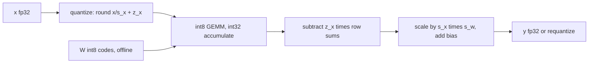

# 29 — Quantization, Pruning, and Compression

> **Prerequisites:** modules 10, 17, 20, 28.
> **You will learn:** affine quantization from first principles (scale, zero point, symmetric vs asymmetric, rounding and clipping error, per-tensor, per-channel and per-group granularity, int4 packing); weight-only, dynamic, static post-training and quantization-aware training with the straight-through estimator; the 2.8 API landscape of `torch.ao.quantization` (deprecated, removal scheduled for 2.10), PT2E and torchao's `quantize_`; LLM.int8, SmoothQuant, GPTQ and AWQ at overview depth; and pruning, 2:4 sparsity and knowledge distillation.

Quantization stores weights, and sometimes activations, as small integers plus a few float scales; pruning removes weights; distillation trains a smaller network to imitate a larger one. Each trades measured quality for bytes, bandwidth or FLOPs, and the engineering question is which of the three the deployment is short of.

The 2.8 stack is in transition: the eager and FX APIs in `torch.ao.quantization` warn that they will be removed in 2.10, and the maintained path is the separately versioned [torchao](https://github.com/pytorch/ao/tree/v0.13.0) (v0.13.0 pairs with PyTorch 2.8). So this module derives the arithmetic, checks it against native quantized tensors, and implements every scheme from scratch in the lab. Formats come from [module 17](./17-mixed-precision.md), tensor subclasses from [module 20](./20-execution-model-dispatch-devices.md), export from [module 28](./28-export-and-deployment.md). The [inference-optimizations module](../transformers/14-inference-optimizations.md) gives the serving view, and [module 38](./38-capstone-export-quantize-serve.md) quantizes the capstone GPT.

---

## 29.1 What compression buys

**Memory.** Bytes per weight: fp32 4, bf16 2, int8 1, int4 0.5 plus scales (§29.3). A 7B model is 13 GiB in bf16, about 3.4 GiB in int4 with group-128 fp16 scales.

**Bandwidth.** Decoding at small batch reads every weight once per token and does about 2 FLOPs per weight read, far below a GPU's ridge point. Latency ≈ weight bytes / bandwidth, so halving bytes nearly halves latency even if the kernel dequantizes to bf16 ([when quantization pays](/courses/inference/04-quantization/04-04-when-quantization-pays.html)).

**Compute.** int8 and fp8 tensor cores run about twice the bf16 rate, but only when *both* operands are low precision, so compute-bound prefill gains only from activation quantization or 2:4 sparsity.

| Technique | What shrinks | Typical quality risk | Retraining? |
|---|---|---|---|
| int8 weight-only | weight bytes (2× vs bf16) | negligible | no |
| int4 weight-only, per-group | weight bytes (3.9× vs bf16 at group 128) | small, model-dependent | no (GPTQ/AWQ calibrate) |
| dynamic int8 | weight bytes + matmul cost | low | no |
| static int8 PTQ | weights, activations, matmul cost | outlier-sensitive | calibration only |
| QAT | same as static | lowest of the int schemes | short fine-tune |
| unstructured pruning | nothing dense | rises with sparsity | usually |
| 2:4 semi-structured | half the values, up to 2× matmul on Ampere+ | moderate | fine-tune |
| structured pruning | real dense FLOPs and bytes | high | yes |
| distillation | the whole model | depends on student | full training |

## 29.2 Affine quantization, derived

An affine quantizer maps reals onto integer codes $[q_{\min}, q_{\max}]$ with a **scale** $s > 0$ and integer **zero point** $z$:

$$q = \operatorname{clamp}\big(\operatorname{round}(x/s) + z,\ q_{\min},\ q_{\max}\big), \qquad \hat x = s\,(q - z).$$

**Asymmetric (uint8).** Widen the observed $[\alpha, \beta]$ to include 0 and map it onto $[0, 255]$: $s = (\beta - \alpha)/255$, $z = \operatorname{round}(-\alpha/s)$. Real 0.0 is then *exactly* code $z$, so zero padding and ReLU zeros quantize without bias ([Jacob et al., 2018](https://arxiv.org/abs/1712.05877)).

**Symmetric (int8).** Fix $z = 0$ and $s = \max|x|/127$, codes in $[-127, 127]$. Dropping $-128$ keeps $x \mapsto -x$ exact. Symmetric suits roughly centred weights. Asymmetric suits one-sided post-ReLU activations, where a symmetric grid would waste half its codes.

**Error.** In range, rounding moves $x/s$ by at most $\tfrac12$, so $|x - \hat x| \le s/2$. If the error is uniform on $[-s/2, s/2]$, its MSE is $\frac{1}{s}\int_{-s/2}^{s/2} e^2\,de = s^2/12$. Out of range, clipping error is unbounded. Calibration is that trade-off: a max-based range never clips but inflates $s$; a 99.99th-percentile or MSE-optimal range clips a few outliers to shrink $s$ for everything else ([design space](/courses/inference/04-quantization/04-01-the-design-space.html)).

**By hand.** $x = [-1.0, 0.0, 0.5, 2.0]$, asymmetric uint8: $s = 3/255 \approx 0.011765$, $z = \operatorname{round}(1/s) = 85$.

| $x$ | $x/s + z$ | $q$ | $\hat x$ | error |
|---|---|---|---|---|
| $-1.0$ | 0 | 0 | $-1.0$ | 0 |
| $0.0$ | 85 | 85 | $0.0$ | 0 |
| $0.5$ | 127.5 | 127 | 0.4941 | $s/2$ |
| $2.0$ | 255 | 255 | $2.0$ | 0 |

$0.5/s = 42.5$ is a tie, and `torch.round` rounds half to even (42), so the error is exactly $s/2$. Fence 1 checks this table against `torch.quantize_per_tensor`.

## 29.3 Granularity: per-tensor, per-channel, per-group

One scale per tensor lets the largest value set $s$ for everyone. In fence 2, one weight row scaled ×50 leaves the other seven rows using codes no larger than ±5 of ±127, and their MSE is about 1,000× worse than with per-row scales. LLM activations have exactly such outlier channels (§29.9).

**Per-channel.** `Linear.weight` is `(out_features, in_features)` and output $y_o = \sum_i W_{oi} x_i$ uses one row. A `(out,)` scale vector, broadcast as `(out, 1)`, factors out of each dot product, so it costs nothing in the matmul (§29.4). "Per-channel" in PyTorch's eager API and here means per *output* channel, axis 0.

**Per-group.** int4 has 16 codes, so one scale per row is too coarse. Groups of $g$ consecutive in-features (32, 64, 128) each get a scale, which now varies *inside* the dot product, so kernels rescale partial sums per group. For a `(4096, 4096)` weight with fp16 scales:

| Scheme | Code bytes | Scale bytes | Overhead | Bits/weight |
|---|---|---|---|---|
| int8 per-tensor | 16 MiB | 2 B | ≈ 0 | 8.0 |
| int8 per-channel | 16 MiB | 8 KiB | 0.05 % | 8.004 |
| int4 group 128 | 8 MiB | 256 KiB | 3.1 % | 4.125 |
| int4 group 32 | 8 MiB | 1 MiB | 12.5 % | 4.5 |

Asymmetric groups add a zero point each. torchao's `Int4WeightOnlyConfig` is uint4 with a floating-point zero point per group.

**Packing.** `torch.int4` exists in 2.8 but reports `itemsize` 1, so two codes are packed into one uint8: the two's-complement low nibble (`q & 0xF`) of the even element goes in bits 0–3, the odd one in bits 4–7, and unpacking masks, shifts and sign-extends (`u - 16` when `u >= 8`). Production kernels interleave nibbles for tensor-core fragments (torchao's `tensor_core_tiled` layout for tinygemm; [README](https://github.com/pytorch/ao/blob/v0.13.0/torchao/quantization/README.md)); only the byte order differs. Fence 3 round-trips the simple layout.

## 29.4 Quantized matmul: where the speed comes from

With symmetric weights (scale $s_w$ per row) and activations ($s_x$):

$$y_o \approx \sum_i s_w q^w_{oi}\, s_x q^x_i = s_w s_x \sum_i q^w_{oi} q^x_i.$$

The sum is integer arithmetic: int8 products accumulated in int32, since 128 products of up to $127^2$ already need 22 bits. One float multiply per output rescales. With an activation zero point $z_x$:

$$\sum_i q^w_{oi}(q^x_i - z_x) = \sum_i q^w_{oi} q^x_i - z_x \underbrace{\textstyle\sum_i q^w_{oi}}_{\text{precomputed per row}},$$

one int32 per row, not a second matmul. Weight zero points would add a per-token $z_w \sum_i q^x_i$ term, one reason weights stay symmetric. The lab's `StaticInt8Linear` is exactly these two lines. The int8 × int8 → int32 GEMM is exposed as the private `torch._int_mm`, which ran on CPU in 2.8.

**Weight-only** kernels instead load codes, dequantize to bf16 in registers, and run a bf16 matmul: less bandwidth, same FLOPs. Right for decode, useless for compute-bound prefill.

**Native quantized tensors.** `torch.quantize_per_tensor(x, s, z, torch.quint8)` and `torch.quantize_per_channel(w, scales, zero_points, axis=0, dtype=torch.qint8)` return tensors with `.int_repr()`, `.q_scale()`, `.q_per_channel_scales()` and `.dequantize()` ([API reference](https://docs.pytorch.org/docs/2.8/quantization-support.html)). Quantized modules run on the global **quantized engine**, `torch.backends.quantized.engine`: `fbgemm` or `x86` on x86, `qnnpack` on ARM. On the reference arm64 Mac, `supported_engines` was `['qnnpack', 'none']` with default `'none'`, so portable code picks from `supported_engines` and restores the old value in `finally`.



## 29.5 Dynamic quantization and the deprecation

**Dynamic quantization** stores int8 weights and quantizes each activation batch from its own range at run time, with no calibration. Engine-guarded, since arm64 defaults to `'none'`:

```python
from torch.ao.quantization import quantize_dynamic     # DeprecationWarning on call in 2.8
old = torch.backends.quantized.engine
try:
    torch.backends.quantized.engine = next(e for e in ("fbgemm", "x86", "qnnpack")
                                           if e in torch.backends.quantized.supported_engines)
    qmodel = quantize_dynamic(model, {nn.Linear}, dtype=torch.qint8)
finally:
    torch.backends.quantized.engine = old
```

Each Linear becomes a `DynamicQuantizedLinear` ([source](https://github.com/pytorch/pytorch/blob/v2.8.0/torch/ao/nn/quantized/dynamic/modules/linear.py)) with a per-tensor qint8 weight. The call emitted `DeprecationWarning: torch.ao.quantization is deprecated and will be removed in 2.10`, whose text in [`torch/ao/quantization/utils.py`](https://github.com/pytorch/pytorch/blob/v2.8.0/torch/ao/quantization/utils.py) is also the migration map:

| 2.8 API | Move to |
|---|---|
| eager `quantize`, `quantize_dynamic`, QuantStub/DeQuantStub | torchao `quantize_(model, config)` |
| FX `prepare_fx` / `convert_fx` | PT2E `prepare_pt2e` / `convert_pt2e` |
| `torch.ao.quantization.quantize_pt2e` (works in 2.8) | `torchao.quantization.pt2e` ([v0.13.0](https://github.com/pytorch/ao/tree/v0.13.0/torchao/quantization/pt2e)) |

The 2.8 [quantization page](https://docs.pytorch.org/docs/2.8/quantization.html) still documents eager and FX; read it for concepts only.

## 29.6 Static PTQ with calibration

Static PTQ fixes activation scales ahead of time from **observers** run on calibration batches: `MinMaxObserver` (extremes), `MovingAverageMinMaxObserver` (EMA of them), `HistogramObserver` (error-minimizing range, so deliberate clipping), `PerChannelMinMaxObserver` (weights). The eager flow marks the int region with `QuantStub`/`DeQuantStub`, calls `prepare`, calibrates, and calls `convert`. First **fuse** Conv-BN-ReLU: BatchNorm folds into conv weights (the folding in [module 24](./24-compiler-internals-fx-inductor.md)), and fusing ReLU removes a requantization between ops.

The lab implements the algorithm instead: a forward pre-hook on each Linear feeds a small `MinMaxObserver` over 8 batches. The maintained path is PT2E: export, let a backend `Quantizer` annotate, calibrate, convert (torchao v0.13.0 paths):

```python
from torchao.quantization.pt2e.quantize_pt2e import prepare_pt2e, convert_pt2e
from torchao.quantization.pt2e.quantizer.x86_inductor_quantizer import (
    X86InductorQuantizer, get_default_x86_inductor_quantization_config)

ep = torch.export.export(model.eval(), (example_x,))
quantizer = X86InductorQuantizer().set_global(get_default_x86_inductor_quantization_config())
prepared = prepare_pt2e(ep.module(), quantizer)   # inserts observers
for xb in calibration_batches:
    prepared(xb)
quantized = convert_pt2e(prepared)                 # explicit quantize/dequantize nodes
```

A backend (Inductor on x86, XNNPACK in ExecuTorch, [module 28](./28-export-and-deployment.md)) pattern-matches dequantize → op → quantize into an integer kernel.

## 29.7 Quantization-aware training and the STE

**QAT** inserts **fake quantization**, $\mathrm{fq}(x) = s\,(\operatorname{clamp}(\operatorname{round}(x/s)+z) - z)$ computed in float, on weights and activations in the forward pass, so the loss sees rounding and weights settle where it hurts less. Conversion is as in PTQ.

But round's gradient is 0 almost everywhere, and autograd returns exactly that (fence 4). The **straight-through estimator** ([Bengio et al., 2013](https://arxiv.org/abs/1308.3432)) treats round as identity in backward but keeps the clamp:

$$\frac{\partial\,\mathrm{fq}(x)}{\partial x} \approx \mathbb{1}\big[q_{\min} \le x/s + z \le q_{\max}\big].$$

Outside the range it is 0: nudging a clipped value does not change the output. A custom `autograd.Function` ([module 08](./08-custom-autograd-and-hooks.md)) returns `grad * inside`. The idiom `x + (fq(x) - x).detach()` has forward `fq(x)` but gradient 1 *everywhere*, so it needs a mask, as the lab's `fake_quant_ste` adds with `torch.where`. `torch.fake_quantize_per_tensor_affine` and `..._per_channel_affine` have the masked STE built in. **LSQ** ([Esser et al., 2020](https://arxiv.org/abs/1902.08153)) also learns $s$ through the STE, with its gradient scaled by $1/\sqrt{N q_{\max}}$; it matters most at 2–4 bits.

torchao's QAT ([QAT README](https://github.com/pytorch/ao/blob/v0.13.0/torchao/quantization/qat/README.md); `IntXQuantizationAwareTrainingConfig` is the older name), not executed here:

```python
from torchao.quantization import quantize_, Int8DynamicActivationInt4WeightConfig
from torchao.quantization.qat import QATConfig

base = Int8DynamicActivationInt4WeightConfig(group_size=32)
quantize_(model, QATConfig(base, step="prepare"))   # Linear -> FakeQuantizedLinear
train_loop(model)
quantize_(model, QATConfig(base, step="convert"))   # real quantization with base
```

## 29.8 torchao and modern formats

torchao is not installed in this course's CI, so this section is fragments against [v0.13.0](https://github.com/pytorch/ao/tree/v0.13.0):

```python
from torchao.quantization import (quantize_, Int8WeightOnlyConfig, Int4WeightOnlyConfig,
    Int8DynamicActivationInt8WeightConfig, Float8DynamicActivationFloat8WeightConfig, PerRow)

quantize_(model, Int8WeightOnlyConfig())                    # A16W8 per-channel
quantize_(model, Int4WeightOnlyConfig(group_size=128))      # A16W4, tinygemm layout
quantize_(model, Int8DynamicActivationInt8WeightConfig())   # A8W8 dynamic
quantize_(model, Float8DynamicActivationFloat8WeightConfig(granularity=PerRow()))
model = torch.compile(model)
```

Apply one config per model. Each makes `linear.weight` a **tensor subclass** (`AffineQuantizedTensor` and successors) of codes, scales and layout that dispatches `F.linear` to a fused kernel ([module 20](./20-execution-model-dispatch-devices.md)); `torch.compile` fuses the dequantization. `Int4WeightOnlyConfig(use_hqq=True)` picks scales with HQQ's optimizer instead of min/max. `torchao.float8.convert_to_float8_training` swaps Linears for fp8 *training* ([float8 README](https://github.com/pytorch/ao/blob/v0.13.0/torchao/float8/README.md); formats in [module 17](./17-mixed-precision.md) and [Micikevicius et al., 2022](https://arxiv.org/abs/2209.05433)). Block-scaled MX formats appear with Triton in [module 25](./25-custom-ops-and-kernels.md).

torchao's README reports for Llama-3.1-8B decode on an H100 (vendor-reported): bf16 126.9 tokens/s, int8 weight-only 198.9, int4 group-64 241.4, with wikitext perplexity 7.54, 7.56 and 8.44. Its A100 Llama-2-7B rows show `int8dq` at 9.6 tokens/s against bf16's 107.4: activation quantization buys compute that a bandwidth-bound batch-1 loop does not need, and its extra work can make decode slower. Match the regime to the bottleneck.

## 29.9 LLM quantization methods (overview)

LLMs break naive int8 through **activation outliers**: a few hidden dimensions are consistently tens of times larger than the rest.

- **LLM.int8()** ([Dettmers et al., 2022](https://arxiv.org/abs/2208.07339)) runs feature columns with magnitude above 6.0 in fp16 and the rest in int8 with vector-wise scales.
- **SmoothQuant** ([Xiao et al., 2023](https://arxiv.org/abs/2211.10438)) rewrites $Y = (X\,\mathrm{diag}(s)^{-1})(\mathrm{diag}(s)\,W)$ with $s_j = \max|X_j|^\alpha / \max|W_j|^{1-\alpha}$, $\alpha \approx 0.5$: the product is unchanged, both factors become int8-friendly, and $s^{-1}$ folds into the preceding LayerNorm.
- **GPTQ** ([Frantar et al., 2023](https://arxiv.org/abs/2210.17323)) quantizes columns one at a time and updates the remaining columns to cancel each column's error, using the inverse Hessian of $H = 2XX^\top$ from calibration activations.
- **AWQ** ([Lin et al., 2024](https://arxiv.org/abs/2306.00978)) protects the ~1 % of weight channels that meet large activations by scaling them up before quantization, with a scale searched on calibration data and no backpropagation.
- **KV-cache quantization** applies the same arithmetic to cached keys and values ([KV quantization](/courses/inference/02-memory-and-kv-cache/02-05-kv-quantization.html)). QLoRA's **NF4** returns in [module 36](./36-capstone-lora-finetuning.md).

| Method | W / A | Granularity | Calibration | Kernels |
|---|---|---|---|---|
| LLM.int8() | int8 / int8 + fp16 outliers | vector-wise | none | mixed decomposition |
| SmoothQuant | int8 / int8 | per-channel W, per-token or per-tensor A | small set | standard int8 GEMM |
| GPTQ | int3–4 / fp16 | per-group | ~128 sequences, Hessian | int4 weight-only GEMM |
| AWQ | int4 / fp16 | per-group | small set, activation stats | int4 weight-only GEMM |

Serving detail: [GPTQ, AWQ, SmoothQuant](/courses/inference/04-quantization/04-02-gptq-awq-smoothquant.html) and [formats and kernels](/courses/inference/04-quantization/04-03-formats-and-kernels.html).

## 29.10 Pruning

`torch.nn.utils.prune` is a reparametrization ([module 10](./10-nn-module-internals.md)). `prune.l1_unstructured(module, "weight", amount=0.5)` renames the parameter `weight_orig`, adds a `weight_mask` buffer, and registers a forward pre-hook computing `weight = weight_orig * weight_mask` ([source](https://github.com/pytorch/pytorch/blob/v2.8.0/torch/nn/utils/prune.py)). Gradients reach `weight_orig` through the mask, so pruned entries stay dead. `prune.remove` bakes in the product as a plain Parameter (fence 5). `prune.global_unstructured` ranks across modules; `prune.ln_structured(module, "weight", amount, n=2, dim=0)` zeros whole output rows.

**Zeros are not speed.** Dense kernels multiply zeros at full price, and unstructured sparse formats rarely beat dense GPU GEMMs below very high sparsity. `ln_structured` also only zeros rows: FLOPs fall only after slicing the weight, and the next layer's input columns, to a smaller dense shape.

**2:4 semi-structured sparsity** ([Mishra et al., 2021](https://arxiv.org/abs/2104.08378)) zeros exactly 2 of every 4 contiguous values along the reduction dimension. Kernels store the 2 values plus 2-bit indices, and Ampere+ sparse tensor cores offer 2× theoretical math throughput (vendor-reported). The [semi-structured tutorial](https://github.com/pytorch/tutorials/blob/ca960b6a7cd299ba00a644aa918bbcffdeb70152/advanced_source/semi_structured_sparse.py) reports 1.3× on a 2:4 BERT on an A100. On CPU, `torch.sparse.to_sparse_semi_structured` ([source](https://github.com/pytorch/pytorch/blob/v2.8.0/torch/sparse/semi_structured.py)) raised `RuntimeError ... Only CUDA tensors are currently supported`, so the lab simulates the mask. References: [pruning tutorial](https://github.com/pytorch/tutorials/blob/ca960b6a7cd299ba00a644aa918bbcffdeb70152/intermediate_source/pruning_tutorial.py), torchao [sparsity README](https://github.com/pytorch/ao/blob/v0.13.0/torchao/sparsity/README.md).

## 29.11 Knowledge distillation

A student matches a teacher's softened outputs and the labels ([Hinton et al., 2015](https://arxiv.org/abs/1503.02531)):

$$\mathcal{L} = \alpha\,T^2\,\mathrm{KL}\big(\operatorname{softmax}(z_t/T)\,\|\,\operatorname{softmax}(z_s/T)\big) + (1-\alpha)\,\mathrm{CE}(z_s, y).$$

$T > 1$ exposes how the teacher ranks wrong classes. The KL gradient per student logit is $\frac{1}{T}(p_s - p_t)$, and for large $T$ the probability gap itself shrinks as $1/T$, so soft gradients scale as $1/T^2$; the $T^2$ factor keeps their weight against CE stable as $T$ is tuned. `F.kl_div` takes the student's log-probabilities as input ([module 13](./13-initialization-and-losses.md)):

```python
kd = F.kl_div(F.log_softmax(z_s / T, -1), F.log_softmax(z_t / T, -1),
              log_target=True, reduction="batchmean") * T * T
loss = alpha * kd + (1 - alpha) * F.cross_entropy(z_s, y)
```

`"batchmean"` is the true KL; `"mean"` also divides by $V$. The [distillation tutorial](https://github.com/pytorch/tutorials/blob/ca960b6a7cd299ba00a644aa918bbcffdeb70152/beginner_source/knowledge_distillation_tutorial.py) uses the same $T^2$. The standard edge recipe: distill, then quantize, with QAT if PTQ loses too much.

## Reconciling the sources

The 2.8 docs still teach eager and FX while the package warns of removal in 2.10; this module follows the warning's migration map and pins torchao v0.13.0 separately. Throughput and accuracy figures from torchao and the papers are vendor- or author-reported. Engines differ by platform (`qnnpack` on the reference Mac, `fbgemm` expected on Linux x86 CI), so nothing here asserts engine-specific numerics.

## Worked quantization verification

**Fence 1** checks the hand-worked table against `torch.quantize_per_tensor`: same codes, exact zero, error at most $s/2$. It proves the formula matches PyTorch's quint8 path, not that min/max is good calibration.

```python pytorch-check
import torch

x = torch.tensor([-1.0, 0.0, 0.5, 2.0])
lo, hi = min(x.min().item(), 0.0), max(x.max().item(), 0.0)
s = (hi - lo) / 255                      # 3/255 = 0.011765
z = int(round(-lo / s))                  # 85: the code that means 0.0
manual = torch.clamp(torch.round(x / s) + z, 0, 255)
assert manual.tolist() == [0.0, 85.0, 127.0, 255.0]   # 0.5/s = 42.5 rounds half-to-even
q = torch.quantize_per_tensor(x, s, z, torch.quint8)
assert torch.equal(q.int_repr().to(torch.float32), manual)
assert q.q_scale() == s and q.q_zero_point() == z
x_hat = q.dequantize()
assert x_hat[1].item() == 0.0                         # zero is exactly representable
assert ((x_hat - x).abs() <= s / 2 + 1e-7).all()
print(f"s={s:.6f} z={z} q={q.int_repr().tolist()} x_hat={[round(v, 4) for v in x_hat.tolist()]}")
```

**Fence 2** puts a ×50 outlier in row 3 of an `(8, 64)` weight. That row's error is identical under both schemes, so the assertion compares the seven ordinary rows (per-channel MSE over 10× lower) and checks `torch.quantize_per_channel` within $s/2$ per row. One synthetic matrix, not a trained model.

```python pytorch-check
import torch

torch.manual_seed(0)
w = torch.randn(8, 64) * 0.05
w[3] *= 50                                            # one outlier output channel

def fq_sym(w, s):
    return torch.clamp(torch.round(w / s), -127, 127) * s

s_t = w.abs().max() / 127                             # one scale, shape ()
s_c = w.abs().amax(dim=1, keepdim=True) / 127         # one scale per row, (8, 1)
mse_t = ((fq_sym(w, s_t) - w) ** 2).mean(dim=1)       # per-row MSE, (8,)
mse_c = ((fq_sym(w, s_c) - w) ** 2).mean(dim=1)
normal = torch.arange(8) != 3
torch.testing.assert_close(mse_c[3], mse_t[3])        # the outlier row: same scale either way
assert mse_c[normal].mean() < mse_t[normal].mean() / 10   # the other rows pay for it

q = torch.quantize_per_channel(w, s_c.squeeze(1).double(), torch.zeros(8, dtype=torch.int64),
                               axis=0, dtype=torch.qint8)
assert q.qscheme() == torch.per_channel_affine            # zero points all 0
torch.testing.assert_close(q.q_per_channel_scales().float(), s_c.squeeze(1), rtol=1e-6, atol=0)
err = (q.dequantize() - w).abs()
assert (err <= s_c / 2 + 1e-6).all()
print(f"ordinary-row MSE per-tensor {mse_t[normal].mean():.2e} vs per-channel {mse_c[normal].mean():.2e}")
```

**Fence 3** round-trips 128 int4 codes through 64 bytes and pins the nibble order. It proves the layout is lossless, not that a kernel reads it.

```python pytorch-check
import torch

def pack_int4(q):                       # q: int8 in [-8, 7], even numel
    u = (q.to(torch.int16) & 0xF).to(torch.uint8).reshape(-1, 2)
    return u[:, 0] | (u[:, 1] << 4)     # low nibble = even index

def unpack_int4(p):
    u = torch.stack([p & 0xF, p >> 4], dim=1).reshape(-1).to(torch.int16)
    return torch.where(u >= 8, u - 16, u).to(torch.int8)   # sign-extend 4 bits

g = torch.Generator().manual_seed(0)
q = torch.randint(-8, 8, (128,), generator=g, dtype=torch.int8)
p = pack_int4(q)
assert p.dtype == torch.uint8 and p.numel() == q.numel() // 2
assert torch.equal(unpack_int4(p), q)
assert pack_int4(torch.tensor([-1, 7], dtype=torch.int8)).item() == 0x7F   # 0xF | 0x7 << 4
print(f"{q.numel()} int4 codes -> {p.numel()} bytes; first byte 0x{p[0].item():02X} from {q[:2].tolist()}")
```

**Fence 4** feeds values inside and outside $[-2.0, 1.75]$ to three fake-quantizers. Forwards agree; the built-in and the `autograd.Function` give gradient 1 inside and 0 outside; the bare `detach` idiom gives 1 everywhere; plain round gives 0. It proves gradient semantics, not that QAT converges.

```python pytorch-check
import torch

s, z, qmin, qmax = 0.25, 0, -8, 7                     # representable range [-2.0, 1.75]
x = torch.tensor([-3.0, -1.1, 0.3, 1.6, 2.5], requires_grad=True)

def fq(t):
    return (torch.clamp(torch.round(t / s) + z, qmin, qmax) - z) * s

class FakeQuantSTE(torch.autograd.Function):
    @staticmethod
    def forward(ctx, t):
        ctx.save_for_backward(t)
        return fq(t)

    @staticmethod
    def backward(ctx, g):
        (t,) = ctx.saved_tensors
        inside = (t / s + z >= qmin) & (t / s + z <= qmax)
        return g * inside                                 # STE, masked by the clamp

y_trick = x + (fq(x) - x).detach()                        # unmasked STE
y_fn = FakeQuantSTE.apply(x)
y_builtin = torch.fake_quantize_per_tensor_affine(x, s, z, qmin, qmax)
torch.testing.assert_close(y_trick, y_builtin)
torch.testing.assert_close(y_fn, y_builtin)

g_trick, = torch.autograd.grad(y_trick.sum(), x)
g_fn, = torch.autograd.grad(y_fn.sum(), x)
g_builtin, = torch.autograd.grad(y_builtin.sum(), x)
g_round, = torch.autograd.grad(fq(x).sum(), x)
assert g_builtin.tolist() == [0.0, 1.0, 1.0, 1.0, 0.0]
assert torch.equal(g_fn, g_builtin) and g_trick.tolist() == [1.0] * 5
assert g_round.abs().sum().item() == 0.0                  # plain round: no signal at all
print(f"forward {y_builtin.tolist()}; grad builtin {g_builtin.tolist()}, trick {g_trick.tolist()}")
```

**Fence 5** checks pruning's bookkeeping before and after `prune.remove`. It proves the reparametrization contract, not a speedup.

```python pytorch-check
import torch
import torch.nn as nn
from torch.nn.utils import prune

torch.manual_seed(0)
lin = nn.Linear(10, 10)
prune.l1_unstructured(lin, "weight", amount=0.5)
assert int((lin.weight == 0).sum()) == 50
assert "weight_mask" in dict(lin.named_buffers())
assert "weight_orig" in dict(lin.named_parameters())
assert "weight" not in dict(lin.named_parameters())       # now a plain attribute
torch.testing.assert_close(lin.weight, lin.weight_orig * lin.weight_mask)
assert len(lin._forward_pre_hooks) == 1                   # recomputes weight each forward

prune.remove(lin, "weight")
assert isinstance(lin.weight, nn.Parameter)
assert "weight_mask" not in dict(lin.named_buffers())
assert "weight_orig" not in dict(lin.named_parameters())
assert int((lin.weight == 0).sum()) == 50 and len(lin._forward_pre_hooks) == 0
print(f"pruned zeros {int((lin.weight == 0).sum())}/100; params {sorted(n for n, _ in lin.named_parameters())}")
```

## Lab: quantize a trained model four ways and measure size and error

[`./code/29_quantization.py`](./code/29_quantization.py) trains a `64 → 128 → 128 → 10` ReLU MLP (30 Adam epochs, seeded 10-class Gaussian mixture, 2,048 train and 1,024 test points), then compresses it from scratch: int8 weight-only per-tensor and per-channel (`Int8WeightOnlyLinear`), int4 group-32 nibble-packed (`Int4GroupLinear`), static int8 PTQ (`MinMaxObserver` on 8 batches feeding `StaticInt8Linear`'s int32 GEMM), QAT (5 epochs of masked-STE fake quantization, then PTQ conversion), and a 2:4 mask with 5 epochs of masked fine-tuning. `--with-ao-dynamic` adds `quantize_dynamic` with an engine from `supported_engines`, restored afterwards, or records a skip. Bytes count codes, scales, zero points, row sums and fp32 biases.

```bash
python content/courses/pytorch/code/29_quantization.py
python site/test_pytorch_29_quantization.py
```

**Tested with Python 3.11 and PyTorch 2.8.0 on CPU.** One local PyTorch 2.8 CPU run on an Apple M2 Pro laptop (4 threads, seed 0, `--with-ao-dynamic`) produced:

| Variant | Test acc | Logit MSE vs fp32 | Bytes (vs fp32) |
|---|---|---|---|
| fp32 | 0.9443 | 0 | 104,488 |
| int8 per-tensor | 0.9453 | 8.7e-4 | 26,932 (25.8 %) |
| int8 per-channel | 0.9453 | 4.8e-4 | 27,984 (26.8 %) |
| int4 group 32 | 0.9424 | 0.156 | 17,224 (16.5 %) |
| static int8 PTQ | 0.9443 | 4.0e-3 | 30,136 (28.8 %) |
| QAT int8 | 0.9443 | 2.22 (fine-tuned) | 30,136 (28.8 %) |
| 2:4 + fine-tune | 0.9346 | 10.6 (fine-tuned) | 56,008 (53.6 %) |
| `quantize_dynamic`, qnnpack | 0.9453 | 4.3e-3 | 26,944 (25.8 %) |

Per-channel scales halve logit error for 1,052 extra bytes; int4 costs 180× more error but almost no accuracy on this easy task; quantized activations make PTQ's error 8× weight-only's. QAT and 2:4 fine-tune, so their logits legitimately move: judge them by accuracy. Across seeds 0–5 every contract held, with per-channel 1.5–2.8× better than per-tensor. Lab work took about 0.9 s, excluding `import torch`.

The test asserts contracts, not these values: byte ratios, per-channel ≤ per-tensor error, bounded accuracy drops, QAT ≥ PTQ − 0.01, exact 2:4 groups, a lossless int4 round trip, and a restored engine for `--with-ao-dynamic`.

**Honest scope.** Algorithms and bytes are real; speed is not measured (Python dequantize-then-matmul is slower than fp32 on CPU), and torchao kernels and GPU 2:4 are fragments above.

## Key takeaways

- $q = \operatorname{clamp}(\operatorname{round}(x/s)+z)$; rounding error is at most $s/2$ (MSE $s^2/12$), and calibration trades clipping against $s$.
- Per-channel scales for int8 weights, per-group for int4: one outlier ruins a per-tensor scale for everyone.
- Integer GEMMs factor scales out and accumulate in int32. Weight-only saves bandwidth, not FLOPs.
- QAT works because the masked STE passes gradients through round and zeros them where the clamp saturates.
- `torch.ao.quantization` eager/FX is deprecated for removal in 2.10: use torchao `quantize_` or PT2E, and always choose and restore the quantized engine.
- Zeros pay only with hardware-matched structure: sliced rows or 2:4. Distill, then quantize.

## Self-check

1. Derive the int8 symmetric scale for a weight row with max |w| = 0.8, the worst-case rounding error, and explain why a single outlier channel makes per-tensor quantization much worse than per-channel.
2. Weight-only int4 makes LLM decoding ~3× faster on a GPU but barely changes prefill throughput. Explain using arithmetic intensity.
3. Why does QAT need the straight-through estimator, and what does the estimator's gradient look like for values outside the clamp range?

---

**Next → [30 — Corpus and a Byte-Level BPE Tokenizer](./30-capstone-corpus-and-tokenizer.md)**
