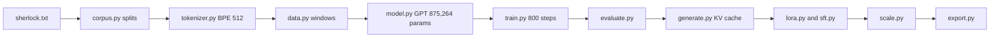
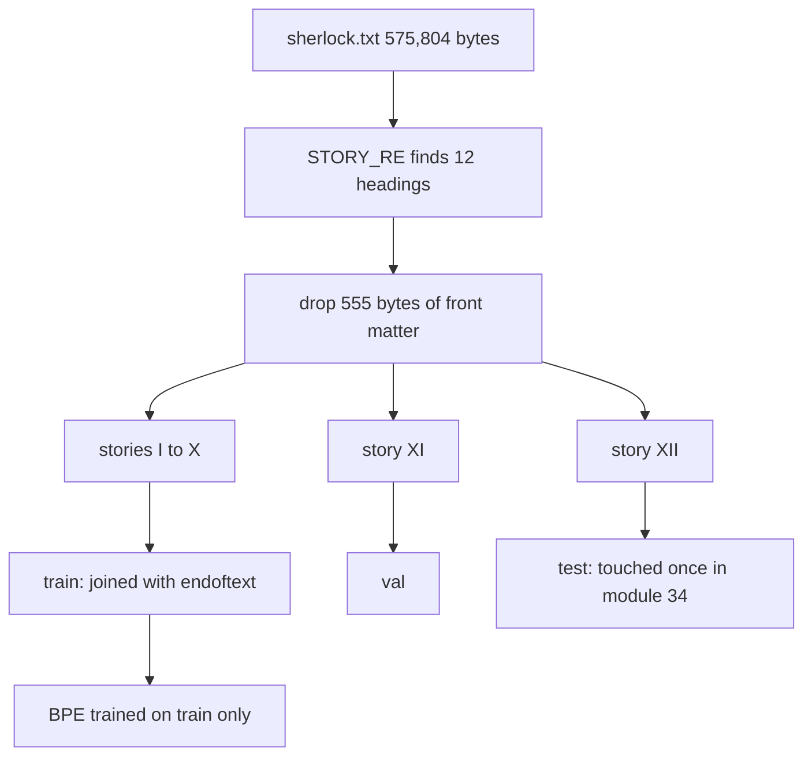

# 30 — Corpus and a Byte-Level BPE Tokenizer

> **Prerequisites:** modules 01–29 (especially 02, 04 and 14).
> **You will learn:** how to turn a public-domain book into a reproducible, licensed, hash-verified training corpus; why splits must be made by document (story), not by random offsets, and how leakage sneaks into tokenizers; byte-level BPE from first principles: pre-tokenization, pair counting on a chunk table, deterministic tie-breaking, merge application; special tokens, encode/decode round trips, compression ratio as the tokenizer's first metric; how a tokenizer artifact is versioned (hashes, pattern, merges) so a checkpoint can never be paired with the wrong vocabulary.

Modules 30–38 use everything from 01–29 on one object: a small GPT trained from nothing on a book, then evaluated, sampled with a KV cache, fine-tuned with LoRA, scaled across processes, exported and quantized. Every step consumes integer token ids, so the capstone starts where every language model starts: text, a license, and a function from bytes to ids.

There is no `nn.Module` here. A leaking split, a non-deterministic tokenizer or an unmatchable vocabulary file crashes nothing; it silently corrupts every number in modules 33–38. The tools are familiar: dtypes (02), `bincount` (04), determinism (06), splits ([14](./14-data-pipelines.md)), hashes ([16](./16-training-loop-checkpointing.md)), property tests (18).

---

## 30.1 What we are about to build, and the map of modules 30–38

**30** commits the corpus and a 512-id tokenizer. **31** turns splits into `int64` token windows. **32** writes the GPT and audits its parameters. **33** pretrains on CPU and commits weights with a manifest naming this module's tokenizer hash. **34** measures perplexity and bits per byte against baselines. **35** adds sampling and the KV cache. **36** fine-tunes with LoRA. **37** profiles, compiles and distributes the recipe. **38** exports, quantizes and serves.



| Fixed number | Value | Decided in |
|---|---|---|
| Vocabulary `V` | 512 = 256 bytes + 255 merges + 1 special | 30 |
| Train tokens | 217,572 (stories I–X, measured) | 30 |
| `block_size`, `L`, `H`, `d_model` | 128, 4, 4, 128 | 32 |
| Parameters `P` | 875,264 | 32 |
| Full pretraining | 800 steps, ≈ 55 s on an M-series laptop | 33 |

Honest scope: a 0.9M-parameter model on half a megabyte of Victorian prose demonstrates every mechanism of LLM training. It is not a useful language model, and we judge it against baselines, never against GPT-2.

## 30.2 Choosing and licensing a corpus

The corpus is *The Adventures of Sherlock Holmes*, Project Gutenberg eBook [#1661](https://www.gutenberg.org/ebooks/1661). It is public domain in the USA (published 1892) and in life+70 jurisdictions (Conan Doyle died in 1930). It is small (575,804 bytes after stripping), its twelve self-contained stories are natural document boundaries, and it is almost, but not entirely, ASCII:

| Character | Count | UTF-8 bytes |
|---|---|---|
| `“` | 2,764 | `e2 80 9c` |
| `”` | 2,325 | `e2 80 9d` |
| `’` | 1,051 | `e2 80 99` |
| `‘` | 434 | `e2 80 98` |
| `—` | 191 | `e2 80 94` |
| `£` | 37 | `c2 a3` |
| `é` | 12 | `c3 a9` |
| `æ œ ½ à â è` | 6, 2, 1, 1, 1, 1 | 2 bytes each |

The file contains zero straight ASCII quotes. Every apostrophe is `’`, so the contraction rule of the GPT-2 pattern (30.5) never fires on this corpus.

Gutenberg wraps the text in a header and footer carrying its license and trademark. The [license page](https://www.gutenberg.org/policy/license.html) states that once these are stripped, the trademark terms no longer apply: what remains is a public-domain text, not a "Project Gutenberg" eBook. We strip both, and the test asserts "PROJECT GUTENBERG" is gone.

## 30.3 Producing `sherlock.txt` reproducibly

`prepare` in [`30_build_tokenizer.py`](./code/30_build_tokenizer.py) decodes the download as UTF-8, refuses any bare `\r`, converts `\r\n` to `\n`, keeps the lines strictly between the line starting `*** START OF THE PROJECT GUTENBERG EBOOK` and the line starting `*** END OF THE PROJECT GUTENBERG EBOOK`, and joins them with `\n` plus one final `\n`. The equivalent `sed -n '28,11959p' pg1661.txt | tr -d '\r'` gives the same hash. Markers are found by content, not line number, so a longer header still strips correctly.

`sherlock_provenance.json` records two hashes that answer different questions:

| Field | Value | Answers |
|---|---|---|
| `source_sha256` | `922e2a12…7cd0` (607,606 bytes) | What did we download on 2026-10-10? |
| `output_sha256` | `3552d466…43b3` (575,804 bytes, 562,213 chars) | What exactly is committed and trained on? |

The source hash records a retrieval, not an eternal identity: Gutenberg re-releases files. If a later download hashes differently, `prepare` warns and refuses to overwrite without `--force`. The output hash is the identity everything else relies on: `llm.corpus.CORPUS_SHA256` holds it, `load_corpus()` verifies it on every load, and CI never downloads, only re-hashes.

## 30.4 Splitting by story, not by offset

Stories are found with a multiline regex:

```python
STORY_RE = re.compile(r"^(I|II|III|IV|V|VI|VII|VIII|IX|X|XI|XII)\. [A-Z][A-Z’' -]+$", re.M)
```

The contents list is indented (`   I.     A Scandal in Bohemia`), so `^` skips it and exactly twelve headings match. The class contains `’` because of `IX. THE ADVENTURE OF THE ENGINEER’S THUMB`. With only `'`, IX would vanish and VIII would silently absorb it. `split_stories` raises unless it finds I…XII in order. Each story runs from its heading to the next, so twelve stories plus 555 bytes of front matter (title and contents, dropped) partition the file.

| Story | Bytes | Split |
|---|---|---|
| I A Scandal in Bohemia | 47,838 | train |
| II The Red-Headed League | 50,567 | train |
| III A Case of Identity | 38,751 | train |
| IV The Boscombe Valley Mystery | 52,462 | train |
| V The Five Orange Pips | 40,402 | train |
| VI The Man with the Twisted Lip | 50,248 | train |
| VII The Blue Carbuncle | 43,341 | train |
| VIII The Speckled Band | 54,100 | train |
| IX The Engineer’s Thumb | 45,650 | train |
| X The Noble Bachelor | 45,372 | train |
| XI The Beryl Coronet | 52,164 | val |
| XII The Copper Beeches | 54,354 | test |

Train joins I–X with `<|endoftext|>` (468,848 bytes including nine separators). The test split is evaluated exactly once, in module 34.

A random offset split puts sentence *k* of a scene in train and *k+1* in val, crediting the model for memorizing the scene. A held-out story is genuinely unseen prose by the same author.

Leakage also enters through the tokenizer, which is a learned model. We measured it: a tokenizer trained on all twelve stories compresses val at 2.2017 bytes/token, against 2.1874 for the train-only tokenizer, about 0.7 % better. A 512-id vocabulary can only hold frequent, generic fragments, so the effect is small here. A 50k vocabulary fitted on val would hold val-specific names as single tokens. The rule costs nothing: everything learned, tokenizer included, sees train only.



## 30.5 Byte-level BPE from first principles

UTF-8 turns any string into integers in 0–255. A vocabulary whose first 256 ids are the byte values can therefore represent every input. There is no `<unk>` and no normalization, and `decode(encode(s)) == s` holds exactly. The cost is length, and attention cost grows with its square. Byte Pair Encoding ([Sennrich, Haddow and Birch 2015](https://arxiv.org/abs/1508.07909)) buys length back by repeatedly merging the most frequent adjacent pair into a new id. For the history (WordPiece, Unigram, vocabulary size) see [Transformers module 02](../transformers/02-tokenization-and-embeddings.md), its smaller sibling [`train_bpe.py`](/courses/transformers/code/train_bpe.py), and the notes on [text preprocessing](../../notes/nlp/text-preprocessing.md) and [language models](../../notes/nlp/language-models.md).

GPT-2 ([Radford et al. 2019](https://cdn.openai.com/better-language-models/language_models_are_unsupervised_multitask_learners.pdf)) added pre-tokenization: a regex splits text into chunks and merges never cross a chunk boundary. GPT-2's [`encoder.py`](https://github.com/openai/gpt-2/blob/9b63575ef42771a015060c964af2c3da4cf7c8ab/src/encoder.py) needs the third-party `regex` module for `\p{L}`/`\p{N}`. We use stdlib `re` and an ASCII version:

```python
PATTERN = r"'(?:[sdmt]|ll|ve|re)| ?[A-Za-z]+| ?[0-9]{1,3}| ?[^\sA-Za-z0-9]+|\s+(?!\S)|\s+"
```

`re` takes the first alternative that matches at each position:

| Alternative | Example chunks | Purpose |
|---|---|---|
| `'(?:[sdmt]\|ll\|ve\|re)` | `'s`, `'ll` | contractions (never fires here) |
| ` ?[A-Za-z]+` | `Holmes`, ` pipe` | a word with at most one leading space |
| ` ?[0-9]{1,3}` | ` 189`, `2` | at most 3 digits, so years do not eat the vocabulary |
| ` ?[^\sA-Za-z0-9]+` | `—`, `.”`, `é` | punctuation runs and every non-ASCII character |
| `\s+(?!\S)` | `\n ` | whitespace, leaving the last space for the next word |
| `\s+` | final whitespace | the rest |

Without chunks, the vocabulary fills with word-straddling fragments like `s H`. With them, ` Holmes` can become one token (it does, id 412) and `s H` cannot exist. Every character falls into some alternative, so `"".join(re.findall(PATTERN, s)) == s` for any string. The ASCII classes have a cost that fence 4 shows: ` café` splits into ` caf` and `é`. That is acceptable for this English corpus and wrong for a multilingual model.

## 30.6 Training: counting pairs on a chunk table

The train text has 112,090 chunks but only 9,756 distinct ones. The trainer in [`llm/tokenizer.py`](./code/llm/tokenizer.py) exploits that:

1. Split on `<|endoftext|>` (never trained on) and count chunk frequencies once with `Counter(re.findall(PATTERN, segment))`.
2. Store each distinct chunk as a list of byte ids with its frequency.
3. Repeat 255 times: count adjacent pairs weighted by frequency; choose `min(pairs, key=lambda p: (-count[p], p))`; replace non-overlapping occurrences left to right in every chunk; assign the next id.

The key `(-count, pair)` is the whole determinism story. The highest count wins, and ties go to the numerically smallest `(a, b)`. Merges are then a function of the chunk multiset only, never of dict order or hash seeds. [minbpe's `basic.py`](https://github.com/karpathy/minbpe/blob/1acefe89412b20245db5a22d2a02001e547dc602/minbpe/basic.py) uses `max(stats, key=stats.get)`, which breaks ties by insertion order, so reordering the input can change its merges.

Hand trace on `low low low lower lowest newer newest` (chunks `low`, ` low`×2, ` lower`, ` lowest`, ` newer`, ` newest`; 37 bytes):

| Step | Pair | Weighted count | New id | Tokens |
|---|---|---|---|---|
| 1 | `l` + `o` | 5 | 256 = `lo` | 37 → 32 |
| 2 | `lo` + `w` | 5 | 257 = `low` | 32 → 27 |
| 3 | ` ` + `low` | 4 | 258 = ` low` | 27 → 23 |

Step 1 is a tie with `(o, w)`, also 5, and `(108, 111) < (111, 119)` decides it. Step 3 counts 4, not 5, because the first `low` has no leading space and is a different chunk.

Merging is non-overlapping and left to right: `aaaa` with pair `(a, a)` becomes `[256, 256]`, and `aaa` becomes `[256, a]`. The counter still reports 3 windows in `aaaa`. That overcount is standard (minbpe does the same) and only affects runs of a repeated symbol.

Each merge step scans the unique-chunk table, 71,043 byte positions instead of 468,848, and a C-speed `a in ids` test skips chunks that cannot contain the pair. On an Apple M2 Pro, 255 merges took 2.96–3.16 s (four local runs). The naive variant, recounting the whole corpus as one id list, measured 0.041 s per merge (≈ 10.5 s total) and learns cross-word merges.

## 30.7 Encoding, decoding, and special tokens

Encoding a chunk replays training: find the adjacent pair with the lowest merge id; if none is a merge, stop; otherwise replace all its non-overlapping occurrences and repeat. Applying merges in rank order reproduces exactly what training did to that chunk. A cache from chunk string to ids makes corpus encoding cheap: all three splits take 0.11–0.29 s locally.

Decoding concatenates `token_bytes(id)` for every id and only then decodes UTF-8 with `errors="replace"`. Tokens are byte strings, not characters. The fifth merge learned is `(0xE2, 0x80)`, the shared prefix of every curly quote and dash, a token worth two thirds of a character. Decoded alone it gives U+FFFD; followed by `0x9C` it gives `“`. In streaming generation (module 35) you therefore cannot print `decode([id])` per step. You must buffer bytes until they form complete UTF-8 sequences.

`<|endoftext|>` is id 511. No merge can produce it, because merges only receive ids 256–510. `encode(text, allowed_special={"<|endoftext|>"})` splits on the literal first and inserts 511 between pieces; module 31 uses this on joined stories. Without permission, the thirteen characters are ordinary bytes, so user text can never inject a document boundary or, in a chat model, a role token. [tiktoken](https://github.com/openai/tiktoken/blob/0.9.0/tiktoken/core.py) instead raises by default on disallowed special text; we encode it as bytes because a book may legitimately contain the string.

## 30.8 Measuring the tokenizer

One local PyTorch 2.8 CPU run (Apple M2 Pro) produced:

| Split | Bytes | Tokens | Bytes/token |
|---|---|---|---|
| train (I–X, 9 EOT) | 468,848 | 217,572 | 2.1549 |
| val (XI) | 52,164 | 23,848 | 2.1874 |
| test (XII) | 54,354 | 25,216 | 2.1555 |

Bytes per token sets sequence length and compute per document, and module 34 uses it to convert nats per token into bits per byte. Val compresses about 1.5 % worse than train. That is the tokenizer's own generalization gap, since merges were fitted to train. Test happens to match train, a reminder that one story is a noisy sample.

| Id | Pair | Count | Id | Pair | Count |
|---|---|---|---|---|---|
| 256 | ` ` + `t` | 10,557 | 261 | ` ` + `w` | 5,498 |
| 257 | `h` + `e` | 9,389 | 262 | ` ` + `s` | 5,062 |
| 258 | ` ` + `a` | 8,226 | 263 | ` t` + `he` | 4,879 |
| 259 | `i` + `n` | 6,225 | 264 | `r` + `e` | 4,584 |
| 260 | `0xE2` + `0x80` | 5,589 | 265 | `h` + `a` | 4,575 |

Id 263, ` the`, is the first merge of two merges. The twenty longest tokens are ` Holmes`, ` little`, ` which`, ` there`, ` would`, ` that`, ` with`, ` have`, `olmes`, ` said`, ` from`, ` upon`, ` this`, ` your`, ` been`, ` very`, ` were`, ` some`, `ittle` and `ather`. None exceeds seven bytes. `olmes` survives on its own because `Holmes` after an opening quote has no leading space: `“Holmes”` encodes as `“`, `H`, `olmes`, `”`. Counting train ids with `torch.bincount(ids, minlength=512)` shows 170 ids never used, all raw bytes (only 86 byte values occur). Their embedding rows in module 32 get no gradient from the loss, only weight decay.

`--compare-hf` trains a Hugging Face `tokenizers` 0.22.1 ByteLevel BPE on the same stories at vocabulary 512: 2.1549 bytes/token on train and 2.1879 on val, within 0.03 % of ours, in 0.08 s. Its ids differ (Unicode pre-tokenizer, byte-to-unicode remapping, other tie-breaks). It runs only in the lab and is skipped if `tokenizers` is absent.

## 30.9 The artifact: versioning a tokenizer

`bpe_sherlock_512.json` is the entire tokenizer:

```json
{
 "version": 1,
 "pattern": "'(?:[sdmt]|ll|ve|re)| ?[A-Za-z]+| ...",
 "vocab_size": 512,
 "special_tokens": {"<|endoftext|>": 511},
 "train_sha256": "e6e9e3dd…437e",
 "merges": [[32, 116], [104, 101], [32, 97], "... 255 pairs in rank order"]
}
```

Ordered merges suffice to rebuild the id→bytes table. `load` rejects a foreign `PATTERN`, merges referencing undefined ids and an inconsistent `vocab_size`; `check` fails if the train split no longer hashes to `train_sha256`.

An embedding row means " Holmes" only through this map. Pair a checkpoint with a tokenizer whose id 412 is something else, and nothing errors. The model emits garbage while the loss still looks plausible, because every id is valid. So module 33's manifest stores this file's sha256 and `load_pretrained` refuses a mismatch. Industrial stacks do the same: tiktoken pins each vocabulary file with an `expected_hash` in [`openai_public.py`](https://github.com/openai/tiktoken/blob/0.9.0/tiktoken_ext/openai_public.py), and Hugging Face ships `tokenizer.json` beside the weights.

## Reconciling the sources

**minbpe.** Its [`regex.py`](https://github.com/karpathy/minbpe/blob/1acefe89412b20245db5a22d2a02001e547dc602/minbpe/regex.py) trains on every chunk occurrence with the `regex` package and the GPT-4 pattern. We use stdlib `re`, an ASCII pattern and a frequency table. Identical chunks give identical pair counts, so merges match except where tie-breaks differ.

**Raschka, chapter 2** uses tiktoken's pretrained GPT-2 tokenizer. Its [bonus notebook](https://github.com/rasbt/LLMs-from-scratch/blob/cdbd33e6d57a71e20ea31434841095fac50cecd8/ch02/05_bpe-from-scratch/bpe-from-scratch.ipynb) implements training separately. A 50,257-id vocabulary at `d_model = 128` would be a 6.4M-parameter embedding, about 8× the rest of our model, which is why the capstone trains its own 512-id tokenizer.

**GPT-2's `bytes_to_unicode`** remaps bytes to printable characters so vocabulary files are readable text. It is a serialization trick, not part of the algorithm, so we store raw integer pairs.

## Worked tokenizer verification

**Fence 1: a complete BPE by hand.** This fence trains three merges on the toy text and asserts the 30.6 trace table, 37 → 23 compression and an exact round trip. It proves the tie-break and chunk weighting, but not the Sherlock artifact; the lab test covers that.

```python pytorch-check
import re
from collections import Counter

PATTERN = r"'(?:[sdmt]|ll|ve|re)| ?[A-Za-z]+| ?[0-9]{1,3}| ?[^\sA-Za-z0-9]+|\s+(?!\S)|\s+"

def merge(ids, pair, new_id):
    out, i = [], 0
    while i < len(ids):
        if i + 1 < len(ids) and (ids[i], ids[i + 1]) == pair:
            out.append(new_id); i += 2
        else:
            out.append(ids[i]); i += 1
    return out

def train(text, n_merges):
    freq = Counter(re.findall(PATTERN, text))          # chunk -> frequency, counted once
    table = [(list(c.encode("utf-8")), n) for c, n in freq.items()]
    merges, trace = {}, []
    for k in range(n_merges):
        pairs = Counter()
        for ids, n in table:
            for p in zip(ids, ids[1:]):
                pairs[p] += n                            # weighted by chunk frequency
        best = min(pairs, key=lambda p: (-pairs[p], p))  # highest count, then smallest pair
        merges[best] = 256 + k
        trace.append((best, pairs[best]))
        table = [(merge(ids, best, 256 + k), n) for ids, n in table]
    return merges, trace

def encode(text, merges):
    out = []
    for chunk in re.findall(PATTERN, text):
        ids = list(chunk.encode("utf-8"))
        while len(ids) > 1:
            p = min(zip(ids, ids[1:]), key=lambda q: merges.get(q, 1 << 30))
            if p not in merges:
                break
            ids = merge(ids, p, merges[p])
        out.extend(ids)
    return out

text = "low low low lower lowest newer newest"
merges, trace = train(text, 3)
assert trace == [((ord("l"), ord("o")), 5), ((256, ord("w")), 5), ((ord(" "), 257), 4)]
vocab = [bytes([i]) for i in range(256)] + [b""] * 3
for (a, b), i in merges.items():
    vocab[i] = vocab[a] + vocab[b]
ids = encode(text, merges)
assert len(text.encode()) == 37 and len(ids) == 23
assert b"".join(vocab[i] for i in ids).decode("utf-8") == text
print("merges:", [(vocab[256 + k], c) for k, (_, c) in enumerate(trace)], "| 37 bytes -> 23 tokens")
```

**Fence 2: non-overlapping merges, and pair counting with tensors.** Three windows are counted in `aaaa` but only two merges happen. Encoding pairs as `a·V + b` and calling `torch.bincount` (module 04) is how a tensor implementation would count them. Ragged chunk lists are why our trainer stays in Python.

```python pytorch-check
import torch

def merge(ids, pair, new_id):
    out, i = [], 0
    while i < len(ids):
        if i + 1 < len(ids) and (ids[i], ids[i + 1]) == pair:
            out.append(new_id); i += 2
        else:
            out.append(ids[i]); i += 1
    return out

assert merge([97, 97, 97, 97], (97, 97), 256) == [256, 256]
assert merge([97, 97, 97], (97, 97), 256) == [256, 97]     # leftmost match wins

V = 257                                                     # pair (a, b) -> code a*V + b
ids = torch.tensor([97, 97, 97, 97], dtype=torch.int64)
counts = torch.bincount(ids[:-1] * V + ids[1:], minlength=V * V)
assert counts[97 * V + 97].item() == 3                      # 3 windows counted, 2 merges
print("aaaa: pair count 3, after merge ->", merge([97] * 4, (97, 97), 256))
```

**Fence 3: UTF-8 boundaries and dtypes.** `“Holmes”` is 8 characters and 12 bytes. A 2-byte prefix decodes to U+FFFD, and decoding pieces separately differs from decoding their concatenation. Bytes fit `torch.uint8`, but ids above 255 do not. That is why ids are `torch.int64` in memory, the index dtype `nn.Embedding` expects ([tensor attributes](https://docs.pytorch.org/docs/2.8/tensor_attributes.html)).

```python pytorch-check
import torch

s = "“Holmes”"
b = s.encode("utf-8")
assert len(s) == 8 and len(b) == 12                # curly quotes are 3 bytes each
assert list(b[:3]) == [0xE2, 0x80, 0x9C]
assert b[:2].decode("utf-8", errors="replace") == "�"
assert b.decode("utf-8") == s

t = torch.tensor(list(b), dtype=torch.uint8)       # bytes fit uint8 ...
assert bytes(t.tolist()).decode("utf-8") == s
try:
    torch.tensor([511], dtype=torch.uint8)         # ... token ids do not
    overflowed = False
except RuntimeError:
    overflowed = True
assert overflowed and t.to(torch.int64).dtype == torch.int64

tokens = [b[:2], b[2:3], b[3:9], b[9:]]            # first "token" is a 2-byte prefix
piecewise = "".join(tok.decode("utf-8", errors="replace") for tok in tokens)
assert piecewise != s and b"".join(tokens).decode("utf-8") == s
print("piecewise:", piecewise, "| joined:", b"".join(tokens).decode("utf-8"))
```

**Fence 4: the pre-tokenizer.** This fence asserts the exact chunks for a sentence that exercises every rule except contractions, and shows two places where ASCII classes diverge from GPT-2's Unicode ones.

```python pytorch-check
import re

PATTERN = r"'(?:[sdmt]|ll|ve|re)| ?[A-Za-z]+| ?[0-9]{1,3}| ?[^\sA-Za-z0-9]+|\s+(?!\S)|\s+"
text = "Holmes's 1892 pipe—\n  smoke"
chunks = re.findall(PATTERN, text)
assert chunks == ["Holmes", "'s", " 189", "2", " pipe", "—", "\n ", " smoke"], chunks
assert "".join(chunks) == text                    # lossless: every character lands in a chunk
# Unicode letters are not [A-Za-z]: "é" falls into the punctuation-like class.
assert re.findall(PATTERN, " café") == [" caf", "é"]
# The curly apostrophe is not "'", so the contraction rule does not fire.
assert re.findall(PATTERN, "Holmes’s") == ["Holmes", "’", "s"]
print(chunks)
```

## Lab: build the corpus and train the tokenizer

Tested with Python 3.11 and PyTorch 2.8.0 on CPU.

```bash
python content/courses/pytorch/code/30_build_tokenizer.py check
python content/courses/pytorch/code/30_build_tokenizer.py train --out /tmp/bpe.json
python site/test_pytorch_30_tokenizer.py
```

`check` (the default) retrains in memory, asserts the merges equal the committed artifact pair for pair, verifies every hash and returns the 30.8 statistics (`--json-out PATH` saves them). `train` writes a fresh artifact. [`llm/corpus.py`](./code/llm/corpus.py) and `llm/tokenizer.py` are standard-library only; modules 31–38 import them, so their public names are frozen.

The corpus was produced once, offline, and CI never rebuilds it:

```bash
curl -L -o /tmp/pg1661.txt https://www.gutenberg.org/cache/epub/1661/pg1661.txt
python content/courses/pytorch/code/30_build_tokenizer.py prepare --source /tmp/pg1661.txt
```

The test shares one retrain (in `setUpModule`) across ten tests: corpus and provenance hashes, the twelve headings, exact merge reproduction, round trips on every split and on adversarial strings (empty, `"\x00"`, a lone combining accent, an emoji ZWJ sequence, the EOT literal without permission), EOT → `[511]` only with permission, val bytes/token in [1.9, 2.5], determinism and `load(save(tok)) == tok`. Locally it took 5.8 s, mostly the retrain.

Scope: the pre-tokenizer is ASCII and English-oriented, there is no Unicode normalization (NFC and NFD `é` encode differently), and there is one special token. It is exact and deterministic, not a production tokenizer.

## Key takeaways

- **A corpus is code plus hashes.** Record downloaded and committed sha256 separately; CI verifies the committed one.
- **Split by document.** Story-level splits prevent scene leakage; the tokenizer sees train only.
- **Byte-level means total.** 256 byte ids encode anything exactly; merges buy back length (2.15 bytes/token).
- **Merge on a chunk-frequency table.** 9,756 unique chunks make 255 merges take about 3 s in pure Python.
- **Determinism is a tie-break.** `(-count, pair)` makes merges a function of the data alone.
- **Decode bytes, not tokens.** A token can be part of a character; streaming output must buffer.
- **Version the vocabulary.** Checkpoints store the tokenizer artifact's hash.

## Self-check

1. A colleague trains the tokenizer on all 12 stories, then reports val perplexity. Name two distinct ways this leaks information, and which one matters more for a 512-token vocabulary.
2. Why can `decode([id])` for a single token produce a replacement character while decoding the full sequence is exact? What does this imply for streaming generation output?
3. Your BPE trainer is non-deterministic across Python processes. What in a dict-of-counts implementation can cause that, and how does the `(-count, pair)` key fix it?

---

**Next →** [31 — Token Datasets and the Training Data Pipeline](./31-capstone-data-pipeline.md)
