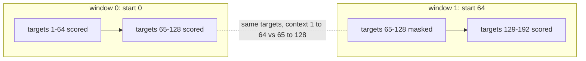

# 31 — Token Datasets and the Training Data Pipeline

> **Prerequisites:** modules 14 and 30.
> **You will learn:** how a next-token objective turns one long id stream into `(x, y)` pairs with `y` shifted by one; random-window training sampling vs sequential evaluation windows, and how stride changes what loss means; storing token streams compactly (`uint16`, memmap) and why the dtype assert matters; seeding loaders so a run can resume at step k and see exactly the batches it would have seen; where document boundaries go and what attending across `<|endoftext|>` implies.

[Module 30](./30-capstone-corpus-and-tokenizer.md) left three strings and a tokenizer. A GPT wants `(B, T)` tensors of `torch.int64` inputs and targets, drawn reproducibly and resumable after a crash. This module writes [`llm/data.py`](./code/llm/data.py) and audits it: token counts, bytes on disk, how many windows straddle a story boundary, whether evaluation scores each token exactly once, and whether batch 7 after a resume is bit-identical to batch 7 of an uninterrupted run.

None of the bugs here crash. An off-by-one window trains the model to copy its input; an evaluation that drops the tail or double-scores an overlap measures a different dataset; a replay-based resume costs a batch per step already taken.

---

## 31.1 From a string to a supervised dataset

Take $T + 1$ consecutive ids $t_0, \dots, t_T$. The input is $x = (t_0, \dots, t_{T-1})$, the target is $y = (t_1, \dots, t_T)$, and position $i$ predicts $t_{i+1}$ from $t_0, \dots, t_i$: $T$ classification problems over $V = 512$ classes per window. A real window from the committed tokenizer, `T = 8`:

| Position $i$ | 0 | 1 | 2 | 3 | 4 | 5 | 6 | 7 |
|---|---|---|---|---|---|---|---|---|
| $x_i$ (id) | 84 | 111 | 372 | 347 | 435 | 425 | 412 | 451 |
| $x_i$ (bytes) | `T` | `o` | ` S` | `her` | `lo` | `ck` | ` Holmes` | ` she` |
| $y_i$ (id) | 111 | 372 | 347 | 435 | 425 | 412 | 451 | 328 |
| context seen | 1 | 2 | 3 | 4 | 5 | 6 | 7 | 8 |

Position 5 sees `To Sherlock` and must put probability on ` Holmes`; position 0 sees one token. One window yields eight signals with eight context lengths, which is why the GPT returns `(B, T, V)` logits, not `(B, V)`. The causal mask and teacher forcing that make this work are derived in [transformers 08](../transformers/08-encoder-decoder-masking.md). The pipeline's only obligation is the shift contract, $y_{:,i} = x_{:,i+1}$ for $i < T-1$ with $y_{:,T-1}$ the token after the window, i.e. `torch.equal(y[:, :-1], x[:, 1:])`. The objective itself is covered in the [language-model notes](../../notes/nlp/language-models.md).

## 31.2 Encoding splits once and storing them compactly

`load_split_tokens(split, tokenizer)` joins the split's stories with module 30's `join_with_eot`, encodes with `allowed_special={"<|endoftext|>"}` so the marker becomes id 511, and returns a 1-D `torch.int64` tensor. `encode_all_splits(tokenizer)` encodes all three once per process (0.11 s locally), memoised by merges and pattern, and returns clones so a caller writing into its tensor cannot poison the cache.

| Split | Stories | Tokens | EOT ids | `uint16` on disk | `int64` in memory |
|---|---|---|---|---|---|
| train | I–X | 217,572 | 9 | 435,144 B (425.0 KiB) | 1.66 MiB |
| val | XI | 23,848 | 0 | 47,696 B (46.6 KiB) | 186.3 KiB |
| test | XII | 25,216 | 0 | 50,432 B (49.3 KiB) | 197.0 KiB |

The counts are deterministic given the committed corpus and tokenizer; the syllabus's pre-tokenizer estimates (217,375 / 23,838 / 25,203) are within 0.1 %, and the test allows ±2 %.

**Two dtypes.** On disk, `uint16`: $V = 512 \le 65{,}535$, so two bytes per token. In memory, `int64`: on 2.8, `nn.Embedding` rejects `uint16` indices ("Expected tensor for argument #1 'indices' to have one of the following scalar types: Long, Int") and `F.cross_entropy` rejects even `int32` targets ("expected scalar type Long but found Int"), both checked locally. Converting the whole split at load time costs 1.66 MiB here; converting per batch is the only option when the stream exceeds RAM.

**The assert.** Casts do not check range: `torch.tensor([70000]).to(torch.uint16)` is `4464` (70,000 mod 65,536), silently, and NumPy's `astype(np.uint16)` agrees. nanoGPT's `prepare.py` can use `uint16` only because GPT-2's largest id is 50,256, as its own comment says. A tokenizer with $V > 65{,}535$ written through that path yields a file that loads cleanly and trains on garbage. `save_uint16` calls `check_uint16_range` (raises `ValueError` outside 0..65,535), then writes raw little-endian bytes via a temp file and `os.replace`, atomic as in [module 16](./16-training-loop-checkpointing.md). Past 65,535 the file must become `uint32` and every reader must know it, so real pipelines store the dtype next to the bytes.

**The scaling path.** nanoGPT's `get_batch` reopens `train.bin` as `np.memmap(..., dtype=np.uint16, mode='r')` every call, slices `B` windows and converts only those with `.astype(np.int64)` ([train.py at 3adf61e](https://github.com/karpathy/nanoGPT/blob/3adf61e154c3fe3fca428ad6bc3818b27a3b8291/train.py), lines 116–125). The OS pages in only touched bytes, so a 20 GB token file costs no RAM up front, and only `B·(T+1)` ids are copied. The torch-native equivalent is `torch.from_file(path, shared=False, size=n, dtype=torch.uint16)`, a tensor whose storage is the file mapped `MAP_PRIVATE`, loaded lazily ([torch.from_file](https://docs.pytorch.org/docs/2.8/generated/torch.from_file.html)). Our splits are small, so `load_uint16` copies to `int64`. The `.bin` files are never committed: they are a pure function of two hashed artifacts.

## 31.3 Training windows: random offsets

A stream of $n$ ids holds $n - T$ windows of $T + 1$ tokens. Raschka's `GPTDatasetV1` precomputes chunks at `range(0, len(token_ids) - max_length, stride)` and shuffles them ([ch02.ipynb at cdbd33e](https://github.com/rasbt/LLMs-from-scratch/blob/cdbd33e6d57a71e20ea31434841095fac50cecd8/ch02/01_main-chapter-code/ch02.ipynb)); nanoGPT draws `torch.randint(len(data) - block_size, (batch_size,))` offsets every step. We follow nanoGPT. With fixed chunks at stride $T$, the target at index 129 is always predicted from one token of context; random offsets put every token at every position over training.

### Windows without copies

`tokens.unfold(0, T + 1, 1)` returns shape `(n - T, T + 1)` with strides `(1, 1)`: every window at once, as a view of the same storage, by header arithmetic ([module 03](./03-storage-strides-views-copies.md), [`Tensor.unfold`](https://docs.pytorch.org/docs/2.8/generated/torch.Tensor.unfold.html)). For train, 28.05 M logical elements over 217,572 stored ones. It equals `tokens.as_strided((n - T, T + 1), (1, 1))`; `unfold` is preferred because it computes the legal size, whereas a wrong `as_strided` size silently reads other memory or raises. Indexing the view with a `(B,)` offset tensor is advanced indexing ([module 04](./04-indexing-broadcasting-shapes.md)): it copies exactly the `B` chosen rows. `x` and `y` are overlapping views of that copy, made contiguous so `y.view(-1)` works in the loss:

```python
def get_batch(tokens, block_size, batch_size, generator):
    offsets = torch.randint(0, tokens.numel() - block_size, (batch_size,), generator=generator)
    windows = tokens.unfold(0, block_size + 1, 1)[offsets]   # view, then a (B, T+1) copy
    return windows[:, :-1].contiguous(), windows[:, 1:].contiguous()
```

It is not measurably faster than nanoGPT's slices plus `torch.stack`: over three local runs of 1,000 batches at `(32, 128)` (Apple M2 Pro, 4 threads), slice-and-stack took 45–70 µs and unfold-gather 32–74 µs, order flipping between runs. Both are about a thousandth of a training step (the syllabus probe of module 33's recipe: 800 steps in ≈ 55 s, ≈ 69 ms each). The value of `unfold` is that "all windows" becomes a testable tensor.

`RandomWindowDataset(tokens, block_size, num_samples, seed)` is the same sampling as a map-style `Dataset` for `DataLoader` users ([module 14](./14-data-pipelines.md), [docs](https://docs.pytorch.org/docs/2.8/data.html)): `set_epoch(e)` draws all offsets from `Generator().manual_seed(seed + e)`, so item $i$ depends only on `(seed, e, i)`, not on sampler or workers.

| Data seen by module 33's recipe | Value |
|---|---|
| Steps × batch × block | 800 × 32 × 128 |
| Target tokens predicted | 3,276,800 |
| Passes over train (217,572 tokens) | 15.06 |
| Windows drawn / distinct windows | 25,600 / 217,444 (11.8 %) |

At fifteen passes, expect train loss to keep falling after val loss flattens; [module 34](./34-capstone-evaluation.md) measures that gap.

## 31.4 Evaluation windows: sequential and sliding

Random windows are wrong for evaluation: runs differ, and targets count twice or never. `SequentialEvalDataset(tokens, block_size, stride)` walks the stream in order and yields `(x, y, loss_mask)`, each `(T,)`, the mask `torch.bool`.

**`stride == T`** gives non-overlapping windows at $0, T, 2T, \dots$. Every target is scored once, but each window restarts context at one token: the mean scored target sees $(T + 1)/2 = 64.5$ tokens. The loss is the model's loss *under that context distribution*.

**`stride < T`** starts a window every $s$ tokens. The first $T - s$ positions of each later window re-predict targets already scored, so the mask turns them off and only the last $s$ positions count, each with at least $T - s + 1$ tokens of context.



**The tail.** Starting at multiples of $s$ while a full window fits leaves up to $s - 1$ final targets unscored; Raschka's loop drops them. We add one window right-aligned to the end of the stream, masked to the targets not yet scored. Unlike a short tail window it keeps shape `(T,)`, so batches need no padding, and it gives the last targets full context. A stream shorter than $T + 1$ gets a single window of length $n - 1$. The lab verifies `n_scored == len(tokens) - 1` on val:

| `stride` | Windows on val | Targets scored | Min context after window 0 | Mean context | Forward cost |
|---|---|---|---|---|---|
| 128 | 187 | 23,847 | 1 | 64.5 | 1.0× |
| 64 | 372 | 23,847 | 65 | ≈ 96.5 | ≈ 2.0× |
| 32 | 743 | 23,847 | 97 | ≈ 112.5 | ≈ 4.0× |

The same model scores lower at stride 32 than at 128 because its targets get more context, not because it is better. A loss without its window scheme is underspecified (nanoGPT's `estimate_loss` uses random windows, Raschka's `calc_loss_loader` non-overlapping ones).

## 31.5 Loaders that can resume

A run resumed at step 512 must see batches 512, 513, … exactly as the uninterrupted run would, or the two are different experiments ([module 16](./16-training-loop-checkpointing.md)).

**Stateful sampling.** `RandomSampler` draws a permutation from its generator at each `__iter__`, and with no `generator` it first draws a seed from the global RNG ([sampler.py at v2.8.0](https://github.com/pytorch/pytorch/blob/v2.8.0/torch/utils/data/sampler.py)). Resuming mid-epoch means restoring that RNG state as it was *before* the permutation, recreating the iterator and fast-forwarding past consumed batches. The seed fixes where the random stream starts, not how many draws have been made since; workers and prefetching make that count easy to get wrong, and fast-forwarding costs time proportional to the step.

**Stateless sampling.** Make batch $k$ a pure function of `(seed, k)`. `make_train_loader(tokens, block_size, batch_size, seed, start_step=0)` returns a `TrainBatchIterator` whose `__next__` seeds a fresh `torch.Generator` with `seed * 1_000_003 + step`, calls `get_batch` and increments `step`. Its whole state is `{"step": k, "seed": seed}`, `k` being the next batch; resuming is one integer, with no replay. Since each batch owns its generator, the loader never touches the global RNG, so dropout and init randomness in module 33 stay independent of sampling ([randomness notes](https://docs.pytorch.org/docs/2.8/notes/randomness.html), [module 06](./06-randomness-and-reproducibility.md)).

The prime 1,000,003 exceeds any step count we run, so seeds $a$ and $a + 1$ could only collide at a step ≥ 1,000,003. Adjacent per-step seeds do not give correlated batches: over 2,000 consecutive steps of seed 1337, adjacent batches shared 11 offsets against 9.4 expected by chance (offset correlation −0.0002). The cost is losing a permutation's "each window once per epoch": with $N = 217{,}444$ windows and $m = 25{,}600$ draws, $1 - N(1 - (1 - 1/N)^m)/m \approx 5.7\,\%$ of draws repeat an earlier window, harmless for a language model.

**Why `num_workers=0`.** Workers hide expensive per-sample work (JPEG decoding, augmentation). Here a batch is one `randint` and one gather. Locally, `DataLoader(RandomWindowDataset, batch_size=32)` took 104–109 µs per batch with 0 workers (per-item `__getitem__` plus default collate) and 224–365 µs with 2 workers, plus 0.95–1.6 s to start them, because each batch is pickled across processes. Against a ≈ 69 ms step this is noise, and workers add start-up time, a dataset copy each and a harder resume. Switch when per-batch CPU work nears the step time: slow-disk memmaps, on-the-fly tokenization, object-storage streaming, or a GPU step fast enough that 100 µs matters.

## 31.6 Document boundaries

Nine EOT ids separate train's ten stories. A window containing one asks the model to predict the start of story VI from the end of story V, and causal attention lets the story-VI positions attend across the marker.

| Option | What the model sees | Cost | Used by |
|---|---|---|---|
| (a) Allow straddling | EOT marks the break; attention crosses it | none | nanoGPT ([`prepare.py`](https://github.com/karpathy/nanoGPT/blob/3adf61e154c3fe3fca428ad6bc3818b27a3b8291/data/openwebtext/prepare.py) appends `eot_token` per document) |
| (b) Block-diagonal document mask | attention stays within a document | per-batch mask; `flex_attention` keeps it sparse ([module 12](./12-normalization-dropout-attention-layers.md)) | Llama 3 ([arXiv 2407.21783](https://arxiv.org/abs/2407.21783): "limited impact" in standard pre-training, important for very long sequences) |
| (c) Never straddle | offsets sampled inside one document | lost windows; tokens near ends under-weighted | per-example fine-tuning, e.g. module 36's padded SFT |

We choose (a). The lab finds 0.534 % of the 217,444 possible `T = 128` windows contain an EOT (9 boundaries × 129 covering offsets), about 137 of the 25,600 windows an 800-step run draws, and only the positions after the EOT attend across it. Those windows also teach what follows id 511, which matters when [module 35](./35-capstone-generation-kv-cache.md) samples past an EOT. With ten long documents the contamination is negligible; with millions of short web documents packed into 8k windows it is not, hence (b).

## Worked data-pipeline verification

Each fence re-derives a contract of `llm/data.py` on a tiny stream.

**Fence 1: shift contract and zero-copy windows.** Proves `unfold` windows are a view (same storage pointer, strides `(1, 1)`) equal to the `as_strided` construction, that `x`/`y` obey the shift, and that gathering rows copies. Proves nothing about the real corpus.

```python pytorch-check
import torch

ids = torch.arange(20)
T = 8
w = ids.unfold(0, T + 1, 1)                     # every (T+1)-window, no copy
assert w.shape == (20 - T, T + 1) and w.stride() == (1, 1)
assert w.untyped_storage().data_ptr() == ids.untyped_storage().data_ptr()
assert torch.equal(w, ids.as_strided((20 - T, T + 1), (1, 1)))

x, y = w[:, :-1], w[:, 1:]
assert torch.equal(y[:, :-1], x[:, 1:])          # y is x shifted by one
assert torch.equal(y[:, -1], ids[T:])            # last target comes from the stream
assert not y.is_contiguous()                     # so .view(-1) would fail

batch = w[torch.tensor([0, 5, 11])]              # advanced indexing copies B rows
assert batch.untyped_storage().data_ptr() != ids.untyped_storage().data_ptr()
assert batch.is_contiguous() and batch.shape == (3, T + 1)
print("windows", tuple(w.shape), "strides", w.stride(), "batch", tuple(batch.shape))
```

**Fence 2: sliding-window scoring is exact.** A standalone version of 31.4 on 50 tokens, `T = 16`, stride 8: every target 1…49 is scored exactly once, including by the right-aligned tail window, and after window 0 every scored target has ≥ 9 context tokens. The library class itself is tested on val by the lab test.

```python pytorch-check
import torch

n, T, s = 50, 16, 8
tokens = torch.arange(n)
last = n - 1 - T
starts = list(range(0, last + 1, s))
if starts[-1] != last:
    starts.append(last)                          # right-aligned final window
hits = torch.zeros(n, dtype=torch.int64)
prev_end = 0
for k, b in enumerate(starts):
    y = tokens[b + 1:b + T + 1]
    mask = (b + 1 + torch.arange(T)) > prev_end  # skip targets already scored
    context = torch.arange(T) + 1                # position j sees j + 1 tokens
    if k > 0:
        assert (context[mask] >= T - s + 1).all()
    hits[y[mask]] += 1
    prev_end = b + T
assert hits[0] == 0 and (hits[1:] == 1).all()
assert int(hits.sum()) == n - 1
print("starts", starts, "scored", int(hits.sum()))
```

**Fence 3: seeded, resumable batches.** Batches 5–9 from a loader "resumed" at step 5 equal those of an uninterrupted sweep; another seed differs; and re-seeding one stateful generator after a crash replays batch 0, not batch 5. Restoring the step inside the training loop is module 33's test.

```python pytorch-check
import torch

tokens = torch.arange(1000)
T, B = 16, 4

def batch_at(seed, k):
    g = torch.Generator().manual_seed(seed * 1_000_003 + k)
    off = torch.randint(0, tokens.numel() - T, (B,), generator=g)
    w = tokens.unfold(0, T + 1, 1)[off]
    return w[:, :-1], w[:, 1:]

sweep = [batch_at(1337, k) for k in range(10)]
resumed = [batch_at(1337, k) for k in range(5, 10)]   # restart from step = 5
for a, b in zip(sweep[5:], resumed):
    assert torch.equal(a[0], b[0]) and torch.equal(a[1], b[1])
assert not torch.equal(batch_at(1338, 5)[0], sweep[5][0])

g = torch.Generator().manual_seed(1337)               # stateful sampler
stateful = [torch.randint(0, 984, (B,), generator=g) for _ in range(6)]
g = torch.Generator().manual_seed(1337)               # "restore the seed"
assert torch.equal(torch.randint(0, 984, (B,), generator=g), stateful[0])
assert not torch.equal(stateful[0], stateful[5])      # batch 0, not batch 5
print("resume ok; batch 5 offsets", sweep[5][0][:, 0].tolist())
```

**Fence 4: `uint16` round trip and guard.** 0, 511 and 65,535 survive `torch.uint16` → NumPy → `int64`; an unchecked cast wraps 70,000 to 4,464; the guard raises instead. The file format is tested in the lab test.

```python pytorch-check
import numpy as np
import torch

def check_uint16_range(t):
    if t.numel() and (int(t.min()) < 0 or int(t.max()) > 65_535):
        raise ValueError(f"ids span [{int(t.min())}, {int(t.max())}], need 0..65535")

ids = torch.tensor([0, 511, 65_535])
check_uint16_range(ids)
arr = ids.to(torch.uint16).numpy()
assert arr.dtype == np.uint16 and arr.nbytes == 6
back = torch.from_numpy(arr.astype(np.int64))
assert back.dtype == torch.int64 and torch.equal(back, ids)

big = torch.tensor([70_000])
assert int(big.to(torch.uint16).to(torch.int64)) == 70_000 % 65_536 == 4_464  # silent wrap
try:
    check_uint16_range(big)
    raise AssertionError("guard did not fire")
except ValueError:
    pass
print("uint16 ok; 70000 wraps to", int(big.to(torch.uint16).to(torch.int64)))
```

## Lab: build and audit the token pipeline

Tested with Python 3.11 and PyTorch 2.8.0 on CPU.

```bash
python content/courses/pytorch/code/31_token_pipeline.py
python site/test_pytorch_31_data.py
```

[`31_token_pipeline.py`](./code/31_token_pipeline.py) encodes the splits, writes each as a `uint16` `.bin` to `--output-dir` (default: a removed temporary directory) and reads it back, checks the shift contract on a batch, measures the boundary fraction, counts how often `SequentialEvalDataset` scores each val target at strides 128, 64, 32 and `--stride`, and checks that a loader resumed at step 7 reproduces batches 7–11. `--benchmark` adds the timings quoted in 31.3 and 31.5; it starts worker processes, so CI never passes it. Other flags: `--block-size 128 --batch-size 32 --seed 1337 --json-out PATH`. One local PyTorch 2.8 CPU run on an Apple M2 Pro produced:

| Result key | Value |
|---|---|
| `n_tokens` | train 217,572 · val 23,848 · test 25,216 |
| `uint16_bytes` | 435,144 · 47,696 · 50,432 |
| `boundary_fraction` | 0.00534 (≈ 137 of 25,600 windows per 800 steps) |
| `eval_windows` (stride 64) | 372 windows, 23,847 targets, each scored once |
| `resume_ok` | `true` |
| wall time incl. `import torch` | 1.06 s |

The test runs the lab once and checks split sizes (±2 %) and EOT counts, batch dtype/shape/shift, exact-once scoring at three strides, resume at step 7, seed sensitivity with the global RNG untouched, `set_epoch` determinism, cache isolation, and the `uint16` round trip and guard (1.13 s locally).

Scope: single process, whole corpus in RAM, no streaming from disk at scale, no packing of variable-length documents, sampling with replacement.

## Key takeaways

- **The objective is a shift.** `x = w[:, :-1]`, `y = w[:, 1:]` over `(T + 1)`-token windows: $ predictions with contexts 1…$.
- **All windows are one view.** `tokens.unfold(0, T + 1, 1)` costs no memory; indexing it copies only the batch.
- **`uint16` on disk, `int64` in memory, range checked.** A cast wraps 70,000 to 4,464 silently.
- **Evaluation needs an exact target set.** Stride plus mask plus a right-aligned tail scores each of  - 1$ targets once; stride sets the context distribution, so report it.
- **Batch $ = f(seed, k).** Resume restores one integer and never fast-forwards a sampler.
- **Workers are for expensive samples**, not a 50 µs gather.
- **Boundaries are a choice.** 0.53 % of windows straddle an EOT here; allowing it is standard.

## Self-check

1. Evaluating with non-overlapping windows gives a higher loss than a sliding window with stride 32 on the same model. Is the model worse? Explain what each number measures.
2. Your run crashed at step 512 and you resume from a checkpoint. Which state must the loader restore for the remaining batches to be identical, and why is "the seed" not enough with a stateful sampler?
3. Why store tokens as uint16 on disk but cast to int64 before the embedding? What changes when V grows past 65,535?

---

**Next →** [32 — The GPT Model, Line by Line](./32-capstone-gpt-model.md)
